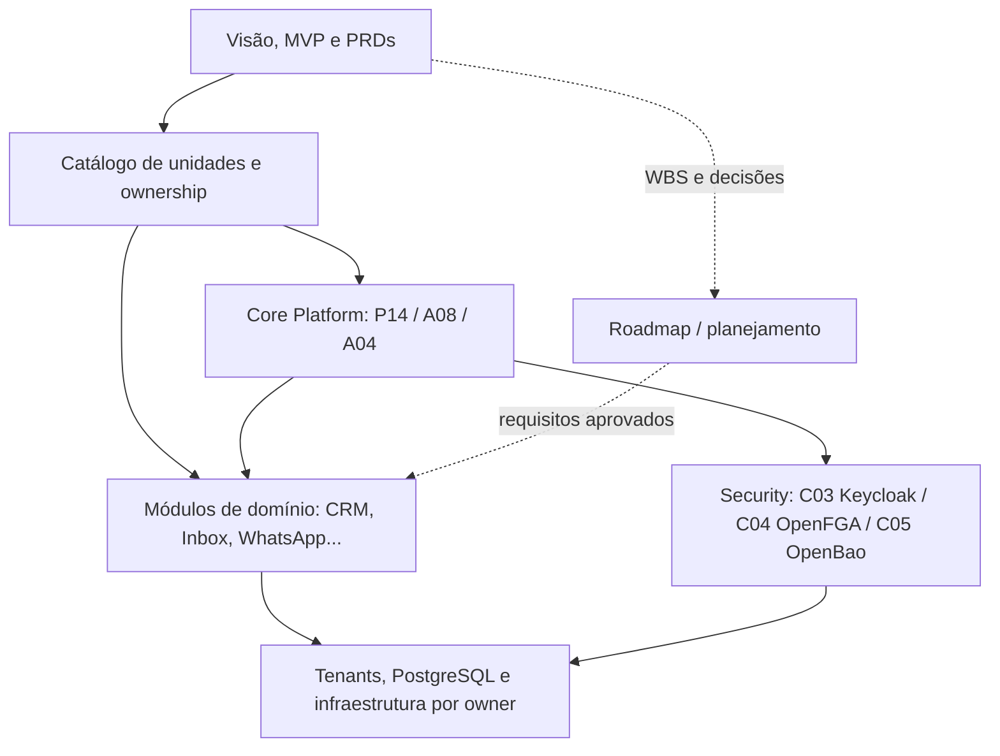
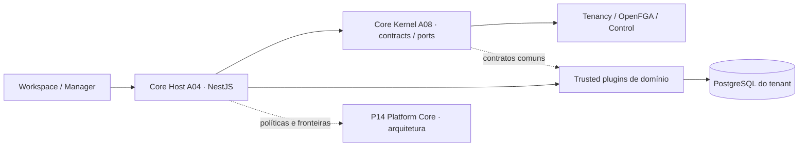
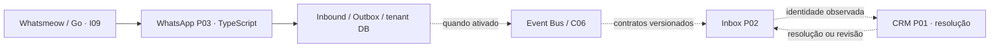
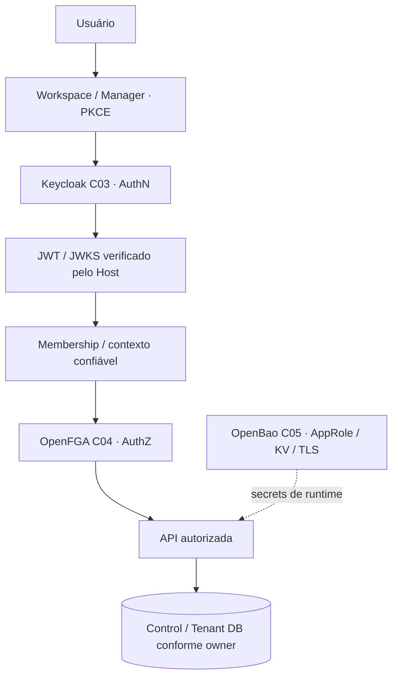
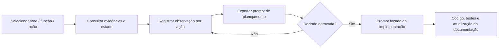

# Biblioteca Syndes — recorte inicial de cinco áreas

> **Base documental consultada: 13/11/2026.** Estas figuras representam fronteiras e fluxos declarados em fontes versionadas, não implantação nem homologação. O CRM tem documentação aprofundada própria em `docs/subprojects/P01-crm/DIAGRAMAS.md`. As demais 52+ unidades do catálogo não fazem parte desta edição.

## 1. Blueprint Geral — relação entre decisões e implementação

**Fonte:** `docs/blueprint/README.md`, `CATALOGO-MODULOS.md`, `MAPA-TECNICO-POR-CAMADAS.md`, `PROJETO-E-WORKPACKAGES.md`. Blueprint unificado **não aprovado**.

## 2. Core Platform — owners distintos

**Nota:** P14 não é um runtime. `executeModule` é gate opt-in. Cadastro em `config/modules.json` não significa módulo ENABLED por tenant.

**Fontes:** `docs/subprojects/P14-platform-core/REFERENCIA-TECNICA.md`, `A08-core-kernel/REFERENCIA-TECNICA.md` e `A04-core-host/REFERENCIA-TECNICA.md`.

## 3. WhatsApp — gateways e eventos

**Nota:** o fluxo editorial não indica cutover WA-CUT, worker em execução, integração completa ou envio de mídia. Não há autorização para ativar projetores.

**Fontes:** `docs/subprojects/P03-whatsapp/STATUS.md`, `OPERACAO.md`, `modules/whatsapp/src/event-bridge.ts`, `modules/core-crm/src/whatsapp-identity-events.ts`.

## 4. Security — identidade, permissão e segredo são controles diferentes

**Nota:** Keycloak não substitui OpenFGA. FGA não substitui membership/entitlement. OpenBao não decide autorização de negócio. Container Up não comprova Product Gate, policies efetivas, unseal nem backup.

**Fontes:** `docs/subprojects/C03-identity-keycloak/STATUS.md`, `C04-authorization-openfga/STATUS.md`, `C05-secrets-openbao/STATUS.md`.

## 5. Fluxo de trabalho na Biblioteca

**Persistência atual das observações:** rascunho **local no navegador**, exportável em Markdown. Não existe gravação automática de decisão aprovada no GitHub a partir dessa interface. Isso exigiria autenticação e um mecanismo de persistência explícito, que não fazem parte desta fase.

## Fontes e pontos de decisão

- [CRM (P01)](../subprojects/P01-crm/STATUS.md) — módulo-piloto aprofundado.
- [Core Platform (P14)](../subprojects/P14-platform-core/STATUS.md), [Kernel (A08)](../subprojects/A08-core-kernel/STATUS.md) e [Host (A04)](../subprojects/A04-core-host/STATUS.md).
- [Blueprint](../blueprint/README.md) — índice ainda em revisão.
- [WhatsApp (P03)](../subprojects/P03-whatsapp/STATUS.md).
- [Keycloak (C03)](../subprojects/C03-identity-keycloak/STATUS.md), [OpenFGA (C04)](../subprojects/C04-authorization-openfga/STATUS.md) e [OpenBao (C05)](../subprojects/C05-secrets-openbao/STATUS.md).

As ações na interface são **pontos de leitura e de decisão**, não contratos novos ou funcionalidades já habilitadas. Cada mudança aprovada deve ser reconciliada com os documentos canônicos do respectivo owner.
