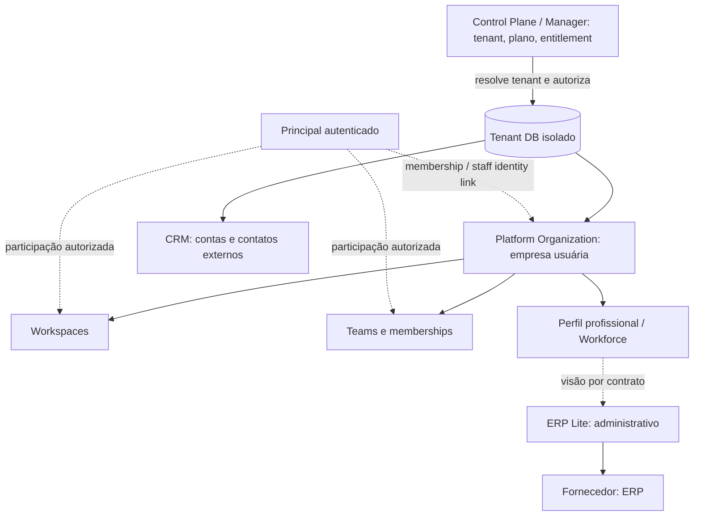

# Proposta — ERP Lite e documentação técnica por módulo

> **PROPOSTA ARQUITETURAL · 12/11/2026 · NÃO APROVADA / NÃO IMPLEMENTADA.**
> Esta proposta reorganiza o catálogo conceitual e o modo de documentar software. Não cria um módulo ERP, não altera SQL, ownership, grants, deploy ou escopo do MVP por conta própria.

## Diagnóstico confirmado no repositório

- A organização empresarial do cliente está em `platform_organizations` e sua árvore de memberships/workspaces em `modules/organizations/sql/001_account_hierarchy.sql`; equipes e papéis profissionais aparecem na migration manual `007_staff_roles_pre_release.sql`.
- O CRM contém entidades comerciais em `crm_people` e `crm_organizations` (`modules/core-crm/sql/001_crm_foundation.sql`). São diferentes de `platform_organizations`.
- Hoje existe `crm_employees` (CRM 003) e a vinculação com identidades de usuário em `platform_staff_identity_links` (Organizations 007). Isso mistura cadastro profissional e CRM e deve ser **reconciliado**, não renomeado diretamente no banco.
- A implementação de múltiplos workspaces/organizations ainda possui travas de compatibilidade. O novo desenho não autoriza remover `002_legacy_single_context_gate.sql`.
- `apps/master-admin-api` / Manager / Control e o DB de cada tenant possuem fronteiras distintas. Não mover tabelas de negócio dos clientes para o Control DB.

## Domínios recomendados

| Domínio | Dono do dado / comportamento | Tela consumidora | Não assumir |
|---|---|---|---|
| Platform Organization | `P04 Organizations & Workforce`: empresa dentro do tenant, unidades, workspaces, teams, memberships | Gestão organizacional; ERP consome visões autorizadas | Empresa externa cadastrada no CRM |
| Identidade autenticada | Identity/Control/Keycloak com autorização OpenFGA | Login / acesso das aplicações | Empregado implica usuário com login |
| Perfil profissional | **A decidir:** Workforce deve ser a fonte lógica de vínculo colaborador–organização; dados existentes em `crm_employees` exigem migração planejada | ERP Lite, área Colaboradores | Criar novamente a mesma pessoa ou identidade |
| Supplier / fornecedor | **Novo domínio proposto ERP Lite**, com ownership por tenant e Platform Organization | ERP Lite, Fornecedores | Depender obrigatoriamente do CRM instalado |
| CRM Person / Account | CRM: contatos, contas e relacionamentos comerciais | CRM, Inbox via contratos | Organização do cliente/tenant ou departamento interno |
| Billing SaaS | Billing / Control: plano e uso do Syndes | Manager | Contabilidade interna do cliente |

### Fluxo conceitual de ownership

**Legenda:** linhas tracejadas mostram referência ou integração por contrato, nunca a permissão automática de leitura nem chave estrangeira entre databases.

### Regra para fornecedores e colaboradores

Fornecedor deve ter identidade comercial estável no **domínio ERP** e poder existir mesmo sem CRM habilitado. Havendo contato/empresa correspondente no CRM, criar um **link opcional por contrato público**, com revisão de duplicidade e isolamento por tenant/org, e não um SELECT direto em tabelas de outro módulo.

Funcionário tem perfil profissional e eventual identidade de acesso. **Funcionário não é necessariamente usuário** e usuário não é necessariamente funcionário. Teams e Workspaces continuam governados por Organizations & Workforce; a tela de Colaboradores do ERP pode consumir o serviço aprovado do Workforce. O responsável pela tabela `crm_employees` atual deve ser decidido antes de qualquer migração.

## ERP Lite — corte funcional proposto

**Fase 1 — cadastros administrativos simples:**
1. Funcionários: perfil, vínculo com Organization, situação ativa/inativa, contatos profissionais, associação a equipe e workspace já existentes, com permissões e auditoria.
2. Fornecedores: razão social/nome, identificação fiscal quando aplicável, contatos, categoria, situação e histórico mínimo; import/export seguro.
3. Permissões: perfis de leitura/edição de ERP por org/workspace e isolamento por tenant.
4. Busca e duplicidade: critérios claros, normalização e arquivamento, sem exclusão destrutiva automática.

**Fora da Fase 1:** folha de pagamento, fiscal/tributário, contabilidade, compras e pagamentos completos, estoque e módulos de e-commerce. São capacidades futuras possíveis, não pressupostos de lançamento.

**Identificador:** reservar um ID de módulo apenas na aprovação da projeção; não acrescentar a 58ª unidade ao catálogo antes de aprovar WBS, ownership, contratos e dependências.

## Documentação técnica — mesmo padrão em cada unidade

Manter a navegação em **Área → Módulo → Página**. Dentro de cada módulo, adicionar uma página de **Referência técnica** com seções no próprio corpo:

| Seção | Conteúdo canônico | Fonte e atualização |
|---|---|---|
| 1. Stack e topologia | tecnologias, framework, pacote, build, dependências públicas, runtime | `package.json`, config de build e Docker/infra comprovados |
| 2. Backend | classes, services, métodos relevantes, parâmetros, efeitos, erros, testes | `src/index.ts`, classes e testes reais; status por método |
| 3. Contratos públicos | exports permitidos, APIs HTTP, ports, eventos versionados, capability e consumidores | `package.json#exports`, OpenAPI/controller e schemas/eventos |
| 4. Frontend | aplicação proprietária, rotas/telas, componentes compartilhados, estado e permissões | `apps/workspace-web`, Manager, Support e `packages/front-shared` |
| 5. Persistência | schemas/tabelas, owner, chaves, isolamento, migrations, compatibilidade, rollback | SQL versionado, manifest e histórico de migrations |
| 6. Operação e provas | variáveis **por nome** sem valores, testes, CI, deploy/ativação/gates | WBS, STATUS, SPRINT e execuções verificadas |

O inventário de método é **selecionado por relevância e contratos públicos**, não despejo cego de cada função privada. Gerar referência de tipos assinados por ferramenta (TypeDoc/OpenAPI) somente quando a superfície pública estiver bem definida. Página deve linkar a fonte exata e indicar `PRESENTE`, `TESTADO`, `INTEGRADO`, `OPERACIONAL` ou `PROPOSTO`. Evitar reduzir esses estados a um único booleano.

### Dois destinos de persistência, sem ambiguidade

| Destino | O que documentar |
|---|---|
| **Tenant DB** | `platform_organizations`, workspaces, teams, memberships, CRM, Inbox, WhatsApp e, quando aprovado, fornecedores e dados administrativos ERP |
| **Control/Manager DB** | tenant registry, instalação/entitlement, planos/billing da plataforma, identidades/delegação de gestão e catálogo de módulos — não registros operacionais privados do cliente |

Cada tabela precisa declarar owner, DB/schema, migração, chave de tenant e organização, FKs e grants. Um módulo pode **referenciar** tabela de outro owner; isso não torna a tabela sua nem autoriza alterá-la.

## Decisões arquiteturais pendentes

1. **Employee:** consolidar o domínio Workforce como proprietário lógico dos colaboradores ou separar HR Master do Workforce? Evitar migrations antes dessa decisão.
2. **Pessoa/Empresa externas:** ERP e CRM terão vínculo opcional entre registros, ou criaremos futuramente um cadastro neutro Party/Counterparty? Não introduzir o novo módulo de cadastro neutro sem demanda real de duplicidade.
3. **ERP Lite:** telas no Workspace, com componentes em `front-shared`; Manager continua aplicação isolada de administração SaaS. A UI pode reunir capacidades de diferentes backends sem absorver ownership.
4. **Controle de acesso:** padrões de permissões por capability e workspace, com regras de staff e fornecedor refinadas em uma projeção específica.

## WBS para implementação incremental

| WP | Entrega | Entrada e gate | Saída verificável |
|---|---|---|---|
| **DOC-01** | Layout de leitura amplo, TOC integrado à esquerda | Mudança só no gerador/CSS do Pages | Build e navegador 1920/1440/1280/mobile, sem scroll horizontal |
| **DOC-02** | Template de referência técnica e piloto Kernel/CRM/Organizations/Host | Inspeção do código e fontes reais | Assinaturas de métodos, contratos, frontend e schemas com links |
| **DOM-01** | ADR de divisão Platform Org / Workforce / CRM / ERP | Decisão de produto e ownership explícita | Mapa de entidades e dados sem duplicidade e sem SQL aplicado |
| **ERP-01** | Projeção ERP Lite: histórias, regras e contratos | DOM-01 aprovado | Escopo, testes, isolamento e WBS aprovados |
| **ERP-02** | Backend Supplier + leitura autorizada de colaboradores | ERP-01; testes/contratos/tenant gates | SQL tenant versionado, API com negativas e rollback aprovado |
| **ERP-03** | UI administrativa no Workspace | ERP-02, design/front-shared e autorização | Telas end-to-end com dados de teste, responsividade e sem acesso cruzado |
| **ERP-04** | Pilotar migração de employee do CRM (se aprovada) | ADR, preflight, restore e compatibilidade | Backfill/reconciliação, testes de rollback; nenhuma ativação tácita |

**Prioridade recomendada:** executar DOC-01 agora, finalizar DOC-02, aprovar DOM-01 e só depois autorizar código ERP. Manter fluxo WhatsApp–Inbox–CRM–Atendimento do MVP como objetivo de entrega; não bloquear esse fluxo por criação prematura de ERP completo.

## Critérios para iniciar agente independente

Para cada módulo: ler `AGENTS.md`, `ESCOPO.md`, `REFERENCIA-TECNICA.md` (se existir), `EVOLUCAO.md`, `STATUS.md`, `SPRINT.md` e apenas contratos externos necessários. Criar um prompt específico de projeção para uma nova capacidade; **não executar diretamente uma proposta ainda não aprovada**. Na aprovação, gerar incremento versionado e prompt de implementação com WBS e critérios de aceite.

**Risco de publicação:** o Pages é público. Publicar assinaturas e contratos necessários à integração, mas nunca DSNs, tokens, infra privada, chaves, segredos ou dados de clientes.
