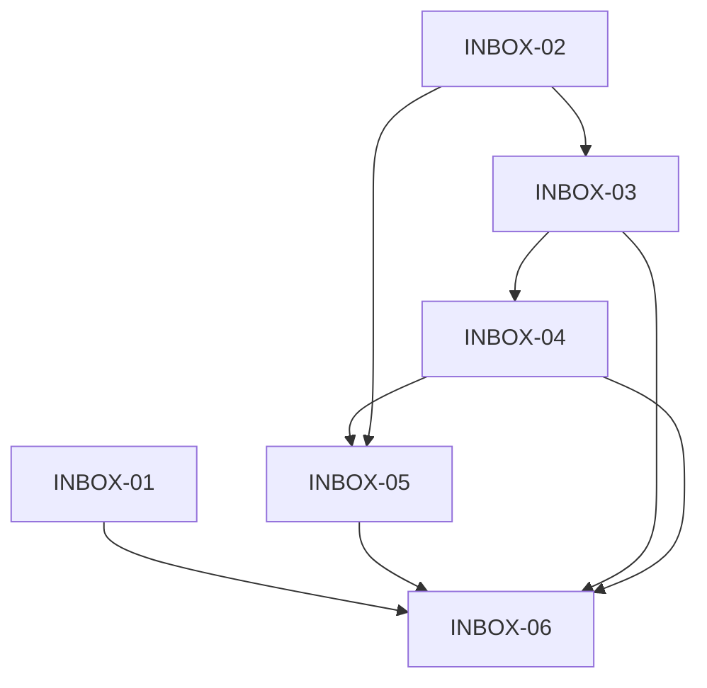

# PRD-002 — Inbox Sprint Plan

## Controle

- **Módulo/gate:** PRD-002 Inbox Product Gate → construção → aceite integrado.
- **Classificação:** MVP.
- **Estado:** execução autorizada pelo usuário em 2026-10-28; Core CRM está registrado como aceito em CRM-11.
- **Base:** [Inbox Product Spec](../product/PRD-002-INBOX-SPEC.md), [Inbox AGENTS](../../modules/inbox/AGENTS.md), baseline MVP e decisões CRM/Platform Core.
- **Stack:** NestJS + Next.js App Router + Drizzle + PostgreSQL; database isolado por tenant e Control Plane separado.
- **Orquestração:** uma Run Orca para todas as tasks, ownership por arquivos, Codex coordena/revisa/aceita; workers não fazem merge nem ampliam escopo.
- **CI/E2E:** unit, component, integration, migrations e build entram em cada fatia/CI. Playwright headless fica apontado como aceite opt-in, produz logs/JSON e não é executado durante desenvolvimento comum.

## Baseline e decisões aplicadas

1. Tenant é o workspace. Dados de conversas/mensagens ficam somente no database do tenant escolhido pelo backend.
2. CRM mantém Person/Organization/ChannelIdentity como source of truth; Inbox guarda referências e interação, sem duplicar cadastro de clientes.
3. Membro é identidade Keycloak + membership no Control Plane; Employee é perfil funcional opcional vinculado a actor existente. Inbox não cria conta Keycloak.
4. A mesma UI serve admin e membro; `tenant_admin` atua em todo o tenant; `tenant_member` permanece filtrado por `customer_scope` (`cpf`, `pj`, `both`) em cada caminho de leitura/escrita/evento.
5. Um responsável por conversa é um membro ativo do tenant; filas sem responsável são permitidas. Não haverá equipes configuráveis nem regras automáticas de atribuição.
6. Estados MVP: `open`, `pending`, `resolved`. Mensagens privadas usam recurso/contrato separado das respostas públicas.
7. PRD-003 WhatsApp vem depois; testar o Inbox antes disso com adapter fake determinístico e sem envio real.
8. Conversa sem Person canônica fica visível somente ao `tenant_admin` até a identificação/associação ao CRM, evitando inferir um escopo CPF/PJ sem evidência.
9. Storage de anexos será privado, tenant-scoped e somente via API autorizada; configuração de diretório/backup precisa ser documentada e testada. Nenhum URL público não assinado.

## Sprints e gates

### Sprint 0 — Product Gate e contratos (concluído pelo coordenador)

- Aprovar o escopo e limites Chatwoot → Syndes sem copiar código ou expandir módulos.
- Congelar entidades/rotas REST, autorização, idempotência, status, transições, eventos e fluxo para conversation sem pessoa vinculada.
- Registrar pré-requisito de associação/revogação de um actor existente; criação/convite Keycloak fica com onboarding e não é simulada.
- Saída: PRD-002 spec e esta ordem de trabalho congelados antes da implementação paralela.

### Sprint 1 — Acesso de atendentes e núcleo de conversas

- `INBOX-01`: expor concessão/revogação auditada de membership existente para `tenant_admin`; sem criação de identidade/convite.
- `INBOX-02`: schema/migration tenant e API para conversation, message, private note, assignment, status e consultas autorizadas.
- Gate: migration em PostgreSQL descartável; listagem/detalhe e mutações provam authz, isolamento, scope CPF/PJ/Both e regras de assignment.

### Sprint 2 — Ingestão, envio confiável, realtime e anexos

- `INBOX-03`: contrato interno de canais + fake adapter; inbound/outbound, dedupe, ordering, retries e status de entrega.
- `INBOX-04`: eventos realtime autenticados e armazenamento/transferência privada de anexos com limites e validação.
- Gate: retries não duplicam nem perdem mensagem; sockets/events e arquivos bloqueiam acesso cross-tenant e fora do customer_scope.

### Sprint 3 — Frontend Inbox

- `INBOX-05`: fila, filtros, detalhe/histórico, resposta, nota privada, assignment, status, anexos e estados de falha/reconexão na aplicação compartilhada Next.js.
- Gate: component tests para estados e ações; contratos consumidos conforme spec; nenhum dado não autorizado exibido por otimização de UI.

### Sprint 4 — Integração, segurança e aceite

- `INBOX-06`: integração de jornada com fake channel, matriz de autorização e isolamento, revisão de segurança, docs e artefatos de aceite.
- Gate final: critérios de DoD do repo atendidos, CI verde, migration de zero e journey comprovada. Script Playwright é necessário para aceite da jornada; execução só no gate/por autorização, via headless com logs revisados.

### Sprint 4-R1 — Recuperação de evidência e fechamento do gate (corrente)

- `INBOX-02-R3`: revisar a implementação local da API central, corrigir somente gaps comprovados e emitir evidência a partir de dispatch ativo. Handoff: `tasks/PRD-002/INBOX-02-R3-api-restoration.md`.
- `INBOX-06-R1`: consolidar matriz, executar gates reproduzíveis e decidir `ACEITO`, `CORREÇÕES NECESSÁRIAS` ou `BLOQUEADO`. Handoff: `tasks/PRD-002/INBOX-06-R1-gate-closure.md`.
- Nenhum commit/push ou avanço para PRD-003 antes da decisão formal do gate.

### Sprint 4-R2 — Follow-ups de fechamento (planejada e despachada)

- `INBOX-06-R2`: jornada Playwright headless opt-in, com artefatos sem secrets.
- `INBOX-04-R2`: drill descartável de backup/restore e autorização de anexos.
- `INBOX-02-R4`: testes backend funcionais para anexos/realtime/channel e higiene de logs.
- `INBOX-06-R3`: decisão formal sobre a limitação WebSocket do BFF.
- `INBOX-06-R4`: rastreamento, CI e decisão final do Product Gate; somente após os anteriores.

Os handoffs estão em `docs/engineering/tasks/PRD-002/`. A execução deve ser sequencial quando houver escrita no mesmo worktree; tarefas read-only podem ser paralelas somente com ownership explícito.

## Ordem e dependências

`INBOX-01` e `INBOX-02` podem iniciar em paralelo: arquivos exclusivos e contratos de Sprint 0 já congelados. `INBOX-03` depende de `INBOX-02`; `INBOX-04` depende de `INBOX-02` e `INBOX-03`; `INBOX-05` depende do contrato REST de `INBOX-02` e contratos realtime/anexo de `INBOX-04`; `INBOX-06` depende de todas as implementações.

## Critérios de aceite integrados

- Uma identidade de actor já existente pode ser concedida a um tenant como `tenant_member`, recebe escopo fixo, e pode ser revogada por `tenant_admin`; ambas as ações são auditadas.
- Conversation, Message e attachments sempre rodam no tenant DB resolvido pelo servidor; payload, header e ID externo não escolhem tenant/database.
- Todos os resultados e eventos respeitam `customer_scope` antes de contar, filtrar, assinar realtime, atribuir, responder ou servir arquivo.
- Mensagem externa duplicada/retry é idempotente; mensagem privada nunca vai para o canal.
- A jornada demonstrável recebe mensagem pelo fake channel, atribui membro, responde, inclui nota privada, atualiza status, anexa arquivo e recupera estado após reconexão.
- Lint, typecheck, unit, component, integração PostgreSQL/migration, checks de tenant isolation e build passam no CI relevante; nenhum teste existente é enfraquecido.
- E2E permanece fora do CI rápido; quando rodado para o Product Gate, produz JSON/logs com cada etapa e resultado analisado por Codex.

## Risco/dívida explicitamente registrada

- Provisionar usuário/login no Keycloak e fluxo de convite são do onboarding; para as sprints, deve existir actor antes de o tenant_admin vinculá-lo. O MVP não será descrito como self-service de criação de contas.
- Conversa ainda sem Person vinculada fica na fila exclusiva de tenant_admin até o CRM resolver a identidade; medir esse caminho na demo e revisar somente se uma regra de classificação segura for aprovada.
- Antes de produção, anexos precisam estar no backup/restore do tenant e ter capacidade/limites operacionais documentados.

## Estado das tasks

| ID | Sprint | Título | Owner inicial | Estado |
|---|---:|---|---|---|
| INBOX-01 | 1 | Membership de atendentes: conceder/revogar actors existentes | OpenCode Free (NVIDIA) | Implementada; correção de revoke/regrant aplicada; aceite integrado ainda depende da evidência PostgreSQL no gate |
| INBOX-02 | 1 | API e persistência de conversas/mensagens | OpenCode Free (NVIDIA) | Implementação local e checks API verdes; aceite formal pendente por dispatch/evidência válidos; R3 aberto |
| INBOX-03 | 2 | Channel port e fake adapter idempotente | OpenCode Free (NVIDIA) | Aceita por Codex; disposable PostgreSQL + API checks verdes |
| INBOX-04 | 2 | Realtime e anexos privados por tenant | OpenCode Free (NVIDIA) | Aceito/lançado; INBOX-02 e INBOX-03 aceitas |
| INBOX-05 | 3 | Frontend Next.js de atendimento | OpenCode Free (NVIDIA) | Implementada com correção R1; typecheck/lint/test/build web verdes; aceite integrado pendente |
| INBOX-02-R3 | 1-R1 | Revisar/restaurar API central e evidência ativa | OpenCode2 (NVIDIA-only) | Em execução; sem commit/push |
| INBOX-06 | 4 | Integração, segurança e Product Gate final | Codex | BLOQUEADA pelo preflight; gaps formalizados em INBOX-06-R1 |
| INBOX-06-R1 | 4-R1 | Fechar matriz, gates e decisão do Product Gate | Codex + workers delimitados | Planejada; depende de INBOX-02-R3 e evidência reproduzível |

Cada worker entrega testes relevantes na mesma fatia, comandos/resultados, arquivos tocados, riscos residuais e não cria commit/PR nem encerra o gate. Codex revisa antes de liberar a task dependente.
