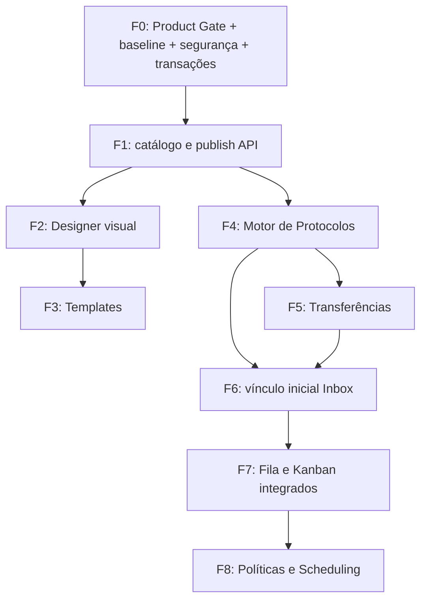

# WBS / EAP — Syndes Gestão de Atendimentos

**Versão:** 0.1 — planejamento proposto em 2026-11-08
**Estado:** Fase 0 em andamento; Product Gate formal pendente. Nenhuma linha deste plano, isoladamente, autoriza alteração do MVP original, merge ou deploy.
**Repositório:** `delmacy/syndes-system`
**Fontes:** `docs/product/PRD-FUNNELS-AND-TEMPLATES-PROPOSAL.md`, `docs/engineering/ADR-FUNNELS-SERVICE-MODEL-PROPOSAL.md`, `docs/engineering/SERVICE-MANAGEMENT-PRODUCT-GATE-20261108.md`, `docs/product/MVP-SCOPE.md`, `docs/product/MODULE-ORDER.md`.

## 1. Resultado, fronteira e política de planejamento

**Resultado desejado:** uma organização (tenant) configura seus próprios grupos, funis, etapas, transições, equipes, resultados e políticas; publica versões; executa protocolos auditáveis; conecta-os ao histórico WhatsApp contínuo; e opera filas/visualizações autorizadas.

**Produto distinto do MVP comercial atual (recomendação, ainda aguardando Product Gate).** O desenvolvimento desta linha não altera o aceite do CRM/Inbox/WhatsApp nem converte módulos planejados em prontos para produção.

**Convenção WBS:** código `F<n>.<n>` = pacote de trabalho com artefato verificável. `F<n>` = entrega/fase. Tarefas do primeiro incremento devem ser subdivididas até ficarem aptas a PR revisável. Nenhuma fase é DONE somente por CI, mock de UI, documentação ou migration.

**Estimativa relativa:** P (pequeno), M (médio), G (grande) = comparação de esforço/risco, **não** horas, datas ou compromisso de entrega. Rever após prova de integração. `BLOQ` = depende de gate; `PEND` = não iniciado; `DOC` = artefato documental concluído; `PART` = verificado parcialmente.

## 2. Estrutura hierárquica / entregas

```text
SYNDES — GESTÃO DE ATENDIMENTOS
├─ F0 — Product Gate e base de integração
│  ├─ F0.1 Auditoria de código/PRs/CI                  [DOC]
│  ├─ F0.2 Decisão de escopo e governança              [BLOQ]
│  ├─ F0.3 Baseline de branches/PRs e CI obrigatório    [PEND]
│  ├─ F0.4 Contratos de segurança/identidade/equipes   [PEND]
│  ├─ F0.5 Contrato transacional e versionamento       [PEND]
│  └─ F0.6 ADR e backlog aprovados                      [BLOQ]
├─ F1 — Catálogo e publicação por API
│  ├─ F1.1 Pacote montável + integração Core Host
│  ├─ F1.2 Grupos de atendimento + equipes mínimas
│  ├─ F1.3 Identidade de funil, N:N equipe/funil
│  ├─ F1.4 Rascunhos, grafo e validação
│  ├─ F1.5 Publicação imutável e concorrência
│  └─ F1.6 Testes, migração, gates e homologação
├─ F2 — Criador visual (Meus Funis / Designer)
├─ F3 — Templates oficiais e privados
├─ F4 — Motor de Protocolos e auditoria
├─ F5 — Transferência e roteamento autorizados
├─ F6 — Integração Inbox / histórico WhatsApp
├─ F7 — Minha Fila, Kanban e visão do supervisor
└─ F8 — Políticas avançadas e integração Scheduling
```

## 3. Mapa de fases e critérios de saída

| Fase | Entrega verificável | Pré-requisito | Gate mínimo |
| --- | --- | --- | --- |
| **F0** | PRD/ADR revisados, decisões explícitas, baseline funcional, backlog e gates de CI | Auditoria | Product Gate aprovado; sem pendências críticas de segurança/branch |
| **F1** | Pacote instalado, API de grupo/equipe/funil, draft válido, publicação imutável `v1` | F0 | E2E API + migração twice + dois tenants + deny + concorrência + CI |
| **F2** | Admin cria/valida/publica funil completo em UI sem código | F1 | E2E navegador, validação servidor, permissão, acessibilidade/mobile |
| **F3** | Instalar/clonar template como rascunho independente | F2 | Sem copiar usuários/segredos/dados; isolado entre tenants |
| **F4** | Abrir protocolo, mover etapa, concluir/reabrir com eventos | F1; idealmente F2 | Eventos atômicos, revision, imutabilidade de versão, tenant deny |
| **F5** | Transferir o mesmo protocolo entre operadores/equipes/funis | F4 + identidade/eligibilidade | Auditoria, origem/destino e capacidade de ler só dados autorizados |
| **F6** | Vínculo explícito protocolo/conversa e marcadores pesquisáveis | F4, F5; Inbox estável | Histórico contínuo e receipts intactos; filtros e marcadores auditáveis |
| **F7** | Fila consolidada e Kanban como projeções do runtime | F4, F5; F6 para navegação | Ordenação/filtros no servidor, perfis e consistência entre telas |
| **F8** | Políticas, presença/capacidade/SLA e Scheduling real em incrementos separados | F4–F7 + Scheduling homologado | Calendário/timezone, casos concorrentes, elegibilidade e indicadores corretos |

**Correção do plano anterior:** templates (F3) podem ser desenvolvidos antes ou depois de F4 sem dependência de execução; o gate de F3 requer **F1 + interface administrativa de F2**, não motor de protocolos. A integração Inbox (F6) pode começar com vínculo simples depois de F4; capacidades completas de transferência requerem F5.

## 4. F0 — Pacotes de trabalho prioritários (executar primeiro)

| WBS | Saída/arquivo ou evidência | Depende | Porte | Status |
| --- | --- | --- | --- | --- |
| **F0.1** | Auditoria de `main`, PRs #17–#19, Core, CRM, Inbox, OpenFGA, tenancy, docs e CI; registrada no Product Gate | — | M | **DOC** |
| **F0.2** | Decisão assinada: fase separada ou mudança formal do MVP; não prometer SLA avançado; nome operacional `Gestão de Atendimentos` | F0.1 | P | **BLOQ** (decisão do produto) |
| **F0.3a** | Mapa de dependências de PRs; base correta da implementação; estratégia explícita de integração/merge da cadeia funcional | F0.1 | M | PEND |
| **F0.3b** | Evidência de proteção da branch, required checks, no-deploy-before-CI; corrigir gatilhos de workflows para novo módulo | F0.3a | M | PEND |
| **F0.4a** | Matriz de capacidades catálogo: ler/criar/editar/publicar/equipes, com grant de publicação independente; desenho para leitura sensível | F0.1 | M | PEND |
| **F0.4b** | Modelo mínimo de equipes, FK com `crm_employees` e política para vínculo autenticado Keycloak `principal -> employee`; sem fingir presença | F0.4a | M | PEND |
| **F0.4c** | Estratégia OpenFGA para recurso/grupo/funil e ausência de herança indevida para processos restritos, testável com negações | F0.4a | M | PEND |
| **F0.5a** | Decisão: transação no `TenantDatabase` pinada a uma conexão **ou** operação SQL atômica única; testes de commit/rollback | F0.1 | M | PEND |
| **F0.5b** | ADR: lifecycle `funnel` separado de `draft revision` e `published version`; versionamento e contrato de validação de grafo | F0.5a | M | PEND |
| **F0.6** | Atualizar PRD/ADR e resolver PG-01..PG-05; abrir backlog rastreável para Incremento 1 | F0.2–F0.5 | P | **BLOQ** |

### Decisões de F0 — recomendação default, não implementadas

- **PG-01:** Gestão de Atendimentos como fase separada do MVP original, não substituição da Inbox.
- **PG-02:** criar equipes mínimas reutilizáveis, sem duplicar CRM/usuários; decidir ownership de forma explícita.
- **PG-03:** dados de protocolos potencialmente sigilosos **não** herdam leitura indiscriminada de `tenant#member`; autorização final sempre no backend.
- **PG-04:** primeiro entregar API e publicação verificável, **depois** o Designer.
- **PG-05:** abrir a branch de código sobre baseline **funcional** aprovada (PR #18 ou sucessora integrada), nunca sobre a `main` documental atual.

**Gate F0:** proprietário decide PG-01; engenharia aprova PG-02–PG-05 após testes de viabilidade; a PR documental registra a decisão. Não há deploy de F0.

## 5. F1 — Decomposição pronta para tickets/PRs

### F1.A — Contratos e infraestrutura mínima (PR pequeno)

| WBS | Pacote de trabalho / artefato | Aceite verificável |
| --- | --- | --- |
| **F1.1a** | Criar `modules/service-management/{AGENTS.md,package.json,tsconfig.json,src/*,sql/,test/}`, ID e `@syndes/service-management` | npm build/test/pack; descriptor validado; sem imports privados |
| **F1.1b** | Manifesto `apps/core-host/config/modules.json`, dependência npm+lockfile e Dockerfile; dependências `platform`/`crm` | `loadInstalledPlugins()` compõe módulos sem alterar controllers do Host |
| **F1.1c** | Port transacional mínimo e/ou SQL atômico conforme F0.5; nenhum `BEGIN` em `pool.query` independente | Teste de rollback multi-instrução + falha concorrente |
| **F1.1d** | Capabilities backend e grants separados para catálogo versus publicação, sem relaxar tenancy | Teste de negação, erro FGA fail-closed, identidade e tenant A/B |

**Critério PR F1.A:** scaffolding, contratos de segurança/transação e CI apropriados, sem endpoint parcial exposto como solução pronta.

### F1.B — Grupos e equipes (PR pequeno)

| WBS | Pacote de trabalho / artefato | Aceite verificável |
| --- | --- | --- |
| **F1.2a** | `001_service_catalog.sql`: `svc_groups`, `svc_teams`, `svc_team_members`, FKs com `crm_employees` por `(tenant_id,id)` | Migração twice; FK impede referência órfã/de outro tenant |
| **F1.2b** | Serviços + rotas autenticadas de grupos/equipes, sem login duplicado | Criar/listar/arquivar por tenant, `401/403/404` testados |
| **F1.2c** | Política de membresia/autorização antes de associação de funcionário | Não pressupor `employeeId = actorId`, usuários online ou competência |

**Critério PR F1.B:** catálogo de grupos/equipes operável e testado por API; sem duplicar pessoas.

### F1.C — Funis, rascunhos e publicação (PR pequeno/médio)

| WBS | Pacote de trabalho / artefato | Aceite verificável |
| --- | --- | --- |
| **F1.3a** | Tabelas `svc_funnels` e `svc_funnel_teams`; FKs compostas e índices; identidade independente do draft | Mesma equipe N funis, mesmo funil N equipes; sem vazamento |
| **F1.4a** | `svc_funnel_drafts` e contrato JSON versionado/tamanho limitado: stages, transitions, outcomes; revisão otimista | `expectedRevision` rejeita edição concorrente com `409` |
| **F1.4b** | Validador de grafo: IDs estáveis; entrada definida; referências válidas; resultado final alcançável; ciclos permitidos; sem etapas inválidas | Unit tests com grafos válidos e inválidos; erros explicativos |
| **F1.5a** | `svc_funnel_versions`; publicação transacional `v1/v2`; checksum e autoria; versão publicada imutável | Testes de publicação repetida/concorrente e v1 preservada |
| **F1.5b** | APIs list/get/create/patch/validate/publish/archive para funis e consulta a versões | E2E autenticado: criar → editar → validar → publicar → consultar |
| **F1.5c** | Capacidade distinta para publicar, permissão por tenant/recurso e mascaramento de IDs alheios | Editor sem publish negado; cross-tenant negado antes do DB |
| **F1.6a** | Pipeline `.github/workflows/service-management.yml`, filtros do CI do Host e Docker build com novo pacote | npm ci, typecheck, unit, integração PG, build e suíte de segurança |
| **F1.6b** | Testes PostgreSQL descartável aplicando migração duas vezes, invariantes, concorrência, transação, isolamentos A/B e regressões | Evidência por SHA, sem dados reais ou WhatsApp externo |
| **F1.6c** | Runbook de migração incremental, rollback de aplicação e versão de artefato | Nada de alteração destrutiva; riscos documentados |
| **F1.6d** | Homologação DevServer01 somente com gates aprovados; smoke Keycloak/OpenFGA, CRUD e regressões | Commit/PR/CI/deploy/resultado registrados; sem logs verbosos |

**Critério de aceitação F1:** um tenant autorizado cria e publica processo próprio `v1`; outro tenant ou agente sem grant não consegue visualizar ou alterar; `v1` fica imutável; edição concorrente causa conflito; núcleo executa montado no Core Host. Não alegar runtime de protocolos.

### Sequência de PRs sugerida

1. `feat/service-management-foundation` — F1.A; base: árvore funcional aprovada depois de F0.
2. `feat/service-management-catalog` — F1.B; base: PR F1.A aprovada.
3. `feat/service-management-versioning` — F1.C; base: PR F1.B aprovada.
4. Integrar cadeia em ordem, com checks do **head exato**; homologar o artefato aprovado. **Não há merge ou deploy automático.**

Se uma PR exceder aproximadamente um único objetivo revisável, subdividir; nunca mascarar falhas num PR gigante.

## 6. F2–F8 — Pacotes macro para posteriores refinamentos

| WBS | Entregável | Itens mínimos | Fora do incremento |
| --- | --- | --- | --- |
| **F2.1–F2.3** | Meus Funis + Editor | lista/busca; editor de identificação/etapas/transições/equipes/resultados; validação/publicação/arquivo com API real | BPMN, scripts |
| **F3.1–F3.3** | Biblioteca de Templates | catálogo Syndes/privados; versão/prévia; instalar como draft sem segredos, funcionários ou dados | marketplace/compartilhamento aberto |
| **F4.1–F4.4** | Motor de Protocolos | identidade pública por tenant; versão pinada; transição autorizada; conclusão/resultado; event log e revision | SLAs avançados |
| **F5.1–F5.3** | Transferências | operador/equipe/funil; motivo; elegibilidade; autorização origem/destino; passagem auditável | presença fictícia |
| **F6.1–F6.3** | Inbox integrada | vínculo explícito mensagens/protocolo; modo contínuo e por atendimento; marcadores pesquisáveis; Inspector autorizado | alteração destrutiva do Whatsmeow |
| **F7.1–F7.3** | Operação | Minha Fila consolidada; Kanban por funil; supervisor por exceções; projeções comuns | contagem arbitrária de conversas como protocolos |
| **F8.1–F8.4** | Operação avançada | políticas/SLAs/calendário; presença/capacidade; roteamento/escalonamento; Scheduling real | orquestrador universal |

**F2–F8 não estão prontas para início de desenvolvimento.** Refinar cada uma em tickets apenas quando o gate da predecessora permitir, mantendo Backlog Now / Next / Later.

## 7. Dependências e ordem crítica



**Caminho de maior risco:** F0.3 (base/PRs) → F0.4 (identidade e auth) → F0.5 (transação) → F1.5 (publicação). Enquanto isso não estiver resolvido, desenhar telas de configuração produz retrabalho.

## 8. Critérios de qualidade por pacote de trabalho

Para cada PR de código, registrar:
- WBS IDs satisfeitos, critérios de aceite e evidência reexecutável;
- SHA, base do PR, workflows executados, quantidade de testes/passes/falhas;
- testes de tenancy, permissão e concorrência proporcionais ao risco;
- SQL incrementais, compatíveis com banco existente, reversão de código segura;
- avaliação de regressões Keycloak, OpenFGA, CRM, Inbox e Whatsmeow;
- revisão, CI realmente obrigatória no ramo protegido, e decisão explícita de deploy;
- pós-deploy: smoke, backups, rollback e estado operacional observado.

**Bloqueios absolutos:** cross-tenant leak; acesso a RH/protocolo sem grant; perda de histórico; adulteração de snapshot publicado; falha de CI obrigatória; falta de artefato rastreável; migração que destrua dados sem plano.

## 9. Primeiro lote pronto para execução — ordem operacional

| Ordem | Ticket sugerido | Entrega concluída quando | Prioridade |
| --- | --- | --- | --- |
| 1 | `SM-F0-001` — Registrar decisão PG-01 e escopo de lançamento | Product Gate diz explicitamente **separado do MVP** ou aprova mudança formal | P0 |
| 2 | `SM-F0-002` — Verificar cadeia de PRs e base funcional | Mapa SHA/base/CI/merge + caminho de integração seguro | P0 |
| 3 | `SM-F0-003` — Desenhar autorização granular + leitura restrita | Matriz de permissões e casos negativos de tenant/funil | P0 |
| 4 | `SM-F0-004` — Fechar contrato de equipes e identidade Keycloak | ADR com ownership, FKs, vinculação `principal↔employee` | P0 |
| 5 | `SM-F0-005` — Provar operação transacional | Spike com transação/rollback e revision (sem deploy) | P0 |
| 6 | `SM-F0-006` — Validar required checks e pipeline | Gates exigidos identificados/protegidos antes de deploy | P0 |
| 7 | `SM-F0-007` — Consolidar Product Gate da PR #19 | PRD/ADR/WBS coerentes e revisão aprovada | P0 |
| 8 | `SM-F1-001` — Abrir branch/PR do pacote montável | PR sobre base funcional aprovada; não sobre `main` vazia | P1, após F0 |
| 9 | `SM-F1-002` — Implementar grupos/equipes tenant-scoped | API + SQL + testes de isolamento | P1 |
| 10 | `SM-F1-003` — Implementar catálogo/drafts/publish | E2E API com versão imutável, CI e homologação | P1 |

**Regra de trabalho:** no máximo **um incremento de produto em construção** (mais desbloqueios técnicos indispensáveis), para não repetir o padrão de vários módulos inacabados. WBS futura é planejamento, não autorização para desenvolver tudo ao mesmo tempo.

## 10. Critério de saída do planejamento

A Fase 0 somente termina quando: PG-01 formalizado; fonte de verdade/branch-base documentada; política de autorização com casos de negação definida; contrato de equipe/identidade aprovado; transação/versionamento definidos; CI bloqueadora configurada/validada; WBS e PRD/ADR coerentes. A partir daí, `SM-F1-001` vira trabalho de implementação autorizado pelo fluxo GitHub → CI → DevServer01.


## 11. Change request CR-001 — Múltiplas organizações, Unidades opcionais e Workspaces (2026-11-08)

**Status:** requisito recebido, modelagem proposta e registrada; implementação **não iniciada**. Esta seção complementa a WBS anterior e prevalece sobre a representação inicial simplificada de `tenant = workspace/empresa`.

**Modelo:** `Customer Account/Tenant (1) → Organizations (N) → Workspaces (N)`; Unidades são opcionais por organização, associados a workspaces N:N; teams e funis operam em workspaces autorizados. Uma organização pode conter múltiplos unidades sem exigir workspace por filial. Há login único e seleção de contexto apenas dos escopos permitidos.

### Novos pacotes predecessores (escopo transversal)

| WBS | Pacote verificável | Dependência | Prioridade | Aceite |
| --- | --- | --- | --- | --- |
| **F0.7** | ADR topologia Account–Organization–Unidade–Workspace, ownership e defaults | F0.1 | P0 | Cardinalidade, N:N Unidade/Workspace, regra Org/Workspace e tenancy documentadas |
| **F0.8** | Análise de impacto CRM/Inbox/OpenFGA, autorização org/workspace e migração legada | F0.7 | P0 | Matriz de acesso A/B; nenhum endpoint inseguro pode habilitar multi-org |
| **F0.9** | Gate de migração e plano de rollback / rollout | F0.8, F0.3 | P0 | Estratégia de organizações/workspaces default e testes aprovados |
| **F1.0a** | Schema/ports de `platform_organizations`, `platform_workspaces`, `platform_units`, `platform_workspace_units`, memberships | F0.9 | P0 | FKs compostas, migration twice, ausência de unidade obrigatório |
| **F1.0b** | Provisionamento e backfill dos defaults para tenant legado | F1.0a | P0 | Usuário legado mantém acesso esperado sem exposição cross-org |
| **F1.0c** | Migração segura de autorização/escopo nas APIs existentes CRM/Inbox, SSE, listas e filtros | F1.0b | P0 | Tenant A/B, Org A/B, Workspace A/B negados quando não autorizados |
| **F1.0d** | APIs de administração de organizações/units/workspaces e seleção contextual no Workspace | F1.0c | P1 | Criar duas organizações com workspaces isolados; unidade opcional; UI não duplica sidebar |
| **F1.3b** | Funis com owner Organization e vínculos N:N Workspace × Funnel | F1.0a, F1.3a | P1 | Reuso de funil em dois workspaces sem visibilidade indevida |
| **F4.0b** | Session com organization owner, workspace origem/atual e contextos auditáveis | F4 + F1.0c | P1 | Handoff intra-org preserva protocolo e trilha |
| **F5.C1** | Mensagens internas/colaboração entre workspaces autorizados | F4, F1.0d | P2 | ACL por participante e auditoria; não enviar ao WhatsApp |
| **F5.C2** | Colaboração cross-organization e correlação entre protocolos locais | F5.C1 | P2 | Compartilhar apenas contexto autorizado; vínculos e eventos auditáveis |
| **F6.0b** | Adaptação da Inbox a Organization/Workspace sem quebrar histórico contínuo | F1.0c, F4 | P1 | Filtros servidor, receipts, SSE e histórico sem regressão |

### Revisão dos gates

- A **F0** passa a exigir F0.7–F0.9 para aprovação da nova topologia.
- A **F1** começa por F1.0a–F1.0c antes de permitir múltiplas organizações e workspaces. O catálogo de funis pode ser construído para o contexto default, mas não exposto entre organizações até que ACL/CRM/Inbox estejam adequados.
- **Unidades** são entidades opcionais: não retardar onboarding de empresa simples exigindo matriz/filial.
- **Comunicação cross-org** é uma entrega posterior e NÃO está incluída no pronto da primeira API de funis. Dentro de uma organização, a mesma solicitação pode mudar workspace sem mudar seu protocolo; entre organizações, preferir vínculo auditável entre protocolos locais.
- Em nenhuma etapa um admin de faturamento se torna automaticamente leitor de dados operacionais; `tenant_memberships` por si só não autoriza Organization/Workspace.

### Próximo backlog reordenado

1. `SM-F0-008`: revisar e aprovar ADR de topologia e modelo de acesso.
2. `SM-F0-009`: mapear migrações e consultas de CRM/Inbox que hoje usam apenas `tenant_id`.
3. `SM-F0-010`: especificar SQL, memberships, grants e defaults sem criar outro banco.
4. `SM-F1-000`: abrir PR mínimo da fundação Organizations/Workspaces e testes de isolamento.
5. `SM-F1-001+`: continuar os pacotes de catálogo já descritos, agora com ownership org/workspace e FKs compostas.

Referência: `docs/engineering/ADR-ACCOUNT-ORGANIZATION-UNIT-WORKSPACE-PROPOSAL.md`. O planejamento antigo não representa funcionalidade já entregue.


## 12. Change request CR-002 — Unidade física ≠ Site de conteúdo (2026-11-08)

A designação definitiva é **Unidade** (entidade de localização/estrutura operacional, código `Unit`). Atualizar os pacotes F0.7/F1.0a/F1.0d para `platform_units`, `platform_workspace_units`, `unit_id` e rotas `/units`. Um workspace pode cobrir 0..N unidades e vice-versa; nenhuma unidade é obrigatória na organização pequena.

**Site** passa a significar exclusivamente uma futura superfície digital de **publicação e navegação**: intranet para colaboradores, extranet/portal para consumidores autenticados ou site público conforme audience e grants. Essa capacidade exige Product Gate e WBS próprios: **não entrar em F1, F2, nem ampliar agora o módulo de Workspaces.** A capacidade futura de Sites deve publicar conteúdo selecionado, jamais abrir acesso direto aos registros internos do Workspace ou das Unidades.

Referência normativa: `docs/engineering/ADR-ACCOUNT-ORGANIZATION-UNIT-WORKSPACE-PROPOSAL.md`.

## 13. Execução — PR #20, início de F1.0 (2026-11-08)

A fundação recebeu implementação inicial na [PR #20](https://github.com/delmacy/syndes-system/pull/20), ainda draft, com base funcional na PR #18. Esta PR #19 continua sendo documental.

| WBS | Implementação e restrições | Estado |
| --- | --- | --- |
| F1.0a | Plugin montável `@syndes/core-organizations` com tabelas Organization, Workspace, Unit, memberships, N:N e audit | Código em PR; release pendente |
| F1.0b | Endpoint autorizado de bootstrap de organização/workspace default, idempotente e atômico; não confere direitos em retries | Parcial; operação e grants FGA pendentes |
| F1.0c | Autorização testada no módulo novo. Migração de CRM/Inbox legados, SSE, consultas e exportações org/workspace-scoped | **Pendente — bloqueia multi-org** |
| F1.0d | API de leitura filtrada, criação de Unidade, sem criação de segunda organização/workspace ou seletor UI | Parcial |
| F0.7–F0.9 | Runbook `docs/engineering/ORGANIZATION-FOUNDATION-IMPLEMENTATION.md` no branch de código, gates de CI e rollout | Revisão e homologação pendentes |

**Gate:** criar tabelas não conclui suporte multi-org. Não habilitar organizações adicionais até que toda leitura e escrita de CRM/Inbox aplique autorização org/workspace no servidor, com testes de negação, sem exposição entre organizações. A PR #20 não autoriza deploy automático.

## 14. Execução — proteção fail-closed de dados legados (PR #23, 2026-11-08)

**WBS F1.0c — Stage A:** [PR #23](https://github.com/delmacy/syndes-system/pull/23), stack sobre #20, implementa e testa `002_legacy_single_context_gate.sql`. Índices únicos `platform_legacy_single_organization` e `platform_legacy_single_workspace` no PostgreSQL do tenant impedem qualquer segunda organização/workspace até que as rotas legadas sejam efetivamente migradas. O banco rejeita concorrência e SQL direto, não só a interface. A migration encontra duplicidade pré-existente e **falha fechada sem apagar dados**.

**Verificação:** no commit `e55845ec92b9c175ed3c027806f29cec23dea19d`, **13 checks GitHub concluíram com sucesso, zero falha, um skip condicionado**. Inclui PostgreSQL descartável com migração repetida, casos negativos `23505`, FKs cross-tenant, trilhas de auditoria, Host, WhatsApp, Inbox e integração de segurança. Nenhuma migração de cliente real, merge ou deploy.

**Inventário**: `docs/engineering/LEGACY-ORGANIZATION-SCOPE-MIGRATION.md` na PR #23 documenta CRM, Inbox, eventos SSE e WhatsApp que ainda operam no escopo tenant. As etapas B/C/D da #21 permanecem **PENDENTES**: ownership e backfill, todos os caminhos de leitura/escrita com contexto autorizado, testes A/B, e somente após isso remoção intencional da trava e criação de várias organizações.

**Status do pacote F1.0c:** **PARCIAL, bloqueio multi-org mantido**. Não atualizar F1.0d para concluído nem habilitar seletor multi-org enquanto a issue #21 estiver aberta.

## 15. Execução — Stage B de propriedade dos dados (PR #24, 2026-11-08)

A [PR #24](https://github.com/delmacy/syndes-system/pull/24), empilhada sobre a #23 e #20, introduz o vínculo inicial de dados legados com Organização e Workspace, mantendo a proteção `002_legacy_single_context_gate.sql`. **Não habilita múltiplas organizações.**

- Migration `003_legacy_ownership.sql`: owner lógico `platform_organization_id` em `crm_people`, `crm_organizations` (empresas contato), `crm_tags` e `whatsapp_accounts`; proprietário e workspaces de origem/atual em `inbox_conversations`, com FKs compostas, índices e triggers do contexto padrão. Notas, empregados, canais, mensagens, eventos e rotas herdam o vínculo por suas referências anteriores; IDs e histórico mantidos.
- Endpoint `POST /v1/tenants/:tenantId/platform/default-context/backfill`: exige tenant membership, FGA `organizations:bootstrap/write` e `admin` ativo na organização **e** workspace default. A execução é transacional, idempotente, com bloqueio de conflito e auditoria com contagens sem conteúdo sensível.
- Teste PostgreSQL descartável inclui os esquemas reais de CRM/Inbox/WhatsApp, aplica a migração duas vezes, insere dados antigos, testa o bootstrap e backfill, proprietário imutável, negação sem membership e preservação de histórico.

**Status F1.0c:** Stage A (#23) concluído em CI. Stage B (#24) implementado no commit `6150aad7a35e63893a62cbd112c0a4965210485c`, **14 checks de CI aprovados, zero falhas, um skip condicionado**, ainda sem merge ou deploy; **Stage C de migração de todas as APIs/SQL/realtime/WhatsApp para contexto autorizado permanece pendente**. Não remover a trava SQL, não liberar multi-org, não dar a issue #21 por concluída. Nenhum deploy em servidores operacionais.
