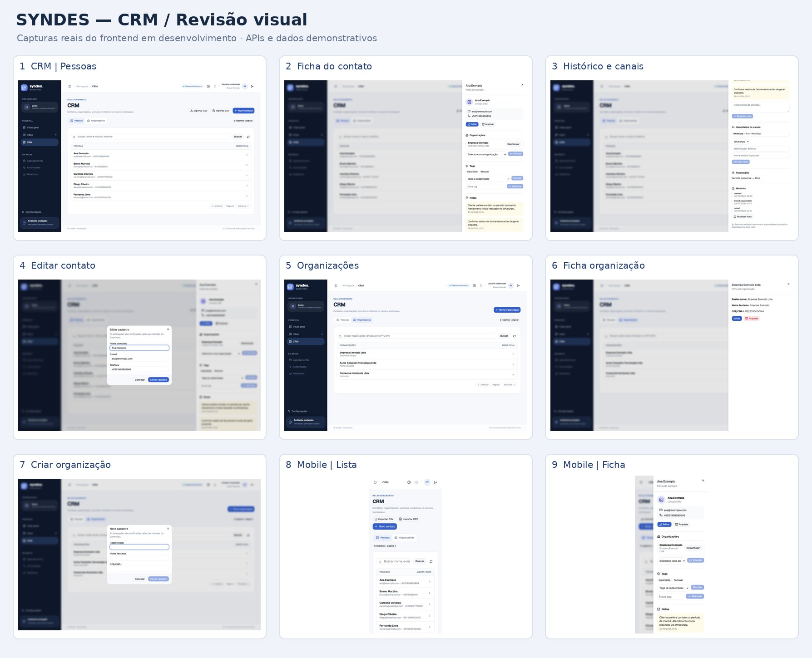
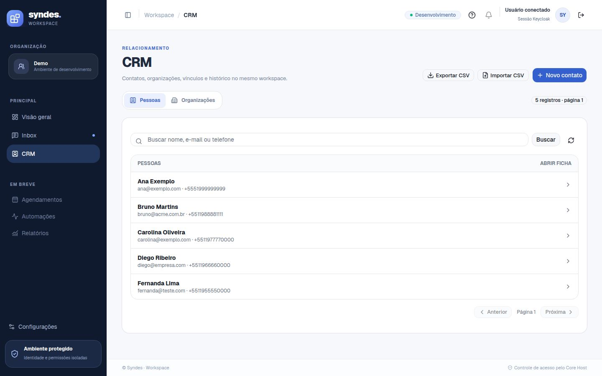
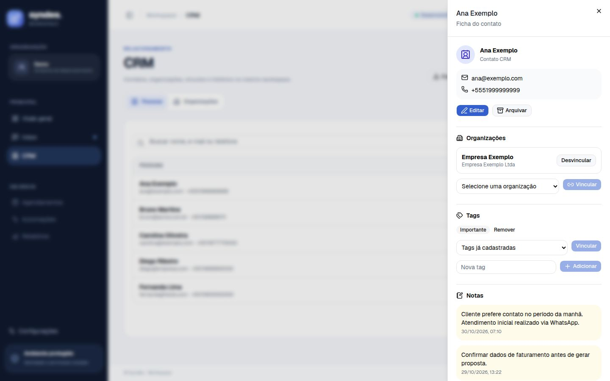
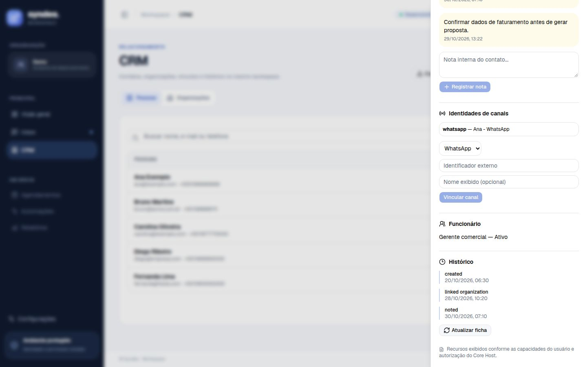
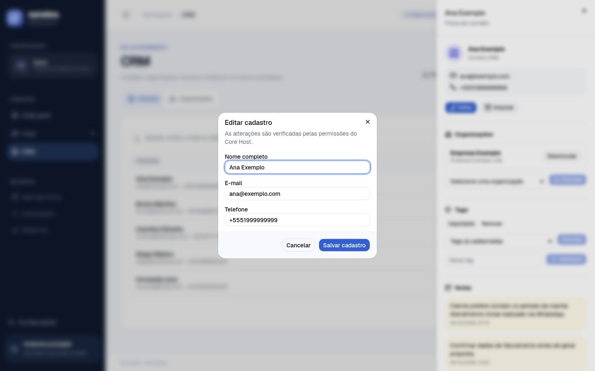
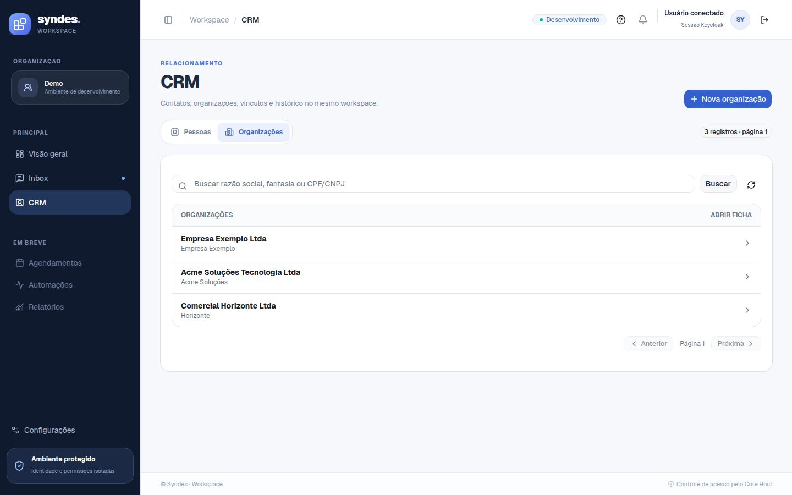
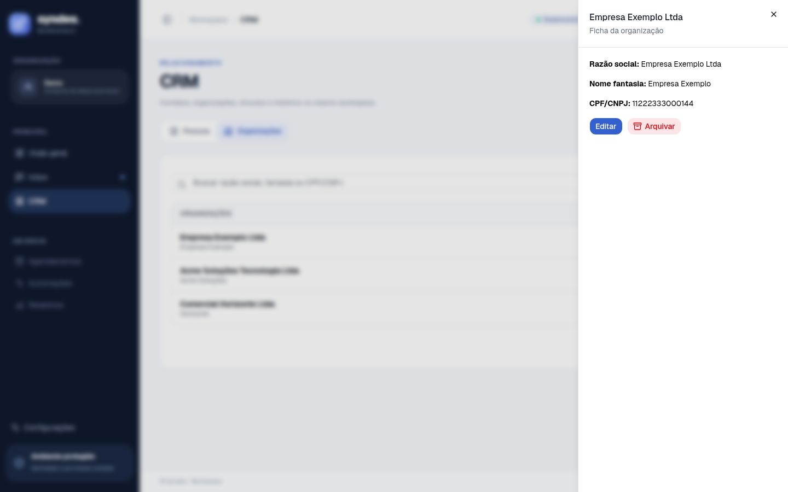
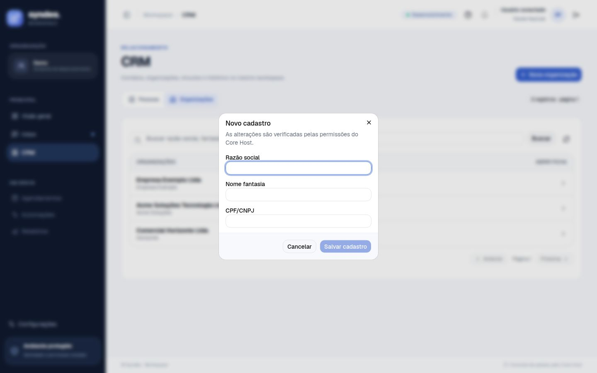
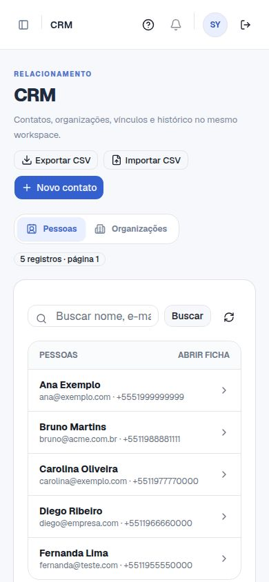
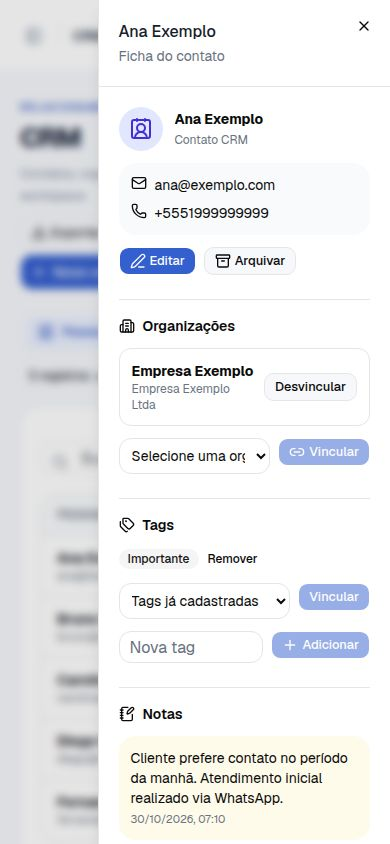

# Syndes — capturas reais do CRM Workspace

Capturas de **1º de novembro de 2026**, da versão de desenvolvimento no commit `e6c6ec090de1743005661710742a675ca1bd9f73` (PR #13).

**Importante:** screenshots gerados com o React/Vite **real**, em Google Chrome, mas com **dados e API/identidade de demonstração simulados**. Não representam implantação do novo CRM no portal publicado, nem comprovação de autenticação real com Keycloak/OpenFGA. Não incluem dados reais de clientes.

A tela principal, a ficha, os formulários e a navegação mobile estão disponíveis abaixo. Para apontar correções, cite o número da imagem.

### Visão geral das 9 telas

### CRM — lista de pessoas (desktop)

### CRM — ficha do contato (desktop)

### CRM — notas, canais e histórico (desktop)

### CRM — editar contato

### CRM — organizações (lista)

### CRM — ficha de organização

### CRM — nova organização

### CRM — lista de contatos (mobile)

### CRM — ficha de contato (mobile)

