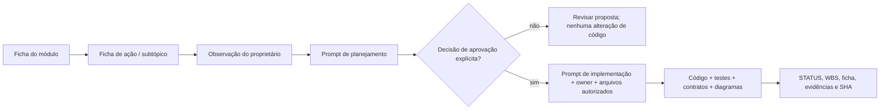

# Como adotar a Ficha Mestre no Syndes — sem duplicar documentação

> Este guia aplica [TEMPLATE-FICHA-MODULO.md](TEMPLATE-FICHA-MODULO.md) e [TEMPLATE-FICHA-ACAO.md](TEMPLATE-FICHA-ACAO.md) **uma unidade de cada vez**, preservando a estrutura existente da Biblioteca. Não cria novo serviço, banco de dados, pipeline paralelo nem migra automaticamente as demais unidades.

## Baseline congelada — v1.0.0 (14/11/2026)

- **Congelamento de estrutura:** os 22 blocos da Ficha Mestre e os 10 blocos da Ficha de Ação não devem ser alterados por agentes durante o preenchimento de módulos.
- **Conteúdo continua evoluindo:** preencher campos, corrigir evidências, registrar edge cases, histórias, diagramas e decisões em fichas concretas permanece permitido. Não confundir congelamento do modelo com congelamento do software.
- **Evolução do padrão:** qualquer novo campo, matriz ou reorganização exige proposta, comparação com a baseline, aprovação explícita do proprietário e incremento de versão; nunca alterar silenciosamente fichas existentes.
- **Matriz de diagramas:** manter os tipos já registrados na seção 04. Outros diagramas, como UML/BPMN, podem ser referenciados em módulos específicos, mas sua inclusão como novos campos obrigatórios é proposta futura, **não parte aprovada da v1.0.0**.
- **Sem governança adicional:** não criar bloqueios do main, serviços ou pipelines novos em nome do congelamento.

## Princípio de projeto

- **O proprietário decide:** abre função/ação, deixa observação, aprova o requisito quando estiver correto.
- **O agente planeja:** inspeciona escopo, fontes e impactos; propõe WBS/aceite **sem** alterar comportamento.
- **O agente implementa:** com decisão explícita, altera somente código autorizado, valida e atualiza a documentação do mesmo incremento.
- **A Biblioteca mostra:** o que foi decidido, o que existe no código, o que está provado e o que continua pendente.
- **Uma única fonte normativa por assunto:** requisito em capítulo de `ESCOPO`; contratos no código+`REFERENCIA-TECNICA`; status em `STATUS`; tarefas no planejamento; a ficha contém **síntese e links**.

## 1. Preenchimento em quatro passagens

| Passagem | Fazer agora | Não exigir ainda | Critério para concluir |
|---|---|---|---|
| **A · Identidade** | ID/owner, objetivo, natureza, limites, status, fontes, dependências, riscos | API/SQL/frontend inexistentes na natureza da unidade | O agente sabe onde ler e o que não modificar |
| **B · Funções e ações** | Agrupar responsabilidades, criar índice de ações com IDs estáveis, requisitos e estados | Inventariar métodos triviais e casos hipotéticos | É possível selecionar um trecho para planejamento |
| **C · Profundidade técnica** | Completar contratos, classes, HTTP, banco, eventos, segurança, UI, testes e diagramas **conforme aplicabilidade** | Exigir seções que não fazem sentido (ex.: migrations no Kernel) | Cada afirmação técnica tem fonte, owner e nível de evidência |
| **D · Continuidade e evidência** | Histórico de observação/decisão, WBS, aprovações, prompts, resultados por SHA, deploy/gates | Homologação sem evidência ou serviço novo para salvar comentários | Outro agente continua a tarefa lendo só o contexto da ação |

**A ordem não é uma corrida para preencher 100%.** Uma ficha com `NÃO SE APLICA — motivo` está completa naquela dimensão. `PENDENTE DE VERIFICAÇÃO` registra uma lacuna real. Preencher um campo com suposta implementação é pior que deixá-lo pendente.

## 2. Onde os arquivos ficam

```text
docs/subprojects/<ID>-<slug>/
  README.md                 # entrada humana e links; preservar
  FICHA-MODULO.md           # síntese + IDs + localização exata
  ESCOPO.md                 # requisitos e capítulos canônicos
  REFERENCIA-TECNICA.md    # contratos e implementação
  STATUS.md                # estados e evidências
  EVOLUCAO.md              # WBS e dependências
  OPERACAO.md              # runbooks e gates
  HISTORICO.md             # decisões e histórico real
  PROJECAO.md              # planejamento do módulo
  IMPLEMENTACAO.md         # implementação do módulo
  chapters/                 # conteúdo normativo por assunto
  acoes/                    # OPCIONAL: fichas de ações com muito detalhe
    <action-id>.md
```

Se a ação já estiver detalhada em um capítulo canônico, **apenas aponte para ele** no índice. Não copiar um mesmo payload ou regra para três arquivos. Não migrar um conteúdo maduro por capricho editorial.

## 3. Quando uma observação deve mudar o código



**Alterar texto da ficha não altera a aplicação.** Quem promove a mudança é o agente de implementação, mediante requisito aprovado. Sua entrega deve modificar a fonte de código correspondente e reconciliar a documentação. O teste/CI verifica o incremento; o proprietário decide sobre homologação.

## 4. Padrão de observação e decisão

Uma observação deve carregar no mínimo: `[ID módulo]`, `[ID ação]`, `[aba/subtópico]`, texto da necessidade, estado atual observado, resultado esperado, link documental, SHA consultada e autor. Pode ser um rascunho local exportável, uma Issue ou Markdown versionado.

Antes de implementar: registrar decisão, critérios de aceite, paths autorizados, exclusões, dependências de outros owners, riscos e gates de segurança/migração/deploy. **Sem essa aprovação, usar apenas o prompt de planejamento.**

## 5. Diagramas

Todo módulo deve responder se os seguintes mapas **se aplicam**: contexto/dependências, processos e interfaces, sequência crítica, estados/erros, dados/ER, eventos/integrações, trust boundaries e implantação. Para cada um, colocar link e evidência, ou registrar `NÃO SE APLICA: motivo` ou `PENDENTE`.

O diagrama publicado deve distinguir **implementado, opt-in e planejado** e ser revisado junto à mudança do fluxo. Mermaid é mantido em Markdown versionado. Não inventar topologias/serviços para preencher o template.

## 6. Aplicabilidade aos cinco núcleos atuais

| Área da Biblioteca | Concentração da ficha | O que NÃO presumir |
|---|---|---|
| **CRM · P01** | Requisitos de contato, CRUD, dados, HTTP, validações, pessoas/organizações, integrações, testes de aceitação | Homologação multi-org ou vínculo WhatsApp automático |
| **Core Platform · P14/A08/A04** | Ownership, Kernel ports, Host composition, registry, SDK, contratos, module lifecycle, gates, eventos | Runtime próprio P14; API ou SQL pertencente ao Kernel |
| **Blueprint Geral** | Visão, escopo aprovado, dependências, roadmap e decisões transversais | Módulo executável, banco próprio, Blueprint já aprovado |
| **WhatsApp · P03** | Gateways I09, contas, texto inbound/outbox, eventos, deduplicação, schema, cutover, sessões | Mídia homologada, projetores concorrentes ou worker ativo |
| **Security · C03/C04/C05** | Keycloak AuthN, FGA AuthZ, OpenBao secrets, trust boundaries, negativas, recovery e owners | AuthN=AuthZ, estado efetivo por container Up, segredos na documentação |

**Recorte:** não promover as demais unidades ao mesmo nível até que a abordagem esteja validada nas cinco áreas.

## 7. Checklist de encerramento de uma alteração

- [ ] Requisito/decisão de implementação **aprovado** e identificado.
- [ ] Branch/worktree/SHA e instruções `AGENTS.md` conferidos.
- [ ] Arquivos editados pertencem ao owner autorizado; dependências externas encaminhadas.
- [ ] Código, contratos e migrations afetados atualizados nos paths originais, quando aplicável.
- [ ] Testes pertinentes executados com resultados PASS/FAIL/SKIP reais.
- [ ] Diagramas e ficha/ação reconciliados, com links para arquivos exatos.
- [ ] `STATUS.md` e `EVOLUCAO.md` atualizados sem promover status por inferência.
- [ ] Provas por commit, ambiente/CI e bloqueios registradas.
- [ ] Próxima tarefa proposta claramente, sem depender da conversa anterior.

**Resultado desejado:** uma nova conversa consegue começar pelo **ID da ação e sua ficha** e continuar apenas o trabalho solicitado. O restante da plataforma permanece consultável por links, não precisa caber inteiro no contexto do agente.
