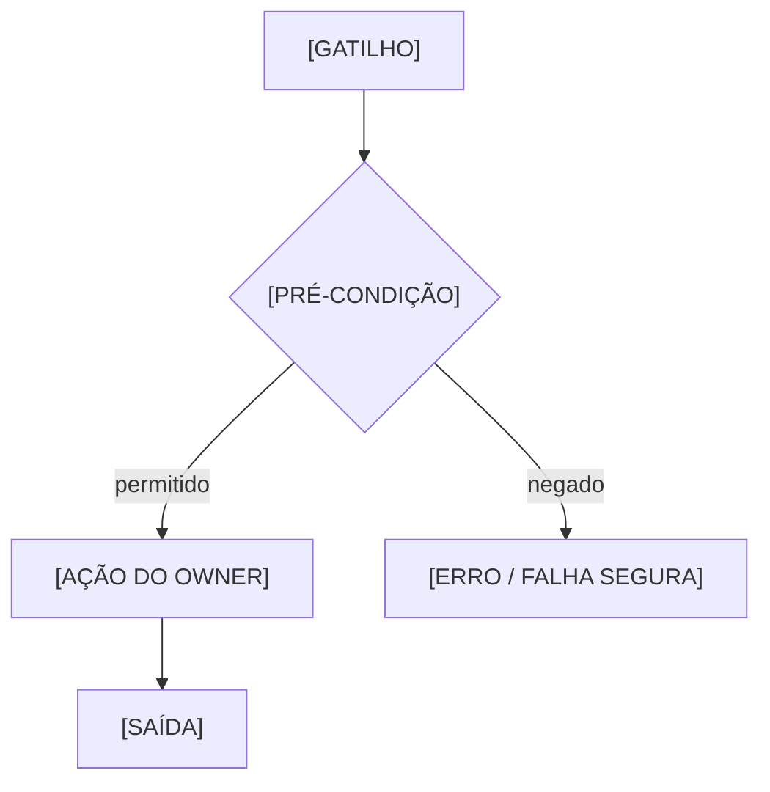

# TEMPLATE — FICHA DETALHADA DE AÇÃO / FUNÇÃO DO MÓDULO

> **BASELINE CONGELADA — v1.0.0.** Estrutura e campos preservados; novas necessidades devem ser registradas nas fichas concretas ou propostas para uma versão futura aprovada.
> **Modelo repetível e incremental, não funcionalidade executada.** Versionar a ação em `docs/subprojects/<ID>-<slug>/acoes/<action-id>.md` **somente quando fizer sentido**; alternativamente manter o bloco em um capítulo canônico existente. A [Ficha Mestre](TEMPLATE-FICHA-MODULO.md) registra o índice e os vínculos. Não duplicar contratos ou requisitos aprovados.
>
> **Critério de granularidade:** uma ação = um resultado reconhecível pelo usuário ou por outro componente, com fronteira, testes e decisão próprios. Pode combinar várias rotas/métodos; não criar uma ação para cada getter sem necessidade.

## A. Endereço exato e estado

| Campo | Valor / fonte |
|---|---|
| Módulo e owner canônico | [ID, slug, owner e `catalog/work-units.json`] |
| Função / categoria | [nome e ID da função] |
| **ID estável da ação** | [ID registrado, preservado ao renomear título] |
| Título e resultado | [verbo + objeto, resultado verificável] |
| Natureza | [usuário, API, background, serviço, infra, governança] |
| Requisitos / casos de uso | [IDs existentes + links; PENDENTE se não houver] |
| Decisão que autoriza | [ID, autor/data e fonte; ou NÃO APROVADA] |
| Estado do escopo | [proposto/aprovado e evidência] |
| Estado do código | [não auditado/declarado/implementado e SHA] |
| Estado de testes | [não executado, PASS, FAIL, SKIP, SHA/CI] |
| Estado integração/deploy/aceite | [separados, com ambiente e prova] |
| Fonte técnica principal | [path, classe, método, SHA] |
| Última reconciliação | [data/commit, responsável e limites] |

## B. Resumo — regra, intenção, fronteira

- **Problema e propósito:** [por quê].
- **Ator ou sistema solicitante:** [quem/identity].
- **Gatilho:** [clique/endpoint/comando/evento/scheduler/configuração].
- **Pré-condições:** [estado, permissões, flags, dados].
- **Fluxo feliz e resultado esperado:** [comportamento observável].
- **Regras/invariantes:** [IDs + documento aprovado; incluir limites e exceções].
- **Não objetivos:** [o que NÃO pode passar a fazer].
- **Side effects:** [alterações externas ou registros persistidos].
- **Saídas esperadas / erros visíveis:** [casos].
- **Não aplicável ao tipo de ação:** [motivo].

## C. Fluxo — cenários e diagrama

| Etapa | Responsável (owner) | Entrada / validação | Saída / efeito | Erros / compensação |
|---|---|---|---|---|
| 1 | [owner] | [entrada] | [resultado] | [falha] |

**Fluxos alternativos:** [duplicidade, rejeição, timeout, retry, idempotência, cancelamento, concorrência, abuso].

**Diagrama:** [link para Mermaid versionado no capítulo/ação; indicar implementado/opt-in/planejado].
**Evidência:** [código, contrato, teste, ADR e SHA].



> Substituir placeholders pelos nomes reais **somente após revisão da fonte**; diagrama genérico não é prova de implementação.

## D. Contratos — API pública/privada, método, comandos, eventos

| Interface | Identificador / versão | Entrada/saída | Publicidade/ownership | Fonte/SHA | Consumidores |
|---|---|---|---|---|---|
| [HTTP / TS / RPC / evento / comando] | [ID] | [schema] | [public/internal/private] | [path] | [IDs] |

**HTTP, se aplicável:**
- Verbo/rota/versão: [path].
- AuthN, AuthZ, client, ação FGA, membership e módulo ENABLED: [fonte].
- Path/query/headers/body: [tipos, defaults, limites, nullable, validações].
- Retornos: [resposta, status HTTP, schemas e casos negativos].
- Idempotência, paginação, filtros, ordenação e rate limits: [fonte].
- Compatibilidade/consumidores/telemetria: [fonte].
- Método responsável e teste: [arquivo, símbolo, caso e SHA].

**Evento/comando/job, se aplicável:** [nome e versão, origem, envelope e escopo tenant/org/workspace, correlator, transação/outbox, dispatcher, retry, DLQ, consumer, idempotência, autorização de serviço, estado de worker].

**Sem API:** escrever `NÃO SE APLICA: [razão]`, não inventar controller.

## E. Dados e persistência

| Banco / schema / owner | Objeto, campos e índices relevantes | Ação SQL/ORM e consistência | Migration | Escopo | Evidência |
|---|---|---|---|---|---|
| [tenant / Control / técnico / nenhum] | [tabela/colunas] | [read/write/transaction] | [path] | [tenant/org/workspace] | [fonte] |

- **Origem e natureza dos dados:** [comando, evento, UI, import; PII/sensível].
- **Validadores e normalizadores:** [função e regra].
- **Relações, constraints e referências:** [FK e fontes].
- **Concorrência, duplicidades, consistência e rollback:** [métodos].
- **Retenção, anonimização, backup e restauração:** [owner/regra].
- **SQL/migration aplicada em ambiente?:** [ambiente + prova ou NÃO VERIFICADO].
- **Não tem persistência?:** [NÃO SE APLICA + justificativa].

## F. Segurança, tenancy e confiança

| Ator/principal | Client / fonte confiável | Recurso/ação | Tenant/org/workspace | Resultado permitido/negado | Evidência/teste |
|---|---|---|---|---|---|
| [actor/user/service] | [issuer, client, source] | [FGA] | [limites] | [condição] | [path] |

**Proibições:** [acesso cruzado, impersonation, segredo no frontend, escalonamento, alteração de grants sem owner].
**Segredos:** referenciar **somente nomes e políticas**, nunca valores, tokens ou endereços administrativos privados.
**Duas ou mais operações simultâneas:** [risco/lock/transaction].

## G. Frontend, experiência e acessibilidade

- **App e owner:** [Workspace, Manager, Support, nenhum].
- **Rota/entrada:** [path/role/menus].
- **Componentes:** [paths; shared visual em front-shared].
- **Estados:** loading, vazio, erro, bloqueado, sucesso, offline, reenvio.
- **Interações e campos:** [validação visual vs. validação backend].
- **Acessibilidade e responsividade:** [casos/critério].
- **Contrato consumido:** [ID/versão].
- **Provas:** [screenshots/E2E em ambiente e SHA].
- **Sem frontend:** `NÃO SE APLICA` e motivo.

## H. Integrações, dependências e impacto da alteração

| Owner externo | Contrato público/versionado | Relação desta ação | Consequência de mudança | Precisa de aprovação? |
|---|---|---|---|---|
| [ID] | [interface] | [provider/consumer] | [breaking/regressão] | [owner] |

**Invariantes que não podem mudar:** [IDs e paths].
**Alternativas e tradeoffs:** [consideradas ou não avaliadas].
**Degradação e falhas:** [comportamento seguro].

## I. Testes, operação e provas

| Critério de aceite / cenário | Teste e comando | Tipo | Ambiente/SHA | Resultado | Evidência | Pendente |
|---|---|---|---|---|---|---|
| [critério] | [path/comando] | [unit/contract/integration/E2E/security] | [local/CI/staging] | [PASS/FAIL/SKIP/NÃO EXECUTADO] | [run] | [lacuna] |

- **Health, métricas, logs, rastreamento:** [source ou N/A].
- **Reprocessamento/rollback/restore:** [se side effects].
- **Deploy/feature flag/migration:** [estado real e owner].
- **Riscos conhecidos/bugs:** [Issue e gravidade].
- **Gate de aceitação:** [decisão humana, ou PENDENTE].
- **Nenhum teste existente:** [PENDENTE DE VERIFICAÇÃO, não PASS].

## J. Observações, decisões, mudanças e próximo incremento

| ID / registro | Subtópico | Observação | Natureza | Estado | Owner | Link |
|---|---|---|---|---|---|---|
| [Issue/ID] | Resumo/Fluxo/Contratos/Dados/API/Segurança/Testes/Operação/Pendências | [texto] | dúvida/bug/proposta/requisito | rascunho/análise/aprovada/rejeitada | [owner] | [source] |

### Mudança individual, quando aprovada

- **Requisito e decisão:** [ID + link, autor/data].
- **Mudança solicitada:** [ANTES → DEPOIS, com critério observável].
- **Subtópicos afetados:** [IDs].
- **Arquivos de código autorizados:** [paths do owner; deixar vazio até aprovação].
- **Não alterar:** [arquivos, contratos, módulos, dados].
- **WBS da alteração:** [IDs verdadeiros; sem inventar].
- **Testes, dados e diagramas afetados:** [paths].
- **Integrações e outros owners:** [requer aprovação separada].
- **Migração/deploy/segurança:** [gates e aprovação especial].
- **Saída obrigatória do agente:** [diff, testes, SHA, documentação e próximos bloqueios].

### Prompts prontos para copiar/gerar

**Planejamento (sem código):**

```text
SYNDES — PLANEJAR
Unidade: [ID e owner] · Ação: [ID] · Aba: [subtópico]
Observação: [texto] · Referência: [ficha/commit]
Leia AGENTS.md, ESCOPO e STATUS da unidade, esta ficha, contratos públicos e código relevante na SHA atual.
Identifique estado real, efeitos em API, dados, IAM, frontend, eventos e outros owners.
Proponha alternativas, riscos, WBS incremental, critérios de aceite, arquivos e diagramas atingidos.
Não implemente, não habilite serviços e não declare aprovação.
Saída: diagnóstico + proposta + decisões pendentes + especificação para aprovação.
```

**Implementação (somente após decisão):**

```text
SYNDES — IMPLEMENTAR
Unidade: [ID/owner] · Ação: [ID] · Requisito APROVADO: [ID e link]
Escopo autorizado: [paths e comportamento] · Exclusões: [contratos/arquivos proibidos]
Leia AGENTS.md, ESCOPO, STATUS, esta ficha, contratos e testes do owner.
Verifique branch/worktree, SHA, arquivos de terceiros e gates.
Implemente apenas o aprovado, teste cenários positivos/negativos e revise compatibilidade.
Atualize código e fontes documentais canônicas; reconcilie a ficha, diagramas, WBS e STATUS com os resultados efetivos.
Não aplique migrations, grants, workers ou deploy sem autorização e gates.
Saída: mudanças/SHAs, testes reais, evidências, documentação atualizada e pendências.
```

**Regra de continuidade:** uma ação nunca fica `CONCLUÍDA` apenas porque o agente respondeu no chat. O fechamento requer alterações e provas em fontes versionadas, vinculadas ao requisito e à decisão correspondente.
