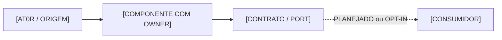
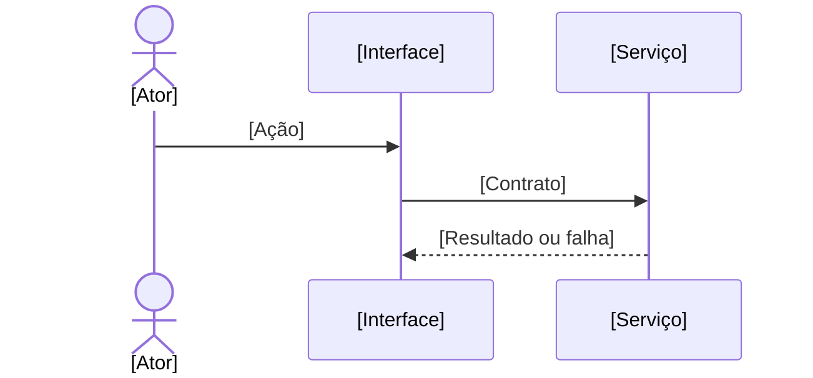

# TEMPLATE MESTRE — FICHA COMPLETA DE MÓDULO / UNIDADE SYNDES

> **MODELO REUTILIZÁVEL — NÃO É UM MÓDULO IMPLEMENTADO.** Versão do template: **1.0.0** (14/11/2026).
> **BASELINE CONGELADA — v1.0.0.** Não acrescentar, remover ou reorganizar campos, seções ou matriz de diagramas sem nova decisão explícita do proprietário e nova versão do modelo. Completar fichas concretas não altera esta baseline.
> Aplicável a módulos de negócio, bibliotecas, Kernel, Host, frontend, infraestrutura, conectores, serviços, integração, segurança, dados e unidades de governança. **Não instanciar nas 57+ unidades automaticamente.** Adotar módulo a módulo, por decisão do proprietário.
>
> **Função desta ficha:** permitir ao proprietário compreender o escopo, decidir uma mudança e fornecer a outro agente contexto suficiente para planejar ou implementar **o trecho exato**, sem relembrar a conversa anterior.
>
> **Fonte normativa não muda:** `catalog/work-units.json` identifica owner; `ESCOPO.md` e `chapters/` contêm requisitos/decisões aprovadas; `REFERENCIA-TECNICA.md` e código/SQL/manifests contêm a implementação; `EVOLUCAO.md` contém WBS; `STATUS.md` distingue evidências; Git/CI/deploy comprovam resultados. **Esta ficha é índice contextual, não uma segunda especificação concorrente.**

## Guia rápido para preencher

**Campos obrigatórios na primeira passagem:** identidade/owner, natureza, objetivo, limites, status verificável, fontes canônicas, funções, ao menos uma ação (ou `NÃO IDENTIFICADA` com pendência), dependências principais, riscos e próximo passo. O restante é **incremental**.

Em cada bloco, use um dos valores:
- **VERIFICADO:** acompanhado de caminho, símbolo quando necessário, SHA/versão e evidência adequada.
- **DECLARADO NO CÓDIGO:** encontrado no código, **sem** alegação de integração ou operação.
- **PLANEJADO / PROPOSTO:** origem da decisão ou proposta e se há aprovação.
- **PENDENTE DE VERIFICAÇÃO:** há dúvida; identifique fonte a consultar, owner e próximo teste.
- **NÃO SE APLICA:** explique *por que* (ex.: Core Kernel não possui frontend nem migrations).
- **NÃO IDENTIFICADO:** não encontrado na auditoria delimitada; **não** equivale a inexistente.

**Nunca preencher um vazio com funcionalidade suposta.** Não usar `DONE`, `TESTADO` ou `OPERACIONAL` apenas por CI verde, commit, arquivo existente ou container Up. Não incluir tokens, chaves, PII, DSNs, configurações sensíveis nem URLs administrativas privadas no repositório público.

**Local de uso recomendado:** `docs/subprojects/<ID>-<slug>/FICHA-MODULO.md`. Não mover nem renomear os arquivos canônicos atuais. Para cada ação, usar [TEMPLATE-FICHA-ACAO.md](TEMPLATE-FICHA-ACAO.md) e, quando merecer detalhe próprio, um arquivo em `chapters/` ou em `acoes/` com ID estável.

---

## 00 · Identificação, snapshot e condições de confiabilidade

| Campo | Informação / link / estado |
|---|---|
| ID canônico do catálogo | `[ID]` — [não criar novo ID sem registrar no catálogo] |
| Nome / slug | `[NOME]` / `[slug]` |
| Natureza | [backend, frontend, biblioteca, serviço, gateway, módulo de negócio, infra, provedor, governança...] |
| Área e parent documental, se existir | [área / documentationParent / motivo] |
| Responsável pelo código (owner) | [ID do owner; unidade que **pode** editar] |
| Responsável pelo produto/decisão | [pessoa/função/registro quando conhecido] |
| Status do escopo | [rascunho / em revisão / aprovado + referência] |
| Status da implementação | [não auditado / identificado / implementado + fontes] |
| Status de integração | [pendente / parcialmente validado / comprovado + evidências] |
| Status de implantação | [ambiente, commit/imagem e prova, ou PENDENTE] |
| Status de operação e homologação | [independentes; aprovação explícita ou PENDENTE] |
| Baseline de documentação | [commit SHA, data UTC e origem] |
| Baseline de código auditado | [commit SHA e branch/worktree; não presumir HEAD atual] |
| Última reconciliação | [data, quem conferiu, quais partes] |
| Versão da ficha | [v1.x; changelog no fim] |
| Sigilo / visibilidade | [público/restrito; somente metadados seguros] |
| Referência externa (Issue/Project/ADR) | [URLs/IDs **verificados**, ou PENDENTE] |

**Síntese executiva de até 8 linhas:** [o que é, o que existe, o que falta, onde começar e qual principal risco.]

**Semântica de status:** requisitos **propostos / aprovados** são uma dimensão; código **declarado / implementado / testado** é outra; integração, deploy, operação e aceite exigem provas próprias. A mesma ficha pode conter capacidades em estados diferentes.

## 01 · Fontes canônicas e endereços de continuidade

| Intenção do leitor/agente | Caminho canônico | SHA/estado | Observação de precedência |
|---|---|---|---|
| Ownership e inventário | `catalog/work-units.json` | [SHA] | Não inventar owner |
| Invariantes globais / locais | `AGENTS.md` · `[raiz]/AGENTS.md` | [SHA] | Respeitar instruções locais |
| Requisitos e decisões aprovadas | `docs/subprojects/[ID]-[slug]/ESCOPO.md` e `chapters/` | [SHA] | Normativo |
| Contratos, classes, APIs, dados | `REFERENCIA-TECNICA.md` + código real | [SHA] | Código prevalece sobre inventário desatualizado |
| WBS e dependências | `EVOLUCAO.md` / Issues | [link] | Proposta != entregue |
| Status, evidências e bloqueios | `STATUS.md` / `SPRINT.md` | [link] | Não inferir aceite |
| Histórico e ADR | `HISTORICO.md` / `docs/engineering/` | [link] | Preservar decisões substituídas |
| Operação e runbooks | `OPERACAO.md` + owner | [link] | Runbook pode não ter sido homologado |
| Código / contrato / migrations | [pastas exatas] | [SHA] | Diretórios do owner |
| Testes e CI | [comandos, paths, runs] | [run/SHA] | Separar pass/fail/skip |
| Prompt de planejamento | `PROJECAO.md` / modelo em standards | [link] | Sem executar código |
| Prompt de implementação | `IMPLEMENTACAO.md` / modelo em standards | [link] | Somente escopo aprovado |

**Pacote mínimo de leitura:** `AGENTS.md` global + local, requisito da ação, `STATUS.md`, contrato pertinente, código específico, testes relacionados. Expandir leitura **sob demanda**, não carregar o sistema inteiro.

## 02 · Propósito, usuários, capacidade e limites

| Eixo | Detalhamento |
|---|---|
| Missão | [problema e resultado] |
| Valor para cliente / operador | [quem recebe e como] |
| Usuários/atores | [tenant user, platform manager, operador, sistema, serviço, agente] |
| Atores externos | [provedores, webhook senders, processos] |
| Capabilities fornecidas | [IDs e links; separar implementadas/propostas] |
| Critérios de sucesso | [métricas verificáveis quando aprovadas] |
| Não objetivos / fora do escopo | [o que não fará] |
| Fronteira do domínio | [dados e regras que **possui**] |
| Fronteira de segurança | [quem autentica, autoriza, isola e audita] |
| Restrições de MVP | [texto apenas, limitações, feature flags etc. reais] |
| Compatibilidade e migração | [contratos que não podem quebrar] |
| Dependências críticas | [ID/owner/interface/status] |

### Regras de negócio e invariantes

| ID | Regra / invariante | Aplicabilidade | Fonte de aprovação | Implementação / prova |
|---|---|---|---|---|
| `[ID].RULE.001` | [regra precisa, inclusive exceção] | [escopo] | [doc/ADR/Issue] | [método/teste/SHA ou PENDENTE] |

### Histórias / casos de uso / exceções

| ID de requisito existente | Ator e necessidade | Pré-condições | Resultado esperado | Critério de aceite | Estado / evidência |
|---|---|---|---|---|---|
| [ID registrado, ou NÃO IDENTIFICADO] | [jornada] | [condição] | [comportamento observável] | [teste] | [status + link] |

Não fabricar IDs para requisitos legados. Em novos requisitos, criar ID apenas na decisão de aprovação e registrá-lo no local canônico.

## 03 · Inventário de funções, ações e subtópicos

> **Forma de navegação:** **Área → Módulo → Função → Ação → Aba temática**. Uma ação é a menor unidade de trabalho que pode receber observação, decisão e prompt próprios. Não transformar cada método numa funcionalidade de produto.

| Função / ID | Finalidade | Ação / ID estável | Ficha de ação | Estado e fonte | Depende de |
|---|---|---|---|---|---|
| [cadastros/integrações/segurança etc.] | [objetivo] | [slug ou ID registrado] | [path/anchor] | [estado] | [IDs/contratos] |

**Abas de ação recomendadas, independentes:** Resumo · Fluxo · Contratos · Dados · API · Segurança · Testes · Operação · Pendências. **Requisitos/decisões** podem aparecer contextualizados em Resumo/Pendências sem impor novas abas; adicionar quando o volume justificar.

**Inventário negativo:** [ações esperadas pelo escopo mas não encontradas no código; separar pedido de implementação].

## 04 · Arquitetura, responsabilidades e diagramas

| Diagrama | Obrigatoriedade | Link / evidência | Situação |
|---|---|---|---|
| Contexto (atores, limites, sistemas externos) | Recomendado para todas as unidades | [arquivo/âncora] | [VERIFICADO/PENDENTE/NÃO SE APLICA] |
| Containers/processos e componentes | Quando há runtime | [fonte] | [estado] |
| Sequência de ação crítica | Quando há interação/side effects | [fonte] | [estado] |
| Máquina de estados e falhas | Quando há lifecycle/job/workflow | [fonte] | [estado] |
| Modelo de dados e relações (ER) | Quando possui persistência | [migration] | [estado] |
| Eventos, comandos e integrações | Quando integra outros owners | [contracts] | [estado] |
| Segurança/trust boundaries | Quando processa identidade/dados | [ports/guards] | [estado] |
| Implantação, redes e portas | Quando possui runtime/infra | [compose/manifest] | [estado] |
| Mapa de dependências e impacto | Recomendado para todas as unidades | [catálogo] | [estado] |

**Legenda obrigatória:** conexão contínua = comprovadamente implementada no código; conexão tracejada = opcional/opt-in/planejada; estado em runtime só com evidência de ambiente. Não confundir *código implementado* com *fluxo operacional*.

**Esqueleto Mermaid — somente placeholders, NÃO diagrama de funcionamento real:**

Se não existir sequência validada, manter `PENDENTE` e não publicar placeholders como arquitetura executada. **Diagramas devem ser versionados perto da ação/contrato e atualizados no mesmo incremento que modifica seus fluxos.**

## 05 · Implementação: código, stack, imports e fronteiras

| Dimensão | Fonte exata | Descrição e riscos |
|---|---|---|
| Linguagens / frameworks / versões | `package.json`, lockfile, `go.mod`, Dockerfile... | [dados verificados] |
| Pacotes e serviços de entrada | [entrypoints] | [responsabilidades] |
| Exports **públicos oficiais** | `package.json#exports`, `src/index.*` | [sem importar internos] |
| Interfaces, ports, adapters | [paths] | [owner e substituibilidade] |
| Classes e métodos **internos** | [paths, assinatura] | [não são API pública] |
| Configuração e feature flags | [paths; nunca valores sensíveis] | [defaults e gates] |
| Bibliotecas compartilhadas | [ID/versão do owner] | [não duplicar código] |
| Comandos build / lint / test | [comandos realmente executáveis] | [versão/runtime necessários] |
| Geradores, migrações de código | [paths] | [efeitos e impacto] |
| Convenções, invariantes de código | [AGENTS.md, ADR] | [restrições] |

### Símbolos, responsabilidades e localização exata

| Símbolo / assinatura | Visibilidade: pública/interna | Arquivo e owner | Entrada / retorno | Efeito e erro | Teste | SHA |
|---|---|---|---|---|---|---|
| [método] | [public export / interno / privado] | [path] | [tipo] | [efeito] | [path] | [SHA] |

### Dependências de build e execução

| Dependência | Versão verificada | Por que existe | Superfície consumida | Necessária/opcional | Consequência se falhar |
|---|---|---|---|---|---|
| [serviço/pacote] | [versão/source] | [razão] | [interface pública] | [tipo] | [fallback seguro ou falha fechada] |

## 06 · Contratos: APIs HTTP, SDK, RPC, eventos e compatibilidade

| Contrato ID/versão | Natureza | Público/privado/interno | Provider/owner | Consumer | Schema / método / fonte | Auth / escopo | Estado |
|---|---|---|---|---|---|---|---|
| [existente] | REST, port TS, SDK, RPC, webhooks... | [classificação] | [ID] | [IDs] | [path] | [guard] | [prova] |

### Detalhe por endpoint (repetir para cada endpoint relevante)

| Campo | Conteúdo verificado |
|---|---|
| ID, recurso e ação de origem | [ID da ficha correspondente] |
| Verbo / URL / versão | [rota declarada; ambiente não presumido] |
| Controller/método e owner | [path e símbolo] |
| Consumidores comprovados | [frontend/serviço/pacote] |
| Autenticação e autorização | [client, JWT, FGA, roles, membership, service grant] |
| Tenant / organização / workspace | [origem confiável, propagação e filtro] |
| Path, query, headers e body | [campos, tipos, opcionalidade, limites, validações] |
| Respostas e códigos | [sucesso, erros e formatos reais] |
| Idempotência / concorrência | [chave, unique, transação, retry] |
| Paginação / rate limit / ordenação | [limites] |
| Versionamento e compatibilidade | [mudanças, consumidores e depreciação] |
| Side effects e dados afetados | [tabelas/eventos/jobs e owner] |
| Testes de contrato e negativas | [path/comando/resultado] |
| Evidência de disponibilidade operacional | [ambiente/SHA ou NÃO VERIFICADO] |

### Erros e cenários de degradação

| Falha / código | Causa conhecida | Tratamento | Retry / idempotência | Evidência de teste |
|---|---|---|---|---|
| [caso] | [origem] | [estado seguro] | [sim/não/condicional] | [source] |

## 07 · Dados, persistência, integridade e privacidade

| Item | Identificação e evidência |
|---|---|
| Owner dos dados | [ID; quem define schema e regras de retenção] |
| Classificação de dados | [pessoal, sensível, cliente, técnico, metadado, financeiro etc.] |
| Origem e destino | [API, comando, evento, import, UI] |
| Banco(s) / schema(s) | [Control / Manager / tenant / técnico / nenhum] |
| Estratégia de isolamento | [database, tenant_id, organization_id, workspace_id, RLS, guards] |
| Migrations existentes / versões | [arquivo e checksum, estado de aplicação por ambiente] |
| Transações / consistência | [atomicidade, outbox, locks, concorrência] |
| Integridade / unicidade / FKs | [constraints, índices, normalização, políticas] |
| Retenção / anonimização / exclusão | [regras aprovadas, LGPD e auditoria] |
| Backup, restore e reconciliação | [procedimento, prova, RPO/RTO se definido] |
| Cache, armazenamento objeto e mídia | [proprietário/TTL/invalidação] |
| Dados de teste | [massa sintética, isolamento, nenhum dado pessoal real] |

### Dicionário de entidades/tabelas (repetível)

| Objeto / owner | Coluna e tipo | PK/FK/índice/constraint | Sensibilidade | Escopo tenant/org/workspace | Migration | Consumidores |
|---|---|---|---|---|---|---|
| [tabela] | [coluna] | [regra SQL] | [classe] | [escopo] | [source] | [módulos] |

**Regra:** migração presente no Git não significa aplicada em staging/produção. Não executar alterações de banco por mera correção editorial.

## 08 · Comandos, eventos, filas, jobs, webhooks e integrações

| ID/versão | Natureza | Producer | Consumer | Payload/schema | Escopo | Estado de implementação / ativação |
|---|---|---|---|---|---|---|
| [ID real] | comando/evento/query/job/webhook | [owner] | [owner] | [fonte] | [tenant/org/workspace] | [evidência] |

Por evento/worker relevante:
- **Envelope:** [ID, versão, actor/service, tenantId, organizationId, workspaceId, correlationId, causationId, timestamp e campos reais].
- **Persistência:** [outbox/inbox, transação, banco/schema, ownership e migration].
- **Entrega:** [dispatcher, retry/backoff, deduplicação, DLQ/reprocessamento, ordenação].
- **Falha:** [estado após tentativa, compensação, rollback, observabilidade].
- **Autorização de serviço:** [trusted principal, FGA service grant, module ENABLED, gate].
- **Implantação:** [worker instalado, habilitado, scheduler opt-in, ambiente e evidência].
- **Consumidores e versões:** [IDs, compatibilidade de envelopes, testes negativos].

**Não misturar:** evento de domínio, comando, query, transporte HTTP e log de auditoria são coisas diferentes.

## 09 · Segurança, identidade, organizações e limites de confiança

| Item | Regra, owner e prova |
|---|---|
| Autenticação | [Keycloak/C03; issuer, aud, azp e clients — **sem tokens**] |
| Autorização | [OpenFGA/C04; objeto, ação, modelo/tuples efetivos apenas se verificados] |
| Secrets e configuração sensível | [OpenBao/C05; paths e policies **sem valores**] |
| Actors humanos vs. serviços | [separação e grants] |
| Platform Manager vs. Workspace | [frontends separados, APIs, client e ownership] |
| Tenant, organização, workspace | [fonte confiável e limites; proibir cruzamento] |
| Cross-tenant / impersonation / privilege escalation | [cenários negativos exigidos] |
| Acesso a banco, filesystem, rede | [identidades mínimas, service grants, firewall] |
| Auditoria de ações | [quem/quando/o que, sem material sensível] |
| Rate limit, antifraude, abuse, CSRF/CORS | [quando aplicável] |
| Criptografia/transporte/rotação | [TLS, KMS, certs, secrets, regras verificadas] |
| Tratamento de dados pessoais e registros | [regras LGPD e acesso] |
| Threat model / superfície exposta | [risco, contramedida, evidência] |
| Segurança de supply-chain | [imagens pinadas, permissões CI, provenance] |

### Matriz de acesso (por ação)

| Ator / client / service | Ação | Recurso e escopo | Permitido? | Gate / origem | Caso de teste |
|---|---|---|---|---|---|
| [ator] | [ação] | [tenant, org, workspace] | [SIM/NÃO/CONDIÇÃO] | [FGA/Control/Host] | [path] |

## 10 · Frontends, fluxos visuais e experiência

| Campo | Conteúdo |
|---|---|
| Aplicação owner | [Workspace / Manager / Support / outra / NÃO SE APLICA] |
| Tela, rota e navegação | [paths reais e quem vê] |
| Componentes e shared UI | [arquivos; preferir front-shared] |
| Estado e cache | [local/remoto; sincronização e invalidação] |
| Formulários e validações | [campos, erro, loading, vazio, sucesso] |
| Permissões visuais e bloqueios | [ocultar não substitui autorização backend] |
| Acessibilidade e responsividade | [teclado, ARIA, mobile, erros, contraste] |
| Internacionalização, tempo e formatação | [idioma, timezone, locale] |
| Jornada e navegabilidade | [diagrama e screenshots **verificados**] |
| Contratos consumidos | [API/evento/SDK + versão] |
| Testes UI/E2E | [cenários e evidências] |
| Reutilização | [componentes front-shared; não duplicar frontend do módulo] |

## 11 · Infraestrutura, deploy, configuração e ambientes

| Campo | Desenvolvimento | Staging | Produção |
|---|---|---|---|
| Serviço e owner | [identidade] | [identidade] | [identidade] |
| Repositório/artefato/imagem | [path/SHA] | [digest] | [digest] |
| Host, container e processo | [não publicar endereço sensível] | [evidência] | [evidência] |
| Networks / ingress / proxy / TLS | [redes e controles] | [controle] | [controle] |
| Portas e protocolos | [somente metadados publicáveis] | [verificado] | [verificado] |
| Dependencies / health / readiness | [checks] | [checks] | [checks] |
| Nomes de variáveis e secrets refs | [**sem valores**] | [sem valores] | [sem valores] |
| Migrations aplicadas | [versão comprovada] | [versão] | [versão] |
| Flags, licenças, quotas | [verificado] | [verificado] | [verificado] |
| Autorização de deploy/rollback | [quem/registro] | [quem] | [quem] |
| Data e evidência do último deploy | [run/SHA] | [run/SHA] | [run/SHA] |

**Ownership de infraestrutura:** servidor, ambiente, Komodo, Docker, Tailnet e banco são owners próprios; o módulo **referencia**, não absorve suas regras.

## 12 · Operação, suporte, SLOs, incidentes e recuperação

| Aspecto | Referência/limite |
|---|---|
| Runbook de inicialização/parada | [caminho ou NÃO VERIFICADO] |
| Health/readiness e critérios | [endpoint e condição real] |
| Logs, métricas, tracing, correlação | [observabilidade e restrições de PII] |
| Alertas, painéis, limiares | [definido / PENDENTE] |
| SLI/SLO/SLA | [definido / NÃO SE APLICA / PENDENTE] |
| Degradação, timeout e retry | [estratégia conhecida] |
| Incidentes conhecidos / postmortem | [registro] |
| Backup e restauração | [teste, data, ambiente, owner] |
| Rollback de código, schema e configuração | [preflight e limitação] |
| Operações manuais perigosas | [quem pode autorizar] |
| Custos, capacidade, quotas | [se aplicável] |
| Manual de operação e troubleshooting | [links verificados] |

## 13 · Qualidade, testes e critérios de aceitação

| ID de requisito/ação | Teste / arquivo / comando | Tipo | Ambiente | SHA | Resultado | Evidência | Cobertura faltante |
|---|---|---|---|---|---|---|---|
| [ID] | [source] | unit, contract, integration, E2E, security, load, restore | [local/CI/staging/prod] | [SHA] | PASS/FAIL/SKIP/NÃO EXECUTADO | [run/log seguro] | [lacuna] |

**Cenários mínimos a considerar:** happy path; entradas inválidas; 401/403/404/409; tenant A/B; org/workspace; concorrência; idempotência/retry; contrato antigo; erro de dependência; observabilidade; migrations/restore; desktop/mobile; acessibilidade; performance quando crítico.

**Matriz não prova execução.** Separar teste proposto, código de teste presente, execução local, CI e operação real.

## 14 · Requisitos não funcionais e restrições transversais

| Área | Requisito concreto | Origem/aprovação | Medição / teste | Estado |
|---|---|---|---|---|
| Desempenho / latência / throughput | [alvo, ou PENDENTE] | [fonte] | [método] | [estado] |
| Escalabilidade e isolamento | [carga e tenancy] | [fonte] | [teste] | [estado] |
| Disponibilidade / resiliência | [SLO/limite] | [fonte] | [teste] | [estado] |
| Segurança, privacidade e conformidade | [regras] | [fonte] | [prova] | [estado] |
| Acessibilidade e compatibilidade | [browser/dispositivos] | [fonte] | [prova] | [estado] |
| Observabilidade e suporte | [requisitos] | [fonte] | [prova] | [estado] |
| Custos/quotas/licenças | [se aplicável] | [fonte] | [medição] | [estado] |

## 15 · Integrações, consumidores e análise de impacto

| Fornecedor → Consumidor | Contrato público/versionado | Requisito ou ação dependente | Se mudar, o que quebra? | Owner da decisão | Testes |
|---|---|---|---|---|---|
| [ID] → [ID] | [path] | [IDs] | [riscos e compatibilidade] | [owner] | [paths] |

**Fronteira:** referenciar dependências externas **sem reescrever** a especificação ou API de outro módulo. Mudança transversal exige análise e autorização do owner afetado.

## 16 · Roadmap, WBS, tarefas e prioridades

| WP / WBS existente | Ação afetada | Objetivo incremental | Dependências | Critério de pronto | Status/fonte | Bloqueio |
|---|---|---|---|---|---|---|
| [ID registrado] | [ID ação] | [resultado] | [IDs] | [teste+docs+prova] | [Issue/Project/EVOLUCAO.md] | [lacuna] |

- **Prioridade atual e justificativa:** [necessidade e custo de oportunidade].
- **Próximo incremento aprovado:** [ID/requisito, ou `NÃO HÁ APROVAÇÃO`].
- **Fora do próximo incremento:** [itens expressamente excluídos].
- **Dependências que bloqueiam execução:** [IDs, decisões e owner].
- **Risco de obsolescência:** [o que mudou desde o último plano].

Não criar linhas de status manual que concorram com o GitHub Project; usar IDs e links para a fonte vigente.

## 17 · Decisões, observações e registro de mudanças

> **Regra:** comentário/observação → análise → proposta → decisão **explícita** → implementação autorizada → teste → documentação reconciliada. Um comentário na interface **não** altera código nem representa aprovação.

| ID da observação/decisão | Ação e subtópico | Tipo | Proposta / motivo | Autor/owner | Situação | Fonte e SHA |
|---|---|---|---|---|---|---|
| [ID/Issue] | [action ID · API / Dados / etc.] | dúvida, ajuste, requisito, bug, ADR | [texto] | [registro] | RASCUNHO / ANÁLISE / APROVADO / REJEITADO | [link] |

**Ficha de decisão (repetir por decisão com impacto):**
- **Pergunta:** [problema e contexto].
- **Estado atual comprovado:** [código, contrato, comportamento e SHA].
- **Alternativas:** [A, B e não fazer; trade-offs].
- **Decisão e razões:** [texto exato, responsável, data, registro de aprovação].
- **Escopo autorizado:** [ações, requisitos, arquivos do owner e gates].
- **Não alterar:** [contratos, dados, outros módulos, segurança].
- **Efeitos esperados:** [comportamento verificável, UX, SQL, contratos/eventos].
- **Impacto cruzado:** [outros owners; solicitações separadas].
- **Critérios de aceite:** [testes e evidências].
- **Reversão/rollout:** [risco, migração, rollback].
- **Substitui decisão anterior?:** [ID ou NÃO].
- **Resultado pós-execução:** [commit, testes, docs, status — vazio até prova].

**Persistência:** rascunho da Biblioteca pode ficar em `localStorage`; **decisão durável** requer Markdown versionado/Issue/ADR com ID e aprovação rastreável. Não escrever automaticamente no GitHub por meio de uma página estática.

## 18 · Pacote de contexto e prompts para agentes

Para **cada ação**, produzir um contexto enxuto que inclua:
1. ID do módulo e da ação, função/subtópico e objetivo.
2. Requisito e decisão **aprovados**, com links, quando existirem.
3. Estado real, SHA e ambiente de referência.
4. Caminhos do owner autorizados e lista explícita de **não alterar**.
5. Contratos públicos oferecidos/consumidos e versões; invariantes de segurança.
6. Migrations, eventos, DTOs, UI e dados **somente se aplicáveis**.
7. Testes afetados e critérios de aceite; negativas e regressões.
8. Dependências, bloqueios, riscos e fonte de cada informação.
9. Orientação de atualizar código **e** documentação no mesmo incremento.
10. Artefatos de saída: diff, testes executados, fontes, commit, STATUS, WBS, diagramas, questões pendentes.

**Planejamento — comando:** `[ID]+[ação]+[subtópico]+[observação]` → verificar fontes e propor impacto/WBS/aceite **sem implementar**. Usar [PROMPT-PROJECAO.md](PROMPT-PROJECAO.md) ou `PROJECAO.md` do módulo.

**Implementação — comando:** `[ID]+[ação]+[subtópico]+[requisito/decisão aprovada]` → verificar branch/SHA, executar apenas o autorizado, testar, atualizar código/documentação/diagramas e registrar provas. Usar [PROMPT-IMPLEMENTACAO.md](PROMPT-IMPLEMENTACAO.md) ou `IMPLEMENTACAO.md` do módulo.

**Alteração de documentação — comando:** `[ID]+[ação]+[subtópico]+[correção]` → conferir evidência, corrigir **a fonte canônica**, atualizar esta ficha e links; **não** alterar comportamento sem decisão.

**Validação de escopo:** se existente, executar `python3 scripts/docs/verify_module_scope.py --module [ID] --base origin/main` e resolver conflitos de owner antes de integrar. A ferramenta não substitui autorização.

## 19 · Checklist de atualização que conecta decisão ao código

| Mudança real | Atualizar fonte | Atualizar ficha/ação | Provas exigidas |
|---|---|---|---|
| Requisito, regra ou escopo aprovado | `ESCOPO.md` / capítulo / ADR | Resumo, decisões, critérios | Aprovação e testes previstos |
| Classe, método, export, dependência | Código owner / manifesto / `REFERENCIA-TECNICA.md` | Contratos, código, dependências | Build/unit, consumers e diff |
| Endpoint, DTO, permissão | Controller/contract/guard, OpenAPI quando existe | API, segurança, fluxo | Contrato e negativas |
| Tabela, coluna, migração, índice | SQL/schema/migrations do owner | Dados, ER, segurança e operação | Migration test, restore/gates |
| Evento, comando, worker, webhook | Schema/producer/consumer/worker | Eventos, sequência, operação | Contratos, retry/idempotência |
| Frontend e interação | Componente e testes UI | Fluxo, interfaces, acessibilidade | E2E/responsividade |
| IAM, authorization, secrets | Owner C03/C04/C05 / adapters | Segurança, dependências, operações | Negativas, grants, rollback |
| Config/deploy/infra | Config, manifesto, owner/ambiente | Infra, operações, STATUS | Runtime por SHA, health |
| Bug, incidente, regressão | Código owner e testes | Histórico, riscos, ação | Repro+regressão+evidência |
| Nova proposta sem aprovação | Issue/rascunho | Decisões e pendências | **Não alterar código** |

**Critério de encerramento:** código e documentação refletindo a **mesma decisão autorizada**, testes executados com resultados explícitos, ligações corrigidas, estado sem exagero e pendências preservadas. Se a implantação não ocorreu, deixar `NÃO IMPLANTADO / NÃO VERIFICADO`.

## 20 · Particularidades opcionais por tipo de módulo

| Tipo | Detalhamento adicional a considerar | Estado e localização |
|---|---|---|
| Billing/financeiro | preços, planos, ledger, impostos, arredondamento, inadimplência, conciliação, auditoria | [NÃO SE APLICA/PENDENTE/link] |
| CRM/comercial | pessoa/empresa, duplicidade, qualificação, funil, consentimento, histórico | [estado] |
| Mensageria/canal | sessão, quotas, pushname, recibos, deduplicação, mídia, cutover | [estado] |
| Integração e ETL | SLA, credenciais, mapping, rate limits, replays, fallback, dead-letter | [estado] |
| IA/conhecimento | modelos, ferramentas, prompts, fontes, autorização, avaliação, custo/tokens | [estado] |
| Segurança | realm, clients OIDC, models FGA, policies Bao, rotação, threat model | [estado] |
| Infraestrutura | redes, ports, topology, certs, IaC, backups, DR, observabilidade | [estado] |
| Banco de dados | tenant/control, pools, migrations, schema, locks, RLS, restore | [estado] |
| Frontend | design system, componentes compartilhados, a11y, estados, E2E | [estado] |
| Agendamento/workflow | timezone, calendários, jobs, retentativas, locks, estados e compensação | [estado] |
| Suporte/operações | incidentes, escalonamento, SLA, trilha de auditoria, evidências | [estado] |
| Pacote/library | exports, SemVer, API pública, backward compatibility, dependentes | [estado] |
| Governança/Blueprint | ADR, decisões, WBS, capacidades, links; **sem inventar runtime** | [estado] |

**Extensibilidade:** anexar um subtópico à ficha de ação ou capítulo canônico, adicionando entrada ao índice. **Não alterar todas as outras 57+ fichas**, nem impor N/A em centenas de linhas quando a natureza da unidade não usa aquele domínio.

## 21 · Histórico da ficha e último checkpoint

| Versão | Data | Alteração documental | Autor / aprovação | Commit / impacto |
|---|---|---|---|---|
| v0.1 | [AAAA-MM-DD] | Identidade, ownership, fontes e primeira ação | [registro] | [SHA] |
| v0.x | [data] | Aprofundamento por função/ação | [registro] | [SHA] |

**Próximo checkpoint explícito:** [uma ação exata, owner, requisito/aprovação pendente e evidência necessária].

**Não confundir:** atualizar esta ficha não comprova que a aplicação mudou. Para que alteração reflita no código é necessário **um incremento de implementação autorizado**, editando o owner correto, seguido de teste e reconciliação documental.
