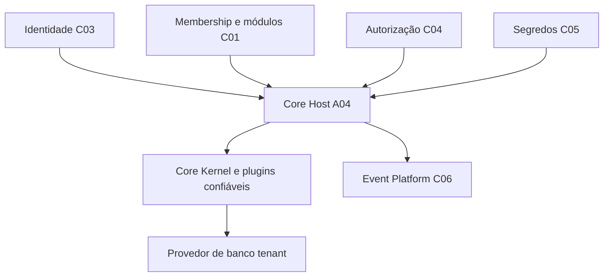

# A04 — Core Host | Referência técnica

> **AUDITORIA ESTÁTICA PARCIAL — 13/11/2026**, checkpoint de código `94fdcc6`. Código presente não comprova deploy, segurança ou execução de plugins em tenants reais.

## Stack, responsabilidades e fronteiras

- **Owner:** `apps/core-host` (NestJS/TypeScript/Node/pg). É o host de composição, **não** owner dos dados ou regras CRM/Inbox/WhatsApp/Organizations/Support.
- **Lista declarada:** `apps/core-host/config/modules.json` contém cinco plugins (CRM, Inbox, WhatsApp, Organizations e Support); `loadInstalledPlugins` valida identificadores, dependências e assets. Instalação, habilitação por tenant e entitlement são verificações distintas.
- **Interfaces públicas:** `CoreKernel`, `SyndesPlugin`, `ModuleDefinition` pertencem a `modules/core-kernel` e aos plugins; classes internas do Host não devem ser consumidas como API pública.
- **Dependências:** C01 Control para membership, lifecycle e catálogo; C03 Keycloak para JWT; C04 OpenFGA para permissões; C05 OpenBao para secrets; C06 Event Platform para entrega. Esses owners mantêm seus próprios contratos.

## Classes, métodos, funções e testes por fonte

| Fonte | Símbolo | Comportamento e limite |
|---|---|---|
| `src/main.ts` | `CoreService.ready`, `CoreController.health/ready/check`, `createHostModule`, `bootstrap` | Composição NestJS, health, readiness, autorização; não confirma roteamento produtivo |
| `src/module-host.ts` | `loadInstalledPlugins`, `installModuleAssets` | Import confiável por specifier, validação de plugin e assets GET/HEAD exatos |
| `src/adapters.ts` | `ActorVerifier.verify`, `PgMembership.canAccessTenant`, `FgaPermission.canAccess`, `fgaResourceObject` | JWT, membership e relação FGA com objeto tenant-bound; sem bypass |
| `src/secrets.ts` | `loadCoreSecrets`, `openBaoSourceFromEnv` | Bootstrap de segredos do C05; não expor valores em logs |
| `src/tenant-database.ts` | `expectedTenantDatabase`, `resolveRegistry`, `TenantCredentialSource.password`, `TenantPgProvider.resolve` | Registro confiável e conexão tenant, sem propriedade das tabelas dos plugins |
| `src/module-catalog.ts` | `PgModuleCatalog.listAvailableForTenant` | Consulta Control, não catálogo livre do browser |
| `src/module-lifecycle.ts` | `PgModuleLifecycle.listModuleStates` | Estados por tenant, não instalação implícita |
| `src/module-effective-access.ts` | `PgEffectiveModuleAccess.canExecuteModule` | Gate de execução efetiva |
| `src/module-installer.ts` | `PgModuleInstaller.plan/apply/enable/disable/verify` | Planejamento, migração e transição auditada: **não executar nesta auditoria** |
| `src/platform-event-service-grant.ts` | `OpenFgaServiceEventGrant.canProcess` | Principal de serviço e `event_delivery`, diferente de grant de usuário |
| `src/platform-event-worker-admission.ts` | `TenantEventWorkerAdmission.authorize` | Exige estado habilitado, escopo válido e autorização; suspende em indisponibilidade |

## Contratos HTTP e segurança

| Método | Rota no Core Host | Gate |
|---|---|---|
| GET | `/healthz` | Liveness, não readiness nem autenticação de negócio |
| GET | `/readyz` | Dependências do Core |
| GET | `/modules/:moduleId/config` | Configuração pública restrita ao contrato do Host; não contém secrets |
| POST | `/v1/tenants/:tenantId/authorize` | Verificação de ator, membership e permissão; não representa grant permanente |

As rotas de cada plugin pertencem ao plugin. É necessário inventário separado de controllers, SSE, jobs e gateways; **não assumir cobertura universal** de autorização só pela presença de adapters.

## Persistência, eventos e interface

- **Control/Manager DB:** catálogo, membership, lifecycle e instalação são acessados por portas; migrations Control pertencem aos seus owners e à infraestrutura PostgreSQL.
- **Tenant DB:** `TenantPgProvider` usa registro e credencial dedicada; schemas CRM/Inbox/WhatsApp/Organizations não são owned pelo A04.
- **Eventos:** publisher, dispatcher, worker, admission, batch e grants de serviço são composição de C06 no Host. Nenhum worker foi iniciado neste ciclo.
- **Frontend:** A04 não tem frontend próprio; Workspace, Manager e Support são consumidores separados. Assets publicados pelos plugins não são um shell universal de autorização.

## Evidência e limitações

Fonte: `docs/evidence/checkpoints/A04-core-host-initial-20261113-0900.md` no branch de auditoria `docs/a04-code-audit-20261113` (não necessariamente incorporado nesta worktree). O checkpoint reportou validação lexical/catálogo e testes A04 **não executados** por ausência de dependências locais; não converter resultado histórico de outro SHA em teste desta revisão. Testes PG17/FGA e deploy real pendentes.

[Status](STATUS.md) · [Operação](OPERACAO.md) · [Escopo](ESCOPO.md).

Fonte navegável: [Core Host no GitHub](https://github.com/delmacy/syndes-system/tree/main/apps/core-host). A URL aponta ao main público e **não** substitui o SHA local do checkpoint.
