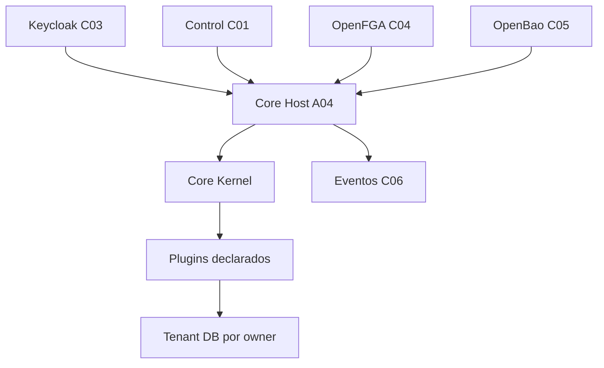

## 5. Arquitetura, banco, interface, configuração e diagramas

- **Banco:** `TenantPgProvider` resolve registro e credenciais, não define migrations de plugins. Control mantém catálogo, membership e lifecycle.
- **Configuração:** `config/modules.json` lista cinco plugins confiáveis; não é catálogo de tenant.
- **Interface:** sem frontend A04 próprio; hosts de Workspace/Manager/Support são aplicações distintas.
- **Eventos:** o worker requer admission e service grant; nenhuma fila/outbox foi ativada nesta auditoria.
