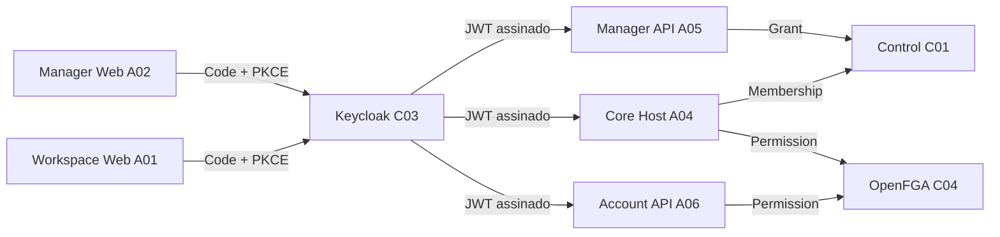

# C03 — Identity Keycloak | Referência técnica

> **AUDITORIA ESTÁTICA E INSPEÇÃO OPERACIONAL LIMITADA — 13/11/2026.** Baseline `origin/main` `ac8deb8`. O catálogo atribui C03 a `infra/security-access`, maturity `distributed` (metadado de inventário). Nenhuma consulta ao Admin API, segredo ou conteúdo de usuários. Portanto, os contratos abaixo são **declarados no código**; seus parâmetros reais de implantação não foram homologados.

## Stack e ownership

| Componente | Fonte | Contrato / limite |
|---|---|---|
| Keycloak 26.8.1 | `infra/security-access/compose.yaml` | Identity provider OIDC; imagem pinada e serviço em redes privadas; configuração via secret montado |
| PostgreSQL | `infra/security-access/compose.yaml`, `infra/postgres/compose.yaml` | Banco técnico declarado `syndes_keycloak`; **não** `syndes_control` nem dados dos tenants |
| OpenBao | `infra/security-access/openbao/render_runtime.py`, `openbao/policies/keycloak.hcl` | Entrega de configuração runtime; segredos não são definidos pela documentação |
| Manager Web (A02) | `apps/master-admin-web/src/auth.ts` | Authorization Code + PKCE S256, `master-runtime.json`, callback no origin |
| Workspace Web (A01) | `apps/workspace-web/src/lib/auth.ts` | Authorization Code + PKCE S256, `workspace-runtime.json`, callback e retorno de rota |
| Manager API (A05) | `apps/master-admin-api/src/auth.mjs`, `src/main.mjs` | JWT RS256 via `jose`, `iss` + `aud` + `azp` + `sub`; grant Control independente |
| Account API (A06) | `apps/account-access-api/src/auth.mjs`, `src/main.mjs` | JWT RS256, client separado e autorização OpenFGA para delegação |
| Core Host (A04) | `apps/core-host/src/adapters.ts`, `src/main.ts` | `ActorVerifier`, membership Control e OpenFGA em gates distintos |

**C03 é infraestrutura declarativa, não um pacote NestJS ou API HTTP própria do repositório**: em `infra/security-access` não há `package.json` ou controller. Métodos listados pertencem aos **consumidores** acima.

## Contratos e métodos de consumidores

| Owner | Símbolo / entrada | Comportamento observado no código |
|---|---|---|
| A02 | `readConfig()` | Carrega `GET /master-runtime.json` (artefato do frontend), valida issuer HTTPS e client id |
| A02 | `login(cfg)` / `finishLogin(cfg)` | `/protocol/openid-connect/auth`, `/token`, `state` e PKCE S256; limpa callback; prazo de 5 minutos |
| A01 | `getWorkspaceConfig()` | Carrega `GET /workspace-runtime.json`; exige issuer HTTPS, client id e tenant UUID |
| A01 | `beginLogin()` / `finishLogin()` | Authorization Code + PKCE; estado na sessão; callback deduplicado durante StrictMode |
| A01 | `actorFromToken(token)` | Apenas decodifica `sub` para UI, **não verifica assinatura** e **não é gate de backend** |
| A05 | `createMasterTokenVerifier({issuer,audience,clientId,jwksUrl})` | RS256/JWKS remoto, `iss` e `aud` exatos, `azp===clientId`, `sub` não vazio; lança em falha |
| A06 | `createTokenVerifier(...)` | RS256, `iss`/`aud`/`azp`, `sub`; retorna actor `kind:user`; veta client Master |
| A04 | `ActorVerifier.verifyClient(header,clientId)` | JWT assinado e client `azp` exato; recusa client Master |
| A04 | `ActorVerifier.verify(header)` | JWT com `iss`/`aud` e veto ao Master; **não** exige azp tenant específico sem `verifyClient` |

## Fluxo, endpoints e fronteiras

- OIDC padrão do provedor: `GET /realms/{realm}/.well-known/openid-configuration`, endpoint de autorização, endpoint de token e JWKS. URLs do realm **não foram verificadas ao vivo**; não declarar disponibilidade apenas pela convenção.
- Endpoints de frontend `GET /master-runtime.json`, `GET /workspace-runtime.json` são configuração da respectiva UI, **não APIs Keycloak**.
- `GET /modules/:moduleId/config` pertence ao **A04 Core Host** e expõe metadados públicos OIDC de plugin instalado; não substitui o controle de autorização.
- Manager e Workspace usam clientes OIDC distintos. A autenticação em um deles não atribui permissões ao outro, e Manager não recebe acesso implícito ao conteúdo do tenant.

## Configuração nominal (sem valores)

- Keycloak: `KEYCLOAK_PUBLIC_URL`, secret montado como `keycloak.conf`, `KC_DB`, `KC_DB_URL`, `KC_DB_USERNAME`, `KC_HOSTNAME`, `KC_HEALTH_ENABLED`, `KC_METRICS_ENABLED` (fonte Compose).
- Manager API: `MASTER_KEYCLOAK_ISSUER`, `MASTER_KEYCLOAK_AUDIENCE`, `MASTER_KEYCLOAK_CLIENT_ID`, `MASTER_KEYCLOAK_JWKS_URL`, `MASTER_PUBLIC_ORIGIN`.
- Account API: `ACCOUNT_OIDC_ISSUER`, `ACCOUNT_OIDC_AUDIENCE`, `ACCOUNT_OIDC_CLIENT_ID`, `ACCOUNT_OIDC_JWKS_URL`.
- Core Host: `CORE_KEYCLOAK_ISSUER`, `CORE_KEYCLOAK_AUDIENCE`, `CORE_KEYCLOAK_JWKS_URL`, `CORE_MASTER_ADMIN_OIDC_CLIENT_ID`.
- Variáveis são **nomes versionados**, não prova de valores corretos em ambiente; não registrar client secrets, bearer, URL interna completa ou credenciais nesta página.

## Persistência, rede e operação observada

- `syndes_keycloak` é a base técnica declarada pelo Compose; **C03 não possui migrations SQL de tenant ou Control** em `infra/security-access`.
- Keycloak e Control são fronteiras distintas; o `sub` do token referencia identidade, enquanto `tenant_memberships` e `platform_operator_access` são tratados por C01.
- `docker ps` em DevServer01 no dia 13/11 mostrou o container Keycloak **Up**, com imagem declarada `26.8.1`. Nenhum `docker exec`, consulta de realm, token, healthcheck ou mudança de configuração foi feito.
- O Compose comenta que não expõe porta de host; uma publicação **somente em loopback** foi observada no container implantado. Isso exige reconciliação dos overrides/deploy, mas não demonstra acesso público.
- Scripts de homologação: `infra/master-admin/keycloak-homolog.py` (`--check`, `--apply`, `--rollback`) e `keycloak-redirect-migrate.py` (migração auditada de redirect). **Não executados**.

## Testes existentes e lacunas

| Fonte | Comprova | Não comprova |
|---|---|---|
| `apps/master-admin-api/test/auth.test.mjs` | RS256 assinado, JWKS fake local, erros de `aud`/`azp`/`sub` | Realm real e navegador |
| `apps/account-access-api/test/auth.test.mjs` | Token RS256 e check OpenFGA em teste | Grants FGA implantados |
| `apps/workspace-web/tests/auth.test.mjs` | PKCE e callback deduplicado, logout/retorno | SSO real no domínio final |
| `tests/platform/platform-manager-keycloak-ci.mjs` | Realm Keycloak descartável, JWT assinado, client adversarial, 401/403 | Client/roles de Keycloak no DevServer01 |
| `tests/platform/test-manager-keycloak-redirect.py` | Restrições estáticas do migrador e registros de auditoria | Migração de redirect aplicada neste trabalho |

**Gates em aberto:** verificar realm/clients/mappers/redirects efetivos sem divulgar PII; provar navegação, renovação/revogação, negativas cruzadas reais e recuperação; revisar rotas que usam `verify` genérico versus `verifyClient` específico.

[Status](STATUS.md) · [Escopo](ESCOPO.md) · [Operação](OPERACAO.md).
