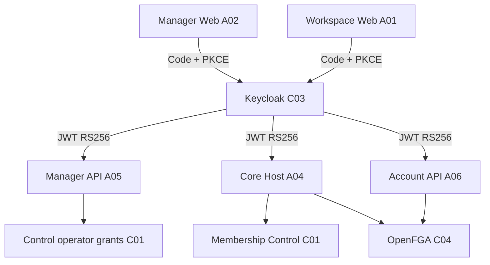

## 5. Arquitetura, banco, interface, configuração e diagramas

### Separação autenticação / autorização

### Persistência e redes

- `infra/security-access/compose.yaml`: serviço Keycloak `26.8.1`, `KC_DB=postgres`, nome técnico do banco `syndes_keycloak`, configuração `keycloak.conf` montada em secret, redes declaradas de dados, autenticação, segredos e identidade Manager.
- Sem migrations de negócio no diretório C03; migrations de Control/tenant pertencem a C01/I04/C02.
- O container Keycloak estava Up no DevServer01 (13/11); publicação somente loopback foi observada no runtime, enquanto o Compose base não publica porta. **Overrides, endpoints públicos, configuração de realm e health OIDC não verificados**.

### Configuração pública versus privada

- Metadados públicos de UI: `issuer` e `clientId` no `master-runtime.json` / `workspace-runtime.json`; o Workspace inclui `tenantId` para apresentação e roteamento, **não como autorização autossuficiente**.
- Manager API: `MASTER_KEYCLOAK_ISSUER`, `MASTER_KEYCLOAK_AUDIENCE`, `MASTER_KEYCLOAK_CLIENT_ID`, `MASTER_KEYCLOAK_JWKS_URL`.
- Core Host: `CORE_KEYCLOAK_ISSUER`, `CORE_KEYCLOAK_AUDIENCE`, `CORE_KEYCLOAK_JWKS_URL` e veto de client Manager.
- Account API: `ACCOUNT_OIDC_ISSUER`, `ACCOUNT_OIDC_AUDIENCE`, `ACCOUNT_OIDC_CLIENT_ID`, `ACCOUNT_OIDC_JWKS_URL`.
- Keycloak/secret: `KEYCLOAK_PUBLIC_URL`, `KC_HOSTNAME`, `KC_DB_URL`, `KC_DB_USERNAME`; **nenhum valor, URL interna ou segredo** deve ser exposto nesta página.

**Frontend:** C03 não possui tela React proprietária; telas de autenticação e callbacks são componentes A01/A02. Implementação de login não comprova fluxo com HTTPS/proxy operante.
