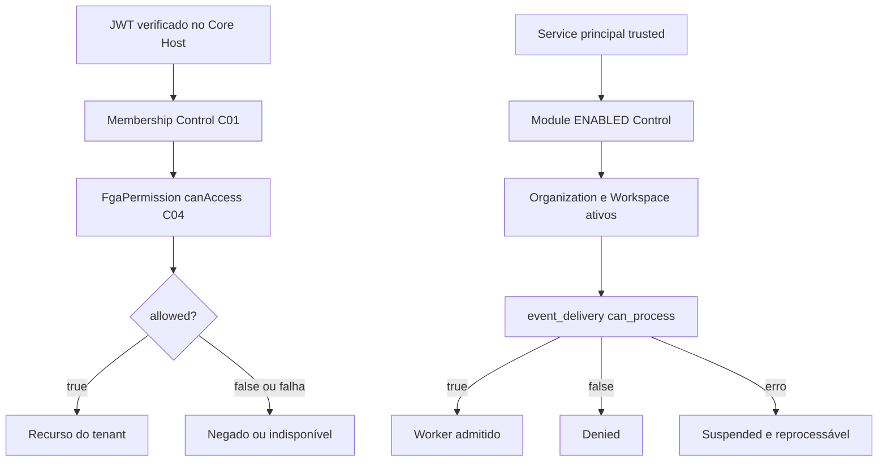

# C04 — Authorization OpenFGA | Referência técnica

> **AUDITORIA ESTÁTICA + CONTAINER UP — 13/11/2026.** Base `2e1707c`. Atribuir ao C04 somente o modelo/provedor, não APIs/classes pertencentes aos consumidores. Nenhuma consulta de stores, grants, modelos ativos, tokens ou dados privados foi realizada.

## Stack e fonte canônica

| Camada | Artefato real | Fronteira |
|---|---|---|
| Serviço OpenFGA v1.22.1 | `infra/security-access/compose.yaml` | `openfga-migrate` executa migration do serviço; `openfga` usa arquivo de configuração privada e redes internas |
| Modelo de autorização candidato | `infra/security-access/fga-model.json` | `schema_version=1.1`; não prova que o modelo está ativo em store real |
| Segredos runtime | `infra/security-access/openbao/render_runtime.py` e políticas | Token/base/store não devem ser publicados |
| A04 Core Host | `apps/core-host/src/adapters.ts`, `src/main.ts` | Autorização de usuário por tenant; membership Control separado |
| A06 Account API | `apps/account-access-api/src/auth.mjs` | Autorização para delegação de roles sem confiar em grant do browser |
| A04/C06 worker | `apps/core-host/src/platform-event-service-grant.ts`, `platform-event-worker-admission.ts` | Serviço trusted e objeto `event_delivery` com escopo completo e deny/suspend |
| Governança | `docs/engineering/ADR-EVENTS-OPENFGA-SERVICE-GRANTS-20261111.md`, `WBS-EVENTS-OPENFGA-SERVICE-20261111.md` | Contratos de implantação/gates, não operação homologada |

`infra/security-access/fga-model.json` não contém classes TypeScript, `package.json` ou endpoints de negócio próprios. O provedor possui endpoint externo OpenFGA, mas as chamadas listadas abaixo são **implementadas em outros owners**.

## Relações versionadas no modelo

| Tipo | Relações | Limites |
|---|---|---|
| `user` | tipo de principal | Não implica tenant membership |
| `tenant` | `member`, `admin` | Tipos diretos `user` |
| `resource` | `tenant`, `viewer`, `editor`, `can_read`, `can_write` | `can_read`: viewer ou membro/admin do tenant; `can_write`: editor ou admin |
| `service` | tipo de principal | Nunca reutilizar `user:` como service |
| `event_delivery` | `processor`, `can_process` | `processor` aceita `service`; `can_process` é relação computada |

**Ponto de atenção:** o modelo de `resource` admite acesso direto por `viewer/editor`; qualquer segurança de escopo depende da criação correta dos vínculos `resource:tenant` e das verificações externas do Host. Não tratar a definição relacional isolada como prova de isolamento em produção.

## Classes, funções, interfaces e chamadas reais (por owner)

| Owner | Símbolo | Comportamento/retorno |
|---|---|---|
| A04 | `FgaPermission.canAccess` | `POST /stores/{store}/check`, usuário `user:{sub}`, `can_read/can_write`, `resource:{sha256(tenant|resource)}`; falha ou resposta inválida nega por exceção |
| A04 | `fgaResourceObject` | Hash do tenant e recurso, sem nome do tenant em plaintext no identificador |
| A06 | `createFgaWriteAuthorizer` | Retorna função `canManageAccountRoles`; faz check `can_write` do recurso de Account |
| A06 | `fgaObject` | Hash de tenant + recurso com função própria do owner |
| A04/C06 | `fgaEventDeliveryObject` | Gera `event_delivery:{sha256}` por tenant, org, workspace, module, consumer e tipo de evento |
| A04/C06 | `OpenFgaServiceEventGrant.canProcess` | Exige principal `service:` exato e relação `can_process`, recusa resultado sem boolean |
| A04/C06 | `TenantEventWorkerAdmission.authorize` | `enabled` somente com estado Control, scope ativo e FGA; `suspended` em falha infra; `denied` em negação explícita |

## Fluxo de proteção

## Persistência, rede, frontend e eventos

- O armazenamento técnico do OpenFGA utiliza PostgreSQL conforme Compose (service `openfga-migrate` e `openfga`). **Não** atribuir suas tabelas às migrations de tenant ou à outbox Control.
- Nenhuma UI de negócio pertence ao C04. Manager/Workspace/Account/Inbox/CRM são consumidores e fazem verificação no backend; não existe permissão válida apenas por menu.
- O OpenFGA check **não emite evento de negócio por si**. O objeto `event_delivery` autoriza entregas de C06; envelopes/outbox pertencem ao Event Platform.
- Testes: `apps/core-host/test/adapters.test.mjs`, `platform-event-service-grant.test.mjs`, `platform-event-service-grant-fga.test.mjs`, `apps/account-access-api/test/auth.test.mjs`. Incluem negativas e instância in-memory/descartável, não configuração runtime persistente.

**Sem prova operacional nesta auditoria:** `fga-model.json` ativo no store, tuples de usuários/serviços, Store ID efetivo, cobertura das rotas, replay, integração com contas ou tenants reais.

[Status](STATUS.md) · [Operação](OPERACAO.md) · [Escopo](ESCOPO.md).
