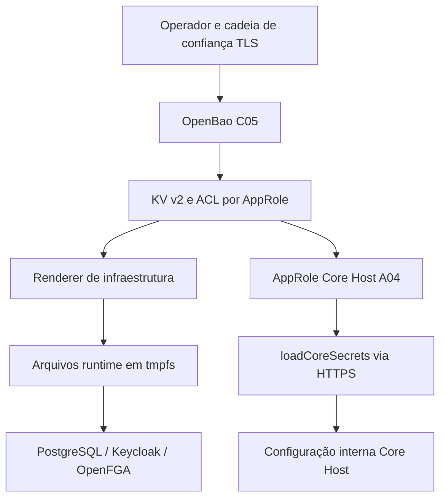

# C05 — Secrets OpenBao | Referência técnica

> **AUDITORIA ESTÁTICA + CONTAINER UP — 13/11/2026.** Baseline `e86beda`; não houve requisições ao OpenBao, leitura de KV, comandos administrativos ou dump de arquivos runtime. Código versionado não significa configuração em operação.

## Stack, modelo e ownership

| Responsável | Fonte | Contrato/consequência |
|---|---|---|
| C05 — servidor | `infra/security-access/compose.yaml`, `infra/security-access/openbao/config.hcl` | OpenBao `openbao/openbao:2.7.0`, HTTPS, rede `syndes-secrets`, volume `openbao_raft`; não é banco Tenant/Control |
| C05 — políticas candidatas | `infra/security-access/openbao/policies/*.hcl` | Templates declarativos para `core-host`, `core-tenant-db`, `keycloak`, `openfga`, `runtime-delivery`; não comprovam instalação |
| C05 — renderer | `infra/security-access/openbao/render_runtime.py`, `run-renderer.sh` | AppRole → KV v2 → arquivo de runtime em diretório protegido → revoke-self |
| A04 — Core Host | `apps/core-host/src/secrets.ts` | `loadCoreSecrets` exige HTTPS + AppRole por arquivos; `openBaoSourceFromEnv` fornece endereços/caminhos, **não valores de secrets** |
| Manager / operação | `infra/master-admin/openbao/{render-master.py,operator-provision.py,run-renderer.sh}` | Operador e renderer próprios; revisão operacional e autorizações separadas |

## Funções e contratos verificáveis

| Owner | Função | Efeitos e falhas |
|---|---|---|
| C05 | `render_runtime.main` (`render_runtime.py`) | Verifica URL fixa, diretório protegido e CA; autentica AppRole e lê KV de `postgres`, `keycloak`, `openfga`; gera arquivos via `mkstemp` + `os.replace`; tenta revogar token |
| C05 | `render_runtime.password` | Validação local de formato/força mínima para entradas do renderer; não equivale a política de rotação |
| A04 | `loadCoreSecrets` (`secrets.ts`) | Lê `roleIdFile`/`secretIdFile`; `POST /v1/auth/approle/login`, `GET /v1/kv/data/production/core-host`, `POST /v1/auth/token/revoke-self`; requer `control_db_url` e `openfga_token` |
| A04 | `openBaoSourceFromEnv` | Seleciona somente `CORE_OPENBAO_URL`, `CORE_BAO_ROLE_ID_FILE`, `CORE_BAO_SECRET_ID_FILE`; não substitui segredo falho por env |
| Manager | `render-master.main` | Renderer de runtime Manager em owner infra/master-admin; não é API C05 |
| Manager | `operator-provision.main` | Procedimento operacional com preflight e efeitos; **não executar** como parte de auditoria |

**Notas:** O Core Host tenta revogar o token inclusive após erro no read. Revogação malsucedida bloqueia startup. Este comportamento está em `secrets.test.mjs` com fetch mockado; nenhuma prova de token revogado em ambiente real foi obtida. `render_runtime.py` tem garantia de falha por exceção para requests, mas a revogação é um gate operacional a observar em integração.

## Modelo de transporte e persistência

A conexão apresentada é **arquitetura declarada e/ou caminho no código**, não topologia implantada comprovada. Nenhuma UI própria pertence ao C05. O cofre não define entidades CRM/Inbox, eventos de negócio nem migrations Tenant DB. `openbao_raft` é persistência interna do serviço OpenBao, sem inferir PostgreSQL separado.

## Testes e verificação

- `apps/core-host/test/secrets.test.mjs`: success/fail, TLS inválido, KV ausente, revogação falha e ausência de fallback inseguro.
- `tests/platform/openbao-smoke.sh`: define ensaio descartável com TLS, inicialização/unseal, Raft, AppRole, policies e renderer; **não executar no ambiente com segredos reais**.
- `infra/security-access/openbao/README.md`: runbook de preparação/DR, com limites explícitos da migração. A checagem só de conteúdo documental não implica resultado de CI ou teste in-memory.

**Não homologado:** integração real em DevServer01, CA/SAN instalado, políticas/identidades efetivas, seal state, auditoria OpenBao, snapshots testados, rotação e consumers totalmente migrados.

[Status](STATUS.md) · [Operação](OPERACAO.md) · [Capítulos](ESCOPO.md).
