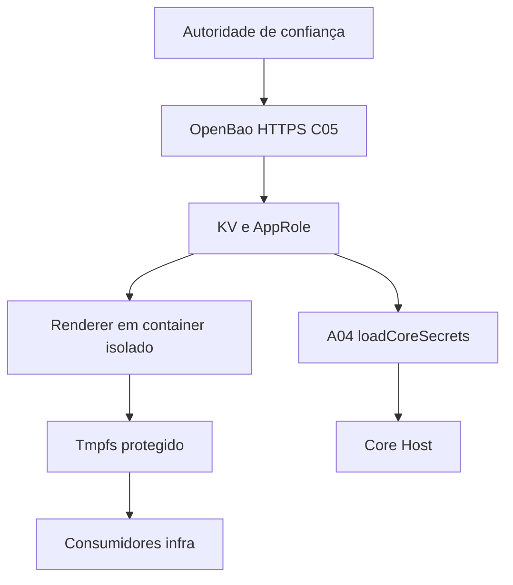

## 5. Arquitetura, banco, interface, configuração e diagramas

**Persistência:** volume Raft próprio `openbao_raft`; não é database PostgreSQL Tenant/Control. **Rede:** `syndes-secrets` de escopo de serviços autorizados, sem pressupor host publicado. **Frontend:** nenhum próprio. **Configuração:** fontes listam `BAO_ADDR`, `CORE_OPENBAO_URL`, `CORE_BAO_ROLE_ID_FILE`, `CORE_BAO_SECRET_ID_FILE` e paths de runtime; não incluir valores/credenciais.

**Migração:** renderer suporta arquivos de outros serviços, mas isso sozinho não atesta migração final de Keycloak/OpenFGA/PostgreSQL.
