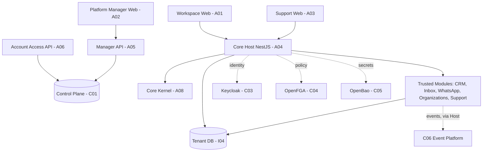

## 5. Arquitetura, banco, interface, configuração e diagramas

### Visão por responsabilidade (modelo lógico, não topologia implantada)

**Interpretação:** setas representam relações arquiteturais de contexto, **não** teste de rede nem contrato operacional de cada seta. Os aplicativos, portas e bancos devem ser auditados nos owners antes de afirmar deploy. O catálogo do Host lista cinco packages confiáveis no commit da revisão; não indica ativação por tenant nem disponibilidade de todos os serviços.

### Fronteiras de persistência

| Contexto | Responsável e estado | Regra essencial |
|---|---|---|
| `syndes_control` | C01, APIs de Control; migrations por fase/candidato | Metadados de catálogo, contas, installs/grants; sem conteúdo CRM/Inbox/WhatsApp |
| DB de tenant | I04/A04 + módulos proprietários | Banco canônico por tenant; selecção pelo provider confiável no Host, nunca pelo navegador |
| Tabelas de domínio | P01/P02/P03/P04/P05/P06 | Escrita pelo owner; parte do SQL histórico está no schema `public`, não assumir conversão |
| `platform_events` no DB tenant | C06; desenho e código de outbox | Estado de ativação operacional a confirmar no ambiente; atomicidade exige transação fixada |
| `control_events` no Control DB | C01; migration `006_control_events` candidata | Só eventos administrativos globais; não misturar dados de domínio tenant |
| `_syndes` / schemas por módulo | [ADR de schemas](../../../engineering/ADR-ACCOUNT-KERNEL-MODULE-SCHEMAS-20261110.md) | Ledger/ACL e schema-alvo em evolução; não declarar aplicado |

### Matrizes de acoplamento e autorização

| Consumidor | Owner / fonte de dados | Mecanismo permitido | Restrição |
|---|---|---|---|
| Workspace | APIs tenant no Host e Account Access quando cabível | HTTP autenticado + contexto validado | Sem Control DB direto; menu não concede permissão |
| Manager | Manager API/Control Plane | API administrativa, client OIDC e role SQL separados | Sem leitura de banco de tenant por privilégio global |
| Core Host | Kernel e plugins NestJS confiáveis | Injeção de ports / registry validado | Sem plugin arbitrário ou mercado remoto em runtime |
| WhatsApp ↔ Inbox ↔ CRM | Módulos P03/P02/P01 e C06 | Contratos/versionamento + outbox/consumer autorizado | Evitar escritas diretas cross-owner; worker não presumido ativo |
| Support | Tenant Syndes e seus grants | Mesmas regras de membership e FGA | Não converter usuário do Manager em leitor automático do Support |

### Interface e configurações

- Frentes distintas: `apps/master-admin-web` (global), `apps/workspace-web` (tenant) e `apps/support-web` (Support), conforme escopo. `packages/front-shared` compartilha apenas componentes e estilos.
- Config de plugins trusted: `apps/core-host/config/modules.json`. **A presença de um package na lista não identifica o ambiente em que foi lançado.**
- Nomes de configuração/variáveis precisam ser confirmados **no owner operacional**; G01 não publica valores, DSNs, credenciais, URLs de administração ou topologia sensível.

### Pendências de arquitetura a validar antes da homologação

- Isolamento real entre Control e Tenant DB, ACL, usuários SQL e Keycloak/OpenFGA, incluindo testes negativos e tenant A/B.
- Ativação de módulo por entitlement + installation + ENABLED + grants na borda HTTP, workers e frontend.
- Event Bus e dispatcher idempotentes em ambiente autorizado, restore e replay operacional; separar suíte descartável de serviço real.
- Perfis de composição, migração por schema e gates de multi-org permanecem **evoluções controladas**, não invariantes comprovadas no deploy.
