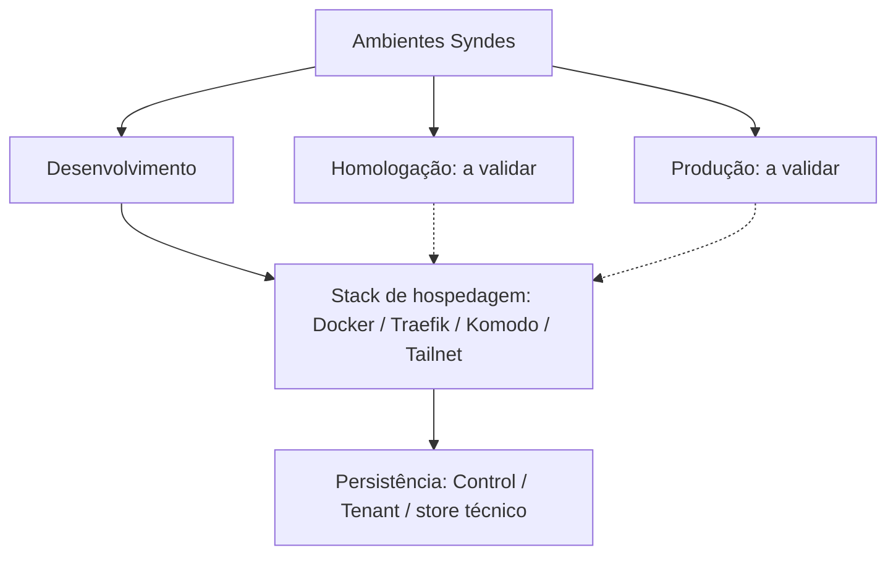

# I02 — server02 | Referência técnica

> **INVENTÁRIO DOCUMENTAL NÃO AUDITADO.** Só descreve arquivos/declarações presentes no repositório; não representa funcionalidade implantada.

## Stack e ownership

- **Fonte:** [infra](https://github.com/delmacy/syndes-system/tree/main/infra) — diretório.
- **Owner:** declarado em `catalog/work-units.json`. Contratos públicos de outros owners não podem ser alterados diretamente.
- **Stack/manifests:** não foi encontrado package.json nesta fonte; auditar o artefato antes de declarar framework.

## Backend: classes, métodos e responsabilidades

**A AUDITAR:** inspecionar código e testes, assinaturas, parâmetros, efeitos e erros. Não publicar API privada como contrato.

## Contratos públicos, APIs e eventos

[Índice normativo de contratos](../../standards/CONTRATOS-PUBLICOS.md). Imports, endpoints e consumers exigem evidência de export, versão e compatibilidade.

## Frontend: aplicações, telas e componentes

**A AUDITAR:** conferir telas em Workspace, Manager ou Support e componentes compartilhados; não inferir rota a partir do nome da unidade.

## Schemas e migrations

### Tenant DB

Tabelas e migrações precisam de ownership e prova de aplicação; arquivo SQL presente não equivale a mudança executada.

Nenhuma migration em subpasta SQL nesta fonte; isso **não** comprova ausência de persistência.

### Control / Manager DB

Nenhuma tabela pode ser atribuída ao Control por inferência; confirmar owner e schema. Negócio do cliente fica no Tenant DB.

## Diagramas, testes e pendências

- [Escopo](ESCOPO.md) · [Evolução](EVOLUCAO.md) · [Status](STATUS.md) · [Histórico](HISTORICO.md).
- **Próximo passo:** auditar classes/exports, contratos, telas, tabelas, testes e evidências sem inventar funcionalidades.

## Ambientes e hospedagem {#ambientes-e-hospedagem}

Esta página agrega infraestrutura de hospedagem do Syndes por **ambiente e função**, não por nomes de máquinas no menu.

| Ambiente / recurso | Fonte canônica | Situação documental |
|---|---|---|
| **Desenvolvimento** | [I01 — runbook DevServer01](../I01-devserver01/OPERACAO.md) | Unidade histórica com runbook; serviços atuais precisam de validação do host |
| **Homologação / produção** | [I02 — hospedagem](OPERACAO.md), [I03 — host auxiliar](../I03-win1-server/OPERACAO.md) | **Mapeamento de papéis a verificar**; não declarar ambiente operacional sem evidência |
| **Banco / PostgreSQL** | [I04](../I04-postgresql/REFERENCIA-TECNICA.md) | Separar Control DB, Tenant DB e stores técnicos |
| **Containers e redes** | [I05 — Docker](../I05-docker-e-redes/REFERENCIA-TECNICA.md) | Serviços de hospedagem, não módulos SaaS |
| **Roteamento TLS** | [I06 — Traefik](../I06-traefik-https/REFERENCIA-TECNICA.md) | Publicação e isolamento de rotas dependem da configuração validada |
| **Rede privada** | [I07 — Tailnet](../I07-tailnet/OPERACAO.md) | Acesso administrativo, não endpoint de API pública |
| **Orquestração** | [I08 — Komodo](../I08-komodo/REFERENCIA-TECNICA.md) | Gestão de containers/hosts, não módulo instalado por tenant |
| **Segurança do host** | [I12](../I12-seguranca-de-host/OPERACAO.md) | Controles operacionais |

### Topologia de responsabilidades

As linhas pontilhadas indicam topologias **a confirmar**, não deploys existentes. A composição efetiva, versões, estado, rede, backups e responsáveis deverão ser importados das fontes operacionais confiáveis sem publicar IPs, segredos, tokens ou configuração de produção no GitHub Pages.

### Composição de cada ambiente

O inventário operacional deve registrar: finalidade, host(s) autorizados, serviços instalados, manifests Compose/Kubernetes quando houver, volumes, redes, entrada HTTPS, dependências, datastore e mecanismo de backup/restore. O estado **instalado/ativo** requer verificação do ambiente e data do diagnóstico; não derivar do código ou dos Dockerfiles.

## Inventário observado — DevServer01 (12/11/2026)

> **Leitura de `docker ps` no ambiente de desenvolvimento, em 12/11/2026.** Os itens abaixo foram observados como containers em execução nessa data. Isso **não** comprova homologação, endpoint acessível, segurança da configuração, atualização do produto ou qualquer instalação em produção. Não são publicados IPs, redes, credenciais nem identificadores de containers.

| Camada | Serviços/tecnologias observados | Observação |
|---|---|---|
| Hospedagem e proxy | Docker Engine, Traefik e serviços Nginx | Containers existentes; rotas e portas não auditadas |
| Orquestração | Komodo Core e Periphery, armazenamento MongoDB | Stack de administração de containers, não módulo SaaS por tenant |
| Identidade e segurança | Keycloak, OpenFGA, OpenBao | Processos presentes; grants e health funcional não homologados |
| Persistência | PostgreSQL 17 e instância PG17 descartável | Separar banco operacional de ambiente de teste; existência não prova migrations |
| Backend de aplicação | Core Host em mais de uma composição | Instâncias de preview/legado exigem inventário de roteamento antes de declarar dono do tráfego |
| Frontends | Workspace e visualização de Manager, além de previews | Imagens e containers observados, não equivalem a release de produto |
| Canal WhatsApp | Gateway Go/Whatsmeow e stack relacionada de Core Host | Sidecar do P03, não módulo independente de menu |

**Próxima auditoria operacional:** associar cada container a seu Compose/manifests, objetivo (preview, teste, desenvolvimento), owner, health funcional, banco, backup e roteamento autorizado. **Homologação e produção permanecem "não verificadas".** A data e o método de coleta devem acompanhar revisões futuras.
