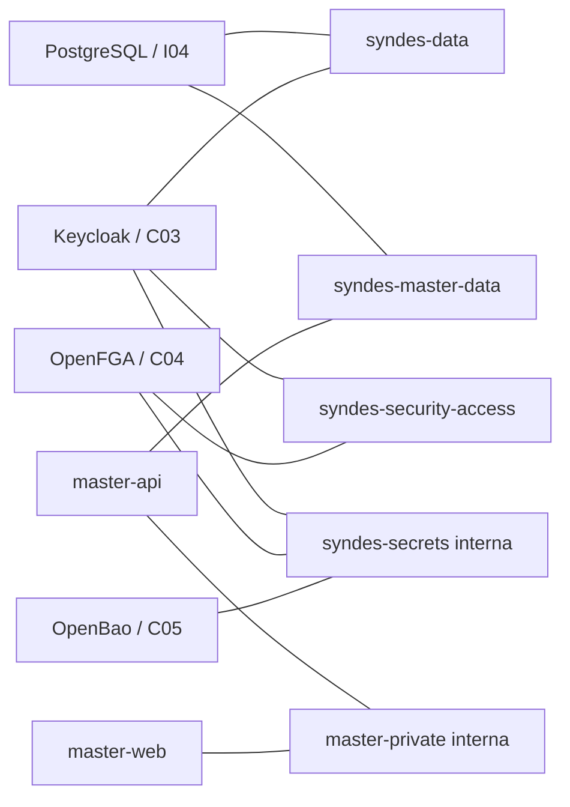

# I05 — Docker e redes | Referência técnica

> **AUDITORIA PARCIAL DE CONFIGURAÇÃO, NÃO HOMOLOGAÇÃO OPERACIONAL.** Base `ec037df`; checkpoint `ff37302`. A configuração Compose é fonte declarativa, não prova de que containers ativos usam a mesma revisão.

## Fontes, serviços e fronteiras

| Fonte | Serviços/imagens declarados | Rede/volume e controles |
|---|---|---|
| `infra/postgres/compose.yaml` | `postgres:17-bookworm` | `postgres_data`, `syndes-data` e `syndes-master-data` externas; secrets montados de runtime, sem porta de banco publicada no manifesto |
| `infra/security-access/compose.yaml` | `keycloak:26.8.1`, `openfga:v1.22.1`, `openbao:2.7.0`, `openfga-migrate` | `syndes-secrets` bridge interna, `syndes-security-access`, `syndes-data`, `syndes-master-identity`; Raft `openbao_raft` |
| `infra/master-admin/compose.yaml` | `master-api`, `master-web` | `master-private` interna, `syndes-master-data`/`syndes-master-identity` externas; web bind em loopback; `read_only`, `no-new-privileges`, `cap_drop: ALL` declarados |

**Interfaces/contratos:** não há API HTTP, classe TypeScript ou frontend próprio do I05. Interfaces são manifests Compose, nomes de rede, mounts, configuração runtime e restrições de conectividade. APIs de identidade, segredo, autorização, tenant e Manager pertencem aos módulos respectivos. Não atribuir schemas/migrations SQL a I05; o volume PostgreSQL pertence ao serviço de I04 e `openbao_raft` ao serviço C05.

**Atenção:** `openfga-migrate` é job mutável declarado, não executado na auditoria. `env_file`, secrets e caminhos de runtime são referenciados, **não lidos**. Nenhum `docker inspect` de containers, env, mounts ou IPs foi realizado.

Diagrama de **vínculos declarados** (subconjunto dos Compose inventariados), não tráfego observado. Os stacks Core Host, Workspace, WhatsApp, Komodo, Traefik e Tailnet requerem inventário próprio.

## Evidência e testes

- Checkpoint: `docs/evidence/checkpoints/I05-docker-networks-initial-20261113-1000.md`.
- Validadores de catálogo e testemunhas verificam consistência do inventário documental, **não** efetividade da rede. O registry de `contract-witnesses.json` referencia símbolos de código; não inventar símbolos JS/TS para YAML.
- Pendentes: inventário completo dos stacks, `docker compose config --quiet` com ambiente sanitizado, comparação de manifests com runtime, ingress/egress, publicação de portas, least privilege e isolamento por rede.

[Status](STATUS.md) · [Operação](OPERACAO.md) · [Escopo](ESCOPO.md).
