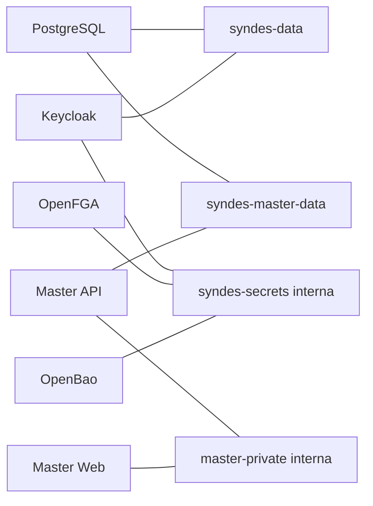

## 5. Arquitetura, banco, interface, configuração e diagramas

Topologia **declarada** e parcial, sem representar IPs, portas efetivas ou tráfego. `postgres_data` pertence à persistência PostgreSQL; `openbao_raft` ao cofre. Não há Tenant DB, Control DB, classes ou frontend próprio do I05. Configurações secretas e env_file não foram lidas.
