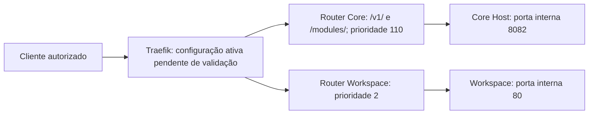

## 5. Arquitetura, banco, interface, configuração e diagramas

- Este diagrama representa a intenção das labels, não uma topologia verificada.
- `infra-proxy` é rede Docker externa no Compose; `web` é entrypoint declarado, **não evidência de TLS**.
- Banco de dados, schemas, migrations e lógica de UI: não pertencem ao I06 segundo o inventário atual; frontend atendido é owner Workspace.
- Configuração dinâmica ativa, certificados e políticas não foram inspecionados nesta reconciliação.
