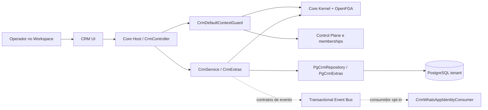
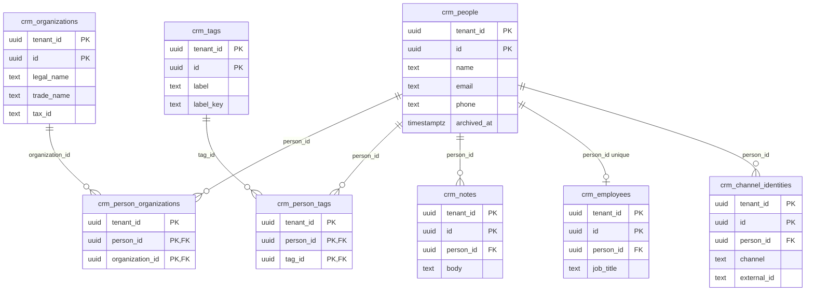
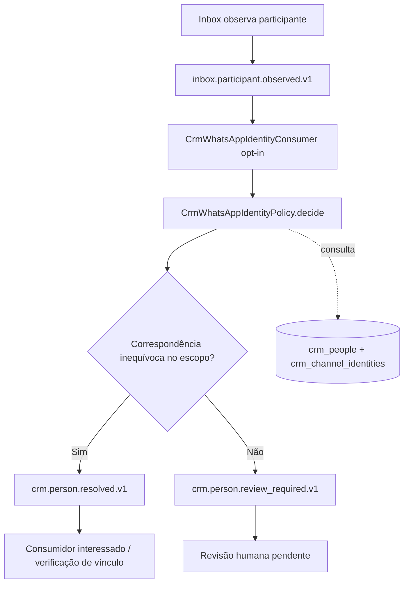
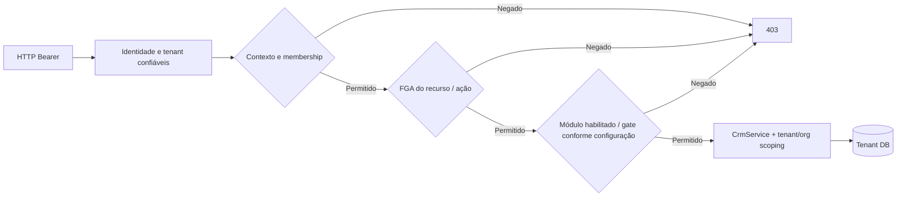
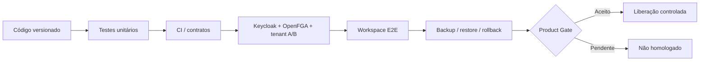

# P01 CRM — Diagramas técnicos verificáveis

> **Leitura de código · 13/11/2026.** Estes diagramas representam responsabilidades, fluxos e relações declaradas. Não comprovam implantação, migrações aplicadas, consumo ativo de eventos nem homologação de produto. Fontes: `modules/core-crm/src/`, `modules/core-crm/sql/`, `apps/workspace-web/src/features/crm*.tsx` e `STATUS.md`.

## 1. Arquitetura de execução



**Fronteira:** Control Plane não é `crm_organizations`. Actor, tenant e escopo operacional não vêm do corpo da requisição.

## 2. Modelo entidade-relacionamento — migrations CRM 001–003



**Auditoria:** `crm_audit` é a **nona tabela** e mantém `tenant_id`, `actor_id`, `entity_type`, `entity_id`, `action`, `recorded_at`; não há FK para `crm_people` na migration 001. Suas referências são lógicas, não relações físicas. As PKs de negócio incluem `tenant_id` onde definidas. Este ER é resumido; colunas e índices completos estão no inventário de dados e nos arquivos SQL.

## 3. Criação de pessoa — sequência lógica

```mermaid
sequenceDiagram
  actor Actor as Operador
  participant UI as Workspace
  participant API as CrmController / Host
  participant G as Guard de contexto
  participant K as Core Kernel / FGA
  participant S as CrmService
  participant PG as Tenant PostgreSQL
  Actor->>UI: Preencher contato
  UI->>API: POST /people com autenticação
  API->>G: Resolver tenant/organização/workspace
  G->>K: Validar membership + crm:context/read
  K-->>G: Permitido ou negar
  G-->>API: Contexto confiável
  API->>S: createPerson(context, input)
  S->>K: crm:people/write
  K-->>S: Permitido ou negar
  S->>PG: Transação tenant + crm_people / crm_audit
  PG-->>S: Person
  S-->>API: Person
  API-->>UI: Resposta HTTP
```

**Atenção:** a sequência ilustra caminhos presentes no código, não demonstra que os componentes foram integrados com tokens reais em um deploy.

## 4. WhatsApp → Inbox → CRM — evento de identidade



**Contrato:** tenant, organization e workspace no envelope. A política não cria contato automaticamente; o consumidor não escreve diretamente nos bancos de Inbox ou WhatsApp. Não pressupor tratamento humano já implantado.

## 5. Segurança, autorizações e escopo



**Limitação:** modo legacy/enforce é condição de rollout; SQL 002 e etapas C2/C3 controlam ativação multi-org. Não remover restrições por inferência documental.

## 6. Portões de publicação e homologação



**Critério:** `IMPLEMENTED != INTEGRATED != TESTED != PROVEN != DONE`. Resultado de build do Docs Reader não é teste do CRM real.
