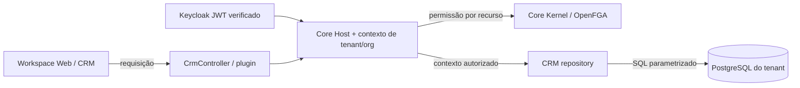
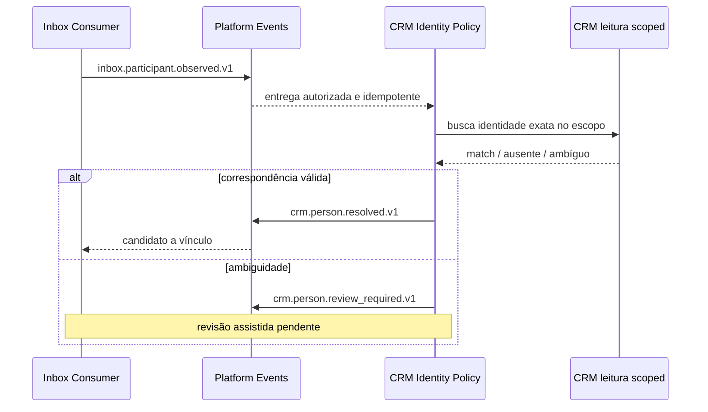

## 5. Contratos e interfaces oferecidos/consumidos

| Interface | Papel do CRM | Dono do outro lado | Referência |
|---|---|---|---|
| `/v1/tenants/:tenantId/crm/*` | Provedor HTTP NestJS | Core Host / Workspace | `src/crm.controller.ts` |
| `GET /crm/capabilities` sob prefixo tenant | Provedor de permissões efetivas por recurso | Core Kernel/FGA | `src/crm.controller.ts` |
| `SyndesPlugin`, `crmModule` v0.1.0 | Pacote contribuinte do Host | A04/A08 | `src/plugin.ts`, `src/service.ts` |
| `TrustedTenantDatabaseProvider` | Consumidor | Core Host + Kernel | `src/contracts.ts`, `src/runtime.ts` |
| `CoreKernel.execute/executeModule` | Consumidor de autorização | Kernel / Host | `src/service.ts`, `src/context-guard.ts` |
| `inbox.participant.observed.v1` | Consumidor lógico de observação de participante | Inbox / Event Platform | `src/whatsapp-identity-events.ts` |
| `crm.person.resolved.v1` | Publicador de resultado de resolução | Consumidores autorizados | `src/whatsapp-identity-events.ts` |
| `crm.person.review_required.v1` | Publicador de pendência de revisão | Consumidor/procedimento a definir | `src/whatsapp-identity-events.ts` |

**Regra:** eventos só são tratados como operacionais após comprovar publisher, outbox, dispatcher, consumidor e grant no ambiente real. Não presumir sucesso por existir type ou teste PG17 sintético.

**Permissões por recurso no plugin:** `crm:context`, `crm:people`, `crm:organizations`, `crm:relationships`, `crm:tags`, `crm:notes`, `crm:employees`, `crm:channels`; ações específicas do manifesto em `src/plugin.ts`. O frontend não substitui autorização HTTP.

**HTTP relevante:** people e organizations (listar/criar/consultar/editar/arquivar), vínculos, tags, notes, channels, employee, timeline, duplicates, imports/exports CSV e capabilities. Não duplicar assinatura de request/payload neste Markdown; conferir o controller antes de editar.

---

### Diagrama — fronteiras de API e autorização

**Limite de leitura:** controller, plugin, guard e repositório existem em código; o desenho **não** comprova execução com Keycloak/OpenFGA reais. O banco é escolhido pelo provedor confiável, não por um DSN fornecido pelo navegador.

### Diagrama — resolução de pessoa por eventos (opt-in)

A cadeia usa contratos identificados em `modules/core-crm/src/whatsapp-identity-events.ts` e `apps/core-host/src/platform-event-worker-composition.ts`. É uma **composição opt-in testada parcialmente**, sem declarar worker operacional ou reconciliação de 14 pessoas.
