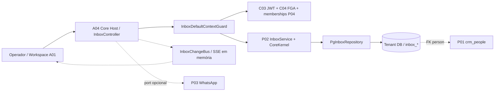
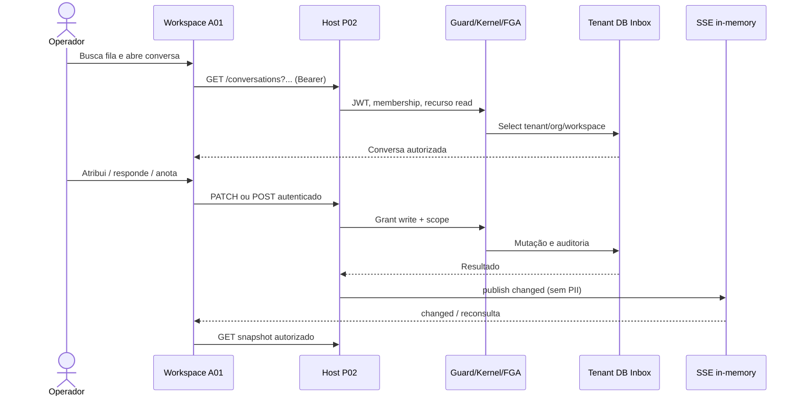
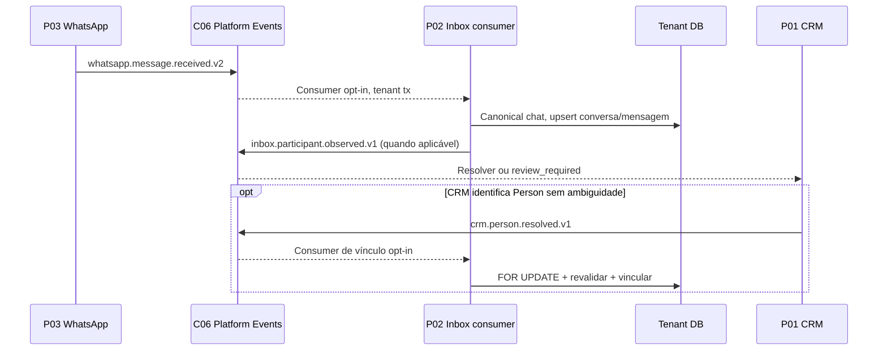
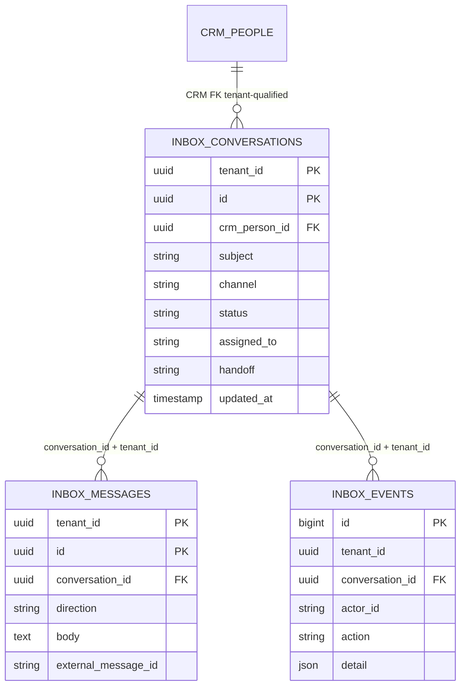
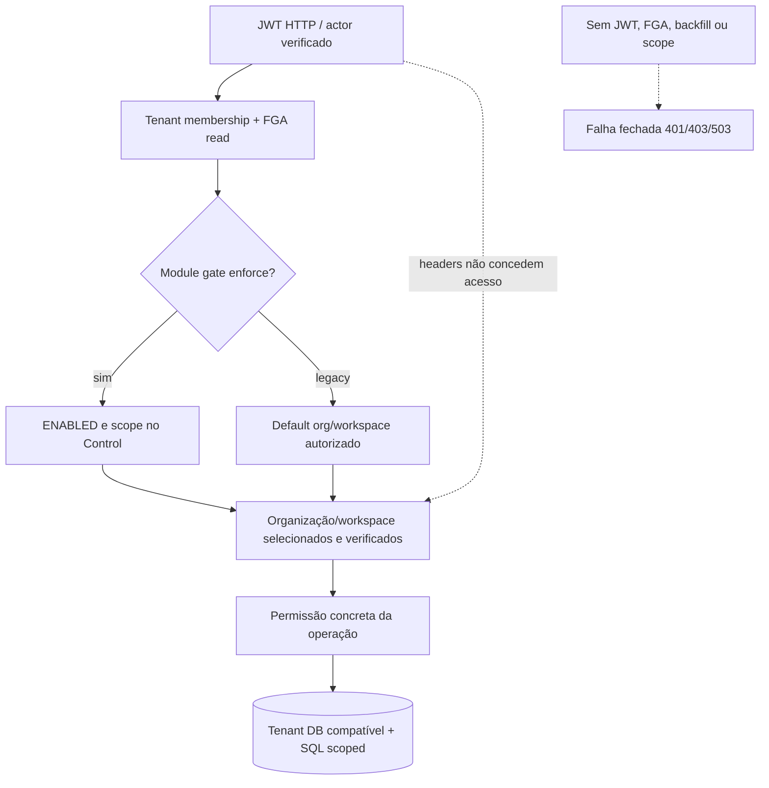

# P02 Inbox — Diagramas reconciliados com o código

> **Representação documental em 16/11/2026** a partir da SHA `24018b354392196899332af1581170fb3ad7cf24`. Diagramas demonstram responsabilidade e dependências identificadas; **não comprovam serviço instalado, worker ativo, pipeline de eventos operacional ou Product Gate**.

## 01 · Visão de componentes e ownership (C4 simplificado)

**Provas de código:** [controller](https://github.com/delmacy/syndes-system/blob/24018b354392196899332af1581170fb3ad7cf24/modules/inbox/src/inbox.controller.ts), [guard](https://github.com/delmacy/syndes-system/blob/24018b354392196899332af1581170fb3ad7cf24/modules/inbox/src/context-guard.ts), [service](https://github.com/delmacy/syndes-system/blob/24018b354392196899332af1581170fb3ad7cf24/modules/inbox/src/service.ts), [repo](https://github.com/delmacy/syndes-system/blob/24018b354392196899332af1581170fb3ad7cf24/modules/inbox/src/postgres.ts). Fluxo do browser requer IAM e mounts reais para estar operacional.

## 02 · Sequência: atender conversa e atualizar UI

**Condição:** para WhatsApp reply `InboxHost.reply` usa o port opcional de P03; enfileiramento **não significa entrega**.

## 03 · Eventos versionados: P03 → P02 → P01

**Gates abertos:** worker e service principal C06, migrações e roteamento P03, replay e conflitos CRM. Diagrama não autoriza ativação. Fonts: [consumer WhatsApp](https://github.com/delmacy/syndes-system/blob/24018b354392196899332af1581170fb3ad7cf24/modules/inbox/src/whatsapp-event-consumer.ts) e [consumer CRM](https://github.com/delmacy/syndes-system/blob/24018b354392196899332af1581170fb3ad7cf24/modules/inbox/src/crm-link-event-consumer.ts).

## 04 · ERD: apenas as três tabelas da migration 001

**Limite intencional:** isto não representa campos adicionais de WA, organização, workspace, favoritos ou unread. Eles precisam de migrations/versionamento reais; ver [inventário](INVENTARIO-TECNICO.md).

## 05 · Fronteiras de confiança e negativas (trust boundary)

**Observação:** os códigos de erro dependem do handler; o desenho não demonstra testes reais A/B. Multi-org e índices 002 dependem de aprovação de owners.

## 06 · Implantação, recovery e estados de validação

| Etapa | Evidência atualmente disponível | Para promover |
|---|---|---|
| Código identificado | `src`, `sql`, `test` em GitHub | Registrar SHA |
| Testes unitários históricos | 34 PASS locais em 12/11 | Reexecutar SHA atual |
| SQL de tenant | 001 presente; extensões identificadas em queries | Inventariar migrations aplicadas/restore |
| Serviço + grants | plugin e permissões declarados | Testar Host, Keycloak, FGA em alvo |
| Event Bus/WA/CRM | consumers opt-in versionados | Provar worker, reprocessamento, cutover |
| UI, dados reais, HA | componentes e SSE in-memory | Browser E2E, acessibilidade, broker/limit |
| Product Gate | Não homologado | Evidência de aceite e rollback |

Não elevar status por documentação, build estático Next.js ou CI de outro módulo.
