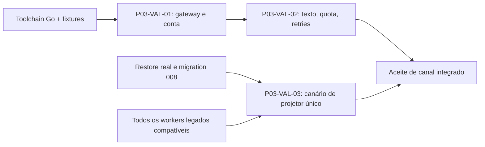

# P03 — WhatsApp | Evolução

> **PLANO DE EVOLUÇÃO · RASCUNHO DE VINCULAÇÃO.** Os workpackages abaixo são associações com a WBS existente, **não designações exclusivas de ownership**, nem confirmação de que a tarefa esteja em andamento ou concluída. Validar antes de autorizar execução.

## Painel do módulo

| Indicador | Fonte e interpretação |
|---|---|
| Unidade | `P03` — `catalog/work-units.json` |
| Workpackages relacionados | 2 grupos da WBS mestre (revisão histórica) |
| Tarefas com referência | 5 IDs rastreáveis, sem duplicar os requisitos |
| Sprint em andamento | [Ver SPRINT.md](SPRINT.md) — não inferir que está ativa |
| Evidências de implementação | [Ver STATUS.md](STATUS.md) — exige commit, testes e ambiente |
| Escopo normativo | [Ver ESCOPO.md](ESCOPO.md) e seus capítulos |
| Pedidos de mudança | [Atualizações](updates/README.md) e GitHub Issues identificadas por `[P03]` |

## Workpackages e tarefas existentes

**Origem rastreável:** [WBS mestre do Syndes](../../engineering/WBS-PROGRAMA-SYNDES-20261110.md) · caminho exato `docs/engineering/WBS-PROGRAMA-SYNDES-20261110.md`.

Os estados da tabela são **os registrados no documento de origem**, que pode estar desatualizado. Não altere o status para DONE sem consultar o STATUS atual, SHA, CI, testes e aceite. Uma mesma tarefa pode envolver outros módulos, que preservam a propriedade de seus próprios contratos.

### WP-40 — Tenant operacional Syndes e Central Syndes Support

**Prioridade na fonte:** P1 · **Gate:** G4 — Support piloto interno/externo

| ID da tarefa | Entregável planejado | Dependências na WBS | Estado registrado na WBS |
|---|---|---|---|
| [**40.04**](../../engineering/WBS-PROGRAMA-SYNDES-20261110.md) | Provisionar conta/número WhatsApp exclusivos do atendimento Syndes | 40.02 | BLOQ (operação) |

**Critérios de aceite e evidências originais:** consultar a seção **WBS 40** em `docs/engineering/WBS-PROGRAMA-SYNDES-20261110.md`; localizar os IDs acima. Confirmar decisões na SHA atual antes de iniciar.

### WP-50 — CRM, Inbox, WhatsApp e Workspace existentes — hardening de MVP

**Prioridade na fonte:** P1 · **Gate:** G5 — fluxo Basic real

| ID da tarefa | Entregável planejado | Dependências na WBS | Estado registrado na WBS |
|---|---|---|---|
| [**50.01**](../../engineering/WBS-PROGRAMA-SYNDES-20261110.md) | Confirmar paridade de CRM/Inbox/WhatsApp entre `main` e DevServer01 | 00.01,10.01 | PEND |
| [**50.05**](../../engineering/WBS-PROGRAMA-SYNDES-20261110.md) | Homologar WhatsApp gateway e Whatsmeow real | 50.01,50.03 | BLOQ |
| [**50.06**](../../engineering/WBS-PROGRAMA-SYNDES-20261110.md) | Auditar controles de rate limit, integridade e quotas dos canais | 50.05,10.06 | BLOQ |
| [**50.08**](../../engineering/WBS-PROGRAMA-SYNDES-20261110.md) | Fechar aceite do fluxo Basic CRM + Inbox + WhatsApp | 50.07,10.07 | BLOQ |

**Critérios de aceite e evidências originais:** consultar a seção **WBS 50** em `docs/engineering/WBS-PROGRAMA-SYNDES-20261110.md`; localizar os IDs acima. Confirmar decisões na SHA atual antes de iniciar.

## Planos especializados e dependências documentais

Esses documentos contêm o detalhamento das frentes relacionadas, mas **não são automaticamente metas da sprint**.

- [WBS WA DATA CRM WA 20261111](../../engineering/WBS-WA-DATA-CRM-WA-20261111.md) — `docs/engineering/WBS-WA-DATA-CRM-WA-20261111.md`
- [WBS WHATSAPP PROJECTION CUTOVER 20261111](../../engineering/WBS-WHATSAPP-PROJECTION-CUTOVER-20261111.md) — `docs/engineering/WBS-WHATSAPP-PROJECTION-CUTOVER-20261111.md`
- [WBS EVENTS WHATSAPP INBOX CRM 20261111](../../engineering/WBS-EVENTS-WHATSAPP-INBOX-CRM-20261111.md) — `docs/engineering/WBS-EVENTS-WHATSAPP-INBOX-CRM-20261111.md`

## Backlog local e novos workpackages

Use esta seção apenas para **planejamentos explicitamente aprovados e vinculados a requisitos do módulo**. A estrutura abaixo é um modelo vazio, não um pacote de trabalho iniciado.

| WP / tarefa | Objetivo e requisito aprovado | Prioridade | Dependência / gate | Situação comprovada | Evidência |
|---|---|---|---|---|---|
| — | Nenhum incremento local adicional registrado neste documento | — | — | NÃO ATRIBUÍDO | — |

Para criar um pacote local novo, utilize [Modelo de Workpackage](../../standards/TEMPLATE-WORKPACKAGE.md), registre IDs estáveis como `P03-WP-01` e `P03-TASK-001`, acrescente tarefas com critérios de aceite, vincule o capítulo normativo e a decisão aprovada. Se houver dependência externa, encaminhe ao dono: não implemente fora de `P03`.

## Próximo incremento e checkpoint

1. **Planejar:** revisar as tarefas da WBS e selecionar um pacote com dependências satisfeitas. Registrar a decisão e o objetivo verificável em [SPRINT.md](SPRINT.md).
2. **Executar:** consumir somente requisitos aprovados, caminhos de código próprios e contratos públicos; os três prompts estão disponíveis nas páginas **Projeção**, **Implementação** e **Alteração rápida**.
3. **Consolidar:** atualizar [STATUS.md](STATUS.md) com SHA, CI, ambiente, testes, bloqueios e evidência de aceite; fechar o pacote antes de outro incremento independente.

**Não confundir:** planejado ≠ aprovado ≠ atribuído ≠ implementado ≠ testado ≠ integrado ≠ operacional ≠ aceito.

## Reconciliação técnica — 2026-11-12

> **Workpackage candidato; NÃO aprovado, atribuído ou iniciado.** Referências locais e resultados de testes devem ser checados contra a SHA do agente antes de editar código.

**Resumo do estado:** Pacote TypeScript com contas, outbox, inbound, dispatch, contratos e migrations 001–008; gateway Go/Whatsmeow existe. O plugin consta em apps/core-host/config/modules.json, mas a inscrição não prova módulo habilitado por tenant nem projetor novo operacional.

**Próximo marco recomendado:** Homologar a rota textual segura por conta/tenant e preparar canário de projetor único apenas após restore real.

### P03-WP-VAL — Validação do incremento MVP (proposto)

| Task ID | WBS / plano relacionado | Entregável | Depende | Critério de aceite | Estado |
|---|---|---|---|---|---|
| **P03-VAL-01** | 50.05; WA-DATA-01 | Executar Go tests e fixtures de conta/callback | Toolchain Go, PG descartável e nenhuma credencial operacional | Go tests + negativas cross-tenant | CANDIDATA / NÃO ATRIBUÍDA |
| **P03-VAL-02** | 50.05/06 | Validar fluxo textual, idempotência, taxa e recovery | Conta ENABLED + autorização scoped | E2E textual e testes de retry/restart/duplicidade | CANDIDATA / NÃO ATRIBUÍDA |
| **P03-VAL-03** | WA-CUT07–10 | Planejar cutover de único projetor com rollback | Migration 008/restore e versões legadas compatíveis | Canário sem dois donos para o mesmo inbound | CANDIDATA / NÃO ATRIBUÍDA |

### Dependências bloqueantes

- Go/Whatsmeow: testes de gateway e persistência/quotas/contas não validados nesta auditoria.
- WA-CUT07–10: migration 008 em staging, todas instâncias legadas compatíveis com filtro, canário e rollback — não ativar projetores concorrentes.
- Grants FGA, identity service, tenant/org/workspace, restore e Control ENABLED reais permanecem gates.
- Escopo de entrega atual textual; mídia completa permanece fora desta fatia.

**Rotina:** escolher **uma meta** na Sprint após resolver os gates; implementar apenas na unidade, executar testes afetados e registrar commit, CI, ambiente, evidências e pendências em STATUS. Não converter esta tabela em tarefas concluídas automaticamente.

### Diagrama — gates e tarefas candidatas WhatsApp

**Estado:** etapas são **candidatas**, não sprints em execução. Não ativar projetor `events` em paralelo com o legado; nenhum gate de deploy foi concedido por este diagrama.

## Acompanhamento no GitHub e histórico comprovado

- [Issues relacionadas a esta unidade](https://github.com/delmacy/syndes-system/issues?q=is%3Aissue%20%22P03%22) — pesquisa de texto; **não equivale a atribuição automática de ownership**.
- [Linha do tempo realizada](HISTORICO.md) — commits com SHA/data; prova de modificação, não aceitação.
- [STATUS](STATUS.md) · [SPRINT](SPRINT.md) — revisão técnica e comprometimento da sprint.
- [Regras para vincular evidências](../../standards/FONTES-DE-VERDADE-E-RASTREABILIDADE.md).

**Datas do roadmap:** não declaradas neste inventário. Workpackages sem data aprovada não recebem barras Gantt fictícias. Quando houver projeto e marcos confirmados, cadastrar o link explícito à fonte.
