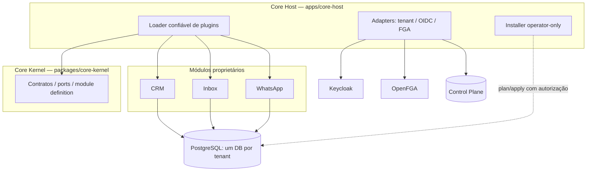
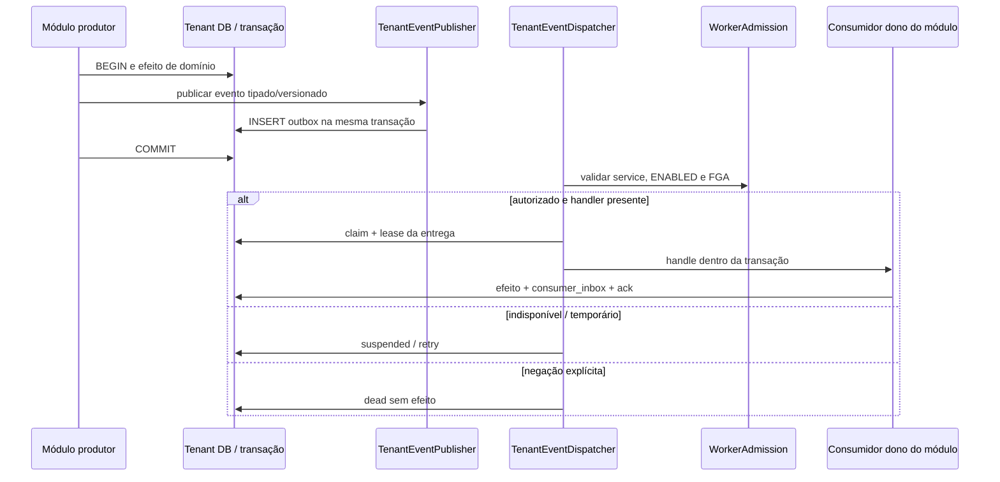
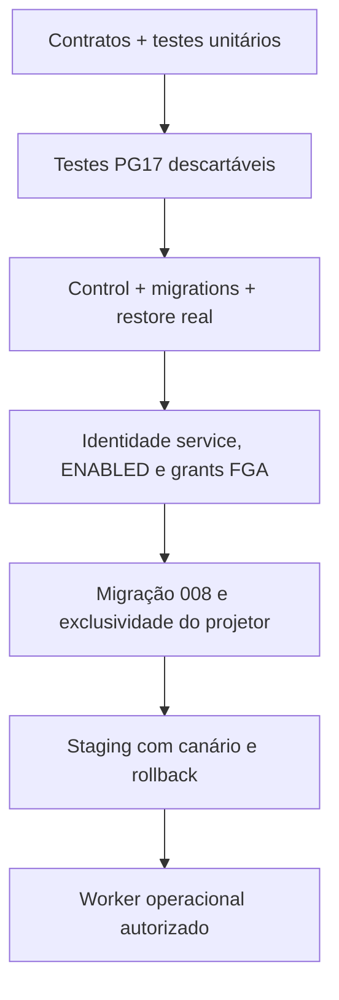

## 5. Arquitetura, banco, interface, configuração e diagramas

> **Levantamento parcial — 12/11/2026.** A unidade `modules/platform-core` é fronteira documental (AGENTS.md), **não** um pacote executável autônomo. Os executáveis e contratos abaixo pertencem a seus próprios owners.

### Diagrama — separação Kernel, Host e módulos

O loader fixo de `apps/core-host/config/modules.json` existe; perfis de instância selecionáveis (CMP-03+) e imagem mínima ainda são planejamento. Não criar import de privados de outros módulos para simplificar integração.

### Diagrama — Transactional Outbox e despacho (opt-in)

**Estado:** dispatcher, publisher e consumidores opt-in existem e tiveram testes sintéticos/PG17 descritos nas WBS; não há scheduler automático ou Worker admission operacional liberados por essa implementação. Fontes: `apps/core-host/src/platform-event-publisher.ts`, `platform-event-dispatcher.ts`, `platform-event-worker-admission.ts`, `platform-event-worker-composition.ts`.

### Diagrama — gates antes da ativação

Nenhuma seta equivale a uma etapa concluída: o gate avança **somente com evidência verificável e autorização**.
