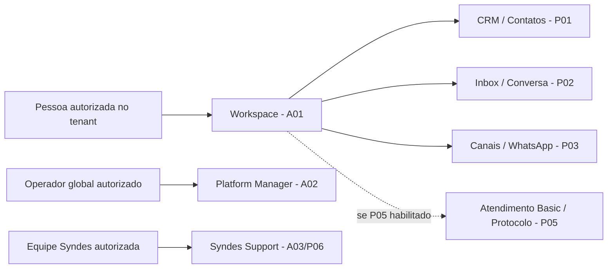

# G02 — Produto e UX

[← Sumário do volume](../) · [↑ Biblioteca](../../)

> **Leitura técnica, não homologação.** Estados, limites e comprovações devem ser lidos em STATUS e nos checkpoints versionados.

## Identificação e rastreabilidade

| Campo | Fonte verificável |
|---|---|
| Unidade / owner | **G02** · Produto e UX |
| Volume | Produto e módulos de negócio |
| Caminho de implementação | `docs/product` |
| Documento de origem | [README](https://github.com/delmacy/syndes-system/blob/main/docs/subprojects/G02-produto-e-ux/README.md) |
| STATUS e critérios | [STATUS original](https://github.com/delmacy/syndes-system/blob/main/docs/subprojects/G02-produto-e-ux/STATUS.md) |
| Símbolos, APIs, SQL e dependências | [REFERENCIA-TECNICA](https://github.com/delmacy/syndes-system/blob/main/docs/subprojects/G02-produto-e-ux/REFERENCIA-TECNICA.md) |
| Implantação, runbooks e gates | [OPERACAO](https://github.com/delmacy/syndes-system/blob/main/docs/subprojects/G02-produto-e-ux/OPERACAO.md) |

## Situação registrada

> AUDITORIA TÉCNICA PARCIAL (produto/UX e fonte estática) — 12/11/2026. Checkout origin/main SHA 36b7ebeabee236196e71b2f43f2ee92a4e0b49c9, DevServer01/worktree isolada. Revisão dos PRDs, ADRs, fonte de React e contratos documentados. Não foram executados browser autenticado, testes de tenant real, deploy, alteração de banco ou aceite do produto. Dimensão Estado Evidência e limite --------- Documentação G02 Auditoria parcial Capítulos 00–07 reconciliados;…

A descrição acima é uma **citação resumida do STATUS versionado**; não significa que os testes de integração, a implantação ou a homologação estejam aprovados.

## Índice dos subcapítulos

Todos os assuntos deste módulo estão nesta página. Clique em um título para saltar à seção correspondente; o índice lateral acompanha a leitura.

- [Casos de uso](#casos-de-uso)
- [Histórias de usuário](#historias-de-usuario)
- [Requisitos](#requisitos)
- [Contratos públicos e privados](#contratos)
- [APIs e endpoints](#apis)
- [Eventos e mensageria](#eventos)
- [Dados e persistência](#dados)
- [Schemas e migrations](#schema)
- [Dependências e integrações](#dependencias)
- [Configuração e ambiente](#configuracao)
- [Frontend e interfaces](#interface)
- [Testes e evidências](#testes)
- [Operação e implantação](#operacao)
- [WBS e evolução](#wbs)
- [Documentação de origem integral](#documentacao-de-origem)
- [Controle de alterações](#controle-de-alteracoes)

## Casos de uso

**Editar esta seção:** [Abrir arquivo-fonte no GitHub](https://github.com/delmacy/syndes-system/edit/main/docs/subprojects/G02-produto-e-ux/chapters/02-requisitos-historias-e-casos-de-uso.md) · [Consultar fonte](https://github.com/delmacy/syndes-system/blob/main/docs/subprojects/G02-produto-e-ux/chapters/02-requisitos-historias-e-casos-de-uso.md)

*Referências extraídas da documentação versionada, sem inferir homologação ou implantação.*

**Fonte:** [REFERENCIA-TECNICA.md](https://github.com/delmacy/syndes-system/blob/main/docs/subprojects/G02-produto-e-ux/REFERENCIA-TECNICA.md)

> Linha 36: **Fluxo de consulta:** [especificação e histórias G02](ESCOPO.md), [matriz de UX](chapters/05-arquitetura-banco-interface-configuracao-e-diagramas.md), [CRM](https://github.com/delmacy/syndes-system/blob/main/docs/product/CORE-CRM-FRONTEND-COMPLETION.md) e [Inbox](https://github.com/delmacy/syndes-system/blob/main/docs/product/INBOX-FRONTEND-PROGRESS.md). O desenho de produto mantém Workspace para Account/Organizatio

**Fonte:** [STATUS.md](https://github.com/delmacy/syndes-system/blob/main/docs/subprojects/G02-produto-e-ux/STATUS.md)

> Linha 41: - [Escopo](ESCOPO.md): missão, atores, histórias, casos de uso, requisitos, limites Basic e matriz de produtos/UX.

📝 Espaço para ajustes e implementação

Este é um **modelo de registro**, não um editor com salvamento automático. Use o link **Editar esta seção** para atualizar o documento versionado.

- **Alteração proposta:** descreva o requisito, contrato, dado ou comportamento.
- **Referência de código:** informe caminho e símbolo real.
- **Testes e evidências:** informe comando, resultado e limite.
- **Critério de aceite:** indique como validar sem presumir homologação.
- **Status e revisão:** atualize a fonte canônica após revisão.

## Histórias de usuário

**Editar esta seção:** [Abrir arquivo-fonte no GitHub](https://github.com/delmacy/syndes-system/edit/main/docs/subprojects/G02-produto-e-ux/chapters/02-requisitos-historias-e-casos-de-uso.md) · [Consultar fonte](https://github.com/delmacy/syndes-system/blob/main/docs/subprojects/G02-produto-e-ux/chapters/02-requisitos-historias-e-casos-de-uso.md)

*Referências extraídas da documentação versionada, sem inferir homologação ou implantação.*

**Fonte:** [06-wbs-marcos-e-aceite.md](https://github.com/delmacy/syndes-system/blob/main/docs/subprojects/G02-produto-e-ux/chapters/06-wbs-marcos-e-aceite.md)

> Linha 32: Não registrar percentual de progresso porque **quantidade de interfaces, commits, migrations ou testes isolados não mede aderência aos critérios de aceite**. Avançar documentalmente para G03 depois desta revisão parcial, mas manter as pendências de G02 até aprovação do responsável.

📝 Espaço para ajustes e implementação

Este é um **modelo de registro**, não um editor com salvamento automático. Use o link **Editar esta seção** para atualizar o documento versionado.

- **Alteração proposta:** descreva o requisito, contrato, dado ou comportamento.
- **Referência de código:** informe caminho e símbolo real.
- **Testes e evidências:** informe comando, resultado e limite.
- **Critério de aceite:** indique como validar sem presumir homologação.
- **Status e revisão:** atualize a fonte canônica após revisão.

## Requisitos

**Editar esta seção:** [Abrir arquivo-fonte no GitHub](https://github.com/delmacy/syndes-system/edit/main/docs/subprojects/G02-produto-e-ux/chapters/02-requisitos-historias-e-casos-de-uso.md) · [Consultar fonte](https://github.com/delmacy/syndes-system/blob/main/docs/subprojects/G02-produto-e-ux/chapters/02-requisitos-historias-e-casos-de-uso.md)

*Referências extraídas da documentação versionada, sem inferir homologação ou implantação.*

**Fonte:** [02-requisitos-historias-e-casos-de-uso.md](https://github.com/delmacy/syndes-system/blob/main/docs/subprojects/G02-produto-e-ux/chapters/02-requisitos-historias-e-casos-de-uso.md)

> Linha 3: As histórias abaixo são **representações resumidas de jornadas presentes em PRDs já versionados**, para descoberta. Os IDs/aceites normativos permanecem nos documentos proprietários; esta página **não cria novos requisitos aprovados**.

> Linha 32: \| Recuperação \| Backup/restore, rollback, monitoramento e erros não silenciosos \| Requisito de lançamento, não homologado nesta auditoria \|

**Fonte:** [07-controle-do-escopo.md](https://github.com/delmacy/syndes-system/blob/main/docs/subprojects/G02-produto-e-ux/chapters/07-controle-do-escopo.md)

> Linha 3: **Revisão G02 não aprova novo requisito, nova sprint nem deploy.** Concilia decisões já registradas e classifica suas limitações.

> Linha 19: - **MVP aprovado:** requisito explicitamente presente na baseline/PRD e com dono definido.

**Fonte:** [REFERENCIA-TECNICA.md](https://github.com/delmacy/syndes-system/blob/main/docs/subprojects/G02-produto-e-ux/REFERENCIA-TECNICA.md)

> Linha 3: > **AUDITORIA DOCUMENTAL E DE FONTE ESTÁTICA PARCIAL — 12/11/2026.** Revisão do checkout `origin/main` SHA `36b7ebeabee236196e71b2f43f2ee92a4e0b49c9`. G02 é governança de requisitos, experiências e Product Gates, **não** pacote executável. Nenhuma verificação de UX com identidade real, deploy ou banco operacional foi executada nesta auditoria.

**Fonte:** [STATUS.md](https://github.com/delmacy/syndes-system/blob/main/docs/subprojects/G02-produto-e-ux/STATUS.md)

> Linha 41: - [Escopo](ESCOPO.md): missão, atores, histórias, casos de uso, requisitos, limites Basic e matriz de produtos/UX.

📝 Espaço para ajustes e implementação

Este é um **modelo de registro**, não um editor com salvamento automático. Use o link **Editar esta seção** para atualizar o documento versionado.

- **Alteração proposta:** descreva o requisito, contrato, dado ou comportamento.
- **Referência de código:** informe caminho e símbolo real.
- **Testes e evidências:** informe comando, resultado e limite.
- **Critério de aceite:** indique como validar sem presumir homologação.
- **Status e revisão:** atualize a fonte canônica após revisão.

## Contratos públicos e privados

**Editar esta seção:** [Abrir arquivo-fonte no GitHub](https://github.com/delmacy/syndes-system/edit/main/docs/subprojects/G02-produto-e-ux/REFERENCIA-TECNICA.md) · [Consultar fonte](https://github.com/delmacy/syndes-system/blob/main/docs/subprojects/G02-produto-e-ux/REFERENCIA-TECNICA.md)

*Referências extraídas da documentação versionada, sem inferir homologação ou implantação.*

**Fonte:** [REFERENCIA-TECNICA.md](https://github.com/delmacy/syndes-system/blob/main/docs/subprojects/G02-produto-e-ux/REFERENCIA-TECNICA.md)

> Linha 28: **G02 não registra endpoint HTTP, evento, módulo Nest nem `package.json#exports`.** Seus contratos são de comportamento e aceite, mantidos nos PRDs. APIs e contracts são implementados e versionados por P01, P02, P03, P05, P06, A04/A05 e C01/C06. Ver [Catálogo de APIs](../../blueprint/APIS.md) e [Contratos por módulo](../../blueprint/CATALOGO-MODULOS.md).

> Linha 36: **Fluxo de consulta:** [especificação e histórias G02](ESCOPO.md), [matriz de UX](chapters/05-arquitetura-banco-interface-configuracao-e-diagramas.md), [CRM](https://github.com/delmacy/syndes-system/blob/main/docs/product/CORE-CRM-FRONTEND-COMPLETION.md) e [Inbox](https://github.com/delmacy/syndes-system/blob/main/docs/product/INBOX-FRONTEND-PROGRESS.md). O desenho de produto mantém Workspace para Account/Organizatio

**Fonte:** [04-contratos-e-dependencias-publicas.md](https://github.com/delmacy/syndes-system/blob/main/docs/subprojects/G02-produto-e-ux/chapters/04-contratos-e-dependencias-publicas.md)

> Linha 5: **G02 não publica bibliotecas, controllers HTTP, esquemas SQL, eventos ou endpoints.** Seus artefatos públicos são decisões e **contratos de produto**: PRDs, escopo, ordem de entrega, critérios de aceite, jornadas, exclusões e Product Gates, todos versionados em `docs/product`.

> Linha 12: \| Design do Manager/Support \| Regras de navegação e papéis por público \| A02/A03/A05/P06 \|

> Linha 13: \| Dependências entre domínios \| Matriz de risco e ordem de entrega \| G01/A04 e owners dos contratos \|

> Linha 28: **Contratos técnicos:** consultar as abas de [APIs](../../../blueprint/APIS.md), [Dados](../../../blueprint/DADOS.md) e [Contratos por owner](../../../blueprint/CATALOGO-MODULOS.md). Contrato citado num PRD pode ser **planejado** e não estar montado na aplicação. `package.json#exports`, fonte HTTP, events e migrations pertencem aos owners executáveis.

**Fonte:** [STATUS.md](https://github.com/delmacy/syndes-system/blob/main/docs/subprojects/G02-produto-e-ux/STATUS.md)

> Linha 3: > **AUDITORIA TÉCNICA PARCIAL (produto/UX e fonte estática) — 12/11/2026.** Checkout `origin/main` SHA `36b7ebeabee236196e71b2f43f2ee92a4e0b49c9`, DevServer01/worktree isolada. Revisão dos PRDs, ADRs, fonte de React e contratos documentados. Não foram executados browser autenticado, testes de tenant real, deploy, alteração de banco ou aceite do produto.

**Fonte:** [OPERACAO.md](https://github.com/delmacy/syndes-system/blob/main/docs/subprojects/G02-produto-e-ux/OPERACAO.md)

> Linha 16: - [Contratos públicos](../../standards/CONTRATOS-PUBLICOS.md).

> Linha 32: 4. Testar com critérios apropriados: unitário, contrato, integração, E2E e CI.

📝 Espaço para ajustes e implementação

Este é um **modelo de registro**, não um editor com salvamento automático. Use o link **Editar esta seção** para atualizar o documento versionado.

- **Alteração proposta:** descreva o requisito, contrato, dado ou comportamento.
- **Referência de código:** informe caminho e símbolo real.
- **Testes e evidências:** informe comando, resultado e limite.
- **Critério de aceite:** indique como validar sem presumir homologação.
- **Status e revisão:** atualize a fonte canônica após revisão.

## APIs e endpoints

**Editar esta seção:** [Abrir arquivo-fonte no GitHub](https://github.com/delmacy/syndes-system/edit/main/docs/subprojects/G02-produto-e-ux/REFERENCIA-TECNICA.md) · [Consultar fonte](https://github.com/delmacy/syndes-system/blob/main/docs/subprojects/G02-produto-e-ux/REFERENCIA-TECNICA.md)

*Referências extraídas da documentação versionada, sem inferir homologação ou implantação.*

**Fonte:** [REFERENCIA-TECNICA.md](https://github.com/delmacy/syndes-system/blob/main/docs/subprojects/G02-produto-e-ux/REFERENCIA-TECNICA.md)

> Linha 7: - **Owner G02:** `docs/product` conforme `catalog/work-units.json`. Arquivos Markdown/PRD e decisões são a fonte documental; **não há `package.json`, API HTTP, classes ou migrations próprios da G02**.

> Linha 21: \| A03 Support \| `apps/support-web/src/App.tsx`, `src/api.ts` \| Cases/filas da própria Syndes; owner P06/A03 \|

> Linha 28: **G02 não registra endpoint HTTP, evento, módulo Nest nem `package.json#exports`.** Seus contratos são de comportamento e aceite, mantidos nos PRDs. APIs e contracts são implementados e versionados por P01, P02, P03, P05, P06, A04/A05 e C01/C06. Ver [Catálogo de APIs](../../blueprint/APIS.md) e [Contratos por módulo](../../blueprint/CATALOGO-MODULOS.md).

**Fonte:** [04-contratos-e-dependencias-publicas.md](https://github.com/delmacy/syndes-system/blob/main/docs/subprojects/G02-produto-e-ux/chapters/04-contratos-e-dependencias-publicas.md)

> Linha 5: **G02 não publica bibliotecas, controllers HTTP, esquemas SQL, eventos ou endpoints.** Seus artefatos públicos são decisões e **contratos de produto**: PRDs, escopo, ordem de entrega, critérios de aceite, jornadas, exclusões e Product Gates, todos versionados em `docs/product`.

> Linha 28: **Contratos técnicos:** consultar as abas de [APIs](../../../blueprint/APIS.md), [Dados](../../../blueprint/DADOS.md) e [Contratos por owner](../../../blueprint/CATALOGO-MODULOS.md). Contrato citado num PRD pode ser **planejado** e não estar montado na aplicação. `package.json#exports`, fonte HTTP, events e migrations pertencem aos owners executáveis.

**Fonte:** [STATUS.md](https://github.com/delmacy/syndes-system/blob/main/docs/subprojects/G02-produto-e-ux/STATUS.md)

> Linha 10: \| **Implementação da G02** \| **Não aplicável (governança)** \| `docs/product` é fonte de documentação; não package, API ou tabela operacional \|

> Linha 35: 5. **Manager versus Workspace:** públicos, autenticação e API distintos; papel global não libera dados privados.

📝 Espaço para ajustes e implementação

Este é um **modelo de registro**, não um editor com salvamento automático. Use o link **Editar esta seção** para atualizar o documento versionado.

- **Alteração proposta:** descreva o requisito, contrato, dado ou comportamento.
- **Referência de código:** informe caminho e símbolo real.
- **Testes e evidências:** informe comando, resultado e limite.
- **Critério de aceite:** indique como validar sem presumir homologação.
- **Status e revisão:** atualize a fonte canônica após revisão.

## Eventos e mensageria

**Editar esta seção:** [Abrir arquivo-fonte no GitHub](https://github.com/delmacy/syndes-system/edit/main/docs/subprojects/G02-produto-e-ux/REFERENCIA-TECNICA.md) · [Consultar fonte](https://github.com/delmacy/syndes-system/blob/main/docs/subprojects/G02-produto-e-ux/REFERENCIA-TECNICA.md)

*Referências extraídas da documentação versionada, sem inferir homologação ou implantação.*

**Fonte:** [REFERENCIA-TECNICA.md](https://github.com/delmacy/syndes-system/blob/main/docs/subprojects/G02-produto-e-ux/REFERENCIA-TECNICA.md)

> Linha 24: Código presente em arquivo e relatos históricos de testes **não provam** que a jornada esteja publicada, autorizada ou homologada.

> Linha 28: **G02 não registra endpoint HTTP, evento, módulo Nest nem `package.json#exports`.** Seus contratos são de comportamento e aceite, mantidos nos PRDs. APIs e contracts são implementados e versionados por P01, P02, P03, P05, P06, A04/A05 e C01/C06. Ver [Catálogo de APIs](../../blueprint/APIS.md) e [Contratos por módulo](../../blueprint/CATALOGO-MODULOS.md).

**Fonte:** [04-contratos-e-dependencias-publicas.md](https://github.com/delmacy/syndes-system/blob/main/docs/subprojects/G02-produto-e-ux/chapters/04-contratos-e-dependencias-publicas.md)

> Linha 5: **G02 não publica bibliotecas, controllers HTTP, esquemas SQL, eventos ou endpoints.** Seus artefatos públicos são decisões e **contratos de produto**: PRDs, escopo, ordem de entrega, critérios de aceite, jornadas, exclusões e Product Gates, todos versionados em `docs/product`.

> Linha 18: \| Contexto \| Fonte canônica \| Consumidor \| Regra de fronteira \|

> Linha 32: - **CRM → Inbox → WhatsApp → Atendimento Basic** é a sequência de produto; a composição técnica tem dependências próprias. Não presumir ordem de inicialização ou evento apenas pela ordem comercial.

📝 Espaço para ajustes e implementação

Este é um **modelo de registro**, não um editor com salvamento automático. Use o link **Editar esta seção** para atualizar o documento versionado.

- **Alteração proposta:** descreva o requisito, contrato, dado ou comportamento.
- **Referência de código:** informe caminho e símbolo real.
- **Testes e evidências:** informe comando, resultado e limite.
- **Critério de aceite:** indique como validar sem presumir homologação.
- **Status e revisão:** atualize a fonte canônica após revisão.

## Dados e persistência

**Editar esta seção:** [Abrir arquivo-fonte no GitHub](https://github.com/delmacy/syndes-system/edit/main/docs/subprojects/G02-produto-e-ux/REFERENCIA-TECNICA.md) · [Consultar fonte](https://github.com/delmacy/syndes-system/blob/main/docs/subprojects/G02-produto-e-ux/REFERENCIA-TECNICA.md)

*Referências extraídas da documentação versionada, sem inferir homologação ou implantação.*

**Fonte:** [REFERENCIA-TECNICA.md](https://github.com/delmacy/syndes-system/blob/main/docs/subprojects/G02-produto-e-ux/REFERENCIA-TECNICA.md)

> Linha 42: **G02 não possui database, schema ou migration.** As fontes de dados pertencem aos respectivos domínios e ao Control Plane. `Platform Organization` não é `CRM Organization`; `Conversation` não é `Attendance Protocol`. Não inferir dados operacionais de telas previstas ou de diagramas.

**Fonte:** [04-contratos-e-dependencias-publicas.md](https://github.com/delmacy/syndes-system/blob/main/docs/subprojects/G02-produto-e-ux/chapters/04-contratos-e-dependencias-publicas.md)

> Linha 28: **Contratos técnicos:** consultar as abas de [APIs](../../../blueprint/APIS.md), [Dados](../../../blueprint/DADOS.md) e [Contratos por owner](../../../blueprint/CATALOGO-MODULOS.md). Contrato citado num PRD pode ser **planejado** e não estar montado na aplicação. `package.json#exports`, fonte HTTP, events e migrations pertencem aos owners executáveis.

> Linha 35: - **Frontend:** o Workspace não se fragmenta em um app por domínio, e o Manager não recebe acesso a dados de cliente por possuir papel global.

**Fonte:** [05-arquitetura-banco-interface-configuracao-e-diagramas.md](https://github.com/delmacy/syndes-system/blob/main/docs/subprojects/G02-produto-e-ux/chapters/05-arquitetura-banco-interface-configuracao-e-diagramas.md)

> Linha 25: \| Manager \| Metadados globais sem dados privados tenant \| `apps/master-admin-web/src/App.tsx`, `src/app/ManagerShell.tsx` \| Roles SQL, OIDC, grants e deploy alvo \|

> Linha 31: `Customer Account / Tenant` determina o isolamento físico de dados; `Platform Organization` e `Workspace` restringem escopo operacional. P04/Control não são equivalentes a `CRM Organization` (empresa de relacionamento). `Conversation` da Inbox conserva mensagens; `Attendance Protocol` tem identidade, estado, atribuição e histórico próprios, com vínculo **opcional** à conversa.

> Linha 33: **G02 não tem database, tabelas ou migrations próprias.** A UI usa dados dos serviços autorizados, nunca conecta diretamente ao PostgreSQL; o servidor verifica identidade, membership, módulo e autorização em cada recurso. Não usar `tenantId`, `organizationId` ou `assignedTo` enviados pelo browser como concessão de privilégios.

> Linha 38: 2. **Estados explícitos:** loading, vazio real, indisponibilidade, negação e conflito não devem virar dado fictício nem esconder falha de autorização.

> Linha 41: 5. **Concorrência e escopo:** preservar rascunhos após erro de envio; mudança de Organization/Workspace deve revalidar requisições/caches/SSE; não mostrar dados de outro escopo.

**Fonte:** [STATUS.md](https://github.com/delmacy/syndes-system/blob/main/docs/subprojects/G02-produto-e-ux/STATUS.md)

> Linha 32: 2. **CRM/Inbox:** checklists de implementação/UX não equivalem a aceite real. Exigir testes com JWT/Keycloak, OpenFGA e dados isolados por tenant; frontend mockado não basta.

> Linha 35: 5. **Manager versus Workspace:** públicos, autenticação e API distintos; papel global não libera dados privados.

> Linha 44: - **Sem alteração de código de produto, PRDs canônicos, CI geral, banco de dados ou infraestrutura.**

📝 Espaço para ajustes e implementação

Este é um **modelo de registro**, não um editor com salvamento automático. Use o link **Editar esta seção** para atualizar o documento versionado.

- **Alteração proposta:** descreva o requisito, contrato, dado ou comportamento.
- **Referência de código:** informe caminho e símbolo real.
- **Testes e evidências:** informe comando, resultado e limite.
- **Critério de aceite:** indique como validar sem presumir homologação.
- **Status e revisão:** atualize a fonte canônica após revisão.

## Schemas e migrations

**Editar esta seção:** [Abrir arquivo-fonte no GitHub](https://github.com/delmacy/syndes-system/edit/main/docs/subprojects/G02-produto-e-ux/REFERENCIA-TECNICA.md) · [Consultar fonte](https://github.com/delmacy/syndes-system/blob/main/docs/subprojects/G02-produto-e-ux/REFERENCIA-TECNICA.md)

*Referências extraídas da documentação versionada, sem inferir homologação ou implantação.*

**Fonte:** [REFERENCIA-TECNICA.md](https://github.com/delmacy/syndes-system/blob/main/docs/subprojects/G02-produto-e-ux/REFERENCIA-TECNICA.md)

> Linha 7: - **Owner G02:** `docs/product` conforme `catalog/work-units.json`. Arquivos Markdown/PRD e decisões são a fonte documental; **não há `package.json`, API HTTP, classes ou migrations próprios da G02**.

> Linha 42: **G02 não possui database, schema ou migration.** As fontes de dados pertencem aos respectivos domínios e ao Control Plane. `Platform Organization` não é `CRM Organization`; `Conversation` não é `Attendance Protocol`. Não inferir dados operacionais de telas previstas ou de diagramas.

**Fonte:** [04-contratos-e-dependencias-publicas.md](https://github.com/delmacy/syndes-system/blob/main/docs/subprojects/G02-produto-e-ux/chapters/04-contratos-e-dependencias-publicas.md)

> Linha 5: **G02 não publica bibliotecas, controllers HTTP, esquemas SQL, eventos ou endpoints.** Seus artefatos públicos são decisões e **contratos de produto**: PRDs, escopo, ordem de entrega, critérios de aceite, jornadas, exclusões e Product Gates, todos versionados em `docs/product`.

> Linha 28: **Contratos técnicos:** consultar as abas de [APIs](../../../blueprint/APIS.md), [Dados](../../../blueprint/DADOS.md) e [Contratos por owner](../../../blueprint/CATALOGO-MODULOS.md). Contrato citado num PRD pode ser **planejado** e não estar montado na aplicação. `package.json#exports`, fonte HTTP, events e migrations pertencem aos owners executáveis.

**Fonte:** [05-arquitetura-banco-interface-configuracao-e-diagramas.md](https://github.com/delmacy/syndes-system/blob/main/docs/subprojects/G02-produto-e-ux/chapters/05-arquitetura-banco-interface-configuracao-e-diagramas.md)

> Linha 25: \| Manager \| Metadados globais sem dados privados tenant \| `apps/master-admin-web/src/App.tsx`, `src/app/ManagerShell.tsx` \| Roles SQL, OIDC, grants e deploy alvo \|

> Linha 33: **G02 não tem database, tabelas ou migrations próprias.** A UI usa dados dos serviços autorizados, nunca conecta diretamente ao PostgreSQL; o servidor verifica identidade, membership, módulo e autorização em cada recurso. Não usar `tenantId`, `organizationId` ou `assignedTo` enviados pelo browser como concessão de privilégios.

**Fonte:** [STATUS.md](https://github.com/delmacy/syndes-system/blob/main/docs/subprojects/G02-produto-e-ux/STATUS.md)

> Linha 10: \| **Implementação da G02** \| **Não aplicável (governança)** \| `docs/product` é fonte de documentação; não package, API ou tabela operacional \|

**Fonte:** [OPERACAO.md](https://github.com/delmacy/syndes-system/blob/main/docs/subprojects/G02-produto-e-ux/OPERACAO.md)

> Linha 3: > **ÍNDICE DE FONTES, NÃO RUNBOOK HOMOLOGADO.** Não executar migrations, alterar permissões ou ativar workers apenas com esta página.

> Linha 31: 3. Confirmar migrations realmente aplicadas, backup/restore e rollback antes de SQL.

📝 Espaço para ajustes e implementação

Este é um **modelo de registro**, não um editor com salvamento automático. Use o link **Editar esta seção** para atualizar o documento versionado.

- **Alteração proposta:** descreva o requisito, contrato, dado ou comportamento.
- **Referência de código:** informe caminho e símbolo real.
- **Testes e evidências:** informe comando, resultado e limite.
- **Critério de aceite:** indique como validar sem presumir homologação.
- **Status e revisão:** atualize a fonte canônica após revisão.

## Dependências e integrações

**Editar esta seção:** [Abrir arquivo-fonte no GitHub](https://github.com/delmacy/syndes-system/edit/main/docs/subprojects/G02-produto-e-ux/REFERENCIA-TECNICA.md) · [Consultar fonte](https://github.com/delmacy/syndes-system/blob/main/docs/subprojects/G02-produto-e-ux/REFERENCIA-TECNICA.md)

*Referências extraídas da documentação versionada, sem inferir homologação ou implantação.*

**Fonte:** [REFERENCIA-TECNICA.md](https://github.com/delmacy/syndes-system/blob/main/docs/subprojects/G02-produto-e-ux/REFERENCIA-TECNICA.md)

> Linha 38: Estados de carregamento/erro/negação e adaptação mobile precisam ser verificados por módulo e papel. Capturas/mock de frontend não comprovam autorização com Keycloak e OpenFGA reais.

> Linha 46: - [STATUS](STATUS.md) distingue documentação, implementação, integração, operação e Product Gate.

**Fonte:** [04-contratos-e-dependencias-publicas.md](https://github.com/delmacy/syndes-system/blob/main/docs/subprojects/G02-produto-e-ux/chapters/04-contratos-e-dependencias-publicas.md)

> Linha 13: \| Dependências entre domínios \| Matriz de risco e ordem de entrega \| G01/A04 e owners dos contratos \|

> Linha 32: - **CRM → Inbox → WhatsApp → Atendimento Basic** é a sequência de produto; a composição técnica tem dependências próprias. Não presumir ordem de inicialização ou evento apenas pela ordem comercial.

**Fonte:** [05-arquitetura-banco-interface-configuracao-e-diagramas.md](https://github.com/delmacy/syndes-system/blob/main/docs/subprojects/G02-produto-e-ux/chapters/05-arquitetura-banco-interface-configuracao-e-diagramas.md)

> Linha 23: \| CRM \| Listar/cadastrar/editar pessoas e organizações; relações, tags, notas e CSV \| `apps/workspace-web/src/features/crm.tsx`, `crm-person-detail.tsx`; [checkpoint](../../../product/CORE-CRM-FRONTEND-COMPLETION.md) \| Keycloak/OpenFGA de perfis distintos, acessibilidade e Product Gate \|

**Fonte:** [STATUS.md](https://github.com/delmacy/syndes-system/blob/main/docs/subprojects/G02-produto-e-ux/STATUS.md)

> Linha 12: \| **Integração** \| **Não verificada na G02** \| Faltam evidências de jornadas E2E reais por perfis Keycloak/OpenFGA e tenant \|

> Linha 32: 2. **CRM/Inbox:** checklists de implementação/UX não equivalem a aceite real. Exigir testes com JWT/Keycloak, OpenFGA e dados isolados por tenant; frontend mockado não basta.

**Fonte:** [OPERACAO.md](https://github.com/delmacy/syndes-system/blob/main/docs/subprojects/G02-produto-e-ux/OPERACAO.md)

> Linha 9: - [Evolução](EVOLUCAO.md): workpackages e dependências; nenhum item é concluído por estar planejado.

> Linha 32: 4. Testar com critérios apropriados: unitário, contrato, integração, E2E e CI.

📝 Espaço para ajustes e implementação

Este é um **modelo de registro**, não um editor com salvamento automático. Use o link **Editar esta seção** para atualizar o documento versionado.

- **Alteração proposta:** descreva o requisito, contrato, dado ou comportamento.
- **Referência de código:** informe caminho e símbolo real.
- **Testes e evidências:** informe comando, resultado e limite.
- **Critério de aceite:** indique como validar sem presumir homologação.
- **Status e revisão:** atualize a fonte canônica após revisão.

## Configuração e ambiente

**Editar esta seção:** [Abrir arquivo-fonte no GitHub](https://github.com/delmacy/syndes-system/edit/main/docs/subprojects/G02-produto-e-ux/OPERACAO.md) · [Consultar fonte](https://github.com/delmacy/syndes-system/blob/main/docs/subprojects/G02-produto-e-ux/OPERACAO.md)

*Referências extraídas da documentação versionada, sem inferir homologação ou implantação.*

**Fonte:** [REFERENCIA-TECNICA.md](https://github.com/delmacy/syndes-system/blob/main/docs/subprojects/G02-produto-e-ux/REFERENCIA-TECNICA.md)

> Linha 36: **Fluxo de consulta:** [especificação e histórias G02](ESCOPO.md), [matriz de UX](chapters/05-arquitetura-banco-interface-configuracao-e-diagramas.md), [CRM](https://github.com/delmacy/syndes-system/blob/main/docs/product/CORE-CRM-FRONTEND-COMPLETION.md) e [Inbox](https://github.com/delmacy/syndes-system/blob/main/docs/product/INBOX-FRONTEND-PROGRESS.md). O desenho de produto mantém Workspace para Account/Organizatio

📝 Espaço para ajustes e implementação

Este é um **modelo de registro**, não um editor com salvamento automático. Use o link **Editar esta seção** para atualizar o documento versionado.

- **Alteração proposta:** descreva o requisito, contrato, dado ou comportamento.
- **Referência de código:** informe caminho e símbolo real.
- **Testes e evidências:** informe comando, resultado e limite.
- **Critério de aceite:** indique como validar sem presumir homologação.
- **Status e revisão:** atualize a fonte canônica após revisão.

## Frontend e interfaces

**Editar esta seção:** [Abrir arquivo-fonte no GitHub](https://github.com/delmacy/syndes-system/edit/main/docs/subprojects/G02-produto-e-ux/REFERENCIA-TECNICA.md) · [Consultar fonte](https://github.com/delmacy/syndes-system/blob/main/docs/subprojects/G02-produto-e-ux/REFERENCIA-TECNICA.md)

*Referências extraídas da documentação versionada, sem inferir homologação ou implantação.*

**Fonte:** [REFERENCIA-TECNICA.md](https://github.com/delmacy/syndes-system/blob/main/docs/subprojects/G02-produto-e-ux/REFERENCIA-TECNICA.md)

> Linha 8: - **Atores e superfícies reais a conferir:** `apps/workspace-web` (A01), `apps/master-admin-web` (A02) e `apps/support-web` (A03). Componentes de apresentação em `packages/front-shared` (A07).

> Linha 18: \| A01 Inbox \| `apps/workspace-web/src/features/inbox.tsx`, `inbox-thread.ts`, `inbox-rules.ts`, `inbox-context.tsx` \| Conversa, fila, handoff, contexto e interface; gates P02/A01 \|

> Linha 22: \| A07 Front Shared \| `packages/front-shared/package.json` \| Componentes de apresentação; sem compartilhamento de sessão/identidade \|

> Linha 31: - Realtime SSE descrito em [checkpoint Inbox](https://github.com/delmacy/syndes-system/blob/main/docs/product/INBOX-FRONTEND-PROGRESS.md) está registrado como incremento local com gates reais pendentes.

> Linha 36: **Fluxo de consulta:** [especificação e histórias G02](ESCOPO.md), [matriz de UX](chapters/05-arquitetura-banco-interface-configuracao-e-diagramas.md), [CRM](https://github.com/delmacy/syndes-system/blob/main/docs/product/CORE-CRM-FRONTEND-COMPLETION.md) e [Inbox](https://github.com/delmacy/syndes-system/blob/main/docs/product/INBOX-FRONTEND-PROGRESS.md). O desenho de produto mantém Workspace para Account/Organizatio

> Linha 38: Estados de carregamento/erro/negação e adaptação mobile precisam ser verificados por módulo e papel. Capturas/mock de frontend não comprovam autorização com Keycloak e OpenFGA reais.

> Linha 42: **G02 não possui database, schema ou migration.** As fontes de dados pertencem aos respectivos domínios e ao Control Plane. `Platform Organization` não é `CRM Organization`; `Conversation` não é `Attendance Protocol`. Não inferir dados operacionais de telas previstas ou de diagramas.

**Fonte:** [03-capabilities.md](https://github.com/delmacy/syndes-system/blob/main/docs/subprojects/G02-produto-e-ux/chapters/03-capabilities.md)

> Linha 9: \| **P01 CRM** \| Pessoas, organizações de relacionamento, tags, notas, vínculos e ficha no Workspace \| [Aceite CRM](../../../product/CORE-CRM-MVP-ACCEPTANCE.md), [UX CRM](../../../product/CORE-CRM-FRONTEND-COMPLETION.md) \| Código/UX descritos e arquivos React encontrados; **Product Gate final pendente** \|

> Linha 10: \| **P02 Inbox** \| Fila e histórico, atribuição, resposta, nota, handoff e contexto CRM \| [PRD-002](../../../product/PRD-002-INBOX-ACCEPTANCE.md), [UX Inbox](../../../product/INBOX-FRONTEND-PROGRESS.md) \| Incrementos frontend e SSE documentados; **E2E real, autorização e release pendentes de confirmação** \|

> Linha 14: \| **A01/A02/A03** \| Workspace, Manager e Support em apps isolados \| [ADR frontend/backend](../../../engineering/ADR-FRONTEND-BACKEND-COMPOSITION-20261110.md) \| Código de frontends encontrado; acesso real cross-context e publicação não verificados na G02 \|

> Linha 20: Estar **no escopo comercial futuro** não significa que telas, APIs e regras já estejam liberadas. A liberação depende dos Product Gates próprios; não criar botões que antecipem capacidade.

> Linha 31: O projeto mantém código de frontend em `apps/workspace-web/src/features/{crm,inbox,whatsapp-accounts}.tsx`, Manager em `apps/master-admin-web` e Support em `apps/support-web`; isso é inspeção do checkout, **não** um atestado de usabilidade ou deploy.

**Fonte:** [05-arquitetura-banco-interface-configuracao-e-diagramas.md](https://github.com/delmacy/syndes-system/blob/main/docs/subprojects/G02-produto-e-ux/chapters/05-arquitetura-banco-interface-configuracao-e-diagramas.md)

> Linha 23: \| CRM \| Listar/cadastrar/editar pessoas e organizações; relações, tags, notas e CSV \| `apps/workspace-web/src/features/crm.tsx`, `crm-person-detail.tsx`; [checkpoint](../../../product/CORE-CRM-FRONTEND-COMPLETION.md) \| Keycloak/OpenFGA de perfis distintos, acessibilidade e Product Gate \|

> Linha 24: \| Inbox \| Filas, histórico, resposta, nota, handoff, contexto CRM e atualização \| `apps/workspace-web/src/features/inbox.tsx`, `inbox-thread.ts`; [checkpoint](../../../product/INBOX-FRONTEND-PROGRESS.md) \| SSE E2E real/multi-instância se aplicável, autorização e regressão \|

> Linha 27: \| Atendimento Basic \| Lista/Kanban simples e inspector vinculado à Inbox \| [PRD-003A](../../../product/PRD-003A-GESTAO-ATENDIMENTOS-MVP.md) \| Sem assumir tela operacional só por previsão no PRD \|

**Fonte:** [STATUS.md](https://github.com/delmacy/syndes-system/blob/main/docs/subprojects/G02-produto-e-ux/STATUS.md)

> Linha 23: \| `CORE-CRM-MVP-ACCEPTANCE.md`, `CORE-CRM-FRONTEND-COMPLETION.md` \| Backend/frontend e testes locais descritos; CRM **incompleto** como produto \| Browser com identidades/perfis reais, usabilidade, backup/restore e Product Gate \|

> Linha 24: \| `PRD-002-INBOX-ACCEPTANCE.md`, `INBOX-FRONTEND-PROGRESS.md` \| Inbox em desenvolvimento; SSE descrito posteriormente ao polling inicial \| E2E de SSE/isolamento/identidade, rollout e Product Gate \|

> Linha 26: \| `ADR-FRONTEND-BACKEND-COMPOSITION-20261110.md` \| Contextos Workspace/Manager/Support separados; `front-shared` visual \| Não prova separação de sessões/permissões implantada \|

> Linha 32: 2. **CRM/Inbox:** checklists de implementação/UX não equivalem a aceite real. Exigir testes com JWT/Keycloak, OpenFGA e dados isolados por tenant; frontend mockado não basta.

📝 Espaço para ajustes e implementação

Este é um **modelo de registro**, não um editor com salvamento automático. Use o link **Editar esta seção** para atualizar o documento versionado.

- **Alteração proposta:** descreva o requisito, contrato, dado ou comportamento.
- **Referência de código:** informe caminho e símbolo real.
- **Testes e evidências:** informe comando, resultado e limite.
- **Critério de aceite:** indique como validar sem presumir homologação.
- **Status e revisão:** atualize a fonte canônica após revisão.

## Testes e evidências

**Editar esta seção:** [Abrir arquivo-fonte no GitHub](https://github.com/delmacy/syndes-system/edit/main/docs/subprojects/G02-produto-e-ux/STATUS.md) · [Consultar fonte](https://github.com/delmacy/syndes-system/blob/main/docs/subprojects/G02-produto-e-ux/STATUS.md)

*Referências extraídas da documentação versionada, sem inferir homologação ou implantação.*

**Fonte:** [STATUS.md](https://github.com/delmacy/syndes-system/blob/main/docs/subprojects/G02-produto-e-ux/STATUS.md)

> Linha 3: > **AUDITORIA TÉCNICA PARCIAL (produto/UX e fonte estática) — 12/11/2026.** Checkout `origin/main` SHA `36b7ebeabee236196e71b2f43f2ee92a4e0b49c9`, DevServer01/worktree isolada. Revisão dos PRDs, ADRs, fonte de React e contratos documentados. Não foram executados browser autenticado, testes de tenant real, deploy, alteração de banco ou aceite do produto.

> Linha 7: \| Dimensão \| Estado \| Evidência e limite \|

> Linha 12: \| **Integração** \| **Não verificada na G02** \| Faltam evidências de jornadas E2E reais por perfis Keycloak/OpenFGA e tenant \|

> Linha 14: \| **Product Gates** \| **Não promovidos** \| Escopo PRD-003A aprovado; CRM/Inbox e módulos posteriores dependem dos respectivos gates \|

> Linha 18: \| Referência \| Estado de produto registrado \| Limite da evidência \|

> Linha 21: \| `PRD-003A-GESTAO-ATENDIMENTOS-MVP.md` \| **Recorte Basic aprovado em 11/11**, entre WhatsApp e Scheduling \| SM-01–06 e Product Gate ainda devem ser verificados \|

> Linha 23: \| `CORE-CRM-MVP-ACCEPTANCE.md`, `CORE-CRM-FRONTEND-COMPLETION.md` \| Backend/frontend e testes locais descritos; CRM **incompleto** como produto \| Browser com identidades/perfis reais, usabilidade, backup/restore e Product Gate \|

> Linha 24: \| `PRD-002-INBOX-ACCEPTANCE.md`, `INBOX-FRONTEND-PROGRESS.md` \| Inbox em desenvolvimento; SSE descrito posteriormente ao polling inicial \| E2E de SSE/isolamento/identidade, rollout e Product Gate \|

> Linha 27: \| Código React em `apps/*/src` \| Arquivos de CRM, Inbox, WhatsApp, Manager e Support presentes \| Presença de fonte sem teste nesta revisão \|

> Linha 32: 2. **CRM/Inbox:** checklists de implementação/UX não equivalem a aceite real. Exigir testes com JWT/Keycloak, OpenFGA e dados isolados por tenant; frontend mockado não basta.

> Linha 33: 3. **SSE da Inbox:** documento anterior indica polling; checkpoint posterior descreve SSE com testes locais, sem E2E e homologação operacional.

> Linha 50: 3. **Owners P01/P02/P03/P05:** conferir produto versus código e Product Gates com testes reais; reconciliação de status técnico em suas ondas.

> Linha 54: \| Data \| SHA/ambiente \| Evidência \| Não comprovado \|

> Linha 58: **Critério para sair de auditoria parcial:** revisão formal da matriz pelo responsável, conciliação de versões dos PRDs e evidências dos owners em seus Product Gates. Publicar documentação não conclui MVP.

**Fonte:** [06-wbs-marcos-e-aceite.md](https://github.com/delmacy/syndes-system/blob/main/docs/subprojects/G02-produto-e-ux/chapters/06-wbs-marcos-e-aceite.md)

> Linha 8: - **Ordem de auditoria documental:** [plano das 57 unidades](../../../blueprint/PLANO-ATUALIZACAO-MODULOS.md). G02 é segunda unidade; ordem de documentação **não muda** Product Gates.

> Linha 12: \| Recorte \| Aceite de produto obrigatório \| Evidência ainda necessária / gate \|

> Linha 14: \| CRM \| Jornada completa com dados consistentes, permissões corretas e UX funcional \| E2E real por perfis/tenants, acessibilidade, recovery, Product Gate P01 \|

> Linha 15: \| Inbox \| Conversa, atribuição, resposta, nota, handoff, histórico e negativa \| Realtime seguro, teste de identidade/isolamento real, recuperação e Product Gate P02 \|

> Linha 17: \| Atendimento Basic \| Funil configurável, protocolo único, etapa válida, responsável autorizado, trilha auditável, lista/Kanban/inspector \| Gates SM-01–06, transações, grants, E2E, restore, aceite e aprovação de Product Gate \|

> Linha 28: \| G02.DOC.03 (candidato, não incluído na WBS) \| Reconciliar PRDs históricos e status dos módulos com Product Gate atual \| **Pendente de evidências dos owners** \|

> Linha 32: Não registrar percentual de progresso porque **quantidade de interfaces, commits, migrations ou testes isolados não mede aderência aos critérios de aceite**. Avançar documentalmente para G03 depois desta revisão parcial, mas manter as pendências de G02 até aprovação do responsável.

**Fonte:** [REFERENCIA-TECNICA.md](https://github.com/delmacy/syndes-system/blob/main/docs/subprojects/G02-produto-e-ux/REFERENCIA-TECNICA.md)

> Linha 3: > **AUDITORIA DOCUMENTAL E DE FONTE ESTÁTICA PARCIAL — 12/11/2026.** Revisão do checkout `origin/main` SHA `36b7ebeabee236196e71b2f43f2ee92a4e0b49c9`. G02 é governança de requisitos, experiências e Product Gates, **não** pacote executável. Nenhuma verificação de UX com identidade real, deploy ou banco operacional foi executada nesta auditoria.

> Linha 15: \| Superfície \| Arquivos presentes no checkout \| Responsabilidade de produto / evidência \|

> Linha 17: \| A01 Workspace \| `apps/workspace-web/src/App.tsx`, `src/features/crm.tsx`, `crm-person-detail.tsx` \| CRM e operações por capability; gates reais no P01/A01 \|

> Linha 18: \| A01 Inbox \| `apps/workspace-web/src/features/inbox.tsx`, `inbox-thread.ts`, `inbox-rules.ts`, `inbox-context.tsx` \| Conversa, fila, handoff, contexto e interface; gates P02/A01 \|

> Linha 24: Código presente em arquivo e relatos históricos de testes **não provam** que a jornada esteja publicada, autorizada ou homologada.

> Linha 31: - Realtime SSE descrito em [checkpoint Inbox](https://github.com/delmacy/syndes-system/blob/main/docs/product/INBOX-FRONTEND-PROGRESS.md) está registrado como incremento local com gates reais pendentes.

> Linha 46: - [STATUS](STATUS.md) distingue documentação, implementação, integração, operação e Product Gate.

> Linha 48: - [Escopo aprovado/planejado](ESCOPO.md) e [gates](chapters/06-wbs-marcos-e-aceite.md) exigem evidência por SHA/ambiente.

**Fonte:** [OPERACAO.md](https://github.com/delmacy/syndes-system/blob/main/docs/subprojects/G02-produto-e-ux/OPERACAO.md)

> Linha 7: - [STATUS](STATUS.md): nível de validação, bloqueios, testes, ambiente e SHA.

> Linha 32: 4. Testar com critérios apropriados: unitário, contrato, integração, E2E e CI.

> Linha 33: 5. Registrar resultado e evidência em STATUS, sem confundir merge com deploy ou aceite.

📝 Espaço para ajustes e implementação

Este é um **modelo de registro**, não um editor com salvamento automático. Use o link **Editar esta seção** para atualizar o documento versionado.

- **Alteração proposta:** descreva o requisito, contrato, dado ou comportamento.
- **Referência de código:** informe caminho e símbolo real.
- **Testes e evidências:** informe comando, resultado e limite.
- **Critério de aceite:** indique como validar sem presumir homologação.
- **Status e revisão:** atualize a fonte canônica após revisão.

## Operação e implantação

**Editar esta seção:** [Abrir arquivo-fonte no GitHub](https://github.com/delmacy/syndes-system/edit/main/docs/subprojects/G02-produto-e-ux/OPERACAO.md) · [Consultar fonte](https://github.com/delmacy/syndes-system/blob/main/docs/subprojects/G02-produto-e-ux/OPERACAO.md)

*Referências extraídas da documentação versionada, sem inferir homologação ou implantação.*

**Fonte:** [OPERACAO.md](https://github.com/delmacy/syndes-system/blob/main/docs/subprojects/G02-produto-e-ux/OPERACAO.md)

> Linha 31: 3. Confirmar migrations realmente aplicadas, backup/restore e rollback antes de SQL.

> Linha 33: 5. Registrar resultado e evidência em STATUS, sem confundir merge com deploy ou aceite.

**Fonte:** [REFERENCIA-TECNICA.md](https://github.com/delmacy/syndes-system/blob/main/docs/subprojects/G02-produto-e-ux/REFERENCIA-TECNICA.md)

> Linha 3: > **AUDITORIA DOCUMENTAL E DE FONTE ESTÁTICA PARCIAL — 12/11/2026.** Revisão do checkout `origin/main` SHA `36b7ebeabee236196e71b2f43f2ee92a4e0b49c9`. G02 é governança de requisitos, experiências e Product Gates, **não** pacote executável. Nenhuma verificação de UX com identidade real, deploy ou banco operacional foi executada nesta auditoria.

> Linha 46: - [STATUS](STATUS.md) distingue documentação, implementação, integração, operação e Product Gate.

**Fonte:** [05-arquitetura-banco-interface-configuracao-e-diagramas.md](https://github.com/delmacy/syndes-system/blob/main/docs/subprojects/G02-produto-e-ux/chapters/05-arquitetura-banco-interface-configuracao-e-diagramas.md)

> Linha 16: **Interpretação:** a figura representa os **contextos de UX de produto**; não implica que uma rota, botão, consumer ou deploy esteja disponível. O Host e as regras de autorização reais pertencem aos owners de A04, C01, C03, C04 e dos módulos.

> Linha 25: \| Manager \| Metadados globais sem dados privados tenant \| `apps/master-admin-web/src/App.tsx`, `src/app/ManagerShell.tsx` \| Roles SQL, OIDC, grants e deploy alvo \|

> Linha 26: \| Support \| Fluxos de case/queue próprios da Syndes \| `apps/support-web/src/App.tsx`; [PRD](../../../product/PRD-SYNDES-SUPPORT.md) \| Autorização para público interno/externo e evidência de operação \|

**Fonte:** [STATUS.md](https://github.com/delmacy/syndes-system/blob/main/docs/subprojects/G02-produto-e-ux/STATUS.md)

> Linha 3: > **AUDITORIA TÉCNICA PARCIAL (produto/UX e fonte estática) — 12/11/2026.** Checkout `origin/main` SHA `36b7ebeabee236196e71b2f43f2ee92a4e0b49c9`, DevServer01/worktree isolada. Revisão dos PRDs, ADRs, fonte de React e contratos documentados. Não foram executados browser autenticado, testes de tenant real, deploy, alteração de banco ou aceite do produto.

> Linha 13: \| **Operação** \| **Não aplicável à G02 como serviço** \| Deploy e módulos/ambientes devem ser auditados por A01–A03, P01–P06 e Infra \|

> Linha 25: \| `PRD-SYNDES-SUPPORT.md` \| Support interno/externo da fornecedora com fronteira própria \| Não confundir com P05 nem presumir deploy \|

> Linha 26: \| `ADR-FRONTEND-BACKEND-COMPOSITION-20261110.md` \| Contextos Workspace/Manager/Support separados; `front-shared` visual \| Não prova separação de sessões/permissões implantada \|

> Linha 56: \| 2026-11-12 \| `36b7ebeabee236196e71b2f43f2ee92a4e0b49c9` · DevServer01, worktree isolada \| PRDs, ADRs e fonte React revisados \| Homologação, deploy, segurança E2E, aceitação comercial \|

📝 Espaço para ajustes e implementação

Este é um **modelo de registro**, não um editor com salvamento automático. Use o link **Editar esta seção** para atualizar o documento versionado.

- **Alteração proposta:** descreva o requisito, contrato, dado ou comportamento.
- **Referência de código:** informe caminho e símbolo real.
- **Testes e evidências:** informe comando, resultado e limite.
- **Critério de aceite:** indique como validar sem presumir homologação.
- **Status e revisão:** atualize a fonte canônica após revisão.

## WBS e evolução

**Editar esta seção:** [Abrir arquivo-fonte no GitHub](https://github.com/delmacy/syndes-system/edit/main/docs/subprojects/G02-produto-e-ux/STATUS.md) · [Consultar fonte](https://github.com/delmacy/syndes-system/blob/main/docs/subprojects/G02-produto-e-ux/STATUS.md)

*Referências extraídas da documentação versionada, sem inferir homologação ou implantação.*

**Fonte:** [STATUS.md](https://github.com/delmacy/syndes-system/blob/main/docs/subprojects/G02-produto-e-ux/STATUS.md)

> Linha 9: \| **Documentação G02** \| **Auditoria parcial** \| Capítulos 00–07 reconciliados; aprovação da matriz de produto/UX pelo responsável pendente \|

**Fonte:** [06-wbs-marcos-e-aceite.md](https://github.com/delmacy/syndes-system/blob/main/docs/subprojects/G02-produto-e-ux/chapters/06-wbs-marcos-e-aceite.md)

> Linha 7: - **Execução:** [G02 Evolução/WBS](../EVOLUCAO.md) relaciona WP-20 (Manager), WP-55 (Basic), WP-70 (módulos futuros), WP-80 (F0–F8 congelado) e WP-95 (go-live). **Associação com WBS não significa DONE.**

> Linha 27: \| G02.DOC.02 (candidato, não incluído na WBS) \| Owner validar matriz de escopo, ambiguidades e aceites \| **Pendente de aprovação** \|

> Linha 28: \| G02.DOC.03 (candidato, não incluído na WBS) \| Reconciliar PRDs históricos e status dos módulos com Product Gate atual \| **Pendente de evidências dos owners** \|

**Fonte:** [07-controle-do-escopo.md](https://github.com/delmacy/syndes-system/blob/main/docs/subprojects/G02-produto-e-ux/chapters/07-controle-do-escopo.md)

> Linha 3: **Revisão G02 não aprova novo requisito, nova sprint nem deploy.** Concilia decisões já registradas e classifica suas limitações.

> Linha 10: \| **CRM tecnicamente avançado, aceite de produto pendente** \| [CORE-CRM-MVP-ACCEPTANCE](../../../product/CORE-CRM-MVP-ACCEPTANCE.md) e [frontend completion](../../../product/CORE-CRM-FRONTEND-COMPLETION.md) \| Conferir CI/código atuais, E2E real e usabilidade em P01/Q04; não marcar DONE por checklist antigo \|

**Fonte:** [REFERENCIA-TECNICA.md](https://github.com/delmacy/syndes-system/blob/main/docs/subprojects/G02-produto-e-ux/REFERENCIA-TECNICA.md)

> Linha 47: - [EVOLUCAO](EVOLUCAO.md) relaciona WBS, sem promover estados por inferência.

> Linha 48: - [Escopo aprovado/planejado](ESCOPO.md) e [gates](chapters/06-wbs-marcos-e-aceite.md) exigem evidência por SHA/ambiente.

**Fonte:** [OPERACAO.md](https://github.com/delmacy/syndes-system/blob/main/docs/subprojects/G02-produto-e-ux/OPERACAO.md)

> Linha 8: - [SPRINT](SPRINT.md): incremento autorizado e checkpoints, quando existentes.

📝 Espaço para ajustes e implementação

Este é um **modelo de registro**, não um editor com salvamento automático. Use o link **Editar esta seção** para atualizar o documento versionado.

- **Alteração proposta:** descreva o requisito, contrato, dado ou comportamento.
- **Referência de código:** informe caminho e símbolo real.
- **Testes e evidências:** informe comando, resultado e limite.
- **Critério de aceite:** indique como validar sem presumir homologação.
- **Status e revisão:** atualize a fonte canônica após revisão.

## Documentação de origem integral

Os oito assuntos canônicos são reproduzidos abaixo para permitir leitura contínua. As fontes versionadas permanecem editáveis e preservadas.

### 00 · Fontes e endereços

[Editar conteúdo original](https://github.com/delmacy/syndes-system/edit/main/docs/subprojects/G02-produto-e-ux/chapters/00-enderecos-exatos-de-leitura.md) · [Abrir fonte](https://github.com/delmacy/syndes-system/blob/main/docs/subprojects/G02-produto-e-ux/chapters/00-enderecos-exatos-de-leitura.md)

##### 0. Endereços exatos de leitura

A G02 é **governança de produto e experiência de uso** com fonte canônica em `docs/product`; não é aplicação web executável, módulo NestJS ou dono de banco.

| Tipo de fonte | Caminho e leitura |
|---|---|
| Ownership e índice | `catalog/work-units.json` (G02 → `docs/product`) e `docs/subprojects/index.json` |
| Baseline comercial | [MVP-SCOPE](https://github.com/delmacy/syndes-system/blob/main/docs/product/MVP-SCOPE.md) — dentro/fora do MVP, limites Basic e sucesso comercial |
| Ordem e gates | [MODULE-ORDER](https://github.com/delmacy/syndes-system/blob/main/docs/product/MODULE-ORDER.md), [AGENTS global](https://github.com/delmacy/syndes-system/blob/main/AGENTS.md) |
| CRM | [Aceite de desenvolvimento](https://github.com/delmacy/syndes-system/blob/main/docs/product/CORE-CRM-MVP-ACCEPTANCE.md) e [fechamento de frontend](https://github.com/delmacy/syndes-system/blob/main/docs/product/CORE-CRM-FRONTEND-COMPLETION.md) |
| Inbox | [PRD-002 / aceite](https://github.com/delmacy/syndes-system/blob/main/docs/product/PRD-002-INBOX-ACCEPTANCE.md) e [progresso da UX](https://github.com/delmacy/syndes-system/blob/main/docs/product/INBOX-FRONTEND-PROGRESS.md) |
| Atendimento Basic | [PRD-003A aprovado](https://github.com/delmacy/syndes-system/blob/main/docs/product/PRD-003A-GESTAO-ATENDIMENTOS-MVP.md), [ADR de domínio](https://github.com/delmacy/syndes-system/blob/main/docs/engineering/ADR-GESTAO-ATENDIMENTOS-BASIC-20261111.md) |
| Funis avançados | [PRD de proposta F0–F8](https://github.com/delmacy/syndes-system/blob/main/docs/product/PRD-FUNNELS-AND-TEMPLATES-PROPOSAL.md) — congelado fora do MVP |
| Support interno | [PRD-SYNDES-SUPPORT](https://github.com/delmacy/syndes-system/blob/main/docs/product/PRD-SYNDES-SUPPORT.md) — não confundir com atendimento comercial genérico |
| Contextos e UI | [ADR frontend/backend](https://github.com/delmacy/syndes-system/blob/main/docs/engineering/ADR-FRONTEND-BACKEND-COMPOSITION-20261110.md), `apps/workspace-web`, `apps/master-admin-web`, `apps/support-web`, `packages/front-shared` |
| Planejamento | [WBS mestre](https://github.com/delmacy/syndes-system/blob/main/docs/engineering/WBS-PROGRAMA-SYNDES-20261110.md), [G02 EVOLUCAO](https://github.com/delmacy/syndes-system/blob/main/docs/subprojects/G02-produto-e-ux/EVOLUCAO.md) e [STATUS](https://github.com/delmacy/syndes-system/blob/main/docs/subprojects/G02-produto-e-ux/STATUS.md) |

**Proveniência:** leitura estática de arquivos do checkout de `origin/main` em 12/11/2026, SHA `36b7ebeabee236196e71b2f43f2ee92a4e0b49c9`. Status históricos dos PRDs não substituem consulta ao código atual, CI do SHA, implantação e Product Gate formal.

### 01 · Missão e fronteiras

[Editar conteúdo original](https://github.com/delmacy/syndes-system/edit/main/docs/subprojects/G02-produto-e-ux/chapters/01-missao-objetivos-e-fronteiras.md) · [Abrir fonte](https://github.com/delmacy/syndes-system/blob/main/docs/subprojects/G02-produto-e-ux/chapters/01-missao-objetivos-e-fronteiras.md)

##### 1. Missão, objetivos e fronteiras

###### Missão e valor

**G02 — Produto e UX** consolida decisões de produto, recortes de MVP, experiências esperadas, atores, requisitos, critérios de aceite e gates de evolução do Syndes. Serve ao responsável pelo produto, analistas, designers, engenheiros, segurança e QA como **índice de decisões verificáveis**, sem substituir os PRDs e contratos de cada módulo.

| Dentro da responsabilidade da G02 | Fora da responsabilidade da G02 |
|---|---|
| Manter visão de escopo comercial e a ordem funcional do MVP | Declarar um módulo implantado só porque consta do MVP |
| Distinguir requisito aprovado, proposta, execução e gate | Criar novos PRDs/funcionalidades sem decisão do produto |
| Relacionar atores, histórias, casos de uso, fluxos e UX | Ser dona de código, método, endpoint ou esquema SQL de P01/P02/P03 |
| Explicitar jornada e restrições de Tenant/Manager/Support | Misturar sessões, dados privados ou privilégios de ambientes distintos |
| Definir critérios de experiência e revisão com evidências | Converter mock, screenshot, CI local ou demo em homologação do produto |
| Registrar exclusões e bloqueios de decisão | Reativar construtor avançado F0–F8 ou múltiplos números sem Product Gate |

###### Fronteiras funcionais confirmadas nos documentos

- **Cliente/Workspace:** interface de CRM, Inbox, WhatsApp e capacidades autorizadas por contexto de Account/Organization/Workspace. Os módulos de domínio continuam donos de suas regras, API e persistência. [ADR de composição](https://github.com/delmacy/syndes-system/blob/main/docs/engineering/ADR-FRONTEND-BACKEND-COMPOSITION-20261110.md).
- **Gestão de Atendimentos Básica:** protocolo, etapas, atribuição e histórico **separados** da conversa contínua da Inbox e da pessoa do CRM. Escopo aprovado para MVP em [PRD-003A](https://github.com/delmacy/syndes-system/blob/main/docs/product/PRD-003A-GESTAO-ATENDIMENTOS-MVP.md); aprovação de escopo não equivale a aceite de produto.
- **Platform Manager:** administração global de metadados em frontend/API separados; não é uma aba privilegiada do Workspace e não acessa automaticamente conversas de tenants.
- **Syndes Support:** operação de atendimento da fornecedora para externos/internos. [PRD-SYNDES-SUPPORT](https://github.com/delmacy/syndes-system/blob/main/docs/product/PRD-SYNDES-SUPPORT.md) não o transforma em motor de atendimento de todos os clientes.

###### Estado das decisões de produto

**Baseline do MVP:** [MVP-SCOPE.md](https://github.com/delmacy/syndes-system/blob/main/docs/product/MVP-SCOPE.md). **Sequência de implementação:** [MODULE-ORDER.md](https://github.com/delmacy/syndes-system/blob/main/docs/product/MODULE-ORDER.md), com exceção registrada para avançar Inbox enquanto a UI CRM ainda tinha pendências. CRM e Inbox não devem ser marcados DONE sem Product Gate.

**Decisão de 11/11/2026:** Gestão de Atendimentos **Basic** foi incluída após CRM/Inbox/WhatsApp e antes de Scheduling; o construtor F0–F8 continua pós-MVP/congelado. Múltiplos números de WhatsApp, CRM avançado, marketplace, IA multiagente e ERP não foram incorporados ao Basic.

**G02 é unidade documental** de governança, não um produto faturável e nem um servidor. A homologação final depende de integração segura, UX utilizável, testes reais, recuperação e cliente externo pagante conforme a baseline comercial.

### 02 · Requisitos e casos de uso

[Editar conteúdo original](https://github.com/delmacy/syndes-system/edit/main/docs/subprojects/G02-produto-e-ux/chapters/02-requisitos-historias-e-casos-de-uso.md) · [Abrir fonte](https://github.com/delmacy/syndes-system/blob/main/docs/subprojects/G02-produto-e-ux/chapters/02-requisitos-historias-e-casos-de-uso.md)

##### 2. Requisitos, histórias de usuário e casos de uso

As histórias abaixo são **representações resumidas de jornadas presentes em PRDs já versionados**, para descoberta. Os IDs/aceites normativos permanecem nos documentos proprietários; esta página **não cria novos requisitos aprovados**.

###### Matriz de requisitos, ator, fonte e aceite

| Referência de origem | Ator / intenção | Ação descrita | Evidência necessária para aceite |
|---|---|---|---|
| [CRM MVP](https://github.com/delmacy/syndes-system/blob/main/docs/product/CORE-CRM-MVP-ACCEPTANCE.md) | Operador autorizado gerencia contatos | Criar, buscar, editar, arquivar e relacionar pessoa/organização, notas e tags | API de CRM, negativa cross-tenant, capacidade por recurso, browser com Keycloak/FGA reais |
| [PRD-002](https://github.com/delmacy/syndes-system/blob/main/docs/product/PRD-002-INBOX-ACCEPTANCE.md) | Atendente responde conversa | Consultar fila/histórico, assumir, responder, nota privada, handoff, estado | Atribuição/identidade verificada, ordem cronológica, 401/403, perfil real e UX responsiva |
| [PRD-003A](https://github.com/delmacy/syndes-system/blob/main/docs/product/PRD-003A-GESTAO-ATENDIMENTOS-MVP.md) | Gestor configura processo Basic | Etapas ordenadas por contexto autorizado; etapa terminal | API real, persistência, validação de configuração e isolamento por tenant/org/workspace |
| [PRD-003A](https://github.com/delmacy/syndes-system/blob/main/docs/product/PRD-003A-GESTAO-ATENDIMENTOS-MVP.md) | Atendente opera protocolo | Abrir idempotente, atribuir, mover etapa válida, concluir e auditar | Protocolo imutável, versão/409, transições não permitidas bloqueadas, histórico atômico |
| [PRD-003A](https://github.com/delmacy/syndes-system/blob/main/docs/product/PRD-003A-GESTAO-ATENDIMENTOS-MVP.md) | Supervisor transfere dentro do Workspace | Transferir atendimento à equipe de destino autorizada | Workforce real, grants revalidados, sem conceder acesso por mera atribuição |
| [PRD Support](https://github.com/delmacy/syndes-system/blob/main/docs/product/PRD-SYNDES-SUPPORT.md) | Solicitante/operador Syndes | Abrir e acompanhar Case externo/interno | Tenant Syndes e filas segregadas; notas internas nunca enviadas ao WhatsApp |
| [ADR frontend](https://github.com/delmacy/syndes-system/blob/main/docs/engineering/ADR-FRONTEND-BACKEND-COMPOSITION-20261110.md) | Usuário seleciona contexto | Operar Account/Organization/Workspace pelo mesmo app de tenant | Contexto e permissões no backend; troca descarta caches/requisições/SSE do escopo anterior |

###### Casos de uso narrativos de consulta (derivados; não novos Product Gates)

**UC-G02-A — Atendimento humano:** autenticado como membro autorizado de Workspace → visualizar apenas fila elegível → abrir conversa → consultar histórico e contexto CRM permitido → responder ou anotar → verificar falhas/negações e estado de atendimento. **Domínios proprietários:** P02/P01/P03, com P05 quando houver protocolo; teste com API mockada é diferente de aceite com grants reais.

**UC-G02-B — Atendimento Basic:** gestor autorizado define etapas → atendente abre protocolo opcionalmente ligado a conversa do mesmo contexto → atribui a usuário elegível → avança apenas transição válida → conclui e consulta trilha append-only. **Owners:** P05, P04, P02; aceites normativos em PRD-003A.

**UC-G02-C — Gestão global:** operador do Platform Manager consulta metadados administrativos do tenant por API separada; ações não exigidas/permitidas pelo contrato não devem ser exibidas. **Não** traduzir ownership global em permissão de leitura da Inbox/CRM.

###### Requisitos não funcionais transversais

| Dimensão | Critério rastreado | Estado de comprovação |
|---|---|---|
| Privacidade e autorização | Nenhuma leitura/gravação cross-tenant; JWT, membership e autorização server-side; segredos segregados | Exigir testes negativos reais por perfil e ambiente; não comprovados pela G02 |
| Usabilidade e acessibilidade | Fluxos completos no desktop/mobile, teclado e estados loading/erro/403 explícitos | Testes mockados registrados em CRM/Inbox; aceite de acessibilidade completo pendente |
| Consistência | Idempotência de inbound/comandos e concorrência de protocolo | Verificar nos owners e testes PG17, não presumir em produção |
| Recuperação | Backup/restore, rollback, monitoramento e erros não silenciosos | Requisito de lançamento, não homologado nesta auditoria |
| Experiência de comunicação | Conversa permanece canônica; histórico e mensagens não desaparecem por efeito de mudança de etapa | Validação E2E necessária com canais e dados autorizados |
| Desempenho | Metas/carga conforme gates do programa | Não preencher percentis ou SLAs sem medição |

A tabela sintetiza decisões rastreadas. **Não** executar criação automática de Issues, aceite ou alteração de código a partir dessas histórias.

### 03 · Capacidades

[Editar conteúdo original](https://github.com/delmacy/syndes-system/edit/main/docs/subprojects/G02-produto-e-ux/chapters/03-capabilities.md) · [Abrir fonte](https://github.com/delmacy/syndes-system/blob/main/docs/subprojects/G02-produto-e-ux/chapters/03-capabilities.md)

##### 3. Capabilities e estado do produto

**Separar quatro conceitos:** *escopo comercial aprovado* ≠ *código encontrado* ≠ *teste local* ≠ *Product Gate/produção*. Esta página é um **mapa de leitura**; os owners devem confirmar a situação técnica em seus STATUS por SHA.

###### Matriz de módulos prioritários

| Área / owner | Capacidade esperada | Fonte do produto | Situação que a G02 pode afirmar |
|---|---|---|---|
| **P01 CRM** | Pessoas, organizações de relacionamento, tags, notas, vínculos e ficha no Workspace | [Aceite CRM](https://github.com/delmacy/syndes-system/blob/main/docs/product/CORE-CRM-MVP-ACCEPTANCE.md), [UX CRM](https://github.com/delmacy/syndes-system/blob/main/docs/product/CORE-CRM-FRONTEND-COMPLETION.md) | Código/UX descritos e arquivos React encontrados; **Product Gate final pendente** |
| **P02 Inbox** | Fila e histórico, atribuição, resposta, nota, handoff e contexto CRM | [PRD-002](https://github.com/delmacy/syndes-system/blob/main/docs/product/PRD-002-INBOX-ACCEPTANCE.md), [UX Inbox](https://github.com/delmacy/syndes-system/blob/main/docs/product/INBOX-FRONTEND-PROGRESS.md) | Incrementos frontend e SSE documentados; **E2E real, autorização e release pendentes de confirmação** |
| **P03 WhatsApp** | Canal textual Basic e ligação com Inbox/CRM | [MVP scope](https://github.com/delmacy/syndes-system/blob/main/docs/product/MVP-SCOPE.md), [ordem](https://github.com/delmacy/syndes-system/blob/main/docs/product/MODULE-ORDER.md) | Capacidade do MVP; contratos/eventos em código não comprovam canal operacional homologado |
| **P05 Gestão de Atendimentos** | Funil Basic configurável, protocolo, atribuição, transição, histórico e visualização simples | [PRD-003A](https://github.com/delmacy/syndes-system/blob/main/docs/product/PRD-003A-GESTAO-ATENDIMENTOS-MVP.md) | **Recorte aprovado em 11/11**; gates SM-01–06 independentes de aprovação de escopo |
| **P06 Syndes Support** | Cases internos/externos segregados da própria fornecedora | [PRD Support](https://github.com/delmacy/syndes-system/blob/main/docs/product/PRD-SYNDES-SUPPORT.md) | Contrato e projeto existentes; não classificar como motor genérico para clientes |
| **A01/A02/A03** | Workspace, Manager e Support em apps isolados | [ADR frontend/backend](https://github.com/delmacy/syndes-system/blob/main/docs/engineering/ADR-FRONTEND-BACKEND-COMPOSITION-20261110.md) | Código de frontends encontrado; acesso real cross-context e publicação não verificados na G02 |

###### Sequência comercial posterior prevista no MVP

Segundo [MODULE-ORDER.md](https://github.com/delmacy/syndes-system/blob/main/docs/product/MODULE-ORDER.md): **Scheduling (P07)** → **AI First-Level Assistant (P08)** → **Documents (P09)** → **Email (P10)** → **Onboarding (P11)** → **Subscription & Billing (P12)** → **Commercial Website (P13)** → Release Candidate → Launch.

Estar **no escopo comercial futuro** não significa que telas, APIs e regras já estejam liberadas. A liberação depende dos Product Gates próprios; não criar botões que antecipem capacidade.

###### Limites do pacote Basic e exclusões

- [MVP-SCOPE](https://github.com/delmacy/syndes-system/blob/main/docs/product/MVP-SCOPE.md): **um número WhatsApp por Basic**, inicialmente até **3 usuários**, com preço **planejado** R$ 69,90 nos meses 1–2 e R$ 129,99 a partir do terceiro; não tratar valores como oferta ativada ou cobrança operacional.
- **Pós-MVP congelado:** Instagram como canal operacional, Calendar, engine genérica de automações, CRM/pipeline comercial avançado, construtor F0–F8, estoque/ERP, múltiplos WhatsApp, marketplace e white-label.
- **Syndes Support** é atendimento interno/externo da própria plataforma e não substitui **P05** em clientes.
- **Entitlement e licença:** módulos contratados/habilitados precisam de controle de tenant e autorização real; menu visível não é prova de permissão.

###### Capacidade de produto versus evidência

O projeto mantém código de frontend em `apps/workspace-web/src/features/{crm,inbox,whatsapp-accounts}.tsx`, Manager em `apps/master-admin-web` e Support em `apps/support-web`; isso é inspeção do checkout, **não** um atestado de usabilidade ou deploy.

### 04 · Contratos e dependências

[Editar conteúdo original](https://github.com/delmacy/syndes-system/edit/main/docs/subprojects/G02-produto-e-ux/chapters/04-contratos-e-dependencias-publicas.md) · [Abrir fonte](https://github.com/delmacy/syndes-system/blob/main/docs/subprojects/G02-produto-e-ux/chapters/04-contratos-e-dependencias-publicas.md)

##### 4. Contratos, interfaces e dependências

###### Contrato da própria G02

**G02 não publica bibliotecas, controllers HTTP, esquemas SQL, eventos ou endpoints.** Seus artefatos públicos são decisões e **contratos de produto**: PRDs, escopo, ordem de entrega, critérios de aceite, jornadas, exclusões e Product Gates, todos versionados em `docs/product`.

| Entrada consumida pela G02 | Saída documental | Responsável pelo fato operacional |
|---|---|---|
| Demanda, decisão do produto e PRD aprovado | Escopo, prioridade, regras e exclusões | G02; implementação pertence ao módulo |
| História/caso de uso e autorização | Critério de aceite e testes negativos esperados | G02 + Q04/Q05 e owner |
| Design UX do Workspace | Jornada e comportamento verificável para operador | A01 e P01/P02/P03/P05 |
| Design do Manager/Support | Regras de navegação e papéis por público | A02/A03/A05/P06 |
| Dependências entre domínios | Matriz de risco e ordem de entrega | G01/A04 e owners dos contratos |
| Evidências de testes/deploy | Parecer de readiness, bloqueios e gate | Q10/Q07/Q04, Operações, owner do módulo |

###### Matriz de contratos que não devem ser confundidos

| Contexto | Fonte canônica | Consumidor | Regra de fronteira |
|---|---|---|---|
| CRM: Person e CRM Organization | P01 | Inbox, WhatsApp, Atendimento | Identidade/empresa de relacionamento não é organização da plataforma |
| Inbox: Conversation e Message | P02 | Atendimento/CRM autorizado | Mensagem contínua não é protocolo nem etapa do funil |
| WhatsApp: Account e transporte | P03 | Inbox/Canais | Identidades e receipts não substituem o estado da conversa |
| Workforce/Platform Organization | P04/C01 | Atendimento, Workspace, Manager | Membership e atribuição precisam de grants reais |
| Atendimento: Funnel/Stage/Protocol | P05 | Inspector Inbox, Kanban/Lista | Protocolo próprio e auditável; não reescrever mensagens |
| Syndes Support: Case/Queue | P06 | Suporte da fornecedora | Não vazar caso de tenant nem replicar helpdesk comercial |
| Front Shared | A07 (`packages/front-shared`) | A01, A02 e demais frentes conforme aceite | Somente apresentação; nenhuma sessão, token, fetch de domínio ou autorização |

**Contratos técnicos:** consultar as abas de [APIs](https://github.com/delmacy/syndes-system/blob/main/docs/blueprint/APIS.md), [Dados](https://github.com/delmacy/syndes-system/blob/main/docs/blueprint/DADOS.md) e [Contratos por owner](https://github.com/delmacy/syndes-system/blob/main/docs/blueprint/CATALOGO-MODULOS.md). Contrato citado num PRD pode ser **planejado** e não estar montado na aplicação. `package.json#exports`, fonte HTTP, events e migrations pertencem aos owners executáveis.

###### Dependências e decisões abertas

- **CRM → Inbox → WhatsApp → Atendimento Basic** é a sequência de produto; a composição técnica tem dependências próprias. Não presumir ordem de inicialização ou evento apenas pela ordem comercial.
- **Workforce e grants:** transferência entre equipes no mesmo Workspace exige elegibilidade real; sem strings de equipe fictícias, conforme [PRD-003A](https://github.com/delmacy/syndes-system/blob/main/docs/product/PRD-003A-GESTAO-ATENDIMENTOS-MVP.md).
- **Organization multi-context:** protótipo de seleção de contexto não libera multi-organização; os gates #21/#31 e SQL002 permanecem com os owners.
- **Frontend:** o Workspace não se fragmenta em um app por domínio, e o Manager não recebe acesso a dados de cliente por possuir papel global.
- **SSE/realtime e mídia:** o incremento de SSE está documentado como código/testes locais, sem E2E real em múltiplos usuários e tenants; anexos permanecem sujeitos a seu gate. Não declarar realtime/mídia homologados.

### 05 · Arquitetura, dados e interfaces

[Editar conteúdo original](https://github.com/delmacy/syndes-system/edit/main/docs/subprojects/G02-produto-e-ux/chapters/05-arquitetura-banco-interface-configuracao-e-diagramas.md) · [Abrir fonte](https://github.com/delmacy/syndes-system/blob/main/docs/subprojects/G02-produto-e-ux/chapters/05-arquitetura-banco-interface-configuracao-e-diagramas.md)

##### 5. Experiência de uso, dados e diagramas

###### Mapa de jornadas por público (lógico, não prova de deploy)

**Interpretação:** a figura representa os **contextos de UX de produto**; não implica que uma rota, botão, consumer ou deploy esteja disponível. O Host e as regras de autorização reais pertencem aos owners de A04, C01, C03, C04 e dos módulos.

###### Fluxos de interface e separação

| Superfície | Experiência documentada ou esperada | Evidência do checkout | Gate a conferir |
|---|---|---|---|
| Workspace React | Overview, CRM, Inbox, contas de WhatsApp, Settings | `apps/workspace-web/src/features/*.tsx` | Navegação por módulo ENABLED, identidade, contexto e ações reais |
| CRM | Listar/cadastrar/editar pessoas e organizações; relações, tags, notas e CSV | `apps/workspace-web/src/features/crm.tsx`, `crm-person-detail.tsx`; [checkpoint](https://github.com/delmacy/syndes-system/blob/main/docs/product/CORE-CRM-FRONTEND-COMPLETION.md) | Keycloak/OpenFGA de perfis distintos, acessibilidade e Product Gate |
| Inbox | Filas, histórico, resposta, nota, handoff, contexto CRM e atualização | `apps/workspace-web/src/features/inbox.tsx`, `inbox-thread.ts`; [checkpoint](https://github.com/delmacy/syndes-system/blob/main/docs/product/INBOX-FRONTEND-PROGRESS.md) | SSE E2E real/multi-instância se aplicável, autorização e regressão |
| Manager | Metadados globais sem dados privados tenant | `apps/master-admin-web/src/App.tsx`, `src/app/ManagerShell.tsx` | Roles SQL, OIDC, grants e deploy alvo |
| Support | Fluxos de case/queue próprios da Syndes | `apps/support-web/src/App.tsx`; [PRD](https://github.com/delmacy/syndes-system/blob/main/docs/product/PRD-SYNDES-SUPPORT.md) | Autorização para público interno/externo e evidência de operação |
| Atendimento Basic | Lista/Kanban simples e inspector vinculado à Inbox | [PRD-003A](https://github.com/delmacy/syndes-system/blob/main/docs/product/PRD-003A-GESTAO-ATENDIMENTOS-MVP.md) | Sem assumir tela operacional só por previsão no PRD |

###### Dados: mapa conceitual de ownership

`Customer Account / Tenant` determina o isolamento físico de dados; `Platform Organization` e `Workspace` restringem escopo operacional. P04/Control não são equivalentes a `CRM Organization` (empresa de relacionamento). `Conversation` da Inbox conserva mensagens; `Attendance Protocol` tem identidade, estado, atribuição e histórico próprios, com vínculo **opcional** à conversa.

**G02 não tem database, tabelas ou migrations próprias.** A UI usa dados dos serviços autorizados, nunca conecta diretamente ao PostgreSQL; o servidor verifica identidade, membership, módulo e autorização em cada recurso. Não usar `tenantId`, `organizationId` ou `assignedTo` enviados pelo browser como concessão de privilégios.

###### Regras de UX verificáveis

1. **Separação de assunto e contexto:** módulo/área no Workspace, funções permitidas pelo usuário e estado de módulo habilitado; Manager e Support não compartilham sessão implícita.
2. **Estados explícitos:** loading, vazio real, indisponibilidade, negação e conflito não devem virar dado fictício nem esconder falha de autorização.
3. **Desktop e mobile:** lista/detalhe/inspector adaptáveis; controles de ações permanecem acessíveis; testes mockados são necessários para iteração, mas insuficientes para aceite real.
4. **Acessibilidade:** teclado, foco, rotulagem, contraste e leitura coerente para fluxos críticos — critérios a comprovar no gate de UX, sem marcar como aprovados nesta revisão.
5. **Concorrência e escopo:** preservar rascunhos após erro de envio; mudança de Organization/Workspace deve revalidar requisições/caches/SSE; não mostrar dados de outro escopo.

**Não há evidência de teste E2E real para todas essas jornadas nesta auditoria**. Os checklists de aceitação pertencem aos PRDs e às suites próprias de cada módulo.

### 06 · WBS e critérios de aceite

[Editar conteúdo original](https://github.com/delmacy/syndes-system/edit/main/docs/subprojects/G02-produto-e-ux/chapters/06-wbs-marcos-e-aceite.md) · [Abrir fonte](https://github.com/delmacy/syndes-system/blob/main/docs/subprojects/G02-produto-e-ux/chapters/06-wbs-marcos-e-aceite.md)

##### 6. WBS, marcos e aceite

###### Prioridade de implementação versus prioridade de documentação

- **Fonte de produto:** [MODULE-ORDER](https://github.com/delmacy/syndes-system/blob/main/docs/product/MODULE-ORDER.md) define CRM → Inbox → WhatsApp → **Gestão de Atendimentos Basic** → Scheduling → AI N1 → Documents → Email → Onboarding → Billing → Commercial Website → RC → Launch.
- **Fonte de escopo:** [MVP-SCOPE](https://github.com/delmacy/syndes-system/blob/main/docs/product/MVP-SCOPE.md) define o Basic e as exclusões; [PRD-003A](https://github.com/delmacy/syndes-system/blob/main/docs/product/PRD-003A-GESTAO-ATENDIMENTOS-MVP.md) foi aprovado em 11/11/2026.
- **Execução:** [G02 Evolução/WBS](https://github.com/delmacy/syndes-system/blob/main/docs/subprojects/G02-produto-e-ux/EVOLUCAO.md) relaciona WP-20 (Manager), WP-55 (Basic), WP-70 (módulos futuros), WP-80 (F0–F8 congelado) e WP-95 (go-live). **Associação com WBS não significa DONE.**
- **Ordem de auditoria documental:** [plano das 57 unidades](https://github.com/delmacy/syndes-system/blob/main/docs/blueprint/PLANO-ATUALIZACAO-MODULOS.md). G02 é segunda unidade; ordem de documentação **não muda** Product Gates.

###### Critérios de aceite por recorte

| Recorte | Aceite de produto obrigatório | Evidência ainda necessária / gate |
|---|---|---|
| CRM | Jornada completa com dados consistentes, permissões corretas e UX funcional | E2E real por perfis/tenants, acessibilidade, recovery, Product Gate P01 |
| Inbox | Conversa, atribuição, resposta, nota, handoff, histórico e negativa | Realtime seguro, teste de identidade/isolamento real, recuperação e Product Gate P02 |
| WhatsApp Basic | Canal textual vinculado a Inbox/CRM com identidades e eventos coerentes | Conta/canal real autorizado, receipts e integração sob controle, sem homologação presumida |
| Atendimento Basic | Funil configurável, protocolo único, etapa válida, responsável autorizado, trilha auditável, lista/Kanban/inspector | Gates SM-01–06, transações, grants, E2E, restore, aceite e aprovação de Product Gate |
| Manager | Metadados globais e fluxos próprios sem escalada de privilégios | JWT/roles SQL/rede, negações entre client OIDC e dados tenant |
| Support Syndes | Cases segregados internos/externos e notas privadas | Filas, grants, browser, integração e release própria |
| MVP comercial | Produto em produção, tenant replicável, isolamento, Basic operacional, cobrança e restore | Exigência de **pelo menos um cliente externo pagante** segundo MVP-SCOPE |

###### WBS da revisão documental G02 (não é nova sprint de produto)

| Item de revisão | Resultado documental | Estado |
|---|---|---|
| G02.DOC.01 | Revisar missão, limites, PRDs e fontes verificáveis | **Auditoria parcial de fontes** |
| G02.DOC.02 (candidato, não incluído na WBS) | Owner validar matriz de escopo, ambiguidades e aceites | **Pendente de aprovação** |
| G02.DOC.03 (candidato, não incluído na WBS) | Reconciliar PRDs históricos e status dos módulos com Product Gate atual | **Pendente de evidências dos owners** |

###### Ponto de controle

Não registrar percentual de progresso porque **quantidade de interfaces, commits, migrations ou testes isolados não mede aderência aos critérios de aceite**. Avançar documentalmente para G03 depois desta revisão parcial, mas manter as pendências de G02 até aprovação do responsável.

### 07 · Controle de escopo

[Editar conteúdo original](https://github.com/delmacy/syndes-system/edit/main/docs/subprojects/G02-produto-e-ux/chapters/07-controle-do-escopo.md) · [Abrir fonte](https://github.com/delmacy/syndes-system/blob/main/docs/subprojects/G02-produto-e-ux/chapters/07-controle-do-escopo.md)

##### 7. Controle do escopo e divergências

**Revisão G02 não aprova novo requisito, nova sprint nem deploy.** Concilia decisões já registradas e classifica suas limitações.

###### Conflitos e ambiguidade a encaminhar ao owner

| Divergência observada | Origem | Tratamento e responsável |
|---|---|---|
| **Escopo comercial amplo versus entregas iniciais** | [MVP-SCOPE](https://github.com/delmacy/syndes-system/blob/main/docs/product/MVP-SCOPE.md) inclui Scheduling, IA, Documents, Email, Billing e Website; [MODULE-ORDER](https://github.com/delmacy/syndes-system/blob/main/docs/product/MODULE-ORDER.md) prioriza um por vez | Manter escopo comercial, mas não exibir módulos posteriores como instalados ou ativos. G02/owners validam gates |
| **CRM tecnicamente avançado, aceite de produto pendente** | [CORE-CRM-MVP-ACCEPTANCE](https://github.com/delmacy/syndes-system/blob/main/docs/product/CORE-CRM-MVP-ACCEPTANCE.md) e [frontend completion](https://github.com/delmacy/syndes-system/blob/main/docs/product/CORE-CRM-FRONTEND-COMPLETION.md) | Conferir CI/código atuais, E2E real e usabilidade em P01/Q04; não marcar DONE por checklist antigo |
| **Inbox: documentos históricos descrevem polling, atualização posterior descreve SSE** | [PRD-002](https://github.com/delmacy/syndes-system/blob/main/docs/product/PRD-002-INBOX-ACCEPTANCE.md) e [INBOX-FRONTEND-PROGRESS](https://github.com/delmacy/syndes-system/blob/main/docs/product/INBOX-FRONTEND-PROGRESS.md) | Reconhecer **SSE implementado/testado localmente** na revisão posterior; E2E e release ainda dependem de validação de P02 |
| **Funil Basic aprovado versus criador completo congelado** | [PRD-003A](https://github.com/delmacy/syndes-system/blob/main/docs/product/PRD-003A-GESTAO-ATENDIMENTOS-MVP.md), [proposta F0–F8](https://github.com/delmacy/syndes-system/blob/main/docs/product/PRD-FUNNELS-AND-TEMPLATES-PROPOSAL.md) | Manter apenas Basic no MVP, sem telas/contratos automáticos de editor visual ou templates avançados |
| **Organização operacional versus CRM Organization** | [ADR frontend/backend](https://github.com/delmacy/syndes-system/blob/main/docs/engineering/ADR-FRONTEND-BACKEND-COMPOSITION-20261110.md) | Diferenciar rótulos, IDs, fonte de dados e autorização; não ligar tabelas por nomenclatura |
| **Support Syndes versus atendimento do cliente** | [PRD Support](https://github.com/delmacy/syndes-system/blob/main/docs/product/PRD-SYNDES-SUPPORT.md) e PRD-003A | P06 pertence à operação da plataforma; P05 ao domínio de atendimento Basic do produto |
| **Interface visível versus capability habilitada** | ADR frontend, catalog/entitlements e módulo de autorização | UI deve mostrar capacidade efetivamente disponível, sem usar a visibilidade de menu como guarda de segurança |

###### Classificação obrigatória na proposta de produto

- **MVP aprovado:** requisito explicitamente presente na baseline/PRD e com dono definido.
- **MVP planejado:** no escopo comercial, mas sem implementação/aceite verificado.
- **Código encontrado:** arquivo/fluxo no checkout, sem assumir implantação.
- **Teste local verificado:** resultado e SHA/ambiente específicos, não substitui E2E real.
- **Product Gate / homologação:** somente decisão de aprovação vinculada a evidência operacional.
- **Pós-MVP:** permanecer congelado até decisão explícita; um mock de tela não autoriza construção.

###### Critério da revisão atual

G02 está **em auditoria documental parcial**: decisões, PRDs e fonte de UI confrontados com a revisão Git `36b7ebeabee236196e71b2f43f2ee92a4e0b49c9`. Não houve navegador autenticado, conexão ao banco, migração, teste de privacidade, produção ou aceite com usuário. Dados comerciais e preços da baseline são **planejados**, não confirmação de oferta ativada.

**Próxima unidade documental:** G03 — Engenharia/colaboração e contrato de alterações. Divergências de P01/P02/P05/A01–A03 serão tratadas pelos seus owners, sem editar módulos de produto nesta frente.

## Controle de alterações

**Este site é somente leitura.** Para alterar qualquer seção, edite o documento canônico no GitHub; a próxima publicação atualizará este livro automaticamente.

| Registro | Onde editar |
|---|---|
| Especificação e referências | [Referência técnica](https://github.com/delmacy/syndes-system/edit/main/docs/subprojects/G02-produto-e-ux/REFERENCIA-TECNICA.md) |
| Estado real e bloqueios | [STATUS](https://github.com/delmacy/syndes-system/edit/main/docs/subprojects/G02-produto-e-ux/STATUS.md) |
| Procedimentos e implantação | [Operação](https://github.com/delmacy/syndes-system/edit/main/docs/subprojects/G02-produto-e-ux/OPERACAO.md) |
| Capítulos canônicos | [Página do módulo](https://github.com/delmacy/syndes-system/blob/main/docs/subprojects/G02-produto-e-ux/README.md) |

**Registro recomendado:** data e responsável; alteração; contrato ou interface afetada; testes; impacto em dependências; evidência; revisão/aceite.

---
*Leitura experimental Starlight; a documentação canônica permanece em `docs/subprojects/`. Não inferir entrega funcional a partir de documentação presente.*
