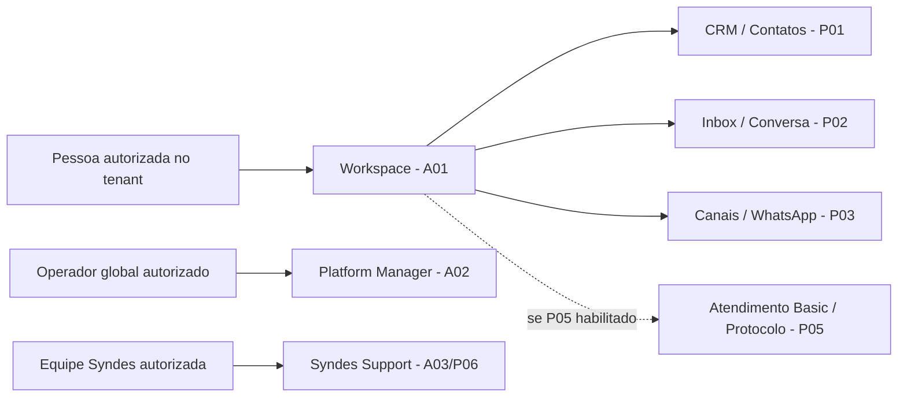

[← Ficha do capítulo](../) · [Volume](../../) · [Fonte original](https://github.com/delmacy/syndes-system/blob/main/docs/subprojects/G02-produto-e-ux/chapters/05-arquitetura-banco-interface-configuracao-e-diagramas.md)

> Conteúdo espelhado da documentação versionada; não expressa automaticamente estado funcional.

## 5. Experiência de uso, dados e diagramas

### Mapa de jornadas por público (lógico, não prova de deploy)

**Interpretação:** a figura representa os **contextos de UX de produto**; não implica que uma rota, botão, consumer ou deploy esteja disponível. O Host e as regras de autorização reais pertencem aos owners de A04, C01, C03, C04 e dos módulos.

### Fluxos de interface e separação

| Superfície | Experiência documentada ou esperada | Evidência do checkout | Gate a conferir |
|---|---|---|---|
| Workspace React | Overview, CRM, Inbox, contas de WhatsApp, Settings | `apps/workspace-web/src/features/*.tsx` | Navegação por módulo ENABLED, identidade, contexto e ações reais |
| CRM | Listar/cadastrar/editar pessoas e organizações; relações, tags, notas e CSV | `apps/workspace-web/src/features/crm.tsx`, `crm-person-detail.tsx`; [checkpoint](https://github.com/delmacy/syndes-system/blob/main/docs/product/CORE-CRM-FRONTEND-COMPLETION.md) | Keycloak/OpenFGA de perfis distintos, acessibilidade e Product Gate |
| Inbox | Filas, histórico, resposta, nota, handoff, contexto CRM e atualização | `apps/workspace-web/src/features/inbox.tsx`, `inbox-thread.ts`; [checkpoint](https://github.com/delmacy/syndes-system/blob/main/docs/product/INBOX-FRONTEND-PROGRESS.md) | SSE E2E real/multi-instância se aplicável, autorização e regressão |
| Manager | Metadados globais sem dados privados tenant | `apps/master-admin-web/src/App.tsx`, `src/app/ManagerShell.tsx` | Roles SQL, OIDC, grants e deploy alvo |
| Support | Fluxos de case/queue próprios da Syndes | `apps/support-web/src/App.tsx`; [PRD](https://github.com/delmacy/syndes-system/blob/main/docs/product/PRD-SYNDES-SUPPORT.md) | Autorização para público interno/externo e evidência de operação |
| Atendimento Basic | Lista/Kanban simples e inspector vinculado à Inbox | [PRD-003A](https://github.com/delmacy/syndes-system/blob/main/docs/product/PRD-003A-GESTAO-ATENDIMENTOS-MVP.md) | Sem assumir tela operacional só por previsão no PRD |

### Dados: mapa conceitual de ownership

`Customer Account / Tenant` determina o isolamento físico de dados; `Platform Organization` e `Workspace` restringem escopo operacional. P04/Control não são equivalentes a `CRM Organization` (empresa de relacionamento). `Conversation` da Inbox conserva mensagens; `Attendance Protocol` tem identidade, estado, atribuição e histórico próprios, com vínculo **opcional** à conversa.

**G02 não tem database, tabelas ou migrations próprias.** A UI usa dados dos serviços autorizados, nunca conecta diretamente ao PostgreSQL; o servidor verifica identidade, membership, módulo e autorização em cada recurso. Não usar `tenantId`, `organizationId` ou `assignedTo` enviados pelo browser como concessão de privilégios.

### Regras de UX verificáveis

1. **Separação de assunto e contexto:** módulo/área no Workspace, funções permitidas pelo usuário e estado de módulo habilitado; Manager e Support não compartilham sessão implícita.
2. **Estados explícitos:** loading, vazio real, indisponibilidade, negação e conflito não devem virar dado fictício nem esconder falha de autorização.
3. **Desktop e mobile:** lista/detalhe/inspector adaptáveis; controles de ações permanecem acessíveis; testes mockados são necessários para iteração, mas insuficientes para aceite real.
4. **Acessibilidade:** teclado, foco, rotulagem, contraste e leitura coerente para fluxos críticos — critérios a comprovar no gate de UX, sem marcar como aprovados nesta revisão.
5. **Concorrência e escopo:** preservar rascunhos após erro de envio; mudança de Organization/Workspace deve revalidar requisições/caches/SSE; não mostrar dados de outro escopo.

**Não há evidência de teste E2E real para todas essas jornadas nesta auditoria**. Os checklists de aceitação pertencem aos PRDs e às suites próprias de cada módulo.

---
**Rastreabilidade:** [revisar documento fonte](https://github.com/delmacy/syndes-system/blob/main/docs/subprojects/G02-produto-e-ux/chapters/05-arquitetura-banco-interface-configuracao-e-diagramas.md).
