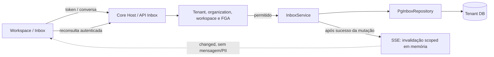
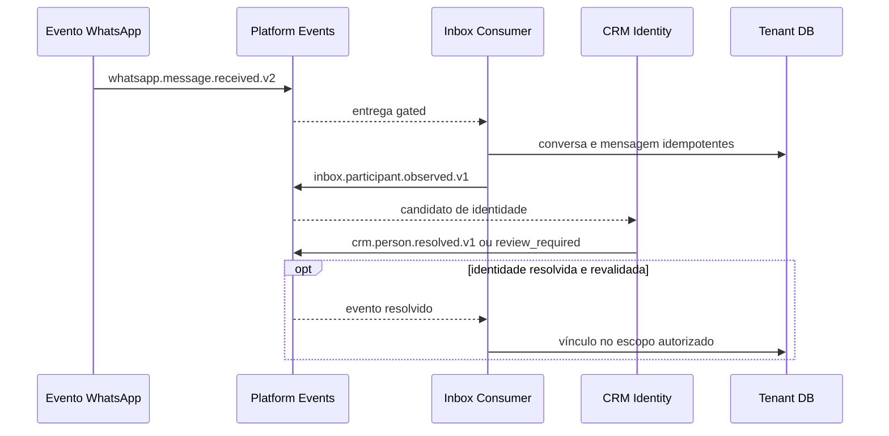

[← Ficha do capítulo](../) · [Volume](../../) · [Fonte original](https://github.com/delmacy/syndes-system/blob/main/docs/subprojects/P02-inbox/chapters/05-arquitetura-banco-interface-configuracao-e-diagramas.md)

> Conteúdo espelhado da documentação versionada; não expressa automaticamente estado funcional.

## 5. Arquitetura, banco, interface, configuração e diagramas

> **Levantamento parcial do código — 12/11/2026.** Componentes abaixo estão presentes no repositório; implantação com identidade real e testes operacionais ainda exigem homologação.

### Componentes e fronteiras

- Módulo: `modules/inbox/src/plugin.ts`, `src/inbox.controller.ts`, `src/service.ts` e `src/postgres.ts`.
- UI consumidora: `apps/workspace-web/src/features/inbox.tsx`. Assets legados do módulo também existem em `modules/inbox/public/`.
- Persistência do módulo: `modules/inbox/sql/001_inbox_foundation.sql`; não adotar tabelas de CRM como propriedade da Inbox.
- Acesso: JWT de identidade confiável, Core Kernel, FGA e contexto de tenant/organização/workspace antes da seleção de banco; não há grants automáticos apenas por definir permissões.
- Atualização de interface: SSE de invalidação por escopo com fallback para HTTP, **em memória de um Host**; não assumir entrega distribuída.

### Diagrama — requisição e atualização de fila

### Diagrama — consumidor de WhatsApp e vínculo CRM (opt-in)

**Gate:** publisher, consumidores e composição existem em código, mas **não** são automaticamente iniciados. O fluxo é candidato para ativação após identidade service, Control ENABLED/FGA, migrações, cutover seguro e testes. Fontes: `modules/inbox/src/whatsapp-event-consumer.ts`, `crm-link-event-consumer.ts`, `apps/core-host/src/platform-event-worker-composition.ts`.

---
**Rastreabilidade:** [revisar documento fonte](https://github.com/delmacy/syndes-system/blob/main/docs/subprojects/P02-inbox/chapters/05-arquitetura-banco-interface-configuracao-e-diagramas.md).
