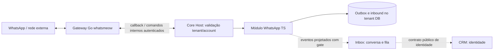
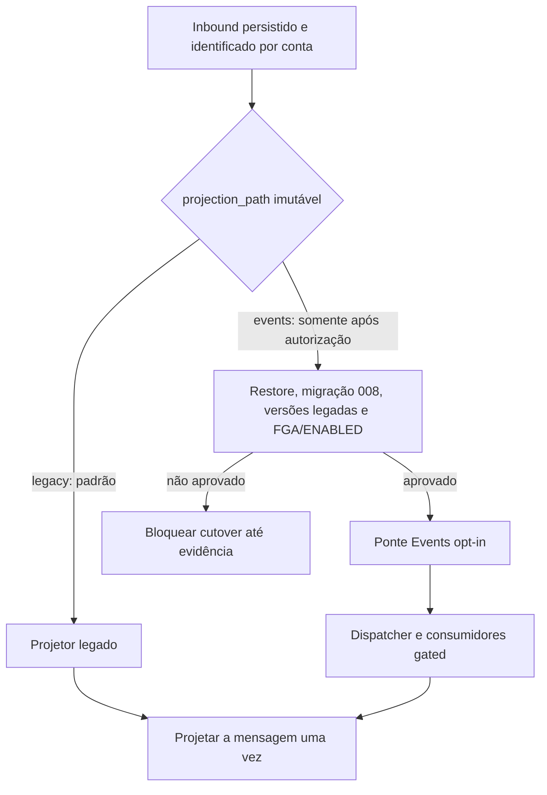

# P03 — WhatsApp

[← Sumário do volume](../) · [↑ Biblioteca](../../)

> **Leitura técnica, não homologação.** Estados, limites e comprovações devem ser lidos em STATUS e nos checkpoints versionados.

## Identificação e rastreabilidade

| Campo | Fonte verificável |
|---|---|
| Unidade / owner | **P03** · WhatsApp |
| Volume | Produto e módulos de negócio |
| Caminho de implementação | `modules/whatsapp` |
| Documento de origem | [README](https://github.com/delmacy/syndes-system/blob/main/docs/subprojects/P03-whatsapp/README.md) |
| STATUS e critérios | [STATUS original](https://github.com/delmacy/syndes-system/blob/main/docs/subprojects/P03-whatsapp/STATUS.md) |
| Símbolos, APIs, SQL e dependências | [REFERENCIA-TECNICA](https://github.com/delmacy/syndes-system/blob/main/docs/subprojects/P03-whatsapp/REFERENCIA-TECNICA.md) |
| Implantação, runbooks e gates | [OPERACAO](https://github.com/delmacy/syndes-system/blob/main/docs/subprojects/P03-whatsapp/OPERACAO.md) |

## Situação registrada

> AUDITORIA TÉCNICA PARCIAL — 2026-11-12. Evidência: worktree b452a03e; testes locais sem implantação. NÃO equivale a CI da SHA publicada, integração real, deploy ou Product Gate. Pacote TypeScript com contas, outbox, inbound, dispatch, contratos e migrations 001–008; gateway Go/Whatsmeow existe. O plugin consta em apps/core-host/config/modules.json, mas a inscrição não prova módulo habilitado por tenant nem projetor novo operacional. Fonte O que foi…

A descrição acima é uma **citação resumida do STATUS versionado**; não significa que os testes de integração, a implantação ou a homologação estejam aprovados.

## Índice dos subcapítulos

Todos os assuntos deste módulo estão nesta página. Clique em um título para saltar à seção correspondente; o índice lateral acompanha a leitura.

- [Casos de uso](#casos-de-uso)
- [Histórias de usuário](#historias-de-usuario)
- [Requisitos](#requisitos)
- [Contratos públicos e privados](#contratos)
- [APIs e endpoints](#apis)
- [Eventos e mensageria](#eventos)
- [Dados e persistência](#dados)
- [Schemas e migrations](#schema)
- [Dependências e integrações](#dependencias)
- [Configuração e ambiente](#configuracao)
- [Frontend e interfaces](#interface)
- [Testes e evidências](#testes)
- [Operação e implantação](#operacao)
- [WBS e evolução](#wbs)
- [Documentação de origem integral](#documentacao-de-origem)
- [Controle de alterações](#controle-de-alteracoes)

## Casos de uso

**Editar esta seção:** [Abrir arquivo-fonte no GitHub](https://github.com/delmacy/syndes-system/edit/main/docs/subprojects/P03-whatsapp/chapters/02-requisitos-historias-e-casos-de-uso.md) · [Consultar fonte](https://github.com/delmacy/syndes-system/blob/main/docs/subprojects/P03-whatsapp/chapters/02-requisitos-historias-e-casos-de-uso.md)

*Referências extraídas da documentação versionada, sem inferir homologação ou implantação.*

**Lacuna documental:** ainda não há especificação textual identificada nesta área. Revisar implementação e registrar evidência antes de preencher.

📝 Espaço para ajustes e implementação

Este é um **modelo de registro**, não um editor com salvamento automático. Use o link **Editar esta seção** para atualizar o documento versionado.

- **Alteração proposta:** descreva o requisito, contrato, dado ou comportamento.
- **Referência de código:** informe caminho e símbolo real.
- **Testes e evidências:** informe comando, resultado e limite.
- **Critério de aceite:** indique como validar sem presumir homologação.
- **Status e revisão:** atualize a fonte canônica após revisão.

## Histórias de usuário

**Editar esta seção:** [Abrir arquivo-fonte no GitHub](https://github.com/delmacy/syndes-system/edit/main/docs/subprojects/P03-whatsapp/chapters/02-requisitos-historias-e-casos-de-uso.md) · [Consultar fonte](https://github.com/delmacy/syndes-system/blob/main/docs/subprojects/P03-whatsapp/chapters/02-requisitos-historias-e-casos-de-uso.md)

*Referências extraídas da documentação versionada, sem inferir homologação ou implantação.*

**Lacuna documental:** ainda não há especificação textual identificada nesta área. Revisar implementação e registrar evidência antes de preencher.

📝 Espaço para ajustes e implementação

Este é um **modelo de registro**, não um editor com salvamento automático. Use o link **Editar esta seção** para atualizar o documento versionado.

- **Alteração proposta:** descreva o requisito, contrato, dado ou comportamento.
- **Referência de código:** informe caminho e símbolo real.
- **Testes e evidências:** informe comando, resultado e limite.
- **Critério de aceite:** indique como validar sem presumir homologação.
- **Status e revisão:** atualize a fonte canônica após revisão.

## Requisitos

**Editar esta seção:** [Abrir arquivo-fonte no GitHub](https://github.com/delmacy/syndes-system/edit/main/docs/subprojects/P03-whatsapp/chapters/02-requisitos-historias-e-casos-de-uso.md) · [Consultar fonte](https://github.com/delmacy/syndes-system/blob/main/docs/subprojects/P03-whatsapp/chapters/02-requisitos-historias-e-casos-de-uso.md)

*Referências extraídas da documentação versionada, sem inferir homologação ou implantação.*

**Fonte:** [02-requisitos-historias-e-casos-de-uso.md](https://github.com/delmacy/syndes-system/blob/main/docs/subprojects/P03-whatsapp/chapters/02-requisitos-historias-e-casos-de-uso.md)

> Linha 2: - RF/US/UC/AC/RN: A INVENTARIAR, sem criar requisitos fictícios.

**Fonte:** [OPERACAO.md](https://github.com/delmacy/syndes-system/blob/main/docs/subprojects/P03-whatsapp/OPERACAO.md)

> Linha 43: **Regra de operação:** o corte do projetor, service grants, restore e deploy exigem gates próprios; esta alteração documental não habilita workers ou conexões.

📝 Espaço para ajustes e implementação

Este é um **modelo de registro**, não um editor com salvamento automático. Use o link **Editar esta seção** para atualizar o documento versionado.

- **Alteração proposta:** descreva o requisito, contrato, dado ou comportamento.
- **Referência de código:** informe caminho e símbolo real.
- **Testes e evidências:** informe comando, resultado e limite.
- **Critério de aceite:** indique como validar sem presumir homologação.
- **Status e revisão:** atualize a fonte canônica após revisão.

## Contratos públicos e privados

**Editar esta seção:** [Abrir arquivo-fonte no GitHub](https://github.com/delmacy/syndes-system/edit/main/docs/subprojects/P03-whatsapp/REFERENCIA-TECNICA.md) · [Consultar fonte](https://github.com/delmacy/syndes-system/blob/main/docs/subprojects/P03-whatsapp/REFERENCIA-TECNICA.md)

*Referências extraídas da documentação versionada, sem inferir homologação ou implantação.*

**Fonte:** [REFERENCIA-TECNICA.md](https://github.com/delmacy/syndes-system/blob/main/docs/subprojects/P03-whatsapp/REFERENCIA-TECNICA.md)

> Linha 8: - **Owner:** declarado em `catalog/work-units.json`. Contratos públicos de outros owners não podem ser alterados diretamente.

> Linha 34: **A AUDITAR:** inspecionar código e testes, assinaturas, parâmetros, efeitos e erros. Não publicar API privada como contrato.

> Linha 68: - **Próximo passo:** auditar classes/exports, contratos, telas, tabelas, testes e evidências sem inventar funcionalidades.

> Linha 76: \| Plugin NestJS e domínio TypeScript \| `modules/whatsapp/src/plugin.ts` e `modules/whatsapp/src/` \| APIs, contas, contratos, regras, outbox e migrations de negócio \|

**Fonte:** [04-contratos-e-dependencias-publicas.md](https://github.com/delmacy/syndes-system/blob/main/docs/subprojects/P03-whatsapp/chapters/04-contratos-e-dependencias-publicas.md)

> Linha 4: - Bibliotecas permitidas: consultar exports públicos e dependências existentes, sem copiar implementação privada.

**Fonte:** [STATUS.md](https://github.com/delmacy/syndes-system/blob/main/docs/subprojects/P03-whatsapp/STATUS.md)

> Linha 7: Pacote TypeScript com contas, outbox, inbound, dispatch, contratos e migrations 001–008; gateway Go/Whatsmeow existe. O plugin consta em apps/core-host/config/modules.json, mas a inscrição não prova módulo habilitado por tenant nem projetor novo operacional.

**Fonte:** [OPERACAO.md](https://github.com/delmacy/syndes-system/blob/main/docs/subprojects/P03-whatsapp/OPERACAO.md)

> Linha 16: - [Contratos públicos](../../standards/CONTRATOS-PUBLICOS.md).

> Linha 32: 4. Testar com critérios apropriados: unitário, contrato, integração, E2E e CI.

> Linha 39: O processo gerencia sessões e a comunicação WhatsApp; a API TypeScript atende aos contratos de negócio. A troca entre processos precisa de autenticação interna e callbacks protegidos. O armazenamento de sessões do sidecar é separado dos dados de negócio do Tenant DB. Não expor a API do sidecar diretamente à internet.

📝 Espaço para ajustes e implementação

Este é um **modelo de registro**, não um editor com salvamento automático. Use o link **Editar esta seção** para atualizar o documento versionado.

- **Alteração proposta:** descreva o requisito, contrato, dado ou comportamento.
- **Referência de código:** informe caminho e símbolo real.
- **Testes e evidências:** informe comando, resultado e limite.
- **Critério de aceite:** indique como validar sem presumir homologação.
- **Status e revisão:** atualize a fonte canônica após revisão.

## APIs e endpoints

**Editar esta seção:** [Abrir arquivo-fonte no GitHub](https://github.com/delmacy/syndes-system/edit/main/docs/subprojects/P03-whatsapp/REFERENCIA-TECNICA.md) · [Consultar fonte](https://github.com/delmacy/syndes-system/blob/main/docs/subprojects/P03-whatsapp/REFERENCIA-TECNICA.md)

*Referências extraídas da documentação versionada, sem inferir homologação ou implantação.*

**Fonte:** [REFERENCIA-TECNICA.md](https://github.com/delmacy/syndes-system/blob/main/docs/subprojects/P03-whatsapp/REFERENCIA-TECNICA.md)

> Linha 34: **A AUDITAR:** inspecionar código e testes, assinaturas, parâmetros, efeitos e erros. Não publicar API privada como contrato.

> Linha 77: \| Sidecar Go / Whatsmeow \| `modules/whatsapp/gateway/whatsmeow/` \| Protocolo WhatsApp, sessões e callbacks autenticados para a API \|

**Fonte:** [05-arquitetura-banco-interface-configuracao-e-diagramas.md](https://github.com/delmacy/syndes-system/blob/main/docs/subprojects/P03-whatsapp/chapters/05-arquitetura-banco-interface-configuracao-e-diagramas.md)

> Linha 8: - TypeScript: `modules/whatsapp/src/plugin.ts`, `inbound-http.ts`, `outbox.ts`, `event-bridge.ts` — contrato, conta, rotas e persistência do módulo.

**Fonte:** [OPERACAO.md](https://github.com/delmacy/syndes-system/blob/main/docs/subprojects/P03-whatsapp/OPERACAO.md)

> Linha 39: O processo gerencia sessões e a comunicação WhatsApp; a API TypeScript atende aos contratos de negócio. A troca entre processos precisa de autenticação interna e callbacks protegidos. O armazenamento de sessões do sidecar é separado dos dados de negócio do Tenant DB. Não expor a API do sidecar diretamente à internet.

📝 Espaço para ajustes e implementação

Este é um **modelo de registro**, não um editor com salvamento automático. Use o link **Editar esta seção** para atualizar o documento versionado.

- **Alteração proposta:** descreva o requisito, contrato, dado ou comportamento.
- **Referência de código:** informe caminho e símbolo real.
- **Testes e evidências:** informe comando, resultado e limite.
- **Critério de aceite:** indique como validar sem presumir homologação.
- **Status e revisão:** atualize a fonte canônica após revisão.

## Eventos e mensageria

**Editar esta seção:** [Abrir arquivo-fonte no GitHub](https://github.com/delmacy/syndes-system/edit/main/docs/subprojects/P03-whatsapp/REFERENCIA-TECNICA.md) · [Consultar fonte](https://github.com/delmacy/syndes-system/blob/main/docs/subprojects/P03-whatsapp/REFERENCIA-TECNICA.md)

*Referências extraídas da documentação versionada, sem inferir homologação ou implantação.*

**Fonte:** [REFERENCIA-TECNICA.md](https://github.com/delmacy/syndes-system/blob/main/docs/subprojects/P03-whatsapp/REFERENCIA-TECNICA.md)

> Linha 16: \| `.` \| `./dist/accounts.js` \| Declaração, não garantia de consumidor instalado \|

> Linha 17: \| `./contracts` \| `./dist/contracts/index.js` \| Declaração, não garantia de consumidor instalado \|

> Linha 18: \| `./crm-link-plan` \| `{"types": "./dist/crm-link-plan.d.ts", "default": "./dist/crm-link-plan.js"}` \| Declaração, não garantia de consumidor instalado \|

> Linha 19: \| `./event-bridge` \| `{"types": "./dist/event-bridge.d.ts", "default": "./dist/event-bridge.js"}` \| Declaração, não garantia de consumidor instalado \|

> Linha 20: \| `./event-identity-reader` \| `{"types": "./dist/event-identity-reader.d.ts", "default": "./dist/event-identity-reader.js"}` \| Declaração, não garantia de consumidor instalado \|

> Linha 21: \| `./event-route-commands` \| `{"types": "./dist/event-route-commands.d.ts", "default": "./dist/event-route-commands.js"}` \| Declaração, não garantia de consumidor instalado \|

> Linha 22: \| `./plugin` \| `./dist/plugin.js` \| Declaração, não garantia de consumidor instalado \|

> Linha 76: \| Plugin NestJS e domínio TypeScript \| `modules/whatsapp/src/plugin.ts` e `modules/whatsapp/src/` \| APIs, contas, contratos, regras, outbox e migrations de negócio \|

**Fonte:** [04-contratos-e-dependencias-publicas.md](https://github.com/delmacy/syndes-system/blob/main/docs/subprojects/P03-whatsapp/chapters/04-contratos-e-dependencias-publicas.md)

> Linha 2: - Entradas, saídas, APIs, eventos e ports: A INVENTARIAR pela fonte executável.

**Fonte:** [05-arquitetura-banco-interface-configuracao-e-diagramas.md](https://github.com/delmacy/syndes-system/blob/main/docs/subprojects/P03-whatsapp/chapters/05-arquitetura-banco-interface-configuracao-e-diagramas.md)

> Linha 8: - TypeScript: `modules/whatsapp/src/plugin.ts`, `inbound-http.ts`, `outbox.ts`, `event-bridge.ts` — contrato, conta, rotas e persistência do módulo.

> Linha 52: **Regra crítica:** nunca permitir dois projetores proprietários do mesmo evento nem mudar `projection_path` histórico para simular rollback. O caminho `events` não está habilitado no runtime por esta documentação. Fontes: `docs/engineering/WBS-WHATSAPP-PROJECTION-CUTOVER-20261111.md` e `apps/core-host/src/platform-event-worker-composition.ts`.

**Fonte:** [STATUS.md](https://github.com/delmacy/syndes-system/blob/main/docs/subprojects/P03-whatsapp/STATUS.md)

> Linha 3: > **AUDITORIA TÉCNICA PARCIAL — 2026-11-12.** Evidência: worktree `b452a03e`; testes locais sem implantação. NÃO equivale a CI da SHA publicada, integração real, deploy ou Product Gate.

> Linha 7: Pacote TypeScript com contas, outbox, inbound, dispatch, contratos e migrations 001–008; gateway Go/Whatsmeow existe. O plugin consta em apps/core-host/config/modules.json, mas a inscrição não prova módulo habilitado por tenant nem projetor novo operacional.

> Linha 13: \| `modules/whatsapp/src/outbox.ts` \| Artefato presente no checkout; não implica runtime habilitado \|

📝 Espaço para ajustes e implementação

Este é um **modelo de registro**, não um editor com salvamento automático. Use o link **Editar esta seção** para atualizar o documento versionado.

- **Alteração proposta:** descreva o requisito, contrato, dado ou comportamento.
- **Referência de código:** informe caminho e símbolo real.
- **Testes e evidências:** informe comando, resultado e limite.
- **Critério de aceite:** indique como validar sem presumir homologação.
- **Status e revisão:** atualize a fonte canônica após revisão.

## Dados e persistência

**Editar esta seção:** [Abrir arquivo-fonte no GitHub](https://github.com/delmacy/syndes-system/edit/main/docs/subprojects/P03-whatsapp/REFERENCIA-TECNICA.md) · [Consultar fonte](https://github.com/delmacy/syndes-system/blob/main/docs/subprojects/P03-whatsapp/REFERENCIA-TECNICA.md)

*Referências extraídas da documentação versionada, sem inferir homologação ou implantação.*

**Fonte:** [REFERENCIA-TECNICA.md](https://github.com/delmacy/syndes-system/blob/main/docs/subprojects/P03-whatsapp/REFERENCIA-TECNICA.md)

> Linha 63: Nenhuma tabela pode ser atribuída ao Control por inferência; confirmar owner e schema. Negócio do cliente fica no Tenant DB.

> Linha 79: **Banco:** as sessões do Whatsmeow utilizam armazenamento PostgreSQL dedicado ao adaptador, conforme seu README. É distinto do **Tenant DB** (contas/mensagens de negócio) e do **Control/Manager DB**. Não pressupor migrations já aplicadas.

**Fonte:** [05-arquitetura-banco-interface-configuracao-e-diagramas.md](https://github.com/delmacy/syndes-system/blob/main/docs/subprojects/P03-whatsapp/chapters/05-arquitetura-banco-interface-configuracao-e-diagramas.md)

> Linha 8: - TypeScript: `modules/whatsapp/src/plugin.ts`, `inbound-http.ts`, `outbox.ts`, `event-bridge.ts` — contrato, conta, rotas e persistência do módulo.

**Fonte:** [STATUS.md](https://github.com/delmacy/syndes-system/blob/main/docs/subprojects/P03-whatsapp/STATUS.md)

> Linha 23: - Go/Whatsmeow: testes de gateway e persistência/quotas/contas não validados nesta auditoria.

**Fonte:** [OPERACAO.md](https://github.com/delmacy/syndes-system/blob/main/docs/subprojects/P03-whatsapp/OPERACAO.md)

> Linha 39: O processo gerencia sessões e a comunicação WhatsApp; a API TypeScript atende aos contratos de negócio. A troca entre processos precisa de autenticação interna e callbacks protegidos. O armazenamento de sessões do sidecar é separado dos dados de negócio do Tenant DB. Não expor a API do sidecar diretamente à internet.

📝 Espaço para ajustes e implementação

Este é um **modelo de registro**, não um editor com salvamento automático. Use o link **Editar esta seção** para atualizar o documento versionado.

- **Alteração proposta:** descreva o requisito, contrato, dado ou comportamento.
- **Referência de código:** informe caminho e símbolo real.
- **Testes e evidências:** informe comando, resultado e limite.
- **Critério de aceite:** indique como validar sem presumir homologação.
- **Status e revisão:** atualize a fonte canônica após revisão.

## Schemas e migrations

**Editar esta seção:** [Abrir arquivo-fonte no GitHub](https://github.com/delmacy/syndes-system/edit/main/docs/subprojects/P03-whatsapp/REFERENCIA-TECNICA.md) · [Consultar fonte](https://github.com/delmacy/syndes-system/blob/main/docs/subprojects/P03-whatsapp/REFERENCIA-TECNICA.md)

*Referências extraídas da documentação versionada, sem inferir homologação ou implantação.*

**Fonte:** [REFERENCIA-TECNICA.md](https://github.com/delmacy/syndes-system/blob/main/docs/subprojects/P03-whatsapp/REFERENCIA-TECNICA.md)

> Linha 48: Tabelas e migrações precisam de ownership e prova de aplicação; arquivo SQL presente não equivale a mudança executada.

> Linha 50: \| Arquivo SQL encontrado \| Banco/owner e estado \|

> Linha 52: \| [001_whatsapp_accounts.sql](https://github.com/delmacy/syndes-system/blob/main/modules/whatsapp/sql/001_whatsapp_accounts.sql) \| A confirmar com o manifesto de migração \|

> Linha 53: \| [002_whatsapp_inbound.sql](https://github.com/delmacy/syndes-system/blob/main/modules/whatsapp/sql/002_whatsapp_inbound.sql) \| A confirmar com o manifesto de migração \|

> Linha 54: \| [003_whatsapp_outbound_inbox.sql](https://github.com/delmacy/syndes-system/blob/main/modules/whatsapp/sql/003_whatsapp_outbound_inbox.sql) \| A confirmar com o manifesto de migração \|

> Linha 55: \| [004_whatsapp_conversation_phone.sql](https://github.com/delmacy/syndes-system/blob/main/modules/whatsapp/sql/004_whatsapp_conversation_phone.sql) \| A confirmar com o manifesto de migração \|

> Linha 56: \| [005_whatsapp_history.sql](https://github.com/delmacy/syndes-system/blob/main/modules/whatsapp/sql/005_whatsapp_history.sql) \| A confirmar com o manifesto de migração \|

> Linha 57: \| [006_whatsapp_contact_names.sql](https://github.com/delmacy/syndes-system/blob/main/modules/whatsapp/sql/006_whatsapp_contact_names.sql) \| A confirmar com o manifesto de migração \|

> Linha 58: \| [007_whatsapp_delivery_receipts.sql](https://github.com/delmacy/syndes-system/blob/main/modules/whatsapp/sql/007_whatsapp_delivery_receipts.sql) \| A confirmar com o manifesto de migração \|

> Linha 59: \| [008_whatsapp_projection_owner.sql](https://github.com/delmacy/syndes-system/blob/main/modules/whatsapp/sql/008_whatsapp_projection_owner.sql) \| A confirmar com o manifesto de migração \|

> Linha 63: Nenhuma tabela pode ser atribuída ao Control por inferência; confirmar owner e schema. Negócio do cliente fica no Tenant DB.

> Linha 68: - **Próximo passo:** auditar classes/exports, contratos, telas, tabelas, testes e evidências sem inventar funcionalidades.

> Linha 76: \| Plugin NestJS e domínio TypeScript \| `modules/whatsapp/src/plugin.ts` e `modules/whatsapp/src/` \| APIs, contas, contratos, regras, outbox e migrations de negócio \|

> Linha 79: **Banco:** as sessões do Whatsmeow utilizam armazenamento PostgreSQL dedicado ao adaptador, conforme seu README. É distinto do **Tenant DB** (contas/mensagens de negócio) e do **Control/Manager DB**. Não pressupor migrations já aplicadas.

**Fonte:** [05-arquitetura-banco-interface-configuracao-e-diagramas.md](https://github.com/delmacy/syndes-system/blob/main/docs/subprojects/P03-whatsapp/chapters/05-arquitetura-banco-interface-configuracao-e-diagramas.md)

> Linha 10: - SQL do módulo: `modules/whatsapp/sql/001_whatsapp_accounts.sql` até `008_whatsapp_projection_owner.sql`; migrações em tenant real somente com autorização e restore.

**Fonte:** [STATUS.md](https://github.com/delmacy/syndes-system/blob/main/docs/subprojects/P03-whatsapp/STATUS.md)

> Linha 7: Pacote TypeScript com contas, outbox, inbound, dispatch, contratos e migrations 001–008; gateway Go/Whatsmeow existe. O plugin consta em apps/core-host/config/modules.json, mas a inscrição não prova módulo habilitado por tenant nem projetor novo operacional.

> Linha 16: \| `modules/whatsapp/sql/008_whatsapp_projection_owner.sql` \| Artefato presente no checkout; não implica runtime habilitado \|

> Linha 24: - WA-CUT07–10: migration 008 em staging, todas instâncias legadas compatíveis com filtro, canário e rollback — não ativar projetores concorrentes.

**Fonte:** [OPERACAO.md](https://github.com/delmacy/syndes-system/blob/main/docs/subprojects/P03-whatsapp/OPERACAO.md)

> Linha 3: > **ÍNDICE DE FONTES, NÃO RUNBOOK HOMOLOGADO.** Não executar migrations, alterar permissões ou ativar workers apenas com esta página.

> Linha 31: 3. Confirmar migrations realmente aplicadas, backup/restore e rollback antes de SQL.

📝 Espaço para ajustes e implementação

Este é um **modelo de registro**, não um editor com salvamento automático. Use o link **Editar esta seção** para atualizar o documento versionado.

- **Alteração proposta:** descreva o requisito, contrato, dado ou comportamento.
- **Referência de código:** informe caminho e símbolo real.
- **Testes e evidências:** informe comando, resultado e limite.
- **Critério de aceite:** indique como validar sem presumir homologação.
- **Status e revisão:** atualize a fonte canônica após revisão.

## Dependências e integrações

**Editar esta seção:** [Abrir arquivo-fonte no GitHub](https://github.com/delmacy/syndes-system/edit/main/docs/subprojects/P03-whatsapp/REFERENCIA-TECNICA.md) · [Consultar fonte](https://github.com/delmacy/syndes-system/blob/main/docs/subprojects/P03-whatsapp/REFERENCIA-TECNICA.md)

*Referências extraídas da documentação versionada, sem inferir homologação ou implantação.*

**Fonte:** [04-contratos-e-dependencias-publicas.md](https://github.com/delmacy/syndes-system/blob/main/docs/subprojects/P03-whatsapp/chapters/04-contratos-e-dependencias-publicas.md)

> Linha 3: - Dependências obrigatórias e opcionais: A VERIFICAR.

> Linha 4: - Bibliotecas permitidas: consultar exports públicos e dependências existentes, sem copiar implementação privada.

**Fonte:** [05-arquitetura-banco-interface-configuracao-e-diagramas.md](https://github.com/delmacy/syndes-system/blob/main/docs/subprojects/P03-whatsapp/chapters/05-arquitetura-banco-interface-configuracao-e-diagramas.md)

> Linha 56: O gateway Whatsmeow está **dentro do módulo P03 WhatsApp**. O plugin NestJS em `modules/whatsapp/src/plugin.ts` representa a integração do módulo com o Core Host; o processo Go em `modules/whatsapp/gateway/whatsmeow/` é um sidecar de protocolo, sessão e callbacks. A divisão de processos não implica dois módulos de negócio.

**Fonte:** [STATUS.md](https://github.com/delmacy/syndes-system/blob/main/docs/subprojects/P03-whatsapp/STATUS.md)

> Linha 3: > **AUDITORIA TÉCNICA PARCIAL — 2026-11-12.** Evidência: worktree `b452a03e`; testes locais sem implantação. NÃO equivale a CI da SHA publicada, integração real, deploy ou Product Gate.

**Fonte:** [OPERACAO.md](https://github.com/delmacy/syndes-system/blob/main/docs/subprojects/P03-whatsapp/OPERACAO.md)

> Linha 9: - [Evolução](EVOLUCAO.md): workpackages e dependências; nenhum item é concluído por estar planejado.

> Linha 32: 4. Testar com critérios apropriados: unitário, contrato, integração, E2E e CI.

📝 Espaço para ajustes e implementação

Este é um **modelo de registro**, não um editor com salvamento automático. Use o link **Editar esta seção** para atualizar o documento versionado.

- **Alteração proposta:** descreva o requisito, contrato, dado ou comportamento.
- **Referência de código:** informe caminho e símbolo real.
- **Testes e evidências:** informe comando, resultado e limite.
- **Critério de aceite:** indique como validar sem presumir homologação.
- **Status e revisão:** atualize a fonte canônica após revisão.

## Configuração e ambiente

**Editar esta seção:** [Abrir arquivo-fonte no GitHub](https://github.com/delmacy/syndes-system/edit/main/docs/subprojects/P03-whatsapp/OPERACAO.md) · [Consultar fonte](https://github.com/delmacy/syndes-system/blob/main/docs/subprojects/P03-whatsapp/OPERACAO.md)

*Referências extraídas da documentação versionada, sem inferir homologação ou implantação.*

**Lacuna documental:** ainda não há especificação textual identificada nesta área. Revisar implementação e registrar evidência antes de preencher.

📝 Espaço para ajustes e implementação

Este é um **modelo de registro**, não um editor com salvamento automático. Use o link **Editar esta seção** para atualizar o documento versionado.

- **Alteração proposta:** descreva o requisito, contrato, dado ou comportamento.
- **Referência de código:** informe caminho e símbolo real.
- **Testes e evidências:** informe comando, resultado e limite.
- **Critério de aceite:** indique como validar sem presumir homologação.
- **Status e revisão:** atualize a fonte canônica após revisão.

## Frontend e interfaces

**Editar esta seção:** [Abrir arquivo-fonte no GitHub](https://github.com/delmacy/syndes-system/edit/main/docs/subprojects/P03-whatsapp/REFERENCIA-TECNICA.md) · [Consultar fonte](https://github.com/delmacy/syndes-system/blob/main/docs/subprojects/P03-whatsapp/REFERENCIA-TECNICA.md)

*Referências extraídas da documentação versionada, sem inferir homologação ou implantação.*

**Fonte:** [REFERENCIA-TECNICA.md](https://github.com/delmacy/syndes-system/blob/main/docs/subprojects/P03-whatsapp/REFERENCIA-TECNICA.md)

> Linha 42: **A AUDITAR:** conferir telas em Workspace, Manager ou Support e componentes compartilhados; não inferir rota a partir do nome da unidade.

> Linha 68: - **Próximo passo:** auditar classes/exports, contratos, telas, tabelas, testes e evidências sem inventar funcionalidades.

> Linha 74: \| Componente de P03 \| Fonte no repositório \| Papel \|

📝 Espaço para ajustes e implementação

Este é um **modelo de registro**, não um editor com salvamento automático. Use o link **Editar esta seção** para atualizar o documento versionado.

- **Alteração proposta:** descreva o requisito, contrato, dado ou comportamento.
- **Referência de código:** informe caminho e símbolo real.
- **Testes e evidências:** informe comando, resultado e limite.
- **Critério de aceite:** indique como validar sem presumir homologação.
- **Status e revisão:** atualize a fonte canônica após revisão.

## Testes e evidências

**Editar esta seção:** [Abrir arquivo-fonte no GitHub](https://github.com/delmacy/syndes-system/edit/main/docs/subprojects/P03-whatsapp/STATUS.md) · [Consultar fonte](https://github.com/delmacy/syndes-system/blob/main/docs/subprojects/P03-whatsapp/STATUS.md)

*Referências extraídas da documentação versionada, sem inferir homologação ou implantação.*

**Fonte:** [STATUS.md](https://github.com/delmacy/syndes-system/blob/main/docs/subprojects/P03-whatsapp/STATUS.md)

> Linha 3: > **AUDITORIA TÉCNICA PARCIAL — 2026-11-12.** Evidência: worktree `b452a03e`; testes locais sem implantação. NÃO equivale a CI da SHA publicada, integração real, deploy ou Product Gate.

> Linha 19: **Testes executados nesta revisão:** cd modules/whatsapp && npm test — 69 PASS, 0 FAIL; testes Go não executados.

> Linha 23: - Go/Whatsmeow: testes de gateway e persistência/quotas/contas não validados nesta auditoria.

> Linha 25: - Grants FGA, identity service, tenant/org/workspace, restore e Control ENABLED reais permanecem gates.

> Linha 36: \| Data \| Ambiente \| Evidência \| Lacuna \|

> Linha 38: \| 2026-11-12 \| DevServer01 checkout `b452a03e` \| Fonte e testes locais listados acima \| Sem staging/CI da publicação, IAM real, restore e aceite \|

> Linha 42: A versão anterior deste STATUS era apenas um esqueleto documental sem auditoria funcional. Ela foi substituída pela inspeção parcial de código, testes e bloqueios acima, sem presumir operação homologada.

**Fonte:** [06-wbs-marcos-e-aceite.md](https://github.com/delmacy/syndes-system/blob/main/docs/subprojects/P03-whatsapp/chapters/06-wbs-marcos-e-aceite.md)

> Linha 3: - Testes, CI e gates: exigir evidência, não presumir DONE.

**Fonte:** [REFERENCIA-TECNICA.md](https://github.com/delmacy/syndes-system/blob/main/docs/subprojects/P03-whatsapp/REFERENCIA-TECNICA.md)

> Linha 14: \| Subpath \| Alvo \| Evidência \|

> Linha 34: **A AUDITAR:** inspecionar código e testes, assinaturas, parâmetros, efeitos e erros. Não publicar API privada como contrato.

> Linha 68: - **Próximo passo:** auditar classes/exports, contratos, telas, tabelas, testes e evidências sem inventar funcionalidades.

> Linha 83: **Gates independentes:** plugin registrado não prova sidecar ativo; sidecar em execução não prova tenant autorizado, conta conectada ou projetor homologado.

**Fonte:** [OPERACAO.md](https://github.com/delmacy/syndes-system/blob/main/docs/subprojects/P03-whatsapp/OPERACAO.md)

> Linha 7: - [STATUS](STATUS.md): nível de validação, bloqueios, testes, ambiente e SHA.

> Linha 32: 4. Testar com critérios apropriados: unitário, contrato, integração, E2E e CI.

> Linha 33: 5. Registrar resultado e evidência em STATUS, sem confundir merge com deploy ou aceite.

> Linha 43: **Regra de operação:** o corte do projetor, service grants, restore e deploy exigem gates próprios; esta alteração documental não habilita workers ou conexões.

📝 Espaço para ajustes e implementação

Este é um **modelo de registro**, não um editor com salvamento automático. Use o link **Editar esta seção** para atualizar o documento versionado.

- **Alteração proposta:** descreva o requisito, contrato, dado ou comportamento.
- **Referência de código:** informe caminho e símbolo real.
- **Testes e evidências:** informe comando, resultado e limite.
- **Critério de aceite:** indique como validar sem presumir homologação.
- **Status e revisão:** atualize a fonte canônica após revisão.

## Operação e implantação

**Editar esta seção:** [Abrir arquivo-fonte no GitHub](https://github.com/delmacy/syndes-system/edit/main/docs/subprojects/P03-whatsapp/OPERACAO.md) · [Consultar fonte](https://github.com/delmacy/syndes-system/blob/main/docs/subprojects/P03-whatsapp/OPERACAO.md)

*Referências extraídas da documentação versionada, sem inferir homologação ou implantação.*

**Fonte:** [OPERACAO.md](https://github.com/delmacy/syndes-system/blob/main/docs/subprojects/P03-whatsapp/OPERACAO.md)

> Linha 31: 3. Confirmar migrations realmente aplicadas, backup/restore e rollback antes de SQL.

> Linha 33: 5. Registrar resultado e evidência em STATUS, sem confundir merge com deploy ou aceite.

> Linha 43: **Regra de operação:** o corte do projetor, service grants, restore e deploy exigem gates próprios; esta alteração documental não habilita workers ou conexões.

**Fonte:** [REFERENCIA-TECNICA.md](https://github.com/delmacy/syndes-system/blob/main/docs/subprojects/P03-whatsapp/REFERENCIA-TECNICA.md)

> Linha 3: > **INVENTÁRIO DOCUMENTAL NÃO AUDITADO.** Só descreve arquivos/declarações presentes no repositório; não representa funcionalidade implantada.

**Fonte:** [05-arquitetura-banco-interface-configuracao-e-diagramas.md](https://github.com/delmacy/syndes-system/blob/main/docs/subprojects/P03-whatsapp/chapters/05-arquitetura-banco-interface-configuracao-e-diagramas.md)

> Linha 52: **Regra crítica:** nunca permitir dois projetores proprietários do mesmo evento nem mudar `projection_path` histórico para simular rollback. O caminho `events` não está habilitado no runtime por esta documentação. Fontes: `docs/engineering/WBS-WHATSAPP-PROJECTION-CUTOVER-20261111.md` e `apps/core-host/src/platform-event-worker-composition.ts`.

> Linha 58: A [Referência técnica de P03](../REFERENCIA-TECNICA.md) e a [Operação de P03](../OPERACAO.md) centralizam a leitura. A antiga unidade I09 continua disponível apenas para consultar histórico, WBS e trabalho operacional anterior.

**Fonte:** [STATUS.md](https://github.com/delmacy/syndes-system/blob/main/docs/subprojects/P03-whatsapp/STATUS.md)

> Linha 3: > **AUDITORIA TÉCNICA PARCIAL — 2026-11-12.** Evidência: worktree `b452a03e`; testes locais sem implantação. NÃO equivale a CI da SHA publicada, integração real, deploy ou Product Gate.

> Linha 24: - WA-CUT07–10: migration 008 em staging, todas instâncias legadas compatíveis com filtro, canário e rollback — não ativar projetores concorrentes.

> Linha 42: A versão anterior deste STATUS era apenas um esqueleto documental sem auditoria funcional. Ela foi substituída pela inspeção parcial de código, testes e bloqueios acima, sem presumir operação homologada.

📝 Espaço para ajustes e implementação

Este é um **modelo de registro**, não um editor com salvamento automático. Use o link **Editar esta seção** para atualizar o documento versionado.

- **Alteração proposta:** descreva o requisito, contrato, dado ou comportamento.
- **Referência de código:** informe caminho e símbolo real.
- **Testes e evidências:** informe comando, resultado e limite.
- **Critério de aceite:** indique como validar sem presumir homologação.
- **Status e revisão:** atualize a fonte canônica após revisão.

## WBS e evolução

**Editar esta seção:** [Abrir arquivo-fonte no GitHub](https://github.com/delmacy/syndes-system/edit/main/docs/subprojects/P03-whatsapp/STATUS.md) · [Consultar fonte](https://github.com/delmacy/syndes-system/blob/main/docs/subprojects/P03-whatsapp/STATUS.md)

*Referências extraídas da documentação versionada, sem inferir homologação ou implantação.*

**Fonte:** [STATUS.md](https://github.com/delmacy/syndes-system/blob/main/docs/subprojects/P03-whatsapp/STATUS.md)

> Linha 32: **Planejamento:** [Evolução](EVOLUCAO.md) · [Sprint](SPRINT.md) · [Escopo](ESCOPO.md).

**Fonte:** [REFERENCIA-TECNICA.md](https://github.com/delmacy/syndes-system/blob/main/docs/subprojects/P03-whatsapp/REFERENCIA-TECNICA.md)

> Linha 81: **Histórico técnico preservado:** [I09 — referência anterior](../I09-whatsmeow-runtime/REFERENCIA-TECNICA.md), [escopo do gateway](../I09-whatsmeow-runtime/ESCOPO.md). O identificador I09 permanece válido para rastrear WBS e commits, mas não corresponde a um segundo módulo de produto ou a outro plugin instalado.

**Fonte:** [OPERACAO.md](https://github.com/delmacy/syndes-system/blob/main/docs/subprojects/P03-whatsapp/OPERACAO.md)

> Linha 8: - [SPRINT](SPRINT.md): incremento autorizado e checkpoints, quando existentes.

📝 Espaço para ajustes e implementação

Este é um **modelo de registro**, não um editor com salvamento automático. Use o link **Editar esta seção** para atualizar o documento versionado.

- **Alteração proposta:** descreva o requisito, contrato, dado ou comportamento.
- **Referência de código:** informe caminho e símbolo real.
- **Testes e evidências:** informe comando, resultado e limite.
- **Critério de aceite:** indique como validar sem presumir homologação.
- **Status e revisão:** atualize a fonte canônica após revisão.

## Documentação de origem integral

Os oito assuntos canônicos são reproduzidos abaixo para permitir leitura contínua. As fontes versionadas permanecem editáveis e preservadas.

### 00 · Fontes e endereços

[Editar conteúdo original](https://github.com/delmacy/syndes-system/edit/main/docs/subprojects/P03-whatsapp/chapters/00-enderecos-exatos-de-leitura.md) · [Abrir fonte](https://github.com/delmacy/syndes-system/blob/main/docs/subprojects/P03-whatsapp/chapters/00-enderecos-exatos-de-leitura.md)

##### 0. Endereços exatos de leitura
- Catálogo: catalog/work-units.json
- Código/artefato: modules/whatsapp
- AGENTS global: AGENTS.md
- AGENTS local: modules/whatsapp/AGENTS.md
- Package/exports: modules/whatsapp/package.json
- Contratos públicos: docs/standards/CONTRATOS-PUBLICOS.md
- Escopo: docs/subprojects/P03-whatsapp/ESCOPO.md
- Status: docs/subprojects/P03-whatsapp/STATUS.md
- Sprint: docs/subprojects/P03-whatsapp/SPRINT.md

### 01 · Missão e fronteiras

[Editar conteúdo original](https://github.com/delmacy/syndes-system/edit/main/docs/subprojects/P03-whatsapp/chapters/01-missao-objetivos-e-fronteiras.md) · [Abrir fonte](https://github.com/delmacy/syndes-system/blob/main/docs/subprojects/P03-whatsapp/chapters/01-missao-objetivos-e-fronteiras.md)

##### 1. Missão, objetivos e fronteiras
- Missão: A RECONCILIAR com fonte e requisitos existentes.
- Valor e consumidores: A DEFINIR.
- Dentro do escopo: A VALIDAR.
- Fora do escopo: A APROVAR.

### 02 · Requisitos e casos de uso

[Editar conteúdo original](https://github.com/delmacy/syndes-system/edit/main/docs/subprojects/P03-whatsapp/chapters/02-requisitos-historias-e-casos-de-uso.md) · [Abrir fonte](https://github.com/delmacy/syndes-system/blob/main/docs/subprojects/P03-whatsapp/chapters/02-requisitos-historias-e-casos-de-uso.md)

##### 2. Requisitos, histórias e casos de uso
- RF/US/UC/AC/RN: A INVENTARIAR, sem criar requisitos fictícios.

### 03 · Capacidades

[Editar conteúdo original](https://github.com/delmacy/syndes-system/edit/main/docs/subprojects/P03-whatsapp/chapters/03-capabilities.md) · [Abrir fonte](https://github.com/delmacy/syndes-system/blob/main/docs/subprojects/P03-whatsapp/chapters/03-capabilities.md)

##### 3. Capabilities
- Capacidades existentes, planejadas e opcionais: A VERIFICAR.
- Evolução preferencialmente aditiva, sempre compatível e testada.
- Declarado não significa implementado ou disponível.

### 04 · Contratos e dependências

[Editar conteúdo original](https://github.com/delmacy/syndes-system/edit/main/docs/subprojects/P03-whatsapp/chapters/04-contratos-e-dependencias-publicas.md) · [Abrir fonte](https://github.com/delmacy/syndes-system/blob/main/docs/subprojects/P03-whatsapp/chapters/04-contratos-e-dependencias-publicas.md)

##### 4. Contratos e dependências públicas
- Entradas, saídas, APIs, eventos e ports: A INVENTARIAR pela fonte executável.
- Dependências obrigatórias e opcionais: A VERIFICAR.
- Bibliotecas permitidas: consultar exports públicos e dependências existentes, sem copiar implementação privada.

### 05 · Arquitetura, dados e interfaces

[Editar conteúdo original](https://github.com/delmacy/syndes-system/edit/main/docs/subprojects/P03-whatsapp/chapters/05-arquitetura-banco-interface-configuracao-e-diagramas.md) · [Abrir fonte](https://github.com/delmacy/syndes-system/blob/main/docs/subprojects/P03-whatsapp/chapters/05-arquitetura-banco-interface-configuracao-e-diagramas.md)

##### 5. Arquitetura, banco, interface, configuração e diagramas

> **Levantamento parcial — 12/11/2026.** Documenta fontes e caminhos, não presume conectividade real nem dupla projeção ativada.

###### Ownership e componentes

- Go + whatsmeow: `modules/whatsapp/gateway/whatsmeow/` — protocolo/sessões, ingestão e outbound.
- TypeScript: `modules/whatsapp/src/plugin.ts`, `inbound-http.ts`, `outbox.ts`, `event-bridge.ts` — contrato, conta, rotas e persistência do módulo.
- Host confiável: `apps/core-host/config/modules.json` monta o plugin; a ativação do tenant e o worker são gates independentes.
- SQL do módulo: `modules/whatsapp/sql/001_whatsapp_accounts.sql` até `008_whatsapp_projection_owner.sql`; migrações em tenant real somente com autorização e restore.

###### Diagrama — separação entre protocolo, API e domínio

###### Diagrama — exclusividade do projetor inbound

**Regra crítica:** nunca permitir dois projetores proprietários do mesmo evento nem mudar `projection_path` histórico para simular rollback. O caminho `events` não está habilitado no runtime por esta documentação. Fontes: `docs/engineering/WBS-WHATSAPP-PROJECTION-CUTOVER-20261111.md` e `apps/core-host/src/platform-event-worker-composition.ts`.

###### Ownership do gateway Go/Whatsmeow (antigo I09)

O gateway Whatsmeow está **dentro do módulo P03 WhatsApp**. O plugin NestJS em `modules/whatsapp/src/plugin.ts` representa a integração do módulo com o Core Host; o processo Go em `modules/whatsapp/gateway/whatsmeow/` é um sidecar de protocolo, sessão e callbacks. A divisão de processos não implica dois módulos de negócio.

A [Referência técnica de P03](https://github.com/delmacy/syndes-system/blob/main/docs/subprojects/P03-whatsapp/REFERENCIA-TECNICA.md) e a [Operação de P03](https://github.com/delmacy/syndes-system/blob/main/docs/subprojects/P03-whatsapp/OPERACAO.md) centralizam a leitura. A antiga unidade I09 continua disponível apenas para consultar histórico, WBS e trabalho operacional anterior.

### 06 · WBS e critérios de aceite

[Editar conteúdo original](https://github.com/delmacy/syndes-system/edit/main/docs/subprojects/P03-whatsapp/chapters/06-wbs-marcos-e-aceite.md) · [Abrir fonte](https://github.com/delmacy/syndes-system/blob/main/docs/subprojects/P03-whatsapp/chapters/06-wbs-marcos-e-aceite.md)

##### 6. WBS, marcos e aceite
- P03.DOC.01: reconciliar escopo com artefatos e decisão do responsável.
- Testes, CI e gates: exigir evidência, não presumir DONE.

### 07 · Controle de escopo

[Editar conteúdo original](https://github.com/delmacy/syndes-system/edit/main/docs/subprojects/P03-whatsapp/chapters/07-controle-do-escopo.md) · [Abrir fonte](https://github.com/delmacy/syndes-system/blob/main/docs/subprojects/P03-whatsapp/chapters/07-controle-do-escopo.md)

##### 7. Controle do escopo
- Baseline: NÃO APROVADO.
- Alterações futuras: registrar impacto, dependências e aprovação antes de alterar o escopo.

## Controle de alterações

**Este site é somente leitura.** Para alterar qualquer seção, edite o documento canônico no GitHub; a próxima publicação atualizará este livro automaticamente.

| Registro | Onde editar |
|---|---|
| Especificação e referências | [Referência técnica](https://github.com/delmacy/syndes-system/edit/main/docs/subprojects/P03-whatsapp/REFERENCIA-TECNICA.md) |
| Estado real e bloqueios | [STATUS](https://github.com/delmacy/syndes-system/edit/main/docs/subprojects/P03-whatsapp/STATUS.md) |
| Procedimentos e implantação | [Operação](https://github.com/delmacy/syndes-system/edit/main/docs/subprojects/P03-whatsapp/OPERACAO.md) |
| Capítulos canônicos | [Página do módulo](https://github.com/delmacy/syndes-system/blob/main/docs/subprojects/P03-whatsapp/README.md) |

**Registro recomendado:** data e responsável; alteração; contrato ou interface afetada; testes; impacto em dependências; evidência; revisão/aceite.

---
*Leitura experimental Starlight; a documentação canônica permanece em `docs/subprojects/`. Não inferir entrega funcional a partir de documentação presente.*
