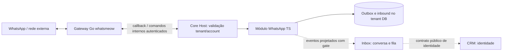
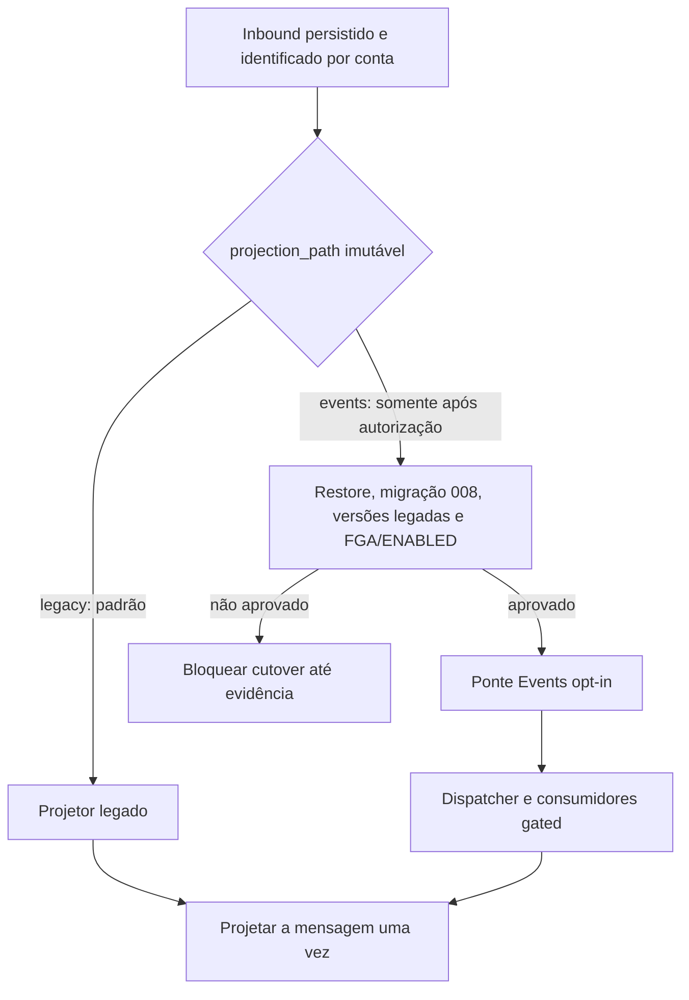

[← Ficha do capítulo](../) · [Volume](../../) · [Fonte original](https://github.com/delmacy/syndes-system/blob/main/docs/subprojects/P03-whatsapp/chapters/05-arquitetura-banco-interface-configuracao-e-diagramas.md)

> Conteúdo espelhado da documentação versionada; não expressa automaticamente estado funcional.

## 5. Arquitetura, banco, interface, configuração e diagramas

> **Levantamento parcial — 12/11/2026.** Documenta fontes e caminhos, não presume conectividade real nem dupla projeção ativada.

### Ownership e componentes

- Go + whatsmeow: `modules/whatsapp/gateway/whatsmeow/` — protocolo/sessões, ingestão e outbound.
- TypeScript: `modules/whatsapp/src/plugin.ts`, `inbound-http.ts`, `outbox.ts`, `event-bridge.ts` — contrato, conta, rotas e persistência do módulo.
- Host confiável: `apps/core-host/config/modules.json` monta o plugin; a ativação do tenant e o worker são gates independentes.
- SQL do módulo: `modules/whatsapp/sql/001_whatsapp_accounts.sql` até `008_whatsapp_projection_owner.sql`; migrações em tenant real somente com autorização e restore.

### Diagrama — separação entre protocolo, API e domínio

### Diagrama — exclusividade do projetor inbound

**Regra crítica:** nunca permitir dois projetores proprietários do mesmo evento nem mudar `projection_path` histórico para simular rollback. O caminho `events` não está habilitado no runtime por esta documentação. Fontes: `docs/engineering/WBS-WHATSAPP-PROJECTION-CUTOVER-20261111.md` e `apps/core-host/src/platform-event-worker-composition.ts`.

### Ownership do gateway Go/Whatsmeow (antigo I09)

O gateway Whatsmeow está **dentro do módulo P03 WhatsApp**. O plugin NestJS em `modules/whatsapp/src/plugin.ts` representa a integração do módulo com o Core Host; o processo Go em `modules/whatsapp/gateway/whatsmeow/` é um sidecar de protocolo, sessão e callbacks. A divisão de processos não implica dois módulos de negócio.

A [Referência técnica de P03](https://github.com/delmacy/syndes-system/blob/main/docs/subprojects/P03-whatsapp/REFERENCIA-TECNICA.md) e a [Operação de P03](https://github.com/delmacy/syndes-system/blob/main/docs/subprojects/P03-whatsapp/OPERACAO.md) centralizam a leitura. A antiga unidade I09 continua disponível apenas para consultar histórico, WBS e trabalho operacional anterior.

---
**Rastreabilidade:** [revisar documento fonte](https://github.com/delmacy/syndes-system/blob/main/docs/subprojects/P03-whatsapp/chapters/05-arquitetura-banco-interface-configuracao-e-diagramas.md).
