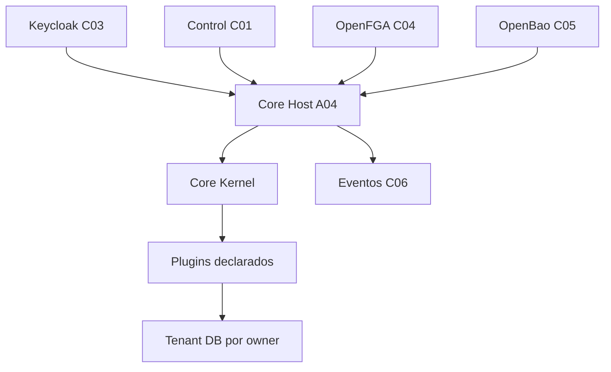

# A04 — Core Host

[← Sumário do volume](../) · [↑ Biblioteca](../../)

> **Leitura técnica, não homologação.** Estados, limites e comprovações devem ser lidos em STATUS e nos checkpoints versionados.

## Identificação e rastreabilidade

| Campo | Fonte verificável |
|---|---|
| Unidade / owner | **A04** · Core Host |
| Volume | Plataforma e core |
| Caminho de implementação | `apps/core-host` |
| Documento de origem | [README](https://github.com/delmacy/syndes-system/blob/main/docs/subprojects/A04-core-host/README.md) |
| STATUS e critérios | [STATUS original](https://github.com/delmacy/syndes-system/blob/main/docs/subprojects/A04-core-host/STATUS.md) |
| Símbolos, APIs, SQL e dependências | [REFERENCIA-TECNICA](https://github.com/delmacy/syndes-system/blob/main/docs/subprojects/A04-core-host/REFERENCIA-TECNICA.md) |
| Implantação, runbooks e gates | [OPERACAO](https://github.com/delmacy/syndes-system/blob/main/docs/subprojects/A04-core-host/OPERACAO.md) |

## Situação registrada

> AUDITORIA TÉCNICA PARCIAL — 13/11/2026. Fonte do inventário: checkpoint 94fdcc6 (auditoria estática sobre integração local f4fbfe5). Esta revisão documental parte de 3c1db91. NÃO HOMOLOGADO: nenhuma consulta a secrets, Keycloak, OpenFGA, bancos operacionais ou deploy. Área Código observado Limitação --------- Composição NestJS main.ts, module-host.ts, config/modules.json Plugins declarados não equivalem a módulos ENABLED Autenticação e autorização…

A descrição acima é uma **citação resumida do STATUS versionado**; não significa que os testes de integração, a implantação ou a homologação estejam aprovados.

## Índice dos subcapítulos

Todos os assuntos deste módulo estão nesta página. Clique em um título para saltar à seção correspondente; o índice lateral acompanha a leitura.

- [Casos de uso](#casos-de-uso)
- [Histórias de usuário](#historias-de-usuario)
- [Requisitos](#requisitos)
- [Contratos públicos e privados](#contratos)
- [APIs e endpoints](#apis)
- [Eventos e mensageria](#eventos)
- [Dados e persistência](#dados)
- [Schemas e migrations](#schema)
- [Dependências e integrações](#dependencias)
- [Configuração e ambiente](#configuracao)
- [Frontend e interfaces](#interface)
- [Testes e evidências](#testes)
- [Operação e implantação](#operacao)
- [WBS e evolução](#wbs)
- [Documentação de origem integral](#documentacao-de-origem)
- [Controle de alterações](#controle-de-alteracoes)

## Casos de uso

**Editar esta seção:** [Abrir arquivo-fonte no GitHub](https://github.com/delmacy/syndes-system/edit/main/docs/subprojects/A04-core-host/chapters/02-requisitos-historias-e-casos-de-uso.md) · [Consultar fonte](https://github.com/delmacy/syndes-system/blob/main/docs/subprojects/A04-core-host/chapters/02-requisitos-historias-e-casos-de-uso.md)

*Referências extraídas da documentação versionada, sem inferir homologação ou implantação.*

**Fonte:** [02-requisitos-historias-e-casos-de-uso.md](https://github.com/delmacy/syndes-system/blob/main/docs/subprojects/A04-core-host/chapters/02-requisitos-historias-e-casos-de-uso.md)

> Linha 3: \| ID \| Fluxo implementado/candidato \| Aceite ainda necessário \|

📝 Espaço para ajustes e implementação

Este é um **modelo de registro**, não um editor com salvamento automático. Use o link **Editar esta seção** para atualizar o documento versionado.

- **Alteração proposta:** descreva o requisito, contrato, dado ou comportamento.
- **Referência de código:** informe caminho e símbolo real.
- **Testes e evidências:** informe comando, resultado e limite.
- **Critério de aceite:** indique como validar sem presumir homologação.
- **Status e revisão:** atualize a fonte canônica após revisão.

## Histórias de usuário

**Editar esta seção:** [Abrir arquivo-fonte no GitHub](https://github.com/delmacy/syndes-system/edit/main/docs/subprojects/A04-core-host/chapters/02-requisitos-historias-e-casos-de-uso.md) · [Consultar fonte](https://github.com/delmacy/syndes-system/blob/main/docs/subprojects/A04-core-host/chapters/02-requisitos-historias-e-casos-de-uso.md)

*Referências extraídas da documentação versionada, sem inferir homologação ou implantação.*

**Fonte:** [STATUS.md](https://github.com/delmacy/syndes-system/blob/main/docs/subprojects/A04-core-host/STATUS.md)

> Linha 19: \| ID \| Estado \| Critério de aceite \|

📝 Espaço para ajustes e implementação

Este é um **modelo de registro**, não um editor com salvamento automático. Use o link **Editar esta seção** para atualizar o documento versionado.

- **Alteração proposta:** descreva o requisito, contrato, dado ou comportamento.
- **Referência de código:** informe caminho e símbolo real.
- **Testes e evidências:** informe comando, resultado e limite.
- **Critério de aceite:** indique como validar sem presumir homologação.
- **Status e revisão:** atualize a fonte canônica após revisão.

## Requisitos

**Editar esta seção:** [Abrir arquivo-fonte no GitHub](https://github.com/delmacy/syndes-system/edit/main/docs/subprojects/A04-core-host/chapters/02-requisitos-historias-e-casos-de-uso.md) · [Consultar fonte](https://github.com/delmacy/syndes-system/blob/main/docs/subprojects/A04-core-host/chapters/02-requisitos-historias-e-casos-de-uso.md)

*Referências extraídas da documentação versionada, sem inferir homologação ou implantação.*

**Fonte:** [02-requisitos-historias-e-casos-de-uso.md](https://github.com/delmacy/syndes-system/blob/main/docs/subprojects/A04-core-host/chapters/02-requisitos-historias-e-casos-de-uso.md)

> Linha 12: Requisitos não são homologados por estarem no código. Nenhum cenário operacional foi executado nesta revisão.

📝 Espaço para ajustes e implementação

Este é um **modelo de registro**, não um editor com salvamento automático. Use o link **Editar esta seção** para atualizar o documento versionado.

- **Alteração proposta:** descreva o requisito, contrato, dado ou comportamento.
- **Referência de código:** informe caminho e símbolo real.
- **Testes e evidências:** informe comando, resultado e limite.
- **Critério de aceite:** indique como validar sem presumir homologação.
- **Status e revisão:** atualize a fonte canônica após revisão.

## Contratos públicos e privados

**Editar esta seção:** [Abrir arquivo-fonte no GitHub](https://github.com/delmacy/syndes-system/edit/main/docs/subprojects/A04-core-host/REFERENCIA-TECNICA.md) · [Consultar fonte](https://github.com/delmacy/syndes-system/blob/main/docs/subprojects/A04-core-host/REFERENCIA-TECNICA.md)

*Referências extraídas da documentação versionada, sem inferir homologação ou implantação.*

**Fonte:** [REFERENCIA-TECNICA.md](https://github.com/delmacy/syndes-system/blob/main/docs/subprojects/A04-core-host/REFERENCIA-TECNICA.md)

> Linha 9: - **Interfaces públicas:** `CoreKernel`, `SyndesPlugin`, `ModuleDefinition` pertencem a `modules/core-kernel` e aos plugins; classes internas do Host não devem ser consumidas como API pública.

> Linha 10: - **Dependências:** C01 Control para membership, lifecycle e catálogo; C03 Keycloak para JWT; C04 OpenFGA para permissões; C05 OpenBao para secrets; C06 Event Platform para entrega. Esses owners mantêm seus próprios contratos.

> Linha 34: \| GET \| `/modules/:moduleId/config` \| Configuração pública restrita ao contrato do Host; não contém secrets \|

> Linha 63: Fonte navegável: [Core Host no GitHub](https://github.com/delmacy/syndes-system/tree/main/apps/core-host). A URL aponta ao main público e **não** substitui o SHA local do checkpoint.

**Fonte:** [04-contratos-e-dependencias-publicas.md](https://github.com/delmacy/syndes-system/blob/main/docs/subprojects/A04-core-host/chapters/04-contratos-e-dependencias-publicas.md)

> Linha 3: - HTTP Core Host: `GET /healthz`, `GET /readyz`, `GET /modules/:moduleId/config`, `POST /v1/tenants/:tenantId/authorize`. Rotas de plugin são **contratos dos owners**, não do Host.

> Linha 7: - `ModuleDefinition`/`SyndesPlugin` pertencem ao Kernel. Não consumir classes de `main.ts` como API pública.

**Fonte:** [STATUS.md](https://github.com/delmacy/syndes-system/blob/main/docs/subprojects/A04-core-host/STATUS.md)

> Linha 21: \| A04.DOC.01 \| **AUDITORIA PARCIAL** \| Contratos, ownership e capítulos reconciliados com testemunhas de símbolos \|

**Fonte:** [OPERACAO.md](https://github.com/delmacy/syndes-system/blob/main/docs/subprojects/A04-core-host/OPERACAO.md)

> Linha 8: 2. Inventariar controllers e contratos HTTP/SSE de cada plugin. Conferir ordem de JWT → membership → FGA → gates Control; documentar negativas cross-tenant e org/workspace.

📝 Espaço para ajustes e implementação

Este é um **modelo de registro**, não um editor com salvamento automático. Use o link **Editar esta seção** para atualizar o documento versionado.

- **Alteração proposta:** descreva o requisito, contrato, dado ou comportamento.
- **Referência de código:** informe caminho e símbolo real.
- **Testes e evidências:** informe comando, resultado e limite.
- **Critério de aceite:** indique como validar sem presumir homologação.
- **Status e revisão:** atualize a fonte canônica após revisão.

## APIs e endpoints

**Editar esta seção:** [Abrir arquivo-fonte no GitHub](https://github.com/delmacy/syndes-system/edit/main/docs/subprojects/A04-core-host/REFERENCIA-TECNICA.md) · [Consultar fonte](https://github.com/delmacy/syndes-system/blob/main/docs/subprojects/A04-core-host/REFERENCIA-TECNICA.md)

*Referências extraídas da documentação versionada, sem inferir homologação ou implantação.*

**Fonte:** [REFERENCIA-TECNICA.md](https://github.com/delmacy/syndes-system/blob/main/docs/subprojects/A04-core-host/REFERENCIA-TECNICA.md)

> Linha 9: - **Interfaces públicas:** `CoreKernel`, `SyndesPlugin`, `ModuleDefinition` pertencem a `modules/core-kernel` e aos plugins; classes internas do Host não devem ser consumidas como API pública.

**Fonte:** [04-contratos-e-dependencias-publicas.md](https://github.com/delmacy/syndes-system/blob/main/docs/subprojects/A04-core-host/chapters/04-contratos-e-dependencias-publicas.md)

> Linha 3: - HTTP Core Host: `GET /healthz`, `GET /readyz`, `GET /modules/:moduleId/config`, `POST /v1/tenants/:tenantId/authorize`. Rotas de plugin são **contratos dos owners**, não do Host.

> Linha 7: - `ModuleDefinition`/`SyndesPlugin` pertencem ao Kernel. Não consumir classes de `main.ts` como API pública.

**Fonte:** [OPERACAO.md](https://github.com/delmacy/syndes-system/blob/main/docs/subprojects/A04-core-host/OPERACAO.md)

> Linha 8: 2. Inventariar controllers e contratos HTTP/SSE de cada plugin. Conferir ordem de JWT → membership → FGA → gates Control; documentar negativas cross-tenant e org/workspace.

📝 Espaço para ajustes e implementação

Este é um **modelo de registro**, não um editor com salvamento automático. Use o link **Editar esta seção** para atualizar o documento versionado.

- **Alteração proposta:** descreva o requisito, contrato, dado ou comportamento.
- **Referência de código:** informe caminho e símbolo real.
- **Testes e evidências:** informe comando, resultado e limite.
- **Critério de aceite:** indique como validar sem presumir homologação.
- **Status e revisão:** atualize a fonte canônica após revisão.

## Eventos e mensageria

**Editar esta seção:** [Abrir arquivo-fonte no GitHub](https://github.com/delmacy/syndes-system/edit/main/docs/subprojects/A04-core-host/REFERENCIA-TECNICA.md) · [Consultar fonte](https://github.com/delmacy/syndes-system/blob/main/docs/subprojects/A04-core-host/REFERENCIA-TECNICA.md)

*Referências extraídas da documentação versionada, sem inferir homologação ou implantação.*

**Fonte:** [REFERENCIA-TECNICA.md](https://github.com/delmacy/syndes-system/blob/main/docs/subprojects/A04-core-host/REFERENCIA-TECNICA.md)

> Linha 43: - **Eventos:** publisher, dispatcher, worker, admission, batch e grants de serviço são composição de C06 no Host. Nenhum worker foi iniciado neste ciclo.

> Linha 44: - **Frontend:** A04 não tem frontend próprio; Workspace, Manager e Support são consumidores separados. Assets publicados pelos plugins não são um shell universal de autorização.

**Fonte:** [04-contratos-e-dependencias-publicas.md](https://github.com/delmacy/syndes-system/blob/main/docs/subprojects/A04-core-host/chapters/04-contratos-e-dependencias-publicas.md)

> Linha 6: - Eventos C06: `OpenFgaServiceEventGrant.canProcess`, `TenantEventWorkerAdmission.authorize`.

**Fonte:** [05-arquitetura-banco-interface-configuracao-e-diagramas.md](https://github.com/delmacy/syndes-system/blob/main/docs/subprojects/A04-core-host/chapters/05-arquitetura-banco-interface-configuracao-e-diagramas.md)

> Linha 18: - **Eventos:** o worker requer admission e service grant; nenhuma fila/outbox foi ativada nesta auditoria.

**Fonte:** [STATUS.md](https://github.com/delmacy/syndes-system/blob/main/docs/subprojects/A04-core-host/STATUS.md)

> Linha 13: \| Eventos \| `platform-event-*.ts` \| Sem ativação de dispatcher/worker ou prova de consumo real \|

> Linha 25: \| A04.EVT.01 \| PENDENTE \| Eventos, worker admission, replay, dedupe e outbox por tenant sem tocar runtime \|

📝 Espaço para ajustes e implementação

Este é um **modelo de registro**, não um editor com salvamento automático. Use o link **Editar esta seção** para atualizar o documento versionado.

- **Alteração proposta:** descreva o requisito, contrato, dado ou comportamento.
- **Referência de código:** informe caminho e símbolo real.
- **Testes e evidências:** informe comando, resultado e limite.
- **Critério de aceite:** indique como validar sem presumir homologação.
- **Status e revisão:** atualize a fonte canônica após revisão.

## Dados e persistência

**Editar esta seção:** [Abrir arquivo-fonte no GitHub](https://github.com/delmacy/syndes-system/edit/main/docs/subprojects/A04-core-host/REFERENCIA-TECNICA.md) · [Consultar fonte](https://github.com/delmacy/syndes-system/blob/main/docs/subprojects/A04-core-host/REFERENCIA-TECNICA.md)

*Referências extraídas da documentação versionada, sem inferir homologação ou implantação.*

**Fonte:** [REFERENCIA-TECNICA.md](https://github.com/delmacy/syndes-system/blob/main/docs/subprojects/A04-core-host/REFERENCIA-TECNICA.md)

> Linha 7: - **Owner:** `apps/core-host` (NestJS/TypeScript/Node/pg). É o host de composição, **não** owner dos dados ou regras CRM/Inbox/WhatsApp/Organizations/Support.

> Linha 41: - **Control/Manager DB:** catálogo, membership, lifecycle e instalação são acessados por portas; migrations Control pertencem aos seus owners e à infraestrutura PostgreSQL.

> Linha 42: - **Tenant DB:** `TenantPgProvider` usa registro e credencial dedicada; schemas CRM/Inbox/WhatsApp/Organizations não são owned pelo A04.

**Fonte:** [STATUS.md](https://github.com/delmacy/syndes-system/blob/main/docs/subprojects/A04-core-host/STATUS.md)

> Linha 11: \| Dados \| `TenantPgProvider`, `resolveRegistry`, adapters Control \| Migrations e grants efetivos não verificados \|

**Fonte:** [OPERACAO.md](https://github.com/delmacy/syndes-system/blob/main/docs/subprojects/A04-core-host/OPERACAO.md)

> Linha 9: 3. Em PostgreSQL 17 **segregado**, confrontar migrations Control/Tenant, roles/grants e `TenantPgProvider` com testes de isolamento, sem usar dados reais.

📝 Espaço para ajustes e implementação

Este é um **modelo de registro**, não um editor com salvamento automático. Use o link **Editar esta seção** para atualizar o documento versionado.

- **Alteração proposta:** descreva o requisito, contrato, dado ou comportamento.
- **Referência de código:** informe caminho e símbolo real.
- **Testes e evidências:** informe comando, resultado e limite.
- **Critério de aceite:** indique como validar sem presumir homologação.
- **Status e revisão:** atualize a fonte canônica após revisão.

## Schemas e migrations

**Editar esta seção:** [Abrir arquivo-fonte no GitHub](https://github.com/delmacy/syndes-system/edit/main/docs/subprojects/A04-core-host/REFERENCIA-TECNICA.md) · [Consultar fonte](https://github.com/delmacy/syndes-system/blob/main/docs/subprojects/A04-core-host/REFERENCIA-TECNICA.md)

*Referências extraídas da documentação versionada, sem inferir homologação ou implantação.*

**Fonte:** [REFERENCIA-TECNICA.md](https://github.com/delmacy/syndes-system/blob/main/docs/subprojects/A04-core-host/REFERENCIA-TECNICA.md)

> Linha 20: \| `src/tenant-database.ts` \| `expectedTenantDatabase`, `resolveRegistry`, `TenantCredentialSource.password`, `TenantPgProvider.resolve` \| Registro confiável e conexão tenant, sem propriedade das tabelas dos plugins \|

> Linha 41: - **Control/Manager DB:** catálogo, membership, lifecycle e instalação são acessados por portas; migrations Control pertencem aos seus owners e à infraestrutura PostgreSQL.

> Linha 42: - **Tenant DB:** `TenantPgProvider` usa registro e credencial dedicada; schemas CRM/Inbox/WhatsApp/Organizations não são owned pelo A04.

**Fonte:** [05-arquitetura-banco-interface-configuracao-e-diagramas.md](https://github.com/delmacy/syndes-system/blob/main/docs/subprojects/A04-core-host/chapters/05-arquitetura-banco-interface-configuracao-e-diagramas.md)

> Linha 15: - **Banco:** `TenantPgProvider` resolve registro e credenciais, não define migrations de plugins. Control mantém catálogo, membership e lifecycle.

**Fonte:** [STATUS.md](https://github.com/delmacy/syndes-system/blob/main/docs/subprojects/A04-core-host/STATUS.md)

> Linha 11: \| Dados \| `TenantPgProvider`, `resolveRegistry`, adapters Control \| Migrations e grants efetivos não verificados \|

> Linha 23: \| A04.DATA.01 \| PENDENTE \| Conferir schema, migrations, grants e negativas tenant/org/workspace em PG17 segregado \|

**Fonte:** [OPERACAO.md](https://github.com/delmacy/syndes-system/blob/main/docs/subprojects/A04-core-host/OPERACAO.md)

> Linha 3: > **CHECKLIST DE AUDITORIA, NÃO RUNBOOK DE PRODUÇÃO.** Nenhum deploy, worker, migration, alteração de grant ou consulta de secrets foi realizado neste incremento.

> Linha 9: 3. Em PostgreSQL 17 **segregado**, confrontar migrations Control/Tenant, roles/grants e `TenantPgProvider` com testes de isolamento, sem usar dados reais.

📝 Espaço para ajustes e implementação

Este é um **modelo de registro**, não um editor com salvamento automático. Use o link **Editar esta seção** para atualizar o documento versionado.

- **Alteração proposta:** descreva o requisito, contrato, dado ou comportamento.
- **Referência de código:** informe caminho e símbolo real.
- **Testes e evidências:** informe comando, resultado e limite.
- **Critério de aceite:** indique como validar sem presumir homologação.
- **Status e revisão:** atualize a fonte canônica após revisão.

## Dependências e integrações

**Editar esta seção:** [Abrir arquivo-fonte no GitHub](https://github.com/delmacy/syndes-system/edit/main/docs/subprojects/A04-core-host/REFERENCIA-TECNICA.md) · [Consultar fonte](https://github.com/delmacy/syndes-system/blob/main/docs/subprojects/A04-core-host/REFERENCIA-TECNICA.md)

*Referências extraídas da documentação versionada, sem inferir homologação ou implantação.*

**Fonte:** [REFERENCIA-TECNICA.md](https://github.com/delmacy/syndes-system/blob/main/docs/subprojects/A04-core-host/REFERENCIA-TECNICA.md)

> Linha 8: - **Lista declarada:** `apps/core-host/config/modules.json` contém cinco plugins (CRM, Inbox, WhatsApp, Organizations e Support); `loadInstalledPlugins` valida identificadores, dependências e assets. Instalação, habilitação por tenant e entitlement são verificações distintas.

> Linha 10: - **Dependências:** C01 Control para membership, lifecycle e catálogo; C03 Keycloak para JWT; C04 OpenFGA para permissões; C05 OpenBao para secrets; C06 Event Platform para entrega. Esses owners mantêm seus próprios contratos.

> Linha 33: \| GET \| `/readyz` \| Dependências do Core \|

> Linha 59: Fonte: `docs/evidence/checkpoints/A04-core-host-initial-20261113-0900.md` no branch de auditoria `docs/a04-code-audit-20261113` (não necessariamente incorporado nesta worktree). O checkpoint reportou validação lexical/catálogo e testes A04 **não executados** por ausência de dependências locais; não converter resultado histórico de outro SHA em teste desta revisão. Testes PG17/FGA e deploy real pendentes.

**Fonte:** [STATUS.md](https://github.com/delmacy/syndes-system/blob/main/docs/subprojects/A04-core-host/STATUS.md)

> Linha 3: > **AUDITORIA TÉCNICA PARCIAL — 13/11/2026.** Fonte do inventário: checkpoint `94fdcc6` (auditoria estática sobre integração local `f4fbfe5`). Esta revisão documental parte de `3c1db91`. **NÃO HOMOLOGADO:** nenhuma consulta a secrets, Keycloak, OpenFGA, bancos operacionais ou deploy.

> Linha 14: \| Testes \| Testes existentes e checkpoint estático \| Suite Node A04 não reexecutada neste incremento; dependências isoladas pendentes \|

> Linha 22: \| A04.TEST.01 \| PENDENTE \| Instalar dependências pinadas em cópia descartável, compilar e executar testes A04 com relatório por SHA \|

> Linha 24: \| A04.SEC.01 \| PENDENTE \| JWT, FGA, OpenBao, gates de módulo e fail-closed em ambiente autorizado \|

**Fonte:** [OPERACAO.md](https://github.com/delmacy/syndes-system/blob/main/docs/subprojects/A04-core-host/OPERACAO.md)

> Linha 7: 1. Confirmar SHA de código, lockfile, owners e ausência de edição concorrente. Preparar cópia **descartável** com dependências Node pinadas; rodar `npm run check` e suites A04, separando SKIP, PASS e falhas reais.

> Linha 10: 4. Em ambiente autorizado, validar readiness, TLS, OpenBao, OpenFGA, revogação, entitlements e comportamento em indisponibilidade; não usar resultado sintético como homologação.

📝 Espaço para ajustes e implementação

Este é um **modelo de registro**, não um editor com salvamento automático. Use o link **Editar esta seção** para atualizar o documento versionado.

- **Alteração proposta:** descreva o requisito, contrato, dado ou comportamento.
- **Referência de código:** informe caminho e símbolo real.
- **Testes e evidências:** informe comando, resultado e limite.
- **Critério de aceite:** indique como validar sem presumir homologação.
- **Status e revisão:** atualize a fonte canônica após revisão.

## Configuração e ambiente

**Editar esta seção:** [Abrir arquivo-fonte no GitHub](https://github.com/delmacy/syndes-system/edit/main/docs/subprojects/A04-core-host/OPERACAO.md) · [Consultar fonte](https://github.com/delmacy/syndes-system/blob/main/docs/subprojects/A04-core-host/OPERACAO.md)

*Referências extraídas da documentação versionada, sem inferir homologação ou implantação.*

**Fonte:** [REFERENCIA-TECNICA.md](https://github.com/delmacy/syndes-system/blob/main/docs/subprojects/A04-core-host/REFERENCIA-TECNICA.md)

> Linha 34: \| GET \| `/modules/:moduleId/config` \| Configuração pública restrita ao contrato do Host; não contém secrets \|

**Fonte:** [05-arquitetura-banco-interface-configuracao-e-diagramas.md](https://github.com/delmacy/syndes-system/blob/main/docs/subprojects/A04-core-host/chapters/05-arquitetura-banco-interface-configuracao-e-diagramas.md)

> Linha 16: - **Configuração:** `config/modules.json` lista cinco plugins confiáveis; não é catálogo de tenant.

**Fonte:** [STATUS.md](https://github.com/delmacy/syndes-system/blob/main/docs/subprojects/A04-core-host/STATUS.md)

> Linha 15: \| Operação \| Configuração versionada \| Sem prova de saúde, CI/deploy do SHA ou E2E \|

📝 Espaço para ajustes e implementação

Este é um **modelo de registro**, não um editor com salvamento automático. Use o link **Editar esta seção** para atualizar o documento versionado.

- **Alteração proposta:** descreva o requisito, contrato, dado ou comportamento.
- **Referência de código:** informe caminho e símbolo real.
- **Testes e evidências:** informe comando, resultado e limite.
- **Critério de aceite:** indique como validar sem presumir homologação.
- **Status e revisão:** atualize a fonte canônica após revisão.

## Frontend e interfaces

**Editar esta seção:** [Abrir arquivo-fonte no GitHub](https://github.com/delmacy/syndes-system/edit/main/docs/subprojects/A04-core-host/REFERENCIA-TECNICA.md) · [Consultar fonte](https://github.com/delmacy/syndes-system/blob/main/docs/subprojects/A04-core-host/REFERENCIA-TECNICA.md)

*Referências extraídas da documentação versionada, sem inferir homologação ou implantação.*

**Fonte:** [REFERENCIA-TECNICA.md](https://github.com/delmacy/syndes-system/blob/main/docs/subprojects/A04-core-host/REFERENCIA-TECNICA.md)

> Linha 44: - **Frontend:** A04 não tem frontend próprio; Workspace, Manager e Support são consumidores separados. Assets publicados pelos plugins não são um shell universal de autorização.

**Fonte:** [03-capabilities.md](https://github.com/delmacy/syndes-system/blob/main/docs/subprojects/A04-core-host/chapters/03-capabilities.md)

> Linha 12: O frontend é propriedade de Workspace/Manager/Support; A04 só hospeda assets confiáveis declarados.

**Fonte:** [05-arquitetura-banco-interface-configuracao-e-diagramas.md](https://github.com/delmacy/syndes-system/blob/main/docs/subprojects/A04-core-host/chapters/05-arquitetura-banco-interface-configuracao-e-diagramas.md)

> Linha 17: - **Interface:** sem frontend A04 próprio; hosts de Workspace/Manager/Support são aplicações distintas.

📝 Espaço para ajustes e implementação

Este é um **modelo de registro**, não um editor com salvamento automático. Use o link **Editar esta seção** para atualizar o documento versionado.

- **Alteração proposta:** descreva o requisito, contrato, dado ou comportamento.
- **Referência de código:** informe caminho e símbolo real.
- **Testes e evidências:** informe comando, resultado e limite.
- **Critério de aceite:** indique como validar sem presumir homologação.
- **Status e revisão:** atualize a fonte canônica após revisão.

## Testes e evidências

**Editar esta seção:** [Abrir arquivo-fonte no GitHub](https://github.com/delmacy/syndes-system/edit/main/docs/subprojects/A04-core-host/STATUS.md) · [Consultar fonte](https://github.com/delmacy/syndes-system/blob/main/docs/subprojects/A04-core-host/STATUS.md)

*Referências extraídas da documentação versionada, sem inferir homologação ou implantação.*

**Fonte:** [STATUS.md](https://github.com/delmacy/syndes-system/blob/main/docs/subprojects/A04-core-host/STATUS.md)

> Linha 12: \| Lifecycle \| `PgModuleCatalog`, `PgModuleLifecycle`, `PgEffectiveModuleAccess`, `PgModuleInstaller` \| Plano, instalação, ativação e execução são gates diferentes \|

> Linha 14: \| Testes \| Testes existentes e checkpoint estático \| Suite Node A04 não reexecutada neste incremento; dependências isoladas pendentes \|

> Linha 22: \| A04.TEST.01 \| PENDENTE \| Instalar dependências pinadas em cópia descartável, compilar e executar testes A04 com relatório por SHA \|

> Linha 24: \| A04.SEC.01 \| PENDENTE \| JWT, FGA, OpenBao, gates de módulo e fail-closed em ambiente autorizado \|

> Linha 26: \| A04.GATE \| BLOQUEADO \| Owner review, CI por SHA, operação comprovada e publicação documental \|

**Fonte:** [06-wbs-marcos-e-aceite.md](https://github.com/delmacy/syndes-system/blob/main/docs/subprojects/A04-core-host/chapters/06-wbs-marcos-e-aceite.md)

> Linha 10: \| A04.GATE \| Bloqueado \| CI, owners, ambiente e documentação publicada \|

> Linha 12: A conclusão da WBS documental não habilita novas features nem substitui o Product Gate.

**Fonte:** [REFERENCIA-TECNICA.md](https://github.com/delmacy/syndes-system/blob/main/docs/subprojects/A04-core-host/REFERENCIA-TECNICA.md)

> Linha 23: \| `src/module-effective-access.ts` \| `PgEffectiveModuleAccess.canExecuteModule` \| Gate de execução efetiva \|

> Linha 30: \| Método \| Rota no Core Host \| Gate \|

> Linha 59: Fonte: `docs/evidence/checkpoints/A04-core-host-initial-20261113-0900.md` no branch de auditoria `docs/a04-code-audit-20261113` (não necessariamente incorporado nesta worktree). O checkpoint reportou validação lexical/catálogo e testes A04 **não executados** por ausência de dependências locais; não converter resultado histórico de outro SHA em teste desta revisão. Testes PG17/FGA e deploy real pendentes.

**Fonte:** [OPERACAO.md](https://github.com/delmacy/syndes-system/blob/main/docs/subprojects/A04-core-host/OPERACAO.md)

> Linha 8: 2. Inventariar controllers e contratos HTTP/SSE de cada plugin. Conferir ordem de JWT → membership → FGA → gates Control; documentar negativas cross-tenant e org/workspace.

> Linha 9: 3. Em PostgreSQL 17 **segregado**, confrontar migrations Control/Tenant, roles/grants e `TenantPgProvider` com testes de isolamento, sem usar dados reais.

> Linha 11: 5. Somente com aprovação operacional, planejar testes de Event Platform: publisher, dispatcher, worker admission, idempotência, replay e DLQ. Não iniciar serviços a partir de documentação.

> Linha 12: 6. Registrar evidência sanitizada por SHA/ambiente, owner review, CI e rollback antes de promover status.

📝 Espaço para ajustes e implementação

Este é um **modelo de registro**, não um editor com salvamento automático. Use o link **Editar esta seção** para atualizar o documento versionado.

- **Alteração proposta:** descreva o requisito, contrato, dado ou comportamento.
- **Referência de código:** informe caminho e símbolo real.
- **Testes e evidências:** informe comando, resultado e limite.
- **Critério de aceite:** indique como validar sem presumir homologação.
- **Status e revisão:** atualize a fonte canônica após revisão.

## Operação e implantação

**Editar esta seção:** [Abrir arquivo-fonte no GitHub](https://github.com/delmacy/syndes-system/edit/main/docs/subprojects/A04-core-host/OPERACAO.md) · [Consultar fonte](https://github.com/delmacy/syndes-system/blob/main/docs/subprojects/A04-core-host/OPERACAO.md)

*Referências extraídas da documentação versionada, sem inferir homologação ou implantação.*

**Fonte:** [OPERACAO.md](https://github.com/delmacy/syndes-system/blob/main/docs/subprojects/A04-core-host/OPERACAO.md)

> Linha 3: > **CHECKLIST DE AUDITORIA, NÃO RUNBOOK DE PRODUÇÃO.** Nenhum deploy, worker, migration, alteração de grant ou consulta de secrets foi realizado neste incremento.

> Linha 12: 6. Registrar evidência sanitizada por SHA/ambiente, owner review, CI e rollback antes de promover status.

**Fonte:** [REFERENCIA-TECNICA.md](https://github.com/delmacy/syndes-system/blob/main/docs/subprojects/A04-core-host/REFERENCIA-TECNICA.md)

> Linha 3: > **AUDITORIA ESTÁTICA PARCIAL — 13/11/2026**, checkpoint de código `94fdcc6`. Código presente não comprova deploy, segurança ou execução de plugins em tenants reais.

> Linha 59: Fonte: `docs/evidence/checkpoints/A04-core-host-initial-20261113-0900.md` no branch de auditoria `docs/a04-code-audit-20261113` (não necessariamente incorporado nesta worktree). O checkpoint reportou validação lexical/catálogo e testes A04 **não executados** por ausência de dependências locais; não converter resultado histórico de outro SHA em teste desta revisão. Testes PG17/FGA e deploy real pendentes.

**Fonte:** [STATUS.md](https://github.com/delmacy/syndes-system/blob/main/docs/subprojects/A04-core-host/STATUS.md)

> Linha 3: > **AUDITORIA TÉCNICA PARCIAL — 13/11/2026.** Fonte do inventário: checkpoint `94fdcc6` (auditoria estática sobre integração local `f4fbfe5`). Esta revisão documental parte de `3c1db91`. **NÃO HOMOLOGADO:** nenhuma consulta a secrets, Keycloak, OpenFGA, bancos operacionais ou deploy.

> Linha 15: \| Operação \| Configuração versionada \| Sem prova de saúde, CI/deploy do SHA ou E2E \|

> Linha 26: \| A04.GATE \| BLOQUEADO \| Owner review, CI por SHA, operação comprovada e publicação documental \|

📝 Espaço para ajustes e implementação

Este é um **modelo de registro**, não um editor com salvamento automático. Use o link **Editar esta seção** para atualizar o documento versionado.

- **Alteração proposta:** descreva o requisito, contrato, dado ou comportamento.
- **Referência de código:** informe caminho e símbolo real.
- **Testes e evidências:** informe comando, resultado e limite.
- **Critério de aceite:** indique como validar sem presumir homologação.
- **Status e revisão:** atualize a fonte canônica após revisão.

## WBS e evolução

**Editar esta seção:** [Abrir arquivo-fonte no GitHub](https://github.com/delmacy/syndes-system/edit/main/docs/subprojects/A04-core-host/STATUS.md) · [Consultar fonte](https://github.com/delmacy/syndes-system/blob/main/docs/subprojects/A04-core-host/STATUS.md)

*Referências extraídas da documentação versionada, sem inferir homologação ou implantação.*

**Fonte:** [STATUS.md](https://github.com/delmacy/syndes-system/blob/main/docs/subprojects/A04-core-host/STATUS.md)

> Linha 22: \| A04.TEST.01 \| PENDENTE \| Instalar dependências pinadas em cópia descartável, compilar e executar testes A04 com relatório por SHA \|

> Linha 23: \| A04.DATA.01 \| PENDENTE \| Conferir schema, migrations, grants e negativas tenant/org/workspace em PG17 segregado \|

> Linha 24: \| A04.SEC.01 \| PENDENTE \| JWT, FGA, OpenBao, gates de módulo e fail-closed em ambiente autorizado \|

> Linha 25: \| A04.EVT.01 \| PENDENTE \| Eventos, worker admission, replay, dedupe e outbox por tenant sem tocar runtime \|

**Fonte:** [06-wbs-marcos-e-aceite.md](https://github.com/delmacy/syndes-system/blob/main/docs/subprojects/A04-core-host/chapters/06-wbs-marcos-e-aceite.md)

> Linha 3: \| Marco \| Estado \| Critério \|

> Linha 6: \| A04.TEST.01 \| Pendente \| Build/test Node isolado, relatório por SHA \|

> Linha 7: \| A04.DATA.01 \| Pendente \| PG17, migrations e grants por owner \|

> Linha 8: \| A04.SEC.01 \| Pendente \| JWT/FGA/tenant negativos e secrets \|

> Linha 9: \| A04.EVT.01 \| Pendente \| Eventos, admission, idempotência e replay \|

> Linha 12: A conclusão da WBS documental não habilita novas features nem substitui o Product Gate.

📝 Espaço para ajustes e implementação

Este é um **modelo de registro**, não um editor com salvamento automático. Use o link **Editar esta seção** para atualizar o documento versionado.

- **Alteração proposta:** descreva o requisito, contrato, dado ou comportamento.
- **Referência de código:** informe caminho e símbolo real.
- **Testes e evidências:** informe comando, resultado e limite.
- **Critério de aceite:** indique como validar sem presumir homologação.
- **Status e revisão:** atualize a fonte canônica após revisão.

## Documentação de origem integral

Os oito assuntos canônicos são reproduzidos abaixo para permitir leitura contínua. As fontes versionadas permanecem editáveis e preservadas.

### 00 · Fontes e endereços

[Editar conteúdo original](https://github.com/delmacy/syndes-system/edit/main/docs/subprojects/A04-core-host/chapters/00-enderecos-exatos-de-leitura.md) · [Abrir fonte](https://github.com/delmacy/syndes-system/blob/main/docs/subprojects/A04-core-host/chapters/00-enderecos-exatos-de-leitura.md)

##### 0. Endereços exatos de leitura

- Catálogo: `catalog/work-units.json`; Host: `apps/core-host/package.json`, `src/main.ts`, `config/modules.json`.
- Plugins e assets: `src/module-host.ts`; auth: `src/adapters.ts`; secrets: `src/secrets.ts`.
- Tenant: `src/tenant-database.ts`; lifecycle: `src/module-{catalog,lifecycle,effective-access,installer}.ts`.
- Eventos: `src/platform-event-*.ts`; testes: `apps/core-host/test/*.mjs`.
- Referência e gates: `docs/subprojects/A04-core-host/{STATUS,REFERENCIA-TECNICA,OPERACAO}.md`.
- Checkpoint externo: `docs/evidence/checkpoints/A04-core-host-initial-20261113-0900.md` no branch `docs/a04-code-audit-20261113`.

### 01 · Missão e fronteiras

[Editar conteúdo original](https://github.com/delmacy/syndes-system/edit/main/docs/subprojects/A04-core-host/chapters/01-missao-objetivos-e-fronteiras.md) · [Abrir fonte](https://github.com/delmacy/syndes-system/blob/main/docs/subprojects/A04-core-host/chapters/01-missao-objetivos-e-fronteiras.md)

##### 1. Missão, objetivos e fronteiras

O A04 compõe Core Kernel, adapters e plugins NestJS confiáveis. Não possui entidades CRM/Inbox/WhatsApp/Support nem as tabelas dos módulos. Control C01 decide membership/lifecycle, C03 valida identidade, C04 decide permissões, C05 provê segredos e C06 entrega eventos.

Plugins listados em `config/modules.json` são candidatos de composição, não tenants habilitados. A04 não oferece instalação de código arbitrário nem marketplace de plugins não confiáveis.

### 02 · Requisitos e casos de uso

[Editar conteúdo original](https://github.com/delmacy/syndes-system/edit/main/docs/subprojects/A04-core-host/chapters/02-requisitos-historias-e-casos-de-uso.md) · [Abrir fonte](https://github.com/delmacy/syndes-system/blob/main/docs/subprojects/A04-core-host/chapters/02-requisitos-historias-e-casos-de-uso.md)

##### 2. Requisitos, histórias e casos de uso

| ID | Fluxo implementado/candidato | Aceite ainda necessário |
|---|---|---|
| A04-RF01 | Inicializar plugins declarados e validar IDs/assets | Compilação e testes isolados por SHA |
| A04-RF02 | Health e readiness sem expor credenciais | Health HTTP no ambiente-alvo |
| A04-RF03 | Autorizar recurso por identidade, tenant e FGA | Matriz negativa A/B e grants reais |
| A04-RF04 | Resolver banco tenant por registro Control | PG17 segregado e grants |
| A04-RF05 | Impedir execução de módulo não habilitado | Testes de admission em rotas e jobs |
| A04-RF06 | Compor entrega de eventos com service grants | Testes C06 e rollback/replay |

Requisitos não são homologados por estarem no código. Nenhum cenário operacional foi executado nesta revisão.

### 03 · Capacidades

[Editar conteúdo original](https://github.com/delmacy/syndes-system/edit/main/docs/subprojects/A04-core-host/chapters/03-capabilities.md) · [Abrir fonte](https://github.com/delmacy/syndes-system/blob/main/docs/subprojects/A04-core-host/chapters/03-capabilities.md)

##### 3. Capabilities

| Capacidade | Fonte | Estado |
|---|---|---|
| Composição NestJS e plugins | `main.ts`, `module-host.ts` | Código versionado, runtime não verificado |
| Verificação JWT e FGA | `adapters.ts` | Adapters presentes; decisão real não verificada |
| Bootstrap OpenBao | `secrets.ts` | Contrato presente; segredo real não acessado |
| Tenant DB provider | `tenant-database.ts` | Contrato presente; PG17 não executado |
| Catalog/lifecycle/access/installer | `module-*.ts` | Gates distintos; implantação não verificada |
| Event worker/grants | `platform-event-*.ts` | Contrato presente; worker não ativado |

O frontend é propriedade de Workspace/Manager/Support; A04 só hospeda assets confiáveis declarados.

### 04 · Contratos e dependências

[Editar conteúdo original](https://github.com/delmacy/syndes-system/edit/main/docs/subprojects/A04-core-host/chapters/04-contratos-e-dependencias-publicas.md) · [Abrir fonte](https://github.com/delmacy/syndes-system/blob/main/docs/subprojects/A04-core-host/chapters/04-contratos-e-dependencias-publicas.md)

##### 4. Contratos e dependências públicas

- HTTP Core Host: `GET /healthz`, `GET /readyz`, `GET /modules/:moduleId/config`, `POST /v1/tenants/:tenantId/authorize`. Rotas de plugin são **contratos dos owners**, não do Host.
- Internos A04: `loadInstalledPlugins`, `installModuleAssets`, `ActorVerifier.verify`, `PgMembership.canAccessTenant`, `FgaPermission.canAccess`, `TenantPgProvider.resolve`.
- Control: `PgModuleCatalog.listAvailableForTenant`, `PgModuleLifecycle.listModuleStates`, `PgEffectiveModuleAccess.canExecuteModule`, `PgModuleInstaller.plan/apply/enable/disable/verify`.
- Eventos C06: `OpenFgaServiceEventGrant.canProcess`, `TenantEventWorkerAdmission.authorize`.
- `ModuleDefinition`/`SyndesPlugin` pertencem ao Kernel. Não consumir classes de `main.ts` como API pública.

### 05 · Arquitetura, dados e interfaces

[Editar conteúdo original](https://github.com/delmacy/syndes-system/edit/main/docs/subprojects/A04-core-host/chapters/05-arquitetura-banco-interface-configuracao-e-diagramas.md) · [Abrir fonte](https://github.com/delmacy/syndes-system/blob/main/docs/subprojects/A04-core-host/chapters/05-arquitetura-banco-interface-configuracao-e-diagramas.md)

##### 5. Arquitetura, banco, interface, configuração e diagramas

- **Banco:** `TenantPgProvider` resolve registro e credenciais, não define migrations de plugins. Control mantém catálogo, membership e lifecycle.
- **Configuração:** `config/modules.json` lista cinco plugins confiáveis; não é catálogo de tenant.
- **Interface:** sem frontend A04 próprio; hosts de Workspace/Manager/Support são aplicações distintas.
- **Eventos:** o worker requer admission e service grant; nenhuma fila/outbox foi ativada nesta auditoria.

### 06 · WBS e critérios de aceite

[Editar conteúdo original](https://github.com/delmacy/syndes-system/edit/main/docs/subprojects/A04-core-host/chapters/06-wbs-marcos-e-aceite.md) · [Abrir fonte](https://github.com/delmacy/syndes-system/blob/main/docs/subprojects/A04-core-host/chapters/06-wbs-marcos-e-aceite.md)

##### 6. WBS, marcos e aceite

| Marco | Estado | Critério |
|---|---|---|
| A04.DOC.01 | Auditoria parcial | Fontes e testemunhas reconciliadas |
| A04.TEST.01 | Pendente | Build/test Node isolado, relatório por SHA |
| A04.DATA.01 | Pendente | PG17, migrations e grants por owner |
| A04.SEC.01 | Pendente | JWT/FGA/tenant negativos e secrets |
| A04.EVT.01 | Pendente | Eventos, admission, idempotência e replay |
| A04.GATE | Bloqueado | CI, owners, ambiente e documentação publicada |

A conclusão da WBS documental não habilita novas features nem substitui o Product Gate.

### 07 · Controle de escopo

[Editar conteúdo original](https://github.com/delmacy/syndes-system/edit/main/docs/subprojects/A04-core-host/chapters/07-controle-do-escopo.md) · [Abrir fonte](https://github.com/delmacy/syndes-system/blob/main/docs/subprojects/A04-core-host/chapters/07-controle-do-escopo.md)

##### 7. Controle do escopo

- Fonte de auditoria: checkpoint `94fdcc6`, integração documental local `f4fbfe5`, branch de reconciliação própria.
- Não executar `PgModuleInstaller.apply/enable/disable`, migrations, SQL operacional, worker, rotação ou deploy.
- Não declarar homologação a partir de código versionado, testemunhas lexicais ou testes históricos.
- Preservar ownership de módulos, Control e C06; inventariar controllers, SSE e jobs separadamente.
- Publicação só se confirma por push, CI Pages e SHA efetivamente servido no site.

## Controle de alterações

**Este site é somente leitura.** Para alterar qualquer seção, edite o documento canônico no GitHub; a próxima publicação atualizará este livro automaticamente.

| Registro | Onde editar |
|---|---|
| Especificação e referências | [Referência técnica](https://github.com/delmacy/syndes-system/edit/main/docs/subprojects/A04-core-host/REFERENCIA-TECNICA.md) |
| Estado real e bloqueios | [STATUS](https://github.com/delmacy/syndes-system/edit/main/docs/subprojects/A04-core-host/STATUS.md) |
| Procedimentos e implantação | [Operação](https://github.com/delmacy/syndes-system/edit/main/docs/subprojects/A04-core-host/OPERACAO.md) |
| Capítulos canônicos | [Página do módulo](https://github.com/delmacy/syndes-system/blob/main/docs/subprojects/A04-core-host/README.md) |

**Registro recomendado:** data e responsável; alteração; contrato ou interface afetada; testes; impacto em dependências; evidência; revisão/aceite.

---
*Leitura experimental Starlight; a documentação canônica permanece em `docs/subprojects/`. Não inferir entrega funcional a partir de documentação presente.*
