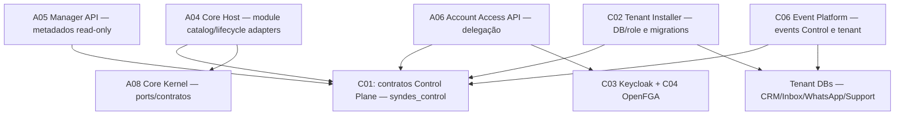
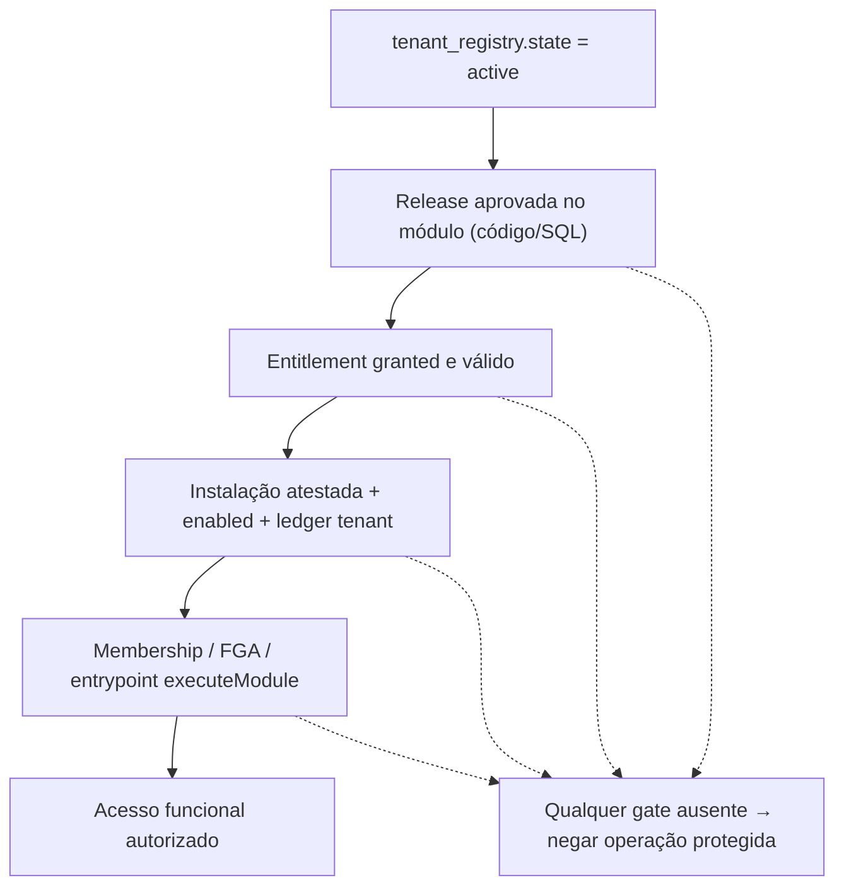
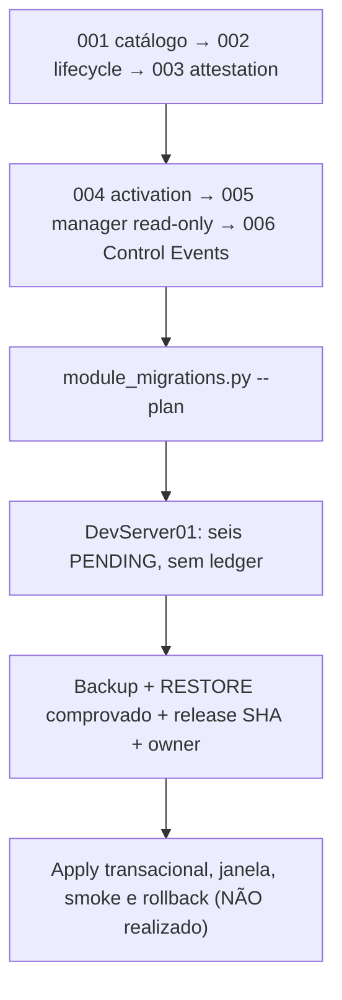

# C01 — Control Plane

[← Sumário do volume](../) · [↑ Biblioteca](../../)

> **Leitura técnica, não homologação.** Estados, limites e comprovações devem ser lidos em STATUS e nos checkpoints versionados.

## Identificação e rastreabilidade

| Campo | Fonte verificável |
|---|---|
| Unidade / owner | **C01** · Control Plane |
| Volume | Plataforma e core |
| Caminho de implementação | `infra/postgres/bootstrap` |
| Documento de origem | [README](https://github.com/delmacy/syndes-system/blob/main/docs/subprojects/C01-control-plane/README.md) |
| STATUS e critérios | [STATUS original](https://github.com/delmacy/syndes-system/blob/main/docs/subprojects/C01-control-plane/STATUS.md) |
| Símbolos, APIs, SQL e dependências | [REFERENCIA-TECNICA](https://github.com/delmacy/syndes-system/blob/main/docs/subprojects/C01-control-plane/REFERENCIA-TECNICA.md) |
| Implantação, runbooks e gates | [OPERACAO](https://github.com/delmacy/syndes-system/blob/main/docs/subprojects/C01-control-plane/OPERACAO.md) |

## Situação registrada

> AUDITORIA TÉCNICA PARCIAL — 13/11/2026. Baseline de código origin/main SHA ac8deb8c538f59364c6247964a5b0d42e5fbae2e; snapshot PostgreSQL DevServer01 2026-11-13T04:38:21Z. Consultas SQL somente leitura, sem dados pessoais ou segredos. Nenhuma migration, grant, role, API, worker, container, backup ou deploy alterado. Staging e produção não verificados. Dimensão Comprovação Limite --------- Documentação C01 AUDITORIA PARCIAL: oito capítulos, reference,…

A descrição acima é uma **citação resumida do STATUS versionado**; não significa que os testes de integração, a implantação ou a homologação estejam aprovados.

## Índice dos subcapítulos

Todos os assuntos deste módulo estão nesta página. Clique em um título para saltar à seção correspondente; o índice lateral acompanha a leitura.

- [Casos de uso](#casos-de-uso)
- [Histórias de usuário](#historias-de-usuario)
- [Requisitos](#requisitos)
- [Contratos públicos e privados](#contratos)
- [APIs e endpoints](#apis)
- [Eventos e mensageria](#eventos)
- [Dados e persistência](#dados)
- [Schemas e migrations](#schema)
- [Dependências e integrações](#dependencias)
- [Configuração e ambiente](#configuracao)
- [Frontend e interfaces](#interface)
- [Testes e evidências](#testes)
- [Operação e implantação](#operacao)
- [WBS e evolução](#wbs)
- [Documentação de origem integral](#documentacao-de-origem)
- [Controle de alterações](#controle-de-alteracoes)

## Casos de uso

**Editar esta seção:** [Abrir arquivo-fonte no GitHub](https://github.com/delmacy/syndes-system/edit/main/docs/subprojects/C01-control-plane/chapters/02-requisitos-historias-e-casos-de-uso.md) · [Consultar fonte](https://github.com/delmacy/syndes-system/blob/main/docs/subprojects/C01-control-plane/chapters/02-requisitos-historias-e-casos-de-uso.md)

*Referências extraídas da documentação versionada, sem inferir homologação ou implantação.*

**Lacuna documental:** ainda não há especificação textual identificada nesta área. Revisar implementação e registrar evidência antes de preencher.

📝 Espaço para ajustes e implementação

Este é um **modelo de registro**, não um editor com salvamento automático. Use o link **Editar esta seção** para atualizar o documento versionado.

- **Alteração proposta:** descreva o requisito, contrato, dado ou comportamento.
- **Referência de código:** informe caminho e símbolo real.
- **Testes e evidências:** informe comando, resultado e limite.
- **Critério de aceite:** indique como validar sem presumir homologação.
- **Status e revisão:** atualize a fonte canônica após revisão.

## Histórias de usuário

**Editar esta seção:** [Abrir arquivo-fonte no GitHub](https://github.com/delmacy/syndes-system/edit/main/docs/subprojects/C01-control-plane/chapters/02-requisitos-historias-e-casos-de-uso.md) · [Consultar fonte](https://github.com/delmacy/syndes-system/blob/main/docs/subprojects/C01-control-plane/chapters/02-requisitos-historias-e-casos-de-uso.md)

*Referências extraídas da documentação versionada, sem inferir homologação ou implantação.*

**Lacuna documental:** ainda não há especificação textual identificada nesta área. Revisar implementação e registrar evidência antes de preencher.

📝 Espaço para ajustes e implementação

Este é um **modelo de registro**, não um editor com salvamento automático. Use o link **Editar esta seção** para atualizar o documento versionado.

- **Alteração proposta:** descreva o requisito, contrato, dado ou comportamento.
- **Referência de código:** informe caminho e símbolo real.
- **Testes e evidências:** informe comando, resultado e limite.
- **Critério de aceite:** indique como validar sem presumir homologação.
- **Status e revisão:** atualize a fonte canônica após revisão.

## Requisitos

**Editar esta seção:** [Abrir arquivo-fonte no GitHub](https://github.com/delmacy/syndes-system/edit/main/docs/subprojects/C01-control-plane/chapters/02-requisitos-historias-e-casos-de-uso.md) · [Consultar fonte](https://github.com/delmacy/syndes-system/blob/main/docs/subprojects/C01-control-plane/chapters/02-requisitos-historias-e-casos-de-uso.md)

*Referências extraídas da documentação versionada, sem inferir homologação ou implantação.*

**Fonte:** [02-requisitos-historias-e-casos-de-uso.md](https://github.com/delmacy/syndes-system/blob/main/docs/subprojects/C01-control-plane/chapters/02-requisitos-historias-e-casos-de-uso.md)

> Linha 3: IDs `C01-R*`, `US-C01-*` e `UC-C01-*` são **rótulos de auditoria** sobre contratos existentes, não novos requisitos de produto aprovados.

> Linha 5: \| Requisito rastreado \| Fonte original \| Evidência necessária \|

📝 Espaço para ajustes e implementação

Este é um **modelo de registro**, não um editor com salvamento automático. Use o link **Editar esta seção** para atualizar o documento versionado.

- **Alteração proposta:** descreva o requisito, contrato, dado ou comportamento.
- **Referência de código:** informe caminho e símbolo real.
- **Testes e evidências:** informe comando, resultado e limite.
- **Critério de aceite:** indique como validar sem presumir homologação.
- **Status e revisão:** atualize a fonte canônica após revisão.

## Contratos públicos e privados

**Editar esta seção:** [Abrir arquivo-fonte no GitHub](https://github.com/delmacy/syndes-system/edit/main/docs/subprojects/C01-control-plane/REFERENCIA-TECNICA.md) · [Consultar fonte](https://github.com/delmacy/syndes-system/blob/main/docs/subprojects/C01-control-plane/REFERENCIA-TECNICA.md)

*Referências extraídas da documentação versionada, sem inferir homologação ou implantação.*

**Fonte:** [REFERENCIA-TECNICA.md](https://github.com/delmacy/syndes-system/blob/main/docs/subprojects/C01-control-plane/REFERENCIA-TECNICA.md)

> Linha 3: > **AUDITORIA ESTÁTICA E SQL SOMENTE LEITURA — 13/11/2026.** Base `origin/main` SHA `ac8deb8c538f59364c6247964a5b0d42e5fbae2e`. Snapshot PostgreSQL DevServer01 `2026-11-13T04:38:21Z`. **C01 é uma fronteira distribuída de dados/contratos globais, não um serviço isolado.** Não foram consultados dados pessoais nem executados migrations, grants, escrita, restore ou deploy. Produção e staging não verificados.

> Linha 12: \| A08 \| `packages/core-kernel/src/module-catalog.ts`, `module-lifecycle.ts`, `module-access.ts`, `control-plane-events.ts` \| Portabilidade e envelopes tipados; não um SDK npm público \|

> Linha 15: \| A06 \| `apps/account-access-api/src/server.mjs`, `main.mjs` \| Delegação de roles de Account com FGA; contrato SQL `control-account-delegation.schema` \|

> Linha 51: \| A04 Host \| `PgModuleInstaller`, `PgControlInstallAttestor`, `PgControlModuleActivator` \| Contratos de operação trusted, não endpoints de provisionamento público \|

> Linha 66: \| Etapa \| Contrato \| DevServer01 \|

**Fonte:** [04-contratos-e-dependencias-publicas.md](https://github.com/delmacy/syndes-system/blob/main/docs/subprojects/C01-control-plane/chapters/04-contratos-e-dependencias-publicas.md)

> Linha 3: **C01 não é um pacote com `export` próprio nem um serviço HTTP específico.** As APIs reais pertencem a A04/A05/A06 e as interfaces portáveis pertencem a A08. O contrato primário do C01 é o **schema Control versionado e suas regras de transição**.

> Linha 7: \| Fonte \| Entidade/contrato \| Efeito e situação \|

> Linha 44: O host público **não recebe** SQL de migration nem nomes de databases fornecidos pelo cliente. Modificar Control schema/roles exige owner, revisão de segurança, ledger/checksum, backup e restore, SHA, janela e teste. Esta auditoria preserva todos os contratos executáveis, sem aplicar DDL.

**Fonte:** [STATUS.md](https://github.com/delmacy/syndes-system/blob/main/docs/subprojects/C01-control-plane/STATUS.md)

> Linha 16: \| **Eventos Control** \| `control_events.outbox_events/deliveries/consumer_inbox` **ausentes** \| Evento v1 é contrato no código, não dispatcher ativo \|

> Linha 28: 4. **P1 — Account roles/delegação ausentes:** tabelas/funções do contrato Account não confirmadas; dependências da A06/FGA reais precisam de gate próprio.

**Fonte:** [OPERACAO.md](https://github.com/delmacy/syndes-system/blob/main/docs/subprojects/C01-control-plane/OPERACAO.md)

> Linha 16: - [Contratos públicos](../../standards/CONTRATOS-PUBLICOS.md).

> Linha 32: 4. Testar com critérios apropriados: unitário, contrato, integração, E2E e CI.

📝 Espaço para ajustes e implementação

Este é um **modelo de registro**, não um editor com salvamento automático. Use o link **Editar esta seção** para atualizar o documento versionado.

- **Alteração proposta:** descreva o requisito, contrato, dado ou comportamento.
- **Referência de código:** informe caminho e símbolo real.
- **Testes e evidências:** informe comando, resultado e limite.
- **Critério de aceite:** indique como validar sem presumir homologação.
- **Status e revisão:** atualize a fonte canônica após revisão.

## APIs e endpoints

**Editar esta seção:** [Abrir arquivo-fonte no GitHub](https://github.com/delmacy/syndes-system/edit/main/docs/subprojects/C01-control-plane/REFERENCIA-TECNICA.md) · [Consultar fonte](https://github.com/delmacy/syndes-system/blob/main/docs/subprojects/C01-control-plane/REFERENCIA-TECNICA.md)

*Referências extraídas da documentação versionada, sem inferir homologação ou implantação.*

**Fonte:** [REFERENCIA-TECNICA.md](https://github.com/delmacy/syndes-system/blob/main/docs/subprojects/C01-control-plane/REFERENCIA-TECNICA.md)

> Linha 14: \| A05 \| `apps/master-admin-api/src/server.mjs`, `modules/tenant-module-inventory.mjs` \| HTTP read-only de metadados, com JWT/allowlist e role própria; sem tenant DB \|

> Linha 15: \| A06 \| `apps/account-access-api/src/server.mjs`, `main.mjs` \| Delegação de roles de Account com FGA; contrato SQL `control-account-delegation.schema` \|

> Linha 18: **C01 não tem `package.json`, classes HTTP, frontend ou APIs próprios em `infra/postgres/bootstrap`.** As classes e métodos abaixo pertencem aos owners citados e foram confrontados com arquivos reais, não atribuídos ficticiamente à C01.

> Linha 39: - `PUBLIC CONNECT` ao `syndes_control` revogado conforme I04. Isso **não** comprova políticas FGA, segurança HTTP de todas as APIs ou isolamento em outros hosts.

> Linha 43: \| Proprietário \| Símbolo/endpoint real \| Comportamento e limite \|

> Linha 51: \| A04 Host \| `PgModuleInstaller`, `PgControlInstallAttestor`, `PgControlModuleActivator` \| Contratos de operação trusted, não endpoints de provisionamento público \|

> Linha 52: \| A05 Manager \| `GET /v1/platform/admin/me`, `/summary`, `/tenants`, `/tenants/:id` \| JWT, allowlist `platform_operator_access`, metadados read-only \|

> Linha 53: \| A05 Manager \| `GET /v1/platform/admin/tenants/:id/modules` \| Consulta catálogo/entitlements/installs; tabelas ausentes **podem causar 503** (código trata erro); sem teste HTTP live \|

> Linha 82: - **Diferença fundamental:** **um tenant `active` em registry não significa entitlement, install, ENABLED, API funcional ou worker**.

**Fonte:** [04-contratos-e-dependencias-publicas.md](https://github.com/delmacy/syndes-system/blob/main/docs/subprojects/C01-control-plane/chapters/04-contratos-e-dependencias-publicas.md)

> Linha 3: **C01 não é um pacote com `export` próprio nem um serviço HTTP específico.** As APIs reais pertencem a A04/A05/A06 e as interfaces portáveis pertencem a A08. O contrato primário do C01 é o **schema Control versionado e suas regras de transição**.

> Linha 26: \| **A05** `apps/master-admin-api/src/server.mjs` \| `GET /v1/platform/admin/me`, `/summary`, `/tenants`, `/tenants/:id`, `/tenants/:id/modules` \| JWT e allowlist de operador; `/modules` depende de tabelas **ausentes** e tende a 503 em caso de erro SQL — **sem teste HTTP real neste host** \|

> Linha 27: \| **A06** `apps/account-access-api/src/server.mjs` \| POST restrito de delegação de roles de conta, com JWT/FGA \| Depende das funções/tabelas Account ainda não instaladas no Control observado \|

> Linha 30: \| **A04** `PgEffectiveModuleAccess.canExecuteModule()` \| Gate de módulo `granted` + `enabled` + metadados/verificação + deps \| **Fail closed** no adapter; somente endpoints migrados para `CoreKernel.executeModule` recebem o gate \|

> Linha 33: **API Manager de inventário:** `apps/master-admin-api/src/modules/tenant-module-inventory.mjs` consulta `module_catalog_versions`, `tenant_module_entitlements` e `tenant_module_installs`; sanitiza a resposta para **não expor schema, DB role, digest ou secret**. Ausência dessas tabelas no Control observado implica falha na consulta, não representação de módulos disponíveis.

**Fonte:** [05-arquitetura-banco-interface-configuracao-e-diagramas.md](https://github.com/delmacy/syndes-system/blob/main/docs/subprojects/C01-control-plane/chapters/05-arquitetura-banco-interface-configuracao-e-diagramas.md)

> Linha 33: \| Registry/membership \| `tenant_registry`, `tenant_memberships` \| Não foi auditada a autorização HTTP de todas as chamadas \|

> Linha 84: - **Frontend:** Platform Manager e Workspace pertencem a apps separados; a API Manager consulta metadados sanitizados, nunca DB ou mensagens dos tenants.

**Fonte:** [STATUS.md](https://github.com/delmacy/syndes-system/blob/main/docs/subprojects/C01-control-plane/STATUS.md)

> Linha 3: > **AUDITORIA TÉCNICA PARCIAL — 13/11/2026.** Baseline de código `origin/main` SHA `ac8deb8c538f59364c6247964a5b0d42e5fbae2e`; snapshot PostgreSQL DevServer01 `2026-11-13T04:38:21Z`. **Consultas SQL somente leitura, sem dados pessoais ou segredos. Nenhuma migration, grant, role, API, worker, container, backup ou deploy alterado.** Staging e produção não verificados.

> Linha 11: \| **Manager base** \| `platform_operator_access`, `platform_tenant_profiles` presentes; `syndes_master_api` com leitura e sem DML de perfis \| Endpoint Manager completo não testado em HTTP no ambiente \|

> Linha 19: \| **Manager inventário** \| `GET /v1/platform/admin/tenants/:id/modules` existe no código e consulta tabelas ausentes \| **Pode retornar 503** por erro SQL; não testado em HTTP real nesta auditoria \|

> Linha 25: 1. **P0 — Consumer/schema parity:** a API Manager de inventário e os adapters Host consultam tabelas de catálogo/lifecycle que ainda **não existem** no Control do DevServer01. A ausência de objeto SQL não deve ser tratada como lista vazia de módulos.

> Linha 37: \| **20.04** \| Manager API role/AppRole \| BLOQ infra \|

> Linha 38: \| **30.03** \| Account API/SQL delegação \| BLOQ \|

> Linha 40: \| **55.03** \| Installer/entitlements/gates \| API opt-in e teste PG17; Control/restore/FGA reais BLOQ \|

> Linha 56: \| 13/11/2026 \| CI no SHA `ac8deb8` \| [24/24 success](https://github.com/delmacy/syndes-system/actions/runs/43359636260) \| Release operacional e compatibilidade de API live \|

📝 Espaço para ajustes e implementação

Este é um **modelo de registro**, não um editor com salvamento automático. Use o link **Editar esta seção** para atualizar o documento versionado.

- **Alteração proposta:** descreva o requisito, contrato, dado ou comportamento.
- **Referência de código:** informe caminho e símbolo real.
- **Testes e evidências:** informe comando, resultado e limite.
- **Critério de aceite:** indique como validar sem presumir homologação.
- **Status e revisão:** atualize a fonte canônica após revisão.

## Eventos e mensageria

**Editar esta seção:** [Abrir arquivo-fonte no GitHub](https://github.com/delmacy/syndes-system/edit/main/docs/subprojects/C01-control-plane/REFERENCIA-TECNICA.md) · [Consultar fonte](https://github.com/delmacy/syndes-system/blob/main/docs/subprojects/C01-control-plane/REFERENCIA-TECNICA.md)

*Referências extraídas da documentação versionada, sem inferir homologação ou implantação.*

**Fonte:** [REFERENCIA-TECNICA.md](https://github.com/delmacy/syndes-system/blob/main/docs/subprojects/C01-control-plane/REFERENCIA-TECNICA.md)

> Linha 16: \| C06 \| `infra/postgres/bootstrap/control-module-events.schema`, `apps/core-host/src/platform-event-*.ts` \| Eventos de administração em Control separados dos eventos de domínio em tenant \|

> Linha 58: O `control-plane-events.ts` do Kernel define **dois envelopes v1**: `platform.module.entitlement.changed.v1` e `platform.module.installation.changed.v1`. O `control-module-events.schema` escreve outbox através do trigger `control_events.enqueue_module_audit()` após INSERT no log append-only `tenant_module_audit`, mantendo o mesmo commit PostgreSQL. `event_deliveries` e `consumer_inbox` dão suporte a tentativas, lease

> Linha 60: Essa infraestrutura consta do **SQL versionado**, mas foi constatado que o schema `control_events` não está instalado na instância. **Nenhum dispatcher Control foi homologado ou ativado por este trabalho.** A outbox tenant-local de CRM/Inbox/WhatsApp em `platform_events` possui owner e gates separados.

> Linha 73: \| 006_control_events \| Outbox Control \| PENDING \|

**Fonte:** [04-contratos-e-dependencias-publicas.md](https://github.com/delmacy/syndes-system/blob/main/docs/subprojects/C01-control-plane/chapters/04-contratos-e-dependencias-publicas.md)

> Linha 38: - **Origem normativa:** trigger `control_events.enqueue_module_audit()` após INSERT de `public.tenant_module_audit`; outbox no **mesmo commit** do Control. `auditEventId` e `correlationId` identificam causalidade, sem payload de mensagens.

> Linha 40: - **Não confundir** com a outbox `platform_events` nos DBs dos tenants (CRM/Inbox/WhatsApp) ou com workers ativos; CP-G02/03 continuam bloqueados/pendentes.

**Fonte:** [05-arquitetura-banco-interface-configuracao-e-diagramas.md](https://github.com/delmacy/syndes-system/blob/main/docs/subprojects/C01-control-plane/chapters/05-arquitetura-banco-interface-configuracao-e-diagramas.md)

> Linha 78: `control_events` foi projetado com outbox, delivery e inbox no **banco Control**, recebendo dados de `tenant_module_audit` na mesma transação. Esse schema contém fatos administrativos de entitlement/instalação, não mensagens. Por outro lado, `platform_events` é schema do **tenant DB**, para eventos dos módulos. A disponibilidade de contrato v1 ou teste PG17 sintético não autoriza dispatcher/control worker ou envio de

**Fonte:** [STATUS.md](https://github.com/delmacy/syndes-system/blob/main/docs/subprojects/C01-control-plane/STATUS.md)

> Linha 16: \| **Eventos Control** \| `control_events.outbox_events/deliveries/consumer_inbox` **ausentes** \| Evento v1 é contrato no código, não dispatcher ativo \|

> Linha 29: 5. **P1 — Control events não instalado:** SQL/trigger disponíveis no Git, sem tables/dispatcher/consumer autorizados neste ambiente; tenant outbox é outro plano de dados.

> Linha 55: \| 13/11/2026 04:38Z \| DevServer01, `syndes_control`, somente leitura \| Registry, Manager base, um tenant ativo; catálogo/roles/eventos ausentes, 6 PENDING \| Dados de clientes, Product Gate, backup/restore, staging \|

> Linha 58: **Status: auditoria técnica parcial de C01; esquema Control base presente, camada de módulos/eventos não instalada na instância examinada. Próxima unidade documental: C03 — Identity Keycloak.**

**Fonte:** [OPERACAO.md](https://github.com/delmacy/syndes-system/blob/main/docs/subprojects/C01-control-plane/OPERACAO.md)

> Linha 43: No snapshot de 13/11/2026, informou **seis migrations PENDING** e `PLAN ONLY: no Control DB changes`; não criou ledger ou schema. A auditoria de catálogo usou `BEGIN TRANSACTION READ ONLY` e agregados sem UUID, principal, evento, PII, tokens ou credenciais.

📝 Espaço para ajustes e implementação

Este é um **modelo de registro**, não um editor com salvamento automático. Use o link **Editar esta seção** para atualizar o documento versionado.

- **Alteração proposta:** descreva o requisito, contrato, dado ou comportamento.
- **Referência de código:** informe caminho e símbolo real.
- **Testes e evidências:** informe comando, resultado e limite.
- **Critério de aceite:** indique como validar sem presumir homologação.
- **Status e revisão:** atualize a fonte canônica após revisão.

## Dados e persistência

**Editar esta seção:** [Abrir arquivo-fonte no GitHub](https://github.com/delmacy/syndes-system/edit/main/docs/subprojects/C01-control-plane/REFERENCIA-TECNICA.md) · [Consultar fonte](https://github.com/delmacy/syndes-system/blob/main/docs/subprojects/C01-control-plane/REFERENCIA-TECNICA.md)

*Referências extraídas da documentação versionada, sem inferir homologação ou implantação.*

**Fonte:** [REFERENCIA-TECNICA.md](https://github.com/delmacy/syndes-system/blob/main/docs/subprojects/C01-control-plane/REFERENCIA-TECNICA.md)

> Linha 3: > **AUDITORIA ESTÁTICA E SQL SOMENTE LEITURA — 13/11/2026.** Base `origin/main` SHA `ac8deb8c538f59364c6247964a5b0d42e5fbae2e`. Snapshot PostgreSQL DevServer01 `2026-11-13T04:38:21Z`. **C01 é uma fronteira distribuída de dados/contratos globais, não um serviço isolado.** Não foram consultados dados pessoais nem executados migrations, grants, escrita, restore ou deploy. Produção e staging não verificados.

> Linha 9: \| C01 \| `infra/postgres/bootstrap/control.schema`, `control-admin.schema`, `control-module-*.schema`, `control-account-*.schema` \| PostgreSQL 17 `syndes_control`: tenant registry/membership, metadados de Manager, catálogo/release/entitlement de módulo \|

> Linha 10: \| I04 \| `infra/postgres/compose.yaml`, `00-init.sh`, `provision-tenant.sh` \| Servidor/DB/role, segurança de conexão e volumes; **não** decisão de autorização do produto \|

> Linha 11: \| C02 \| `scripts/control/module_migrations.py`, `infra/postgres/bootstrap/migrate-modules-tenant.sh` \| Installer/operador de migrations; somente com release SHA, backup/restore, checksum e gates \|

> Linha 13: \| A04 \| `apps/core-host/src/module-catalog.ts`, `module-lifecycle.ts`, `module-effective-access.ts`, `module-installer.ts` \| Adapters PostgreSQL, readmodels, gates opt-in e installer trusted \|

> Linha 14: \| A05 \| `apps/master-admin-api/src/server.mjs`, `modules/tenant-module-inventory.mjs` \| HTTP read-only de metadados, com JWT/allowlist e role própria; sem tenant DB \|

> Linha 16: \| C06 \| `infra/postgres/bootstrap/control-module-events.schema`, `apps/core-host/src/platform-event-*.ts` \| Eventos de administração em Control separados dos eventos de domínio em tenant \|

> Linha 18: **C01 não tem `package.json`, classes HTTP, frontend ou APIs próprios em `infra/postgres/bootstrap`.** As classes e métodos abaixo pertencem aos owners citados e foram confrontados com arquivos reais, não atribuídos ficticiamente à C01.

> Linha 58: O `control-plane-events.ts` do Kernel define **dois envelopes v1**: `platform.module.entitlement.changed.v1` e `platform.module.installation.changed.v1`. O `control-module-events.schema` escreve outbox através do trigger `control_events.enqueue_module_audit()` após INSERT no log append-only `tenant_module_audit`, mantendo o mesmo commit PostgreSQL. `event_deliveries` e `consumer_inbox` dão suporte a tentativas, lease

**Fonte:** [05-arquitetura-banco-interface-configuracao-e-diagramas.md](https://github.com/delmacy/syndes-system/blob/main/docs/subprojects/C01-control-plane/chapters/05-arquitetura-banco-interface-configuracao-e-diagramas.md)

> Linha 31: \| Classe de dados \| Presente \| Ausente / pendente \|

> Linha 78: `control_events` foi projetado com outbox, delivery e inbox no **banco Control**, recebendo dados de `tenant_module_audit` na mesma transação. Esse schema contém fatos administrativos de entitlement/instalação, não mensagens. Por outro lado, `platform_events` é schema do **tenant DB**, para eventos dos módulos. A disponibilidade de contrato v1 ou teste PG17 sintético não autoriza dispatcher/control worker ou envio de

**Fonte:** [STATUS.md](https://github.com/delmacy/syndes-system/blob/main/docs/subprojects/C01-control-plane/STATUS.md)

> Linha 3: > **AUDITORIA TÉCNICA PARCIAL — 13/11/2026.** Baseline de código `origin/main` SHA `ac8deb8c538f59364c6247964a5b0d42e5fbae2e`; snapshot PostgreSQL DevServer01 `2026-11-13T04:38:21Z`. **Consultas SQL somente leitura, sem dados pessoais ou segredos. Nenhuma migration, grant, role, API, worker, container, backup ou deploy alterado.** Staging e produção não verificados.

> Linha 26: 2. **P0 — tenant `active` não demonstra módulos habilitados:** um tenant está registrado como ativo, porém não existem os dados de módulo necessários para entitlement/installation/ENABLED. Risco de UX ou APIs inferirem acesso inadequadamente.

> Linha 29: 5. **P1 — Control events não instalado:** SQL/trigger disponíveis no Git, sem tables/dispatcher/consumer autorizados neste ambiente; tenant outbox é outro plano de dados.

> Linha 49: A sequência correta é revisar os consumers reais e a versão da instalação, obter evidência de backup/restore e aprovação para um plano de migração, realizar ensaios negativos em staging e só então decidir se/como aplicar os schemas. **Esta entrega não abre gate de migration nem modifica dados.**

> Linha 55: \| 13/11/2026 04:38Z \| DevServer01, `syndes_control`, somente leitura \| Registry, Manager base, um tenant ativo; catálogo/roles/eventos ausentes, 6 PENDING \| Dados de clientes, Product Gate, backup/restore, staging \|

**Fonte:** [OPERACAO.md](https://github.com/delmacy/syndes-system/blob/main/docs/subprojects/C01-control-plane/OPERACAO.md)

> Linha 3: > **RUNBOOK DE CONSULTA, NÃO DE IMPLANTAÇÃO.** A auditoria C01 de 13/11/2026 examinou somente catálogo de PostgreSQL e código versionado. Não autoriza DDL, migrations, grants, workers ou leitura de dados pessoais.

> Linha 15: - [Código/artefato do módulo](https://github.com/delmacy/syndes-system/tree/main/infra/postgres/bootstrap) — `infra/postgres/bootstrap`.

📝 Espaço para ajustes e implementação

Este é um **modelo de registro**, não um editor com salvamento automático. Use o link **Editar esta seção** para atualizar o documento versionado.

- **Alteração proposta:** descreva o requisito, contrato, dado ou comportamento.
- **Referência de código:** informe caminho e símbolo real.
- **Testes e evidências:** informe comando, resultado e limite.
- **Critério de aceite:** indique como validar sem presumir homologação.
- **Status e revisão:** atualize a fonte canônica após revisão.

## Schemas e migrations

**Editar esta seção:** [Abrir arquivo-fonte no GitHub](https://github.com/delmacy/syndes-system/edit/main/docs/subprojects/C01-control-plane/REFERENCIA-TECNICA.md) · [Consultar fonte](https://github.com/delmacy/syndes-system/blob/main/docs/subprojects/C01-control-plane/REFERENCIA-TECNICA.md)

*Referências extraídas da documentação versionada, sem inferir homologação ou implantação.*

**Fonte:** [REFERENCIA-TECNICA.md](https://github.com/delmacy/syndes-system/blob/main/docs/subprojects/C01-control-plane/REFERENCIA-TECNICA.md)

> Linha 3: > **AUDITORIA ESTÁTICA E SQL SOMENTE LEITURA — 13/11/2026.** Base `origin/main` SHA `ac8deb8c538f59364c6247964a5b0d42e5fbae2e`. Snapshot PostgreSQL DevServer01 `2026-11-13T04:38:21Z`. **C01 é uma fronteira distribuída de dados/contratos globais, não um serviço isolado.** Não foram consultados dados pessoais nem executados migrations, grants, escrita, restore ou deploy. Produção e staging não verificados.

> Linha 9: \| C01 \| `infra/postgres/bootstrap/control.schema`, `control-admin.schema`, `control-module-*.schema`, `control-account-*.schema` \| PostgreSQL 17 `syndes_control`: tenant registry/membership, metadados de Manager, catálogo/release/entitlement de módulo \|

> Linha 11: \| C02 \| `scripts/control/module_migrations.py`, `infra/postgres/bootstrap/migrate-modules-tenant.sh` \| Installer/operador de migrations; somente com release SHA, backup/restore, checksum e gates \|

> Linha 15: \| A06 \| `apps/account-access-api/src/server.mjs`, `main.mjs` \| Delegação de roles de Account com FGA; contrato SQL `control-account-delegation.schema` \|

> Linha 16: \| C06 \| `infra/postgres/bootstrap/control-module-events.schema`, `apps/core-host/src/platform-event-*.ts` \| Eventos de administração em Control separados dos eventos de domínio em tenant \|

> Linha 24: \| `public.tenant_registry`, `public.tenant_memberships` \| `control.schema` \| **PRESENTES** — um tenant com `state=active` no registry (sem divulgar UUID) \|

> Linha 25: \| `public.platform_operator_access`, `public.platform_tenant_profiles` \| `control-admin.schema` \| **PRESENTES** \|

> Linha 26: \| `public.tenant_account_role_grants`, `tenant_account_role_audit` \| `control-account-roles.schema` \| **AUSENTES** \|

> Linha 27: \| `public.module_catalog`, `module_catalog_versions`, `module_catalog_dependencies` \| `control-module-catalog.schema` \| **AUSENTES** — stage 001 \|

> Linha 28: \| `public.tenant_module_entitlements`, `tenant_module_installs`, `tenant_module_audit` \| `control-module-lifecycle.schema` \| **AUSENTES** — stage 002 \|

> Linha 29: \| Funções/roles de atestado, ativação \| `control-module-attestation.schema`, `control-module-activation.schema` \| **003–004 PENDING**; roles module operator/installer/activator ausentes \|

> Linha 30: \| Grants Manager de inventário de módulo \| `control-module-manager-readonly.schema` \| **005 PENDING** \|

> Linha 31: \| `control_events.outbox_events`, `event_deliveries`, `consumer_inbox` \| `control-module-events.schema` \| **AUSENTES** — stage 006 \|

> Linha 37: - `syndes_master_api`: **SELECT** no registry/perfis; sem `INSERT` ou `UPDATE` nas tabelas de perfis consultadas.

> Linha 50: \| A04 Host \| `PgEffectiveModuleAccess.canExecuteModule()` \| Retorna **false em erro de schema/Control**; não garante que todos os controllers apliquem o gate \|

> Linha 53: \| A05 Manager \| `GET /v1/platform/admin/tenants/:id/modules` \| Consulta catálogo/entitlements/installs; tabelas ausentes **podem causar 503** (código trata erro); sem teste HTTP live \|

> Linha 54: \| A06 Account \| `POST` de delegação de papéis por conta no prefixo `/v1/accounts/` \| JWT/FGA e função de SQL de delegação; SQL Account não instalado no Control auditado \|

> Linha 58: O `control-plane-events.ts` do Kernel define **dois envelopes v1**: `platform.module.entitlement.changed.v1` e `platform.module.installation.changed.v1`. O `control-module-events.schema` escreve outbox através do trigger `control_events.enqueue_module_audit()` após INSERT no log append-only `tenant_module_audit`, mantendo o mesmo commit PostgreSQL. `event_deliveries` e `consumer_inbox` dão suporte a tentativas, lease

**Fonte:** [04-contratos-e-dependencias-publicas.md](https://github.com/delmacy/syndes-system/blob/main/docs/subprojects/C01-control-plane/chapters/04-contratos-e-dependencias-publicas.md)

> Linha 3: **C01 não é um pacote com `export` próprio nem um serviço HTTP específico.** As APIs reais pertencem a A04/A05/A06 e as interfaces portáveis pertencem a A08. O contrato primário do C01 é o **schema Control versionado e suas regras de transição**.

> Linha 9: \| `control.schema` \| `public.tenant_registry(tenant_id,database_name,role_name,state)` \| Registry global; **presente**, 1 tenant `active` no DevServer \|

> Linha 10: \| `control.schema` \| `public.tenant_memberships(tenant_id,principal_id,state)` \| Membership global; **presente**, com SELECT para `syndes_core` \|

> Linha 11: \| `control-admin.schema` \| `platform_operator_access` e `platform_tenant_profiles` \| Metadados e role `syndes_master_api` somente leitura; **presentes** \|

> Linha 12: \| `control-account-roles.schema` \| `tenant_account_role_grants`, `tenant_account_role_audit` \| Tabelas **ausentes** na instância examinada \|

> Linha 13: \| `control-account-delegation.schema` \| `apply_tenant_account_delegation` \| Função versionada para A06; disponibilidade **não foi comprovada em runtime** \|

> Linha 14: \| `control-module-catalog.schema` \| `module_catalog`, `module_catalog_versions`, `module_catalog_dependencies` \| Staged 001, **ausentes** \|

> Linha 15: \| `control-module-lifecycle.schema` \| `tenant_module_entitlements`, `tenant_module_installs`, `tenant_module_audit` \| Stage 002; transições auditadas, **ausentes** \|

> Linha 16: \| `control-module-attestation.schema` \| Roles/funções de atestado de instalação \| Stage 003 **PENDING** \|

> Linha 17: \| `control-module-activation.schema` \| Funções de habilitação/revogação \| Stage 004 **PENDING** \|

> Linha 18: \| `control-module-manager-readonly.schema` \| Grants de leitura de módulo para Manager \| Stage 005 **PENDING** \|

> Linha 19: \| `control-module-events.schema` \| `control_events.outbox_events`, `event_deliveries`, `consumer_inbox`, trigger \| Stage 006 **PENDING** \|

> Linha 26: \| **A05** `apps/master-admin-api/src/server.mjs` \| `GET /v1/platform/admin/me`, `/summary`, `/tenants`, `/tenants/:id`, `/tenants/:id/modules` \| JWT e allowlist de operador; `/modules` depende de tabelas **ausentes** e tende a 503 em caso de erro SQL — **sem teste HTTP real neste host** \|

> Linha 27: \| **A06** `apps/account-access-api/src/server.mjs` \| POST restrito de delegação de roles de conta, com JWT/FGA \| Depende das funções/tabelas Account ainda não instaladas no Control observado \|

> Linha 28: \| **A04** `PgModuleCatalog.listAvailableForTenant()` \| Consulta releases aprovadas; somente build trusted e tenant `active` \| SQL referência `module_catalog` ausente no DevServer; não é entitlement \|

> Linha 29: \| **A04** `PgModuleLifecycle.listModuleStates()` \| Estado agregado de entitlement/instalação \| SQL de módulo ausente; projection não é autorização \|

> Linha 33: **API Manager de inventário:** `apps/master-admin-api/src/modules/tenant-module-inventory.mjs` consulta `module_catalog_versions`, `tenant_module_entitlements` e `tenant_module_installs`; sanitiza a resposta para **não expor schema, DB role, digest ou secret**. Ausência dessas tabelas no Control observado implica falha na consulta, não representação de módulos disponíveis.

> Linha 39: - **Entrega:** `control_events.event_deliveries` com lease, retry, dead/suspended; `control_events.consumer_inbox` para idempotência por consumer. Fonte SQL está no repositório, mas **não instalada neste Control**.

**Fonte:** [05-arquitetura-banco-interface-configuracao-e-diagramas.md](https://github.com/delmacy/syndes-system/blob/main/docs/subprojects/C01-control-plane/chapters/05-arquitetura-banco-interface-configuracao-e-diagramas.md)

> Linha 59: O estado `active` encontrado para um tenant no registry é **somente estado administrativo**. Não significa que catálogo/entitlements, schemas do tenant ou FGA estejam aptos; o DevServer01 não tem as tabelas da cadeia de módulo.

> Linha 78: `control_events` foi projetado com outbox, delivery e inbox no **banco Control**, recebendo dados de `tenant_module_audit` na mesma transação. Esse schema contém fatos administrativos de entitlement/instalação, não mensagens. Por outro lado, `platform_events` é schema do **tenant DB**, para eventos dos módulos. A disponibilidade de contrato v1 ou teste PG17 sintético não autoriza dispatcher/control worker ou envio de

> Linha 82: - **Control DB:** `syndes_control`, conexão de runtime somente leitura para `syndes_core` e `syndes_master_api` em objetos específicos; nenhuma publicação de porta SQL via Compose.

> Linha 85: - **Backup e recuperação:** ausência de migração e ledger no runtime **não é justificativa para aplicar SQL** sem restore real da versão implantada. Staging e produção permanecem não verificados.

**Fonte:** [STATUS.md](https://github.com/delmacy/syndes-system/blob/main/docs/subprojects/C01-control-plane/STATUS.md)

> Linha 3: > **AUDITORIA TÉCNICA PARCIAL — 13/11/2026.** Baseline de código `origin/main` SHA `ac8deb8c538f59364c6247964a5b0d42e5fbae2e`; snapshot PostgreSQL DevServer01 `2026-11-13T04:38:21Z`. **Consultas SQL somente leitura, sem dados pessoais ou segredos. Nenhuma migration, grant, role, API, worker, container, backup ou deploy alterado.** Staging e produção não verificados.

> Linha 9: \| **Documentação C01** \| **AUDITORIA PARCIAL:** oito capítulos, reference, contracts, WBS, schema e APIs por owner reconciliados \| Revisão formal e aceite dos responsáveis ainda pendentes \|

> Linha 12: \| **Account roles** \| SQL versionado; `tenant_account_role_grants`, `tenant_account_role_audit` ausentes no DevServer \| A06 e delegação funcional não homologados \|

> Linha 13: \| **Catálogo e releases** \| `module_catalog`, `module_catalog_versions`, `module_catalog_dependencies` **ausentes** \| Consulta Host/Manager depende de schema não instalado \|

> Linha 19: \| **Manager inventário** \| `GET /v1/platform/admin/tenants/:id/modules` existe no código e consulta tabelas ausentes \| **Pode retornar 503** por erro SQL; não testado em HTTP real nesta auditoria \|

> Linha 25: 1. **P0 — Consumer/schema parity:** a API Manager de inventário e os adapters Host consultam tabelas de catálogo/lifecycle que ainda **não existem** no Control do DevServer01. A ausência de objeto SQL não deve ser tratada como lista vazia de módulos.

> Linha 27: 3. **P1 — seis migrations Control pendentes:** stages 001–006 com checksums versionados; ledger ausente e roles de módulos não criadas. **Não aplicar** sem backup, restore, release SHA, owner e Product Gate.

> Linha 28: 4. **P1 — Account roles/delegação ausentes:** tabelas/funções do contrato Account não confirmadas; dependências da A06/FGA reais precisam de gate próprio.

> Linha 29: 5. **P1 — Control events não instalado:** SQL/trigger disponíveis no Git, sem tables/dispatcher/consumer autorizados neste ambiente; tenant outbox é outro plano de dados.

> Linha 38: \| **30.03** \| Account API/SQL delegação \| BLOQ \|

> Linha 49: A sequência correta é revisar os consumers reais e a versão da instalação, obter evidência de backup/restore e aprovação para um plano de migração, realizar ensaios negativos em staging e só então decidir se/como aplicar os schemas. **Esta entrega não abre gate de migration nem modifica dados.**

**Fonte:** [OPERACAO.md](https://github.com/delmacy/syndes-system/blob/main/docs/subprojects/C01-control-plane/OPERACAO.md)

> Linha 3: > **RUNBOOK DE CONSULTA, NÃO DE IMPLANTAÇÃO.** A auditoria C01 de 13/11/2026 examinou somente catálogo de PostgreSQL e código versionado. Não autoriza DDL, migrations, grants, workers ou leitura de dados pessoais.

> Linha 31: 3. Confirmar migrations realmente aplicadas, backup/restore e rollback antes de SQL.

> Linha 43: No snapshot de 13/11/2026, informou **seis migrations PENDING** e `PLAN ONLY: no Control DB changes`; não criou ledger ou schema. A auditoria de catálogo usou `BEGIN TRANSACTION READ ONLY` e agregados sem UUID, principal, evento, PII, tokens ou credenciais.

> Linha 45: Antes de qualquer alteração, exigir: comparação de runtime/consumer com schema realmente implantado; owners C01/I04/C02/A04/A05/C06; backup real e restore isolado ensaiado; checksum/SHA da release; janela e reversão; grants e testes negativos A/B; gate explícito. Não usar essa documentação como autorização operacional.

📝 Espaço para ajustes e implementação

Este é um **modelo de registro**, não um editor com salvamento automático. Use o link **Editar esta seção** para atualizar o documento versionado.

- **Alteração proposta:** descreva o requisito, contrato, dado ou comportamento.
- **Referência de código:** informe caminho e símbolo real.
- **Testes e evidências:** informe comando, resultado e limite.
- **Critério de aceite:** indique como validar sem presumir homologação.
- **Status e revisão:** atualize a fonte canônica após revisão.

## Dependências e integrações

**Editar esta seção:** [Abrir arquivo-fonte no GitHub](https://github.com/delmacy/syndes-system/edit/main/docs/subprojects/C01-control-plane/REFERENCIA-TECNICA.md) · [Consultar fonte](https://github.com/delmacy/syndes-system/blob/main/docs/subprojects/C01-control-plane/REFERENCIA-TECNICA.md)

*Referências extraídas da documentação versionada, sem inferir homologação ou implantação.*

**Fonte:** [05-arquitetura-banco-interface-configuracao-e-diagramas.md](https://github.com/delmacy/syndes-system/blob/main/docs/subprojects/C01-control-plane/chapters/05-arquitetura-banco-interface-configuracao-e-diagramas.md)

> Linha 27: **Fluxos no diagrama descrevem dependências arquiteturais, não conexões implantadas/aprovadas em staging.** C01 não é mais um container de aplicação e não oferece um frontend próprio.

**Fonte:** [STATUS.md](https://github.com/delmacy/syndes-system/blob/main/docs/subprojects/C01-control-plane/STATUS.md)

> Linha 28: 4. **P1 — Account roles/delegação ausentes:** tabelas/funções do contrato Account não confirmadas; dependências da A06/FGA reais precisam de gate próprio.

> Linha 58: **Status: auditoria técnica parcial de C01; esquema Control base presente, camada de módulos/eventos não instalada na instância examinada. Próxima unidade documental: C03 — Identity Keycloak.**

**Fonte:** [OPERACAO.md](https://github.com/delmacy/syndes-system/blob/main/docs/subprojects/C01-control-plane/OPERACAO.md)

> Linha 9: - [Evolução](EVOLUCAO.md): workpackages e dependências; nenhum item é concluído por estar planejado.

> Linha 32: 4. Testar com critérios apropriados: unitário, contrato, integração, E2E e CI.

📝 Espaço para ajustes e implementação

Este é um **modelo de registro**, não um editor com salvamento automático. Use o link **Editar esta seção** para atualizar o documento versionado.

- **Alteração proposta:** descreva o requisito, contrato, dado ou comportamento.
- **Referência de código:** informe caminho e símbolo real.
- **Testes e evidências:** informe comando, resultado e limite.
- **Critério de aceite:** indique como validar sem presumir homologação.
- **Status e revisão:** atualize a fonte canônica após revisão.

## Configuração e ambiente

**Editar esta seção:** [Abrir arquivo-fonte no GitHub](https://github.com/delmacy/syndes-system/edit/main/docs/subprojects/C01-control-plane/OPERACAO.md) · [Consultar fonte](https://github.com/delmacy/syndes-system/blob/main/docs/subprojects/C01-control-plane/OPERACAO.md)

*Referências extraídas da documentação versionada, sem inferir homologação ou implantação.*

**Fonte:** [REFERENCIA-TECNICA.md](https://github.com/delmacy/syndes-system/blob/main/docs/subprojects/C01-control-plane/REFERENCIA-TECNICA.md)

> Linha 10: \| I04 \| `infra/postgres/compose.yaml`, `00-init.sh`, `provision-tenant.sh` \| Servidor/DB/role, segurança de conexão e volumes; **não** decisão de autorização do produto \|

**Fonte:** [05-arquitetura-banco-interface-configuracao-e-diagramas.md](https://github.com/delmacy/syndes-system/blob/main/docs/subprojects/C01-control-plane/chapters/05-arquitetura-banco-interface-configuracao-e-diagramas.md)

> Linha 82: - **Control DB:** `syndes_control`, conexão de runtime somente leitura para `syndes_core` e `syndes_master_api` em objetos específicos; nenhuma publicação de porta SQL via Compose.

📝 Espaço para ajustes e implementação

Este é um **modelo de registro**, não um editor com salvamento automático. Use o link **Editar esta seção** para atualizar o documento versionado.

- **Alteração proposta:** descreva o requisito, contrato, dado ou comportamento.
- **Referência de código:** informe caminho e símbolo real.
- **Testes e evidências:** informe comando, resultado e limite.
- **Critério de aceite:** indique como validar sem presumir homologação.
- **Status e revisão:** atualize a fonte canônica após revisão.

## Frontend e interfaces

**Editar esta seção:** [Abrir arquivo-fonte no GitHub](https://github.com/delmacy/syndes-system/edit/main/docs/subprojects/C01-control-plane/REFERENCIA-TECNICA.md) · [Consultar fonte](https://github.com/delmacy/syndes-system/blob/main/docs/subprojects/C01-control-plane/REFERENCIA-TECNICA.md)

*Referências extraídas da documentação versionada, sem inferir homologação ou implantação.*

**Fonte:** [REFERENCIA-TECNICA.md](https://github.com/delmacy/syndes-system/blob/main/docs/subprojects/C01-control-plane/REFERENCIA-TECNICA.md)

> Linha 18: **C01 não tem `package.json`, classes HTTP, frontend ou APIs próprios em `infra/postgres/bootstrap`.** As classes e métodos abaixo pertencem aos owners citados e foram confrontados com arquivos reais, não atribuídos ficticiamente à C01.

**Fonte:** [05-arquitetura-banco-interface-configuracao-e-diagramas.md](https://github.com/delmacy/syndes-system/blob/main/docs/subprojects/C01-control-plane/chapters/05-arquitetura-banco-interface-configuracao-e-diagramas.md)

> Linha 27: **Fluxos no diagrama descrevem dependências arquiteturais, não conexões implantadas/aprovadas em staging.** C01 não é mais um container de aplicação e não oferece um frontend próprio.

> Linha 84: - **Frontend:** Platform Manager e Workspace pertencem a apps separados; a API Manager consulta metadados sanitizados, nunca DB ou mensagens dos tenants.

📝 Espaço para ajustes e implementação

Este é um **modelo de registro**, não um editor com salvamento automático. Use o link **Editar esta seção** para atualizar o documento versionado.

- **Alteração proposta:** descreva o requisito, contrato, dado ou comportamento.
- **Referência de código:** informe caminho e símbolo real.
- **Testes e evidências:** informe comando, resultado e limite.
- **Critério de aceite:** indique como validar sem presumir homologação.
- **Status e revisão:** atualize a fonte canônica após revisão.

## Testes e evidências

**Editar esta seção:** [Abrir arquivo-fonte no GitHub](https://github.com/delmacy/syndes-system/edit/main/docs/subprojects/C01-control-plane/STATUS.md) · [Consultar fonte](https://github.com/delmacy/syndes-system/blob/main/docs/subprojects/C01-control-plane/STATUS.md)

*Referências extraídas da documentação versionada, sem inferir homologação ou implantação.*

**Fonte:** [STATUS.md](https://github.com/delmacy/syndes-system/blob/main/docs/subprojects/C01-control-plane/STATUS.md)

> Linha 20: \| **CI baseline** \| [Run 43359636260](https://github.com/delmacy/syndes-system/actions/runs/43359636260): **24/24 jobs success** no SHA `ac8deb8` \| Testes PG17 descartáveis, não rollback/restore do Control persistente \|

> Linha 27: 3. **P1 — seis migrations Control pendentes:** stages 001–006 com checksums versionados; ledger ausente e roles de módulos não criadas. **Não aplicar** sem backup, restore, release SHA, owner e Product Gate.

> Linha 28: 4. **P1 — Account roles/delegação ausentes:** tabelas/funções do contrato Account não confirmadas; dependências da A06/FGA reais precisam de gate próprio.

> Linha 30: 6. **P1 — testes/disponibilidade reais:** CI aprovada em fixtures; falta provar a composição Host/Manager/Control do ambiente persistente, negativas de tenant e recovery.

> Linha 31: 7. **P1 — outros ambientes sem evidência:** conectores `server02` e `win1-server` offline durante a auditoria; não inferir produção inativa ou conforme.

> Linha 40: \| **55.03** \| Installer/entitlements/gates \| API opt-in e teste PG17; Control/restore/FGA reais BLOQ \|

> Linha 42: \| **CP-E01..E07** \| Artefatos/versionamento e testes Control Events \| No Git; WBS registra entrega em worktree, **não aplicada operacionalmente** \|

> Linha 49: A sequência correta é revisar os consumers reais e a versão da instalação, obter evidência de backup/restore e aprovação para um plano de migração, realizar ensaios negativos em staging e só então decidir se/como aplicar os schemas. **Esta entrega não abre gate de migration nem modifica dados.**

> Linha 53: \| Momento \| Fonte \| Evidência \| Não comprovado \|

> Linha 55: \| 13/11/2026 04:38Z \| DevServer01, `syndes_control`, somente leitura \| Registry, Manager base, um tenant ativo; catálogo/roles/eventos ausentes, 6 PENDING \| Dados de clientes, Product Gate, backup/restore, staging \|

**Fonte:** [06-wbs-marcos-e-aceite.md](https://github.com/delmacy/syndes-system/blob/main/docs/subprojects/C01-control-plane/chapters/06-wbs-marcos-e-aceite.md)

> Linha 18: \| **CP-E01/E02** \| `control_events` 006 e trigger audit→outbox \| SQL versionado no Git, testes PG17 descartáveis; **não instalado no DevServer** \|

> Linha 23: \| **CP-G02** \| Dispatcher Control + identidade/FGA \| **BLOQUEADO** até schemas/grants e Product Gate \|

> Linha 32: 4. Somente então executar migrations 001–006 via operação separada, com teste de grants, tenant A/B, idempotência e transação. **Não realizado nesta auditoria.**

> Linha 33: 5. Exigir teste HTTP de Manager `/tenants/:id/modules`, pipeline do Host, service identity, autorização e CP-G02/03 antes de declarar integração/aceite.

> Linha 35: **Continuidade do plano documental:** próxima unidade **C03 — Identity Keycloak**; incidentes relacionados a C01 ficam registrados com owner/gate, sem avançar código por conta própria.

**Fonte:** [REFERENCIA-TECNICA.md](https://github.com/delmacy/syndes-system/blob/main/docs/subprojects/C01-control-plane/REFERENCIA-TECNICA.md)

> Linha 11: \| C02 \| `scripts/control/module_migrations.py`, `infra/postgres/bootstrap/migrate-modules-tenant.sh` \| Installer/operador de migrations; somente com release SHA, backup/restore, checksum e gates \|

> Linha 13: \| A04 \| `apps/core-host/src/module-catalog.ts`, `module-lifecycle.ts`, `module-effective-access.ts`, `module-installer.ts` \| Adapters PostgreSQL, readmodels, gates opt-in e installer trusted \|

> Linha 50: \| A04 Host \| `PgEffectiveModuleAccess.canExecuteModule()` \| Retorna **false em erro de schema/Control**; não garante que todos os controllers apliquem o gate \|

> Linha 53: \| A05 Manager \| `GET /v1/platform/admin/tenants/:id/modules` \| Consulta catálogo/entitlements/installs; tabelas ausentes **podem causar 503** (código trata erro); sem teste HTTP live \|

> Linha 60: Essa infraestrutura consta do **SQL versionado**, mas foi constatado que o schema `control_events` não está instalado na instância. **Nenhum dispatcher Control foi homologado ou ativado por este trabalho.** A outbox tenant-local de CRM/Inbox/WhatsApp em `platform_events` possui owner e gates separados.

**Fonte:** [OPERACAO.md](https://github.com/delmacy/syndes-system/blob/main/docs/subprojects/C01-control-plane/OPERACAO.md)

> Linha 7: - [STATUS](STATUS.md): nível de validação, bloqueios, testes, ambiente e SHA.

> Linha 32: 4. Testar com critérios apropriados: unitário, contrato, integração, E2E e CI.

> Linha 33: 5. Registrar resultado e evidência em STATUS, sem confundir merge com deploy ou aceite.

> Linha 45: Antes de qualquer alteração, exigir: comparação de runtime/consumer com schema realmente implantado; owners C01/I04/C02/A04/A05/C06; backup real e restore isolado ensaiado; checksum/SHA da release; janela e reversão; grants e testes negativos A/B; gate explícito. Não usar essa documentação como autorização operacional.

📝 Espaço para ajustes e implementação

Este é um **modelo de registro**, não um editor com salvamento automático. Use o link **Editar esta seção** para atualizar o documento versionado.

- **Alteração proposta:** descreva o requisito, contrato, dado ou comportamento.
- **Referência de código:** informe caminho e símbolo real.
- **Testes e evidências:** informe comando, resultado e limite.
- **Critério de aceite:** indique como validar sem presumir homologação.
- **Status e revisão:** atualize a fonte canônica após revisão.

## Operação e implantação

**Editar esta seção:** [Abrir arquivo-fonte no GitHub](https://github.com/delmacy/syndes-system/edit/main/docs/subprojects/C01-control-plane/OPERACAO.md) · [Consultar fonte](https://github.com/delmacy/syndes-system/blob/main/docs/subprojects/C01-control-plane/OPERACAO.md)

*Referências extraídas da documentação versionada, sem inferir homologação ou implantação.*

**Fonte:** [OPERACAO.md](https://github.com/delmacy/syndes-system/blob/main/docs/subprojects/C01-control-plane/OPERACAO.md)

> Linha 3: > **RUNBOOK DE CONSULTA, NÃO DE IMPLANTAÇÃO.** A auditoria C01 de 13/11/2026 examinou somente catálogo de PostgreSQL e código versionado. Não autoriza DDL, migrations, grants, workers ou leitura de dados pessoais.

> Linha 31: 3. Confirmar migrations realmente aplicadas, backup/restore e rollback antes de SQL.

> Linha 33: 5. Registrar resultado e evidência em STATUS, sem confundir merge com deploy ou aceite.

> Linha 45: Antes de qualquer alteração, exigir: comparação de runtime/consumer com schema realmente implantado; owners C01/I04/C02/A04/A05/C06; backup real e restore isolado ensaiado; checksum/SHA da release; janela e reversão; grants e testes negativos A/B; gate explícito. Não usar essa documentação como autorização operacional.

**Fonte:** [REFERENCIA-TECNICA.md](https://github.com/delmacy/syndes-system/blob/main/docs/subprojects/C01-control-plane/REFERENCIA-TECNICA.md)

> Linha 3: > **AUDITORIA ESTÁTICA E SQL SOMENTE LEITURA — 13/11/2026.** Base `origin/main` SHA `ac8deb8c538f59364c6247964a5b0d42e5fbae2e`. Snapshot PostgreSQL DevServer01 `2026-11-13T04:38:21Z`. **C01 é uma fronteira distribuída de dados/contratos globais, não um serviço isolado.** Não foram consultados dados pessoais nem executados migrations, grants, escrita, restore ou deploy. Produção e staging não verificados.

> Linha 51: \| A04 Host \| `PgModuleInstaller`, `PgControlInstallAttestor`, `PgControlModuleActivator` \| Contratos de operação trusted, não endpoints de provisionamento público \|

**Fonte:** [05-arquitetura-banco-interface-configuracao-e-diagramas.md](https://github.com/delmacy/syndes-system/blob/main/docs/subprojects/C01-control-plane/chapters/05-arquitetura-banco-interface-configuracao-e-diagramas.md)

> Linha 27: **Fluxos no diagrama descrevem dependências arquiteturais, não conexões implantadas/aprovadas em staging.** C01 não é mais um container de aplicação e não oferece um frontend próprio.

> Linha 85: - **Backup e recuperação:** ausência de migração e ledger no runtime **não é justificativa para aplicar SQL** sem restore real da versão implantada. Staging e produção permanecem não verificados.

**Fonte:** [06-wbs-marcos-e-aceite.md](https://github.com/delmacy/syndes-system/blob/main/docs/subprojects/C01-control-plane/chapters/06-wbs-marcos-e-aceite.md)

> Linha 30: 2. Examinar backup/recovery **real**, versão PG17, plano de rollback, restore em local segregado e checksum/ledger sem dados pessoais publicados.

> Linha 32: 4. Somente então executar migrations 001–006 via operação separada, com teste de grants, tenant A/B, idempotência e transação. **Não realizado nesta auditoria.**

**Fonte:** [STATUS.md](https://github.com/delmacy/syndes-system/blob/main/docs/subprojects/C01-control-plane/STATUS.md)

> Linha 3: > **AUDITORIA TÉCNICA PARCIAL — 13/11/2026.** Baseline de código `origin/main` SHA `ac8deb8c538f59364c6247964a5b0d42e5fbae2e`; snapshot PostgreSQL DevServer01 `2026-11-13T04:38:21Z`. **Consultas SQL somente leitura, sem dados pessoais ou segredos. Nenhuma migration, grant, role, API, worker, container, backup ou deploy alterado.** Staging e produção não verificados.

> Linha 20: \| **CI baseline** \| [Run 43359636260](https://github.com/delmacy/syndes-system/actions/runs/43359636260): **24/24 jobs success** no SHA `ac8deb8` \| Testes PG17 descartáveis, não rollback/restore do Control persistente \|

> Linha 21: \| **Deploy, staging e produção** \| Nenhuma implantação adicional comprovada nesta revisão \| **NÃO VERIFICADO** \|

📝 Espaço para ajustes e implementação

Este é um **modelo de registro**, não um editor com salvamento automático. Use o link **Editar esta seção** para atualizar o documento versionado.

- **Alteração proposta:** descreva o requisito, contrato, dado ou comportamento.
- **Referência de código:** informe caminho e símbolo real.
- **Testes e evidências:** informe comando, resultado e limite.
- **Critério de aceite:** indique como validar sem presumir homologação.
- **Status e revisão:** atualize a fonte canônica após revisão.

## WBS e evolução

**Editar esta seção:** [Abrir arquivo-fonte no GitHub](https://github.com/delmacy/syndes-system/edit/main/docs/subprojects/C01-control-plane/STATUS.md) · [Consultar fonte](https://github.com/delmacy/syndes-system/blob/main/docs/subprojects/C01-control-plane/STATUS.md)

*Referências extraídas da documentação versionada, sem inferir homologação ou implantação.*

**Fonte:** [STATUS.md](https://github.com/delmacy/syndes-system/blob/main/docs/subprojects/C01-control-plane/STATUS.md)

> Linha 9: \| **Documentação C01** \| **AUDITORIA PARCIAL:** oito capítulos, reference, contracts, WBS, schema e APIs por owner reconciliados \| Revisão formal e aceite dos responsáveis ainda pendentes \|

> Linha 42: \| **CP-E01..E07** \| Artefatos/versionamento e testes Control Events \| No Git; WBS registra entrega em worktree, **não aplicada operacionalmente** \|

**Fonte:** [06-wbs-marcos-e-aceite.md](https://github.com/delmacy/syndes-system/blob/main/docs/subprojects/C01-control-plane/chapters/06-wbs-marcos-e-aceite.md)

> Linha 3: A [EVOLUÇÃO C01](../EVOLUCAO.md) vincula os IDs **20.04, 30.03, 40.02, 55.03, 90.02, 90.03**. Os estados na WBS mestre são históricos e não foram promovidos. O plano especializado [CP-E/G](https://github.com/delmacy/syndes-system/blob/main/docs/engineering/WBS-CONTROL-PLANE-EVENTS-20261111.md) separa código/artefatos, instalação e consumers operacionais.

> Linha 21: \| **CP-E07** \| ADR/WBS/instruções \| Fontes disponíveis; aprovação humana específica pendente \|

> Linha 24: \| **CP-G03** \| Consumers Manager/readmodel + observabilidade e replay \| **PENDENTE** \|

**Fonte:** [07-controle-do-escopo.md](https://github.com/delmacy/syndes-system/blob/main/docs/subprojects/C01-control-plane/chapters/07-controle-do-escopo.md)

> Linha 13: \| **P2 — WBS “worktree” não é deploy** \| CP-E01..E07 marcados “implementado na worktree” na fonte \| G03/C01: registrar que fontes hoje existem no main, mas **nenhum apply operacional** \|

> Linha 23: - [x] WBS CP-E/CP-G e tarefas 20/30/40/55/90 preservadas, sem promover estados.

**Fonte:** [REFERENCIA-TECNICA.md](https://github.com/delmacy/syndes-system/blob/main/docs/subprojects/C01-control-plane/REFERENCIA-TECNICA.md)

> Linha 81: - **WBS:** [EVOLUÇÃO](EVOLUCAO.md) e [CP-E/CP-G](https://github.com/delmacy/syndes-system/blob/main/docs/engineering/WBS-CONTROL-PLANE-EVENTS-20261111.md): CP-G01/02 bloqueados, CP-G03 pendente.

**Fonte:** [OPERACAO.md](https://github.com/delmacy/syndes-system/blob/main/docs/subprojects/C01-control-plane/OPERACAO.md)

> Linha 8: - [SPRINT](SPRINT.md): incremento autorizado e checkpoints, quando existentes.

> Linha 18: - **Fonte do migrador:** [`scripts/control/module_migrations.py`](https://github.com/delmacy/syndes-system/blob/main/scripts/control/module_migrations.py) e [WBS especializada CP-G](https://github.com/delmacy/syndes-system/blob/main/docs/engineering/WBS-CONTROL-PLANE-EVENTS-20261111.md). A presença do script não autoriza `--apply`.

📝 Espaço para ajustes e implementação

Este é um **modelo de registro**, não um editor com salvamento automático. Use o link **Editar esta seção** para atualizar o documento versionado.

- **Alteração proposta:** descreva o requisito, contrato, dado ou comportamento.
- **Referência de código:** informe caminho e símbolo real.
- **Testes e evidências:** informe comando, resultado e limite.
- **Critério de aceite:** indique como validar sem presumir homologação.
- **Status e revisão:** atualize a fonte canônica após revisão.

## Documentação de origem integral

Os oito assuntos canônicos são reproduzidos abaixo para permitir leitura contínua. As fontes versionadas permanecem editáveis e preservadas.

### 00 · Fontes e endereços

[Editar conteúdo original](https://github.com/delmacy/syndes-system/edit/main/docs/subprojects/C01-control-plane/chapters/00-enderecos-exatos-de-leitura.md) · [Abrir fonte](https://github.com/delmacy/syndes-system/blob/main/docs/subprojects/C01-control-plane/chapters/00-enderecos-exatos-de-leitura.md)

##### 0. Fontes auditadas, SHA e prova de ambiente

> **Auditoria estática + catálogo PostgreSQL somente leitura — 13/11/2026.** Base do checkout `origin/main`: `ac8deb8c538f59364c6247964a5b0d42e5fbae2e`. Snapshot do DevServer01: **2026-11-13T04:38:21Z**. Staging e produção **não verificados**. Não foram lidos registros de clientes nem alterados serviços, bancos, grants ou schemas.

| Fonte | Conteúdo e limite |
|---|---|
| `catalog/work-units.json` — `C01` | Owner `infra/postgres/bootstrap`, maturidade `distributed` (não é deploy) |
| [`infra/postgres/bootstrap/control.schema`](https://github.com/delmacy/syndes-system/blob/main/infra/postgres/bootstrap/control.schema) | Tabelas base `tenant_registry`, `tenant_memberships`, grants SELECT do Core |
| [`control-admin.schema`](https://github.com/delmacy/syndes-system/blob/main/infra/postgres/bootstrap/control-admin.schema) | Role e tabelas de metadados do Platform Manager |
| `control-account-roles.schema`, `control-account-delegation.schema` | Papéis de conta e função de delegação; **ausentes** da instância examinada |
| `control-module-catalog.schema` | Catálogo, versões aprovadas e dependências — **não instalado no Control examinado** |
| `control-module-lifecycle.schema`, `control-module-attestation.schema`, `control-module-activation.schema` | Entitlements, instalações, auditoria, atestado, transições; dependem do migrador |
| `control-module-manager-readonly.schema` | Grants de inventário de módulos para Manager; stage 005 **pendente** |
| `control-module-events.schema` | Schema `control_events`, trigger audit→outbox e entregas/inbox; stage 006 **pendente** |
| [`scripts/control/module_migrations.py`](https://github.com/delmacy/syndes-system/blob/main/scripts/control/module_migrations.py) | Runner `--plan`/ `--apply`, ordem 001–006, checksum SHA-256, ledger, validação PG17 |
| `apps/core-host/src/module-catalog.ts`, `module-lifecycle.ts`, `module-effective-access.ts` | Adapters Host/Kernel **não** tabelas do C01 em runtime |
| `apps/master-admin-api/src/server.mjs`, `modules/tenant-module-inventory.mjs` | API somente leitura de metadados; depende de schema de catálogo |
| `apps/account-access-api/src/server.mjs`, `main.mjs` | Delegação de Account com FGA e função SQL (owner A06) |
| `packages/core-kernel/src/module-*.ts`, `control-plane-events.ts` | Ports/interfaces e eventos tipados pertencentes a A08 |
| `tests/platform/*.sh`, `scripts/control/test_module_migrations.py`, testes PG17 Host/Manager | Testes com fixture/CI; **não** migrations executadas no DevServer |
| [WBS Control Events](https://github.com/delmacy/syndes-system/blob/main/docs/engineering/WBS-CONTROL-PLANE-EVENTS-20261111.md) | CP-E01..E07 disponíveis em código/artefatos; CP-G01..G03 com gates abertos |
| [CI de origem](https://github.com/delmacy/syndes-system/actions/runs/43359636260) | 24/24 jobs aprovados no commit `ac8deb8`, sem homologação do banco |

###### Método de observação

Foram consultadas exclusivamente as visões **`pg_roles`, `pg_database`, `pg_namespace` e presença de tabelas/funções** em transações `BEGIN TRANSACTION READ ONLY`, com contagens/flags agregadas. Executado também `python3 scripts/control/module_migrations.py --plan`, sem `--apply`. **Nenhum UUID, principal, payload de evento, DSN ou segredo** foi registrado no portal.

**Atenção:** as páginas são públicas. Não incluir catálogo completo, `pg_dump`, dados individuais, valores de credenciais, IPs, rotas administrativas internas nem detalhes de acesso operacional.

### 01 · Missão e fronteiras

[Editar conteúdo original](https://github.com/delmacy/syndes-system/edit/main/docs/subprojects/C01-control-plane/chapters/01-missao-objetivos-e-fronteiras.md) · [Abrir fonte](https://github.com/delmacy/syndes-system/blob/main/docs/subprojects/C01-control-plane/chapters/01-missao-objetivos-e-fronteiras.md)

##### 1. Missão, responsabilidades e limites do Control Plane

###### C01 — Control Plane lógico e sua persistência

O C01 descreve **o plano administrativo da plataforma**: registry e memberships de tenants, catálogo e estado de módulos, versionamento/approval de releases e transições auditáveis. Seu source path `infra/postgres/bootstrap` contém contratos SQL, não um processo `control-plane` executável.

| Unidade | Proprietário da execução | Limite |
|---|---|---|
| **C01 — Control Plane** | Estrutura de `syndes_control` e consistência dos contratos globais | Não armazena dados de CRM, mensagens ou eventos do tenant |
| **I04 — PostgreSQL** | Serviço, volumes, databases, roles e segurança de conexão | Não é dono dos estados de produto/tenant |
| **C02 — Tenant Installer** | Provisionamento de DB/role e migrations tenant por release confiável | Não usar parâmetros arbitrários da requisição |
| **A08 — Core Kernel** | `ModuleCatalogPort`, `TenantModuleLifecyclePort`, `ModuleAccessPort`, contratos v1 | Não deve acessar PostgreSQL/Keycloak diretamente |
| **A04 — Core Host** | Adapters `PgModuleCatalog`, `PgModuleLifecycle`, `PgEffectiveModuleAccess` e composition root | `executeModule` opt-in, sem enforcement universal |
| **A05 — Manager API** | API administrativa GET, readmodel de tenants/módulos | Não tem conexão com tenant DB nem permissão de editar conteúdo |
| **A06 — Account Access API** | Delegação de papéis de conta, token/FGA e SQL restrito | Não deve virar API pública para conceder grants irrestritos |
| **C03/C04/C05 — Identity/FGA/Secrets** | Keycloak, OpenFGA, OpenBao | Identity/authorization/secrets independentes de registry e entitlements |
| **C06 — Event Platform** | Outbox, dispatchers e consumers de cada natureza de dados | `control_events` pertence ao banco Control; `platform_events` ao tenant DB |

###### Invariantes fundamentais

- **Platform tenant ≠ organização CRM.** O registry global aponta um database canônico por tenant; pertencimentos e permissões de módulos são separadas das relações de CRM/workforce.
- **Tenant `active` ≠ módulo `enabled`.** São estados independentes; catálogo aprovado também não significa entitlement, instalação, verificação física ou autorização FGA.
- **Manager global ≠ usuário de banco tenant.** Leitura de metadados globais com role específica; sem impersonação, sem acesso às mensagens ou conversas.
- **Control DB ≠ outbox de negócio.** Eventos Control `platform.module.*.v1` devem usar schema `control_events`; conversas e mensagens do tenant usam `platform_events` em seu DB.
- **SQL offline ≠ runtime.** Migrations, funções de transição e triggers podem estar versionados sem terem sido aplicados; serviço Host/Master não os cria no boot.
- **Gate forte para mudanças:** fixar release SHA/checksum, validar backup/restore e autorização, verificar ledger, janela e rollback antes de DDL. Esta auditoria não executa nenhum desses passos mutantes.

###### As-is versus desenho aprovado

O DevServer01 possui registry, membership e tabelas básicas de operadores/perfis. Um registro de tenant encontra-se em `active`, mas catálogo, lifecycle, roles de operadores de módulos, ledger e outbox Control **não existem** nesse banco. Portanto, **não inferir operação dos módulos a partir do tenant ativo**.

**C01 não possui frontend próprio**: os aplicativos Manager/Workspace/Support têm owners e fronteiras diferentes. Seu contrato é o modelo de dados e os serviços que consomem o Control.

### 02 · Requisitos e casos de uso

[Editar conteúdo original](https://github.com/delmacy/syndes-system/edit/main/docs/subprojects/C01-control-plane/chapters/02-requisitos-historias-e-casos-de-uso.md) · [Abrir fonte](https://github.com/delmacy/syndes-system/blob/main/docs/subprojects/C01-control-plane/chapters/02-requisitos-historias-e-casos-de-uso.md)

##### 2. Requisitos de contrato e casos de uso existentes

IDs `C01-R*`, `US-C01-*` e `UC-C01-*` são **rótulos de auditoria** sobre contratos existentes, não novos requisitos de produto aprovados.

| Requisito rastreado | Fonte original | Evidência necessária |
|---|---|---|
| **C01-R01 — Registry confiável** | `control.schema`, `provision-tenant.sh` | UUID/DB/role canônicos, `state`, membership e negações |
| **C01-R02 — Admin somente metadados** | `control-admin.schema`, Manager `server.mjs` | GET com JWT e operador autorizado; sem acesso tenant DB |
| **C01-R03 — Contas delegadas** | `control-account-roles.schema`, `control-account-delegation.schema` | Token/FGA, role restrita, rollback, testes PG17; **schema live ausente** |
| **C01-R04 — Catálogo e approval** | `control-module-catalog.schema`, `PgModuleCatalog` | Versão, dependências e release approved em build confiável |
| **C01-R05 — Entitlement separado de instalação** | `control-module-lifecycle.schema`, `PgModuleLifecycle` | Transições auditadas com `valid_until`, estados e recibo |
| **C01-R06 — Verificação de instalador** | `control-module-attestation.schema`, `control-module-activation.schema` | Checksum/digest, ledger tenant, FGA e gates físicos |
| **C01-R07 — Gates efetivos** | `PgEffectiveModuleAccess`/A08 | `ENABLED` e dependências; exceção Control deve negar, não liberar |
| **C01-R08 — Eventos administrativos** | `control-module-events.schema`, A08 `control-plane-events.ts` | Audit→outbox na mesma transação, schemas por plano, consumidores idempotentes |
| **C01-R09 — Migrations rastreáveis** | `module_migrations.py` | PG17, SQL fixo, SHA-256, ledger ordenado, backup/restore e autorização |
| **C01-R10 — Separação Control/Tenant** | `infra/README.md` e SQL | Control sem PII de conversa, Manager sem DB tenant; tenant com role exclusiva |

###### Histórias e casos de uso

**US-C01-01:** como responsável pela plataforma, quero ver tenants e seus estados sem obter acesso aos dados privados dos clientes.

**US-C01-02:** como operador, quero distinguir catálogo aprovado, entitlement, instalação, verificação e habilitação para evitar confundir `tenant active` com produto funcional.

**US-C01-03:** como responsável de release, quero que o plano de migrations identifique checksum/ordem/backup e exija aprovação, sem aplicar DDL por conveniência.

**US-C01-04:** como auditor, quero saber se uma rota Manager depende de tabelas ausentes no DB realmente instalado.

**UC-C01-A — Consulta Manager:** JWT válido → allowlist de `platform_operator_access` ativa → `GET /v1/platform/admin/tenants` ou `/summary` → SQL metadados. Para `/tenants/:id/modules`, o handler consulta catálogo/entitlements; **tabelas faltantes podem resultar em 503**, não em inventário vazio válido.

**UC-C01-B — Habilitação de módulo (projetada, não instalada):** release aprovado no catálogo → entitlement válido → instalação atestada/ledger tenant → estado `enabled` → deps/gates/FGA → entrypoint com `executeModule`; sem qualquer etapa, negar. **Código/SQL disponíveis não são prova de rollout.**

**UC-C01-C — Evento de módulo:** transição administrativa validada → `tenant_module_audit` append-only → trigger do Control 006 publica `control_events` atomicamente → entregas/inbox por consumer → dispatcher autorizado. **Trigger/dispatcher não estão ativos no Control observado.**

**UC-C01-D — Reconciliar banco:** consultar `--plan` → confirmar objetos/ledger → revisar backup, restore e SHA → decisão de owner e janela → eventual apply por operação separada. **Esta passagem realizou só as duas primeiras consultas**, sem DDL.

### 03 · Capacidades

[Editar conteúdo original](https://github.com/delmacy/syndes-system/edit/main/docs/subprojects/C01-control-plane/chapters/03-capabilities.md) · [Abrir fonte](https://github.com/delmacy/syndes-system/blob/main/docs/subprojects/C01-control-plane/chapters/03-capabilities.md)

##### 3. Capabilities reais, parciais e não instaladas

###### Control DB DevServer01 — snapshot 13/11/2026 04:38:21Z

| Capacidade | Código disponível | DB/serviço observado |
|---|---|---|
| Tenant Registry | `control.schema`, `provision-tenant.sh` | **Instalado:** `tenant_registry`, `tenant_memberships`; **1 tenant ativo** no registry |
| Metadados Manager | `control-admin.schema`, Manager API | **Instalado:** `platform_operator_access`, `platform_tenant_profiles`; role de leitura sem DML de perfis |
| Account roles e delegação | `control-account-roles.schema`, `control-account-delegation.schema` | **Ausentes:** `tenant_account_role_grants`, `tenant_account_role_audit` |
| Catálogo de módulos | `control-module-catalog.schema` | **Ausente:** `module_catalog`, `module_catalog_versions`, dependências |
| Entitlements e instalação | `control-module-lifecycle.schema` | **Ausentes:** `tenant_module_entitlements`, `tenant_module_installs`, `tenant_module_audit` |
| Install attestation/activation | `control-module-attestation.schema`, `control-module-activation.schema` | As funções/roles de módulo **não podem ser consideradas implantadas**; 003/004 pendentes |
| Leitura do Manager por módulo | `control-module-manager-readonly.schema`, Manager inventory | A rota existe no código, **mas depende de tabelas ausentes**; execução em produção não ensaiada |
| Control Events | `control-module-events.schema`, A08 event contract | **Ausentes:** outbox, delivery, inbox no schema `control_events` |
| Core Host adapters | `PgModuleCatalog`, `PgModuleLifecycle`, `PgEffectiveModuleAccess` | **Código no Git**; acesso efetivo depende do Control compatível; não confundir com API já integrada |
| Migrador versionado | `scripts/control/module_migrations.py` | `--plan` no DevServer: **001–006 PENDING**; ledger `control_module_schema_migrations` **ausente** |
| Dispatcher/consumers Control | CP-G02/03 da WBS | **Não implantados/aceitos**, sem identidade FGA/workers autorizados |
| Multi-org e business data | Owners Organizations/CRM/Inbox/WhatsApp | Fora da C01; nenhuma promoção de SQL 002 ou dados tenant |

###### Diferenças importantes de semântica

- `tenant_registry.state='active'` indica **estado administrativo do tenant**, não execução de módulos nem prova de que o banco tenant possua CRM/Inbox.
- Uma versão aprovada no catálogo só é **disponível no build confiável**; nunca equivale a `entitled`, `installed`, `enabled` ou autorização FGA.
- Uma instalação com `verification_digest` registrado não substitui prova real do ledger tenant nem garante que todo controller use `executeModule`.
- A API Manager `GET /v1/platform/admin/tenants/:id/modules` é implementada em código e filtra metadados. **No Control observado faltam suas tabelas SQL, portanto não declarar funcionalidade homologada**.
- O evento `platform.module.entitlement.changed.v1` / `platform.module.installation.changed.v1` é contrato de administração; nenhum conteúdo de mensagens ou contatos vai ao Control.

###### Testes versus operação

O commit base `ac8deb8` passou [CI integrado 24/24](https://github.com/delmacy/syndes-system/actions/runs/43359636260), incluindo testes PG17 descartáveis de Control/Manager/Host. Isso comprova o **código sob teste naquele SHA**, não o estado instalado no DevServer. A inspeção live mostrou as seis migrations Control pendentes, com SQL base de tenant/Manager já aplicado.

### 04 · Contratos e dependências

[Editar conteúdo original](https://github.com/delmacy/syndes-system/edit/main/docs/subprojects/C01-control-plane/chapters/04-contratos-e-dependencias-publicas.md) · [Abrir fonte](https://github.com/delmacy/syndes-system/blob/main/docs/subprojects/C01-control-plane/chapters/04-contratos-e-dependencias-publicas.md)

##### 4. Contratos públicos, internos, SQL, APIs e eventos

**C01 não é um pacote com `export` próprio nem um serviço HTTP específico.** As APIs reais pertencem a A04/A05/A06 e as interfaces portáveis pertencem a A08. O contrato primário do C01 é o **schema Control versionado e suas regras de transição**.

###### Contratos SQL — owner de Control

| Fonte | Entidade/contrato | Efeito e situação |
|---|---|---|
| `control.schema` | `public.tenant_registry(tenant_id,database_name,role_name,state)` | Registry global; **presente**, 1 tenant `active` no DevServer |
| `control.schema` | `public.tenant_memberships(tenant_id,principal_id,state)` | Membership global; **presente**, com SELECT para `syndes_core` |
| `control-admin.schema` | `platform_operator_access` e `platform_tenant_profiles` | Metadados e role `syndes_master_api` somente leitura; **presentes** |
| `control-account-roles.schema` | `tenant_account_role_grants`, `tenant_account_role_audit` | Tabelas **ausentes** na instância examinada |
| `control-account-delegation.schema` | `apply_tenant_account_delegation` | Função versionada para A06; disponibilidade **não foi comprovada em runtime** |
| `control-module-catalog.schema` | `module_catalog`, `module_catalog_versions`, `module_catalog_dependencies` | Staged 001, **ausentes** |
| `control-module-lifecycle.schema` | `tenant_module_entitlements`, `tenant_module_installs`, `tenant_module_audit` | Stage 002; transições auditadas, **ausentes** |
| `control-module-attestation.schema` | Roles/funções de atestado de instalação | Stage 003 **PENDING** |
| `control-module-activation.schema` | Funções de habilitação/revogação | Stage 004 **PENDING** |
| `control-module-manager-readonly.schema` | Grants de leitura de módulo para Manager | Stage 005 **PENDING** |
| `control-module-events.schema` | `control_events.outbox_events`, `event_deliveries`, `consumer_inbox`, trigger | Stage 006 **PENDING** |
| `module_migrations.py` | `public.control_module_schema_migrations` com SHA-256/release commit | Ledger **ausente**, nenhum dos estágios 001–006 foi aplicado nesta auditoria |

###### APIs de consumidor reais (não endpoints do C01)

| Owner/fonte | Interface | Limite da evidência |
|---|---|---|
| **A05** `apps/master-admin-api/src/server.mjs` | `GET /v1/platform/admin/me`, `/summary`, `/tenants`, `/tenants/:id`, `/tenants/:id/modules` | JWT e allowlist de operador; `/modules` depende de tabelas **ausentes** e tende a 503 em caso de erro SQL — **sem teste HTTP real neste host** |
| **A06** `apps/account-access-api/src/server.mjs` | POST restrito de delegação de roles de conta, com JWT/FGA | Depende das funções/tabelas Account ainda não instaladas no Control observado |
| **A04** `PgModuleCatalog.listAvailableForTenant()` | Consulta releases aprovadas; somente build trusted e tenant `active` | SQL referência `module_catalog` ausente no DevServer; não é entitlement |
| **A04** `PgModuleLifecycle.listModuleStates()` | Estado agregado de entitlement/instalação | SQL de módulo ausente; projection não é autorização |
| **A04** `PgEffectiveModuleAccess.canExecuteModule()` | Gate de módulo `granted` + `enabled` + metadados/verificação + deps | **Fail closed** no adapter; somente endpoints migrados para `CoreKernel.executeModule` recebem o gate |
| **A08** `ModuleCatalogPort`, `TenantModuleLifecyclePort`, `ModuleAccessPort` | Interfaces públicas de `@syndes/core-kernel` | Pacote `private:true`, não SDK distribuído/serviço C01 |

**API Manager de inventário:** `apps/master-admin-api/src/modules/tenant-module-inventory.mjs` consulta `module_catalog_versions`, `tenant_module_entitlements` e `tenant_module_installs`; sanitiza a resposta para **não expor schema, DB role, digest ou secret**. Ausência dessas tabelas no Control observado implica falha na consulta, não representação de módulos disponíveis.

###### Contratos de eventos administrativos

- **Tipos v1** definidos em `packages/core-kernel/src/control-plane-events.ts`: `platform.module.entitlement.changed.v1` e `platform.module.installation.changed.v1`.
- **Origem normativa:** trigger `control_events.enqueue_module_audit()` após INSERT de `public.tenant_module_audit`; outbox no **mesmo commit** do Control. `auditEventId` e `correlationId` identificam causalidade, sem payload de mensagens.
- **Entrega:** `control_events.event_deliveries` com lease, retry, dead/suspended; `control_events.consumer_inbox` para idempotência por consumer. Fonte SQL está no repositório, mas **não instalada neste Control**.
- **Não confundir** com a outbox `platform_events` nos DBs dos tenants (CRM/Inbox/WhatsApp) ou com workers ativos; CP-G02/03 continuam bloqueados/pendentes.

###### Contratos de mudança e trust

O host público **não recebe** SQL de migration nem nomes de databases fornecidos pelo cliente. Modificar Control schema/roles exige owner, revisão de segurança, ledger/checksum, backup e restore, SHA, janela e teste. Esta auditoria preserva todos os contratos executáveis, sem aplicar DDL.

### 05 · Arquitetura, dados e interfaces

[Editar conteúdo original](https://github.com/delmacy/syndes-system/edit/main/docs/subprojects/C01-control-plane/chapters/05-arquitetura-banco-interface-configuracao-e-diagramas.md) · [Abrir fonte](https://github.com/delmacy/syndes-system/blob/main/docs/subprojects/C01-control-plane/chapters/05-arquitetura-banco-interface-configuracao-e-diagramas.md)

##### 5. Arquitetura Control, bancos, segurança e diagramas

###### Distribuição por owner — estado lógico

**Fluxos no diagrama descrevem dependências arquiteturais, não conexões implantadas/aprovadas em staging.** C01 não é mais um container de aplicação e não oferece um frontend próprio.

###### As-is: tabelas do Control no DevServer01

| Classe de dados | Presente | Ausente / pendente |
|---|---|---|
| Registry/membership | `tenant_registry`, `tenant_memberships` | Não foi auditada a autorização HTTP de todas as chamadas |
| Manager | `platform_operator_access`, `platform_tenant_profiles` | Grant do inventário de módulos (stage 005) |
| Account role/delegação | — | `tenant_account_role_grants`, `tenant_account_role_audit` |
| Catálogo/releases | — | `module_catalog`, `module_catalog_versions`, `module_catalog_dependencies` |
| Lifecycle/audit | — | `tenant_module_entitlements`, `tenant_module_installs`, `tenant_module_audit` |
| Control Events | — | `control_events.outbox_events`, `event_deliveries`, `consumer_inbox` |
| Ledger de migrações | — | `control_module_schema_migrations`; **6 PENDING** |

###### Três estados que não devem ser confundidos

O estado `active` encontrado para um tenant no registry é **somente estado administrativo**. Não significa que catálogo/entitlements, schemas do tenant ou FGA estejam aptos; o DevServer01 não tem as tabelas da cadeia de módulo.

###### As migrations 001–006 — contrato, não execução

O migrador calcula checksums SHA-256 dos arquivos versionados, verifica o DB `syndes_control`, PG17, role operadora, ordem e ledger. O modo `--apply` exige evidências e autorização separadas; **não foi utilizado**.

###### Control Events versus tenant Events

`control_events` foi projetado com outbox, delivery e inbox no **banco Control**, recebendo dados de `tenant_module_audit` na mesma transação. Esse schema contém fatos administrativos de entitlement/instalação, não mensagens. Por outro lado, `platform_events` é schema do **tenant DB**, para eventos dos módulos. A disponibilidade de contrato v1 ou teste PG17 sintético não autoriza dispatcher/control worker ou envio de dados entre planos.

###### Configuração, secrets, persistência, interface

- **Control DB:** `syndes_control`, conexão de runtime somente leitura para `syndes_core` e `syndes_master_api` em objetos específicos; nenhuma publicação de porta SQL via Compose.
- **Secrets e IAM:** secrets protegidos, token/OIDC/FGA com owners próprios; `PUBLIC CONNECT` aos bancos técnicos foi revogado, mas testes cross-service precisam ocorrer em ambiente autorizado.
- **Frontend:** Platform Manager e Workspace pertencem a apps separados; a API Manager consulta metadados sanitizados, nunca DB ou mensagens dos tenants.
- **Backup e recuperação:** ausência de migração e ledger no runtime **não é justificativa para aplicar SQL** sem restore real da versão implantada. Staging e produção permanecem não verificados.

### 06 · WBS e critérios de aceite

[Editar conteúdo original](https://github.com/delmacy/syndes-system/edit/main/docs/subprojects/C01-control-plane/chapters/06-wbs-marcos-e-aceite.md) · [Abrir fonte](https://github.com/delmacy/syndes-system/blob/main/docs/subprojects/C01-control-plane/chapters/06-wbs-marcos-e-aceite.md)

##### 6. WBS de C01, entrega de eventos e aceite

A [EVOLUÇÃO C01](https://github.com/delmacy/syndes-system/blob/main/docs/subprojects/C01-control-plane/EVOLUCAO.md) vincula os IDs **20.04, 30.03, 40.02, 55.03, 90.02, 90.03**. Os estados na WBS mestre são históricos e não foram promovidos. O plano especializado [CP-E/G](https://github.com/delmacy/syndes-system/blob/main/docs/engineering/WBS-CONTROL-PLANE-EVENTS-20261111.md) separa código/artefatos, instalação e consumers operacionais.

| ID | Origem | Status na fonte | Prova que falta |
|---|---|---|---|
| **20.04** | Provisionar `syndes_master_api` + OpenBao AppRole | BLOQ infra | Role SQL presente e SELECT verificado; identidade/secrets/serviço completo não homologados |
| **30.03** | Account Owner/Admin e delegação | BLOQ | SQL Account e função não observados, FGA real e regressões |
| **40.02** | Syndes como tenant convencional | BLOQ | Registry tem um tenant `active`, mas **não podemos atribuir identidade ou tenant operacional** sem prova |
| **55.03** | Installer/entitlements e API `enabled` | BLOQ em Control/restore/FGA reais | SQL 001–006 pendentes; schema tenant e ledger ausentes no DB examinado |
| **90.02** | Produtor de métricas agregadas Support→Manager | BLOQ | Design e contrato sem PII, identidade de serviço e isolamento |
| **90.03** | API de leitura de snapshots/estado stale | BLOQ | Dependência do produtor e consentimento de exposição de metadados |

###### CP-E01–E07 — código versus operação

| Plano | Conteúdo | Comprovação |
|---|---|---|
| **CP-E01/E02** | `control_events` 006 e trigger audit→outbox | SQL versionado no Git, testes PG17 descartáveis; **não instalado no DevServer** |
| **CP-E03–E05** | Contratos v1, inbox/deliveries e FK tenant/module/grants | Código/SQL versionados; sem workers/grants reais |
| **CP-E06** | Migration runner checksum-pinned 001–006 | `--plan` no DevServer: **6 PENDING** |
| **CP-E07** | ADR/WBS/instruções | Fontes disponíveis; aprovação humana específica pendente |
| **CP-G01** | Apply Control 001–006 | **BLOQUEADO**: backup real, restore ensaiado, release SHA, janela e autorização |
| **CP-G02** | Dispatcher Control + identidade/FGA | **BLOQUEADO** até schemas/grants e Product Gate |
| **CP-G03** | Consumers Manager/readmodel + observabilidade e replay | **PENDENTE** |
| **CP-G04** | Multi-org/SQL002/reconciliação WhatsApp | **FORA DE ESCOPO** desta frente |

###### Condições antes da promoção

1. Resolver qual é o ambiente e o release em uso, SHA do Host e papel do Control existente; comparar consumers com tabelas/índices.
2. Examinar backup/recovery **real**, versão PG17, plano de rollback, restore em local segregado e checksum/ledger sem dados pessoais publicados.
3. Obter sign-off de C01/I04/C02/C06/A05/Segurança para iniciar **qualquer** migração ou grant.
4. Somente então executar migrations 001–006 via operação separada, com teste de grants, tenant A/B, idempotência e transação. **Não realizado nesta auditoria.**
5. Exigir teste HTTP de Manager `/tenants/:id/modules`, pipeline do Host, service identity, autorização e CP-G02/03 antes de declarar integração/aceite.

**Continuidade do plano documental:** próxima unidade **C03 — Identity Keycloak**; incidentes relacionados a C01 ficam registrados com owner/gate, sem avançar código por conta própria.

### 07 · Controle de escopo

[Editar conteúdo original](https://github.com/delmacy/syndes-system/edit/main/docs/subprojects/C01-control-plane/chapters/07-controle-do-escopo.md) · [Abrir fonte](https://github.com/delmacy/syndes-system/blob/main/docs/subprojects/C01-control-plane/chapters/07-controle-do-escopo.md)

##### 7. Divergências, riscos, continuidade e fronteiras

| Prioridade de investigação | Fato evidenciado | Responsável e ação |
|---|---|---|
| **P0 — schema Control incompatível com novos consumers** | Catálogo/releases/entitlements/audit/outbox ausentes; seis migrations Control PENDING | C01/A04/A05/C02/C06: reconciliar versão de runtime e dependências; sem migration automática |
| **P0 — tenant administrativo active não equivale a módulos operacionais** | Um tenant `active` no registry, mas sem estruturas de lifecycle de módulo no Control | C01/G02: proibir inferência “cliente ativo = módulos habilitados”; verificar em cada gate |
| **P1 — inventário Manager pode falhar por SQL ausente** | `GET /v1/platform/admin/tenants/:id/modules` consulta `module_catalog` e installs | A05/C01: testar HTTP quando schema for compatível; estado funcional atual **não comprovado** |
| **P1 — delegação Account não instalada neste Control** | `tenant_account_role_grants/audit` ausentes | A06/C01: conferir dependências, funções/roles e FGA, sem concessão de privilégios |
| **P1 — eventos Control são somente contrato** | `control_events` ausente no runtime; CP-G02/03 bloqueados | C06/C01: não iniciar dispatcher, não declarar replay ou inbox ativo |
| **P1 — grants básicos corretos mas cobertura incompleta** | SELECT permitido a core/Manager, sem DML de dados de perfil; roles de operação de módulo ausentes | C01/I04/Q05: negativas A/B, testes de serviços e privilégio mínimo |
| **P1 — backup/restore operacional não comprovado** | Testes CI descartáveis, sem recovery de `syndes_control` persistente | I10/I11/Q08: restore/rollback, RPO/RTO e aprovação |
| **P1 — outros hosts não examinados** | `server02`, `win1-server` offline no conector | I02/C01: staging/produção não verificados, nunca presumir serviços desligados |
| **P2 — WBS “worktree” não é deploy** | CP-E01..E07 marcados “implementado na worktree” na fonte | G03/C01: registrar que fontes hoje existem no main, mas **nenhum apply operacional** |

###### Checklist do checkpoint

- [x] Catálogos de Control consultados em transação somente leitura, sem PII/segredos.
- [x] 1 tenant `active` observado no registry; nenhuma identidade real divulgada.
- [x] Verificada presença de tabelas base e ausência de catálogo, lifecycle, Account e events.
- [x] Roles `syndes_module_operator`, `syndes_module_installer`, `syndes_module_activator` ausentes.
- [x] Runner oficial `--plan` confirma seis stages pendentes, sem criar ledger/DDL.
- [x] Contratos do Kernel/Host/Manager/Account/Events diferenciados por owner e fonte.
- [x] WBS CP-E/CP-G e tarefas 20/30/40/55/90 preservadas, sem promover estados.
- [ ] Comparação de release/serviço efetivo com o schema instalado ratificada pelos owners.
- [ ] Backup/restore real e plano de rollback aprovados.
- [ ] Staging/produção, testes de identidade/FGA, Manager e tenant A/B homologados.

**Limites da entrega:** somente documentação e testes documentais. Nenhum arquivo de runtime, API, migrations SQL, grants, roles, container, workflow CI, worker ou banco foi modificado. Não executar `--apply` para “fechar” a divergência.

**Próxima unidade:** **C03 — Identity Keycloak**. O C01 segue em **auditoria parcial**, com gates operacionais separados.

## Controle de alterações

**Este site é somente leitura.** Para alterar qualquer seção, edite o documento canônico no GitHub; a próxima publicação atualizará este livro automaticamente.

| Registro | Onde editar |
|---|---|
| Especificação e referências | [Referência técnica](https://github.com/delmacy/syndes-system/edit/main/docs/subprojects/C01-control-plane/REFERENCIA-TECNICA.md) |
| Estado real e bloqueios | [STATUS](https://github.com/delmacy/syndes-system/edit/main/docs/subprojects/C01-control-plane/STATUS.md) |
| Procedimentos e implantação | [Operação](https://github.com/delmacy/syndes-system/edit/main/docs/subprojects/C01-control-plane/OPERACAO.md) |
| Capítulos canônicos | [Página do módulo](https://github.com/delmacy/syndes-system/blob/main/docs/subprojects/C01-control-plane/README.md) |

**Registro recomendado:** data e responsável; alteração; contrato ou interface afetada; testes; impacto em dependências; evidência; revisão/aceite.

---
*Leitura experimental Starlight; a documentação canônica permanece em `docs/subprojects/`. Não inferir entrega funcional a partir de documentação presente.*
