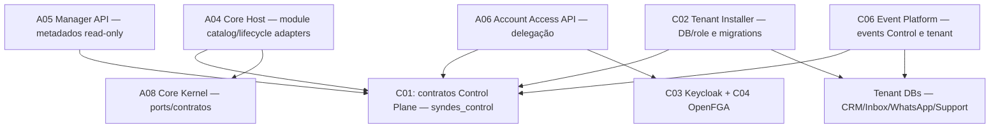
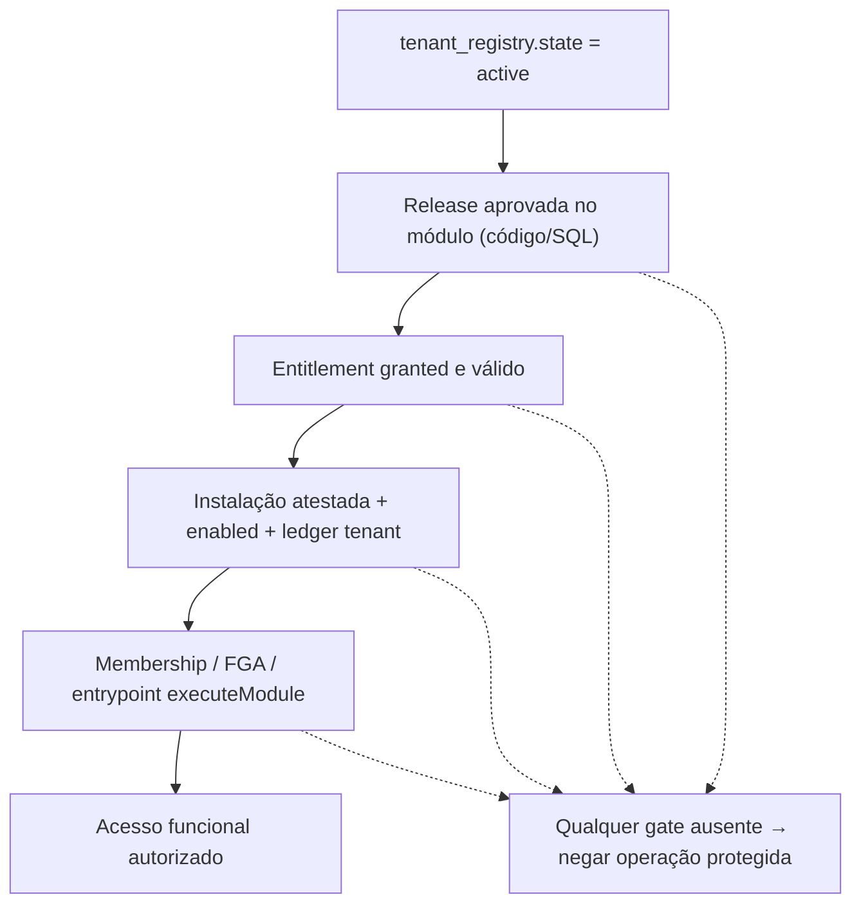
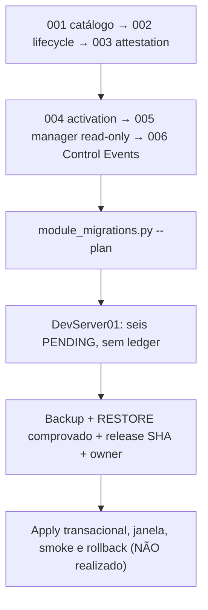

[← Ficha do capítulo](../) · [Volume](../../) · [Fonte original](https://github.com/delmacy/syndes-system/blob/main/docs/subprojects/C01-control-plane/chapters/05-arquitetura-banco-interface-configuracao-e-diagramas.md)

> Conteúdo espelhado da documentação versionada; não expressa automaticamente estado funcional.

## 5. Arquitetura Control, bancos, segurança e diagramas

### Distribuição por owner — estado lógico

**Fluxos no diagrama descrevem dependências arquiteturais, não conexões implantadas/aprovadas em staging.** C01 não é mais um container de aplicação e não oferece um frontend próprio.

### As-is: tabelas do Control no DevServer01

| Classe de dados | Presente | Ausente / pendente |
|---|---|---|
| Registry/membership | `tenant_registry`, `tenant_memberships` | Não foi auditada a autorização HTTP de todas as chamadas |
| Manager | `platform_operator_access`, `platform_tenant_profiles` | Grant do inventário de módulos (stage 005) |
| Account role/delegação | — | `tenant_account_role_grants`, `tenant_account_role_audit` |
| Catálogo/releases | — | `module_catalog`, `module_catalog_versions`, `module_catalog_dependencies` |
| Lifecycle/audit | — | `tenant_module_entitlements`, `tenant_module_installs`, `tenant_module_audit` |
| Control Events | — | `control_events.outbox_events`, `event_deliveries`, `consumer_inbox` |
| Ledger de migrações | — | `control_module_schema_migrations`; **6 PENDING** |

### Três estados que não devem ser confundidos

O estado `active` encontrado para um tenant no registry é **somente estado administrativo**. Não significa que catálogo/entitlements, schemas do tenant ou FGA estejam aptos; o DevServer01 não tem as tabelas da cadeia de módulo.

### As migrations 001–006 — contrato, não execução

O migrador calcula checksums SHA-256 dos arquivos versionados, verifica o DB `syndes_control`, PG17, role operadora, ordem e ledger. O modo `--apply` exige evidências e autorização separadas; **não foi utilizado**.

### Control Events versus tenant Events

`control_events` foi projetado com outbox, delivery e inbox no **banco Control**, recebendo dados de `tenant_module_audit` na mesma transação. Esse schema contém fatos administrativos de entitlement/instalação, não mensagens. Por outro lado, `platform_events` é schema do **tenant DB**, para eventos dos módulos. A disponibilidade de contrato v1 ou teste PG17 sintético não autoriza dispatcher/control worker ou envio de dados entre planos.

### Configuração, secrets, persistência, interface

- **Control DB:** `syndes_control`, conexão de runtime somente leitura para `syndes_core` e `syndes_master_api` em objetos específicos; nenhuma publicação de porta SQL via Compose.
- **Secrets e IAM:** secrets protegidos, token/OIDC/FGA com owners próprios; `PUBLIC CONNECT` aos bancos técnicos foi revogado, mas testes cross-service precisam ocorrer em ambiente autorizado.
- **Frontend:** Platform Manager e Workspace pertencem a apps separados; a API Manager consulta metadados sanitizados, nunca DB ou mensagens dos tenants.
- **Backup e recuperação:** ausência de migração e ledger no runtime **não é justificativa para aplicar SQL** sem restore real da versão implantada. Staging e produção permanecem não verificados.

---
**Rastreabilidade:** [revisar documento fonte](https://github.com/delmacy/syndes-system/blob/main/docs/subprojects/C01-control-plane/chapters/05-arquitetura-banco-interface-configuracao-e-diagramas.md).
