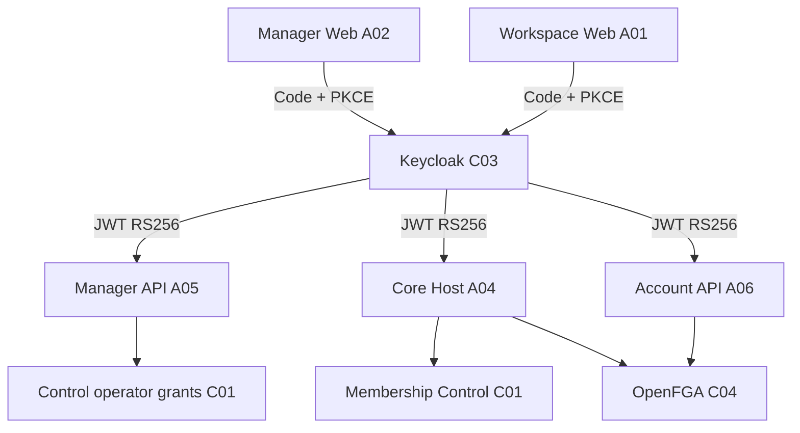

# C03 — Identity Keycloak

[← Sumário do volume](../) · [↑ Biblioteca](../../)

> **Leitura técnica, não homologação.** Estados, limites e comprovações devem ser lidos em STATUS e nos checkpoints versionados.

## Identificação e rastreabilidade

| Campo | Fonte verificável |
|---|---|
| Unidade / owner | **C03** · Identity Keycloak |
| Volume | Plataforma e core |
| Caminho de implementação | `infra/security-access` |
| Documento de origem | [README](https://github.com/delmacy/syndes-system/blob/main/docs/subprojects/C03-identity-keycloak/README.md) |
| STATUS e critérios | [STATUS original](https://github.com/delmacy/syndes-system/blob/main/docs/subprojects/C03-identity-keycloak/STATUS.md) |
| Símbolos, APIs, SQL e dependências | [REFERENCIA-TECNICA](https://github.com/delmacy/syndes-system/blob/main/docs/subprojects/C03-identity-keycloak/REFERENCIA-TECNICA.md) |
| Implantação, runbooks e gates | [OPERACAO](https://github.com/delmacy/syndes-system/blob/main/docs/subprojects/C03-identity-keycloak/OPERACAO.md) |

## Situação registrada

> AUDITORIA TÉCNICA PARCIAL — 13/11/2026. Fonte de código: origin/main SHA ac8deb8c538f59364c6247964a5b0d42e5fbae2e; consolidação documental iniciada após C01 f64a38c. Observação somente leitura do DevServer01 (sem consulta de usuários, tokens, realm administrativo ou credenciais). Nenhum cliente OIDC, redirect, segredo, API, banco ou container foi alterado. Staging e produção não verificados. Eixo Evidência confirmada Limite --------- Documentação…

A descrição acima é uma **citação resumida do STATUS versionado**; não significa que os testes de integração, a implantação ou a homologação estejam aprovados.

## Índice dos subcapítulos

Todos os assuntos deste módulo estão nesta página. Clique em um título para saltar à seção correspondente; o índice lateral acompanha a leitura.

- [Casos de uso](#casos-de-uso)
- [Histórias de usuário](#historias-de-usuario)
- [Requisitos](#requisitos)
- [Contratos públicos e privados](#contratos)
- [APIs e endpoints](#apis)
- [Eventos e mensageria](#eventos)
- [Dados e persistência](#dados)
- [Schemas e migrations](#schema)
- [Dependências e integrações](#dependencias)
- [Configuração e ambiente](#configuracao)
- [Frontend e interfaces](#interface)
- [Testes e evidências](#testes)
- [Operação e implantação](#operacao)
- [WBS e evolução](#wbs)
- [Documentação de origem integral](#documentacao-de-origem)
- [Controle de alterações](#controle-de-alteracoes)

## Casos de uso

**Editar esta seção:** [Abrir arquivo-fonte no GitHub](https://github.com/delmacy/syndes-system/edit/main/docs/subprojects/C03-identity-keycloak/chapters/02-requisitos-historias-e-casos-de-uso.md) · [Consultar fonte](https://github.com/delmacy/syndes-system/blob/main/docs/subprojects/C03-identity-keycloak/chapters/02-requisitos-historias-e-casos-de-uso.md)

*Referências extraídas da documentação versionada, sem inferir homologação ou implantação.*

**Fonte:** [02-requisitos-historias-e-casos-de-uso.md](https://github.com/delmacy/syndes-system/blob/main/docs/subprojects/C03-identity-keycloak/chapters/02-requisitos-historias-e-casos-de-uso.md)

> Linha 5: \| ID documental \| Caso e critério observado \| Fonte \|

**Fonte:** [STATUS.md](https://github.com/delmacy/syndes-system/blob/main/docs/subprojects/C03-identity-keycloak/STATUS.md)

> Linha 11: \| Integração \| Testes unitários com JWKS e tokens assinados; CI Keycloak descartável com testes negativos `aud`/`azp` \| Sem fluxo navegador + Keycloak + Control/tenant real homologado nesta revisão \|

📝 Espaço para ajustes e implementação

Este é um **modelo de registro**, não um editor com salvamento automático. Use o link **Editar esta seção** para atualizar o documento versionado.

- **Alteração proposta:** descreva o requisito, contrato, dado ou comportamento.
- **Referência de código:** informe caminho e símbolo real.
- **Testes e evidências:** informe comando, resultado e limite.
- **Critério de aceite:** indique como validar sem presumir homologação.
- **Status e revisão:** atualize a fonte canônica após revisão.

## Histórias de usuário

**Editar esta seção:** [Abrir arquivo-fonte no GitHub](https://github.com/delmacy/syndes-system/edit/main/docs/subprojects/C03-identity-keycloak/chapters/02-requisitos-historias-e-casos-de-uso.md) · [Consultar fonte](https://github.com/delmacy/syndes-system/blob/main/docs/subprojects/C03-identity-keycloak/chapters/02-requisitos-historias-e-casos-de-uso.md)

*Referências extraídas da documentação versionada, sem inferir homologação ou implantação.*

**Fonte:** [02-requisitos-historias-e-casos-de-uso.md](https://github.com/delmacy/syndes-system/blob/main/docs/subprojects/C03-identity-keycloak/chapters/02-requisitos-historias-e-casos-de-uso.md)

> Linha 20: **Critérios de aceite propostos, ainda não executados:** Auth N/N, autorização 401/403, PKCE, redirects exatos, revogação, rotação, integridade de HTTPS e segregação de clients no ambiente-alvo. Não classificar como requisitos adicionais implementados.

📝 Espaço para ajustes e implementação

Este é um **modelo de registro**, não um editor com salvamento automático. Use o link **Editar esta seção** para atualizar o documento versionado.

- **Alteração proposta:** descreva o requisito, contrato, dado ou comportamento.
- **Referência de código:** informe caminho e símbolo real.
- **Testes e evidências:** informe comando, resultado e limite.
- **Critério de aceite:** indique como validar sem presumir homologação.
- **Status e revisão:** atualize a fonte canônica após revisão.

## Requisitos

**Editar esta seção:** [Abrir arquivo-fonte no GitHub](https://github.com/delmacy/syndes-system/edit/main/docs/subprojects/C03-identity-keycloak/chapters/02-requisitos-historias-e-casos-de-uso.md) · [Consultar fonte](https://github.com/delmacy/syndes-system/blob/main/docs/subprojects/C03-identity-keycloak/chapters/02-requisitos-historias-e-casos-de-uso.md)

*Referências extraídas da documentação versionada, sem inferir homologação ou implantação.*

**Fonte:** [02-requisitos-historias-e-casos-de-uso.md](https://github.com/delmacy/syndes-system/blob/main/docs/subprojects/C03-identity-keycloak/chapters/02-requisitos-historias-e-casos-de-uso.md)

> Linha 20: **Critérios de aceite propostos, ainda não executados:** Auth N/N, autorização 401/403, PKCE, redirects exatos, revogação, rotação, integridade de HTTPS e segregação de clients no ambiente-alvo. Não classificar como requisitos adicionais implementados.

**Fonte:** [07-controle-do-escopo.md](https://github.com/delmacy/syndes-system/blob/main/docs/subprojects/C03-identity-keycloak/chapters/07-controle-do-escopo.md)

> Linha 10: **Pendência de aceite:** o owner deverá aprovar requisitos operacionais como rotação, revogação e backup/restore; propostas de validação não se tornam escopo aprovado por terem sido escritas.

📝 Espaço para ajustes e implementação

Este é um **modelo de registro**, não um editor com salvamento automático. Use o link **Editar esta seção** para atualizar o documento versionado.

- **Alteração proposta:** descreva o requisito, contrato, dado ou comportamento.
- **Referência de código:** informe caminho e símbolo real.
- **Testes e evidências:** informe comando, resultado e limite.
- **Critério de aceite:** indique como validar sem presumir homologação.
- **Status e revisão:** atualize a fonte canônica após revisão.

## Contratos públicos e privados

**Editar esta seção:** [Abrir arquivo-fonte no GitHub](https://github.com/delmacy/syndes-system/edit/main/docs/subprojects/C03-identity-keycloak/REFERENCIA-TECNICA.md) · [Consultar fonte](https://github.com/delmacy/syndes-system/blob/main/docs/subprojects/C03-identity-keycloak/REFERENCIA-TECNICA.md)

*Referências extraídas da documentação versionada, sem inferir homologação ou implantação.*

**Fonte:** [REFERENCIA-TECNICA.md](https://github.com/delmacy/syndes-system/blob/main/docs/subprojects/C03-identity-keycloak/REFERENCIA-TECNICA.md)

> Linha 3: > **AUDITORIA ESTÁTICA E INSPEÇÃO OPERACIONAL LIMITADA — 13/11/2026.** Baseline `origin/main` `ac8deb8`. O catálogo atribui C03 a `infra/security-access`, maturity `distributed` (metadado de inventário). Nenhuma consulta ao Admin API, segredo ou conteúdo de usuários. Portanto, os contratos abaixo são **declarados no código**; seus parâmetros reais de implantação não foram homologados.

> Linha 7: \| Componente \| Fonte \| Contrato / limite \|

> Linha 31: \| A04 \| `ActorVerifier.verifyToken(header,clientId?)` \| Implementação **private** compartilhada por `verify` e `verifyClient`; não constitui API pública da plataforma \|

> Linha 68: - O Compose comenta que não expõe porta de host; uma publicação **somente em loopback** foi observada no container implantado. Isso exige reconciliação dos overrides/deploy, mas não demonstra acesso público.

**Fonte:** [04-contratos-e-dependencias-publicas.md](https://github.com/delmacy/syndes-system/blob/main/docs/subprojects/C03-identity-keycloak/chapters/04-contratos-e-dependencias-publicas.md)

> Linha 3: **Contrato externo do C03:** OIDC do Keycloak (Authorization Code, token, JWKS e discovery). O provedor não publica API de negócio Syndes. URI exata/realm live **não auditados**.

> Linha 5: \| Consumidor \| Contrato \| Dependência e negativa de acesso \|

> Linha 15: **Eventos:** não foi identificado contrato de evento de domínio próprio do C03 em `infra/security-access`. Eventos tenant em C06 e trilhas de autorização pertencem a outros owners; não inventar publisher/consumer Keycloak.

> Linha 17: **Public/private:** métodos de clientes OIDC nos frontends e verificadores de APIs são implementação interna dos respectivos pacotes, **não SDK público C03**. OpenBao/Keycloak admin secrets, arquivo renderizado e política de provisionamento são contratos privados de operação.

**Fonte:** [STATUS.md](https://github.com/delmacy/syndes-system/blob/main/docs/subprojects/C03-identity-keycloak/STATUS.md)

> Linha 12: \| Operação \| Container `syndes-security-access-keycloak-1` observado **Up** no DevServer01 em 13/11 \| Estado do container não comprova readiness, HTTPS público, client, realm ou login funcional \|

> Linha 20: - **A01 / Workspace Web:** `getWorkspaceConfig`, `beginLogin`, `finishLogin`, `markSignedOut`; client público separado e callback validado por `state`.

> Linha 31: 4. **P1 — configuração versus runtime:** o Compose define ausência de porta pública; a instância observada tem binding local de loopback. Inventariar overrides e origem de exposição HTTPS sem publicar topologia sensível.

> Linha 44: - **13/11/2026:** inspecionados arquivos versionados e estado limitado do container Keycloak, sem dados privados. Testes de documentação/contrato são evidência da revisão, **não** Product Gate.

**Fonte:** [OPERACAO.md](https://github.com/delmacy/syndes-system/blob/main/docs/subprojects/C03-identity-keycloak/OPERACAO.md)

> Linha 21: - `infra/master-admin/keycloak-homolog.py`: `--check` é modo de inspeção; `--apply` cria/ajusta client conforme script e `--rollback` usa registro privado. Exigem operador autorizado e análise de risco.

> Linha 24: - Não copiar tokens, senhas, secret files nem detalhes de topologia privada para esta documentação.

📝 Espaço para ajustes e implementação

Este é um **modelo de registro**, não um editor com salvamento automático. Use o link **Editar esta seção** para atualizar o documento versionado.

- **Alteração proposta:** descreva o requisito, contrato, dado ou comportamento.
- **Referência de código:** informe caminho e símbolo real.
- **Testes e evidências:** informe comando, resultado e limite.
- **Critério de aceite:** indique como validar sem presumir homologação.
- **Status e revisão:** atualize a fonte canônica após revisão.

## APIs e endpoints

**Editar esta seção:** [Abrir arquivo-fonte no GitHub](https://github.com/delmacy/syndes-system/edit/main/docs/subprojects/C03-identity-keycloak/REFERENCIA-TECNICA.md) · [Consultar fonte](https://github.com/delmacy/syndes-system/blob/main/docs/subprojects/C03-identity-keycloak/REFERENCIA-TECNICA.md)

*Referências extraídas da documentação versionada, sem inferir homologação ou implantação.*

**Fonte:** [REFERENCIA-TECNICA.md](https://github.com/delmacy/syndes-system/blob/main/docs/subprojects/C03-identity-keycloak/REFERENCIA-TECNICA.md)

> Linha 3: > **AUDITORIA ESTÁTICA E INSPEÇÃO OPERACIONAL LIMITADA — 13/11/2026.** Baseline `origin/main` `ac8deb8`. O catálogo atribui C03 a `infra/security-access`, maturity `distributed` (metadado de inventário). Nenhuma consulta ao Admin API, segredo ou conteúdo de usuários. Portanto, os contratos abaixo são **declarados no código**; seus parâmetros reais de implantação não foram homologados.

> Linha 14: \| Manager API (A05) \| `apps/master-admin-api/src/auth.mjs`, `src/main.mjs` \| JWT RS256 via `jose`, `iss` + `aud` + `azp` + `sub`; grant Control independente \|

> Linha 15: \| Account API (A06) \| `apps/account-access-api/src/auth.mjs`, `src/main.mjs` \| JWT RS256, client separado e autorização OpenFGA para delegação \|

> Linha 18: **C03 é infraestrutura declarativa, não um pacote NestJS ou API HTTP própria do repositório**: em `infra/security-access` não há `package.json` ou controller. Métodos listados pertencem aos **consumidores** acima.

> Linha 24: \| A02 \| `readConfig()` \| Carrega `GET /master-runtime.json` (artefato do frontend), valida issuer HTTPS e client id \|

> Linha 26: \| A01 \| `getWorkspaceConfig()` \| Carrega `GET /workspace-runtime.json`; exige issuer HTTPS, client id e tenant UUID \|

> Linha 31: \| A04 \| `ActorVerifier.verifyToken(header,clientId?)` \| Implementação **private** compartilhada por `verify` e `verifyClient`; não constitui API pública da plataforma \|

> Linha 50: - OIDC padrão do provedor: `GET /realms/{realm}/.well-known/openid-configuration`, endpoint de autorização, endpoint de token e JWKS. URLs do realm **não foram verificadas ao vivo**; não declarar disponibilidade apenas pela convenção.

> Linha 51: - Endpoints de frontend `GET /master-runtime.json`, `GET /workspace-runtime.json` são configuração da respectiva UI, **não APIs Keycloak**.

> Linha 52: - `GET /modules/:moduleId/config` pertence ao **A04 Core Host** e expõe metadados públicos OIDC de plugin instalado; não substitui o controle de autorização.

> Linha 58: - Manager API: `MASTER_KEYCLOAK_ISSUER`, `MASTER_KEYCLOAK_AUDIENCE`, `MASTER_KEYCLOAK_CLIENT_ID`, `MASTER_KEYCLOAK_JWKS_URL`, `MASTER_PUBLIC_ORIGIN`.

> Linha 59: - Account API: `ACCOUNT_OIDC_ISSUER`, `ACCOUNT_OIDC_AUDIENCE`, `ACCOUNT_OIDC_CLIENT_ID`, `ACCOUNT_OIDC_JWKS_URL`.

> Linha 75: \| `apps/master-admin-api/test/auth.test.mjs` \| RS256 assinado, JWKS fake local, erros de `aud`/`azp`/`sub` \| Realm real e navegador \|

> Linha 76: \| `apps/account-access-api/test/auth.test.mjs` \| Token RS256 e check OpenFGA em teste \| Grants FGA implantados \|

**Fonte:** [04-contratos-e-dependencias-publicas.md](https://github.com/delmacy/syndes-system/blob/main/docs/subprojects/C03-identity-keycloak/chapters/04-contratos-e-dependencias-publicas.md)

> Linha 3: **Contrato externo do C03:** OIDC do Keycloak (Authorization Code, token, JWKS e discovery). O provedor não publica API de negócio Syndes. URI exata/realm live **não auditados**.

> Linha 7: \| Manager Web A02 \| `login`, `finishLogin`, `/master-runtime.json`, endpoints padrão OIDC \| PKCE, `state`; qualquer callback fora da sessão é rejeitado \|

> Linha 9: \| Manager API A05 \| `createMasterTokenVerifier` \| `iss`, `aud`, `azp`, `sub`, JWKS RS256; depois verifica operador no Control \|

> Linha 10: \| Account API A06 \| `createTokenVerifier` \| audience/client dedicado; decisão de escrita no OpenFGA \|

> Linha 19: **Versões:** não afirmar compatibilidade sem comparar manifests, realm/clients de homologação e testes da imagem implantada. C03 não possui API versionada NestJS no repositório.

**Fonte:** [05-arquitetura-banco-interface-configuracao-e-diagramas.md](https://github.com/delmacy/syndes-system/blob/main/docs/subprojects/C03-identity-keycloak/chapters/05-arquitetura-banco-interface-configuracao-e-diagramas.md)

> Linha 22: - O container Keycloak estava Up no DevServer01 (13/11); publicação somente loopback foi observada no runtime, enquanto o Compose base não publica porta. **Overrides, endpoints públicos, configuração de realm e health OIDC não verificados**.

> Linha 27: - Manager API: `MASTER_KEYCLOAK_ISSUER`, `MASTER_KEYCLOAK_AUDIENCE`, `MASTER_KEYCLOAK_CLIENT_ID`, `MASTER_KEYCLOAK_JWKS_URL`.

> Linha 29: - Account API: `ACCOUNT_OIDC_ISSUER`, `ACCOUNT_OIDC_AUDIENCE`, `ACCOUNT_OIDC_CLIENT_ID`, `ACCOUNT_OIDC_JWKS_URL`.

**Fonte:** [STATUS.md](https://github.com/delmacy/syndes-system/blob/main/docs/subprojects/C03-identity-keycloak/STATUS.md)

> Linha 3: > **AUDITORIA TÉCNICA PARCIAL — 13/11/2026.** Fonte de código: `origin/main` SHA `ac8deb8c538f59364c6247964a5b0d42e5fbae2e`; consolidação documental iniciada após C01 `f64a38c`. Observação **somente leitura** do DevServer01 (sem consulta de usuários, tokens, realm administrativo ou credenciais). Nenhum cliente OIDC, redirect, segredo, API, banco ou container foi alterado. Staging e produção **não verificados**.

> Linha 21: - **A05 / Manager API:** `createMasterTokenVerifier` exige assinatura RS256, issuer HTTPS, audience e client `azp`; `platform_operator_access` é gate independente.

> Linha 22: - **A06 / Account API:** `createTokenVerifier` devolve actor e recusa client Master; autorização de papéis de Account ocorre no OpenFGA, **não no Keycloak**.

**Fonte:** [OPERACAO.md](https://github.com/delmacy/syndes-system/blob/main/docs/subprojects/C03-identity-keycloak/OPERACAO.md)

> Linha 7: - DevServer01: Keycloak `26.8.1` identificado como container **Up**. Imagem/versionamento seguem `infra/security-access/compose.yaml`, mas **não** foi executado teste HTTP OIDC, login de navegador ou consulta autenticada ao realm.

📝 Espaço para ajustes e implementação

Este é um **modelo de registro**, não um editor com salvamento automático. Use o link **Editar esta seção** para atualizar o documento versionado.

- **Alteração proposta:** descreva o requisito, contrato, dado ou comportamento.
- **Referência de código:** informe caminho e símbolo real.
- **Testes e evidências:** informe comando, resultado e limite.
- **Critério de aceite:** indique como validar sem presumir homologação.
- **Status e revisão:** atualize a fonte canônica após revisão.

## Eventos e mensageria

**Editar esta seção:** [Abrir arquivo-fonte no GitHub](https://github.com/delmacy/syndes-system/edit/main/docs/subprojects/C03-identity-keycloak/REFERENCIA-TECNICA.md) · [Consultar fonte](https://github.com/delmacy/syndes-system/blob/main/docs/subprojects/C03-identity-keycloak/REFERENCIA-TECNICA.md)

*Referências extraídas da documentação versionada, sem inferir homologação ou implantação.*

**Fonte:** [04-contratos-e-dependencias-publicas.md](https://github.com/delmacy/syndes-system/blob/main/docs/subprojects/C03-identity-keycloak/chapters/04-contratos-e-dependencias-publicas.md)

> Linha 5: \| Consumidor \| Contrato \| Dependência e negativa de acesso \|

> Linha 15: **Eventos:** não foi identificado contrato de evento de domínio próprio do C03 em `infra/security-access`. Eventos tenant em C06 e trilhas de autorização pertencem a outros owners; não inventar publisher/consumer Keycloak.

📝 Espaço para ajustes e implementação

Este é um **modelo de registro**, não um editor com salvamento automático. Use o link **Editar esta seção** para atualizar o documento versionado.

- **Alteração proposta:** descreva o requisito, contrato, dado ou comportamento.
- **Referência de código:** informe caminho e símbolo real.
- **Testes e evidências:** informe comando, resultado e limite.
- **Critério de aceite:** indique como validar sem presumir homologação.
- **Status e revisão:** atualize a fonte canônica após revisão.

## Dados e persistência

**Editar esta seção:** [Abrir arquivo-fonte no GitHub](https://github.com/delmacy/syndes-system/edit/main/docs/subprojects/C03-identity-keycloak/REFERENCIA-TECNICA.md) · [Consultar fonte](https://github.com/delmacy/syndes-system/blob/main/docs/subprojects/C03-identity-keycloak/REFERENCIA-TECNICA.md)

*Referências extraídas da documentação versionada, sem inferir homologação ou implantação.*

**Fonte:** [REFERENCIA-TECNICA.md](https://github.com/delmacy/syndes-system/blob/main/docs/subprojects/C03-identity-keycloak/REFERENCIA-TECNICA.md)

> Linha 10: \| PostgreSQL \| `infra/security-access/compose.yaml`, `infra/postgres/compose.yaml` \| Banco técnico declarado `syndes_keycloak`; **não** `syndes_control` nem dados dos tenants \|

**Fonte:** [05-arquitetura-banco-interface-configuracao-e-diagramas.md](https://github.com/delmacy/syndes-system/blob/main/docs/subprojects/C03-identity-keycloak/chapters/05-arquitetura-banco-interface-configuracao-e-diagramas.md)

> Linha 20: - `infra/security-access/compose.yaml`: serviço Keycloak `26.8.1`, `KC_DB=postgres`, nome técnico do banco `syndes_keycloak`, configuração `keycloak.conf` montada em secret, redes declaradas de dados, autenticação, segredos e identidade Manager.

**Fonte:** [STATUS.md](https://github.com/delmacy/syndes-system/blob/main/docs/subprojects/C03-identity-keycloak/STATUS.md)

> Linha 24: - **C04 / OpenFGA e C01 / Control:** autorização, membership e grants separados da autenticação. Token válido não basta para acessar dados.

> Linha 29: 2. **P0 — isolamento entre aplicações requer E2E negativo:** provar token Manager→Workspace negado, Workspace→Manager negado e sujeito sem grant→403 com dados A/B reais; a CI sintética não fecha esse gate.

> Linha 44: - **13/11/2026:** inspecionados arquivos versionados e estado limitado do container Keycloak, sem dados privados. Testes de documentação/contrato são evidência da revisão, **não** Product Gate.

📝 Espaço para ajustes e implementação

Este é um **modelo de registro**, não um editor com salvamento automático. Use o link **Editar esta seção** para atualizar o documento versionado.

- **Alteração proposta:** descreva o requisito, contrato, dado ou comportamento.
- **Referência de código:** informe caminho e símbolo real.
- **Testes e evidências:** informe comando, resultado e limite.
- **Critério de aceite:** indique como validar sem presumir homologação.
- **Status e revisão:** atualize a fonte canônica após revisão.

## Schemas e migrations

**Editar esta seção:** [Abrir arquivo-fonte no GitHub](https://github.com/delmacy/syndes-system/edit/main/docs/subprojects/C03-identity-keycloak/REFERENCIA-TECNICA.md) · [Consultar fonte](https://github.com/delmacy/syndes-system/blob/main/docs/subprojects/C03-identity-keycloak/REFERENCIA-TECNICA.md)

*Referências extraídas da documentação versionada, sem inferir homologação ou implantação.*

**Fonte:** [REFERENCIA-TECNICA.md](https://github.com/delmacy/syndes-system/blob/main/docs/subprojects/C03-identity-keycloak/REFERENCIA-TECNICA.md)

> Linha 65: - `syndes_keycloak` é a base técnica declarada pelo Compose; **C03 não possui migrations SQL de tenant ou Control** em `infra/security-access`.

**Fonte:** [05-arquitetura-banco-interface-configuracao-e-diagramas.md](https://github.com/delmacy/syndes-system/blob/main/docs/subprojects/C03-identity-keycloak/chapters/05-arquitetura-banco-interface-configuracao-e-diagramas.md)

> Linha 21: - Sem migrations de negócio no diretório C03; migrations de Control/tenant pertencem a C01/I04/C02.

📝 Espaço para ajustes e implementação

Este é um **modelo de registro**, não um editor com salvamento automático. Use o link **Editar esta seção** para atualizar o documento versionado.

- **Alteração proposta:** descreva o requisito, contrato, dado ou comportamento.
- **Referência de código:** informe caminho e símbolo real.
- **Testes e evidências:** informe comando, resultado e limite.
- **Critério de aceite:** indique como validar sem presumir homologação.
- **Status e revisão:** atualize a fonte canônica após revisão.

## Dependências e integrações

**Editar esta seção:** [Abrir arquivo-fonte no GitHub](https://github.com/delmacy/syndes-system/edit/main/docs/subprojects/C03-identity-keycloak/REFERENCIA-TECNICA.md) · [Consultar fonte](https://github.com/delmacy/syndes-system/blob/main/docs/subprojects/C03-identity-keycloak/REFERENCIA-TECNICA.md)

*Referências extraídas da documentação versionada, sem inferir homologação ou implantação.*

**Fonte:** [REFERENCIA-TECNICA.md](https://github.com/delmacy/syndes-system/blob/main/docs/subprojects/C03-identity-keycloak/REFERENCIA-TECNICA.md)

> Linha 9: \| Keycloak 26.8.1 \| `infra/security-access/compose.yaml` \| Identity provider OIDC; imagem pinada e serviço em redes privadas; configuração via secret montado \|

> Linha 11: \| OpenBao \| `infra/security-access/openbao/render_runtime.py`, `openbao/policies/keycloak.hcl` \| Entrega de configuração runtime; segredos não são definidos pela documentação \|

> Linha 15: \| Account API (A06) \| `apps/account-access-api/src/auth.mjs`, `src/main.mjs` \| JWT RS256, client separado e autorização OpenFGA para delegação \|

> Linha 16: \| Core Host (A04) \| `apps/core-host/src/adapters.ts`, `src/main.ts` \| `ActorVerifier`, membership Control e OpenFGA em gates distintos \|

> Linha 51: - Endpoints de frontend `GET /master-runtime.json`, `GET /workspace-runtime.json` são configuração da respectiva UI, **não APIs Keycloak**.

> Linha 57: - Keycloak: `KEYCLOAK_PUBLIC_URL`, secret montado como `keycloak.conf`, `KC_DB`, `KC_DB_URL`, `KC_DB_USERNAME`, `KC_HOSTNAME`, `KC_HEALTH_ENABLED`, `KC_METRICS_ENABLED` (fonte Compose).

> Linha 66: - Keycloak e Control são fronteiras distintas; o `sub` do token referencia identidade, enquanto `tenant_memberships` e `platform_operator_access` são tratados por C01.

> Linha 67: - `docker ps` em DevServer01 no dia 13/11 mostrou o container Keycloak **Up**, com imagem declarada `26.8.1`. Nenhum `docker exec`, consulta de realm, token, healthcheck ou mudança de configuração foi feito.

> Linha 69: - Scripts de homologação: `infra/master-admin/keycloak-homolog.py` (`--check`, `--apply`, `--rollback`) e `keycloak-redirect-migrate.py` (migração auditada de redirect). **Não executados**.

> Linha 76: \| `apps/account-access-api/test/auth.test.mjs` \| Token RS256 e check OpenFGA em teste \| Grants FGA implantados \|

> Linha 78: \| `tests/platform/platform-manager-keycloak-ci.mjs` \| Realm Keycloak descartável, JWT assinado, client adversarial, 401/403 \| Client/roles de Keycloak no DevServer01 \|

> Linha 79: \| `tests/platform/test-manager-keycloak-redirect.py` \| Restrições estáticas do migrador e registros de auditoria \| Migração de redirect aplicada neste trabalho \|

**Fonte:** [04-contratos-e-dependencias-publicas.md](https://github.com/delmacy/syndes-system/blob/main/docs/subprojects/C03-identity-keycloak/chapters/04-contratos-e-dependencias-publicas.md)

> Linha 3: **Contrato externo do C03:** OIDC do Keycloak (Authorization Code, token, JWKS e discovery). O provedor não publica API de negócio Syndes. URI exata/realm live **não auditados**.

> Linha 5: \| Consumidor \| Contrato \| Dependência e negativa de acesso \|

> Linha 10: \| Account API A06 \| `createTokenVerifier` \| audience/client dedicado; decisão de escrita no OpenFGA \|

> Linha 15: **Eventos:** não foi identificado contrato de evento de domínio próprio do C03 em `infra/security-access`. Eventos tenant em C06 e trilhas de autorização pertencem a outros owners; não inventar publisher/consumer Keycloak.

> Linha 17: **Public/private:** métodos de clientes OIDC nos frontends e verificadores de APIs são implementação interna dos respectivos pacotes, **não SDK público C03**. OpenBao/Keycloak admin secrets, arquivo renderizado e política de provisionamento são contratos privados de operação.

**Fonte:** [05-arquitetura-banco-interface-configuracao-e-diagramas.md](https://github.com/delmacy/syndes-system/blob/main/docs/subprojects/C03-identity-keycloak/chapters/05-arquitetura-banco-interface-configuracao-e-diagramas.md)

> Linha 20: - `infra/security-access/compose.yaml`: serviço Keycloak `26.8.1`, `KC_DB=postgres`, nome técnico do banco `syndes_keycloak`, configuração `keycloak.conf` montada em secret, redes declaradas de dados, autenticação, segredos e identidade Manager.

> Linha 22: - O container Keycloak estava Up no DevServer01 (13/11); publicação somente loopback foi observada no runtime, enquanto o Compose base não publica porta. **Overrides, endpoints públicos, configuração de realm e health OIDC não verificados**.

> Linha 30: - Keycloak/secret: `KEYCLOAK_PUBLIC_URL`, `KC_HOSTNAME`, `KC_DB_URL`, `KC_DB_USERNAME`; **nenhum valor, URL interna ou segredo** deve ser exposto nesta página.

**Fonte:** [STATUS.md](https://github.com/delmacy/syndes-system/blob/main/docs/subprojects/C03-identity-keycloak/STATUS.md)

> Linha 10: \| Implementação \| Keycloak Compose `26.8.1`; PKCE S256 em Manager/Workspace; validação RS256 por JWKS no Manager, Account e Core Host \| Fonte no Git não comprova configuração do realm existente \|

> Linha 11: \| Integração \| Testes unitários com JWKS e tokens assinados; CI Keycloak descartável com testes negativos `aud`/`azp` \| Sem fluxo navegador + Keycloak + Control/tenant real homologado nesta revisão \|

> Linha 12: \| Operação \| Container `syndes-security-access-keycloak-1` observado **Up** no DevServer01 em 13/11 \| Estado do container não comprova readiness, HTTPS público, client, realm ou login funcional \|

> Linha 18: - **C03 / Keycloak:** autentica identidades OIDC; banco técnico `syndes_keycloak` (não é o banco Control nem de tenants).

> Linha 22: - **A06 / Account API:** `createTokenVerifier` devolve actor e recusa client Master; autorização de papéis de Account ocorre no OpenFGA, **não no Keycloak**.

> Linha 24: - **C04 / OpenFGA e C01 / Control:** autorização, membership e grants separados da autenticação. Token válido não basta para acessar dados.

> Linha 28: 1. **P0 — configuração real não reconciliada:** Compose e testes descrevem o esperado, mas não foram lidos de forma autenticada os clients, audiences, redirects, realm e mapper efetivos do Keycloak do DevServer01.

> Linha 32: 5. **P1 — operação de identidade:** faltam evidências de health OIDC real, rotação/expiração de chaves, sessão/logout, revogação, backup/restore Keycloak e resposta a incidentes.

> Linha 42: \| C03.OPS.01 \| **PENDENTE** \| Runbook Keycloak, saúde, atualização, rotação, backup/restore e rollback testados \|

> Linha 44: - **13/11/2026:** inspecionados arquivos versionados e estado limitado do container Keycloak, sem dados privados. Testes de documentação/contrato são evidência da revisão, **não** Product Gate.

> Linha 45: - **Próxima unidade documental:** C04 — Authorization OpenFGA, após registrar C03 com suas lacunas.

**Fonte:** [OPERACAO.md](https://github.com/delmacy/syndes-system/blob/main/docs/subprojects/C03-identity-keycloak/OPERACAO.md)

> Linha 3: > **NÃO É RUNBOOK HOMOLOGADO.** Auditoria somente leitura em 13/11/2026. Não autoriza editar realm, clients, redirects, Keycloak, banco, token, OpenBao nem reiniciar serviços.

> Linha 7: - DevServer01: Keycloak `26.8.1` identificado como container **Up**. Imagem/versionamento seguem `infra/security-access/compose.yaml`, mas **não** foi executado teste HTTP OIDC, login de navegador ou consulta autenticada ao realm.

> Linha 8: - Segurança: `openbao` oferece secret config em runtime, sem publicar valores. O Keycloak declara banco técnico próprio. O Compose não é atestado de configuração do deploy.

> Linha 17: 5. Associar provas por SHA + ambiente, owner e decisão de segurança antes de alterar status para integração validada ou homologação.

> Linha 21: - `infra/master-admin/keycloak-homolog.py`: `--check` é modo de inspeção; `--apply` cria/ajusta client conforme script e `--rollback` usa registro privado. Exigem operador autorizado e análise de risco.

> Linha 22: - `infra/master-admin/keycloak-redirect-migrate.py`: operação de redirect com `--apply`/`--rollback`; não invocar sem janela, origem correta e rollback aprovado.

> Linha 23: - Não ativar Direct Access Grants no client de browser real; a suíte `platform-manager-keycloak-ci.mjs` os habilita apenas em **realm descartável**.

📝 Espaço para ajustes e implementação

Este é um **modelo de registro**, não um editor com salvamento automático. Use o link **Editar esta seção** para atualizar o documento versionado.

- **Alteração proposta:** descreva o requisito, contrato, dado ou comportamento.
- **Referência de código:** informe caminho e símbolo real.
- **Testes e evidências:** informe comando, resultado e limite.
- **Critério de aceite:** indique como validar sem presumir homologação.
- **Status e revisão:** atualize a fonte canônica após revisão.

## Configuração e ambiente

**Editar esta seção:** [Abrir arquivo-fonte no GitHub](https://github.com/delmacy/syndes-system/edit/main/docs/subprojects/C03-identity-keycloak/OPERACAO.md) · [Consultar fonte](https://github.com/delmacy/syndes-system/blob/main/docs/subprojects/C03-identity-keycloak/OPERACAO.md)

*Referências extraídas da documentação versionada, sem inferir homologação ou implantação.*

**Fonte:** [OPERACAO.md](https://github.com/delmacy/syndes-system/blob/main/docs/subprojects/C03-identity-keycloak/OPERACAO.md)

> Linha 7: - DevServer01: Keycloak `26.8.1` identificado como container **Up**. Imagem/versionamento seguem `infra/security-access/compose.yaml`, mas **não** foi executado teste HTTP OIDC, login de navegador ou consulta autenticada ao realm.

> Linha 8: - Segurança: `openbao` oferece secret config em runtime, sem publicar valores. O Keycloak declara banco técnico próprio. O Compose não é atestado de configuração do deploy.

> Linha 13: 1. Identificar versão/digest da imagem em uso, overrides do Compose, origem HTTPS, issuer e cadeia de certificados; reunir **metadados sem segredos**.

**Fonte:** [REFERENCIA-TECNICA.md](https://github.com/delmacy/syndes-system/blob/main/docs/subprojects/C03-identity-keycloak/REFERENCIA-TECNICA.md)

> Linha 9: \| Keycloak 26.8.1 \| `infra/security-access/compose.yaml` \| Identity provider OIDC; imagem pinada e serviço em redes privadas; configuração via secret montado \|

> Linha 10: \| PostgreSQL \| `infra/security-access/compose.yaml`, `infra/postgres/compose.yaml` \| Banco técnico declarado `syndes_keycloak`; **não** `syndes_control` nem dados dos tenants \|

> Linha 11: \| OpenBao \| `infra/security-access/openbao/render_runtime.py`, `openbao/policies/keycloak.hcl` \| Entrega de configuração runtime; segredos não são definidos pela documentação \|

> Linha 51: - Endpoints de frontend `GET /master-runtime.json`, `GET /workspace-runtime.json` são configuração da respectiva UI, **não APIs Keycloak**.

> Linha 57: - Keycloak: `KEYCLOAK_PUBLIC_URL`, secret montado como `keycloak.conf`, `KC_DB`, `KC_DB_URL`, `KC_DB_USERNAME`, `KC_HOSTNAME`, `KC_HEALTH_ENABLED`, `KC_METRICS_ENABLED` (fonte Compose).

> Linha 61: - Variáveis são **nomes versionados**, não prova de valores corretos em ambiente; não registrar client secrets, bearer, URL interna completa ou credenciais nesta página.

> Linha 65: - `syndes_keycloak` é a base técnica declarada pelo Compose; **C03 não possui migrations SQL de tenant ou Control** em `infra/security-access`.

> Linha 67: - `docker ps` em DevServer01 no dia 13/11 mostrou o container Keycloak **Up**, com imagem declarada `26.8.1`. Nenhum `docker exec`, consulta de realm, token, healthcheck ou mudança de configuração foi feito.

> Linha 68: - O Compose comenta que não expõe porta de host; uma publicação **somente em loopback** foi observada no container implantado. Isso exige reconciliação dos overrides/deploy, mas não demonstra acesso público.

**Fonte:** [05-arquitetura-banco-interface-configuracao-e-diagramas.md](https://github.com/delmacy/syndes-system/blob/main/docs/subprojects/C03-identity-keycloak/chapters/05-arquitetura-banco-interface-configuracao-e-diagramas.md)

> Linha 20: - `infra/security-access/compose.yaml`: serviço Keycloak `26.8.1`, `KC_DB=postgres`, nome técnico do banco `syndes_keycloak`, configuração `keycloak.conf` montada em secret, redes declaradas de dados, autenticação, segredos e identidade Manager.

> Linha 22: - O container Keycloak estava Up no DevServer01 (13/11); publicação somente loopback foi observada no runtime, enquanto o Compose base não publica porta. **Overrides, endpoints públicos, configuração de realm e health OIDC não verificados**.

**Fonte:** [STATUS.md](https://github.com/delmacy/syndes-system/blob/main/docs/subprojects/C03-identity-keycloak/STATUS.md)

> Linha 10: \| Implementação \| Keycloak Compose `26.8.1`; PKCE S256 em Manager/Workspace; validação RS256 por JWKS no Manager, Account e Core Host \| Fonte no Git não comprova configuração do realm existente \|

> Linha 19: - **A02 / Manager Web:** `readConfig`, `login`, `finishLogin` e `clearLogin` usando Authorization Code + PKCE; configuração de runtime própria.

> Linha 28: 1. **P0 — configuração real não reconciliada:** Compose e testes descrevem o esperado, mas não foram lidos de forma autenticada os clients, audiences, redirects, realm e mapper efetivos do Keycloak do DevServer01.

> Linha 31: 4. **P1 — configuração versus runtime:** o Compose define ausência de porta pública; a instância observada tem binding local de loopback. Inventariar overrides e origem de exposição HTTPS sem publicar topologia sensível.

📝 Espaço para ajustes e implementação

Este é um **modelo de registro**, não um editor com salvamento automático. Use o link **Editar esta seção** para atualizar o documento versionado.

- **Alteração proposta:** descreva o requisito, contrato, dado ou comportamento.
- **Referência de código:** informe caminho e símbolo real.
- **Testes e evidências:** informe comando, resultado e limite.
- **Critério de aceite:** indique como validar sem presumir homologação.
- **Status e revisão:** atualize a fonte canônica após revisão.

## Frontend e interfaces

**Editar esta seção:** [Abrir arquivo-fonte no GitHub](https://github.com/delmacy/syndes-system/edit/main/docs/subprojects/C03-identity-keycloak/REFERENCIA-TECNICA.md) · [Consultar fonte](https://github.com/delmacy/syndes-system/blob/main/docs/subprojects/C03-identity-keycloak/REFERENCIA-TECNICA.md)

*Referências extraídas da documentação versionada, sem inferir homologação ou implantação.*

**Fonte:** [REFERENCIA-TECNICA.md](https://github.com/delmacy/syndes-system/blob/main/docs/subprojects/C03-identity-keycloak/REFERENCIA-TECNICA.md)

> Linha 7: \| Componente \| Fonte \| Contrato / limite \|

> Linha 24: \| A02 \| `readConfig()` \| Carrega `GET /master-runtime.json` (artefato do frontend), valida issuer HTTPS e client id \|

> Linha 51: - Endpoints de frontend `GET /master-runtime.json`, `GET /workspace-runtime.json` são configuração da respectiva UI, **não APIs Keycloak**.

**Fonte:** [05-arquitetura-banco-interface-configuracao-e-diagramas.md](https://github.com/delmacy/syndes-system/blob/main/docs/subprojects/C03-identity-keycloak/chapters/05-arquitetura-banco-interface-configuracao-e-diagramas.md)

> Linha 32: **Frontend:** C03 não possui tela React proprietária; telas de autenticação e callbacks são componentes A01/A02. Implementação de login não comprova fluxo com HTTPS/proxy operante.

📝 Espaço para ajustes e implementação

Este é um **modelo de registro**, não um editor com salvamento automático. Use o link **Editar esta seção** para atualizar o documento versionado.

- **Alteração proposta:** descreva o requisito, contrato, dado ou comportamento.
- **Referência de código:** informe caminho e símbolo real.
- **Testes e evidências:** informe comando, resultado e limite.
- **Critério de aceite:** indique como validar sem presumir homologação.
- **Status e revisão:** atualize a fonte canônica após revisão.

## Testes e evidências

**Editar esta seção:** [Abrir arquivo-fonte no GitHub](https://github.com/delmacy/syndes-system/edit/main/docs/subprojects/C03-identity-keycloak/STATUS.md) · [Consultar fonte](https://github.com/delmacy/syndes-system/blob/main/docs/subprojects/C03-identity-keycloak/STATUS.md)

*Referências extraídas da documentação versionada, sem inferir homologação ou implantação.*

**Fonte:** [STATUS.md](https://github.com/delmacy/syndes-system/blob/main/docs/subprojects/C03-identity-keycloak/STATUS.md)

> Linha 7: \| Eixo \| Evidência confirmada \| Limite \|

> Linha 9: \| Documentação \| **Auditoria parcial**: fontes, consumidores OIDC, métodos, fluxos, rede, testes e lacunas mapeados \| Revisão e aprovação do owner pendentes \|

> Linha 11: \| Integração \| Testes unitários com JWKS e tokens assinados; CI Keycloak descartável com testes negativos `aud`/`azp` \| Sem fluxo navegador + Keycloak + Control/tenant real homologado nesta revisão \|

> Linha 14: \| Product Gate \| **Não aprovado** \| Sem teste E2E A/B, grants reais, recuperação/rotação ou homologação de produção \|

> Linha 21: - **A05 / Manager API:** `createMasterTokenVerifier` exige assinatura RS256, issuer HTTPS, audience e client `azp`; `platform_operator_access` é gate independente.

> Linha 28: 1. **P0 — configuração real não reconciliada:** Compose e testes descrevem o esperado, mas não foram lidos de forma autenticada os clients, audiences, redirects, realm e mapper efetivos do Keycloak do DevServer01.

> Linha 29: 2. **P0 — isolamento entre aplicações requer E2E negativo:** provar token Manager→Workspace negado, Workspace→Manager negado e sujeito sem grant→403 com dados A/B reais; a CI sintética não fecha esse gate.

> Linha 32: 5. **P1 — operação de identidade:** faltam evidências de health OIDC real, rotação/expiração de chaves, sessão/logout, revogação, backup/restore Keycloak e resposta a incidentes.

> Linha 39: \| C03.DOC.01 \| **AUDITORIA PARCIAL** \| Owner revisar matriz e evidências \|

> Linha 44: - **13/11/2026:** inspecionados arquivos versionados e estado limitado do container Keycloak, sem dados privados. Testes de documentação/contrato são evidência da revisão, **não** Product Gate.

**Fonte:** [06-wbs-marcos-e-aceite.md](https://github.com/delmacy/syndes-system/blob/main/docs/subprojects/C03-identity-keycloak/chapters/06-wbs-marcos-e-aceite.md)

> Linha 5: \| C03.DOC.01 \| Documentação/owner C03 \| Capabilities, contratos, testes, stack e riscos referenciados por arquivo \| Auditoria parcial \|

> Linha 9: \| C03.GATE \| Produto/Segurança/Operação \| Revisão de cliente e domínio, teste HTTPS, isolamento, sign-off por SHA/ambiente \| Bloqueado \|

> Linha 11: **Evidência já existente:** testes unitários JWT/PKCE e `tests/platform/platform-manager-keycloak-ci.mjs` com Keycloak descartável; CI geral aprovada no SHA `ac8deb8`. Não reutilizar o status CI como certificação dos clients/realm persistentes.

**Fonte:** [REFERENCIA-TECNICA.md](https://github.com/delmacy/syndes-system/blob/main/docs/subprojects/C03-identity-keycloak/REFERENCIA-TECNICA.md)

> Linha 16: \| Core Host (A04) \| `apps/core-host/src/adapters.ts`, `src/main.ts` \| `ActorVerifier`, membership Control e OpenFGA em gates distintos \|

> Linha 28: \| A01 \| `actorFromToken(token)` \| Apenas decodifica `sub` para UI, **não verifica assinatura** e **não é gate de backend** \|

> Linha 76: \| `apps/account-access-api/test/auth.test.mjs` \| Token RS256 e check OpenFGA em teste \| Grants FGA implantados \|

> Linha 81: **Gates em aberto:** verificar realm/clients/mappers/redirects efetivos sem divulgar PII; provar navegação, renovação/revogação, negativas cruzadas reais e recuperação; revisar rotas que usam `verify` genérico versus `verifyClient` específico.

**Fonte:** [OPERACAO.md](https://github.com/delmacy/syndes-system/blob/main/docs/subprojects/C03-identity-keycloak/OPERACAO.md)

> Linha 7: - DevServer01: Keycloak `26.8.1` identificado como container **Up**. Imagem/versionamento seguem `infra/security-access/compose.yaml`, mas **não** foi executado teste HTTP OIDC, login de navegador ou consulta autenticada ao realm.

> Linha 15: 3. Executar testes negativos usando identidades de teste autorizadas: Manager→tenant 401/403, Workspace→Manager 401, `iss`/`aud`/`azp` inválidos e `sub` sem grant no Control/FGA.

> Linha 30: **Próximo gate:** C03.SEC.01 + C03.SEC.02, com revisão cruzada de C01 Control, C04 FGA, A04 Core Host, A05 Manager, A06 Account e A01/A02 frontends. Nenhuma alteração de infraestrutura foi executada.

📝 Espaço para ajustes e implementação

Este é um **modelo de registro**, não um editor com salvamento automático. Use o link **Editar esta seção** para atualizar o documento versionado.

- **Alteração proposta:** descreva o requisito, contrato, dado ou comportamento.
- **Referência de código:** informe caminho e símbolo real.
- **Testes e evidências:** informe comando, resultado e limite.
- **Critério de aceite:** indique como validar sem presumir homologação.
- **Status e revisão:** atualize a fonte canônica após revisão.

## Operação e implantação

**Editar esta seção:** [Abrir arquivo-fonte no GitHub](https://github.com/delmacy/syndes-system/edit/main/docs/subprojects/C03-identity-keycloak/OPERACAO.md) · [Consultar fonte](https://github.com/delmacy/syndes-system/blob/main/docs/subprojects/C03-identity-keycloak/OPERACAO.md)

*Referências extraídas da documentação versionada, sem inferir homologação ou implantação.*

**Fonte:** [OPERACAO.md](https://github.com/delmacy/syndes-system/blob/main/docs/subprojects/C03-identity-keycloak/OPERACAO.md)

> Linha 8: - Segurança: `openbao` oferece secret config em runtime, sem publicar valores. O Keycloak declara banco técnico próprio. O Compose não é atestado de configuração do deploy.

> Linha 16: 4. Comprovar health, logs higienizados, chaves JWKS/rotação, políticas de sessão/logout, desativação de usuário, reset, recuperação, backup/restore e rollback de client.

> Linha 21: - `infra/master-admin/keycloak-homolog.py`: `--check` é modo de inspeção; `--apply` cria/ajusta client conforme script e `--rollback` usa registro privado. Exigem operador autorizado e análise de risco.

> Linha 22: - `infra/master-admin/keycloak-redirect-migrate.py`: operação de redirect com `--apply`/`--rollback`; não invocar sem janela, origem correta e rollback aprovado.

**Fonte:** [REFERENCIA-TECNICA.md](https://github.com/delmacy/syndes-system/blob/main/docs/subprojects/C03-identity-keycloak/REFERENCIA-TECNICA.md)

> Linha 3: > **AUDITORIA ESTÁTICA E INSPEÇÃO OPERACIONAL LIMITADA — 13/11/2026.** Baseline `origin/main` `ac8deb8`. O catálogo atribui C03 a `infra/security-access`, maturity `distributed` (metadado de inventário). Nenhuma consulta ao Admin API, segredo ou conteúdo de usuários. Portanto, os contratos abaixo são **declarados no código**; seus parâmetros reais de implantação não foram homologados.

> Linha 68: - O Compose comenta que não expõe porta de host; uma publicação **somente em loopback** foi observada no container implantado. Isso exige reconciliação dos overrides/deploy, mas não demonstra acesso público.

> Linha 69: - Scripts de homologação: `infra/master-admin/keycloak-homolog.py` (`--check`, `--apply`, `--rollback`) e `keycloak-redirect-migrate.py` (migração auditada de redirect). **Não executados**.

> Linha 76: \| `apps/account-access-api/test/auth.test.mjs` \| Token RS256 e check OpenFGA em teste \| Grants FGA implantados \|

**Fonte:** [06-wbs-marcos-e-aceite.md](https://github.com/delmacy/syndes-system/blob/main/docs/subprojects/C03-identity-keycloak/chapters/06-wbs-marcos-e-aceite.md)

> Linha 8: \| C03.OPS.01 \| Infra/Segurança \| Health, rotação/JWKS, sessões, logs higienizados, backup/restore e rollback demonstrados \| Pendente \|

> Linha 9: \| C03.GATE \| Produto/Segurança/Operação \| Revisão de cliente e domínio, teste HTTPS, isolamento, sign-off por SHA/ambiente \| Bloqueado \|

**Fonte:** [STATUS.md](https://github.com/delmacy/syndes-system/blob/main/docs/subprojects/C03-identity-keycloak/STATUS.md)

> Linha 12: \| Operação \| Container `syndes-security-access-keycloak-1` observado **Up** no DevServer01 em 13/11 \| Estado do container não comprova readiness, HTTPS público, client, realm ou login funcional \|

> Linha 32: 5. **P1 — operação de identidade:** faltam evidências de health OIDC real, rotação/expiração de chaves, sessão/logout, revogação, backup/restore Keycloak e resposta a incidentes.

> Linha 33: 6. **P1 — clients mutáveis:** scripts de homologação e migração de redirect possuem modos de escrita; nenhuma aplicação ou rollback está autorizada por esta auditoria.

> Linha 42: \| C03.OPS.01 \| **PENDENTE** \| Runbook Keycloak, saúde, atualização, rotação, backup/restore e rollback testados \|

📝 Espaço para ajustes e implementação

Este é um **modelo de registro**, não um editor com salvamento automático. Use o link **Editar esta seção** para atualizar o documento versionado.

- **Alteração proposta:** descreva o requisito, contrato, dado ou comportamento.
- **Referência de código:** informe caminho e símbolo real.
- **Testes e evidências:** informe comando, resultado e limite.
- **Critério de aceite:** indique como validar sem presumir homologação.
- **Status e revisão:** atualize a fonte canônica após revisão.

## WBS e evolução

**Editar esta seção:** [Abrir arquivo-fonte no GitHub](https://github.com/delmacy/syndes-system/edit/main/docs/subprojects/C03-identity-keycloak/STATUS.md) · [Consultar fonte](https://github.com/delmacy/syndes-system/blob/main/docs/subprojects/C03-identity-keycloak/STATUS.md)

*Referências extraídas da documentação versionada, sem inferir homologação ou implantação.*

**Fonte:** [STATUS.md](https://github.com/delmacy/syndes-system/blob/main/docs/subprojects/C03-identity-keycloak/STATUS.md)

> Linha 40: \| C03.SEC.01 \| **PENDENTE** \| Leitura autenticada, segura e somente leitura dos metadados de realm/clients no ambiente-alvo \|

> Linha 41: \| C03.SEC.02 \| **PENDENTE** \| Matriz de aceitação/rejeição real por `iss`/`aud`/`azp`/`sub`, grants e isolamento \|

> Linha 42: \| C03.OPS.01 \| **PENDENTE** \| Runbook Keycloak, saúde, atualização, rotação, backup/restore e rollback testados \|

**Fonte:** [06-wbs-marcos-e-aceite.md](https://github.com/delmacy/syndes-system/blob/main/docs/subprojects/C03-identity-keycloak/chapters/06-wbs-marcos-e-aceite.md)

> Linha 3: \| Marco \| Responsável / dependência \| Saída verificável \| Status \|

> Linha 6: \| C03.SEC.01 \| C03 + segurança + operador Keycloak \| Snapshot seguro read-only de realm, clients, redirects, mappers e flags efetivos \| Pendente \|

> Linha 7: \| C03.SEC.02 \| A01/A02/A04/A05/A06 + C01/C04 \| Suite E2E negativa com tokens reais de homologação e grants reais tenant A/B \| Pendente \|

> Linha 8: \| C03.OPS.01 \| Infra/Segurança \| Health, rotação/JWKS, sessões, logs higienizados, backup/restore e rollback demonstrados \| Pendente \|

**Fonte:** [07-controle-do-escopo.md](https://github.com/delmacy/syndes-system/blob/main/docs/subprojects/C03-identity-keycloak/chapters/07-controle-do-escopo.md)

> Linha 8: - **Mudanças futuras:** Issue/WBS própria, revisão de segurança e avaliação de regressão E2E; manter distinção IMPLEMENTED ≠ INTEGRATED ≠ PROVEN ≠ DONE.

📝 Espaço para ajustes e implementação

Este é um **modelo de registro**, não um editor com salvamento automático. Use o link **Editar esta seção** para atualizar o documento versionado.

- **Alteração proposta:** descreva o requisito, contrato, dado ou comportamento.
- **Referência de código:** informe caminho e símbolo real.
- **Testes e evidências:** informe comando, resultado e limite.
- **Critério de aceite:** indique como validar sem presumir homologação.
- **Status e revisão:** atualize a fonte canônica após revisão.

## Documentação de origem integral

Os oito assuntos canônicos são reproduzidos abaixo para permitir leitura contínua. As fontes versionadas permanecem editáveis e preservadas.

### 00 · Fontes e endereços

[Editar conteúdo original](https://github.com/delmacy/syndes-system/edit/main/docs/subprojects/C03-identity-keycloak/chapters/00-enderecos-exatos-de-leitura.md) · [Abrir fonte](https://github.com/delmacy/syndes-system/blob/main/docs/subprojects/C03-identity-keycloak/chapters/00-enderecos-exatos-de-leitura.md)

##### 0. Endereços exatos de leitura

| Assunto | Fonte do repositório |
|---|---|
| Catálogo e maturity | `catalog/work-units.json` (`C03`, `infra/security-access`, `distributed`) |
| Contrato Keycloak | `infra/security-access/compose.yaml` (serviço `keycloak`) |
| Segredos runtime | `infra/security-access/openbao/render_runtime.py`, `openbao/policies/keycloak.hcl` |
| Manager PKCE | `apps/master-admin-web/src/auth.ts` (A02) |
| Workspace PKCE | `apps/workspace-web/src/lib/auth.ts` (A01) |
| Manager JWT | `apps/master-admin-api/src/auth.mjs`, `src/main.mjs` (A05) |
| Account JWT | `apps/account-access-api/src/auth.mjs`, `src/main.mjs` (A06) |
| Core JWT, membership, FGA | `apps/core-host/src/adapters.ts`, `src/main.ts` (A04) |
| Homologação/redirect | `infra/master-admin/keycloak-homolog.py`, `keycloak-redirect-migrate.py` (owner de operação Manager) |
| CI e regressões | `tests/platform/platform-manager-keycloak-ci.mjs`, `test-manager-keycloak-redirect.py`, `apps/*/test/auth.test.mjs` |
| Padrão público | `docs/standards/CONTRATOS-PUBLICOS.md` |
| Status e evidências | `docs/subprojects/C03-identity-keycloak/STATUS.md`, `REFERENCIA-TECNICA.md`, `OPERACAO.md` |

**Baselines:** código `origin/main` `ac8deb8c538f59364c6247964a5b0d42e5fbae2e`; revisão após C01 `f64a38c`, em 13/11/2026. Nenhuma configuração de produção foi exportada.

### 01 · Missão e fronteiras

[Editar conteúdo original](https://github.com/delmacy/syndes-system/edit/main/docs/subprojects/C03-identity-keycloak/chapters/01-missao-objetivos-e-fronteiras.md) · [Abrir fonte](https://github.com/delmacy/syndes-system/blob/main/docs/subprojects/C03-identity-keycloak/chapters/01-missao-objetivos-e-fronteiras.md)

##### 1. Missão, objetivos e fronteiras

**Missão observada:** fornecer autenticação OIDC para consumidores Syndes; a decisão de acesso à organização, workspace, módulo e recursos **não** pertence ao Keycloak isoladamente.

**Responsabilidades C03:** serviço Keycloak, configuração runtime obtida por secret e endpoints padrão OIDC do provedor; políticas de identidade e ciclo de credenciais dependem de aprovação operacional.

**Owners consumidores:** A02/A01 controlam interface e PKCE; A05/A06/A04 validam JWT assinado; C01 mantém registro/membership/grants do Control; C04 OpenFGA decide permissões. C03 não é frontend, Core Host, RBAC de negócio, módulo CRM ou instalador de tenants.

**Separação de contexto:** dois fronts por fronteira de confiança (Manager vs Workspace) com clients distintos. O `sub` é identidade imutável e não prova membership, role de operador ou entitlement de módulo.

**Exclusões:** Keycloak não gerencia dados de CRM, mensagens Inbox/WhatsApp, migrations de tenant, grants OpenFGA, usuários de CRM como objetos de negócio nem tabelas Control.

**Status da especificação:** entendimento técnico reconciliado com fontes; requisitos de rotação, logout corporativo e recuperação permanecem **propostas de validação**, não funcionalidades aceitas.

### 02 · Requisitos e casos de uso

[Editar conteúdo original](https://github.com/delmacy/syndes-system/edit/main/docs/subprojects/C03-identity-keycloak/chapters/02-requisitos-historias-e-casos-de-uso.md) · [Abrir fonte](https://github.com/delmacy/syndes-system/blob/main/docs/subprojects/C03-identity-keycloak/chapters/02-requisitos-historias-e-casos-de-uso.md)

##### 2. Requisitos, histórias e casos de uso

###### Comportamentos comprovados por fonte (não equivalem a Product Gate)

| ID documental | Caso e critério observado | Fonte |
|---|---|---|
| C03-RF01 | Manager e Workspace iniciam Authorization Code com PKCE S256 e validam `state` na resposta | `apps/master-admin-web/src/auth.ts`; `apps/workspace-web/src/lib/auth.ts` |
| C03-RF02 | Manager API recusa token com `aud`, `azp`, `iss`, assinatura ou `sub` incompatíveis | `apps/master-admin-api/src/auth.mjs`; `test/auth.test.mjs` |
| C03-RF03 | Account API recusa client Manager e exige grant específico OpenFGA para delegação | `apps/account-access-api/src/auth.mjs`; `test/auth.test.mjs` |
| C03-RF04 | Core Host rejeita client Manager e pode exigir client `azp` exato por `verifyClient` | `apps/core-host/src/adapters.ts` |
| C03-RF05 | Token Master válido sem autorização de operador retorna 403 no teste de integração descartável | `tests/platform/platform-manager-keycloak-ci.mjs` |

###### Histórias de uso e critérios que exigem aceite operacional

- **US-01 (Manager):** como operador autorizado, entrar no Manager exclusivamente com client Manager e ter acesso recusado sem registro de privilégio Control; provar em navegador e API reais.
- **US-02 (Workspace):** como usuário com membership de tenant, entrar no Workspace com client próprio; token Manager não pode entrar no backend tenant, mesmo se audiência for compartilhada por erro.
- **US-03 (administrador):** revisar, revogar e rotacionar configuração de client com auditoria, sem expor credenciais e com rollback comprovado.
- **US-04 (segurança):** testar sessão expirada, usuário revogado, redirect não permitido, issuer forjado, audience inadequada, JWKS indisponível e negativação cross-tenant.

**Critérios de aceite propostos, ainda não executados:** Auth N/N, autorização 401/403, PKCE, redirects exatos, revogação, rotação, integridade de HTTPS e segregação de clients no ambiente-alvo. Não classificar como requisitos adicionais implementados.

### 03 · Capacidades

[Editar conteúdo original](https://github.com/delmacy/syndes-system/edit/main/docs/subprojects/C03-identity-keycloak/chapters/03-capabilities.md) · [Abrir fonte](https://github.com/delmacy/syndes-system/blob/main/docs/subprojects/C03-identity-keycloak/chapters/03-capabilities.md)

##### 3. Capabilities

| Capacidade | Evidência | Estado de comprovação |
|---|---|---|
| Identity provider OIDC | `infra/security-access/compose.yaml`, Keycloak `26.8.1` | Serviço versionado; container observado Up; login não comprovado |
| Authorization Code + PKCE S256 | `apps/master-admin-web/src/auth.ts`, `apps/workspace-web/src/lib/auth.ts` | Implementado nos frontends; cobertura unitária de Workspace |
| JWT RS256 e JWKS remoto | `apps/master-admin-api/src/auth.mjs`, `apps/account-access-api/src/auth.mjs`, `apps/core-host/src/adapters.ts` | Implementado em consumidores; testes unitários/integrados descartáveis |
| Audience e authorized party distintos | Verificadores de token e fixtures Keycloak de CI | Provado no teste descartável, não no realm real |
| Autorização contextual | Control `platform_operator_access`/membership + OpenFGA | **Owner externo C01/C04**; não declarar capability nativa do Keycloak |
| Configuração secreta | OpenBao renderer e `keycloak.conf` montado no Compose | Contrato de entrega; valores e rotação não auditados |
| Migração de redirect | `infra/master-admin/keycloak-redirect-migrate.py` | Script auditável; não executado nesta etapa |
| Backup, revogação, rotação, recovery | Sem evidência E2E operacional nesta auditoria | Pendente de runbook e Product Gate |

**Antirrequisito:** não ativar Direct Access Grants em clientes de navegador. As credenciais de teste usadas em CI pertencem exclusivamente ao realm **descartável**.

### 04 · Contratos e dependências

[Editar conteúdo original](https://github.com/delmacy/syndes-system/edit/main/docs/subprojects/C03-identity-keycloak/chapters/04-contratos-e-dependencias-publicas.md) · [Abrir fonte](https://github.com/delmacy/syndes-system/blob/main/docs/subprojects/C03-identity-keycloak/chapters/04-contratos-e-dependencias-publicas.md)

##### 4. Contratos e dependências públicas

**Contrato externo do C03:** OIDC do Keycloak (Authorization Code, token, JWKS e discovery). O provedor não publica API de negócio Syndes. URI exata/realm live **não auditados**.

| Consumidor | Contrato | Dependência e negativa de acesso |
|---|---|---|
| Manager Web A02 | `login`, `finishLogin`, `/master-runtime.json`, endpoints padrão OIDC | PKCE, `state`; qualquer callback fora da sessão é rejeitado |
| Workspace Web A01 | `beginLogin`, `finishLogin`, `/workspace-runtime.json` | PKCE, tenant UUID de runtime; validação verdadeira de autorização é backend |
| Manager API A05 | `createMasterTokenVerifier` | `iss`, `aud`, `azp`, `sub`, JWKS RS256; depois verifica operador no Control |
| Account API A06 | `createTokenVerifier` | audience/client dedicado; decisão de escrita no OpenFGA |
| Core Host A04 | `ActorVerifier.verifyClient`, `ActorVerifier.verify` | JWT RS256; `verifyClient` exige `azp`, `verify` recusa Master sem exigir client único |

**Erros e limites observados:** tokens inválidos geram exceção de verificador; controladores convertem em 401 ou negam operação conforme o owner. Issuer HTTPS é exigido no Manager/Account (config), e um JWT válido não implica membership/entitlement.

**Eventos:** não foi identificado contrato de evento de domínio próprio do C03 em `infra/security-access`. Eventos tenant em C06 e trilhas de autorização pertencem a outros owners; não inventar publisher/consumer Keycloak.

**Public/private:** métodos de clientes OIDC nos frontends e verificadores de APIs são implementação interna dos respectivos pacotes, **não SDK público C03**. OpenBao/Keycloak admin secrets, arquivo renderizado e política de provisionamento são contratos privados de operação.

**Versões:** não afirmar compatibilidade sem comparar manifests, realm/clients de homologação e testes da imagem implantada. C03 não possui API versionada NestJS no repositório.

### 05 · Arquitetura, dados e interfaces

[Editar conteúdo original](https://github.com/delmacy/syndes-system/edit/main/docs/subprojects/C03-identity-keycloak/chapters/05-arquitetura-banco-interface-configuracao-e-diagramas.md) · [Abrir fonte](https://github.com/delmacy/syndes-system/blob/main/docs/subprojects/C03-identity-keycloak/chapters/05-arquitetura-banco-interface-configuracao-e-diagramas.md)

##### 5. Arquitetura, banco, interface, configuração e diagramas

###### Separação autenticação / autorização

###### Persistência e redes

- `infra/security-access/compose.yaml`: serviço Keycloak `26.8.1`, `KC_DB=postgres`, nome técnico do banco `syndes_keycloak`, configuração `keycloak.conf` montada em secret, redes declaradas de dados, autenticação, segredos e identidade Manager.
- Sem migrations de negócio no diretório C03; migrations de Control/tenant pertencem a C01/I04/C02.
- O container Keycloak estava Up no DevServer01 (13/11); publicação somente loopback foi observada no runtime, enquanto o Compose base não publica porta. **Overrides, endpoints públicos, configuração de realm e health OIDC não verificados**.

###### Configuração pública versus privada

- Metadados públicos de UI: `issuer` e `clientId` no `master-runtime.json` / `workspace-runtime.json`; o Workspace inclui `tenantId` para apresentação e roteamento, **não como autorização autossuficiente**.
- Manager API: `MASTER_KEYCLOAK_ISSUER`, `MASTER_KEYCLOAK_AUDIENCE`, `MASTER_KEYCLOAK_CLIENT_ID`, `MASTER_KEYCLOAK_JWKS_URL`.
- Core Host: `CORE_KEYCLOAK_ISSUER`, `CORE_KEYCLOAK_AUDIENCE`, `CORE_KEYCLOAK_JWKS_URL` e veto de client Manager.
- Account API: `ACCOUNT_OIDC_ISSUER`, `ACCOUNT_OIDC_AUDIENCE`, `ACCOUNT_OIDC_CLIENT_ID`, `ACCOUNT_OIDC_JWKS_URL`.
- Keycloak/secret: `KEYCLOAK_PUBLIC_URL`, `KC_HOSTNAME`, `KC_DB_URL`, `KC_DB_USERNAME`; **nenhum valor, URL interna ou segredo** deve ser exposto nesta página.

**Frontend:** C03 não possui tela React proprietária; telas de autenticação e callbacks são componentes A01/A02. Implementação de login não comprova fluxo com HTTPS/proxy operante.

### 06 · WBS e critérios de aceite

[Editar conteúdo original](https://github.com/delmacy/syndes-system/edit/main/docs/subprojects/C03-identity-keycloak/chapters/06-wbs-marcos-e-aceite.md) · [Abrir fonte](https://github.com/delmacy/syndes-system/blob/main/docs/subprojects/C03-identity-keycloak/chapters/06-wbs-marcos-e-aceite.md)

##### 6. WBS, marcos e aceite

| Marco | Responsável / dependência | Saída verificável | Status |
|---|---|---|---|
| C03.DOC.01 | Documentação/owner C03 | Capabilities, contratos, testes, stack e riscos referenciados por arquivo | Auditoria parcial |
| C03.SEC.01 | C03 + segurança + operador Keycloak | Snapshot seguro read-only de realm, clients, redirects, mappers e flags efetivos | Pendente |
| C03.SEC.02 | A01/A02/A04/A05/A06 + C01/C04 | Suite E2E negativa com tokens reais de homologação e grants reais tenant A/B | Pendente |
| C03.OPS.01 | Infra/Segurança | Health, rotação/JWKS, sessões, logs higienizados, backup/restore e rollback demonstrados | Pendente |
| C03.GATE | Produto/Segurança/Operação | Revisão de cliente e domínio, teste HTTPS, isolamento, sign-off por SHA/ambiente | Bloqueado |

**Evidência já existente:** testes unitários JWT/PKCE e `tests/platform/platform-manager-keycloak-ci.mjs` com Keycloak descartável; CI geral aprovada no SHA `ac8deb8`. Não reutilizar o status CI como certificação dos clients/realm persistentes.

**Sequência adequada:** homologar configuração atual sem escrita → testar negativas por client, issuer e grant → validar recuperação/rotação e exposição HTTPS → obter aceite → só então qualquer ajuste operacional distinto.

**Próxima auditoria documental da lista de 57 unidades:** C04 — Authorization OpenFGA; não antecipar sua implementação para fechar a documentação C03.

### 07 · Controle de escopo

[Editar conteúdo original](https://github.com/delmacy/syndes-system/edit/main/docs/subprojects/C03-identity-keycloak/chapters/07-controle-do-escopo.md) · [Abrir fonte](https://github.com/delmacy/syndes-system/blob/main/docs/subprojects/C03-identity-keycloak/chapters/07-controle-do-escopo.md)

##### 7. Controle do escopo

- **Baseline técnico:** fontes `origin/main` `ac8deb8c538f59364c6247964a5b0d42e5fbae2e` em 13/11/2026; C03 `maturity=distributed` no catálogo é inventário, não estado DONE.
- **Estado:** documentação auditada parcialmente, implementação encontrada, integração com CI descartável e observação limitada de container; produção, homologação e aceites não verificados.
- **Permitido nesta etapa:** leitura de fontes, inventário de nomes de configuração, mapeamento de contratos por owner e testes documentais que não modificam ambiente.
- **Não permitido sem aprovação separada:** alterações em clients/realm, redirects, grupos, usuários, sessão, OpenBao, FGA, migrations, aplicação de scripts `--apply`, restart, deploy ou exposição pública de endereços/segredos.
- **Fronteira de ownership:** autorização por membership/grant é C01/C04 e consumidores A04/A05/A06; frontends A01/A02 controlam PKCE. C03 não deve assumir APIs ou tabelas dos outros owners.
- **Mudanças futuras:** Issue/WBS própria, revisão de segurança e avaliação de regressão E2E; manter distinção IMPLEMENTED ≠ INTEGRATED ≠ PROVEN ≠ DONE.

**Pendência de aceite:** o owner deverá aprovar requisitos operacionais como rotação, revogação e backup/restore; propostas de validação não se tornam escopo aprovado por terem sido escritas.

## Controle de alterações

**Este site é somente leitura.** Para alterar qualquer seção, edite o documento canônico no GitHub; a próxima publicação atualizará este livro automaticamente.

| Registro | Onde editar |
|---|---|
| Especificação e referências | [Referência técnica](https://github.com/delmacy/syndes-system/edit/main/docs/subprojects/C03-identity-keycloak/REFERENCIA-TECNICA.md) |
| Estado real e bloqueios | [STATUS](https://github.com/delmacy/syndes-system/edit/main/docs/subprojects/C03-identity-keycloak/STATUS.md) |
| Procedimentos e implantação | [Operação](https://github.com/delmacy/syndes-system/edit/main/docs/subprojects/C03-identity-keycloak/OPERACAO.md) |
| Capítulos canônicos | [Página do módulo](https://github.com/delmacy/syndes-system/blob/main/docs/subprojects/C03-identity-keycloak/README.md) |

**Registro recomendado:** data e responsável; alteração; contrato ou interface afetada; testes; impacto em dependências; evidência; revisão/aceite.

---
*Leitura experimental Starlight; a documentação canônica permanece em `docs/subprojects/`. Não inferir entrega funcional a partir de documentação presente.*
