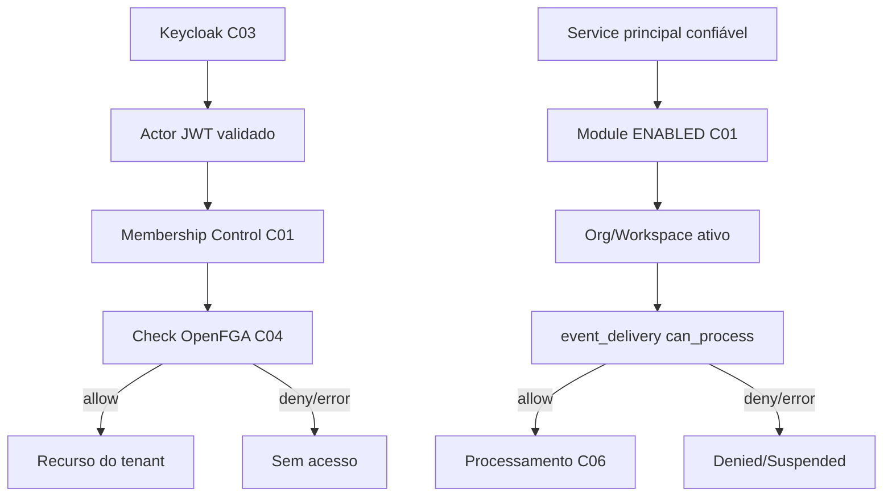

# C04 — Authorization OpenFGA

[← Sumário do volume](../) · [↑ Biblioteca](../../)

> **Leitura técnica, não homologação.** Estados, limites e comprovações devem ser lidos em STATUS e nos checkpoints versionados.

## Identificação e rastreabilidade

| Campo | Fonte verificável |
|---|---|
| Unidade / owner | **C04** · Authorization OpenFGA |
| Volume | Plataforma e core |
| Caminho de implementação | `infra/security-access/fga-model.json` |
| Documento de origem | [README](https://github.com/delmacy/syndes-system/blob/main/docs/subprojects/C04-authorization-openfga/README.md) |
| STATUS e critérios | [STATUS original](https://github.com/delmacy/syndes-system/blob/main/docs/subprojects/C04-authorization-openfga/STATUS.md) |
| Símbolos, APIs, SQL e dependências | [REFERENCIA-TECNICA](https://github.com/delmacy/syndes-system/blob/main/docs/subprojects/C04-authorization-openfga/REFERENCIA-TECNICA.md) |
| Implantação, runbooks e gates | [OPERACAO](https://github.com/delmacy/syndes-system/blob/main/docs/subprojects/C04-authorization-openfga/OPERACAO.md) |

## Situação registrada

> AUDITORIA TÉCNICA PARCIAL — 13/11/2026. Baseline de código: 2e1707c; revisão de arquivos e inspeção de containers somente leitura no DevServer01. Não foram consultadas tuples reais, stores, usuários nem tokens. Nenhuma configuração, grant, migration, serviço ou banco foi alterado. Homologação, staging e produção não verificados. Dimensão Evidência Limite --------- Documentação Modelo OpenFGA, ports e consumidores mapeados com owner e testes Auditoria…

A descrição acima é uma **citação resumida do STATUS versionado**; não significa que os testes de integração, a implantação ou a homologação estejam aprovados.

## Índice dos subcapítulos

Todos os assuntos deste módulo estão nesta página. Clique em um título para saltar à seção correspondente; o índice lateral acompanha a leitura.

- [Casos de uso](#casos-de-uso)
- [Histórias de usuário](#historias-de-usuario)
- [Requisitos](#requisitos)
- [Contratos públicos e privados](#contratos)
- [APIs e endpoints](#apis)
- [Eventos e mensageria](#eventos)
- [Dados e persistência](#dados)
- [Schemas e migrations](#schema)
- [Dependências e integrações](#dependencias)
- [Configuração e ambiente](#configuracao)
- [Frontend e interfaces](#interface)
- [Testes e evidências](#testes)
- [Operação e implantação](#operacao)
- [WBS e evolução](#wbs)
- [Documentação de origem integral](#documentacao-de-origem)
- [Controle de alterações](#controle-de-alteracoes)

## Casos de uso

**Editar esta seção:** [Abrir arquivo-fonte no GitHub](https://github.com/delmacy/syndes-system/edit/main/docs/subprojects/C04-authorization-openfga/chapters/02-requisitos-historias-e-casos-de-uso.md) · [Consultar fonte](https://github.com/delmacy/syndes-system/blob/main/docs/subprojects/C04-authorization-openfga/chapters/02-requisitos-historias-e-casos-de-uso.md)

*Referências extraídas da documentação versionada, sem inferir homologação ou implantação.*

**Fonte:** [02-requisitos-historias-e-casos-de-uso.md](https://github.com/delmacy/syndes-system/blob/main/docs/subprojects/C04-authorization-openfga/chapters/02-requisitos-historias-e-casos-de-uso.md)

> Linha 3: \| ID \| Fluxo previsto/observado no código \| Estado \|

📝 Espaço para ajustes e implementação

Este é um **modelo de registro**, não um editor com salvamento automático. Use o link **Editar esta seção** para atualizar o documento versionado.

- **Alteração proposta:** descreva o requisito, contrato, dado ou comportamento.
- **Referência de código:** informe caminho e símbolo real.
- **Testes e evidências:** informe comando, resultado e limite.
- **Critério de aceite:** indique como validar sem presumir homologação.
- **Status e revisão:** atualize a fonte canônica após revisão.

## Histórias de usuário

**Editar esta seção:** [Abrir arquivo-fonte no GitHub](https://github.com/delmacy/syndes-system/edit/main/docs/subprojects/C04-authorization-openfga/chapters/02-requisitos-historias-e-casos-de-uso.md) · [Consultar fonte](https://github.com/delmacy/syndes-system/blob/main/docs/subprojects/C04-authorization-openfga/chapters/02-requisitos-historias-e-casos-de-uso.md)

*Referências extraídas da documentação versionada, sem inferir homologação ou implantação.*

**Lacuna documental:** ainda não há especificação textual identificada nesta área. Revisar implementação e registrar evidência antes de preencher.

📝 Espaço para ajustes e implementação

Este é um **modelo de registro**, não um editor com salvamento automático. Use o link **Editar esta seção** para atualizar o documento versionado.

- **Alteração proposta:** descreva o requisito, contrato, dado ou comportamento.
- **Referência de código:** informe caminho e símbolo real.
- **Testes e evidências:** informe comando, resultado e limite.
- **Critério de aceite:** indique como validar sem presumir homologação.
- **Status e revisão:** atualize a fonte canônica após revisão.

## Requisitos

**Editar esta seção:** [Abrir arquivo-fonte no GitHub](https://github.com/delmacy/syndes-system/edit/main/docs/subprojects/C04-authorization-openfga/chapters/02-requisitos-historias-e-casos-de-uso.md) · [Consultar fonte](https://github.com/delmacy/syndes-system/blob/main/docs/subprojects/C04-authorization-openfga/chapters/02-requisitos-historias-e-casos-de-uso.md)

*Referências extraídas da documentação versionada, sem inferir homologação ou implantação.*

**Lacuna documental:** ainda não há especificação textual identificada nesta área. Revisar implementação e registrar evidência antes de preencher.

📝 Espaço para ajustes e implementação

Este é um **modelo de registro**, não um editor com salvamento automático. Use o link **Editar esta seção** para atualizar o documento versionado.

- **Alteração proposta:** descreva o requisito, contrato, dado ou comportamento.
- **Referência de código:** informe caminho e símbolo real.
- **Testes e evidências:** informe comando, resultado e limite.
- **Critério de aceite:** indique como validar sem presumir homologação.
- **Status e revisão:** atualize a fonte canônica após revisão.

## Contratos públicos e privados

**Editar esta seção:** [Abrir arquivo-fonte no GitHub](https://github.com/delmacy/syndes-system/edit/main/docs/subprojects/C04-authorization-openfga/REFERENCIA-TECNICA.md) · [Consultar fonte](https://github.com/delmacy/syndes-system/blob/main/docs/subprojects/C04-authorization-openfga/REFERENCIA-TECNICA.md)

*Referências extraídas da documentação versionada, sem inferir homologação ou implantação.*

**Fonte:** [REFERENCIA-TECNICA.md](https://github.com/delmacy/syndes-system/blob/main/docs/subprojects/C04-authorization-openfga/REFERENCIA-TECNICA.md)

> Linha 9: \| Serviço OpenFGA v1.22.1 \| `infra/security-access/compose.yaml` \| `openfga-migrate` executa migration do serviço; `openfga` usa arquivo de configuração privada e redes internas \|

> Linha 15: \| Governança \| `docs/engineering/ADR-EVENTS-OPENFGA-SERVICE-GRANTS-20261111.md`, `WBS-EVENTS-OPENFGA-SERVICE-20261111.md` \| Contratos de implantação/gates, não operação homologada \|

**Fonte:** [04-contratos-e-dependencias-publicas.md](https://github.com/delmacy/syndes-system/blob/main/docs/subprojects/C04-authorization-openfga/chapters/04-contratos-e-dependencias-publicas.md)

> Linha 3: Contrato externo OpenFGA: `POST /stores/{store}/check` com `tuple_key`, retornando `allowed` booleano. **Store/model ID e grants efetivos não verificados.**

> Linha 11: Esses símbolos pertencem aos packages citados, **não** constituem classes/API pública de `infra/security-access/fga-model.json`.

**Fonte:** [STATUS.md](https://github.com/delmacy/syndes-system/blob/main/docs/subprojects/C04-authorization-openfga/STATUS.md)

> Linha 25: 1. **P0 — estado efetivo desconhecido:** `fga-model.json` é contrato versionado; model ID/tuples/store reais do OpenFGA DevServer01 não foram consultados. Não afirmar migração de `event_delivery`.

> Linha 35: \| C04.DOC.01 \| **AUDITORIA PARCIAL** \| Contratos e fontes reconciliados, evidências source-linked \|

**Fonte:** [OPERACAO.md](https://github.com/delmacy/syndes-system/blob/main/docs/subprojects/C04-authorization-openfga/OPERACAO.md)

> Linha 7: 1. Verificar versão/digest OpenFGA, health e config ativa com operador autorizado; registrar metadados seguros, sem divulgar endpoint privado, tokens, IDs de recursos ou tuples.

📝 Espaço para ajustes e implementação

Este é um **modelo de registro**, não um editor com salvamento automático. Use o link **Editar esta seção** para atualizar o documento versionado.

- **Alteração proposta:** descreva o requisito, contrato, dado ou comportamento.
- **Referência de código:** informe caminho e símbolo real.
- **Testes e evidências:** informe comando, resultado e limite.
- **Critério de aceite:** indique como validar sem presumir homologação.
- **Status e revisão:** atualize a fonte canônica após revisão.

## APIs e endpoints

**Editar esta seção:** [Abrir arquivo-fonte no GitHub](https://github.com/delmacy/syndes-system/edit/main/docs/subprojects/C04-authorization-openfga/REFERENCIA-TECNICA.md) · [Consultar fonte](https://github.com/delmacy/syndes-system/blob/main/docs/subprojects/C04-authorization-openfga/REFERENCIA-TECNICA.md)

*Referências extraídas da documentação versionada, sem inferir homologação ou implantação.*

**Fonte:** [REFERENCIA-TECNICA.md](https://github.com/delmacy/syndes-system/blob/main/docs/subprojects/C04-authorization-openfga/REFERENCIA-TECNICA.md)

> Linha 13: \| A06 Account API \| `apps/account-access-api/src/auth.mjs` \| Autorização para delegação de roles sem confiar em grant do browser \|

> Linha 17: `infra/security-access/fga-model.json` não contém classes TypeScript, `package.json` ou endpoints de negócio próprios. O provedor possui endpoint externo OpenFGA, mas as chamadas listadas abaixo são **implementadas em outros owners**.

> Linha 35: \| A04 \| `FgaPermission.canAccess` \| `POST /stores/{store}/check`, usuário `user:{sub}`, `can_read/can_write`, `resource:{sha256(tenant\|resource)}`; falha ou resposta inválida nega por exceção \|

> Linha 65: - Testes: `apps/core-host/test/adapters.test.mjs`, `platform-event-service-grant.test.mjs`, `platform-event-service-grant-fga.test.mjs`, `apps/account-access-api/test/auth.test.mjs`. Incluem negativas e instância in-memory/descartável, não configuração runtime persistente.

**Fonte:** [04-contratos-e-dependencias-publicas.md](https://github.com/delmacy/syndes-system/blob/main/docs/subprojects/C04-authorization-openfga/chapters/04-contratos-e-dependencias-publicas.md)

> Linha 3: Contrato externo OpenFGA: `POST /stores/{store}/check` com `tuple_key`, retornando `allowed` booleano. **Store/model ID e grants efetivos não verificados.**

> Linha 11: Esses símbolos pertencem aos packages citados, **não** constituem classes/API pública de `infra/security-access/fga-model.json`.

**Fonte:** [STATUS.md](https://github.com/delmacy/syndes-system/blob/main/docs/subprojects/C04-authorization-openfga/STATUS.md)

> Linha 18: - **A04 Core Host:** `FgaPermission.canAccess` faz `POST /stores/{store}/check`, exige decisão booleana; `TenantEventWorkerAdmission.authorize` combina ENABLED, escopo tenant/org/workspace e grant de serviço.

> Linha 19: - **A06 Account API:** `createFgaWriteAuthorizer` usa identidade de usuário e recurso hash do tenant; não confundir com permissão de operador global.

**Fonte:** [OPERACAO.md](https://github.com/delmacy/syndes-system/blob/main/docs/subprojects/C04-authorization-openfga/OPERACAO.md)

> Linha 7: 1. Verificar versão/digest OpenFGA, health e config ativa com operador autorizado; registrar metadados seguros, sem divulgar endpoint privado, tokens, IDs de recursos ou tuples.

> Linha 11: 5. Exigir sign-off de C01/C03/C04/A04/A06/C06, testes CI e testes HTTP/PG17/OpenFGA no ambiente-alvo por SHA antes de registrar Product Gate.

📝 Espaço para ajustes e implementação

Este é um **modelo de registro**, não um editor com salvamento automático. Use o link **Editar esta seção** para atualizar o documento versionado.

- **Alteração proposta:** descreva o requisito, contrato, dado ou comportamento.
- **Referência de código:** informe caminho e símbolo real.
- **Testes e evidências:** informe comando, resultado e limite.
- **Critério de aceite:** indique como validar sem presumir homologação.
- **Status e revisão:** atualize a fonte canônica após revisão.

## Eventos e mensageria

**Editar esta seção:** [Abrir arquivo-fonte no GitHub](https://github.com/delmacy/syndes-system/edit/main/docs/subprojects/C04-authorization-openfga/REFERENCIA-TECNICA.md) · [Consultar fonte](https://github.com/delmacy/syndes-system/blob/main/docs/subprojects/C04-authorization-openfga/REFERENCIA-TECNICA.md)

*Referências extraídas da documentação versionada, sem inferir homologação ou implantação.*

**Fonte:** [REFERENCIA-TECNICA.md](https://github.com/delmacy/syndes-system/blob/main/docs/subprojects/C04-authorization-openfga/REFERENCIA-TECNICA.md)

> Linha 11: \| Segredos runtime \| `infra/security-access/openbao/render_runtime.py` e políticas \| Token/base/store não devem ser publicados \|

> Linha 39: \| A04/C06 \| `fgaEventDeliveryObject` \| Gera `event_delivery:{sha256}` por tenant, org, workspace, module, consumer e tipo de evento \|

> Linha 62: - O armazenamento técnico do OpenFGA utiliza PostgreSQL conforme Compose (service `openfga-migrate` e `openfga`). **Não** atribuir suas tabelas às migrations de tenant ou à outbox Control.

> Linha 64: - O OpenFGA check **não emite evento de negócio por si**. O objeto `event_delivery` autoriza entregas de C06; envelopes/outbox pertencem ao Event Platform.

**Fonte:** [OPERACAO.md](https://github.com/delmacy/syndes-system/blob/main/docs/subprojects/C04-authorization-openfga/OPERACAO.md)

> Linha 9: 3. Executar matriz de negativas: token/cliente errado, sem membership, tenant A/B, organização/workspace errado, módulo disabled, service principal falso, consumer/evento diferente, revogação e indisponibilidade do serviço.

📝 Espaço para ajustes e implementação

Este é um **modelo de registro**, não um editor com salvamento automático. Use o link **Editar esta seção** para atualizar o documento versionado.

- **Alteração proposta:** descreva o requisito, contrato, dado ou comportamento.
- **Referência de código:** informe caminho e símbolo real.
- **Testes e evidências:** informe comando, resultado e limite.
- **Critério de aceite:** indique como validar sem presumir homologação.
- **Status e revisão:** atualize a fonte canônica após revisão.

## Dados e persistência

**Editar esta seção:** [Abrir arquivo-fonte no GitHub](https://github.com/delmacy/syndes-system/edit/main/docs/subprojects/C04-authorization-openfga/REFERENCIA-TECNICA.md) · [Consultar fonte](https://github.com/delmacy/syndes-system/blob/main/docs/subprojects/C04-authorization-openfga/REFERENCIA-TECNICA.md)

*Referências extraídas da documentação versionada, sem inferir homologação ou implantação.*

**Fonte:** [REFERENCIA-TECNICA.md](https://github.com/delmacy/syndes-system/blob/main/docs/subprojects/C04-authorization-openfga/REFERENCIA-TECNICA.md)

> Linha 3: > **AUDITORIA ESTÁTICA + CONTAINER UP — 13/11/2026.** Base `2e1707c`. Atribuir ao C04 somente o modelo/provedor, não APIs/classes pertencentes aos consumidores. Nenhuma consulta de stores, grants, modelos ativos, tokens ou dados privados foi realizada.

> Linha 62: - O armazenamento técnico do OpenFGA utiliza PostgreSQL conforme Compose (service `openfga-migrate` e `openfga`). **Não** atribuir suas tabelas às migrations de tenant ou à outbox Control.

**Fonte:** [05-arquitetura-banco-interface-configuracao-e-diagramas.md](https://github.com/delmacy/syndes-system/blob/main/docs/subprojects/C04-authorization-openfga/chapters/05-arquitetura-banco-interface-configuracao-e-diagramas.md)

> Linha 17: **Persistência:** OpenFGA usa PostgreSQL próprio de serviço conforme Compose; `fga-model.json` não é migration SQL Tenant nem Control. `openfga-migrate` pertence à inicialização operacional do provedor.

📝 Espaço para ajustes e implementação

Este é um **modelo de registro**, não um editor com salvamento automático. Use o link **Editar esta seção** para atualizar o documento versionado.

- **Alteração proposta:** descreva o requisito, contrato, dado ou comportamento.
- **Referência de código:** informe caminho e símbolo real.
- **Testes e evidências:** informe comando, resultado e limite.
- **Critério de aceite:** indique como validar sem presumir homologação.
- **Status e revisão:** atualize a fonte canônica após revisão.

## Schemas e migrations

**Editar esta seção:** [Abrir arquivo-fonte no GitHub](https://github.com/delmacy/syndes-system/edit/main/docs/subprojects/C04-authorization-openfga/REFERENCIA-TECNICA.md) · [Consultar fonte](https://github.com/delmacy/syndes-system/blob/main/docs/subprojects/C04-authorization-openfga/REFERENCIA-TECNICA.md)

*Referências extraídas da documentação versionada, sem inferir homologação ou implantação.*

**Fonte:** [REFERENCIA-TECNICA.md](https://github.com/delmacy/syndes-system/blob/main/docs/subprojects/C04-authorization-openfga/REFERENCIA-TECNICA.md)

> Linha 9: \| Serviço OpenFGA v1.22.1 \| `infra/security-access/compose.yaml` \| `openfga-migrate` executa migration do serviço; `openfga` usa arquivo de configuração privada e redes internas \|

> Linha 62: - O armazenamento técnico do OpenFGA utiliza PostgreSQL conforme Compose (service `openfga-migrate` e `openfga`). **Não** atribuir suas tabelas às migrations de tenant ou à outbox Control.

**Fonte:** [05-arquitetura-banco-interface-configuracao-e-diagramas.md](https://github.com/delmacy/syndes-system/blob/main/docs/subprojects/C04-authorization-openfga/chapters/05-arquitetura-banco-interface-configuracao-e-diagramas.md)

> Linha 17: **Persistência:** OpenFGA usa PostgreSQL próprio de serviço conforme Compose; `fga-model.json` não é migration SQL Tenant nem Control. `openfga-migrate` pertence à inicialização operacional do provedor.

**Fonte:** [STATUS.md](https://github.com/delmacy/syndes-system/blob/main/docs/subprojects/C04-authorization-openfga/STATUS.md)

> Linha 3: > **AUDITORIA TÉCNICA PARCIAL — 13/11/2026.** Baseline de código: `2e1707c`; revisão de arquivos e inspeção de containers **somente leitura** no DevServer01. **Não foram consultadas tuples reais, stores, usuários nem tokens.** Nenhuma configuração, grant, migration, serviço ou banco foi alterado. Homologação, staging e produção **não verificados**.

> Linha 38: \| C04.OPS.01 \| PENDENTE \| Health, modelo versionado, autorização de migrations/tuples, backup/restore e rollback \|

📝 Espaço para ajustes e implementação

Este é um **modelo de registro**, não um editor com salvamento automático. Use o link **Editar esta seção** para atualizar o documento versionado.

- **Alteração proposta:** descreva o requisito, contrato, dado ou comportamento.
- **Referência de código:** informe caminho e símbolo real.
- **Testes e evidências:** informe comando, resultado e limite.
- **Critério de aceite:** indique como validar sem presumir homologação.
- **Status e revisão:** atualize a fonte canônica após revisão.

## Dependências e integrações

**Editar esta seção:** [Abrir arquivo-fonte no GitHub](https://github.com/delmacy/syndes-system/edit/main/docs/subprojects/C04-authorization-openfga/REFERENCIA-TECNICA.md) · [Consultar fonte](https://github.com/delmacy/syndes-system/blob/main/docs/subprojects/C04-authorization-openfga/REFERENCIA-TECNICA.md)

*Referências extraídas da documentação versionada, sem inferir homologação ou implantação.*

**Fonte:** [REFERENCIA-TECNICA.md](https://github.com/delmacy/syndes-system/blob/main/docs/subprojects/C04-authorization-openfga/REFERENCIA-TECNICA.md)

> Linha 9: \| Serviço OpenFGA v1.22.1 \| `infra/security-access/compose.yaml` \| `openfga-migrate` executa migration do serviço; `openfga` usa arquivo de configuração privada e redes internas \|

> Linha 11: \| Segredos runtime \| `infra/security-access/openbao/render_runtime.py` e políticas \| Token/base/store não devem ser publicados \|

> Linha 15: \| Governança \| `docs/engineering/ADR-EVENTS-OPENFGA-SERVICE-GRANTS-20261111.md`, `WBS-EVENTS-OPENFGA-SERVICE-20261111.md` \| Contratos de implantação/gates, não operação homologada \|

> Linha 17: `infra/security-access/fga-model.json` não contém classes TypeScript, `package.json` ou endpoints de negócio próprios. O provedor possui endpoint externo OpenFGA, mas as chamadas listadas abaixo são **implementadas em outros owners**.

> Linha 62: - O armazenamento técnico do OpenFGA utiliza PostgreSQL conforme Compose (service `openfga-migrate` e `openfga`). **Não** atribuir suas tabelas às migrations de tenant ou à outbox Control.

> Linha 64: - O OpenFGA check **não emite evento de negócio por si**. O objeto `event_delivery` autoriza entregas de C06; envelopes/outbox pertencem ao Event Platform.

> Linha 67: **Sem prova operacional nesta auditoria:** `fga-model.json` ativo no store, tuples de usuários/serviços, Store ID efetivo, cobertura das rotas, replay, integração com contas ou tenants reais.

**Fonte:** [04-contratos-e-dependencias-publicas.md](https://github.com/delmacy/syndes-system/blob/main/docs/subprojects/C04-authorization-openfga/chapters/04-contratos-e-dependencias-publicas.md)

> Linha 3: Contrato externo OpenFGA: `POST /stores/{store}/check` com `tuple_key`, retornando `allowed` booleano. **Store/model ID e grants efetivos não verificados.**

**Fonte:** [05-arquitetura-banco-interface-configuracao-e-diagramas.md](https://github.com/delmacy/syndes-system/blob/main/docs/subprojects/C04-authorization-openfga/chapters/05-arquitetura-banco-interface-configuracao-e-diagramas.md)

> Linha 17: **Persistência:** OpenFGA usa PostgreSQL próprio de serviço conforme Compose; `fga-model.json` não é migration SQL Tenant nem Control. `openfga-migrate` pertence à inicialização operacional do provedor.

**Fonte:** [STATUS.md](https://github.com/delmacy/syndes-system/blob/main/docs/subprojects/C04-authorization-openfga/STATUS.md)

> Linha 9: \| Documentação \| Modelo OpenFGA, ports e consumidores mapeados com owner e testes \| Auditoria parcial; revisão formal pendente \|

> Linha 11: \| Integração sintética \| Testes de adapters, escopo e suíte in-memory OpenFGA versionada \| Não equivale a acesso real do tenant/operador \|

> Linha 12: \| Operação DevServer01 \| Container `syndes-security-access-openfga-1` observado **Up** em 13/11 \| Não foi consultado model ID vigente, health autenticado ou decision log \|

> Linha 25: 1. **P0 — estado efetivo desconhecido:** `fga-model.json` é contrato versionado; model ID/tuples/store reais do OpenFGA DevServer01 não foram consultados. Não afirmar migração de `event_delivery`.

> Linha 41: **Próxima auditoria documental:** C05 — Secrets OpenBao. A existência de um arquivo/modelo nunca confirma permissões efetivas.

**Fonte:** [OPERACAO.md](https://github.com/delmacy/syndes-system/blob/main/docs/subprojects/C04-authorization-openfga/OPERACAO.md)

> Linha 3: > **NÃO É RUNBOOK HOMOLOGADO.** O container OpenFGA foi observado Up no DevServer01 (13/11/2026); o modelo, stores, tuples, versões e resultados reais **não foram consultados**. Sem operação de escrita, autenticação administrativa ou deploy.

> Linha 7: 1. Verificar versão/digest OpenFGA, health e config ativa com operador autorizado; registrar metadados seguros, sem divulgar endpoint privado, tokens, IDs de recursos ou tuples.

> Linha 11: 5. Exigir sign-off de C01/C03/C04/A04/A06/C06, testes CI e testes HTTP/PG17/OpenFGA no ambiente-alvo por SHA antes de registrar Product Gate.

> Linha 15: - Não executar `openfga-migrate`, DDL, comandos de tuple write, mudanças de modelo, policy, OpenBao ou grants reais.

📝 Espaço para ajustes e implementação

Este é um **modelo de registro**, não um editor com salvamento automático. Use o link **Editar esta seção** para atualizar o documento versionado.

- **Alteração proposta:** descreva o requisito, contrato, dado ou comportamento.
- **Referência de código:** informe caminho e símbolo real.
- **Testes e evidências:** informe comando, resultado e limite.
- **Critério de aceite:** indique como validar sem presumir homologação.
- **Status e revisão:** atualize a fonte canônica após revisão.

## Configuração e ambiente

**Editar esta seção:** [Abrir arquivo-fonte no GitHub](https://github.com/delmacy/syndes-system/edit/main/docs/subprojects/C04-authorization-openfga/OPERACAO.md) · [Consultar fonte](https://github.com/delmacy/syndes-system/blob/main/docs/subprojects/C04-authorization-openfga/OPERACAO.md)

*Referências extraídas da documentação versionada, sem inferir homologação ou implantação.*

**Fonte:** [REFERENCIA-TECNICA.md](https://github.com/delmacy/syndes-system/blob/main/docs/subprojects/C04-authorization-openfga/REFERENCIA-TECNICA.md)

> Linha 9: \| Serviço OpenFGA v1.22.1 \| `infra/security-access/compose.yaml` \| `openfga-migrate` executa migration do serviço; `openfga` usa arquivo de configuração privada e redes internas \|

> Linha 62: - O armazenamento técnico do OpenFGA utiliza PostgreSQL conforme Compose (service `openfga-migrate` e `openfga`). **Não** atribuir suas tabelas às migrations de tenant ou à outbox Control.

> Linha 65: - Testes: `apps/core-host/test/adapters.test.mjs`, `platform-event-service-grant.test.mjs`, `platform-event-service-grant-fga.test.mjs`, `apps/account-access-api/test/auth.test.mjs`. Incluem negativas e instância in-memory/descartável, não configuração runtime persistente.

**Fonte:** [05-arquitetura-banco-interface-configuracao-e-diagramas.md](https://github.com/delmacy/syndes-system/blob/main/docs/subprojects/C04-authorization-openfga/chapters/05-arquitetura-banco-interface-configuracao-e-diagramas.md)

> Linha 17: **Persistência:** OpenFGA usa PostgreSQL próprio de serviço conforme Compose; `fga-model.json` não é migration SQL Tenant nem Control. `openfga-migrate` pertence à inicialização operacional do provedor.

> Linha 19: **Configuração e redes:** arquivo runtime privado montado pelo Compose, sem publicar valores de store, tokens, URLs, endereços internos ou tuples. Container Up não significa modelo instalado. **Frontend:** não existe tela C04; enforcement pertence aos backends.

**Fonte:** [STATUS.md](https://github.com/delmacy/syndes-system/blob/main/docs/subprojects/C04-authorization-openfga/STATUS.md)

> Linha 3: > **AUDITORIA TÉCNICA PARCIAL — 13/11/2026.** Baseline de código: `2e1707c`; revisão de arquivos e inspeção de containers **somente leitura** no DevServer01. **Não foram consultadas tuples reais, stores, usuários nem tokens.** Nenhuma configuração, grant, migration, serviço ou banco foi alterado. Homologação, staging e produção **não verificados**.

📝 Espaço para ajustes e implementação

Este é um **modelo de registro**, não um editor com salvamento automático. Use o link **Editar esta seção** para atualizar o documento versionado.

- **Alteração proposta:** descreva o requisito, contrato, dado ou comportamento.
- **Referência de código:** informe caminho e símbolo real.
- **Testes e evidências:** informe comando, resultado e limite.
- **Critério de aceite:** indique como validar sem presumir homologação.
- **Status e revisão:** atualize a fonte canônica após revisão.

## Frontend e interfaces

**Editar esta seção:** [Abrir arquivo-fonte no GitHub](https://github.com/delmacy/syndes-system/edit/main/docs/subprojects/C04-authorization-openfga/REFERENCIA-TECNICA.md) · [Consultar fonte](https://github.com/delmacy/syndes-system/blob/main/docs/subprojects/C04-authorization-openfga/REFERENCIA-TECNICA.md)

*Referências extraídas da documentação versionada, sem inferir homologação ou implantação.*

**Fonte:** [03-capabilities.md](https://github.com/delmacy/syndes-system/blob/main/docs/subprojects/C04-authorization-openfga/chapters/03-capabilities.md)

> Linha 12: O C04 não possui frontend próprio, nem recebe permissão a partir de tela/claim não confirmado.

**Fonte:** [05-arquitetura-banco-interface-configuracao-e-diagramas.md](https://github.com/delmacy/syndes-system/blob/main/docs/subprojects/C04-authorization-openfga/chapters/05-arquitetura-banco-interface-configuracao-e-diagramas.md)

> Linha 19: **Configuração e redes:** arquivo runtime privado montado pelo Compose, sem publicar valores de store, tokens, URLs, endereços internos ou tuples. Container Up não significa modelo instalado. **Frontend:** não existe tela C04; enforcement pertence aos backends.

📝 Espaço para ajustes e implementação

Este é um **modelo de registro**, não um editor com salvamento automático. Use o link **Editar esta seção** para atualizar o documento versionado.

- **Alteração proposta:** descreva o requisito, contrato, dado ou comportamento.
- **Referência de código:** informe caminho e símbolo real.
- **Testes e evidências:** informe comando, resultado e limite.
- **Critério de aceite:** indique como validar sem presumir homologação.
- **Status e revisão:** atualize a fonte canônica após revisão.

## Testes e evidências

**Editar esta seção:** [Abrir arquivo-fonte no GitHub](https://github.com/delmacy/syndes-system/edit/main/docs/subprojects/C04-authorization-openfga/STATUS.md) · [Consultar fonte](https://github.com/delmacy/syndes-system/blob/main/docs/subprojects/C04-authorization-openfga/STATUS.md)

*Referências extraídas da documentação versionada, sem inferir homologação ou implantação.*

**Fonte:** [STATUS.md](https://github.com/delmacy/syndes-system/blob/main/docs/subprojects/C04-authorization-openfga/STATUS.md)

> Linha 7: \| Dimensão \| Evidência \| Limite \|

> Linha 9: \| Documentação \| Modelo OpenFGA, ports e consumidores mapeados com owner e testes \| Auditoria parcial; revisão formal pendente \|

> Linha 11: \| Integração sintética \| Testes de adapters, escopo e suíte in-memory OpenFGA versionada \| Não equivale a acesso real do tenant/operador \|

> Linha 21: - **C01/Organizations:** tenant membership, estado da organização e módulos ENABLED são gates distintos de decisão FGA.

> Linha 26: 2. **P0 — isolamento de tenant não homologado:** testar matrizes de user/service, tenant A/B, org/workspace e negações em ambiente autorizado; testes descartáveis não provam produção.

> Linha 27: 3. **P1 — aplicação dos grants service:** WBS/ADR descrevem candidato tipado, mas o worker continua com gates; não ativar dispatcher, escrever tuples ou aplicar modelo por inferência.

> Linha 35: \| C04.DOC.01 \| **AUDITORIA PARCIAL** \| Contratos e fontes reconciliados, evidências source-linked \|

> Linha 37: \| C04.SEC.02 \| PENDENTE \| Testes adversariais A/B, user/service, grants, revogações e fail-closed no ambiente-alvo \|

> Linha 39: \| C04.GATE \| BLOQUEADO \| Aceite integrado com C01/C03/A04/A06/C06 e owners \|

**Fonte:** [06-wbs-marcos-e-aceite.md](https://github.com/delmacy/syndes-system/blob/main/docs/subprojects/C04-authorization-openfga/chapters/06-wbs-marcos-e-aceite.md)

> Linha 3: \| Marco \| Evidência/aceite \| Estado \|

> Linha 5: \| C04.DOC.01 \| Modelo, wrappers, testes, fronteiras e witness registry \| **Auditoria parcial** \|

> Linha 9: \| C04.GATE \| Owner/security sign-off com modelos/tuples revisados e CI por SHA \| Bloqueado \|

> Linha 11: WBS relacionada: `docs/engineering/WBS-EVENTS-OPENFGA-SERVICE-20261111.md`. Testes in-memory não promovem serviço a DONE nem autorizam ativação do worker.

**Fonte:** [REFERENCIA-TECNICA.md](https://github.com/delmacy/syndes-system/blob/main/docs/subprojects/C04-authorization-openfga/REFERENCIA-TECNICA.md)

> Linha 15: \| Governança \| `docs/engineering/ADR-EVENTS-OPENFGA-SERVICE-GRANTS-20261111.md`, `WBS-EVENTS-OPENFGA-SERVICE-20261111.md` \| Contratos de implantação/gates, não operação homologada \|

> Linha 65: - Testes: `apps/core-host/test/adapters.test.mjs`, `platform-event-service-grant.test.mjs`, `platform-event-service-grant-fga.test.mjs`, `apps/account-access-api/test/auth.test.mjs`. Incluem negativas e instância in-memory/descartável, não configuração runtime persistente.

**Fonte:** [OPERACAO.md](https://github.com/delmacy/syndes-system/blob/main/docs/subprojects/C04-authorization-openfga/OPERACAO.md)

> Linha 11: 5. Exigir sign-off de C01/C03/C04/A04/A06/C06, testes CI e testes HTTP/PG17/OpenFGA no ambiente-alvo por SHA antes de registrar Product Gate.

> Linha 17: - Não concluir implantação/segurança pela imagem Docker em execução ou pelos testes sintéticos.

> Linha 23: Modelo: `infra/security-access/fga-model.json`. Testes: `apps/core-host/test/adapters.test.mjs`, `platform-event-service-grant.test.mjs`, `platform-event-service-grant-fga.test.mjs`.

📝 Espaço para ajustes e implementação

Este é um **modelo de registro**, não um editor com salvamento automático. Use o link **Editar esta seção** para atualizar o documento versionado.

- **Alteração proposta:** descreva o requisito, contrato, dado ou comportamento.
- **Referência de código:** informe caminho e símbolo real.
- **Testes e evidências:** informe comando, resultado e limite.
- **Critério de aceite:** indique como validar sem presumir homologação.
- **Status e revisão:** atualize a fonte canônica após revisão.

## Operação e implantação

**Editar esta seção:** [Abrir arquivo-fonte no GitHub](https://github.com/delmacy/syndes-system/edit/main/docs/subprojects/C04-authorization-openfga/OPERACAO.md) · [Consultar fonte](https://github.com/delmacy/syndes-system/blob/main/docs/subprojects/C04-authorization-openfga/OPERACAO.md)

*Referências extraídas da documentação versionada, sem inferir homologação ou implantação.*

**Fonte:** [OPERACAO.md](https://github.com/delmacy/syndes-system/blob/main/docs/subprojects/C04-authorization-openfga/OPERACAO.md)

> Linha 3: > **NÃO É RUNBOOK HOMOLOGADO.** O container OpenFGA foi observado Up no DevServer01 (13/11/2026); o modelo, stores, tuples, versões e resultados reais **não foram consultados**. Sem operação de escrita, autenticação administrativa ou deploy.

> Linha 10: 4. Validar fail-closed e suspensão recuperável de workers, métricas higienizadas, rollback de versão/tuples, backup/restore e processo de recuperação.

> Linha 17: - Não concluir implantação/segurança pela imagem Docker em execução ou pelos testes sintéticos.

**Fonte:** [REFERENCIA-TECNICA.md](https://github.com/delmacy/syndes-system/blob/main/docs/subprojects/C04-authorization-openfga/REFERENCIA-TECNICA.md)

> Linha 15: \| Governança \| `docs/engineering/ADR-EVENTS-OPENFGA-SERVICE-GRANTS-20261111.md`, `WBS-EVENTS-OPENFGA-SERVICE-20261111.md` \| Contratos de implantação/gates, não operação homologada \|

**Fonte:** [06-wbs-marcos-e-aceite.md](https://github.com/delmacy/syndes-system/blob/main/docs/subprojects/C04-authorization-openfga/chapters/06-wbs-marcos-e-aceite.md)

> Linha 8: \| C04.OPS.01 \| Health, observabilidade sem PII, backup/restore e rollback \| Pendente \|

**Fonte:** [STATUS.md](https://github.com/delmacy/syndes-system/blob/main/docs/subprojects/C04-authorization-openfga/STATUS.md)

> Linha 10: \| Código \| Modelo JSON `schema_version=1.1`, adapters FGA de usuário e serviço, verificações fail-closed \| Não implica tuples, stores ou permissões implantadas \|

> Linha 12: \| Operação DevServer01 \| Container `syndes-security-access-openfga-1` observado **Up** em 13/11 \| Não foi consultado model ID vigente, health autenticado ou decision log \|

> Linha 29: 5. **P1 — disponibilidade e recuperação:** registrar health, métricas, versionamento do modelo, rollback, backup, rotação do token e tratamento de indisponibilidade.

> Linha 38: \| C04.OPS.01 \| PENDENTE \| Health, modelo versionado, autorização de migrations/tuples, backup/restore e rollback \|

📝 Espaço para ajustes e implementação

Este é um **modelo de registro**, não um editor com salvamento automático. Use o link **Editar esta seção** para atualizar o documento versionado.

- **Alteração proposta:** descreva o requisito, contrato, dado ou comportamento.
- **Referência de código:** informe caminho e símbolo real.
- **Testes e evidências:** informe comando, resultado e limite.
- **Critério de aceite:** indique como validar sem presumir homologação.
- **Status e revisão:** atualize a fonte canônica após revisão.

## WBS e evolução

**Editar esta seção:** [Abrir arquivo-fonte no GitHub](https://github.com/delmacy/syndes-system/edit/main/docs/subprojects/C04-authorization-openfga/STATUS.md) · [Consultar fonte](https://github.com/delmacy/syndes-system/blob/main/docs/subprojects/C04-authorization-openfga/STATUS.md)

*Referências extraídas da documentação versionada, sem inferir homologação ou implantação.*

**Fonte:** [STATUS.md](https://github.com/delmacy/syndes-system/blob/main/docs/subprojects/C04-authorization-openfga/STATUS.md)

> Linha 9: \| Documentação \| Modelo OpenFGA, ports e consumidores mapeados com owner e testes \| Auditoria parcial; revisão formal pendente \|

> Linha 27: 3. **P1 — aplicação dos grants service:** WBS/ADR descrevem candidato tipado, mas o worker continua com gates; não ativar dispatcher, escrever tuples ou aplicar modelo por inferência.

> Linha 36: \| C04.SEC.01 \| PENDENTE \| Snapshot autenticado *read-only* de modelo, stores e política efetiva, sem tuples/PII em docs \|

> Linha 37: \| C04.SEC.02 \| PENDENTE \| Testes adversariais A/B, user/service, grants, revogações e fail-closed no ambiente-alvo \|

> Linha 38: \| C04.OPS.01 \| PENDENTE \| Health, modelo versionado, autorização de migrations/tuples, backup/restore e rollback \|

**Fonte:** [06-wbs-marcos-e-aceite.md](https://github.com/delmacy/syndes-system/blob/main/docs/subprojects/C04-authorization-openfga/chapters/06-wbs-marcos-e-aceite.md)

> Linha 3: \| Marco \| Evidência/aceite \| Estado \|

> Linha 6: \| C04.SEC.01 \| Provar modelo/store e tuples de homologação em leitura segura \| Pendente \|

> Linha 7: \| C04.SEC.02 \| Provar denies A/B, user/service, client, scope, revogação \| Pendente \|

> Linha 8: \| C04.OPS.01 \| Health, observabilidade sem PII, backup/restore e rollback \| Pendente \|

> Linha 11: WBS relacionada: `docs/engineering/WBS-EVENTS-OPENFGA-SERVICE-20261111.md`. Testes in-memory não promovem serviço a DONE nem autorizam ativação do worker.

**Fonte:** [REFERENCIA-TECNICA.md](https://github.com/delmacy/syndes-system/blob/main/docs/subprojects/C04-authorization-openfga/REFERENCIA-TECNICA.md)

> Linha 15: \| Governança \| `docs/engineering/ADR-EVENTS-OPENFGA-SERVICE-GRANTS-20261111.md`, `WBS-EVENTS-OPENFGA-SERVICE-20261111.md` \| Contratos de implantação/gates, não operação homologada \|

📝 Espaço para ajustes e implementação

Este é um **modelo de registro**, não um editor com salvamento automático. Use o link **Editar esta seção** para atualizar o documento versionado.

- **Alteração proposta:** descreva o requisito, contrato, dado ou comportamento.
- **Referência de código:** informe caminho e símbolo real.
- **Testes e evidências:** informe comando, resultado e limite.
- **Critério de aceite:** indique como validar sem presumir homologação.
- **Status e revisão:** atualize a fonte canônica após revisão.

## Documentação de origem integral

Os oito assuntos canônicos são reproduzidos abaixo para permitir leitura contínua. As fontes versionadas permanecem editáveis e preservadas.

### 00 · Fontes e endereços

[Editar conteúdo original](https://github.com/delmacy/syndes-system/edit/main/docs/subprojects/C04-authorization-openfga/chapters/00-enderecos-exatos-de-leitura.md) · [Abrir fonte](https://github.com/delmacy/syndes-system/blob/main/docs/subprojects/C04-authorization-openfga/chapters/00-enderecos-exatos-de-leitura.md)

##### 0. Endereços exatos de leitura

- Catálogo: `catalog/work-units.json`, C04 em `infra/security-access/fga-model.json`.
- Modelo: `infra/security-access/fga-model.json` (schema 1.1).
- Provider e migrations do serviço: `infra/security-access/compose.yaml`.
- Owner A04: `apps/core-host/src/adapters.ts`, `main.ts`, `platform-event-service-grant.ts`, `platform-event-worker-admission.ts`.
- Owner A06: `apps/account-access-api/src/auth.mjs`.
- Testes: `apps/core-host/test/adapters.test.mjs`, `platform-event-service-grant.test.mjs`, `platform-event-service-grant-fga.test.mjs`; `apps/account-access-api/test/auth.test.mjs`.
- ADR/WBS: `docs/engineering/ADR-EVENTS-OPENFGA-SERVICE-GRANTS-20261111.md`, `WBS-EVENTS-OPENFGA-SERVICE-20261111.md`.
- STATUS: `docs/subprojects/C04-authorization-openfga/STATUS.md`.

### 01 · Missão e fronteiras

[Editar conteúdo original](https://github.com/delmacy/syndes-system/edit/main/docs/subprojects/C04-authorization-openfga/chapters/01-missao-objetivos-e-fronteiras.md) · [Abrir fonte](https://github.com/delmacy/syndes-system/blob/main/docs/subprojects/C04-authorization-openfga/chapters/01-missao-objetivos-e-fronteiras.md)

##### 1. Missão, objetivos e fronteiras

C04 fornece a **decisão relacional de autorização** por OpenFGA. A autenticação JWT é de C03/consumidores, membership e catálogo de módulos são C01, o escopo Organization/Workspace é P04 e a entrega de eventos pertence a C06. C04 não é fonte canônica de pessoas CRM, mensagens ou banco tenant.

Tipos documentados: `user`, `tenant`, `resource`, `service`, `event_delivery`. Permissões de usuário (`can_read/can_write`) não autorizam serviço (`can_process`). Configurações reais/tuples não inspecionadas.

### 02 · Requisitos e casos de uso

[Editar conteúdo original](https://github.com/delmacy/syndes-system/edit/main/docs/subprojects/C04-authorization-openfga/chapters/02-requisitos-historias-e-casos-de-uso.md) · [Abrir fonte](https://github.com/delmacy/syndes-system/blob/main/docs/subprojects/C04-authorization-openfga/chapters/02-requisitos-historias-e-casos-de-uso.md)

##### 2. Requisitos, histórias e casos de uso

| ID | Fluxo previsto/observado no código | Estado |
|---|---|---|
| C04-RF01 | Backend checa resource-scoped `can_read/can_write` após autenticação e membership | Código em A04, integração real a validar |
| C04-RF02 | Account API chama `can_write` para delegação de roles | Código A06, grants reais não validados |
| C04-RF03 | Event worker exige `service:...`, `event_delivery:...` e `can_process` | Adapter candidato, worker operacional não homologado |
| C04-RF04 | Negativas ou erro de infraestrutura não liberam permissão por fallback | Testes locais/descartáveis, runtime não homologado |

**Casos de aceite pendentes:** usuário sem grant, tenant cruzado, org/workspace divergentes, service falsificado, permissão revogada e indisponibilidade. Esses itens são critérios de auditoria, não features aprovadas adicionais.

### 03 · Capacidades

[Editar conteúdo original](https://github.com/delmacy/syndes-system/edit/main/docs/subprojects/C04-authorization-openfga/chapters/03-capabilities.md) · [Abrir fonte](https://github.com/delmacy/syndes-system/blob/main/docs/subprojects/C04-authorization-openfga/chapters/03-capabilities.md)

##### 3. Capabilities

| Capacidade | Fonte | Evidência |
|---|---|---|
| Modelo relacional 1.1 de usuário, recurso, tenant | `fga-model.json` | Versão no Git; modelo ativo não verificado |
| Relação de processamento exclusiva de serviço | `event_delivery.processor/can_process` | Contrato versionado; tuples reais não verificadas |
| Check usuário `can_read/can_write` | `FgaPermission.canAccess` | Adapter A04 e teste |
| Check Account roles | `createFgaWriteAuthorizer` | Adapter A06 e teste |
| Grant de worker por evento/consumer/scope | `OpenFgaServiceEventGrant.canProcess` | Adapter e teste in-memory |
| Operational health, rotação, backup, rollback | Infra/Runbook | **Pendente de homologação** |

O C04 não possui frontend próprio, nem recebe permissão a partir de tela/claim não confirmado.

### 04 · Contratos e dependências

[Editar conteúdo original](https://github.com/delmacy/syndes-system/edit/main/docs/subprojects/C04-authorization-openfga/chapters/04-contratos-e-dependencias-publicas.md) · [Abrir fonte](https://github.com/delmacy/syndes-system/blob/main/docs/subprojects/C04-authorization-openfga/chapters/04-contratos-e-dependencias-publicas.md)

##### 4. Contratos e dependências públicas

Contrato externo OpenFGA: `POST /stores/{store}/check` com `tuple_key`, retornando `allowed` booleano. **Store/model ID e grants efetivos não verificados.**

- C04 modelo: `resource`/ `tenant` / `user` para `can_read` e `can_write`; `event_delivery` / `service` para `can_process`.
- A04 `FgaPermission.canAccess`: objeto `resource:{hash(tenant|resource)}`, principal `user:`, `can_read/can_write`.
- A06 `createFgaWriteAuthorizer`: conta com grant de escrita; não implanta tuples.
- A04/C06 `fgaEventDeliveryObject`, `OpenFgaServiceEventGrant.canProcess`: check `service:` e `event_delivery:`.
- C01 `tenant_memberships` e enabled-module gate são externos a C04; proteção não pode depender só de resposta FGA.

Esses símbolos pertencem aos packages citados, **não** constituem classes/API pública de `infra/security-access/fga-model.json`.

### 05 · Arquitetura, dados e interfaces

[Editar conteúdo original](https://github.com/delmacy/syndes-system/edit/main/docs/subprojects/C04-authorization-openfga/chapters/05-arquitetura-banco-interface-configuracao-e-diagramas.md) · [Abrir fonte](https://github.com/delmacy/syndes-system/blob/main/docs/subprojects/C04-authorization-openfga/chapters/05-arquitetura-banco-interface-configuracao-e-diagramas.md)

##### 5. Arquitetura, banco, interface, configuração e diagramas

**Persistência:** OpenFGA usa PostgreSQL próprio de serviço conforme Compose; `fga-model.json` não é migration SQL Tenant nem Control. `openfga-migrate` pertence à inicialização operacional do provedor.

**Configuração e redes:** arquivo runtime privado montado pelo Compose, sem publicar valores de store, tokens, URLs, endereços internos ou tuples. Container Up não significa modelo instalado. **Frontend:** não existe tela C04; enforcement pertence aos backends.

### 06 · WBS e critérios de aceite

[Editar conteúdo original](https://github.com/delmacy/syndes-system/edit/main/docs/subprojects/C04-authorization-openfga/chapters/06-wbs-marcos-e-aceite.md) · [Abrir fonte](https://github.com/delmacy/syndes-system/blob/main/docs/subprojects/C04-authorization-openfga/chapters/06-wbs-marcos-e-aceite.md)

##### 6. WBS, marcos e aceite

| Marco | Evidência/aceite | Estado |
|---|---|---|
| C04.DOC.01 | Modelo, wrappers, testes, fronteiras e witness registry | **Auditoria parcial** |
| C04.SEC.01 | Provar modelo/store e tuples de homologação em leitura segura | Pendente |
| C04.SEC.02 | Provar denies A/B, user/service, client, scope, revogação | Pendente |
| C04.OPS.01 | Health, observabilidade sem PII, backup/restore e rollback | Pendente |
| C04.GATE | Owner/security sign-off com modelos/tuples revisados e CI por SHA | Bloqueado |

WBS relacionada: `docs/engineering/WBS-EVENTS-OPENFGA-SERVICE-20261111.md`. Testes in-memory não promovem serviço a DONE nem autorizam ativação do worker.

### 07 · Controle de escopo

[Editar conteúdo original](https://github.com/delmacy/syndes-system/edit/main/docs/subprojects/C04-authorization-openfga/chapters/07-controle-do-escopo.md) · [Abrir fonte](https://github.com/delmacy/syndes-system/blob/main/docs/subprojects/C04-authorization-openfga/chapters/07-controle-do-escopo.md)

##### 7. Controle do escopo

- Baseline `2e1707c`, auditoria somente leitura de 13/11/2026.
- Contrato versionado: tipos/relações JSON e adapters dos owners A04/A06/C06; instalação real não verificada.
- Não autorizado: criar tuples/grants, alterar modelo, OpenBao, bancos, infra, Frontend, CI ou iniciar worker.
- C04 não substitui `C01` memberships/entitlements nem `C03` identidade; `user` e `service` não são intercambiáveis.
- Evolução com teste negativo, revisão owner e evidência separada de sintético vs. homologado.

## Controle de alterações

**Este site é somente leitura.** Para alterar qualquer seção, edite o documento canônico no GitHub; a próxima publicação atualizará este livro automaticamente.

| Registro | Onde editar |
|---|---|
| Especificação e referências | [Referência técnica](https://github.com/delmacy/syndes-system/edit/main/docs/subprojects/C04-authorization-openfga/REFERENCIA-TECNICA.md) |
| Estado real e bloqueios | [STATUS](https://github.com/delmacy/syndes-system/edit/main/docs/subprojects/C04-authorization-openfga/STATUS.md) |
| Procedimentos e implantação | [Operação](https://github.com/delmacy/syndes-system/edit/main/docs/subprojects/C04-authorization-openfga/OPERACAO.md) |
| Capítulos canônicos | [Página do módulo](https://github.com/delmacy/syndes-system/blob/main/docs/subprojects/C04-authorization-openfga/README.md) |

**Registro recomendado:** data e responsável; alteração; contrato ou interface afetada; testes; impacto em dependências; evidência; revisão/aceite.

---
*Leitura experimental Starlight; a documentação canônica permanece em `docs/subprojects/`. Não inferir entrega funcional a partir de documentação presente.*
