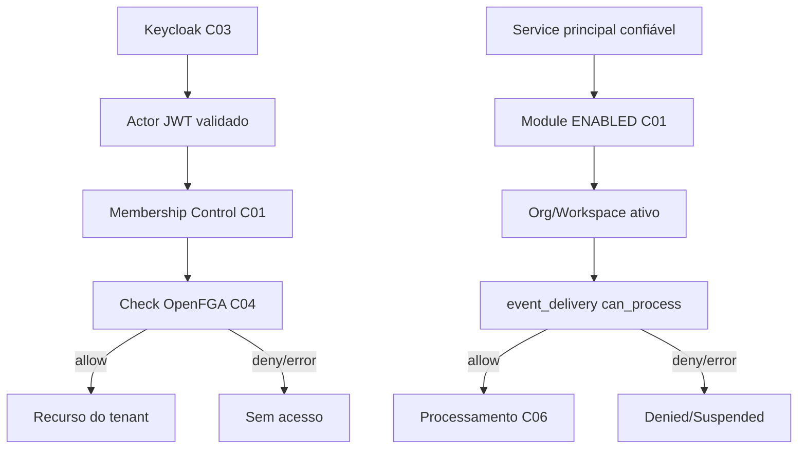

[← Ficha do capítulo](../) · [Volume](../../) · [Fonte original](https://github.com/delmacy/syndes-system/blob/main/docs/subprojects/C04-authorization-openfga/chapters/05-arquitetura-banco-interface-configuracao-e-diagramas.md)

> Conteúdo espelhado da documentação versionada; não expressa automaticamente estado funcional.

## 5. Arquitetura, banco, interface, configuração e diagramas

**Persistência:** OpenFGA usa PostgreSQL próprio de serviço conforme Compose; `fga-model.json` não é migration SQL Tenant nem Control. `openfga-migrate` pertence à inicialização operacional do provedor.

**Configuração e redes:** arquivo runtime privado montado pelo Compose, sem publicar valores de store, tokens, URLs, endereços internos ou tuples. Container Up não significa modelo instalado. **Frontend:** não existe tela C04; enforcement pertence aos backends.

---
**Rastreabilidade:** [revisar documento fonte](https://github.com/delmacy/syndes-system/blob/main/docs/subprojects/C04-authorization-openfga/chapters/05-arquitetura-banco-interface-configuracao-e-diagramas.md).
