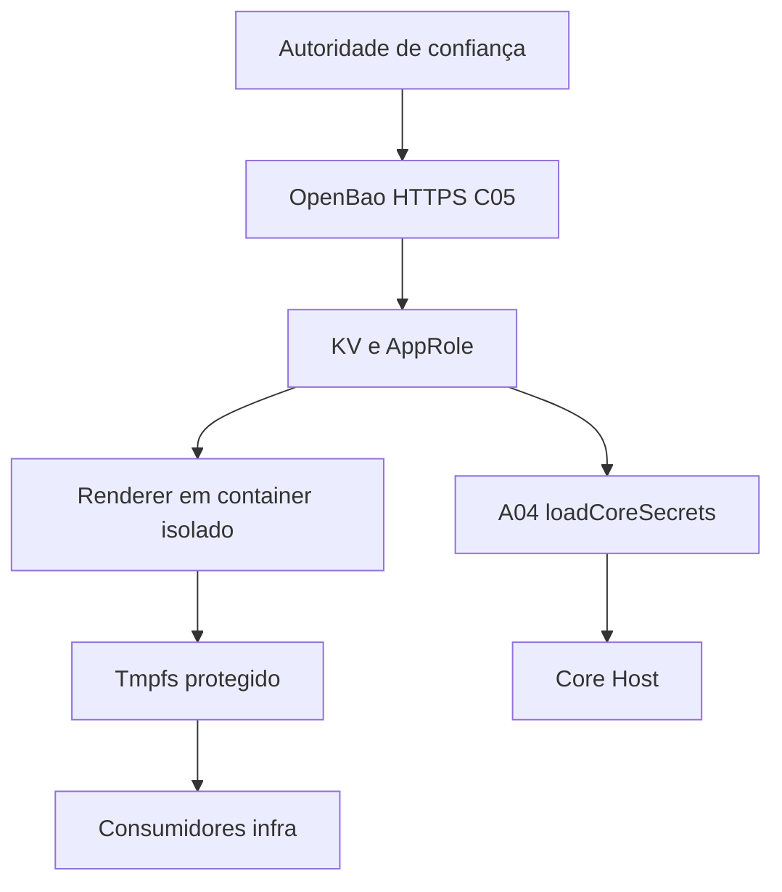

# C05 — Secrets OpenBao

[← Sumário do volume](../) · [↑ Biblioteca](../../)

> **Leitura técnica, não homologação.** Estados, limites e comprovações devem ser lidos em STATUS e nos checkpoints versionados.

## Identificação e rastreabilidade

| Campo | Fonte verificável |
|---|---|
| Unidade / owner | **C05** · Secrets OpenBao |
| Volume | Plataforma e core |
| Caminho de implementação | `infra/security-access/openbao` |
| Documento de origem | [README](https://github.com/delmacy/syndes-system/blob/main/docs/subprojects/C05-secrets-openbao/README.md) |
| STATUS e critérios | [STATUS original](https://github.com/delmacy/syndes-system/blob/main/docs/subprojects/C05-secrets-openbao/STATUS.md) |
| Símbolos, APIs, SQL e dependências | [REFERENCIA-TECNICA](https://github.com/delmacy/syndes-system/blob/main/docs/subprojects/C05-secrets-openbao/REFERENCIA-TECNICA.md) |
| Implantação, runbooks e gates | [OPERACAO](https://github.com/delmacy/syndes-system/blob/main/docs/subprojects/C05-secrets-openbao/OPERACAO.md) |

## Situação registrada

> AUDITORIA TÉCNICA PARCIAL — 13/11/2026. Baseline e86beda; fontes Git e observação somente leitura do container no DevServer01. Container syndes-security-access-openbao-1 observado Up (imagem openbao/openbao:2.7.0). Nenhum token, segredo, política ativa, conteúdo KV, seal/unseal ou endpoint administrativo foi consultado. Estado operacional e produção NÃO HOMOLOGADOS. Dimensão Verificado Limites --------- Infra/Compose Imagem versionada, HTTPS listener,…

A descrição acima é uma **citação resumida do STATUS versionado**; não significa que os testes de integração, a implantação ou a homologação estejam aprovados.

## Índice dos subcapítulos

Todos os assuntos deste módulo estão nesta página. Clique em um título para saltar à seção correspondente; o índice lateral acompanha a leitura.

- [Casos de uso](#casos-de-uso)
- [Histórias de usuário](#historias-de-usuario)
- [Requisitos](#requisitos)
- [Contratos públicos e privados](#contratos)
- [APIs e endpoints](#apis)
- [Eventos e mensageria](#eventos)
- [Dados e persistência](#dados)
- [Schemas e migrations](#schema)
- [Dependências e integrações](#dependencias)
- [Configuração e ambiente](#configuracao)
- [Frontend e interfaces](#interface)
- [Testes e evidências](#testes)
- [Operação e implantação](#operacao)
- [WBS e evolução](#wbs)
- [Documentação de origem integral](#documentacao-de-origem)
- [Controle de alterações](#controle-de-alteracoes)

## Casos de uso

**Editar esta seção:** [Abrir arquivo-fonte no GitHub](https://github.com/delmacy/syndes-system/edit/main/docs/subprojects/C05-secrets-openbao/chapters/02-requisitos-historias-e-casos-de-uso.md) · [Consultar fonte](https://github.com/delmacy/syndes-system/blob/main/docs/subprojects/C05-secrets-openbao/chapters/02-requisitos-historias-e-casos-de-uso.md)

*Referências extraídas da documentação versionada, sem inferir homologação ou implantação.*

**Lacuna documental:** ainda não há especificação textual identificada nesta área. Revisar implementação e registrar evidência antes de preencher.

📝 Espaço para ajustes e implementação

Este é um **modelo de registro**, não um editor com salvamento automático. Use o link **Editar esta seção** para atualizar o documento versionado.

- **Alteração proposta:** descreva o requisito, contrato, dado ou comportamento.
- **Referência de código:** informe caminho e símbolo real.
- **Testes e evidências:** informe comando, resultado e limite.
- **Critério de aceite:** indique como validar sem presumir homologação.
- **Status e revisão:** atualize a fonte canônica após revisão.

## Histórias de usuário

**Editar esta seção:** [Abrir arquivo-fonte no GitHub](https://github.com/delmacy/syndes-system/edit/main/docs/subprojects/C05-secrets-openbao/chapters/02-requisitos-historias-e-casos-de-uso.md) · [Consultar fonte](https://github.com/delmacy/syndes-system/blob/main/docs/subprojects/C05-secrets-openbao/chapters/02-requisitos-historias-e-casos-de-uso.md)

*Referências extraídas da documentação versionada, sem inferir homologação ou implantação.*

**Lacuna documental:** ainda não há especificação textual identificada nesta área. Revisar implementação e registrar evidência antes de preencher.

📝 Espaço para ajustes e implementação

Este é um **modelo de registro**, não um editor com salvamento automático. Use o link **Editar esta seção** para atualizar o documento versionado.

- **Alteração proposta:** descreva o requisito, contrato, dado ou comportamento.
- **Referência de código:** informe caminho e símbolo real.
- **Testes e evidências:** informe comando, resultado e limite.
- **Critério de aceite:** indique como validar sem presumir homologação.
- **Status e revisão:** atualize a fonte canônica após revisão.

## Requisitos

**Editar esta seção:** [Abrir arquivo-fonte no GitHub](https://github.com/delmacy/syndes-system/edit/main/docs/subprojects/C05-secrets-openbao/chapters/02-requisitos-historias-e-casos-de-uso.md) · [Consultar fonte](https://github.com/delmacy/syndes-system/blob/main/docs/subprojects/C05-secrets-openbao/chapters/02-requisitos-historias-e-casos-de-uso.md)

*Referências extraídas da documentação versionada, sem inferir homologação ou implantação.*

**Fonte:** [02-requisitos-historias-e-casos-de-uso.md](https://github.com/delmacy/syndes-system/blob/main/docs/subprojects/C05-secrets-openbao/chapters/02-requisitos-historias-e-casos-de-uso.md)

> Linha 3: \| ID \| Requisito observado/proposto \| Evidência / aceite \|

> Linha 12: A aprovação de requisito depende de contrato owner e teste de negação; nada foi promovido a homologado por documentação.

📝 Espaço para ajustes e implementação

Este é um **modelo de registro**, não um editor com salvamento automático. Use o link **Editar esta seção** para atualizar o documento versionado.

- **Alteração proposta:** descreva o requisito, contrato, dado ou comportamento.
- **Referência de código:** informe caminho e símbolo real.
- **Testes e evidências:** informe comando, resultado e limite.
- **Critério de aceite:** indique como validar sem presumir homologação.
- **Status e revisão:** atualize a fonte canônica após revisão.

## Contratos públicos e privados

**Editar esta seção:** [Abrir arquivo-fonte no GitHub](https://github.com/delmacy/syndes-system/edit/main/docs/subprojects/C05-secrets-openbao/REFERENCIA-TECNICA.md) · [Consultar fonte](https://github.com/delmacy/syndes-system/blob/main/docs/subprojects/C05-secrets-openbao/REFERENCIA-TECNICA.md)

*Referências extraídas da documentação versionada, sem inferir homologação ou implantação.*

**Fonte:** [REFERENCIA-TECNICA.md](https://github.com/delmacy/syndes-system/blob/main/docs/subprojects/C05-secrets-openbao/REFERENCIA-TECNICA.md)

> Linha 7: \| Responsável \| Fonte \| Contrato/consequência \|

**Fonte:** [04-contratos-e-dependencias-publicas.md](https://github.com/delmacy/syndes-system/blob/main/docs/subprojects/C05-secrets-openbao/chapters/04-contratos-e-dependencias-publicas.md)

> Linha 7: - O C05 não publica evento de negócio ou API frontend. Contratos de auth/authorizer ficam em C03/C04/A04.

**Fonte:** [STATUS.md](https://github.com/delmacy/syndes-system/blob/main/docs/subprojects/C05-secrets-openbao/STATUS.md)

> Linha 9: \| Infra/Compose \| Imagem versionada, HTTPS listener, rede privada `syndes-secrets`, Raft nomeado `openbao_raft` \| Container Up ≠ unsealed, saudável ou cofre utilizável \|

> Linha 19: - **C05** é infraestrutura de segredos. **A04 Core Host** é proprietário de `loadCoreSecrets`; **Manager** tem renderer e operador próprios. Não promover implementações de consumers como API pública de C05.

> Linha 29: \| C05.DOC.01 \| **AUDITORIA PARCIAL** \| Artefatos, contratos, testes e limites reconciliados \|

**Fonte:** [OPERACAO.md](https://github.com/delmacy/syndes-system/blob/main/docs/subprojects/C05-secrets-openbao/OPERACAO.md)

> Linha 7: 1. Registrar SHA/digest do serviço, TLS CA/SAN, health/initialized/sealed do ambiente **sem divulgar segredo ou topologia privada**.

📝 Espaço para ajustes e implementação

Este é um **modelo de registro**, não um editor com salvamento automático. Use o link **Editar esta seção** para atualizar o documento versionado.

- **Alteração proposta:** descreva o requisito, contrato, dado ou comportamento.
- **Referência de código:** informe caminho e símbolo real.
- **Testes e evidências:** informe comando, resultado e limite.
- **Critério de aceite:** indique como validar sem presumir homologação.
- **Status e revisão:** atualize a fonte canônica após revisão.

## APIs e endpoints

**Editar esta seção:** [Abrir arquivo-fonte no GitHub](https://github.com/delmacy/syndes-system/edit/main/docs/subprojects/C05-secrets-openbao/REFERENCIA-TECNICA.md) · [Consultar fonte](https://github.com/delmacy/syndes-system/blob/main/docs/subprojects/C05-secrets-openbao/REFERENCIA-TECNICA.md)

*Referências extraídas da documentação versionada, sem inferir homologação ou implantação.*

**Fonte:** [REFERENCIA-TECNICA.md](https://github.com/delmacy/syndes-system/blob/main/docs/subprojects/C05-secrets-openbao/REFERENCIA-TECNICA.md)

> Linha 21: \| A04 \| `loadCoreSecrets` (`secrets.ts`) \| Lê `roleIdFile`/`secretIdFile`; `POST /v1/auth/approle/login`, `GET /v1/kv/data/production/core-host`, `POST /v1/auth/token/revoke-self`; requer `control_db_url` e `openfga_token` \|

> Linha 23: \| Manager \| `render-master.main` \| Renderer de runtime Manager em owner infra/master-admin; não é API C05 \|

**Fonte:** [04-contratos-e-dependencias-publicas.md](https://github.com/delmacy/syndes-system/blob/main/docs/subprojects/C05-secrets-openbao/chapters/04-contratos-e-dependencias-publicas.md)

> Linha 3: - OpenBao API usada pelo Core Host: `POST /v1/auth/approle/login`, `GET /v1/kv/data/production/core-host`, `POST /v1/auth/token/revoke-self`. `loadCoreSecrets` retorna `controlDbUrl` e `openfgaToken` internamente ao A04; valores nunca devem ser documentados.

> Linha 4: - Renderer C05 `render_runtime.main`: AppRole de provisionamento, KV `postgres/keycloak/openfga` e saída de arquivos protected tmpfs; não é HTTP endpoint SaaS.

> Linha 7: - O C05 não publica evento de negócio ou API frontend. Contratos de auth/authorizer ficam em C03/C04/A04.

**Fonte:** [STATUS.md](https://github.com/delmacy/syndes-system/blob/main/docs/subprojects/C05-secrets-openbao/STATUS.md)

> Linha 3: > **AUDITORIA TÉCNICA PARCIAL — 13/11/2026.** Baseline `e86beda`; fontes Git e observação **somente leitura** do container no DevServer01. Container `syndes-security-access-openbao-1` observado **Up** (imagem `openbao/openbao:2.7.0`). Nenhum token, segredo, política ativa, conteúdo KV, seal/unseal ou endpoint administrativo foi consultado. Estado operacional e produção **NÃO HOMOLOGADOS**.

> Linha 19: - **C05** é infraestrutura de segredos. **A04 Core Host** é proprietário de `loadCoreSecrets`; **Manager** tem renderer e operador próprios. Não promover implementações de consumers como API pública de C05.

> Linha 35: **Próxima unidade de documentação:** A06 — Account Access API.

📝 Espaço para ajustes e implementação

Este é um **modelo de registro**, não um editor com salvamento automático. Use o link **Editar esta seção** para atualizar o documento versionado.

- **Alteração proposta:** descreva o requisito, contrato, dado ou comportamento.
- **Referência de código:** informe caminho e símbolo real.
- **Testes e evidências:** informe comando, resultado e limite.
- **Critério de aceite:** indique como validar sem presumir homologação.
- **Status e revisão:** atualize a fonte canônica após revisão.

## Eventos e mensageria

**Editar esta seção:** [Abrir arquivo-fonte no GitHub](https://github.com/delmacy/syndes-system/edit/main/docs/subprojects/C05-secrets-openbao/REFERENCIA-TECNICA.md) · [Consultar fonte](https://github.com/delmacy/syndes-system/blob/main/docs/subprojects/C05-secrets-openbao/REFERENCIA-TECNICA.md)

*Referências extraídas da documentação versionada, sem inferir homologação ou implantação.*

**Fonte:** [REFERENCIA-TECNICA.md](https://github.com/delmacy/syndes-system/blob/main/docs/subprojects/C05-secrets-openbao/REFERENCIA-TECNICA.md)

> Linha 42: A conexão apresentada é **arquitetura declarada e/ou caminho no código**, não topologia implantada comprovada. Nenhuma UI própria pertence ao C05. O cofre não define entidades CRM/Inbox, eventos de negócio nem migrations Tenant DB. `openbao_raft` é persistência interna do serviço OpenBao, sem inferir PostgreSQL separado.

**Fonte:** [04-contratos-e-dependencias-publicas.md](https://github.com/delmacy/syndes-system/blob/main/docs/subprojects/C05-secrets-openbao/chapters/04-contratos-e-dependencias-publicas.md)

> Linha 7: - O C05 não publica evento de negócio ou API frontend. Contratos de auth/authorizer ficam em C03/C04/A04.

**Fonte:** [05-arquitetura-banco-interface-configuracao-e-diagramas.md](https://github.com/delmacy/syndes-system/blob/main/docs/subprojects/C05-secrets-openbao/chapters/05-arquitetura-banco-interface-configuracao-e-diagramas.md)

> Linha 14: **Persistência:** volume Raft próprio `openbao_raft`; não é database PostgreSQL Tenant/Control. **Rede:** `syndes-secrets` de escopo de serviços autorizados, sem pressupor host publicado. **Frontend:** nenhum próprio. **Configuração:** fontes listam `BAO_ADDR`, `CORE_OPENBAO_URL`, `CORE_BAO_ROLE_ID_FILE`, `CORE_BAO_SECRET_ID_FILE` e paths de runtime; não incluir valores/credenciais.

**Fonte:** [STATUS.md](https://github.com/delmacy/syndes-system/blob/main/docs/subprojects/C05-secrets-openbao/STATUS.md)

> Linha 11: \| Consumidor Core Host \| `loadCoreSecrets` lê AppRole de arquivos, exige TLS, KV obrigatório, revoga token bootstrap \| Testes mockados; app runtime real não validado \|

📝 Espaço para ajustes e implementação

Este é um **modelo de registro**, não um editor com salvamento automático. Use o link **Editar esta seção** para atualizar o documento versionado.

- **Alteração proposta:** descreva o requisito, contrato, dado ou comportamento.
- **Referência de código:** informe caminho e símbolo real.
- **Testes e evidências:** informe comando, resultado e limite.
- **Critério de aceite:** indique como validar sem presumir homologação.
- **Status e revisão:** atualize a fonte canônica após revisão.

## Dados e persistência

**Editar esta seção:** [Abrir arquivo-fonte no GitHub](https://github.com/delmacy/syndes-system/edit/main/docs/subprojects/C05-secrets-openbao/REFERENCIA-TECNICA.md) · [Consultar fonte](https://github.com/delmacy/syndes-system/blob/main/docs/subprojects/C05-secrets-openbao/REFERENCIA-TECNICA.md)

*Referências extraídas da documentação versionada, sem inferir homologação ou implantação.*

**Fonte:** [REFERENCIA-TECNICA.md](https://github.com/delmacy/syndes-system/blob/main/docs/subprojects/C05-secrets-openbao/REFERENCIA-TECNICA.md)

> Linha 19: \| C05 \| `render_runtime.main` (`render_runtime.py`) \| Verifica URL fixa, diretório protegido e CA; autentica AppRole e lê KV de `postgres`, `keycloak`, `openfga`; gera arquivos via `mkstemp` + `os.replace`; tenta revogar token \|

> Linha 42: A conexão apresentada é **arquitetura declarada e/ou caminho no código**, não topologia implantada comprovada. Nenhuma UI própria pertence ao C05. O cofre não define entidades CRM/Inbox, eventos de negócio nem migrations Tenant DB. `openbao_raft` é persistência interna do serviço OpenBao, sem inferir PostgreSQL separado.

**Fonte:** [04-contratos-e-dependencias-publicas.md](https://github.com/delmacy/syndes-system/blob/main/docs/subprojects/C05-secrets-openbao/chapters/04-contratos-e-dependencias-publicas.md)

> Linha 4: - Renderer C05 `render_runtime.main`: AppRole de provisionamento, KV `postgres/keycloak/openfga` e saída de arquivos protected tmpfs; não é HTTP endpoint SaaS.

**Fonte:** [05-arquitetura-banco-interface-configuracao-e-diagramas.md](https://github.com/delmacy/syndes-system/blob/main/docs/subprojects/C05-secrets-openbao/chapters/05-arquitetura-banco-interface-configuracao-e-diagramas.md)

> Linha 14: **Persistência:** volume Raft próprio `openbao_raft`; não é database PostgreSQL Tenant/Control. **Rede:** `syndes-secrets` de escopo de serviços autorizados, sem pressupor host publicado. **Frontend:** nenhum próprio. **Configuração:** fontes listam `BAO_ADDR`, `CORE_OPENBAO_URL`, `CORE_BAO_ROLE_ID_FILE`, `CORE_BAO_SECRET_ID_FILE` e paths de runtime; não incluir valores/credenciais.

> Linha 16: **Migração:** renderer suporta arquivos de outros serviços, mas isso sozinho não atesta migração final de Keycloak/OpenFGA/PostgreSQL.

**Fonte:** [STATUS.md](https://github.com/delmacy/syndes-system/blob/main/docs/subprojects/C05-secrets-openbao/STATUS.md)

> Linha 20: - Os renderers podem produzir configurações para PostgreSQL/Keycloak/OpenFGA; **a existência do código de renderer não significa que todos os consumidores já migraram**, estejam configurados ou tenham retirado seus dados da distribuição por ambiente.

**Fonte:** [OPERACAO.md](https://github.com/delmacy/syndes-system/blob/main/docs/subprojects/C05-secrets-openbao/OPERACAO.md)

> Linha 10: 4. Separar os consumers efetivamente migrados (Core Host, Manager, PostgreSQL, Keycloak, OpenFGA) por ambiente; não extrapolar do código/README. Testar restart/reload, rotação e fallback recusado.

📝 Espaço para ajustes e implementação

Este é um **modelo de registro**, não um editor com salvamento automático. Use o link **Editar esta seção** para atualizar o documento versionado.

- **Alteração proposta:** descreva o requisito, contrato, dado ou comportamento.
- **Referência de código:** informe caminho e símbolo real.
- **Testes e evidências:** informe comando, resultado e limite.
- **Critério de aceite:** indique como validar sem presumir homologação.
- **Status e revisão:** atualize a fonte canônica após revisão.

## Schemas e migrations

**Editar esta seção:** [Abrir arquivo-fonte no GitHub](https://github.com/delmacy/syndes-system/edit/main/docs/subprojects/C05-secrets-openbao/REFERENCIA-TECNICA.md) · [Consultar fonte](https://github.com/delmacy/syndes-system/blob/main/docs/subprojects/C05-secrets-openbao/REFERENCIA-TECNICA.md)

*Referências extraídas da documentação versionada, sem inferir homologação ou implantação.*

**Fonte:** [REFERENCIA-TECNICA.md](https://github.com/delmacy/syndes-system/blob/main/docs/subprojects/C05-secrets-openbao/REFERENCIA-TECNICA.md)

> Linha 42: A conexão apresentada é **arquitetura declarada e/ou caminho no código**, não topologia implantada comprovada. Nenhuma UI própria pertence ao C05. O cofre não define entidades CRM/Inbox, eventos de negócio nem migrations Tenant DB. `openbao_raft` é persistência interna do serviço OpenBao, sem inferir PostgreSQL separado.

📝 Espaço para ajustes e implementação

Este é um **modelo de registro**, não um editor com salvamento automático. Use o link **Editar esta seção** para atualizar o documento versionado.

- **Alteração proposta:** descreva o requisito, contrato, dado ou comportamento.
- **Referência de código:** informe caminho e símbolo real.
- **Testes e evidências:** informe comando, resultado e limite.
- **Critério de aceite:** indique como validar sem presumir homologação.
- **Status e revisão:** atualize a fonte canônica após revisão.

## Dependências e integrações

**Editar esta seção:** [Abrir arquivo-fonte no GitHub](https://github.com/delmacy/syndes-system/edit/main/docs/subprojects/C05-secrets-openbao/REFERENCIA-TECNICA.md) · [Consultar fonte](https://github.com/delmacy/syndes-system/blob/main/docs/subprojects/C05-secrets-openbao/REFERENCIA-TECNICA.md)

*Referências extraídas da documentação versionada, sem inferir homologação ou implantação.*

**Fonte:** [REFERENCIA-TECNICA.md](https://github.com/delmacy/syndes-system/blob/main/docs/subprojects/C05-secrets-openbao/REFERENCIA-TECNICA.md)

> Linha 3: > **AUDITORIA ESTÁTICA + CONTAINER UP — 13/11/2026.** Baseline `e86beda`; não houve requisições ao OpenBao, leitura de KV, comandos administrativos ou dump de arquivos runtime. Código versionado não significa configuração em operação.

> Linha 9: \| C05 — servidor \| `infra/security-access/compose.yaml`, `infra/security-access/openbao/config.hcl` \| OpenBao `openbao/openbao:2.7.0`, HTTPS, rede `syndes-secrets`, volume `openbao_raft`; não é banco Tenant/Control \|

> Linha 10: \| C05 — políticas candidatas \| `infra/security-access/openbao/policies/*.hcl` \| Templates declarativos para `core-host`, `core-tenant-db`, `keycloak`, `openfga`, `runtime-delivery`; não comprovam instalação \|

> Linha 11: \| C05 — renderer \| `infra/security-access/openbao/render_runtime.py`, `run-renderer.sh` \| AppRole → KV v2 → arquivo de runtime em diretório protegido → revoke-self \|

> Linha 13: \| Manager / operação \| `infra/master-admin/openbao/{render-master.py,operator-provision.py,run-renderer.sh}` \| Operador e renderer próprios; revisão operacional e autorizações separadas \|

> Linha 19: \| C05 \| `render_runtime.main` (`render_runtime.py`) \| Verifica URL fixa, diretório protegido e CA; autentica AppRole e lê KV de `postgres`, `keycloak`, `openfga`; gera arquivos via `mkstemp` + `os.replace`; tenta revogar token \|

> Linha 26: **Notas:** O Core Host tenta revogar o token inclusive após erro no read. Revogação malsucedida bloqueia startup. Este comportamento está em `secrets.test.mjs` com fetch mockado; nenhuma prova de token revogado em ambiente real foi obtida. `render_runtime.py` tem garantia de falha por exceção para requests, mas a revogação é um gate operacional a observar em integração.

> Linha 42: A conexão apresentada é **arquitetura declarada e/ou caminho no código**, não topologia implantada comprovada. Nenhuma UI própria pertence ao C05. O cofre não define entidades CRM/Inbox, eventos de negócio nem migrations Tenant DB. `openbao_raft` é persistência interna do serviço OpenBao, sem inferir PostgreSQL separado.

> Linha 47: - `tests/platform/openbao-smoke.sh`: define ensaio descartável com TLS, inicialização/unseal, Raft, AppRole, policies e renderer; **não executar no ambiente com segredos reais**.

> Linha 48: - `infra/security-access/openbao/README.md`: runbook de preparação/DR, com limites explícitos da migração. A checagem só de conteúdo documental não implica resultado de CI ou teste in-memory.

> Linha 50: **Não homologado:** integração real em DevServer01, CA/SAN instalado, políticas/identidades efetivas, seal state, auditoria OpenBao, snapshots testados, rotação e consumers totalmente migrados.

**Fonte:** [04-contratos-e-dependencias-publicas.md](https://github.com/delmacy/syndes-system/blob/main/docs/subprojects/C05-secrets-openbao/chapters/04-contratos-e-dependencias-publicas.md)

> Linha 3: - OpenBao API usada pelo Core Host: `POST /v1/auth/approle/login`, `GET /v1/kv/data/production/core-host`, `POST /v1/auth/token/revoke-self`. `loadCoreSecrets` retorna `controlDbUrl` e `openfgaToken` internamente ao A04; valores nunca devem ser documentados.

> Linha 4: - Renderer C05 `render_runtime.main`: AppRole de provisionamento, KV `postgres/keycloak/openfga` e saída de arquivos protected tmpfs; não é HTTP endpoint SaaS.

**Fonte:** [05-arquitetura-banco-interface-configuracao-e-diagramas.md](https://github.com/delmacy/syndes-system/blob/main/docs/subprojects/C05-secrets-openbao/chapters/05-arquitetura-banco-interface-configuracao-e-diagramas.md)

> Linha 16: **Migração:** renderer suporta arquivos de outros serviços, mas isso sozinho não atesta migração final de Keycloak/OpenFGA/PostgreSQL.

**Fonte:** [STATUS.md](https://github.com/delmacy/syndes-system/blob/main/docs/subprojects/C05-secrets-openbao/STATUS.md)

> Linha 3: > **AUDITORIA TÉCNICA PARCIAL — 13/11/2026.** Baseline `e86beda`; fontes Git e observação **somente leitura** do container no DevServer01. Container `syndes-security-access-openbao-1` observado **Up** (imagem `openbao/openbao:2.7.0`). Nenhum token, segredo, política ativa, conteúdo KV, seal/unseal ou endpoint administrativo foi consultado. Estado operacional e produção **NÃO HOMOLOGADOS**.

> Linha 13: \| Policies \| `policies/{core-host,core-tenant-db,keycloak,openfga,runtime-delivery}.hcl` declaradas \| Templates no Git **não comprovam políticas ativas** \|

> Linha 14: \| Testes \| `apps/core-host/test/secrets.test.mjs` e script `tests/platform/openbao-smoke.sh` \| Smoke é teste **descartável**; não foi executado contra o OpenBao atual \|

> Linha 20: - Os renderers podem produzir configurações para PostgreSQL/Keycloak/OpenFGA; **a existência do código de renderer não significa que todos os consumidores já migraram**, estejam configurados ou tenham retirado seus dados da distribuição por ambiente.

> Linha 21: - `infra/security-access/openbao/README.md` descreve limitações explícitas de migração; reconciliar Compose e runtime-alvo antes de publicar estado final.

**Fonte:** [OPERACAO.md](https://github.com/delmacy/syndes-system/blob/main/docs/subprojects/C05-secrets-openbao/OPERACAO.md)

> Linha 10: 4. Separar os consumers efetivamente migrados (Core Host, Manager, PostgreSQL, Keycloak, OpenFGA) por ambiente; não extrapolar do código/README. Testar restart/reload, rotação e fallback recusado.

> Linha 16: - Nunca utilizar o smoke descartável `tests/platform/openbao-smoke.sh` contra volume real: o script inicializa um cofre de teste e usa identidade descartável.

📝 Espaço para ajustes e implementação

Este é um **modelo de registro**, não um editor com salvamento automático. Use o link **Editar esta seção** para atualizar o documento versionado.

- **Alteração proposta:** descreva o requisito, contrato, dado ou comportamento.
- **Referência de código:** informe caminho e símbolo real.
- **Testes e evidências:** informe comando, resultado e limite.
- **Critério de aceite:** indique como validar sem presumir homologação.
- **Status e revisão:** atualize a fonte canônica após revisão.

## Configuração e ambiente

**Editar esta seção:** [Abrir arquivo-fonte no GitHub](https://github.com/delmacy/syndes-system/edit/main/docs/subprojects/C05-secrets-openbao/OPERACAO.md) · [Consultar fonte](https://github.com/delmacy/syndes-system/blob/main/docs/subprojects/C05-secrets-openbao/OPERACAO.md)

*Referências extraídas da documentação versionada, sem inferir homologação ou implantação.*

**Fonte:** [OPERACAO.md](https://github.com/delmacy/syndes-system/blob/main/docs/subprojects/C05-secrets-openbao/OPERACAO.md)

> Linha 9: 3. Validar arquivos tmpfs, permissões, atomicidade do renderer, escopo de rede, expiração e revogação de tokens. A ausência de secrets em logs/compose/metadata requer prova específica.

**Fonte:** [REFERENCIA-TECNICA.md](https://github.com/delmacy/syndes-system/blob/main/docs/subprojects/C05-secrets-openbao/REFERENCIA-TECNICA.md)

> Linha 3: > **AUDITORIA ESTÁTICA + CONTAINER UP — 13/11/2026.** Baseline `e86beda`; não houve requisições ao OpenBao, leitura de KV, comandos administrativos ou dump de arquivos runtime. Código versionado não significa configuração em operação.

> Linha 9: \| C05 — servidor \| `infra/security-access/compose.yaml`, `infra/security-access/openbao/config.hcl` \| OpenBao `openbao/openbao:2.7.0`, HTTPS, rede `syndes-secrets`, volume `openbao_raft`; não é banco Tenant/Control \|

> Linha 22: \| A04 \| `openBaoSourceFromEnv` \| Seleciona somente `CORE_OPENBAO_URL`, `CORE_BAO_ROLE_ID_FILE`, `CORE_BAO_SECRET_ID_FILE`; não substitui segredo falho por env \|

**Fonte:** [05-arquitetura-banco-interface-configuracao-e-diagramas.md](https://github.com/delmacy/syndes-system/blob/main/docs/subprojects/C05-secrets-openbao/chapters/05-arquitetura-banco-interface-configuracao-e-diagramas.md)

> Linha 14: **Persistência:** volume Raft próprio `openbao_raft`; não é database PostgreSQL Tenant/Control. **Rede:** `syndes-secrets` de escopo de serviços autorizados, sem pressupor host publicado. **Frontend:** nenhum próprio. **Configuração:** fontes listam `BAO_ADDR`, `CORE_OPENBAO_URL`, `CORE_BAO_ROLE_ID_FILE`, `CORE_BAO_SECRET_ID_FILE` e paths de runtime; não incluir valores/credenciais.

**Fonte:** [STATUS.md](https://github.com/delmacy/syndes-system/blob/main/docs/subprojects/C05-secrets-openbao/STATUS.md)

> Linha 9: \| Infra/Compose \| Imagem versionada, HTTPS listener, rede privada `syndes-secrets`, Raft nomeado `openbao_raft` \| Container Up ≠ unsealed, saudável ou cofre utilizável \|

> Linha 21: - `infra/security-access/openbao/README.md` descreve limitações explícitas de migração; reconciliar Compose e runtime-alvo antes de publicar estado final.

> Linha 22: - O Raft usa um único volume/nó no Compose conhecido; criptografia por barreira depende de unseal; volume não substitui backup testado.

📝 Espaço para ajustes e implementação

Este é um **modelo de registro**, não um editor com salvamento automático. Use o link **Editar esta seção** para atualizar o documento versionado.

- **Alteração proposta:** descreva o requisito, contrato, dado ou comportamento.
- **Referência de código:** informe caminho e símbolo real.
- **Testes e evidências:** informe comando, resultado e limite.
- **Critério de aceite:** indique como validar sem presumir homologação.
- **Status e revisão:** atualize a fonte canônica após revisão.

## Frontend e interfaces

**Editar esta seção:** [Abrir arquivo-fonte no GitHub](https://github.com/delmacy/syndes-system/edit/main/docs/subprojects/C05-secrets-openbao/REFERENCIA-TECNICA.md) · [Consultar fonte](https://github.com/delmacy/syndes-system/blob/main/docs/subprojects/C05-secrets-openbao/REFERENCIA-TECNICA.md)

*Referências extraídas da documentação versionada, sem inferir homologação ou implantação.*

**Fonte:** [03-capabilities.md](https://github.com/delmacy/syndes-system/blob/main/docs/subprojects/C05-secrets-openbao/chapters/03-capabilities.md)

> Linha 3: \| Componente \| Capacidade de código \| Estado \|

> Linha 12: A ausência de frontend próprio é deliberada: segredos são providos pelo backend/infraestrutura.

**Fonte:** [05-arquitetura-banco-interface-configuracao-e-diagramas.md](https://github.com/delmacy/syndes-system/blob/main/docs/subprojects/C05-secrets-openbao/chapters/05-arquitetura-banco-interface-configuracao-e-diagramas.md)

> Linha 14: **Persistência:** volume Raft próprio `openbao_raft`; não é database PostgreSQL Tenant/Control. **Rede:** `syndes-secrets` de escopo de serviços autorizados, sem pressupor host publicado. **Frontend:** nenhum próprio. **Configuração:** fontes listam `BAO_ADDR`, `CORE_OPENBAO_URL`, `CORE_BAO_ROLE_ID_FILE`, `CORE_BAO_SECRET_ID_FILE` e paths de runtime; não incluir valores/credenciais.

📝 Espaço para ajustes e implementação

Este é um **modelo de registro**, não um editor com salvamento automático. Use o link **Editar esta seção** para atualizar o documento versionado.

- **Alteração proposta:** descreva o requisito, contrato, dado ou comportamento.
- **Referência de código:** informe caminho e símbolo real.
- **Testes e evidências:** informe comando, resultado e limite.
- **Critério de aceite:** indique como validar sem presumir homologação.
- **Status e revisão:** atualize a fonte canônica após revisão.

## Testes e evidências

**Editar esta seção:** [Abrir arquivo-fonte no GitHub](https://github.com/delmacy/syndes-system/edit/main/docs/subprojects/C05-secrets-openbao/STATUS.md) · [Consultar fonte](https://github.com/delmacy/syndes-system/blob/main/docs/subprojects/C05-secrets-openbao/STATUS.md)

*Referências extraídas da documentação versionada, sem inferir homologação ou implantação.*

**Fonte:** [STATUS.md](https://github.com/delmacy/syndes-system/blob/main/docs/subprojects/C05-secrets-openbao/STATUS.md)

> Linha 11: \| Consumidor Core Host \| `loadCoreSecrets` lê AppRole de arquivos, exige TLS, KV obrigatório, revoga token bootstrap \| Testes mockados; app runtime real não validado \|

> Linha 14: \| Testes \| `apps/core-host/test/secrets.test.mjs` e script `tests/platform/openbao-smoke.sh` \| Smoke é teste **descartável**; não foi executado contra o OpenBao atual \|

> Linha 29: \| C05.DOC.01 \| **AUDITORIA PARCIAL** \| Artefatos, contratos, testes e limites reconciliados \|

> Linha 32: \| C05.OPS.01 \| PENDENTE \| Testes em ambiente-alvo de rotação, reload, Raft snapshot/restore, recovery key custody e auditoria \|

> Linha 33: \| C05.GATE \| BLOQUEADO \| Aceite dos owners C05/A04/C03/C04, sem exposição de material secreto \|

**Fonte:** [06-wbs-marcos-e-aceite.md](https://github.com/delmacy/syndes-system/blob/main/docs/subprojects/C05-secrets-openbao/chapters/06-wbs-marcos-e-aceite.md)

> Linha 9: \| C05.GATE \| Assinatura do owner + evidência de ambiente-alvo \| Bloqueado \|

> Linha 11: O smoke em `tests/platform/openbao-smoke.sh` é **descartável e potencialmente destrutivo**, jamais deve ser aplicado no volume real como teste da documentação.

**Fonte:** [REFERENCIA-TECNICA.md](https://github.com/delmacy/syndes-system/blob/main/docs/subprojects/C05-secrets-openbao/REFERENCIA-TECNICA.md)

> Linha 26: **Notas:** O Core Host tenta revogar o token inclusive após erro no read. Revogação malsucedida bloqueia startup. Este comportamento está em `secrets.test.mjs` com fetch mockado; nenhuma prova de token revogado em ambiente real foi obtida. `render_runtime.py` tem garantia de falha por exceção para requests, mas a revogação é um gate operacional a observar em integração.

> Linha 48: - `infra/security-access/openbao/README.md`: runbook de preparação/DR, com limites explícitos da migração. A checagem só de conteúdo documental não implica resultado de CI ou teste in-memory.

**Fonte:** [OPERACAO.md](https://github.com/delmacy/syndes-system/blob/main/docs/subprojects/C05-secrets-openbao/OPERACAO.md)

> Linha 8: 2. Verificar em ambiente autorizado a presença e versão de KV, AppRole, políticas mínimas por workload, restrições negativas e registro de auditoria; guardar evidência sanitizada e segregada.

> Linha 16: - Nunca utilizar o smoke descartável `tests/platform/openbao-smoke.sh` contra volume real: o script inicializa um cofre de teste e usa identidade descartável.

> Linha 18: - O Product Gate exige aprovação dos owners e evidência do ambiente-alvo.

📝 Espaço para ajustes e implementação

Este é um **modelo de registro**, não um editor com salvamento automático. Use o link **Editar esta seção** para atualizar o documento versionado.

- **Alteração proposta:** descreva o requisito, contrato, dado ou comportamento.
- **Referência de código:** informe caminho e símbolo real.
- **Testes e evidências:** informe comando, resultado e limite.
- **Critério de aceite:** indique como validar sem presumir homologação.
- **Status e revisão:** atualize a fonte canônica após revisão.

## Operação e implantação

**Editar esta seção:** [Abrir arquivo-fonte no GitHub](https://github.com/delmacy/syndes-system/edit/main/docs/subprojects/C05-secrets-openbao/OPERACAO.md) · [Consultar fonte](https://github.com/delmacy/syndes-system/blob/main/docs/subprojects/C05-secrets-openbao/OPERACAO.md)

*Referências extraídas da documentação versionada, sem inferir homologação ou implantação.*

**Fonte:** [OPERACAO.md](https://github.com/delmacy/syndes-system/blob/main/docs/subprojects/C05-secrets-openbao/OPERACAO.md)

> Linha 11: 5. Preparar backup off-host e exercício de snapshot/restore do Raft, custódia de recovery/unseal, procedimento de rollback e aprovação de segurança antes de registrar operação homologada.

**Fonte:** [REFERENCIA-TECNICA.md](https://github.com/delmacy/syndes-system/blob/main/docs/subprojects/C05-secrets-openbao/REFERENCIA-TECNICA.md)

> Linha 3: > **AUDITORIA ESTÁTICA + CONTAINER UP — 13/11/2026.** Baseline `e86beda`; não houve requisições ao OpenBao, leitura de KV, comandos administrativos ou dump de arquivos runtime. Código versionado não significa configuração em operação.

> Linha 13: \| Manager / operação \| `infra/master-admin/openbao/{render-master.py,operator-provision.py,run-renderer.sh}` \| Operador e renderer próprios; revisão operacional e autorizações separadas \|

> Linha 42: A conexão apresentada é **arquitetura declarada e/ou caminho no código**, não topologia implantada comprovada. Nenhuma UI própria pertence ao C05. O cofre não define entidades CRM/Inbox, eventos de negócio nem migrations Tenant DB. `openbao_raft` é persistência interna do serviço OpenBao, sem inferir PostgreSQL separado.

**Fonte:** [STATUS.md](https://github.com/delmacy/syndes-system/blob/main/docs/subprojects/C05-secrets-openbao/STATUS.md)

> Linha 15: \| Operação \| NÃO HOMOLOGADA \| Inicialização, unseal, backup Raft, revogação, rotação, observabilidade e recuperação pendentes \|

📝 Espaço para ajustes e implementação

Este é um **modelo de registro**, não um editor com salvamento automático. Use o link **Editar esta seção** para atualizar o documento versionado.

- **Alteração proposta:** descreva o requisito, contrato, dado ou comportamento.
- **Referência de código:** informe caminho e símbolo real.
- **Testes e evidências:** informe comando, resultado e limite.
- **Critério de aceite:** indique como validar sem presumir homologação.
- **Status e revisão:** atualize a fonte canônica após revisão.

## WBS e evolução

**Editar esta seção:** [Abrir arquivo-fonte no GitHub](https://github.com/delmacy/syndes-system/edit/main/docs/subprojects/C05-secrets-openbao/STATUS.md) · [Consultar fonte](https://github.com/delmacy/syndes-system/blob/main/docs/subprojects/C05-secrets-openbao/STATUS.md)

*Referências extraídas da documentação versionada, sem inferir homologação ou implantação.*

**Fonte:** [STATUS.md](https://github.com/delmacy/syndes-system/blob/main/docs/subprojects/C05-secrets-openbao/STATUS.md)

> Linha 30: \| C05.SEC.01 \| PENDENTE \| Validação autorizada e sanitizada de seal/unseal, TLS, KV, AppRole e ACL de menor privilégio \|

> Linha 31: \| C05.SEC.02 \| PENDENTE \| Matriz de negativas: cross-service, token inválido/revogado, TLS incorreto, fallback recusado \|

> Linha 32: \| C05.OPS.01 \| PENDENTE \| Testes em ambiente-alvo de rotação, reload, Raft snapshot/restore, recovery key custody e auditoria \|

**Fonte:** [06-wbs-marcos-e-aceite.md](https://github.com/delmacy/syndes-system/blob/main/docs/subprojects/C05-secrets-openbao/chapters/06-wbs-marcos-e-aceite.md)

> Linha 3: \| Marco \| Verificação \| Estado \|

> Linha 6: \| C05.SEC.01 \| Health, TLS, KV/AppRole e ACL efetivos sem expor segredo \| Pendente \|

> Linha 7: \| C05.SEC.02 \| Matriz cross-service, roles e tokens negativos \| Pendente \|

> Linha 8: \| C05.OPS.01 \| Raft backup/restore, rotação, restart, revogação, logs \| Pendente \|

📝 Espaço para ajustes e implementação

Este é um **modelo de registro**, não um editor com salvamento automático. Use o link **Editar esta seção** para atualizar o documento versionado.

- **Alteração proposta:** descreva o requisito, contrato, dado ou comportamento.
- **Referência de código:** informe caminho e símbolo real.
- **Testes e evidências:** informe comando, resultado e limite.
- **Critério de aceite:** indique como validar sem presumir homologação.
- **Status e revisão:** atualize a fonte canônica após revisão.

## Documentação de origem integral

Os oito assuntos canônicos são reproduzidos abaixo para permitir leitura contínua. As fontes versionadas permanecem editáveis e preservadas.

### 00 · Fontes e endereços

[Editar conteúdo original](https://github.com/delmacy/syndes-system/edit/main/docs/subprojects/C05-secrets-openbao/chapters/00-enderecos-exatos-de-leitura.md) · [Abrir fonte](https://github.com/delmacy/syndes-system/blob/main/docs/subprojects/C05-secrets-openbao/chapters/00-enderecos-exatos-de-leitura.md)

##### 0. Endereços exatos de leitura

- Catálogo C05: `catalog/work-units.json`; índice: `docs/subprojects/index.json`.
- Compose: `infra/security-access/compose.yaml`; configuração: `infra/security-access/openbao/config.hcl`.
- Contratos: `infra/security-access/openbao/render_runtime.py`, `run-renderer.sh` e `policies/*.hcl`.
- Core Host A04: `apps/core-host/src/secrets.ts`, `test/secrets.test.mjs`.
- Manager: `infra/master-admin/openbao/render-master.py`, `operator-provision.py`, `run-renderer.sh`.
- Smoke descartável: `tests/platform/openbao-smoke.sh`.
- Runbook: `infra/security-access/openbao/README.md`.
- Auditoria: `docs/subprojects/C05-secrets-openbao/{STATUS,REFERENCIA-TECNICA,OPERACAO}.md`.

### 01 · Missão e fronteiras

[Editar conteúdo original](https://github.com/delmacy/syndes-system/edit/main/docs/subprojects/C05-secrets-openbao/chapters/01-missao-objetivos-e-fronteiras.md) · [Abrir fonte](https://github.com/delmacy/syndes-system/blob/main/docs/subprojects/C05-secrets-openbao/chapters/01-missao-objetivos-e-fronteiras.md)

##### 1. Missão, objetivos e fronteiras

C05 gerencia confiança de bootstrap, emissão e entrega de segredos. Não controla identidade JWT (C03), políticas OpenFGA (C04), membership Control (C01) ou schemas Tenant. A04 Core Host e Master-Admin são consumidores/operadores distintos.

O servidor OpenBao do Compose usa TLS e Raft `openbao_raft`. Isso não implica unseal, KV provisionado ou HA. A configuração versionada pode divergir do estado efetivo em DevServer01; a auditoria não consultou secrets, roles nem seal status.

### 02 · Requisitos e casos de uso

[Editar conteúdo original](https://github.com/delmacy/syndes-system/edit/main/docs/subprojects/C05-secrets-openbao/chapters/02-requisitos-historias-e-casos-de-uso.md) · [Abrir fonte](https://github.com/delmacy/syndes-system/blob/main/docs/subprojects/C05-secrets-openbao/chapters/02-requisitos-historias-e-casos-de-uso.md)

##### 2. Requisitos, histórias e casos de uso

| ID | Requisito observado/proposto | Evidência / aceite |
|---|---|---|
| C05-RF01 | Workload autentica com AppRole e lê somente seu KV | A04 `loadCoreSecrets` e teste mockado; validação real pendente |
| C05-RF02 | Canal exige TLS/CA e recusa endpoint HTTP | Código A04 e renderer |
| C05-RF03 | Token bootstrap é revogado mesmo após read falho | Código e testes A04; efetividade real pendente |
| C05-RF04 | Infra renderer produz arquivos protegidos sem registrar valores | Fonte Python; execução real pendente |
| C05-RF05 | Policies segregam namespaces por serviço | HCL versionado; ACL aplicada não verificada |
| C05-RF06 | Raft pode ser recuperado com backup e custódia | Runbook/smoke descartável; operação pendente |

A aprovação de requisito depende de contrato owner e teste de negação; nada foi promovido a homologado por documentação.

### 03 · Capacidades

[Editar conteúdo original](https://github.com/delmacy/syndes-system/edit/main/docs/subprojects/C05-secrets-openbao/chapters/03-capabilities.md) · [Abrir fonte](https://github.com/delmacy/syndes-system/blob/main/docs/subprojects/C05-secrets-openbao/chapters/03-capabilities.md)

##### 3. Capabilities

| Componente | Capacidade de código | Estado |
|---|---|---|
| OpenBao server | Raft, HTTPS, ACL/AppRole conforme configuração | Container Up, estado do cofre não verificado |
| Renderer infra | AppRole, KV, escrita atômica de arquivos e revoke-self | Implementação versionada |
| Core Host | `loadCoreSecrets` e `openBaoSourceFromEnv` | Testes de unidade mockados |
| Manager | Renderer/provisioner próprios | Operação não verificada |
| Policies `*.hcl` | Escopos declarados | Ativação não verificada |
| Rotação, backups e recuperação | Runbook de preparação | Sem ensaio de ambiente-alvo |

A ausência de frontend próprio é deliberada: segredos são providos pelo backend/infraestrutura.

### 04 · Contratos e dependências

[Editar conteúdo original](https://github.com/delmacy/syndes-system/edit/main/docs/subprojects/C05-secrets-openbao/chapters/04-contratos-e-dependencias-publicas.md) · [Abrir fonte](https://github.com/delmacy/syndes-system/blob/main/docs/subprojects/C05-secrets-openbao/chapters/04-contratos-e-dependencias-publicas.md)

##### 4. Contratos e dependências públicas

- OpenBao API usada pelo Core Host: `POST /v1/auth/approle/login`, `GET /v1/kv/data/production/core-host`, `POST /v1/auth/token/revoke-self`. `loadCoreSecrets` retorna `controlDbUrl` e `openfgaToken` internamente ao A04; valores nunca devem ser documentados.
- Renderer C05 `render_runtime.main`: AppRole de provisionamento, KV `postgres/keycloak/openfga` e saída de arquivos protected tmpfs; não é HTTP endpoint SaaS.
- `openBaoSourceFromEnv`: seleção de URL e nomes de arquivos, não credenciais de app.
- Policies do C05 são templates declarativos, não autorização ativa. `operator-provision.main` pertence ao Manager.
- O C05 não publica evento de negócio ou API frontend. Contratos de auth/authorizer ficam em C03/C04/A04.

### 05 · Arquitetura, dados e interfaces

[Editar conteúdo original](https://github.com/delmacy/syndes-system/edit/main/docs/subprojects/C05-secrets-openbao/chapters/05-arquitetura-banco-interface-configuracao-e-diagramas.md) · [Abrir fonte](https://github.com/delmacy/syndes-system/blob/main/docs/subprojects/C05-secrets-openbao/chapters/05-arquitetura-banco-interface-configuracao-e-diagramas.md)

##### 5. Arquitetura, banco, interface, configuração e diagramas

**Persistência:** volume Raft próprio `openbao_raft`; não é database PostgreSQL Tenant/Control. **Rede:** `syndes-secrets` de escopo de serviços autorizados, sem pressupor host publicado. **Frontend:** nenhum próprio. **Configuração:** fontes listam `BAO_ADDR`, `CORE_OPENBAO_URL`, `CORE_BAO_ROLE_ID_FILE`, `CORE_BAO_SECRET_ID_FILE` e paths de runtime; não incluir valores/credenciais.

**Migração:** renderer suporta arquivos de outros serviços, mas isso sozinho não atesta migração final de Keycloak/OpenFGA/PostgreSQL.

### 06 · WBS e critérios de aceite

[Editar conteúdo original](https://github.com/delmacy/syndes-system/edit/main/docs/subprojects/C05-secrets-openbao/chapters/06-wbs-marcos-e-aceite.md) · [Abrir fonte](https://github.com/delmacy/syndes-system/blob/main/docs/subprojects/C05-secrets-openbao/chapters/06-wbs-marcos-e-aceite.md)

##### 6. WBS, marcos e aceite

| Marco | Verificação | Estado |
|---|---|---|
| C05.DOC.01 | Artefatos/contratos/runbooks e owners ligados | Auditoria parcial |
| C05.SEC.01 | Health, TLS, KV/AppRole e ACL efetivos sem expor segredo | Pendente |
| C05.SEC.02 | Matriz cross-service, roles e tokens negativos | Pendente |
| C05.OPS.01 | Raft backup/restore, rotação, restart, revogação, logs | Pendente |
| C05.GATE | Assinatura do owner + evidência de ambiente-alvo | Bloqueado |

O smoke em `tests/platform/openbao-smoke.sh` é **descartável e potencialmente destrutivo**, jamais deve ser aplicado no volume real como teste da documentação.

### 07 · Controle de escopo

[Editar conteúdo original](https://github.com/delmacy/syndes-system/edit/main/docs/subprojects/C05-secrets-openbao/chapters/07-controle-do-escopo.md) · [Abrir fonte](https://github.com/delmacy/syndes-system/blob/main/docs/subprojects/C05-secrets-openbao/chapters/07-controle-do-escopo.md)

##### 7. Controle do escopo

- Snapshot de código `e86beda` e observação Docker Up no DevServer01 em 13/11/2026.
- Nenhum segredo, role/policy efetiva ou seal state foi lido.
- Não alterar grants, CA, políticas, chaves, volumes, usuários, registros de auditoria, containers ou workflows como parte da documentação.
- A04/Manager consomem OpenBao mas mantêm ownership dos próprios adapters e endpoints.
- A migração e o hardening permanecem pendentes de autorização de operação; sem afirmações de deploy final.

## Controle de alterações

**Este site é somente leitura.** Para alterar qualquer seção, edite o documento canônico no GitHub; a próxima publicação atualizará este livro automaticamente.

| Registro | Onde editar |
|---|---|
| Especificação e referências | [Referência técnica](https://github.com/delmacy/syndes-system/edit/main/docs/subprojects/C05-secrets-openbao/REFERENCIA-TECNICA.md) |
| Estado real e bloqueios | [STATUS](https://github.com/delmacy/syndes-system/edit/main/docs/subprojects/C05-secrets-openbao/STATUS.md) |
| Procedimentos e implantação | [Operação](https://github.com/delmacy/syndes-system/edit/main/docs/subprojects/C05-secrets-openbao/OPERACAO.md) |
| Capítulos canônicos | [Página do módulo](https://github.com/delmacy/syndes-system/blob/main/docs/subprojects/C05-secrets-openbao/README.md) |

**Registro recomendado:** data e responsável; alteração; contrato ou interface afetada; testes; impacto em dependências; evidência; revisão/aceite.

---
*Leitura experimental Starlight; a documentação canônica permanece em `docs/subprojects/`. Não inferir entrega funcional a partir de documentação presente.*
