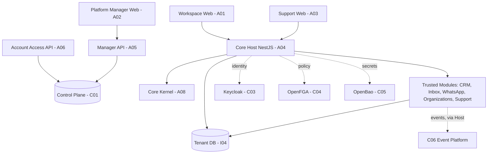

# G01 — Arquitetura

[← Sumário do volume](../) · [↑ Biblioteca](../../)

> **Leitura técnica, não homologação.** Estados, limites e comprovações devem ser lidos em STATUS e nos checkpoints versionados.

## Identificação e rastreabilidade

| Campo | Fonte verificável |
|---|---|
| Unidade / owner | **G01** · Arquitetura |
| Volume | Plataforma e core |
| Caminho de implementação | `docs/engineering` |
| Documento de origem | [README](https://github.com/delmacy/syndes-system/blob/main/docs/subprojects/G01-arquitetura/README.md) |
| STATUS e critérios | [STATUS original](https://github.com/delmacy/syndes-system/blob/main/docs/subprojects/G01-arquitetura/STATUS.md) |
| Símbolos, APIs, SQL e dependências | [REFERENCIA-TECNICA](https://github.com/delmacy/syndes-system/blob/main/docs/subprojects/G01-arquitetura/REFERENCIA-TECNICA.md) |
| Implantação, runbooks e gates | [OPERACAO](https://github.com/delmacy/syndes-system/blob/main/docs/subprojects/G01-arquitetura/OPERACAO.md) |

## Situação registrada

> AUDITORIA TÉCNICA PARCIAL — 12/11/2026. Revisão estática de documentação, catálogo, manifests e código no checkout de origin/main SHA b73f42adf47a9b766790f399e13529b470aef171 (DevServer01/worktree isolada). Não foram executados deploy, migrações, testes de autorização com serviços reais ou Product Gate. Revisão documental não é homologação arquitetural. Dimensão Estado constatado Evidência e limite --------- Documentação Auditoria parcial Capítulos 00–07…

A descrição acima é uma **citação resumida do STATUS versionado**; não significa que os testes de integração, a implantação ou a homologação estejam aprovados.

## Índice dos subcapítulos

Todos os assuntos deste módulo estão nesta página. Clique em um título para saltar à seção correspondente; o índice lateral acompanha a leitura.

- [Casos de uso](#casos-de-uso)
- [Histórias de usuário](#historias-de-usuario)
- [Requisitos](#requisitos)
- [Contratos públicos e privados](#contratos)
- [APIs e endpoints](#apis)
- [Eventos e mensageria](#eventos)
- [Dados e persistência](#dados)
- [Schemas e migrations](#schema)
- [Dependências e integrações](#dependencias)
- [Configuração e ambiente](#configuracao)
- [Frontend e interfaces](#interface)
- [Testes e evidências](#testes)
- [Operação e implantação](#operacao)
- [WBS e evolução](#wbs)
- [Documentação de origem integral](#documentacao-de-origem)
- [Controle de alterações](#controle-de-alteracoes)

## Casos de uso

**Editar esta seção:** [Abrir arquivo-fonte no GitHub](https://github.com/delmacy/syndes-system/edit/main/docs/subprojects/G01-arquitetura/chapters/02-requisitos-historias-e-casos-de-uso.md) · [Consultar fonte](https://github.com/delmacy/syndes-system/blob/main/docs/subprojects/G01-arquitetura/chapters/02-requisitos-historias-e-casos-de-uso.md)

*Referências extraídas da documentação versionada, sem inferir homologação ou implantação.*

**Fonte:** [02-requisitos-historias-e-casos-de-uso.md](https://github.com/delmacy/syndes-system/blob/main/docs/subprojects/G01-arquitetura/chapters/02-requisitos-historias-e-casos-de-uso.md)

> Linha 26: \| Caso \| Entrada \| Fluxo esperado \| Saída \|

**Fonte:** [STATUS.md](https://github.com/delmacy/syndes-system/blob/main/docs/subprojects/G01-arquitetura/STATUS.md)

> Linha 12: \| **Integração** \| **Não verificada nesta auditoria** \| G01 não executou testes reais Keycloak/OpenFGA, PostgreSQL tenant A/B ou fluxo de Event Bus \|

📝 Espaço para ajustes e implementação

Este é um **modelo de registro**, não um editor com salvamento automático. Use o link **Editar esta seção** para atualizar o documento versionado.

- **Alteração proposta:** descreva o requisito, contrato, dado ou comportamento.
- **Referência de código:** informe caminho e símbolo real.
- **Testes e evidências:** informe comando, resultado e limite.
- **Critério de aceite:** indique como validar sem presumir homologação.
- **Status e revisão:** atualize a fonte canônica após revisão.

## Histórias de usuário

**Editar esta seção:** [Abrir arquivo-fonte no GitHub](https://github.com/delmacy/syndes-system/edit/main/docs/subprojects/G01-arquitetura/chapters/02-requisitos-historias-e-casos-de-uso.md) · [Consultar fonte](https://github.com/delmacy/syndes-system/blob/main/docs/subprojects/G01-arquitetura/chapters/02-requisitos-historias-e-casos-de-uso.md)

*Referências extraídas da documentação versionada, sem inferir homologação ou implantação.*

**Lacuna documental:** ainda não há especificação textual identificada nesta área. Revisar implementação e registrar evidência antes de preencher.

📝 Espaço para ajustes e implementação

Este é um **modelo de registro**, não um editor com salvamento automático. Use o link **Editar esta seção** para atualizar o documento versionado.

- **Alteração proposta:** descreva o requisito, contrato, dado ou comportamento.
- **Referência de código:** informe caminho e símbolo real.
- **Testes e evidências:** informe comando, resultado e limite.
- **Critério de aceite:** indique como validar sem presumir homologação.
- **Status e revisão:** atualize a fonte canônica após revisão.

## Requisitos

**Editar esta seção:** [Abrir arquivo-fonte no GitHub](https://github.com/delmacy/syndes-system/edit/main/docs/subprojects/G01-arquitetura/chapters/02-requisitos-historias-e-casos-de-uso.md) · [Consultar fonte](https://github.com/delmacy/syndes-system/blob/main/docs/subprojects/G01-arquitetura/chapters/02-requisitos-historias-e-casos-de-uso.md)

*Referências extraídas da documentação versionada, sem inferir homologação ou implantação.*

**Fonte:** [02-requisitos-historias-e-casos-de-uso.md](https://github.com/delmacy/syndes-system/blob/main/docs/subprojects/G01-arquitetura/chapters/02-requisitos-historias-e-casos-de-uso.md)

> Linha 7: \| Regra identificada \| Fonte / owner \| Verificação necessária \|

> Linha 33: **Requisitos ainda não elicitados:** níveis mensuráveis de performance, RTO/RPO de cada ambiente, schemas futuros por módulo e contratos remotos entre hosts carecem de aprovação/medição específica. Não preencher números por suposição.

**Fonte:** [07-controle-do-escopo.md](https://github.com/delmacy/syndes-system/blob/main/docs/subprojects/G01-arquitetura/chapters/07-controle-do-escopo.md)

> Linha 3: **Baseline de requisitos da G01: NÃO APROVADA para novo escopo.** A presente atualização é uma **reconciliação documental de decisões e código existentes**, não nova ADR, Product Gate ou autorização para alterar módulos.

**Fonte:** [STATUS.md](https://github.com/delmacy/syndes-system/blob/main/docs/subprojects/G01-arquitetura/STATUS.md)

> Linha 20: \| `catalog/work-units.json`, `docs/subprojects/index.json` \| G01 é unidade de arquitetura, source `docs/engineering`; owners por área e documentação vinculada \| Aprovação de novos requisitos \|

📝 Espaço para ajustes e implementação

Este é um **modelo de registro**, não um editor com salvamento automático. Use o link **Editar esta seção** para atualizar o documento versionado.

- **Alteração proposta:** descreva o requisito, contrato, dado ou comportamento.
- **Referência de código:** informe caminho e símbolo real.
- **Testes e evidências:** informe comando, resultado e limite.
- **Critério de aceite:** indique como validar sem presumir homologação.
- **Status e revisão:** atualize a fonte canônica após revisão.

## Contratos públicos e privados

**Editar esta seção:** [Abrir arquivo-fonte no GitHub](https://github.com/delmacy/syndes-system/edit/main/docs/subprojects/G01-arquitetura/REFERENCIA-TECNICA.md) · [Consultar fonte](https://github.com/delmacy/syndes-system/blob/main/docs/subprojects/G01-arquitetura/REFERENCIA-TECNICA.md)

*Referências extraídas da documentação versionada, sem inferir homologação ou implantação.*

**Fonte:** [REFERENCIA-TECNICA.md](https://github.com/delmacy/syndes-system/blob/main/docs/subprojects/G01-arquitetura/REFERENCIA-TECNICA.md)

> Linha 9: - **Arquitetura observada:** `packages/core-kernel` como biblioteca de contratos, `apps/core-host` como composition root NestJS e `modules/*` como pacotes de domínio. Ver [ADR de composição](https://github.com/delmacy/syndes-system/blob/main/docs/engineering/ADR-COMPOSICAO-MODULAR-CORE-20261111.md) e [mapa da G01](chapters/05-arquitetura-banco-interface-configuracao-e-diagramas.md).

> Linha 30: - [Superfícies de importação e limites](../../standards/CONTRATOS-PUBLICOS.md): o código `package.json#exports` define o que é público para consumidores.

> Linha 34: - **G01 não publica nem consome eventos como runtime.** Um contrato declarado em Core não comprova producer/consumer ativo.

**Fonte:** [04-contratos-e-dependencias-publicas.md](https://github.com/delmacy/syndes-system/blob/main/docs/subprojects/G01-arquitetura/chapters/04-contratos-e-dependencias-publicas.md)

> Linha 5: **Entradas:** ADRs, AGENTS, inventário do catálogo, documentação de owner, WBS, evidências de CI/ambiente e propostas de mudança. **Saídas:** decisões rastreáveis, limites de responsabilidade, diagramas, matrices de conformidade, pendências e links para a fonte. **Não há export TypeScript, API HTTP ou evento produzido pela G01.**

> Linha 9: \| Responsável real \| Fonte no código \| O que o contrato delimita \|

> Linha 13: \| P01 CRM \| `modules/core-crm/package.json` \| Export `.` e `./plugin`; detalhes do domínio pertencem ao P01 \|

> Linha 14: \| P02 Inbox \| `modules/inbox/package.json` \| Pacote **`@syndes/core-inbox`**, exports `.` e `./plugin` \|

> Linha 15: \| P03 WhatsApp \| `modules/whatsapp/package.json` \| Pacote `@syndes/whatsapp`, múltiplos exports de contracts/bridge/plugin; verificar compatibilidade antes de importar \|

> Linha 17: \| C01/C03/C04/C05 \| ADRs de Control, Keycloak, OpenFGA e OpenBao \| Metadados e identidade, relação/recurso e segredos; contratos de infraestrutura e políticas, não API pública da G01 \|

> Linha 19: **Regra:** `export` em um arquivo não implica superfície pública do pacote. Confirmar `package.json#exports`, consumidor, compatibilidade, autenticação e isolamento antes de integrar. O Host deve injetar ports/consumidores; evitar imports de caminhos `src/` privados de outros owners.

> Linha 24: 2. [CONTRATOS-PUBLICOS.md](../../../standards/CONTRATOS-PUBLICOS.md) contém `@syndes/inbox` como rótulo **a verificar**; o `package.json` atual do P02 declara `@syndes/core-inbox`. O owner P02 deve atualizar a ficha normativa e conferir consumidores.

**Fonte:** [STATUS.md](https://github.com/delmacy/syndes-system/blob/main/docs/subprojects/G01-arquitetura/STATUS.md)

> Linha 21: \| `packages/core-kernel/src/index.ts` e `src/contracts.ts` \| Exports públicos de `CoreKernel`, `ModuleRegistry`, `TenancyPort`, `AuthorizationPort`, `TrustedTenantTransactionProvider` e `ModuleAccessPort` \| Enforcement real em todos os endpoints e workers \|

> Linha 24: \| `modules/core-crm/package.json`, `modules/inbox/package.json`, `modules/whatsapp/package.json` \| Superfícies via `exports`; pacote Inbox = `@syndes/core-inbox` \| Rotas HTTP habilitadas, identidade ou integração \|

> Linha 26: \| `packages/core-kernel/src/platform-events.ts`, `control-plane-events.ts` \| Tipos/validação de contratos de eventos \| Dispatcher ativo, migrations aplicadas ou replay operacional \|

> Linha 33: 2. Índice `docs/standards/CONTRATOS-PUBLICOS.md` menciona `@syndes/inbox` como nome a verificar; o manifesto P02 declara `@syndes/core-inbox`. Corrigir pelo owner do contrato.

> Linha 40: - [Capítulos da especificação](ESCOPO.md): missão, responsabilidades e exclusões, matrizes, contratos, estados de implementação, diagrama lógico, fontes e pendências.

**Fonte:** [OPERACAO.md](https://github.com/delmacy/syndes-system/blob/main/docs/subprojects/G01-arquitetura/OPERACAO.md)

> Linha 16: - [Contratos públicos](../../standards/CONTRATOS-PUBLICOS.md).

> Linha 32: 4. Testar com critérios apropriados: unitário, contrato, integração, E2E e CI.

📝 Espaço para ajustes e implementação

Este é um **modelo de registro**, não um editor com salvamento automático. Use o link **Editar esta seção** para atualizar o documento versionado.

- **Alteração proposta:** descreva o requisito, contrato, dado ou comportamento.
- **Referência de código:** informe caminho e símbolo real.
- **Testes e evidências:** informe comando, resultado e limite.
- **Critério de aceite:** indique como validar sem presumir homologação.
- **Status e revisão:** atualize a fonte canônica após revisão.

## APIs e endpoints

**Editar esta seção:** [Abrir arquivo-fonte no GitHub](https://github.com/delmacy/syndes-system/edit/main/docs/subprojects/G01-arquitetura/REFERENCIA-TECNICA.md) · [Consultar fonte](https://github.com/delmacy/syndes-system/blob/main/docs/subprojects/G01-arquitetura/REFERENCIA-TECNICA.md)

*Referências extraídas da documentação versionada, sem inferir homologação ou implantação.*

**Fonte:** [REFERENCIA-TECNICA.md](https://github.com/delmacy/syndes-system/blob/main/docs/subprojects/G01-arquitetura/REFERENCIA-TECNICA.md)

> Linha 3: > **AUDITORIA ESTÁTICA PARCIAL — 12/11/2026.** G01 mantém decisões e matrizes, não é serviço, package executável, controlador HTTP nem schema PostgreSQL. As referências a classes e interfaces abaixo pertencem aos seus respectivos owners e foram examinadas no commit `b73f42adf47a9b766790f399e13529b470aef171`; não comprovam instalação operacional.

> Linha 26: **A G01 não registra endpoints HTTP.** Os controllers pertencem ao Core Host, módulos de produto e APIs administrativas; conferir as rotas reais, middleware de autorização e montagem na [consulta de APIs por owner](../../blueprint/APIS.md). Nenhum endpoint deve ser inferido de título de ADR ou classe.

**Fonte:** [04-contratos-e-dependencias-publicas.md](https://github.com/delmacy/syndes-system/blob/main/docs/subprojects/G01-arquitetura/chapters/04-contratos-e-dependencias-publicas.md)

> Linha 5: **Entradas:** ADRs, AGENTS, inventário do catálogo, documentação de owner, WBS, evidências de CI/ambiente e propostas de mudança. **Saídas:** decisões rastreáveis, limites de responsabilidade, diagramas, matrices de conformidade, pendências e links para a fonte. **Não há export TypeScript, API HTTP ou evento produzido pela G01.**

> Linha 17: \| C01/C03/C04/C05 \| ADRs de Control, Keycloak, OpenFGA e OpenBao \| Metadados e identidade, relação/recurso e segredos; contratos de infraestrutura e políticas, não API pública da G01 \|

> Linha 23: 1. [CORE-FRAMEWORK-ARCHITECTURE.md](../../../engineering/CORE-FRAMEWORK-ARCHITECTURE.md) ainda usa `apps/core-api` como *future composition root* em diagrama histórico, mas o Host do checkout é `apps/core-host`. **Atualizar a referência antiga em revisão própria**, preservando contexto e aprovação original.

**Fonte:** [05-arquitetura-banco-interface-configuracao-e-diagramas.md](https://github.com/delmacy/syndes-system/blob/main/docs/subprojects/G01-arquitetura/chapters/05-arquitetura-banco-interface-configuracao-e-diagramas.md)

> Linha 39: \| Workspace \| APIs tenant no Host e Account Access quando cabível \| HTTP autenticado + contexto validado \| Sem Control DB direto; menu não concede permissão \|

> Linha 40: \| Manager \| Manager API/Control Plane \| API administrativa, client OIDC e role SQL separados \| Sem leitura de banco de tenant por privilégio global \|

> Linha 54: - Ativação de módulo por entitlement + installation + ENABLED + grants na borda HTTP, workers e frontend.

**Fonte:** [STATUS.md](https://github.com/delmacy/syndes-system/blob/main/docs/subprojects/G01-arquitetura/STATUS.md)

> Linha 10: \| **Implementação da G01** \| **Não aplicável (governança)** \| Owner `docs/engineering` no catálogo; G01 não possui API, package de runtime nem persistência \|

> Linha 21: \| `packages/core-kernel/src/index.ts` e `src/contracts.ts` \| Exports públicos de `CoreKernel`, `ModuleRegistry`, `TenancyPort`, `AuthorizationPort`, `TrustedTenantTransactionProvider` e `ModuleAccessPort` \| Enforcement real em todos os endpoints e workers \|

> Linha 24: \| `modules/core-crm/package.json`, `modules/inbox/package.json`, `modules/whatsapp/package.json` \| Superfícies via `exports`; pacote Inbox = `@syndes/core-inbox` \| Rotas HTTP habilitadas, identidade ou integração \|

> Linha 32: 1. Diagrama histórico do Core Framework menciona `apps/core-api` como futuro Host; a composição examinada é `apps/core-host`. Atualização da referência histórica **sob revisão**, não mudança de arquitetura implícita.

📝 Espaço para ajustes e implementação

Este é um **modelo de registro**, não um editor com salvamento automático. Use o link **Editar esta seção** para atualizar o documento versionado.

- **Alteração proposta:** descreva o requisito, contrato, dado ou comportamento.
- **Referência de código:** informe caminho e símbolo real.
- **Testes e evidências:** informe comando, resultado e limite.
- **Critério de aceite:** indique como validar sem presumir homologação.
- **Status e revisão:** atualize a fonte canônica após revisão.

## Eventos e mensageria

**Editar esta seção:** [Abrir arquivo-fonte no GitHub](https://github.com/delmacy/syndes-system/edit/main/docs/subprojects/G01-arquitetura/REFERENCIA-TECNICA.md) · [Consultar fonte](https://github.com/delmacy/syndes-system/blob/main/docs/subprojects/G01-arquitetura/REFERENCIA-TECNICA.md)

*Referências extraídas da documentação versionada, sem inferir homologação ou implantação.*

**Fonte:** [REFERENCIA-TECNICA.md](https://github.com/delmacy/syndes-system/blob/main/docs/subprojects/G01-arquitetura/REFERENCIA-TECNICA.md)

> Linha 20: \| C06 Event Platform \| `packages/core-kernel/src/platform-events.ts`, `control-plane-events.ts` \| Eventos tipados e validações, não ativação do worker \|

> Linha 31: - [Kernel](../../subprojects/A08-core-kernel/REFERENCIA-TECNICA.md): ports, ModuleRegistry e eventos tipados.

> Linha 33: - [Event Platform](../../subprojects/C06-event-platform/REFERENCIA-TECNICA.md): outbox, dispatcher, consumers e limites entre Control e tenant.

> Linha 34: - **G01 não publica nem consome eventos como runtime.** Um contrato declarado em Core não comprova producer/consumer ativo.

> Linha 45: - **Eventos:** `platform_events` no tenant e `control_events` no Control têm owners e gates distintos. Ver [matriz de dados da G01](chapters/05-arquitetura-banco-interface-configuracao-e-diagramas.md).

**Fonte:** [04-contratos-e-dependencias-publicas.md](https://github.com/delmacy/syndes-system/blob/main/docs/subprojects/G01-arquitetura/chapters/04-contratos-e-dependencias-publicas.md)

> Linha 5: **Entradas:** ADRs, AGENTS, inventário do catálogo, documentação de owner, WBS, evidências de CI/ambiente e propostas de mudança. **Saídas:** decisões rastreáveis, limites de responsabilidade, diagramas, matrices de conformidade, pendências e links para a fonte. **Não há export TypeScript, API HTTP ou evento produzido pela G01.**

> Linha 19: **Regra:** `export` em um arquivo não implica superfície pública do pacote. Confirmar `package.json#exports`, consumidor, compatibilidade, autenticação e isolamento antes de integrar. O Host deve injetar ports/consumidores; evitar imports de caminhos `src/` privados de outros owners.

**Fonte:** [05-arquitetura-banco-interface-configuracao-e-diagramas.md](https://github.com/delmacy/syndes-system/blob/main/docs/subprojects/G01-arquitetura/chapters/05-arquitetura-banco-interface-configuracao-e-diagramas.md)

> Linha 31: \| `platform_events` no DB tenant \| C06; desenho e código de outbox \| Estado de ativação operacional a confirmar no ambiente; atomicidade exige transação fixada \|

> Linha 32: \| `control_events` no Control DB \| C01; migration `006_control_events` candidata \| Só eventos administrativos globais; não misturar dados de domínio tenant \|

> Linha 37: \| Consumidor \| Owner / fonte de dados \| Mecanismo permitido \| Restrição \|

> Linha 42: \| WhatsApp ↔ Inbox ↔ CRM \| Módulos P03/P02/P01 e C06 \| Contratos/versionamento + outbox/consumer autorizado \| Evitar escritas diretas cross-owner; worker não presumido ativo \|

**Fonte:** [STATUS.md](https://github.com/delmacy/syndes-system/blob/main/docs/subprojects/G01-arquitetura/STATUS.md)

> Linha 26: \| `packages/core-kernel/src/platform-events.ts`, `control-plane-events.ts` \| Tipos/validação de contratos de eventos \| Dispatcher ativo, migrations aplicadas ou replay operacional \|

> Linha 28: **Referências normativas consultadas:** [Core Framework](../../engineering/CORE-FRAMEWORK-ARCHITECTURE.md), [composição do Core](../../engineering/ADR-COMPOSICAO-MODULAR-CORE-20261111.md), [Control/Tenant](../../engineering/ADR-CONTROL-TENANT-MODULE-COMPOSITION-20261110.md), [frontend/backend](../../engineering/ADR-FRONTEND-BACKEND-COMPOSITION-20261110.md), [schemas](../../engineering/ADR-ACCOUNT-KERNEL-MODULE-SCHEMA

> Linha 57: **Critério para subir de “auditoria parcial”:** aprovar a descrição com os owners, solucionar ou formalizar divergências, verificar a SHA integrada e registrar evidências de testes/gates relevantes. Não confundir documento publicado com Product Gate concluído.

📝 Espaço para ajustes e implementação

Este é um **modelo de registro**, não um editor com salvamento automático. Use o link **Editar esta seção** para atualizar o documento versionado.

- **Alteração proposta:** descreva o requisito, contrato, dado ou comportamento.
- **Referência de código:** informe caminho e símbolo real.
- **Testes e evidências:** informe comando, resultado e limite.
- **Critério de aceite:** indique como validar sem presumir homologação.
- **Status e revisão:** atualize a fonte canônica após revisão.

## Dados e persistência

**Editar esta seção:** [Abrir arquivo-fonte no GitHub](https://github.com/delmacy/syndes-system/edit/main/docs/subprojects/G01-arquitetura/REFERENCIA-TECNICA.md) · [Consultar fonte](https://github.com/delmacy/syndes-system/blob/main/docs/subprojects/G01-arquitetura/REFERENCIA-TECNICA.md)

*Referências extraídas da documentação versionada, sem inferir homologação ou implantação.*

**Fonte:** [REFERENCIA-TECNICA.md](https://github.com/delmacy/syndes-system/blob/main/docs/subprojects/G01-arquitetura/REFERENCIA-TECNICA.md)

> Linha 3: > **AUDITORIA ESTÁTICA PARCIAL — 12/11/2026.** G01 mantém decisões e matrizes, não é serviço, package executável, controlador HTTP nem schema PostgreSQL. As referências a classes e interfaces abaixo pertencem aos seus respectivos owners e foram examinadas no commit `b73f42adf47a9b766790f399e13529b470aef171`; não comprovam instalação operacional.

> Linha 42: - **G01:** nenhuma tabela/migration própria; não existe banco de dados de arquitetura.

> Linha 43: - **Control Plane:** dados de catálogo e governança sob C01/Manager; não é backend de CRM, Inbox e WhatsApp.

> Linha 44: - **Tenant DB:** banco por tenant; o desenho de schemas por módulo é evolutivo e não deve ser declarado aplicado só porque existe um ADR.

> Linha 45: - **Eventos:** `platform_events` no tenant e `control_events` no Control têm owners e gates distintos. Ver [matriz de dados da G01](chapters/05-arquitetura-banco-interface-configuracao-e-diagramas.md).

**Fonte:** [05-arquitetura-banco-interface-configuracao-e-diagramas.md](https://github.com/delmacy/syndes-system/blob/main/docs/subprojects/G01-arquitetura/chapters/05-arquitetura-banco-interface-configuracao-e-diagramas.md)

> Linha 32: \| `control_events` no Control DB \| C01; migration `006_control_events` candidata \| Só eventos administrativos globais; não misturar dados de domínio tenant \|

> Linha 37: \| Consumidor \| Owner / fonte de dados \| Mecanismo permitido \| Restrição \|

> Linha 53: - Isolamento real entre Control e Tenant DB, ACL, usuários SQL e Keycloak/OpenFGA, incluindo testes negativos e tenant A/B.

**Fonte:** [STATUS.md](https://github.com/delmacy/syndes-system/blob/main/docs/subprojects/G01-arquitetura/STATUS.md)

> Linha 10: \| **Implementação da G01** \| **Não aplicável (governança)** \| Owner `docs/engineering` no catálogo; G01 não possui API, package de runtime nem persistência \|

> Linha 12: \| **Integração** \| **Não verificada nesta auditoria** \| G01 não executou testes reais Keycloak/OpenFGA, PostgreSQL tenant A/B ou fluxo de Event Bus \|

> Linha 34: 3. Schemas PostgreSQL por módulo e migração de tabelas `public` são evolução por gates; **não há evidência nesta auditoria de migração completa nem de ACL aplicada no ambiente**.

📝 Espaço para ajustes e implementação

Este é um **modelo de registro**, não um editor com salvamento automático. Use o link **Editar esta seção** para atualizar o documento versionado.

- **Alteração proposta:** descreva o requisito, contrato, dado ou comportamento.
- **Referência de código:** informe caminho e símbolo real.
- **Testes e evidências:** informe comando, resultado e limite.
- **Critério de aceite:** indique como validar sem presumir homologação.
- **Status e revisão:** atualize a fonte canônica após revisão.

## Schemas e migrations

**Editar esta seção:** [Abrir arquivo-fonte no GitHub](https://github.com/delmacy/syndes-system/edit/main/docs/subprojects/G01-arquitetura/REFERENCIA-TECNICA.md) · [Consultar fonte](https://github.com/delmacy/syndes-system/blob/main/docs/subprojects/G01-arquitetura/REFERENCIA-TECNICA.md)

*Referências extraídas da documentação versionada, sem inferir homologação ou implantação.*

**Fonte:** [REFERENCIA-TECNICA.md](https://github.com/delmacy/syndes-system/blob/main/docs/subprojects/G01-arquitetura/REFERENCIA-TECNICA.md)

> Linha 3: > **AUDITORIA ESTÁTICA PARCIAL — 12/11/2026.** G01 mantém decisões e matrizes, não é serviço, package executável, controlador HTTP nem schema PostgreSQL. As referências a classes e interfaces abaixo pertencem aos seus respectivos owners e foram examinadas no commit `b73f42adf47a9b766790f399e13529b470aef171`; não comprovam instalação operacional.

> Linha 42: - **G01:** nenhuma tabela/migration própria; não existe banco de dados de arquitetura.

> Linha 44: - **Tenant DB:** banco por tenant; o desenho de schemas por módulo é evolutivo e não deve ser declarado aplicado só porque existe um ADR.

**Fonte:** [04-contratos-e-dependencias-publicas.md](https://github.com/delmacy/syndes-system/blob/main/docs/subprojects/G01-arquitetura/chapters/04-contratos-e-dependencias-publicas.md)

> Linha 25: 3. [ADR Kernel/schemas](../../../engineering/ADR-ACCOUNT-KERNEL-MODULE-SCHEMAS-20261110.md) descreve schemas por módulo como evolução incremental, enquanto SQL histórico ainda utiliza `public`. **Não afirmar isolamento por schema aplicado** até a migração e os grants serem verificados em banco real.

**Fonte:** [05-arquitetura-banco-interface-configuracao-e-diagramas.md](https://github.com/delmacy/syndes-system/blob/main/docs/subprojects/G01-arquitetura/chapters/05-arquitetura-banco-interface-configuracao-e-diagramas.md)

> Linha 28: \| `syndes_control` \| C01, APIs de Control; migrations por fase/candidato \| Metadados de catálogo, contas, installs/grants; sem conteúdo CRM/Inbox/WhatsApp \|

> Linha 30: \| Tabelas de domínio \| P01/P02/P03/P04/P05/P06 \| Escrita pelo owner; parte do SQL histórico está no schema `public`, não assumir conversão \|

> Linha 32: \| `control_events` no Control DB \| C01; migration `006_control_events` candidata \| Só eventos administrativos globais; não misturar dados de domínio tenant \|

> Linha 33: \| `_syndes` / schemas por módulo \| [ADR de schemas](../../../engineering/ADR-ACCOUNT-KERNEL-MODULE-SCHEMAS-20261110.md) \| Ledger/ACL e schema-alvo em evolução; não declarar aplicado \|

> Linha 40: \| Manager \| Manager API/Control Plane \| API administrativa, client OIDC e role SQL separados \| Sem leitura de banco de tenant por privilégio global \|

> Linha 53: - Isolamento real entre Control e Tenant DB, ACL, usuários SQL e Keycloak/OpenFGA, incluindo testes negativos e tenant A/B.

> Linha 56: - Perfis de composição, migração por schema e gates de multi-org permanecem **evoluções controladas**, não invariantes comprovadas no deploy.

**Fonte:** [STATUS.md](https://github.com/delmacy/syndes-system/blob/main/docs/subprojects/G01-arquitetura/STATUS.md)

> Linha 26: \| `packages/core-kernel/src/platform-events.ts`, `control-plane-events.ts` \| Tipos/validação de contratos de eventos \| Dispatcher ativo, migrations aplicadas ou replay operacional \|

> Linha 28: **Referências normativas consultadas:** [Core Framework](../../engineering/CORE-FRAMEWORK-ARCHITECTURE.md), [composição do Core](../../engineering/ADR-COMPOSICAO-MODULAR-CORE-20261111.md), [Control/Tenant](../../engineering/ADR-CONTROL-TENANT-MODULE-COMPOSITION-20261110.md), [frontend/backend](../../engineering/ADR-FRONTEND-BACKEND-COMPOSITION-20261110.md), [schemas](../../engineering/ADR-ACCOUNT-KERNEL-MODULE-SCHEMA

> Linha 34: 3. Schemas PostgreSQL por módulo e migração de tabelas `public` são evolução por gates; **não há evidência nesta auditoria de migração completa nem de ACL aplicada no ambiente**.

> Linha 43: - Nenhum módulo de produto, SQL, workflow geral ou serviço operacional foi alterado.

**Fonte:** [OPERACAO.md](https://github.com/delmacy/syndes-system/blob/main/docs/subprojects/G01-arquitetura/OPERACAO.md)

> Linha 3: > **ÍNDICE DE FONTES, NÃO RUNBOOK HOMOLOGADO.** Não executar migrations, alterar permissões ou ativar workers apenas com esta página.

> Linha 31: 3. Confirmar migrations realmente aplicadas, backup/restore e rollback antes de SQL.

📝 Espaço para ajustes e implementação

Este é um **modelo de registro**, não um editor com salvamento automático. Use o link **Editar esta seção** para atualizar o documento versionado.

- **Alteração proposta:** descreva o requisito, contrato, dado ou comportamento.
- **Referência de código:** informe caminho e símbolo real.
- **Testes e evidências:** informe comando, resultado e limite.
- **Critério de aceite:** indique como validar sem presumir homologação.
- **Status e revisão:** atualize a fonte canônica após revisão.

## Dependências e integrações

**Editar esta seção:** [Abrir arquivo-fonte no GitHub](https://github.com/delmacy/syndes-system/edit/main/docs/subprojects/G01-arquitetura/REFERENCIA-TECNICA.md) · [Consultar fonte](https://github.com/delmacy/syndes-system/blob/main/docs/subprojects/G01-arquitetura/REFERENCIA-TECNICA.md)

*Referências extraídas da documentação versionada, sem inferir homologação ou implantação.*

**Fonte:** [04-contratos-e-dependencias-publicas.md](https://github.com/delmacy/syndes-system/blob/main/docs/subprojects/G01-arquitetura/chapters/04-contratos-e-dependencias-publicas.md)

> Linha 12: \| A04 Core Host \| `apps/core-host/src/module-host.ts`, `config/modules.json` \| `loadInstalledPlugins`, módulos confiáveis e validation de dependências/rotas de assets \|

> Linha 17: \| C01/C03/C04/C05 \| ADRs de Control, Keycloak, OpenFGA e OpenBao \| Metadados e identidade, relação/recurso e segredos; contratos de infraestrutura e políticas, não API pública da G01 \|

> Linha 28: **Dependências de G01:** documentos versionados sob `docs/engineering`, catálogo, ADRs e resultados de auditoria dos owners; nenhuma dependência runtime obrigatória identificada para a unidade documental.

**Fonte:** [05-arquitetura-banco-interface-configuracao-e-diagramas.md](https://github.com/delmacy/syndes-system/blob/main/docs/subprojects/G01-arquitetura/chapters/05-arquitetura-banco-interface-configuracao-e-diagramas.md)

> Linha 53: - Isolamento real entre Control e Tenant DB, ACL, usuários SQL e Keycloak/OpenFGA, incluindo testes negativos e tenant A/B.

**Fonte:** [STATUS.md](https://github.com/delmacy/syndes-system/blob/main/docs/subprojects/G01-arquitetura/STATUS.md)

> Linha 12: \| **Integração** \| **Não verificada nesta auditoria** \| G01 não executou testes reais Keycloak/OpenFGA, PostgreSQL tenant A/B ou fluxo de Event Bus \|

> Linha 22: \| `packages/core-kernel/src/module-registry.ts` \| Registro com validação de ID/versão, dependências ausentes e ciclos \| Compatibilidade entre versões em todos os consumidores \|

> Linha 24: \| `modules/core-crm/package.json`, `modules/inbox/package.json`, `modules/whatsapp/package.json` \| Superfícies via `exports`; pacote Inbox = `@syndes/core-inbox` \| Rotas HTTP habilitadas, identidade ou integração \|

> Linha 36: 5. Não se executaram testes de integração, E2E, restore, autorização real ou verificação de deploy nesta revisão; o CI da futura SHA documental também requer checagem separada.

**Fonte:** [OPERACAO.md](https://github.com/delmacy/syndes-system/blob/main/docs/subprojects/G01-arquitetura/OPERACAO.md)

> Linha 9: - [Evolução](EVOLUCAO.md): workpackages e dependências; nenhum item é concluído por estar planejado.

> Linha 32: 4. Testar com critérios apropriados: unitário, contrato, integração, E2E e CI.

📝 Espaço para ajustes e implementação

Este é um **modelo de registro**, não um editor com salvamento automático. Use o link **Editar esta seção** para atualizar o documento versionado.

- **Alteração proposta:** descreva o requisito, contrato, dado ou comportamento.
- **Referência de código:** informe caminho e símbolo real.
- **Testes e evidências:** informe comando, resultado e limite.
- **Critério de aceite:** indique como validar sem presumir homologação.
- **Status e revisão:** atualize a fonte canônica após revisão.

## Configuração e ambiente

**Editar esta seção:** [Abrir arquivo-fonte no GitHub](https://github.com/delmacy/syndes-system/edit/main/docs/subprojects/G01-arquitetura/OPERACAO.md) · [Consultar fonte](https://github.com/delmacy/syndes-system/blob/main/docs/subprojects/G01-arquitetura/OPERACAO.md)

*Referências extraídas da documentação versionada, sem inferir homologação ou implantação.*

**Fonte:** [REFERENCIA-TECNICA.md](https://github.com/delmacy/syndes-system/blob/main/docs/subprojects/G01-arquitetura/REFERENCIA-TECNICA.md)

> Linha 9: - **Arquitetura observada:** `packages/core-kernel` como biblioteca de contratos, `apps/core-host` como composition root NestJS e `modules/*` como pacotes de domínio. Ver [ADR de composição](https://github.com/delmacy/syndes-system/blob/main/docs/engineering/ADR-COMPOSICAO-MODULAR-CORE-20261111.md) e [mapa da G01](chapters/05-arquitetura-banco-interface-configuracao-e-diagramas.md).

> Linha 32: - [Core Host](../../subprojects/A04-core-host/REFERENCIA-TECNICA.md): bindings dos ports, plugins trusted e configuração.

> Linha 45: - **Eventos:** `platform_events` no tenant e `control_events` no Control têm owners e gates distintos. Ver [matriz de dados da G01](chapters/05-arquitetura-banco-interface-configuracao-e-diagramas.md).

> Linha 49: - [Diagrama e matrizes](chapters/05-arquitetura-banco-interface-configuracao-e-diagramas.md) são **lógicos**, não desenho de infraestrutura homologada.

**Fonte:** [05-arquitetura-banco-interface-configuracao-e-diagramas.md](https://github.com/delmacy/syndes-system/blob/main/docs/subprojects/G01-arquitetura/chapters/05-arquitetura-banco-interface-configuracao-e-diagramas.md)

> Linha 49: - Nomes de configuração/variáveis precisam ser confirmados **no owner operacional**; G01 não publica valores, DSNs, credenciais, URLs de administração ou topologia sensível.

**Fonte:** [STATUS.md](https://github.com/delmacy/syndes-system/blob/main/docs/subprojects/G01-arquitetura/STATUS.md)

> Linha 11: \| **Arquitetura de componentes** \| **Código e configuração encontrados** \| Kernel/Host/plugins/frontends presentes no checkout; a presença em Git não prova operação \|

> Linha 23: \| `apps/core-host/src/module-host.ts`, `config/modules.json` \| Loader de trusted plugins, configuração fixa de CRM, Inbox, WhatsApp, Organizations, Support \| Instalação/ENABLED por tenant ou perfis de instância \|

📝 Espaço para ajustes e implementação

Este é um **modelo de registro**, não um editor com salvamento automático. Use o link **Editar esta seção** para atualizar o documento versionado.

- **Alteração proposta:** descreva o requisito, contrato, dado ou comportamento.
- **Referência de código:** informe caminho e símbolo real.
- **Testes e evidências:** informe comando, resultado e limite.
- **Critério de aceite:** indique como validar sem presumir homologação.
- **Status e revisão:** atualize a fonte canônica após revisão.

## Frontend e interfaces

**Editar esta seção:** [Abrir arquivo-fonte no GitHub](https://github.com/delmacy/syndes-system/edit/main/docs/subprojects/G01-arquitetura/REFERENCIA-TECNICA.md) · [Consultar fonte](https://github.com/delmacy/syndes-system/blob/main/docs/subprojects/G01-arquitetura/REFERENCIA-TECNICA.md)

*Referências extraídas da documentação versionada, sem inferir homologação ou implantação.*

**Fonte:** [REFERENCIA-TECNICA.md](https://github.com/delmacy/syndes-system/blob/main/docs/subprojects/G01-arquitetura/REFERENCIA-TECNICA.md)

> Linha 9: - **Arquitetura observada:** `packages/core-kernel` como biblioteca de contratos, `apps/core-host` como composition root NestJS e `modules/*` como pacotes de domínio. Ver [ADR de composição](https://github.com/delmacy/syndes-system/blob/main/docs/engineering/ADR-COMPOSICAO-MODULAR-CORE-20261111.md) e [mapa da G01](chapters/05-arquitetura-banco-interface-configuracao-e-diagramas.md).

> Linha 38: **G01 não possui frontend operacional.** A apresentação do portal é o Syndes Docs; as aplicações são A01 Workspace, A02 Platform Manager e A03 Support, com `packages/front-shared` restrito a componentes visuais. Identidade, sessão e controle de recursos não podem atravessar bundles por simples reuso de UI.

> Linha 45: - **Eventos:** `platform_events` no tenant e `control_events` no Control têm owners e gates distintos. Ver [matriz de dados da G01](chapters/05-arquitetura-banco-interface-configuracao-e-diagramas.md).

> Linha 49: - [Diagrama e matrizes](chapters/05-arquitetura-banco-interface-configuracao-e-diagramas.md) são **lógicos**, não desenho de infraestrutura homologada.

**Fonte:** [03-capabilities.md](https://github.com/delmacy/syndes-system/blob/main/docs/subprojects/G01-arquitetura/chapters/03-capabilities.md)

> Linha 11: \| Isolamento de frontends por contexto \| [ADR frontend/backend](../../../engineering/ADR-FRONTEND-BACKEND-COMPOSITION-20261110.md), `apps/master-admin-web`, `apps/workspace-web`, `packages/front-shared` \| Estruturas de projeto presentes; sessão real não verificada \|

**Fonte:** [05-arquitetura-banco-interface-configuracao-e-diagramas.md](https://github.com/delmacy/syndes-system/blob/main/docs/subprojects/G01-arquitetura/chapters/05-arquitetura-banco-interface-configuracao-e-diagramas.md)

> Linha 47: - Frentes distintas: `apps/master-admin-web` (global), `apps/workspace-web` (tenant) e `apps/support-web` (Support), conforme escopo. `packages/front-shared` compartilha apenas componentes e estilos.

> Linha 54: - Ativação de módulo por entitlement + installation + ENABLED + grants na borda HTTP, workers e frontend.

**Fonte:** [STATUS.md](https://github.com/delmacy/syndes-system/blob/main/docs/subprojects/G01-arquitetura/STATUS.md)

> Linha 11: \| **Arquitetura de componentes** \| **Código e configuração encontrados** \| Kernel/Host/plugins/frontends presentes no checkout; a presença em Git não prova operação \|

> Linha 28: **Referências normativas consultadas:** [Core Framework](../../engineering/CORE-FRAMEWORK-ARCHITECTURE.md), [composição do Core](../../engineering/ADR-COMPOSICAO-MODULAR-CORE-20261111.md), [Control/Tenant](../../engineering/ADR-CONTROL-TENANT-MODULE-COMPOSITION-20261110.md), [frontend/backend](../../engineering/ADR-FRONTEND-BACKEND-COMPOSITION-20261110.md), [schemas](../../engineering/ADR-ACCOUNT-KERNEL-MODULE-SCHEMA

📝 Espaço para ajustes e implementação

Este é um **modelo de registro**, não um editor com salvamento automático. Use o link **Editar esta seção** para atualizar o documento versionado.

- **Alteração proposta:** descreva o requisito, contrato, dado ou comportamento.
- **Referência de código:** informe caminho e símbolo real.
- **Testes e evidências:** informe comando, resultado e limite.
- **Critério de aceite:** indique como validar sem presumir homologação.
- **Status e revisão:** atualize a fonte canônica após revisão.

## Testes e evidências

**Editar esta seção:** [Abrir arquivo-fonte no GitHub](https://github.com/delmacy/syndes-system/edit/main/docs/subprojects/G01-arquitetura/STATUS.md) · [Consultar fonte](https://github.com/delmacy/syndes-system/blob/main/docs/subprojects/G01-arquitetura/STATUS.md)

*Referências extraídas da documentação versionada, sem inferir homologação ou implantação.*

**Fonte:** [STATUS.md](https://github.com/delmacy/syndes-system/blob/main/docs/subprojects/G01-arquitetura/STATUS.md)

> Linha 3: > **AUDITORIA TÉCNICA PARCIAL — 12/11/2026.** Revisão **estática de documentação, catálogo, manifests e código** no checkout de `origin/main` SHA `b73f42adf47a9b766790f399e13529b470aef171` (DevServer01/worktree isolada). Não foram executados deploy, migrações, testes de autorização com serviços reais ou Product Gate. **Revisão documental não é homologação arquitetural.**

> Linha 7: \| Dimensão \| Estado constatado \| Evidência e limite \|

> Linha 12: \| **Integração** \| **Não verificada nesta auditoria** \| G01 não executou testes reais Keycloak/OpenFGA, PostgreSQL tenant A/B ou fluxo de Event Bus \|

> Linha 14: \| **Escopo e gates** \| **Revisão/aprovação pendentes** \| Documentação anterior não aprovada; decisões dos ADRs mantêm seus próprios estados \|

> Linha 18: \| Fonte conferida no SHA \| Evidência estática encontrada \| O que **não** comprova \|

> Linha 34: 3. Schemas PostgreSQL por módulo e migração de tabelas `public` são evolução por gates; **não há evidência nesta auditoria de migração completa nem de ACL aplicada no ambiente**.

> Linha 36: 5. Não se executaram testes de integração, E2E, restore, autorização real ou verificação de deploy nesta revisão; o CI da futura SHA documental também requer checagem separada.

> Linha 48: 2. **G02 — Produto e UX:** auditar escopo/PRDs, prioridades, jornadas e Product Gates, conforme sequência aprovada.

> Linha 49: 3. **G03/Q10/Q07:** rastreabilidade de ADR e evidências de qualidade/CI; não editar workflows nesta frente documental.

> Linha 57: **Critério para subir de “auditoria parcial”:** aprovar a descrição com os owners, solucionar ou formalizar divergências, verificar a SHA integrada e registrar evidências de testes/gates relevantes. Não confundir documento publicado com Product Gate concluído.

**Fonte:** [06-wbs-marcos-e-aceite.md](https://github.com/delmacy/syndes-system/blob/main/docs/subprojects/G01-arquitetura/chapters/06-wbs-marcos-e-aceite.md)

> Linha 5: A associação de G01 em `catalog/evolution-associations.json` **não transfere ownership nem prova execução**. As referências existentes são: 00.01 (baseline da `main`), 30.01 (matriz de papéis), 55.01 (recorte Basic de atendimento), 60.01 (gate multi-org), 80.01 (funil avançado, congelado) e 90.01 (métricas sanitizadas); ver [Evolução](../EVOLUCAO.md) e [WBS mestre](../../../engineering/WBS-PROGRAMA-SYNDES-20261110.md

> Linha 9: \| Tarefa documental \| Evidência / saída \| Situação em 12/11/2026 \|

> Linha 21: 3. A WBS e as ADRs ficam ligadas a decisões e evidências; mudanças de arquitetura exigem novo gate, não atualização silenciosa de texto.

> Linha 22: 4. Quality Gates registra a evidência de testes e CI por SHA; nenhuma afirmação de integração depende apenas de presença de arquivo.

**Fonte:** [REFERENCIA-TECNICA.md](https://github.com/delmacy/syndes-system/blob/main/docs/subprojects/G01-arquitetura/REFERENCIA-TECNICA.md)

> Linha 45: - **Eventos:** `platform_events` no tenant e `control_events` no Control têm owners e gates distintos. Ver [matriz de dados da G01](chapters/05-arquitetura-banco-interface-configuracao-e-diagramas.md).

> Linha 52: - **Testes de execução:** não realizados nesta auditoria; a revisão verifica documentação e estrutura estática. Testes CI dos documentos serão registrados separadamente quando executados.

**Fonte:** [OPERACAO.md](https://github.com/delmacy/syndes-system/blob/main/docs/subprojects/G01-arquitetura/OPERACAO.md)

> Linha 7: - [STATUS](STATUS.md): nível de validação, bloqueios, testes, ambiente e SHA.

> Linha 32: 4. Testar com critérios apropriados: unitário, contrato, integração, E2E e CI.

> Linha 33: 5. Registrar resultado e evidência em STATUS, sem confundir merge com deploy ou aceite.

📝 Espaço para ajustes e implementação

Este é um **modelo de registro**, não um editor com salvamento automático. Use o link **Editar esta seção** para atualizar o documento versionado.

- **Alteração proposta:** descreva o requisito, contrato, dado ou comportamento.
- **Referência de código:** informe caminho e símbolo real.
- **Testes e evidências:** informe comando, resultado e limite.
- **Critério de aceite:** indique como validar sem presumir homologação.
- **Status e revisão:** atualize a fonte canônica após revisão.

## Operação e implantação

**Editar esta seção:** [Abrir arquivo-fonte no GitHub](https://github.com/delmacy/syndes-system/edit/main/docs/subprojects/G01-arquitetura/OPERACAO.md) · [Consultar fonte](https://github.com/delmacy/syndes-system/blob/main/docs/subprojects/G01-arquitetura/OPERACAO.md)

*Referências extraídas da documentação versionada, sem inferir homologação ou implantação.*

**Fonte:** [OPERACAO.md](https://github.com/delmacy/syndes-system/blob/main/docs/subprojects/G01-arquitetura/OPERACAO.md)

> Linha 31: 3. Confirmar migrations realmente aplicadas, backup/restore e rollback antes de SQL.

> Linha 33: 5. Registrar resultado e evidência em STATUS, sem confundir merge com deploy ou aceite.

**Fonte:** [REFERENCIA-TECNICA.md](https://github.com/delmacy/syndes-system/blob/main/docs/subprojects/G01-arquitetura/REFERENCIA-TECNICA.md)

> Linha 10: - **Arquitetura ≠ implantação:** o arquivo `apps/core-host/config/modules.json` declara cinco plugins trusted, sem provar ENABLED/entitlement em tenant.

**Fonte:** [05-arquitetura-banco-interface-configuracao-e-diagramas.md](https://github.com/delmacy/syndes-system/blob/main/docs/subprojects/G01-arquitetura/chapters/05-arquitetura-banco-interface-configuracao-e-diagramas.md)

> Linha 22: **Interpretação:** setas representam relações arquiteturais de contexto, **não** teste de rede nem contrato operacional de cada seta. Os aplicativos, portas e bancos devem ser auditados nos owners antes de afirmar deploy. O catálogo do Host lista cinco packages confiáveis no commit da revisão; não indica ativação por tenant nem disponibilidade de todos os serviços.

> Linha 56: - Perfis de composição, migração por schema e gates de multi-org permanecem **evoluções controladas**, não invariantes comprovadas no deploy.

**Fonte:** [STATUS.md](https://github.com/delmacy/syndes-system/blob/main/docs/subprojects/G01-arquitetura/STATUS.md)

> Linha 3: > **AUDITORIA TÉCNICA PARCIAL — 12/11/2026.** Revisão **estática de documentação, catálogo, manifests e código** no checkout de `origin/main` SHA `b73f42adf47a9b766790f399e13529b470aef171` (DevServer01/worktree isolada). Não foram executados deploy, migrações, testes de autorização com serviços reais ou Product Gate. **Revisão documental não é homologação arquitetural.**

> Linha 11: \| **Arquitetura de componentes** \| **Código e configuração encontrados** \| Kernel/Host/plugins/frontends presentes no checkout; a presença em Git não prova operação \|

> Linha 13: \| **Operação** \| **Não se aplica à G01 como serviço** \| Deploys pertencem aos respectivos módulos e infraestrutura; ambiente-alvo não auditado \|

> Linha 25: \| `apps/master-admin-web`, `apps/workspace-web`, `apps/support-web`, `packages/front-shared` \| Projetos e compartilhamento visual presentes \| Deploy independente, OIDC e isolamento verificados no ambiente \|

> Linha 36: 5. Não se executaram testes de integração, E2E, restore, autorização real ou verificação de deploy nesta revisão; o CI da futura SHA documental também requer checagem separada.

📝 Espaço para ajustes e implementação

Este é um **modelo de registro**, não um editor com salvamento automático. Use o link **Editar esta seção** para atualizar o documento versionado.

- **Alteração proposta:** descreva o requisito, contrato, dado ou comportamento.
- **Referência de código:** informe caminho e símbolo real.
- **Testes e evidências:** informe comando, resultado e limite.
- **Critério de aceite:** indique como validar sem presumir homologação.
- **Status e revisão:** atualize a fonte canônica após revisão.

## WBS e evolução

**Editar esta seção:** [Abrir arquivo-fonte no GitHub](https://github.com/delmacy/syndes-system/edit/main/docs/subprojects/G01-arquitetura/STATUS.md) · [Consultar fonte](https://github.com/delmacy/syndes-system/blob/main/docs/subprojects/G01-arquitetura/STATUS.md)

*Referências extraídas da documentação versionada, sem inferir homologação ou implantação.*

**Fonte:** [STATUS.md](https://github.com/delmacy/syndes-system/blob/main/docs/subprojects/G01-arquitetura/STATUS.md)

> Linha 9: \| **Documentação** \| **Auditoria parcial** \| Capítulos 00–07 reconciliados com ADRs e fontes de código; aprovação do responsável pendente \|

> Linha 42: - [Evolução/WBS](EVOLUCAO.md): mantém associações existentes sem inventar responsáveis/estados.

**Fonte:** [06-wbs-marcos-e-aceite.md](https://github.com/delmacy/syndes-system/blob/main/docs/subprojects/G01-arquitetura/chapters/06-wbs-marcos-e-aceite.md)

> Linha 5: A associação de G01 em `catalog/evolution-associations.json` **não transfere ownership nem prova execução**. As referências existentes são: 00.01 (baseline da `main`), 30.01 (matriz de papéis), 55.01 (recorte Basic de atendimento), 60.01 (gate multi-org), 80.01 (funil avançado, congelado) e 90.01 (métricas sanitizadas); ver [Evolução](../EVOLUCAO.md) e [WBS mestre](../../../engineering/WBS-PROGRAMA-SYNDES-20261110.md

> Linha 21: 3. A WBS e as ADRs ficam ligadas a decisões e evidências; mudanças de arquitetura exigem novo gate, não atualização silenciosa de texto.

**Fonte:** [07-controle-do-escopo.md](https://github.com/delmacy/syndes-system/blob/main/docs/subprojects/G01-arquitetura/chapters/07-controle-do-escopo.md)

> Linha 9: - **Plano ou proposta:** `WBS`, candidato de schema, composição futura e outras interfaces a aprovar; apresentar como pendência, não contrato entregue.

**Fonte:** [REFERENCIA-TECNICA.md](https://github.com/delmacy/syndes-system/blob/main/docs/subprojects/G01-arquitetura/REFERENCIA-TECNICA.md)

> Linha 8: - **Natureza:** documentação técnica (Markdown/ADRs/WBS/catálogo). **Sem `package.json`, runtime, build de aplicação ou secrets próprios**.

> Linha 50: - [STATUS](STATUS.md) contém SHA, fontes examinadas, divergências e próximo marco.

> Linha 51: - [WBS](EVOLUCAO.md) mantém tarefas associadas, não mudança de status implícita.

**Fonte:** [OPERACAO.md](https://github.com/delmacy/syndes-system/blob/main/docs/subprojects/G01-arquitetura/OPERACAO.md)

> Linha 8: - [SPRINT](SPRINT.md): incremento autorizado e checkpoints, quando existentes.

📝 Espaço para ajustes e implementação

Este é um **modelo de registro**, não um editor com salvamento automático. Use o link **Editar esta seção** para atualizar o documento versionado.

- **Alteração proposta:** descreva o requisito, contrato, dado ou comportamento.
- **Referência de código:** informe caminho e símbolo real.
- **Testes e evidências:** informe comando, resultado e limite.
- **Critério de aceite:** indique como validar sem presumir homologação.
- **Status e revisão:** atualize a fonte canônica após revisão.

## Documentação de origem integral

Os oito assuntos canônicos são reproduzidos abaixo para permitir leitura contínua. As fontes versionadas permanecem editáveis e preservadas.

### 00 · Fontes e endereços

[Editar conteúdo original](https://github.com/delmacy/syndes-system/edit/main/docs/subprojects/G01-arquitetura/chapters/00-enderecos-exatos-de-leitura.md) · [Abrir fonte](https://github.com/delmacy/syndes-system/blob/main/docs/subprojects/G01-arquitetura/chapters/00-enderecos-exatos-de-leitura.md)

##### 0. Endereços exatos de leitura

Esta unidade **G01 — Arquitetura** é governança documental e decisão transversal; **não** corresponde a um módulo NestJS executável, a uma API ou a um schema de banco.

| Fonte | Caminho canônico e finalidade |
|---|---|
| Registro de ownership | [catalog/work-units.json](https://github.com/delmacy/syndes-system/blob/main/catalog/work-units.json) — ID G01, área, source `docs/engineering` |
| Índice documental | [docs/subprojects/index.json](https://github.com/delmacy/syndes-system/blob/main/docs/subprojects/index.json) — links por unidade |
| Instruções globais | [AGENTS.md](https://github.com/delmacy/syndes-system/blob/main/AGENTS.md) — MVP, segurança, gates e limites |
| Arquitetura geral | [Core Framework](https://github.com/delmacy/syndes-system/blob/main/docs/engineering/CORE-FRAMEWORK-ARCHITECTURE.md), [composição por perfis](https://github.com/delmacy/syndes-system/blob/main/docs/engineering/ADR-COMPOSICAO-MODULAR-CORE-20261111.md) |
| Fronteira Control/Tenant | [Control x Tenant](https://github.com/delmacy/syndes-system/blob/main/docs/engineering/ADR-CONTROL-TENANT-MODULE-COMPOSITION-20261110.md), [Manager boundary](https://github.com/delmacy/syndes-system/blob/main/docs/engineering/ADR-PLATFORM-MANAGER-BOUNDARY.md) |
| Frontends e Backend | [Composição de frontend/backend](https://github.com/delmacy/syndes-system/blob/main/docs/engineering/ADR-FRONTEND-BACKEND-COMPOSITION-20261110.md) |
| Persistência e ciclo de vida | [Kernel e schemas](https://github.com/delmacy/syndes-system/blob/main/docs/engineering/ADR-ACCOUNT-KERNEL-MODULE-SCHEMAS-20261110.md) |
| Eventos | [Eventos tenant](https://github.com/delmacy/syndes-system/blob/main/docs/engineering/ADR-PLATFORM-EVENTS-20261111.md), [eventos Control](https://github.com/delmacy/syndes-system/blob/main/docs/engineering/ADR-CONTROL-PLANE-EVENTS-20261111.md) |
| Contratos de importação | [Contratos públicos](https://github.com/delmacy/syndes-system/blob/main/docs/standards/CONTRATOS-PUBLICOS.md), `package.json#exports` do owner |
| Planejamento | [WBS mestre](https://github.com/delmacy/syndes-system/blob/main/docs/engineering/WBS-PROGRAMA-SYNDES-20261110.md), [ordem de auditoria](https://github.com/delmacy/syndes-system/blob/main/docs/blueprint/PLANO-ATUALIZACAO-MODULOS.md), [G01 STATUS](https://github.com/delmacy/syndes-system/blob/main/docs/subprojects/G01-arquitetura/STATUS.md) |

**Critério de leitura:** o estado indicado em cada ADR vale para **aquela decisão e baseline**, não prova que a versão atual esteja operacional. Para afirmação de implementação, conferir diretamente o arquivo de código no mesmo SHA; para implantação, CI, configuração e evidências do ambiente-alvo.

### 01 · Missão e fronteiras

[Editar conteúdo original](https://github.com/delmacy/syndes-system/edit/main/docs/subprojects/G01-arquitetura/chapters/01-missao-objetivos-e-fronteiras.md) · [Abrir fonte](https://github.com/delmacy/syndes-system/blob/main/docs/subprojects/G01-arquitetura/chapters/01-missao-objetivos-e-fronteiras.md)

##### 1. Missão, objetivos e fronteiras

###### Missão da G01

Manter o **mapa arquitetural verificável do Syndes**, suas decisões, invariantes, limites de ownership e dependências entre áreas. Transformar ADRs aprovadas em **regras de integração rastreáveis** e registrar proposições ainda pendentes, sem reimplementar a lógica dos módulos.

**Natureza:** G01 é uma unidade de governança localizada em `docs/engineering`; **não** tem package de runtime, endpoints HTTP ou tabelas próprias. O desenho de software é executado por A08 Core Kernel, A04 Core Host, C01–C08, apps, modules e infraestrutura sob seus próprios owners.

###### Dentro e fora do escopo

| G01 deve fazer | G01 não deve fazer |
|---|---|
| Descrever fronteiras de Control Plane, Tenant Plane, módulos e apps | Criar um segundo Core, Manager, backend genérico ou frontend por módulo |
| Identificar fontes de verdade, status da decisão, ADR, dependências e interfaces | Reatribuir ownership de P01/P02/P03, C03–C06 ou I02 |
| Exigir contratos públicos, isolamento, segurança, compatibilidade e testes | Declarar deployments, grants, migrations ou Product Gates aprovados sem evidência |
| Manter matriz de conformidade e riscos arquiteturais | Executar DDL, migrar tenant, ativar workers ou publicar segredos |
| Manter links para APIs, classes, métodos, schemas e eventos do **owner** | Copiar para G01 o conteúdo técnico normativo de cada unidade |

###### Decisões documentadas e estado de implementação

- **Decisão arquitetural:** Kernel agnóstico, Host NestJS como composition root e módulos de negócio em packages confiáveis. Referências: [Core Framework](https://github.com/delmacy/syndes-system/blob/main/docs/engineering/CORE-FRAMEWORK-ARCHITECTURE.md) e [ADR de composição](https://github.com/delmacy/syndes-system/blob/main/docs/engineering/ADR-COMPOSICAO-MODULAR-CORE-20261111.md). O arquivo `apps/core-host/config/modules.json` declara atualmente cinco plugins trusted (CRM, Inbox, WhatsApp, Organizations e Support); **lista de plugins não é prova de serviço habilitado num tenant**.
- **Fronteira de dados:** Control DB administra metadados/plataforma; dados de negócio em bancos PostgreSQL próprios de tenant. Schemas por módulo são evolução **parcial/proposta**, não assumir conversão concluída dos schemas `public`. Referência: [ADR de schemas](https://github.com/delmacy/syndes-system/blob/main/docs/engineering/ADR-ACCOUNT-KERNEL-MODULE-SCHEMAS-20261110.md).
- **Fronteira de confiança:** Manager e Workspace são apps separados; `front-shared` compartilha apenas apresentação, não identidade, sessão ou regras. Referência: [ADR frontend/backend](https://github.com/delmacy/syndes-system/blob/main/docs/engineering/ADR-FRONTEND-BACKEND-COMPOSITION-20261110.md).
- **Event Bus:** contratos tipados, transactional outbox por tenant e ledger Control distintos. Código candidato e testes descartáveis **não** são ativação operacional. Referências: [tenant events](https://github.com/delmacy/syndes-system/blob/main/docs/engineering/ADR-PLATFORM-EVENTS-20261111.md) e [Control events](https://github.com/delmacy/syndes-system/blob/main/docs/engineering/ADR-CONTROL-PLANE-EVENTS-20261111.md).

###### Consumidores e responsabilidades

Engenharia/Tech Lead usa G01 para planejar mudanças; os owners usam G01 para conferir contratos e limites; Produto revisa consequências e Product Gates; Segurança/Operação verifica riscos de tenants, autorização, migrations e releases. **A aprovação de cada escopo funcional continua no módulo de produto responsável.**

**Situação da revisão:** descrição arquitetural **reconciliada parcialmente com fontes do repositório** em 12/11/2026; não constitui homologação de nenhuma aplicação.

### 02 · Requisitos e casos de uso

[Editar conteúdo original](https://github.com/delmacy/syndes-system/edit/main/docs/subprojects/G01-arquitetura/chapters/02-requisitos-historias-e-casos-de-uso.md) · [Abrir fonte](https://github.com/delmacy/syndes-system/blob/main/docs/subprojects/G01-arquitetura/chapters/02-requisitos-historias-e-casos-de-uso.md)

##### 2. Requisitos, histórias e casos de uso

Esta página descreve **critérios arquiteturais derivados de ADRs e AGENTS já existentes**, não introduz novas features nem aprova uma PRD.

###### Invariantes rastreados

| Regra identificada | Fonte / owner | Verificação necessária |
|---|---|---|
| Tenant seleciona apenas DB validado pelo Host; identificador do navegador não determina DSN | [Core Framework](https://github.com/delmacy/syndes-system/blob/main/docs/engineering/CORE-FRAMEWORK-ARCHITECTURE.md); A08/A04 | Teste negativo A/B e provider confiável |
| Tenancy **e** autorização por recurso exigidas, com falha fechada | [Kernel contracts](https://github.com/delmacy/syndes-system/blob/main/docs/engineering/CORE-FRAMEWORK-ARCHITECTURE.md); A08/C04 | JWT/Keycloak, FGA, membership, erros e negação |
| Manager não lê conteúdo dos tenants por papel global | [Manager boundary](https://github.com/delmacy/syndes-system/blob/main/docs/engineering/ADR-PLATFORM-MANAGER-BOUNDARY.md); A05/C01 | ACL SQL, tokens cross-client e rede real |
| Módulo compilado no Host ≠ enabled para qualquer tenant | [Composição Control/Tenant](https://github.com/delmacy/syndes-system/blob/main/docs/engineering/ADR-CONTROL-TENANT-MODULE-COMPOSITION-20261110.md); A04/C02 | Entitlement, install ledger, lifecycle/ModuleAccessPort |
| Um owner mantém a fonte normativa de dados/contratos | [ADR Kernel e schemas](https://github.com/delmacy/syndes-system/blob/main/docs/engineering/ADR-ACCOUNT-KERNEL-MODULE-SCHEMAS-20261110.md); owners | Importação por exports, revisão de schema e writers |
| Eventos tenant e eventos Control usam DB/schemas distintos | [ADRs de eventos](https://github.com/delmacy/syndes-system/blob/main/docs/engineering/ADR-PLATFORM-EVENTS-20261111.md); C06/C01 | Outbox na mesma transação e replay idempotente |
| Workspace, Manager e Support não compartilham sessão nem autorização | [ADR de composição](https://github.com/delmacy/syndes-system/blob/main/docs/engineering/ADR-FRONTEND-BACKEND-COMPOSITION-20261110.md); A01–A03 | Builds, OIDC, políticas e E2E separados |

###### Histórias de consulta — exemplos para documentação (não requisitos de produto aprovados)

- **Como Tech Lead**, quero localizar o owner de um contrato e sua decisão arquitetural para evitar dependência privada ou implementação duplicada.
- **Como engenheiro de módulos**, quero saber se um símbolo é um export público, uma API HTTP declarada ou uma interface interna antes de integrar consumidores.
- **Como auditor de segurança**, quero distinguir permissão global, membership de tenant e autorização OpenFGA para formular testes negativos.
- **Como responsável por release**, quero identificar gates pendentes por decisão antes de autorizar migrations, workers ou deploy.

###### Casos de uso documentais

| Caso | Entrada | Fluxo esperado | Saída |
|---|---|---|---|
| Validar mudança de contrato | proposta de assinatura/versão em owner | identificar consumers e ADR → diff → testes → revisão | decisão e evidências vinculadas |
| Registrar nova fronteira | conflito de ownership entre módulos | verificar catálogo → ADR existente → marcar pendência → solicitar decisão | owner confirmado ou bloqueio explícito |
| Auditar capacidade habilitada | módulo presente no Host/config | comparar build, instalação, grants, tenant, autorização, logs e teste | estado multidimensional, sem inferir homologação |
| Solicitar alteração arquitetural | necessidade após MVP/bug/blocker | classificar pelo AGENTS → impacto por módulo → ADR e WBS | proposta sujeita a aprovação, não código automático |

**Requisitos ainda não elicitados:** níveis mensuráveis de performance, RTO/RPO de cada ambiente, schemas futuros por módulo e contratos remotos entre hosts carecem de aprovação/medição específica. Não preencher números por suposição.

### 03 · Capacidades

[Editar conteúdo original](https://github.com/delmacy/syndes-system/edit/main/docs/subprojects/G01-arquitetura/chapters/03-capabilities.md) · [Abrir fonte](https://github.com/delmacy/syndes-system/blob/main/docs/subprojects/G01-arquitetura/chapters/03-capabilities.md)

##### 3. Capabilities arquiteturais

**G01 não expõe capabilities de negócio nem declara API de runtime.** Suas capacidades são decisões, documentação e critérios de revisão.

| Capability documental | Evidência localizada | Estado desta auditoria |
|---|---|---|
| Mapa de ownership por unidade | `catalog/work-units.json`; `docs/subprojects/index.json` | Registro presente; governança de alterações requer revisão |
| Composição modular de Kernel, Host e plugins | `packages/core-kernel/src/module-registry.ts`, `apps/core-host/src/module-host.ts`, `apps/core-host/config/modules.json` | Código e config examinados; implantação não verificada |
| Contratos públicos explícitos | `packages/core-kernel/src/index.ts`, `package.json#exports` de CRM/Inbox/WhatsApp | Superfícies declaradas; compatibilidade de consumidores a auditar |
| Fronteira Control/Tenant | [ADR de composição](https://github.com/delmacy/syndes-system/blob/main/docs/engineering/ADR-CONTROL-TENANT-MODULE-COMPOSITION-20261110.md) | Decisão documentada; ACL e grants reais pendentes de teste |
| Isolamento de frontends por contexto | [ADR frontend/backend](https://github.com/delmacy/syndes-system/blob/main/docs/engineering/ADR-FRONTEND-BACKEND-COMPOSITION-20261110.md), `apps/master-admin-web`, `apps/workspace-web`, `packages/front-shared` | Estruturas de projeto presentes; sessão real não verificada |
| Integração por eventos versionados e outbox | `packages/core-kernel/src/platform-events.ts` e `control-plane-events.ts`; ADRs de eventos | Contratos/código encontrados; workers e schemas operacionais não auditados |
| Consulta de WBS e histórico | [WBS mestre](https://github.com/delmacy/syndes-system/blob/main/docs/engineering/WBS-PROGRAMA-SYNDES-20261110.md), [plano documental](https://github.com/delmacy/syndes-system/blob/main/docs/blueprint/PLANO-ATUALIZACAO-MODULOS.md) | Fontes presentes; associação não comprova execução |

###### O que não é uma capability disponível

- Configuração futura de perfis de deploy por instância (CMP-01–10), importação remota entre Hosts e marketplace de plugins — **não** considerar implementados.
- Schemas `crm`, `inbox`, `whatsapp` por módulo em todos os tenants — desenho-alvo, **não** comprovação de migração aplicada.
- API de módulos ENABLED/entitlements end-to-end e worker de eventos ativo — exigir gate Control/tenant, autorização e evidências.
- G01 como owner de regras de CRM, WhatsApp, Inbox, Billing, Identity ou SQL — proibido substituir os respectivos owners.

Para cada capacidade operacional, consultar o [módulo proprietário](https://github.com/delmacy/syndes-system/blob/main/docs/blueprint/CATALOGO-MODULOS.md) e sua aba correspondente; **não duplicar uma segunda implementação normativa nesta G01**.

### 04 · Contratos e dependências

[Editar conteúdo original](https://github.com/delmacy/syndes-system/edit/main/docs/subprojects/G01-arquitetura/chapters/04-contratos-e-dependencias-publicas.md) · [Abrir fonte](https://github.com/delmacy/syndes-system/blob/main/docs/subprojects/G01-arquitetura/chapters/04-contratos-e-dependencias-publicas.md)

##### 4. Contratos e dependências públicas

###### G01 como unidade documental

**Entradas:** ADRs, AGENTS, inventário do catálogo, documentação de owner, WBS, evidências de CI/ambiente e propostas de mudança. **Saídas:** decisões rastreáveis, limites de responsabilidade, diagramas, matrices de conformidade, pendências e links para a fonte. **Não há export TypeScript, API HTTP ou evento produzido pela G01.**

###### Contratos operacionais identificados em owners

| Responsável real | Fonte no código | O que o contrato delimita |
|---|---|---|
| A08 Core Kernel | `packages/core-kernel/src/index.ts`, `src/contracts.ts`, `src/module-registry.ts` | `CoreKernel`, `ModuleRegistry`, `TenancyPort`, `AuthorizationPort`, `TrustedTenantDatabaseProvider`, `TrustedTenantTransactionProvider`, `ModuleAccessPort` |
| A04 Core Host | `apps/core-host/src/module-host.ts`, `config/modules.json` | `loadInstalledPlugins`, módulos confiáveis e validation de dependências/rotas de assets |
| P01 CRM | `modules/core-crm/package.json` | Export `.` e `./plugin`; detalhes do domínio pertencem ao P01 |
| P02 Inbox | `modules/inbox/package.json` | Pacote **`@syndes/core-inbox`**, exports `.` e `./plugin` |
| P03 WhatsApp | `modules/whatsapp/package.json` | Pacote `@syndes/whatsapp`, múltiplos exports de contracts/bridge/plugin; verificar compatibilidade antes de importar |
| C06 Event Platform | `packages/core-kernel/src/platform-events.ts`, `control-plane-events.ts` | Envelopes e validação tipados; declaração ≠ entrega operacional |
| C01/C03/C04/C05 | ADRs de Control, Keycloak, OpenFGA e OpenBao | Metadados e identidade, relação/recurso e segredos; contratos de infraestrutura e políticas, não API pública da G01 |

**Regra:** `export` em um arquivo não implica superfície pública do pacote. Confirmar `package.json#exports`, consumidor, compatibilidade, autenticação e isolamento antes de integrar. O Host deve injetar ports/consumidores; evitar imports de caminhos `src/` privados de outros owners.

###### Conflitos/reconciliações documentais identificados

1. [CORE-FRAMEWORK-ARCHITECTURE.md](https://github.com/delmacy/syndes-system/blob/main/docs/engineering/CORE-FRAMEWORK-ARCHITECTURE.md) ainda usa `apps/core-api` como *future composition root* em diagrama histórico, mas o Host do checkout é `apps/core-host`. **Atualizar a referência antiga em revisão própria**, preservando contexto e aprovação original.
2. [CONTRATOS-PUBLICOS.md](https://github.com/delmacy/syndes-system/blob/main/docs/standards/CONTRATOS-PUBLICOS.md) contém `@syndes/inbox` como rótulo **a verificar**; o `package.json` atual do P02 declara `@syndes/core-inbox`. O owner P02 deve atualizar a ficha normativa e conferir consumidores.
3. [ADR Kernel/schemas](https://github.com/delmacy/syndes-system/blob/main/docs/engineering/ADR-ACCOUNT-KERNEL-MODULE-SCHEMAS-20261110.md) descreve schemas por módulo como evolução incremental, enquanto SQL histórico ainda utiliza `public`. **Não afirmar isolamento por schema aplicado** até a migração e os grants serem verificados em banco real.
4. [ADR composição modular](https://github.com/delmacy/syndes-system/blob/main/docs/engineering/ADR-COMPOSICAO-MODULAR-CORE-20261111.md) prevê perfis de implantação, mas a fonte examinada só inclui config estática. **Perfis distintos não comprovados**.

**Dependências de G01:** documentos versionados sob `docs/engineering`, catálogo, ADRs e resultados de auditoria dos owners; nenhuma dependência runtime obrigatória identificada para a unidade documental.

### 05 · Arquitetura, dados e interfaces

[Editar conteúdo original](https://github.com/delmacy/syndes-system/edit/main/docs/subprojects/G01-arquitetura/chapters/05-arquitetura-banco-interface-configuracao-e-diagramas.md) · [Abrir fonte](https://github.com/delmacy/syndes-system/blob/main/docs/subprojects/G01-arquitetura/chapters/05-arquitetura-banco-interface-configuracao-e-diagramas.md)

##### 5. Arquitetura, banco, interface, configuração e diagramas

###### Visão por responsabilidade (modelo lógico, não topologia implantada)

**Interpretação:** setas representam relações arquiteturais de contexto, **não** teste de rede nem contrato operacional de cada seta. Os aplicativos, portas e bancos devem ser auditados nos owners antes de afirmar deploy. O catálogo do Host lista cinco packages confiáveis no commit da revisão; não indica ativação por tenant nem disponibilidade de todos os serviços.

###### Fronteiras de persistência

| Contexto | Responsável e estado | Regra essencial |
|---|---|---|
| `syndes_control` | C01, APIs de Control; migrations por fase/candidato | Metadados de catálogo, contas, installs/grants; sem conteúdo CRM/Inbox/WhatsApp |
| DB de tenant | I04/A04 + módulos proprietários | Banco canônico por tenant; selecção pelo provider confiável no Host, nunca pelo navegador |
| Tabelas de domínio | P01/P02/P03/P04/P05/P06 | Escrita pelo owner; parte do SQL histórico está no schema `public`, não assumir conversão |
| `platform_events` no DB tenant | C06; desenho e código de outbox | Estado de ativação operacional a confirmar no ambiente; atomicidade exige transação fixada |
| `control_events` no Control DB | C01; migration `006_control_events` candidata | Só eventos administrativos globais; não misturar dados de domínio tenant |
| `_syndes` / schemas por módulo | [ADR de schemas](https://github.com/delmacy/syndes-system/blob/main/docs/engineering/ADR-ACCOUNT-KERNEL-MODULE-SCHEMAS-20261110.md) | Ledger/ACL e schema-alvo em evolução; não declarar aplicado |

###### Matrizes de acoplamento e autorização

| Consumidor | Owner / fonte de dados | Mecanismo permitido | Restrição |
|---|---|---|---|
| Workspace | APIs tenant no Host e Account Access quando cabível | HTTP autenticado + contexto validado | Sem Control DB direto; menu não concede permissão |
| Manager | Manager API/Control Plane | API administrativa, client OIDC e role SQL separados | Sem leitura de banco de tenant por privilégio global |
| Core Host | Kernel e plugins NestJS confiáveis | Injeção de ports / registry validado | Sem plugin arbitrário ou mercado remoto em runtime |
| WhatsApp ↔ Inbox ↔ CRM | Módulos P03/P02/P01 e C06 | Contratos/versionamento + outbox/consumer autorizado | Evitar escritas diretas cross-owner; worker não presumido ativo |
| Support | Tenant Syndes e seus grants | Mesmas regras de membership e FGA | Não converter usuário do Manager em leitor automático do Support |

###### Interface e configurações

- Frentes distintas: `apps/master-admin-web` (global), `apps/workspace-web` (tenant) e `apps/support-web` (Support), conforme escopo. `packages/front-shared` compartilha apenas componentes e estilos.
- Config de plugins trusted: `apps/core-host/config/modules.json`. **A presença de um package na lista não identifica o ambiente em que foi lançado.**
- Nomes de configuração/variáveis precisam ser confirmados **no owner operacional**; G01 não publica valores, DSNs, credenciais, URLs de administração ou topologia sensível.

###### Pendências de arquitetura a validar antes da homologação

- Isolamento real entre Control e Tenant DB, ACL, usuários SQL e Keycloak/OpenFGA, incluindo testes negativos e tenant A/B.
- Ativação de módulo por entitlement + installation + ENABLED + grants na borda HTTP, workers e frontend.
- Event Bus e dispatcher idempotentes em ambiente autorizado, restore e replay operacional; separar suíte descartável de serviço real.
- Perfis de composição, migração por schema e gates de multi-org permanecem **evoluções controladas**, não invariantes comprovadas no deploy.

### 06 · WBS e critérios de aceite

[Editar conteúdo original](https://github.com/delmacy/syndes-system/edit/main/docs/subprojects/G01-arquitetura/chapters/06-wbs-marcos-e-aceite.md) · [Abrir fonte](https://github.com/delmacy/syndes-system/blob/main/docs/subprojects/G01-arquitetura/chapters/06-wbs-marcos-e-aceite.md)

##### 6. WBS, marcos e aceite

###### Relação com a WBS mestre

A associação de G01 em `catalog/evolution-associations.json` **não transfere ownership nem prova execução**. As referências existentes são: 00.01 (baseline da `main`), 30.01 (matriz de papéis), 55.01 (recorte Basic de atendimento), 60.01 (gate multi-org), 80.01 (funil avançado, congelado) e 90.01 (métricas sanitizadas); ver [Evolução](https://github.com/delmacy/syndes-system/blob/main/docs/subprojects/G01-arquitetura/EVOLUCAO.md) e [WBS mestre](https://github.com/delmacy/syndes-system/blob/main/docs/engineering/WBS-PROGRAMA-SYNDES-20261110.md).

###### Checkpoint da presente revisão G01

| Tarefa documental | Evidência / saída | Situação em 12/11/2026 |
|---|---|---|
| Reconhecer owner e natureza da G01 | Catálogo + índice documental e diretório `docs/engineering` | Revisado no checkout; não runtime |
| Resumir decisões arquiteturais e status | Core Framework, ADRs de composição, Control/Tenant, identidade e Event Bus | Referências reconciliadas parcialmente |
| Confirmar superfície técnica em código | Exports Kernel, registry, `module-host.ts`, `config/modules.json`, manifests | Inspeção estática; sem execução E2E |
| Registrar contradições e lacunas | Diagrama `apps/core-api` histórico, nome de Inbox no índice de contratos, schemas-alvo e profiles | Pendências abertas, owners identificados |
| Aprovação da descrição pela governança do projeto | Revisão do responsável e resultado em STATUS/Issue | **Não aprovada nesta auditoria** |

###### Critério para marcar G01 revisada/aprovada

1. Responsável valida a descrição das fronteiras, exclusões e a terminologia de domínio.
2. Donos dos contratos confirmam ou corrigem as divergências no documento de origem.
3. A WBS e as ADRs ficam ligadas a decisões e evidências; mudanças de arquitetura exigem novo gate, não atualização silenciosa de texto.
4. Quality Gates registra a evidência de testes e CI por SHA; nenhuma afirmação de integração depende apenas de presença de arquivo.

**Próxima unidade na ordem documental:** G02 — Produto e UX. A G01 pode permanecer **auditoria parcial** até confirmação do responsável e reconciliação das discrepâncias.

### 07 · Controle de escopo

[Editar conteúdo original](https://github.com/delmacy/syndes-system/edit/main/docs/subprojects/G01-arquitetura/chapters/07-controle-do-escopo.md) · [Abrir fonte](https://github.com/delmacy/syndes-system/blob/main/docs/subprojects/G01-arquitetura/chapters/07-controle-do-escopo.md)

##### 7. Controle do escopo

**Baseline de requisitos da G01: NÃO APROVADA para novo escopo.** A presente atualização é uma **reconciliação documental de decisões e código existentes**, não nova ADR, Product Gate ou autorização para alterar módulos.

###### Classificação das fontes

- **Decisão arquitetural existente:** ADR com estado e data próprios; transcrever o sentido e anotar a versão da fonte, sem promover automaticamente a produção.
- **Código observado:** caminho + revisão Git + verificação de símbolo/config; não inferir execução, compatibilidade ou acesso.
- **Plano ou proposta:** `WBS`, candidato de schema, composição futura e outras interfaces a aprovar; apresentar como pendência, não contrato entregue.
- **Evidência operacional:** testes reais, CI, ambiente, SHA/digest e homologação somente quando comprovados.

###### Propostas sujeitas a revisão do owner

| Divergência/risco | Tratativa proposta | Unidade que precisa validar |
|---|---|---|
| `apps/core-api` histórico vs `apps/core-host` atual | Anotar obsolescência sem reescrever decisão original | A04 / G01 |
| `@syndes/inbox` em índice de contratos vs `@syndes/core-inbox` no manifesto | Corrigir a entrada do índice normativo com fonte de package, conferir consumidores | P02 / G01 |
| Esquemas de módulo ainda propostos vs SQL histórico em `public` | Registrar matriz de migrações e gates; não executar DDL neste trabalho | I04 / C02 / módulos |
| Controle ENABLED e Event Worker não comprovados no ambiente-alvo | Validar testes negativos, ledger, grants e restore em gates próprios | A04 / C01 / C06 / Q04–Q05 |
| Perfis de composição por instância não materializados | Continuar CMP-01/CMP-02 em escopo aprovado antes de implementar perfis | P14 / A08 / A04 |

###### Política de mudança

A G01 pode editar **somente sua própria documentação e os registros de decisão formalmente atribuídos a ela**, de acordo com o escopo aprovado. Mudanças em `packages/core-kernel`, `apps/core-host`, `modules/*`, migrations ou configuração operacional são de responsabilidade dos respectivos owners e exigem aprovação/execução separada. Não transformar uma auditoria documental em implementação transversal.

**Checkpoint:** 12/11/2026 — leitura de fontes e documentação; homologação de arquitetura, integração e operação **não verificada**.

## Controle de alterações

**Este site é somente leitura.** Para alterar qualquer seção, edite o documento canônico no GitHub; a próxima publicação atualizará este livro automaticamente.

| Registro | Onde editar |
|---|---|
| Especificação e referências | [Referência técnica](https://github.com/delmacy/syndes-system/edit/main/docs/subprojects/G01-arquitetura/REFERENCIA-TECNICA.md) |
| Estado real e bloqueios | [STATUS](https://github.com/delmacy/syndes-system/edit/main/docs/subprojects/G01-arquitetura/STATUS.md) |
| Procedimentos e implantação | [Operação](https://github.com/delmacy/syndes-system/edit/main/docs/subprojects/G01-arquitetura/OPERACAO.md) |
| Capítulos canônicos | [Página do módulo](https://github.com/delmacy/syndes-system/blob/main/docs/subprojects/G01-arquitetura/README.md) |

**Registro recomendado:** data e responsável; alteração; contrato ou interface afetada; testes; impacto em dependências; evidência; revisão/aceite.

---
*Leitura experimental Starlight; a documentação canônica permanece em `docs/subprojects/`. Não inferir entrega funcional a partir de documentação presente.*
