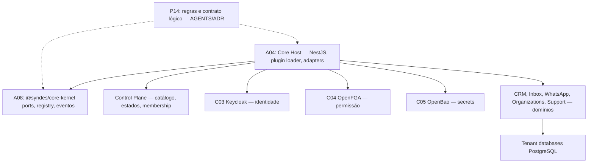
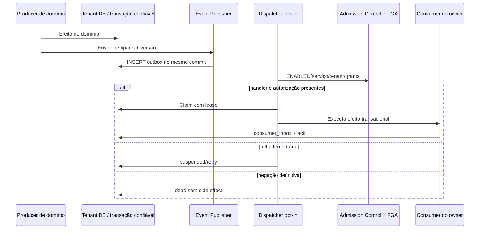
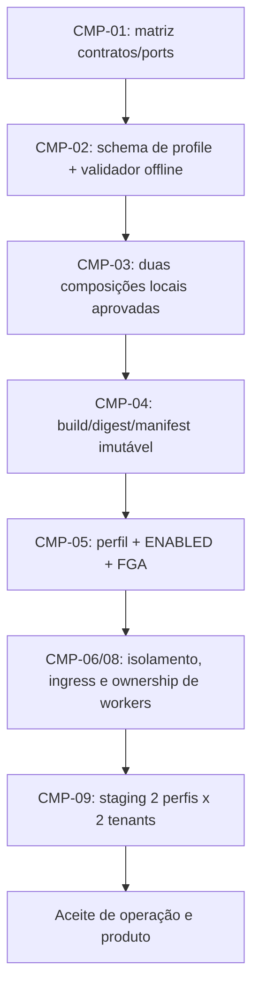

# P14 — Platform Core

[← Sumário do volume](../) · [↑ Biblioteca](../../)

> **Leitura técnica, não homologação.** Estados, limites e comprovações devem ser lidos em STATUS e nos checkpoints versionados.

## Identificação e rastreabilidade

| Campo | Fonte verificável |
|---|---|
| Unidade / owner | **P14** · Platform Core |
| Volume | Plataforma e core |
| Caminho de implementação | `modules/platform-core` |
| Documento de origem | [README](https://github.com/delmacy/syndes-system/blob/main/docs/subprojects/P14-platform-core/README.md) |
| STATUS e critérios | [STATUS original](https://github.com/delmacy/syndes-system/blob/main/docs/subprojects/P14-platform-core/STATUS.md) |
| Símbolos, APIs, SQL e dependências | [REFERENCIA-TECNICA](https://github.com/delmacy/syndes-system/blob/main/docs/subprojects/P14-platform-core/REFERENCIA-TECNICA.md) |
| Implantação, runbooks e gates | [OPERACAO](https://github.com/delmacy/syndes-system/blob/main/docs/subprojects/P14-platform-core/OPERACAO.md) |

## Situação registrada

> AUDITORIA TÉCNICA PARCIAL RECONCILIADA — 12/11/2026. Revisão de fontes na worktree isolada baseada no SHA e2c5194a97d48d8a809231d7088be668604725fb. A unidade P14 NÃO é pacote runtime próprio: modules/platform-core contém apenas AGENTS.md. O Core executável é distribuído por A08 Kernel, A04 Host, Control/Identity/Authorization e módulos de domínio. Nenhuma alteração de runtime, banco, permissões, plugin ou produção foi feita nesta auditoria; revisão sem…

A descrição acima é uma **citação resumida do STATUS versionado**; não significa que os testes de integração, a implantação ou a homologação estejam aprovados.

## Índice dos subcapítulos

Todos os assuntos deste módulo estão nesta página. Clique em um título para saltar à seção correspondente; o índice lateral acompanha a leitura.

- [Casos de uso](#casos-de-uso)
- [Histórias de usuário](#historias-de-usuario)
- [Requisitos](#requisitos)
- [Contratos públicos e privados](#contratos)
- [APIs e endpoints](#apis)
- [Eventos e mensageria](#eventos)
- [Dados e persistência](#dados)
- [Schemas e migrations](#schema)
- [Dependências e integrações](#dependencias)
- [Configuração e ambiente](#configuracao)
- [Frontend e interfaces](#interface)
- [Testes e evidências](#testes)
- [Operação e implantação](#operacao)
- [WBS e evolução](#wbs)
- [Documentação de origem integral](#documentacao-de-origem)
- [Controle de alterações](#controle-de-alteracoes)

## Casos de uso

**Editar esta seção:** [Abrir arquivo-fonte no GitHub](https://github.com/delmacy/syndes-system/edit/main/docs/subprojects/P14-platform-core/chapters/02-requisitos-historias-e-casos-de-uso.md) · [Consultar fonte](https://github.com/delmacy/syndes-system/blob/main/docs/subprojects/P14-platform-core/chapters/02-requisitos-historias-e-casos-de-uso.md)

*Referências extraídas da documentação versionada, sem inferir homologação ou implantação.*

**Lacuna documental:** ainda não há especificação textual identificada nesta área. Revisar implementação e registrar evidência antes de preencher.

📝 Espaço para ajustes e implementação

Este é um **modelo de registro**, não um editor com salvamento automático. Use o link **Editar esta seção** para atualizar o documento versionado.

- **Alteração proposta:** descreva o requisito, contrato, dado ou comportamento.
- **Referência de código:** informe caminho e símbolo real.
- **Testes e evidências:** informe comando, resultado e limite.
- **Critério de aceite:** indique como validar sem presumir homologação.
- **Status e revisão:** atualize a fonte canônica após revisão.

## Histórias de usuário

**Editar esta seção:** [Abrir arquivo-fonte no GitHub](https://github.com/delmacy/syndes-system/edit/main/docs/subprojects/P14-platform-core/chapters/02-requisitos-historias-e-casos-de-uso.md) · [Consultar fonte](https://github.com/delmacy/syndes-system/blob/main/docs/subprojects/P14-platform-core/chapters/02-requisitos-historias-e-casos-de-uso.md)

*Referências extraídas da documentação versionada, sem inferir homologação ou implantação.*

**Lacuna documental:** ainda não há especificação textual identificada nesta área. Revisar implementação e registrar evidência antes de preencher.

📝 Espaço para ajustes e implementação

Este é um **modelo de registro**, não um editor com salvamento automático. Use o link **Editar esta seção** para atualizar o documento versionado.

- **Alteração proposta:** descreva o requisito, contrato, dado ou comportamento.
- **Referência de código:** informe caminho e símbolo real.
- **Testes e evidências:** informe comando, resultado e limite.
- **Critério de aceite:** indique como validar sem presumir homologação.
- **Status e revisão:** atualize a fonte canônica após revisão.

## Requisitos

**Editar esta seção:** [Abrir arquivo-fonte no GitHub](https://github.com/delmacy/syndes-system/edit/main/docs/subprojects/P14-platform-core/chapters/02-requisitos-historias-e-casos-de-uso.md) · [Consultar fonte](https://github.com/delmacy/syndes-system/blob/main/docs/subprojects/P14-platform-core/chapters/02-requisitos-historias-e-casos-de-uso.md)

*Referências extraídas da documentação versionada, sem inferir homologação ou implantação.*

**Fonte:** [02-requisitos-historias-e-casos-de-uso.md](https://github.com/delmacy/syndes-system/blob/main/docs/subprojects/P14-platform-core/chapters/02-requisitos-historias-e-casos-de-uso.md)

> Linha 3: Os identificadores `P14-R*` e `US-P14-*` servem somente para **referenciar decisões existentes** (`AGENTS.md`, ADR de composição e ADRs de eventos). Não constituem novos requisitos aprovados, tickets criados ou incrementos de software.

**Fonte:** [STATUS.md](https://github.com/delmacy/syndes-system/blob/main/docs/subprojects/P14-platform-core/STATUS.md)

> Linha 48: - [Escopo](ESCOPO.md): requisitos, capacidades, contratos e diagramas por owner.

📝 Espaço para ajustes e implementação

Este é um **modelo de registro**, não um editor com salvamento automático. Use o link **Editar esta seção** para atualizar o documento versionado.

- **Alteração proposta:** descreva o requisito, contrato, dado ou comportamento.
- **Referência de código:** informe caminho e símbolo real.
- **Testes e evidências:** informe comando, resultado e limite.
- **Critério de aceite:** indique como validar sem presumir homologação.
- **Status e revisão:** atualize a fonte canônica após revisão.

## Contratos públicos e privados

**Editar esta seção:** [Abrir arquivo-fonte no GitHub](https://github.com/delmacy/syndes-system/edit/main/docs/subprojects/P14-platform-core/REFERENCIA-TECNICA.md) · [Consultar fonte](https://github.com/delmacy/syndes-system/blob/main/docs/subprojects/P14-platform-core/REFERENCIA-TECNICA.md)

*Referências extraídas da documentação versionada, sem inferir homologação ou implantação.*

**Fonte:** [REFERENCIA-TECNICA.md](https://github.com/delmacy/syndes-system/blob/main/docs/subprojects/P14-platform-core/REFERENCIA-TECNICA.md)

> Linha 10: \| A08 — Core Kernel \| `packages/core-kernel/package.json`, `src/index.ts`, `kernel.ts`, `module-registry.ts` \| Node 22+/TypeScript; `@syndes/core-kernel` versão 0.1.0 **privada**, `exports["."]` apenas \|

> Linha 13: \| Plataforma de eventos \| `packages/core-kernel/src/*events.ts`, `apps/core-host/src/platform-event-*.ts` \| Contrato tipado + publicação/dispatch/manual batch **opt-in**, não scheduler automático \|

> Linha 18: Os nomes abaixo são **exports públicos reais** de `packages/core-kernel/src/index.ts`; não são classes/métodos pertencentes à P14.

> Linha 29: \| `resolveApprovedModules`, `projectTenantModuleStates` \| Contratos de catálogo e lifecycle; operacionalidade depende de adapters reais \|

> Linha 31: **Contrato de import:** `@syndes/core-kernel` (entrypoint público), nunca `@syndes/core-kernel/src/*.ts`. O package tem `private:true`, sem publicação pública aprovada.

> Linha 43: \| `GET /modules/:moduleId/config` \| Retorna `issuer/clientId` de plugin aprovado com OIDC público configurado \|

> Linha 51: - A04 provê `TenantPgProvider`, adapters, publishers e dispatchers; A08 define o contrato. Workers automáticos, grants reais e DDL operacional dependem de gates separados.

**Fonte:** [04-contratos-e-dependencias-publicas.md](https://github.com/delmacy/syndes-system/blob/main/docs/subprojects/P14-platform-core/chapters/04-contratos-e-dependencias-publicas.md)

> Linha 3: **P14 não possui package.json, controller HTTP, export JavaScript, serviço NestJS ou esquema SQL.** O contrato normativo dessa unidade é o `AGENTS.md` e as decisões aprovadas. As interfaces reais abaixo possuem owners separados.

> Linha 7: \| Fonte e interface real \| Contrato público e responsabilidade \| Consumidores \|

> Linha 9: \| `package.json#exports["."]`, `src/index.ts` \| `@syndes/core-kernel`: **único import público do pacote**; caminhos `src/*` internos não são API \| Host e módulos autorizados \|

> Linha 28: \| `main.ts` \| `GET /healthz`, `GET /readyz`, `GET /modules/:moduleId/config` \| Rotas do **Host**, não API P14; config OIDC pública sem segredo \|

> Linha 35: - **Público do Kernel:** `@syndes/core-kernel`; `src/index.ts` enumera símbolos. `private: true` impede tratar como SDK npm distribuído.

> Linha 36: - **Interno do Host:** `apps/core-host/src/*` não deve ser importado diretamente por outros módulos como SDK público. Usar tokens/ports injetados e contratos versionados aprovados.

> Linha 37: - **Privado do tenant:** credenciais, DSN, membership e transações; nunca criar interface que aceite nome do DB vindo do navegador.

> Linha 41: Qualquer alteração em API, export, ACL, SQL, eventos ou composição cross-owner precisa de revisão, WBS/ADR/PR e suites de consumidores. Esta auditoria **não** altera contratos executáveis.

**Fonte:** [STATUS.md](https://github.com/delmacy/syndes-system/blob/main/docs/subprojects/P14-platform-core/STATUS.md)

> Linha 13: \| **Documentação P14** \| **Auditoria parcial**: 8 capítulos, contratos, diagrama, WBS e referência técnica reconciliados \| Aprovação de arquitetura pelos owners continua pendente \|

> Linha 15: \| **Core Kernel A08** \| `packages/core-kernel`: `CoreKernel`, `ModuleRegistry`, ports, `SyndesPlugin`, eventos tipados \| Package privado; implementação e testes pertencem a A08 \|

> Linha 18: \| **Eventos** \| `platform-event-*.ts`, contratos `platform-events.ts` e `control-plane-events.ts` identificados \| Worker admission/composição manual **não são scheduler ativo nem DDL produtivo** \|

> Linha 29: \| `packages/core-kernel/src/index.ts` e `package.json#exports` \| Exports tipados do Kernel `@syndes/core-kernel` \| SDK externo publicado \|

> Linha 48: - [Escopo](ESCOPO.md): requisitos, capacidades, contratos e diagramas por owner.

> Linha 58: \| 2026-11-12 \| `e2c5194`, worktree documental P14 \| Reconciliação estática de código e política, sem mutações de runtime \| Aprovação dos contratos e Product Gate \|

**Fonte:** [OPERACAO.md](https://github.com/delmacy/syndes-system/blob/main/docs/subprojects/P14-platform-core/OPERACAO.md)

> Linha 16: - [Contratos públicos](../../standards/CONTRATOS-PUBLICOS.md).

> Linha 32: 4. Testar com critérios apropriados: unitário, contrato, integração, E2E e CI.

📝 Espaço para ajustes e implementação

Este é um **modelo de registro**, não um editor com salvamento automático. Use o link **Editar esta seção** para atualizar o documento versionado.

- **Alteração proposta:** descreva o requisito, contrato, dado ou comportamento.
- **Referência de código:** informe caminho e símbolo real.
- **Testes e evidências:** informe comando, resultado e limite.
- **Critério de aceite:** indique como validar sem presumir homologação.
- **Status e revisão:** atualize a fonte canônica após revisão.

## APIs e endpoints

**Editar esta seção:** [Abrir arquivo-fonte no GitHub](https://github.com/delmacy/syndes-system/edit/main/docs/subprojects/P14-platform-core/REFERENCIA-TECNICA.md) · [Consultar fonte](https://github.com/delmacy/syndes-system/blob/main/docs/subprojects/P14-platform-core/REFERENCIA-TECNICA.md)

*Referências extraídas da documentação versionada, sem inferir homologação ou implantação.*

**Fonte:** [REFERENCIA-TECNICA.md](https://github.com/delmacy/syndes-system/blob/main/docs/subprojects/P14-platform-core/REFERENCIA-TECNICA.md)

> Linha 9: \| P14 \| `modules/platform-core/AGENTS.md` \| Política de capacidades transversais, sem package, classes, banco, HTTP ou app \|

> Linha 12: \| Control/tenancy \| `modules/organizations`, `apps/account-access-api`, `apps/core-host/src/module-*.ts` \| Managers/tenants com ownership separado \|

> Linha 14: \| Domínio \| `modules/core-crm`, `inbox`, `whatsapp`, `organizations`, `support`, `service-management` \| API, persistência e comportamento próprios, sob seus owners \|

> Linha 37: `apps/core-host/src/main.ts` define os controllers HTTP concretos do **Host**, não da P14:

> Linha 41: \| `GET /healthz` \| Estado básico `ok` \|

> Linha 42: \| `GET /readyz` \| Verifica CoreService/Control e inicialização do Kernel \|

> Linha 43: \| `GET /modules/:moduleId/config` \| Retorna `issuer/clientId` de plugin aprovado com OIDC público configurado \|

> Linha 44: \| `POST /v1/tenants/:tenantId/authorize` \| JWT verificado, UUID tenant, tenant membership + FGA via `CoreKernel.execute`; resposta deny/falha apropriada \|

> Linha 46: Isso não prova que todos os controllers de domínios tenham sido migrados para o gate de `executeModule`. Não expor `main.ts` como API SDK do Kernel.

**Fonte:** [04-contratos-e-dependencias-publicas.md](https://github.com/delmacy/syndes-system/blob/main/docs/subprojects/P14-platform-core/chapters/04-contratos-e-dependencias-publicas.md)

> Linha 3: **P14 não possui package.json, controller HTTP, export JavaScript, serviço NestJS ou esquema SQL.** O contrato normativo dessa unidade é o `AGENTS.md` e as decisões aprovadas. As interfaces reais abaixo possuem owners separados.

> Linha 9: \| `package.json#exports["."]`, `src/index.ts` \| `@syndes/core-kernel`: **único import público do pacote**; caminhos `src/*` internos não são API \| Host e módulos autorizados \|

> Linha 11: \| `CoreKernel.execute(request, handler)` \| Valida request e sequência membership + autorização de recurso; `Actor` autenticado externamente \| Endpoints conectados \|

> Linha 28: \| `main.ts` \| `GET /healthz`, `GET /readyz`, `GET /modules/:moduleId/config` \| Rotas do **Host**, não API P14; config OIDC pública sem segredo \|

> Linha 29: \| `main.ts` \| `POST /v1/tenants/:tenantId/authorize` \| JWT, tenant UUID, `CoreKernel.execute`; não é autorização de todos os controllers do sistema \|

> Linha 41: Qualquer alteração em API, export, ACL, SQL, eventos ou composição cross-owner precisa de revisão, WBS/ADR/PR e suites de consumidores. Esta auditoria **não** altera contratos executáveis.

**Fonte:** [05-arquitetura-banco-interface-configuracao-e-diagramas.md](https://github.com/delmacy/syndes-system/blob/main/docs/subprojects/P14-platform-core/chapters/05-arquitetura-banco-interface-configuracao-e-diagramas.md)

> Linha 38: 6. Em falha de membership, FGA, identidade ou infraestrutura, negar a operação protegida; a implementação do erro HTTP depende do Host.

**Fonte:** [STATUS.md](https://github.com/delmacy/syndes-system/blob/main/docs/subprojects/P14-platform-core/STATUS.md)

> Linha 17: \| **Módulos e Tenant/Control** \| Implementação dividida por owners; Control ENABLED, membership/FGA/tenancy e tenant DB têm gates próprios \| `executeModule` é opt-in; não declarar enforcement universal sem testar cada endpoint \|

> Linha 42: 6. **Governança:** não transferir API, SQL, frontend, decisões de instalação ou produto dos owners A04/A08/C01/etc. para P14.

> Linha 49: - [Referência técnica](REFERENCIA-TECNICA.md): símbolos e endpoints reais, pertencentes a Kernel/Host.

📝 Espaço para ajustes e implementação

Este é um **modelo de registro**, não um editor com salvamento automático. Use o link **Editar esta seção** para atualizar o documento versionado.

- **Alteração proposta:** descreva o requisito, contrato, dado ou comportamento.
- **Referência de código:** informe caminho e símbolo real.
- **Testes e evidências:** informe comando, resultado e limite.
- **Critério de aceite:** indique como validar sem presumir homologação.
- **Status e revisão:** atualize a fonte canônica após revisão.

## Eventos e mensageria

**Editar esta seção:** [Abrir arquivo-fonte no GitHub](https://github.com/delmacy/syndes-system/edit/main/docs/subprojects/P14-platform-core/REFERENCIA-TECNICA.md) · [Consultar fonte](https://github.com/delmacy/syndes-system/blob/main/docs/subprojects/P14-platform-core/REFERENCIA-TECNICA.md)

*Referências extraídas da documentação versionada, sem inferir homologação ou implantação.*

**Fonte:** [REFERENCIA-TECNICA.md](https://github.com/delmacy/syndes-system/blob/main/docs/subprojects/P14-platform-core/REFERENCIA-TECNICA.md)

> Linha 13: \| Plataforma de eventos \| `packages/core-kernel/src/*events.ts`, `apps/core-host/src/platform-event-*.ts` \| Contrato tipado + publicação/dispatch/manual batch **opt-in**, não scheduler automático \|

**Fonte:** [04-contratos-e-dependencias-publicas.md](https://github.com/delmacy/syndes-system/blob/main/docs/subprojects/P14-platform-core/chapters/04-contratos-e-dependencias-publicas.md)

> Linha 18: \| `TrustedTenantTransactionProvider.withTransaction` \| Conexão pinned para operação e outbox atômicas \| Event publishers/consumers \|

> Linha 30: \| `platform-event-publisher.ts` \| Publicação transacional \| Requer provider transacional, outbox no tenant DB \|

> Linha 38: - **Eventos de domínio/Control:** são naturezas e schemas distintos; a publicação não altera automaticamente status de módulo.

> Linha 41: Qualquer alteração em API, export, ACL, SQL, eventos ou composição cross-owner precisa de revisão, WBS/ADR/PR e suites de consumidores. Esta auditoria **não** altera contratos executáveis.

**Fonte:** [05-arquitetura-banco-interface-configuracao-e-diagramas.md](https://github.com/delmacy/syndes-system/blob/main/docs/subprojects/P14-platform-core/chapters/05-arquitetura-banco-interface-configuracao-e-diagramas.md)

> Linha 88: - **Configuração implementada:** `apps/core-host/config/modules.json` fixo, runtime secrets/oidc/FGA configurados pelo Host. Valores de credenciais, URLs internas e grants reais **não** devem ser publicados.

**Fonte:** [STATUS.md](https://github.com/delmacy/syndes-system/blob/main/docs/subprojects/P14-platform-core/STATUS.md)

> Linha 15: \| **Core Kernel A08** \| `packages/core-kernel`: `CoreKernel`, `ModuleRegistry`, ports, `SyndesPlugin`, eventos tipados \| Package privado; implementação e testes pertencem a A08 \|

> Linha 18: \| **Eventos** \| `platform-event-*.ts`, contratos `platform-events.ts` e `control-plane-events.ts` identificados \| Worker admission/composição manual **não são scheduler ativo nem DDL produtivo** \|

> Linha 29: \| `packages/core-kernel/src/index.ts` e `package.json#exports` \| Exports tipados do Kernel `@syndes/core-kernel` \| SDK externo publicado \|

> Linha 40: 4. **Eventos:** migrations de tenant/Control, FGA service grants, projetor único WhatsApp, backup/restore e worker operacional dependem de gates separados.

📝 Espaço para ajustes e implementação

Este é um **modelo de registro**, não um editor com salvamento automático. Use o link **Editar esta seção** para atualizar o documento versionado.

- **Alteração proposta:** descreva o requisito, contrato, dado ou comportamento.
- **Referência de código:** informe caminho e símbolo real.
- **Testes e evidências:** informe comando, resultado e limite.
- **Critério de aceite:** indique como validar sem presumir homologação.
- **Status e revisão:** atualize a fonte canônica após revisão.

## Dados e persistência

**Editar esta seção:** [Abrir arquivo-fonte no GitHub](https://github.com/delmacy/syndes-system/edit/main/docs/subprojects/P14-platform-core/REFERENCIA-TECNICA.md) · [Consultar fonte](https://github.com/delmacy/syndes-system/blob/main/docs/subprojects/P14-platform-core/REFERENCIA-TECNICA.md)

*Referências extraídas da documentação versionada, sem inferir homologação ou implantação.*

**Fonte:** [REFERENCIA-TECNICA.md](https://github.com/delmacy/syndes-system/blob/main/docs/subprojects/P14-platform-core/REFERENCIA-TECNICA.md)

> Linha 14: \| Domínio \| `modules/core-crm`, `inbox`, `whatsapp`, `organizations`, `support`, `service-management` \| API, persistência e comportamento próprios, sob seus owners \|

> Linha 28: \| `validatePlatformEvent`, `validateControlPlaneEvent` \| Envelopes versionados para planos de dados distintos \|

> Linha 50: - **Nenhum schema, migration, database ou entidade SQL é da P14.** Control DB, tenant DB (um por tenant) e schemas de módulos têm owners independentes. `platform_events` fica no banco tenant, não em Control.

**Fonte:** [04-contratos-e-dependencias-publicas.md](https://github.com/delmacy/syndes-system/blob/main/docs/subprojects/P14-platform-core/chapters/04-contratos-e-dependencias-publicas.md)

> Linha 19: \| `validatePlatformEvent/validateControlPlaneEvent` \| Envelopes tipados/versionados, grupos de dados distintos \| Produtores/consumidores autorizados \|

> Linha 30: \| `platform-event-publisher.ts` \| Publicação transacional \| Requer provider transacional, outbox no tenant DB \|

**Fonte:** [05-arquitetura-banco-interface-configuracao-e-diagramas.md](https://github.com/delmacy/syndes-system/blob/main/docs/subprojects/P14-platform-core/chapters/05-arquitetura-banco-interface-configuracao-e-diagramas.md)

> Linha 86: - **P14 não tem PostgreSQL, migration ou tabela própria.** Control DB, schema `platform_events` no tenant e migrations dos módulos têm owners separados.

**Fonte:** [STATUS.md](https://github.com/delmacy/syndes-system/blob/main/docs/subprojects/P14-platform-core/STATUS.md)

> Linha 17: \| **Módulos e Tenant/Control** \| Implementação dividida por owners; Control ENABLED, membership/FGA/tenancy e tenant DB têm gates próprios \| `executeModule` é opt-in; não declarar enforcement universal sem testar cada endpoint \|

📝 Espaço para ajustes e implementação

Este é um **modelo de registro**, não um editor com salvamento automático. Use o link **Editar esta seção** para atualizar o documento versionado.

- **Alteração proposta:** descreva o requisito, contrato, dado ou comportamento.
- **Referência de código:** informe caminho e símbolo real.
- **Testes e evidências:** informe comando, resultado e limite.
- **Critério de aceite:** indique como validar sem presumir homologação.
- **Status e revisão:** atualize a fonte canônica após revisão.

## Schemas e migrations

**Editar esta seção:** [Abrir arquivo-fonte no GitHub](https://github.com/delmacy/syndes-system/edit/main/docs/subprojects/P14-platform-core/REFERENCIA-TECNICA.md) · [Consultar fonte](https://github.com/delmacy/syndes-system/blob/main/docs/subprojects/P14-platform-core/REFERENCIA-TECNICA.md)

*Referências extraídas da documentação versionada, sem inferir homologação ou implantação.*

**Fonte:** [REFERENCIA-TECNICA.md](https://github.com/delmacy/syndes-system/blob/main/docs/subprojects/P14-platform-core/REFERENCIA-TECNICA.md)

> Linha 25: \| `ModuleRegistry.register/ordered/has` \| SemVer/IDs válidos, schemas únicos, dependências e ordenação; rejeita ciclos/ausentes \|

> Linha 26: \| `defineSyndesModule(...)`, `SyndesPlugin` \| Descriptor confiável e seus assets, permissions e migrations \|

> Linha 50: - **Nenhum schema, migration, database ou entidade SQL é da P14.** Control DB, tenant DB (um por tenant) e schemas de módulos têm owners independentes. `platform_events` fica no banco tenant, não em Control.

**Fonte:** [04-contratos-e-dependencias-publicas.md](https://github.com/delmacy/syndes-system/blob/main/docs/subprojects/P14-platform-core/chapters/04-contratos-e-dependencias-publicas.md)

> Linha 3: **P14 não possui package.json, controller HTTP, export JavaScript, serviço NestJS ou esquema SQL.** O contrato normativo dessa unidade é o `AGENTS.md` e as decisões aprovadas. As interfaces reais abaixo possuem owners separados.

> Linha 13: \| `ModuleRegistry.register/ordered/has` \| IDs, versões, schemas, dependências, ordem e rejeição de ciclos/ausência \| Host/owners de plugin \|

> Linha 38: - **Eventos de domínio/Control:** são naturezas e schemas distintos; a publicação não altera automaticamente status de módulo.

> Linha 41: Qualquer alteração em API, export, ACL, SQL, eventos ou composição cross-owner precisa de revisão, WBS/ADR/PR e suites de consumidores. Esta auditoria **não** altera contratos executáveis.

**Fonte:** [05-arquitetura-banco-interface-configuracao-e-diagramas.md](https://github.com/delmacy/syndes-system/blob/main/docs/subprojects/P14-platform-core/chapters/05-arquitetura-banco-interface-configuracao-e-diagramas.md)

> Linha 67: Os artefatos em `apps/core-host/src/platform-event-*.ts` e os contratos em `packages/core-kernel/src/*events.ts` existem; **não existe scheduler automático liberado nem worker operacional homologado**. As migrations do tenant e do Control têm owners e pré-requisitos distintos, sem permissão de aplicar DDL só por documentar.

> Linha 86: - **P14 não tem PostgreSQL, migration ou tabela própria.** Control DB, schema `platform_events` no tenant e migrations dos módulos têm owners separados.

> Linha 89: - **Segurança:** para ativação de perfis/workers exige Control ENABLED, FGA service grants, schema migrado com backup/restore, canário e rollback autorizados.

**Fonte:** [STATUS.md](https://github.com/delmacy/syndes-system/blob/main/docs/subprojects/P14-platform-core/STATUS.md)

> Linha 33: \| `docs/engineering/ADR-COMPOSICAO-MODULAR-CORE-20261111.md` \| Decisão de evolução por perfis \| Schema CMP-02 implementado \|

> Linha 37: 1. **CMP-01/02:** matriz de ports/dependências com sign-off e schema de profile validado offline ainda pendentes. A auditoria documental não conclui CMP-01 automaticamente.

> Linha 40: 4. **Eventos:** migrations de tenant/Control, FGA service grants, projetor único WhatsApp, backup/restore e worker operacional dependem de gates separados.

> Linha 42: 6. **Governança:** não transferir API, SQL, frontend, decisões de instalação ou produto dos owners A04/A08/C01/etc. para P14.

**Fonte:** [OPERACAO.md](https://github.com/delmacy/syndes-system/blob/main/docs/subprojects/P14-platform-core/OPERACAO.md)

> Linha 3: > **ÍNDICE DE FONTES, NÃO RUNBOOK HOMOLOGADO.** Não executar migrations, alterar permissões ou ativar workers apenas com esta página.

> Linha 31: 3. Confirmar migrations realmente aplicadas, backup/restore e rollback antes de SQL.

📝 Espaço para ajustes e implementação

Este é um **modelo de registro**, não um editor com salvamento automático. Use o link **Editar esta seção** para atualizar o documento versionado.

- **Alteração proposta:** descreva o requisito, contrato, dado ou comportamento.
- **Referência de código:** informe caminho e símbolo real.
- **Testes e evidências:** informe comando, resultado e limite.
- **Critério de aceite:** indique como validar sem presumir homologação.
- **Status e revisão:** atualize a fonte canônica após revisão.

## Dependências e integrações

**Editar esta seção:** [Abrir arquivo-fonte no GitHub](https://github.com/delmacy/syndes-system/edit/main/docs/subprojects/P14-platform-core/REFERENCIA-TECNICA.md) · [Consultar fonte](https://github.com/delmacy/syndes-system/blob/main/docs/subprojects/P14-platform-core/REFERENCIA-TECNICA.md)

*Referências extraídas da documentação versionada, sem inferir homologação ou implantação.*

**Fonte:** [REFERENCIA-TECNICA.md](https://github.com/delmacy/syndes-system/blob/main/docs/subprojects/P14-platform-core/REFERENCIA-TECNICA.md)

> Linha 11: \| A04 — Core Host \| `apps/core-host/package.json`, `src/main.ts`, `module-host.ts` \| NestJS 12, Node ESM, pg, jose e adapters Control/Keycloak/OpenFGA/OpenBao \|

> Linha 22: \| `CoreKernel` / `start()` \| Inicializa definições com ordem de dependências e sem repetir hooks após rejeição \|

> Linha 25: \| `ModuleRegistry.register/ordered/has` \| SemVer/IDs válidos, schemas únicos, dependências e ordenação; rejeita ciclos/ausentes \|

> Linha 35: `apps/core-host/src/module-host.ts` expõe **internamente** `loadInstalledPlugins()` e `installModuleAssets()`: lê a lista fixa de `config/modules.json` (CRM, Inbox, WhatsApp, Organizations, Support), valida trusted specifiers `@syndes/.../plugin`, dependências/ciclos e rotas duplicadas. `@syndes/service` existe como dependência do Host, **mas não está listado na composição ativa**.

**Fonte:** [04-contratos-e-dependencias-publicas.md](https://github.com/delmacy/syndes-system/blob/main/docs/subprojects/P14-platform-core/chapters/04-contratos-e-dependencias-publicas.md)

> Linha 10: \| `CoreKernel.start()` \| Inicializa módulos por dependência; falha persistente requer novo Kernel \| Host \|

> Linha 13: \| `ModuleRegistry.register/ordered/has` \| IDs, versões, schemas, dependências, ordem e rejeição de ciclos/ausência \| Host/owners de plugin \|

> Linha 25: \| `module-host.ts` \| `loadInstalledPlugins()` \| Lista estática `config/modules.json`, specifier trusted e validação de dependências antes do Nest \|

**Fonte:** [05-arquitetura-banco-interface-configuracao-e-diagramas.md](https://github.com/delmacy/syndes-system/blob/main/docs/subprojects/P14-platform-core/chapters/05-arquitetura-banco-interface-configuracao-e-diagramas.md)

> Linha 27: **P14 não é um processo extra.** A04 importa interfaces de A08 e carrega plugins confiáveis listados em `apps/core-host/config/modules.json`: CRM, Inbox, WhatsApp, Organizations e Support. O pacote `@syndes/service` é dependência de build, mas não está nesse manifesto fixo. A configuração não cria perfis selecionáveis por instância.

> Linha 34: 2. Ordenar definições no `ModuleRegistry`, recusando dependência circular/ausente.

> Linha 36: 4. Receber `Actor` previamente autenticado pelo Host (Keycloak).

**Fonte:** [STATUS.md](https://github.com/delmacy/syndes-system/blob/main/docs/subprojects/P14-platform-core/STATUS.md)

> Linha 16: \| **Core Host A04** \| `apps/core-host/src/main.ts`, `module-host.ts`, adapters, `config/modules.json` \| Loader fixo, **sem perfis por instância**. Serviço é dependência mas não plugin instalado \|

> Linha 19: \| **Testes locais históricos** \| Auditoria anterior do checkout `b452a03e`: Kernel **35 PASS**, Host **63 PASS, 19 SKIP** \| Não reexecutados nesta revisão; skips não comprovam PG17/staging/Keycloak/FGA \|

> Linha 37: 1. **CMP-01/02:** matriz de ports/dependências com sign-off e schema de profile validado offline ainda pendentes. A auditoria documental não conclui CMP-01 automaticamente.

> Linha 39: 3. **Serviço Basic:** package `@syndes/service` é dependência do Host, mas não está em `config/modules.json`; módulos precisam ser montados/ENABLED com grants e Product Gate específicos.

> Linha 41: 5. **Testes de integração reais:** resultados históricos com SKIP não servem como aceite de DB, tenant, FGA/Keycloak ou instalação; CI atual só comprova seu próprio SHA.

**Fonte:** [OPERACAO.md](https://github.com/delmacy/syndes-system/blob/main/docs/subprojects/P14-platform-core/OPERACAO.md)

> Linha 9: - [Evolução](EVOLUCAO.md): workpackages e dependências; nenhum item é concluído por estar planejado.

> Linha 32: 4. Testar com critérios apropriados: unitário, contrato, integração, E2E e CI.

📝 Espaço para ajustes e implementação

Este é um **modelo de registro**, não um editor com salvamento automático. Use o link **Editar esta seção** para atualizar o documento versionado.

- **Alteração proposta:** descreva o requisito, contrato, dado ou comportamento.
- **Referência de código:** informe caminho e símbolo real.
- **Testes e evidências:** informe comando, resultado e limite.
- **Critério de aceite:** indique como validar sem presumir homologação.
- **Status e revisão:** atualize a fonte canônica após revisão.

## Configuração e ambiente

**Editar esta seção:** [Abrir arquivo-fonte no GitHub](https://github.com/delmacy/syndes-system/edit/main/docs/subprojects/P14-platform-core/OPERACAO.md) · [Consultar fonte](https://github.com/delmacy/syndes-system/blob/main/docs/subprojects/P14-platform-core/OPERACAO.md)

*Referências extraídas da documentação versionada, sem inferir homologação ou implantação.*

**Fonte:** [REFERENCIA-TECNICA.md](https://github.com/delmacy/syndes-system/blob/main/docs/subprojects/P14-platform-core/REFERENCIA-TECNICA.md)

> Linha 27: \| `TrustedTenantDatabaseProvider`, `TrustedTenantTransactionProvider` \| Porta query-only vs. conexão pinned com `withTransaction` para efeitos atômicos \|

**Fonte:** [05-arquitetura-banco-interface-configuracao-e-diagramas.md](https://github.com/delmacy/syndes-system/blob/main/docs/subprojects/P14-platform-core/chapters/05-arquitetura-banco-interface-configuracao-e-diagramas.md)

> Linha 27: **P14 não é um processo extra.** A04 importa interfaces de A08 e carrega plugins confiáveis listados em `apps/core-host/config/modules.json`: CRM, Inbox, WhatsApp, Organizations e Support. O pacote `@syndes/service` é dependência de build, mas não está nesse manifesto fixo. A configuração não cria perfis selecionáveis por instância.

> Linha 88: - **Configuração implementada:** `apps/core-host/config/modules.json` fixo, runtime secrets/oidc/FGA configurados pelo Host. Valores de credenciais, URLs internas e grants reais **não** devem ser publicados.

📝 Espaço para ajustes e implementação

Este é um **modelo de registro**, não um editor com salvamento automático. Use o link **Editar esta seção** para atualizar o documento versionado.

- **Alteração proposta:** descreva o requisito, contrato, dado ou comportamento.
- **Referência de código:** informe caminho e símbolo real.
- **Testes e evidências:** informe comando, resultado e limite.
- **Critério de aceite:** indique como validar sem presumir homologação.
- **Status e revisão:** atualize a fonte canônica após revisão.

## Frontend e interfaces

**Editar esta seção:** [Abrir arquivo-fonte no GitHub](https://github.com/delmacy/syndes-system/edit/main/docs/subprojects/P14-platform-core/REFERENCIA-TECNICA.md) · [Consultar fonte](https://github.com/delmacy/syndes-system/blob/main/docs/subprojects/P14-platform-core/REFERENCIA-TECNICA.md)

*Referências extraídas da documentação versionada, sem inferir homologação ou implantação.*

**Fonte:** [REFERENCIA-TECNICA.md](https://github.com/delmacy/syndes-system/blob/main/docs/subprojects/P14-platform-core/REFERENCIA-TECNICA.md)

> Linha 52: - **Nenhum frontend P14.** Workspace e Manager são apps separados; `packages/front-shared` não compartilha credenciais/sessão.

**Fonte:** [03-capabilities.md](https://github.com/delmacy/syndes-system/blob/main/docs/subprojects/P14-platform-core/chapters/03-capabilities.md)

> Linha 5: \| Contratos de tenancy/autorização \| **A08** `contracts.ts`, `kernel.ts` \| Interface de Kernel, não enforcement universal automático \|

> Linha 12: \| Componentes compartilhados de frontend \| **A07** `packages/front-shared`; **A01/A02/A03** seus aplicativos \| Visuais compartilhados sem sessão/token/contexto misturados \|

> Linha 15: \| Painel de composição \| CMP-10 opcional \| **Não existe frontend P14** \|

**Fonte:** [05-arquitetura-banco-interface-configuracao-e-diagramas.md](https://github.com/delmacy/syndes-system/blob/main/docs/subprojects/P14-platform-core/chapters/05-arquitetura-banco-interface-configuracao-e-diagramas.md)

> Linha 87: - **Não existe frontend P14.** Workspace tenant, Manager e Support são aplicativos separados; `front-shared` só fornece UI sem tokens/sessões.

**Fonte:** [STATUS.md](https://github.com/delmacy/syndes-system/blob/main/docs/subprojects/P14-platform-core/STATUS.md)

> Linha 14: \| **Runtime P14** \| **Não aplicável** — somente `modules/platform-core/AGENTS.md` \| P14 não tem package JSON, controller, banco nem frontend \|

> Linha 42: 6. **Governança:** não transferir API, SQL, frontend, decisões de instalação ou produto dos owners A04/A08/C01/etc. para P14.

📝 Espaço para ajustes e implementação

Este é um **modelo de registro**, não um editor com salvamento automático. Use o link **Editar esta seção** para atualizar o documento versionado.

- **Alteração proposta:** descreva o requisito, contrato, dado ou comportamento.
- **Referência de código:** informe caminho e símbolo real.
- **Testes e evidências:** informe comando, resultado e limite.
- **Critério de aceite:** indique como validar sem presumir homologação.
- **Status e revisão:** atualize a fonte canônica após revisão.

## Testes e evidências

**Editar esta seção:** [Abrir arquivo-fonte no GitHub](https://github.com/delmacy/syndes-system/edit/main/docs/subprojects/P14-platform-core/STATUS.md) · [Consultar fonte](https://github.com/delmacy/syndes-system/blob/main/docs/subprojects/P14-platform-core/STATUS.md)

*Referências extraídas da documentação versionada, sem inferir homologação ou implantação.*

**Fonte:** [STATUS.md](https://github.com/delmacy/syndes-system/blob/main/docs/subprojects/P14-platform-core/STATUS.md)

> Linha 7: O levantamento complementa os testes históricos; o CI remoto verde não aprova operação ou perfis por instância.

> Linha 11: \| Dimensão \| Evidência verificada \| Limite real \|

> Linha 15: \| **Core Kernel A08** \| `packages/core-kernel`: `CoreKernel`, `ModuleRegistry`, ports, `SyndesPlugin`, eventos tipados \| Package privado; implementação e testes pertencem a A08 \|

> Linha 17: \| **Módulos e Tenant/Control** \| Implementação dividida por owners; Control ENABLED, membership/FGA/tenancy e tenant DB têm gates próprios \| `executeModule` é opt-in; não declarar enforcement universal sem testar cada endpoint \|

> Linha 19: \| **Testes locais históricos** \| Auditoria anterior do checkout `b452a03e`: Kernel **35 PASS**, Host **63 PASS, 19 SKIP** \| Não reexecutados nesta revisão; skips não comprovam PG17/staging/Keycloak/FGA \|

> Linha 20: \| **CI integrado da baseline** \| [run 43345095065](https://github.com/delmacy/syndes-system/actions/runs/43345095065) — **24/24 jobs success** no SHA `e2c5194` \| Ambiente de CI, não deploy/restore/Product Gate \|

> Linha 22: \| **Aceite/Operação** \| Nenhuma homologação feita nesta frente \| Release, backup/restore, service grants, rollout e Product Gate pendentes \|

> Linha 39: 3. **Serviço Basic:** package `@syndes/service` é dependência do Host, mas não está em `config/modules.json`; módulos precisam ser montados/ENABLED com grants e Product Gate específicos.

> Linha 40: 4. **Eventos:** migrations de tenant/Control, FGA service grants, projetor único WhatsApp, backup/restore e worker operacional dependem de gates separados.

> Linha 41: 5. **Testes de integração reais:** resultados históricos com SKIP não servem como aceite de DB, tenant, FGA/Keycloak ou instalação; CI atual só comprova seu próprio SHA.

> Linha 51: - **Próximo candidato técnico:** validar CMP-01 (matriz de port/adapters/consumers e testes de fronteira) e depois especificar CMP-02 offline, sob autorização do owner. Nada de perfil/projeto dedicado em runtime antes de CMP-03+ e gates operacionais.

> Linha 56: \| 2026-11-12 \| `b452a03e`, DevServer01 \| Testes locais históricos Kernel 35, Host 63; 19 skip \| Deploy/staging/CI desse SHA \|

> Linha 58: \| 2026-11-12 \| `e2c5194`, worktree documental P14 \| Reconciliação estática de código e política, sem mutações de runtime \| Aprovação dos contratos e Product Gate \|

**Fonte:** [06-wbs-marcos-e-aceite.md](https://github.com/delmacy/syndes-system/blob/main/docs/subprojects/P14-platform-core/chapters/06-wbs-marcos-e-aceite.md)

> Linha 7: \| Frente \| Trabalho \| Estado de origem \| Evidência que falta \|

> Linha 10: \| 50.08 \| Gate Basic CRM/Inbox/WhatsApp \| BLOQ na WBS \| Jornada real com identidade, tenant e consentimento \|

> Linha 11: \| 55.03 \| Serviço com Host/installer e gates \| API opt-in, Control/restore/FGA reais BLOQ \| `@syndes/service` listado no loader **não está**; ativação requer owner e gates \|

> Linha 12: \| 70.09 \| Product Gate por módulo \| PEND \| QA, UX, dados/operador e sign-off \|

> Linha 14: \| CMP-01 \| Contratos/ports/provedores e dependências \| **PEND** no plano de composição \| Matriz aprovada + testes negativos de fronteira \|

> Linha 17: \| CMP-04–09 \| Imagens, entitlements, isolamento, ownership e staging \| PEND/BLOQ/CONDICIONAL \| Build attestation, FGA, backup/restore e testes de 2 tenants \|

> Linha 18: \| CMP-10 \| UI opcional de composição \| P2 \| Product Gate futuro, fora do MVP atual \|

> Linha 29: - Aprovar matriz real de APIs/ports e owners (CMP-01), com testes de dependência, negação e compatibilidade por consumidor.

> Linha 32: - Homologar worker/dispatchers somente após Control+tenant schemas, service grant FGA, ownership exclusivo e teste restaurável em staging.

> Linha 33: - Validar duas composições reais sob dois tenants, com digest, recursos, logs, rollback e aceite; não atribuir DONE a P14 antes dos gates correspondentes.

**Fonte:** [REFERENCIA-TECNICA.md](https://github.com/delmacy/syndes-system/blob/main/docs/subprojects/P14-platform-core/REFERENCIA-TECNICA.md)

> Linha 24: \| `CoreKernel.executeModule(...)` \| Gate **opt-in** de `ModuleAccessPort`, não ativado automaticamente em todos os controllers \|

> Linha 46: Isso não prova que todos os controllers de domínios tenham sido migrados para o gate de `executeModule`. Não expor `main.ts` como API SDK do Kernel.

> Linha 51: - A04 provê `TenantPgProvider`, adapters, publishers e dispatchers; A08 define o contrato. Workers automáticos, grants reais e DDL operacional dependem de gates separados.

> Linha 54: - **Segurança:** qualquer mudança cross-owner exige revisão, testes de consumidores, tenant isolation e autorização; a inspeção não concede acesso operacional.

> Linha 58: - **Histórico:** [STATUS P14](STATUS.md) registrava em revisão anterior 35 testes locais Kernel PASS e 63 Host PASS, com **19 SKIP**; isso não foi reexecutado como teste de produto nesta auditoria documental.

**Fonte:** [OPERACAO.md](https://github.com/delmacy/syndes-system/blob/main/docs/subprojects/P14-platform-core/OPERACAO.md)

> Linha 7: - [STATUS](STATUS.md): nível de validação, bloqueios, testes, ambiente e SHA.

> Linha 32: 4. Testar com critérios apropriados: unitário, contrato, integração, E2E e CI.

> Linha 33: 5. Registrar resultado e evidência em STATUS, sem confundir merge com deploy ou aceite.

📝 Espaço para ajustes e implementação

Este é um **modelo de registro**, não um editor com salvamento automático. Use o link **Editar esta seção** para atualizar o documento versionado.

- **Alteração proposta:** descreva o requisito, contrato, dado ou comportamento.
- **Referência de código:** informe caminho e símbolo real.
- **Testes e evidências:** informe comando, resultado e limite.
- **Critério de aceite:** indique como validar sem presumir homologação.
- **Status e revisão:** atualize a fonte canônica após revisão.

## Operação e implantação

**Editar esta seção:** [Abrir arquivo-fonte no GitHub](https://github.com/delmacy/syndes-system/edit/main/docs/subprojects/P14-platform-core/OPERACAO.md) · [Consultar fonte](https://github.com/delmacy/syndes-system/blob/main/docs/subprojects/P14-platform-core/OPERACAO.md)

*Referências extraídas da documentação versionada, sem inferir homologação ou implantação.*

**Fonte:** [OPERACAO.md](https://github.com/delmacy/syndes-system/blob/main/docs/subprojects/P14-platform-core/OPERACAO.md)

> Linha 31: 3. Confirmar migrations realmente aplicadas, backup/restore e rollback antes de SQL.

> Linha 33: 5. Registrar resultado e evidência em STATUS, sem confundir merge com deploy ou aceite.

**Fonte:** [REFERENCIA-TECNICA.md](https://github.com/delmacy/syndes-system/blob/main/docs/subprojects/P14-platform-core/REFERENCIA-TECNICA.md)

> Linha 23: \| `CoreKernel.execute(...)` \| Exige `Actor` autenticado, `TenancyPort.canAccessTenant` e `AuthorizationPort.canAccess`; nega operação indevida \|

> Linha 53: - **Nenhum perfil de composição implantado:** `config/modules.json` é lista fixa; o plano CMP-01/02 é futuro e CMP-03–09 não está comprovado.

**Fonte:** [05-arquitetura-banco-interface-configuracao-e-diagramas.md](https://github.com/delmacy/syndes-system/blob/main/docs/subprojects/P14-platform-core/chapters/05-arquitetura-banco-interface-configuracao-e-diagramas.md)

> Linha 38: 6. Em falha de membership, FGA, identidade ou infraestrutura, negar a operação protegida; a implementação do erro HTTP depende do Host.

> Linha 82: Conforme [ADR de composição](https://github.com/delmacy/syndes-system/blob/main/docs/engineering/ADR-COMPOSICAO-MODULAR-CORE-20261111.md), perfis por instância devem ser artefatos confiáveis imutáveis por build/deploy. Não carregar módulos a partir de requisições de usuários; não inventar comunicação cross-process sem contrato/teste/necessidade.

> Linha 89: - **Segurança:** para ativação de perfis/workers exige Control ENABLED, FGA service grants, schema migrado com backup/restore, canário e rollback autorizados.

**Fonte:** [06-wbs-marcos-e-aceite.md](https://github.com/delmacy/syndes-system/blob/main/docs/subprojects/P14-platform-core/chapters/06-wbs-marcos-e-aceite.md)

> Linha 25: 4. **Implantação/perfis:** nada habilitado, nenhum worker iniciado, nenhuma migration operacional aplicada nesta auditoria.

> Linha 33: - Validar duas composições reais sob dois tenants, com digest, recursos, logs, rollback e aceite; não atribuir DONE a P14 antes dos gates correspondentes.

**Fonte:** [STATUS.md](https://github.com/delmacy/syndes-system/blob/main/docs/subprojects/P14-platform-core/STATUS.md)

> Linha 3: > **AUDITORIA TÉCNICA PARCIAL RECONCILIADA — 12/11/2026.** Revisão de fontes na worktree isolada baseada no SHA `e2c5194a97d48d8a809231d7088be668604725fb`. A unidade P14 **NÃO é pacote runtime próprio**: `modules/platform-core` contém apenas `AGENTS.md`. O Core executável é distribuído por A08 Kernel, A04 Host, Control/Identity/Authorization e módulos de domínio. Nenhuma alteração de runtime, banco, permissões, plugi

> Linha 7: O levantamento complementa os testes históricos; o CI remoto verde não aprova operação ou perfis por instância.

> Linha 20: \| **CI integrado da baseline** \| [run 43345095065](https://github.com/delmacy/syndes-system/actions/runs/43345095065) — **24/24 jobs success** no SHA `e2c5194` \| Ambiente de CI, não deploy/restore/Product Gate \|

> Linha 22: \| **Aceite/Operação** \| Nenhuma homologação feita nesta frente \| Release, backup/restore, service grants, rollout e Product Gate pendentes \|

> Linha 38: 2. **CMP-03–09:** duas composições independentes, imagem mínima, checksums, entitlements por instância, ingress, worker ownership, segurança e rollback **não comprovados**.

> Linha 56: \| 2026-11-12 \| `b452a03e`, DevServer01 \| Testes locais históricos Kernel 35, Host 63; 19 skip \| Deploy/staging/CI desse SHA \|

> Linha 57: \| 2026-11-12 \| `e2c5194a97d48d8a809231d7088be668604725fb`, CI remoto \| [24/24 jobs success](https://github.com/delmacy/syndes-system/actions/runs/43345095065) \| Produto/restore/rollback/profile operacional \|

📝 Espaço para ajustes e implementação

Este é um **modelo de registro**, não um editor com salvamento automático. Use o link **Editar esta seção** para atualizar o documento versionado.

- **Alteração proposta:** descreva o requisito, contrato, dado ou comportamento.
- **Referência de código:** informe caminho e símbolo real.
- **Testes e evidências:** informe comando, resultado e limite.
- **Critério de aceite:** indique como validar sem presumir homologação.
- **Status e revisão:** atualize a fonte canônica após revisão.

## WBS e evolução

**Editar esta seção:** [Abrir arquivo-fonte no GitHub](https://github.com/delmacy/syndes-system/edit/main/docs/subprojects/P14-platform-core/STATUS.md) · [Consultar fonte](https://github.com/delmacy/syndes-system/blob/main/docs/subprojects/P14-platform-core/STATUS.md)

*Referências extraídas da documentação versionada, sem inferir homologação ou implantação.*

**Fonte:** [STATUS.md](https://github.com/delmacy/syndes-system/blob/main/docs/subprojects/P14-platform-core/STATUS.md)

> Linha 13: \| **Documentação P14** \| **Auditoria parcial**: 8 capítulos, contratos, diagrama, WBS e referência técnica reconciliados \| Aprovação de arquitetura pelos owners continua pendente \|

> Linha 21: \| **Perfis CMP** \| [ADR de composição](../../engineering/ADR-COMPOSICAO-MODULAR-CORE-20261111.md) e [WBS](../../engineering/WBS-COMPOSICAO-MODULAR-CORE-20261111.md) \| CMP-01/02 **PEND**; CMP-03/04 PEND, CMP-05/06/08/09 bloqueados; CMP-07 condicional, CMP-10 opcional \|

> Linha 46: A P14 **já era uma das 10 unidades com auditoria parcial** do plano. Esta revisão substitui placeholders por análise rastreável; **não aumenta a contagem de 10 nem reduz os 47 baselines**. WBS principal: 00.01, 50.01, 50.08, 55.03, 70.09 e 95.01. Especializada: CMP-01–10, sem promoção de tasks.

> Linha 50: - [WBS/EVOLUÇÃO](EVOLUCAO.md): workpackages candidatos e bloqueios.

**Fonte:** [06-wbs-marcos-e-aceite.md](https://github.com/delmacy/syndes-system/blob/main/docs/subprojects/P14-platform-core/chapters/06-wbs-marcos-e-aceite.md)

> Linha 5: A [EVOLUÇÃO P14](../EVOLUCAO.md) contém tarefas **00.01, 50.01, 50.08, 55.03, 70.09 e 95.01** e a [WBS de composição](https://github.com/delmacy/syndes-system/blob/main/docs/engineering/WBS-COMPOSICAO-MODULAR-CORE-20261111.md) contém CMP-01 a CMP-10. São **estados históricos**, não um percentual nem novas sprints.

> Linha 9: \| 00.01/50.01 \| Baseline e paridade main/DevServer \| PEND na WBS \| Inventário por SHA e comparação de runtime \|

> Linha 10: \| 50.08 \| Gate Basic CRM/Inbox/WhatsApp \| BLOQ na WBS \| Jornada real com identidade, tenant e consentimento \|

**Fonte:** [07-controle-do-escopo.md](https://github.com/delmacy/syndes-system/blob/main/docs/subprojects/P14-platform-core/chapters/07-controle-do-escopo.md)

> Linha 21: - [x] ADR/WBS de perfis reconciliadas com `config/modules.json` fixo.

> Linha 23: - [ ] CMP-01 validada formalmente por owners/consumer-tests — **PENDENTE**.

**Fonte:** [REFERENCIA-TECNICA.md](https://github.com/delmacy/syndes-system/blob/main/docs/subprojects/P14-platform-core/REFERENCIA-TECNICA.md)

> Linha 60: - **Composição:** [ADR](https://github.com/delmacy/syndes-system/blob/main/docs/engineering/ADR-COMPOSICAO-MODULAR-CORE-20261111.md) e [WBS](https://github.com/delmacy/syndes-system/blob/main/docs/engineering/WBS-COMPOSICAO-MODULAR-CORE-20261111.md); CMP-01–10 são planejamento. Consulte [EVOLUÇÃO P14](EVOLUCAO.md) antes de criar tarefas.

**Fonte:** [OPERACAO.md](https://github.com/delmacy/syndes-system/blob/main/docs/subprojects/P14-platform-core/OPERACAO.md)

> Linha 8: - [SPRINT](SPRINT.md): incremento autorizado e checkpoints, quando existentes.

📝 Espaço para ajustes e implementação

Este é um **modelo de registro**, não um editor com salvamento automático. Use o link **Editar esta seção** para atualizar o documento versionado.

- **Alteração proposta:** descreva o requisito, contrato, dado ou comportamento.
- **Referência de código:** informe caminho e símbolo real.
- **Testes e evidências:** informe comando, resultado e limite.
- **Critério de aceite:** indique como validar sem presumir homologação.
- **Status e revisão:** atualize a fonte canônica após revisão.

## Documentação de origem integral

Os oito assuntos canônicos são reproduzidos abaixo para permitir leitura contínua. As fontes versionadas permanecem editáveis e preservadas.

### 00 · Fontes e endereços

[Editar conteúdo original](https://github.com/delmacy/syndes-system/edit/main/docs/subprojects/P14-platform-core/chapters/00-enderecos-exatos-de-leitura.md) · [Abrir fonte](https://github.com/delmacy/syndes-system/blob/main/docs/subprojects/P14-platform-core/chapters/00-enderecos-exatos-de-leitura.md)

##### 0. Fontes verificáveis e endereço da unidade

> **Auditoria documental parcial — 12/11/2026.** Baseline: commit `e2c5194a97d48d8a809231d7088be668604725fb` de `origin/main`, worktree isolada no DevServer01.

| Questão | Fonte exata | Interpretação |
|---|---|---|
| Quem é P14? | `catalog/work-units.json` — `P14`, `path=modules/platform-core`, `maturity=contract` | Fronteira de contrato, não pacote publicado |
| Regras | [`modules/platform-core/AGENTS.md`](https://github.com/delmacy/syndes-system/blob/main/modules/platform-core/AGENTS.md) e `AGENTS.md` global | Missão transversal, limites e invariantes; P14 não implementa sozinho cada capacidade |
| Kernel | [`packages/core-kernel/package.json`](https://github.com/delmacy/syndes-system/blob/main/packages/core-kernel/package.json), `src/index.ts`, `kernel.ts`, `contracts.ts`, `module-registry.ts` | Package privado `@syndes/core-kernel` (A08), com exports públicos tipados |
| Host | [`apps/core-host/src/main.ts`](https://github.com/delmacy/syndes-system/blob/main/apps/core-host/src/main.ts), `module-host.ts`, `config/modules.json` | Runtime NestJS/composition root (A04), plugins trusted fixos |
| Control / Identity / Authorization | `modules/organizations`, `apps/account-access-api`, `apps/master-admin-api`, `infra/`, `apps/core-host/src/adapters.ts` | Sistemas e adaptações com owners próprios, não conteúdo do `modules/platform-core` |
| Events | `packages/core-kernel/src/platform-events.ts`, `control-plane-events.ts`; `apps/core-host/src/platform-event-*.ts` | Contratos e código opt-in; não há worker/scheduler operacional liberado |
| Decisão de composição | [ADR-COMPOSICAO-MODULAR-CORE](https://github.com/delmacy/syndes-system/blob/main/docs/engineering/ADR-COMPOSICAO-MODULAR-CORE-20261111.md) | Arquitetura aprovada, perfis CMP-02–09 ainda por implementar/homologar |
| Plano especializado | [WBS-COMPOSICAO-MODULAR-CORE](https://github.com/delmacy/syndes-system/blob/main/docs/engineering/WBS-COMPOSICAO-MODULAR-CORE-20261111.md) | CMP-01–10: PEND/BLOQ/CONDICIONAL, não entregas prontas |
| Evidência de CI | [Mainline 43345095065](https://github.com/delmacy/syndes-system/actions/runs/43345095065) | 24/24 jobs `success` no SHA auditado, sem equivaler a deploy ou Product Gate |
| WBS vinculada | [EVOLUÇÃO P14](https://github.com/delmacy/syndes-system/blob/main/docs/subprojects/P14-platform-core/EVOLUCAO.md) | 00.01, 50.01, 50.08, 55.03, 70.09, 95.01, mais frente CMP |

A consulta deve fixar SHA/owner/arquivo. O portal Docs é **público**: não registrar senhas, tokens, topologia administrativa interna nem configurações de produção.

### 01 · Missão e fronteiras

[Editar conteúdo original](https://github.com/delmacy/syndes-system/edit/main/docs/subprojects/P14-platform-core/chapters/01-missao-objetivos-e-fronteiras.md) · [Abrir fonte](https://github.com/delmacy/syndes-system/blob/main/docs/subprojects/P14-platform-core/chapters/01-missao-objetivos-e-fronteiras.md)

##### 1. Missão, objetivos e fronteiras do Platform Core

###### Natureza da P14

O identificador P14 descreve a **fronteira lógica de capacidades transversais**: Identity, Tenancy, Authorization, Resource Registry, Module Registry, Entitlements, Audit, Events, Provisioning e Configuration, conforme `modules/platform-core/AGENTS.md`. Isso é um **mapa de responsabilidades**, não um runtime `platform-core` com controllers, tabelas e serviços próprios.

###### Responsabilidades por proprietário

| Unidade real | É responsável por | Não deve assumir |
|---|---|---|
| **P14 — Platform Core** | Regras transversais, integridade do desenho, contrato arquitetural e dependências entre owners | Implementar APIs/SQL de outras unidades só por estar sob o nome “Core” |
| **A08 — Core Kernel** | `@syndes/core-kernel`: interfaces portáveis, `CoreKernel`, `ModuleRegistry`, contratos/versionamento | Falar com PostgreSQL, Keycloak/OpenFGA/OpenBao diretamente ou modelar negócio |
| **A04 — Core Host** | Aplicação NestJS, composition root, adapters, carregamento de plugins confiáveis, rotas e ciclo de vida | Conter regras de CRM/WhatsApp/Inbox ou usar plugins arbitrários da rede |
| **Control Plane/Organizations** | Cadastro de tenant, catálogo, estados de módulos, memberships e provisionamento | Guardar mensagens/eventos de negócio em `syndes_control` |
| **Identity/Authorization/Secrets** | Keycloak OIDC, OpenFGA, OpenBao e permissões de serviço | Permitir fallback em indisponibilidade ou atribuir dados de tenant ao Platform Manager |
| **Módulos `modules/*`** | Domínio, dados, migrations, APIs e contratos públicos próprios | Importar `src/` privado de outros módulos como extensão do Kernel |
| **Infraestrutura** | Deploy, HTTPS, redes, grants, backups, restore e rollbacks | Interpretar um teste descartável como autorização para produção |

###### Invariantes normativos

- A identidade é autenticada no Host; o Kernel recebe `Actor` **já verificado**, não JWT.
- O tenant é resolvido por mecanismo confiável e membership server-side. Um tenant ID enviado pelo usuário nunca escolhe DSN/role.
- Autorização de recurso e acesso ao tenant são independentes, com negação segura em falha. A habilitação de módulo requer também `ENABLED`/grants no ponto apropriado.
- Control Plane e dados dos tenants permanecem em databases separados; admin global não recebe leitura do conteúdo dos tenants.
- Composição física de plugin **não equivale** a entitlement do tenant. Um plugin instalado também não comprova que há API/rota exposta ou acesso liberado.
- Eventos exigem contrato versionado, transação confiável e idempotência; os workers de execução automática continuam dependentes de gates.
- Sem plugin marketplace, framework universal de workflows, perfil arbitrário a partir do navegador ou microserviços por antecipação.

###### Atores e consumidores

Arquitetos e donos de contrato; desenvolvedores dos módulos; Host/Kernel; equipes de segurança e operação. Uma *platform organization* é distinta da organização cadastrada no CRM. UI pública da P14 não existe; a documentação guia os owners responsáveis.

### 02 · Requisitos e casos de uso

[Editar conteúdo original](https://github.com/delmacy/syndes-system/edit/main/docs/subprojects/P14-platform-core/chapters/02-requisitos-historias-e-casos-de-uso.md) · [Abrir fonte](https://github.com/delmacy/syndes-system/blob/main/docs/subprojects/P14-platform-core/chapters/02-requisitos-historias-e-casos-de-uso.md)

##### 2. Requisitos, histórias e casos de uso

Os identificadores `P14-R*` e `US-P14-*` servem somente para **referenciar decisões existentes** (`AGENTS.md`, ADR de composição e ADRs de eventos). Não constituem novos requisitos aprovados, tickets criados ou incrementos de software.

| Critério documental | Origem | Prova exigida |
|---|---|---|
| P14-R01 — Portabilidade do Kernel | `CORE-FRAMEWORK-ARCHITECTURE.md` e `ADR-COMPOSICAO-MODULAR-CORE-20261111.md` | `package.json#exports` e `CoreKernel` sem SDKs externos de infraestrutura |
| P14-R02 — Registro determinístico | `module-registry.ts` e Host loader | Rejeição de IDs/versões inválidos, duplicação, ciclos e dependências ausentes |
| P14-R03 — Membership e FGA fail closed | `contracts.ts`, `kernel.ts`, `adapters.ts` | Negativas com atores/tenants/recursos errados, erro de policy/backend |
| P14-R04 — Plugins trusted | `module-host.ts`, `plugin.ts` | Descritores instalados, IDs canônicos, rotas/migrations/permissions validados |
| P14-R05 — Gating por tenant e módulo | `module-access.ts`, `module-effective-access.ts`, `AGENTS.md` | `ENABLED` e identidade/grants confirmados no **entrypoint real** |
| P14-R06 — Proteção de transações/eventos | `platform-events.ts`, `tenant-database.ts`, `platform-event-*.ts` | Outbox/consumer inbox em transação e idempotência em DB descartável, depois staging |
| P14-R07 — Fonte de composição versionada | ADR de composição CMP-01–03 | Manifesto validado offline e startup fail-closed para perfil inválido (**planejado**) |
| P14-R08 — Release por instância | CMP-04–09 | SBOM/digest, segredo, ingress, ownership de workers e dois perfis reais (**não comprovados**) |
| P14-R09 — Boundaries de frontend | ADR-FRONTEND-BACKEND-COMPOSITION | Workspace/Manager separados; `front-shared` só visuais |
| P14-R10 — Operação e aceite | WBS/Quality Gates | SHA CI, restore real, rollback, segurança e Product Gate independentes |

###### Histórias documentais

**US-P14-01:** como autor de módulo, quero consumir somente os exports públicos do Kernel e de outros módulos para manter a compatibilidade e evitar acoplamentos internos.

**US-P14-02:** como integrador do Host, quero falhar na inicialização quando houver módulo não confiável, dependência circular/ausente ou conflito de rota.

**US-P14-03:** como responsável por tenant, quero negar operação sem membership, autorização de recurso ou módulo habilitado, inclusive quando o provedor está indisponível.

**US-P14-04:** como operador, quero saber quais são os gates para executar o Event Worker em staging, sem confundir código opt-in com um processo de produção ativo.

**US-P14-05 (futuro):** como responsável por implantação, quero usar perfis imutáveis por instância **após CMP-01/02/03**, com testes de dependências, isolamento e rollback.

###### Casos de uso de arquitetura

**UC-P14-A — Inicialização de plugin:** carregar `config/modules.json` confiável → validar `@syndes/.../plugin` → validar `definition.id` e descriptors → `ModuleRegistry(...).ordered()` recusa ciclos/ausência → compor NestJS → verificar secrets/Control → iniciar.

**UC-P14-B — Acesso a tenant:** Host valida JWT e cria `Actor` → Kernel valida request → `TenancyPort.canAccessTenant` → `AuthorizationPort.canAccess` → módulo (e seu gate efetivo, quando utilizado). **`executeModule` é opt-in**, não afirmar que todos os endpoints o usam.

**UC-P14-C — Emissão de evento:** efeito de negócio + outbox dentro da transação → dispatcher e consumer com idempotência e admission → gates de serviço/ENABLED/FGA. Worker manual/opt-in não implica scheduler ou deploy.

**UC-P14-D — Perfil de instância (planejado):** inventário CMP-01 → manifesto CMP-02 → dois perfis locais CMP-03 → imagem/rollout/gates posteriores. Não usar a configuração atual de plugins fixos como prova de CMP-03.

### 03 · Capacidades

[Editar conteúdo original](https://github.com/delmacy/syndes-system/edit/main/docs/subprojects/P14-platform-core/chapters/03-capabilities.md) · [Abrir fonte](https://github.com/delmacy/syndes-system/blob/main/docs/subprojects/P14-platform-core/chapters/03-capabilities.md)

##### 3. Capabilities da plataforma: implementadas, distribuídas e planejadas

| Capacidade | Implementação/owner verificável | Limite do estado |
|---|---|---|
| Contratos de tenancy/autorização | **A08** `contracts.ts`, `kernel.ts` | Interface de Kernel, não enforcement universal automático |
| Registro/dependências de módulos | **A08** `module-registry.ts`, `plugin.ts` | Rejeição de ciclos/ID, sem marketplace ou seleção dinâmica |
| OIDC, FGA, banco e segredos | **A04** Host adapters + C03/C04/C05/Infra | Enforcement e secrets no Host; P14 não tem runtime |
| Catálogo e ciclo de vida | **A08** `module-catalog.ts`/`module-lifecycle.ts`; **A04** `module-catalog.ts`, `module-lifecycle.ts`, `module-effective-access.ts` | Catalog/ENABLED depende do Control Plane real e do ponto de entrada |
| Trusted Tenant DB/Transaction | **A08** `TrustedTenantDatabaseProvider` e `TrustedTenantTransactionProvider`; **A04** `tenant-database.ts` | Consulta não é transação; publicação de evento exige pinning |
| Events e controle | **A08** `platform-events.ts`/`control-plane-events.ts`; **A04** publisher/dispatcher/worker opt-in | Schema e scripts existem; sem worker/scheduler automático homologado |
| Plugin API composition | **A04** `module-host.ts`, `main.ts`, `config/modules.json` | Lista fixa de cinco plugins de produto; pacote `service` está na dependência mas não no loader |
| Componentes compartilhados de frontend | **A07** `packages/front-shared`; **A01/A02/A03** seus aplicativos | Visuais compartilhados sem sessão/token/contexto misturados |
| Perfis imutáveis por instância | CMP-01–03 no ADR/WBS de composição | **Planejado, não implementado**; loader fixo não é manifesto de perfil |
| Builds por perfil, grants/entitlements, multi-host | CMP-04–09 | **Não homologados**; exigem imagens, isolamento, ownership e testes por ambiente |
| Painel de composição | CMP-10 opcional | **Não existe frontend P14** |

###### Evidências concretas

- `packages/core-kernel/package.json`: `@syndes/core-kernel` privado, Node `>=22`, TypeScript, `exports["."]` para `dist/index.js` e `dist/index.d.ts`. Não há licença/SDK público lançado.
- `ModuleRegistry` ordena dependências de modo determinístico, rejeitando IDs inválidos, versões inválidas, schemas reservados, duplicados, ciclos e dependências ausentes.
- `CoreKernel.start` mantém rejeição de inicialização para impedir retry que repetiria efeitos. `execute` combina membership com autorização; `executeModule` adiciona acesso ao módulo por port opcional.
- `apps/core-host/config/modules.json` contém **CRM, Inbox, WhatsApp, Organizations e Support**. Não inclui `service-management`, embora `apps/core-host/package.json` o liste como dependência; não declarar Serviço montado no runtime.
- CI [43345095065](https://github.com/delmacy/syndes-system/actions/runs/43345095065), SHA `e2c5194`: **24/24 jobs success**, incluindo Kernel, Host, plataforma e módulos selecionados. Isto é execução de teste de GitHub Actions, não evidência de release.

**Capacidades P14 não comprovadas:** perfil de composição por instância, dois Hosts com distintos módulos, cross-process generic ports, worker operacional, migration real/restore e Product Gate. Não transferir implementações de A04/A08 para P14.

### 04 · Contratos e dependências

[Editar conteúdo original](https://github.com/delmacy/syndes-system/edit/main/docs/subprojects/P14-platform-core/chapters/04-contratos-e-dependencias-publicas.md) · [Abrir fonte](https://github.com/delmacy/syndes-system/blob/main/docs/subprojects/P14-platform-core/chapters/04-contratos-e-dependencias-publicas.md)

##### 4. Contratos públicos, internos e dependências

**P14 não possui package.json, controller HTTP, export JavaScript, serviço NestJS ou esquema SQL.** O contrato normativo dessa unidade é o `AGENTS.md` e as decisões aprovadas. As interfaces reais abaixo possuem owners separados.

###### Contratos do Kernel (A08), não métodos P14

| Fonte e interface real | Contrato público e responsabilidade | Consumidores |
|---|---|---|
| `package.json#exports["."]`, `src/index.ts` | `@syndes/core-kernel`: **único import público do pacote**; caminhos `src/*` internos não são API | Host e módulos autorizados |
| `CoreKernel.start()` | Inicializa módulos por dependência; falha persistente requer novo Kernel | Host |
| `CoreKernel.execute(request, handler)` | Valida request e sequência membership + autorização de recurso; `Actor` autenticado externamente | Endpoints conectados |
| `CoreKernel.executeModule(request, handler)` | Variante opt-in com `ModuleAccessPort`; se indisponível, nega em vez de permitir | Apenas entrypoints explicitamente migrados |
| `ModuleRegistry.register/ordered/has` | IDs, versões, schemas, dependências, ordem e rejeição de ciclos/ausência | Host/owners de plugin |
| `defineSyndesModule(plugin)` | Valida descriptor de `SyndesPlugin`, migrações, assets e permissions | Módulos confiáveis |
| `TenancyPort.canAccessTenant` | Membership verificada no Host | Kernel |
| `AuthorizationPort.canAccess` | Autorização de recurso independente do tenant | Kernel |
| `TrustedTenantDatabaseProvider.resolve` | Handle de DB escolhido pelo Host, não pela requisição | Adapters |
| `TrustedTenantTransactionProvider.withTransaction` | Conexão pinned para operação e outbox atômicas | Event publishers/consumers |
| `validatePlatformEvent/validateControlPlaneEvent` | Envelopes tipados/versionados, grupos de dados distintos | Produtores/consumidores autorizados |

###### Contratos do Host (A04) — concretos, não fornecidos pela P14

| Fonte | Método/rota/serviço | Limite de exposição |
|---|---|---|
| `module-host.ts` | `loadInstalledPlugins()` | Lista estática `config/modules.json`, specifier trusted e validação de dependências antes do Nest |
| `module-host.ts` | `installModuleAssets(app,plugins)` | Rotas declaradas, GET/HEAD, headers de segurança; assets não são microfrontend remoto |
| `main.ts` | `createHostModule(plugins)` | Composition root Nest, providers de Control, tenancy, FGA, secrets |
| `main.ts` | `GET /healthz`, `GET /readyz`, `GET /modules/:moduleId/config` | Rotas do **Host**, não API P14; config OIDC pública sem segredo |
| `main.ts` | `POST /v1/tenants/:tenantId/authorize` | JWT, tenant UUID, `CoreKernel.execute`; não é autorização de todos os controllers do sistema |
| `platform-event-publisher.ts` | Publicação transacional | Requer provider transacional, outbox no tenant DB |
| `platform-event-dispatcher.ts`, `platform-event-worker-*.ts` | Dispatch/manual batch/admission | Código opt-in; nenhum scheduler/grant produtivo autorizado |

###### Público, privado e contratos de mudança

- **Público do Kernel:** `@syndes/core-kernel`; `src/index.ts` enumera símbolos. `private: true` impede tratar como SDK npm distribuído.
- **Interno do Host:** `apps/core-host/src/*` não deve ser importado diretamente por outros módulos como SDK público. Usar tokens/ports injetados e contratos versionados aprovados.
- **Privado do tenant:** credenciais, DSN, membership e transações; nunca criar interface que aceite nome do DB vindo do navegador.
- **Eventos de domínio/Control:** são naturezas e schemas distintos; a publicação não altera automaticamente status de módulo.
- **Configuração atual:** `config/modules.json` é lista fixa; **não há manifesto declarativo de perfis diferentes por instância**.

Qualquer alteração em API, export, ACL, SQL, eventos ou composição cross-owner precisa de revisão, WBS/ADR/PR e suites de consumidores. Esta auditoria **não** altera contratos executáveis.

### 05 · Arquitetura, dados e interfaces

[Editar conteúdo original](https://github.com/delmacy/syndes-system/edit/main/docs/subprojects/P14-platform-core/chapters/05-arquitetura-banco-interface-configuracao-e-diagramas.md) · [Abrir fonte](https://github.com/delmacy/syndes-system/blob/main/docs/subprojects/P14-platform-core/chapters/05-arquitetura-banco-interface-configuracao-e-diagramas.md)

##### 5. Arquitetura, persistência, interface e diagramas

###### Fronteiras de implementação (as-is)

**P14 não é um processo extra.** A04 importa interfaces de A08 e carrega plugins confiáveis listados em `apps/core-host/config/modules.json`: CRM, Inbox, WhatsApp, Organizations e Support. O pacote `@syndes/service` é dependência de build, mas não está nesse manifesto fixo. A configuração não cria perfis selecionáveis por instância.

###### Inicialização/autorizações

A composição do Host é verificada em sequência:

1. Ler `config/modules.json` e importar somente plugins confiáveis já instalados.
2. Ordenar definições no `ModuleRegistry`, recusando dependência circular/ausente.
3. Inicializar o `CoreKernel` e confirmar secrets/Control sem fallback permissivo.
4. Receber `Actor` previamente autenticado pelo Host (Keycloak).
5. Para o entrypoint ligado ao Kernel, exigir `TenancyPort.canAccessTenant` e `AuthorizationPort.canAccess` antes do handler.
6. Em falha de membership, FGA, identidade ou infraestrutura, negar a operação protegida; a implementação do erro HTTP depende do Host.

**Limite de eficácia:** o `CoreKernel.executeModule` existe para gate adicional de módulo, porém é opt-in; não presumir que todos os controllers o utilizam. `platform admin` não ganha acesso ao conteúdo de tenants.

###### Transactional Outbox e Worker Admission — artefatos opt-in

Os artefatos em `apps/core-host/src/platform-event-*.ts` e os contratos em `packages/core-kernel/src/*events.ts` existem; **não existe scheduler automático liberado nem worker operacional homologado**. As migrations do tenant e do Control têm owners e pré-requisitos distintos, sem permissão de aplicar DDL só por documentar.

###### Perfis de Core por instância — to-be aprovado, não implementado

Conforme [ADR de composição](https://github.com/delmacy/syndes-system/blob/main/docs/engineering/ADR-COMPOSICAO-MODULAR-CORE-20261111.md), perfis por instância devem ser artefatos confiáveis imutáveis por build/deploy. Não carregar módulos a partir de requisições de usuários; não inventar comunicação cross-process sem contrato/teste/necessidade.

###### Banco, frontend e configuração

- **P14 não tem PostgreSQL, migration ou tabela própria.** Control DB, schema `platform_events` no tenant e migrations dos módulos têm owners separados.
- **Não existe frontend P14.** Workspace tenant, Manager e Support são aplicativos separados; `front-shared` só fornece UI sem tokens/sessões.
- **Configuração implementada:** `apps/core-host/config/modules.json` fixo, runtime secrets/oidc/FGA configurados pelo Host. Valores de credenciais, URLs internas e grants reais **não** devem ser publicados.
- **Segurança:** para ativação de perfis/workers exige Control ENABLED, FGA service grants, schema migrado com backup/restore, canário e rollback autorizados.

### 06 · WBS e critérios de aceite

[Editar conteúdo original](https://github.com/delmacy/syndes-system/edit/main/docs/subprojects/P14-platform-core/chapters/06-wbs-marcos-e-aceite.md) · [Abrir fonte](https://github.com/delmacy/syndes-system/blob/main/docs/subprojects/P14-platform-core/chapters/06-wbs-marcos-e-aceite.md)

##### 6. WBS, milestones e aceite

###### Vínculos já registrados na WBS (não ownership exclusivo)

A [EVOLUÇÃO P14](https://github.com/delmacy/syndes-system/blob/main/docs/subprojects/P14-platform-core/EVOLUCAO.md) contém tarefas **00.01, 50.01, 50.08, 55.03, 70.09 e 95.01** e a [WBS de composição](https://github.com/delmacy/syndes-system/blob/main/docs/engineering/WBS-COMPOSICAO-MODULAR-CORE-20261111.md) contém CMP-01 a CMP-10. São **estados históricos**, não um percentual nem novas sprints.

| Frente | Trabalho | Estado de origem | Evidência que falta |
|---|---|---|---|
| 00.01/50.01 | Baseline e paridade main/DevServer | PEND na WBS | Inventário por SHA e comparação de runtime |
| 50.08 | Gate Basic CRM/Inbox/WhatsApp | BLOQ na WBS | Jornada real com identidade, tenant e consentimento |
| 55.03 | Serviço com Host/installer e gates | API opt-in, Control/restore/FGA reais BLOQ | `@syndes/service` listado no loader **não está**; ativação requer owner e gates |
| 70.09 | Product Gate por módulo | PEND | QA, UX, dados/operador e sign-off |
| 95.01 | Definition of Done | PEND | Critérios e aprovação de owners |
| CMP-01 | Contratos/ports/provedores e dependências | **PEND** no plano de composição | Matriz aprovada + testes negativos de fronteira |
| CMP-02 | Schema de `composition-profile` e validador offline | **PEND** | Schema/validador confiável + rejeição de entradas inválidas |
| CMP-03 | Duas instâncias locais com subconjunto confiável | **PEND** | Startup determinístico sem editar código de domínio |
| CMP-04–09 | Imagens, entitlements, isolamento, ownership e staging | PEND/BLOQ/CONDICIONAL | Build attestation, FGA, backup/restore e testes de 2 tenants |
| CMP-10 | UI opcional de composição | P2 | Product Gate futuro, fora do MVP atual |

###### Status desta revisão

1. **Inventário de contrato executável:** Kernel/Host/Control/Modules/Events diferenciados com fontes. Auditoria documental parcial, não conclusão de CMP-01.
2. **Baseline CI:** [run 43345095065](https://github.com/delmacy/syndes-system/actions/runs/43345095065) no SHA `e2c5194` — 24/24 `success`; prova de CI, não aceitação da composição ou serviço.
3. **Matriz de arquitetura:** direitos de owner, endpoints do Host e exports do Kernel foram registrados sem mudar interfaces.
4. **Implantação/perfis:** nada habilitado, nenhum worker iniciado, nenhuma migration operacional aplicada nesta auditoria.

###### Critérios mínimos antes de promover P14

- Aprovar matriz real de APIs/ports e owners (CMP-01), com testes de dependência, negação e compatibilidade por consumidor.
- Implementar/validar **schema de profiles offline** (CMP-02) com versionamento, integridade, conflito de rotas e dependências antes de qualquer startup; obter autorização de execução em A04/A08.
- Reconciliar módulos presentes no build/loader versus instalação/ENABLED de tenant e FGA (CMP-05).
- Homologar worker/dispatchers somente após Control+tenant schemas, service grant FGA, ownership exclusivo e teste restaurável em staging.
- Validar duas composições reais sob dois tenants, com digest, recursos, logs, rollback e aceite; não atribuir DONE a P14 antes dos gates correspondentes.

**Próxima unidade documental na ordem:** **I02 — Hospedagem e ambientes**, após P14. Não transformar esta análise em implementação de perfis/módulo sem escopo e autorização próprios.

### 07 · Controle de escopo

[Editar conteúdo original](https://github.com/delmacy/syndes-system/edit/main/docs/subprojects/P14-platform-core/chapters/07-controle-do-escopo.md) · [Abrir fonte](https://github.com/delmacy/syndes-system/blob/main/docs/subprojects/P14-platform-core/chapters/07-controle-do-escopo.md)

##### 7. Controle de escopo, riscos e próximos gates

**Escopo da presente atualização:** somente páginas/documentos da P14 e testes de regressão documental. Não se alteram `modules/platform-core/AGENTS.md`, `packages/core-kernel`, `apps/core-host`, Config de plugins, pipelines, schemas, grants, dados, servidores nem configuração operacional.

| Risco / divergência | Owner real | Encaminhamento |
|---|---|---|
| P14 confundido com serviço `platform-core` | P14/G01 | Declarar `AGENTS.md` como única fonte própria; Core real pertence a A08/A04 |
| Kernel público confundido com SDK npm publicado | A08 | `package.json` é `private:true` e exporta `"." `; release externo requer licença/revisão |
| Loader fixo confundido com perfil por instância | A04/Infra | CMP-02/03 ainda pendentes; não declarar dois perfis implantáveis |
| Serviço Basic presente em dependências, ausente do loader | A04/P05 | Não instalar/ativar Serviço sem preflight Control/FGA/migrations |
| `executeModule` confundido com enforcement de todas as rotas | A04/C01/C04 | Confirmar o gate em cada endpoint/worker, falha fechada |
| Event Bus opt-in confundido com scheduler operacional | A04/C06/Infra | Sem worker automático, source de Control, service grants/backup/restore e gate |
| Banco Control confundido com tenant data | C01/C02/I04 | Isolamento por database, schema, conexão pinned e owner por migration |
| Perfil com dois Hosts concorrentes | A04/C06/Infra | Ownership de eventos, inbounds e jobs antes de permitir múltiplos processos |
| Publicação Docs confundida com release | G03/Q07/Q10 | Status por SHA/CI/deploy/aceite distintos |

###### Checklist

- [x] Fonte P14 e ausência de runtime próprio verificadas por árvore do Git.
- [x] API pública do Kernel e composição Host identificadas em código.
- [x] ADR/WBS de perfis reconciliadas com `config/modules.json` fixo.
- [x] CI do SHA auditado verificado como 24/24 success em ambiente GitHub Actions.
- [ ] CMP-01 validada formalmente por owners/consumer-tests — **PENDENTE**.
- [ ] Perfis CMP-02/03 disponíveis — **NÃO IMPLEMENTADOS**.
- [ ] Gate de worker/Control/tenant/restore e autorização operacional — **BLOQUEADO**.
- [ ] Product Gate/CI de rollout e aprovação da composição — **NÃO COMPROVADOS**.

**Não aumentar a contagem de auditorias parciais do programa:** P14 **já** estava contabilizado como auditoria parcial no plano anterior. Esta passagem amplia a evidência e substitui placeholders, sem promover P14 para DONE ou aumentar o total de 10 unidades auditadas.

## Controle de alterações

**Este site é somente leitura.** Para alterar qualquer seção, edite o documento canônico no GitHub; a próxima publicação atualizará este livro automaticamente.

| Registro | Onde editar |
|---|---|
| Especificação e referências | [Referência técnica](https://github.com/delmacy/syndes-system/edit/main/docs/subprojects/P14-platform-core/REFERENCIA-TECNICA.md) |
| Estado real e bloqueios | [STATUS](https://github.com/delmacy/syndes-system/edit/main/docs/subprojects/P14-platform-core/STATUS.md) |
| Procedimentos e implantação | [Operação](https://github.com/delmacy/syndes-system/edit/main/docs/subprojects/P14-platform-core/OPERACAO.md) |
| Capítulos canônicos | [Página do módulo](https://github.com/delmacy/syndes-system/blob/main/docs/subprojects/P14-platform-core/README.md) |

**Registro recomendado:** data e responsável; alteração; contrato ou interface afetada; testes; impacto em dependências; evidência; revisão/aceite.

---
*Leitura experimental Starlight; a documentação canônica permanece em `docs/subprojects/`. Não inferir entrega funcional a partir de documentação presente.*
