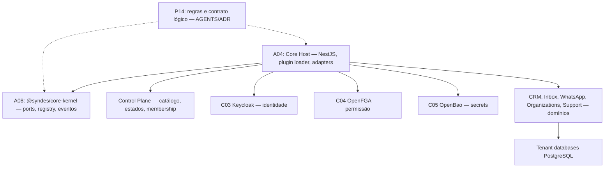
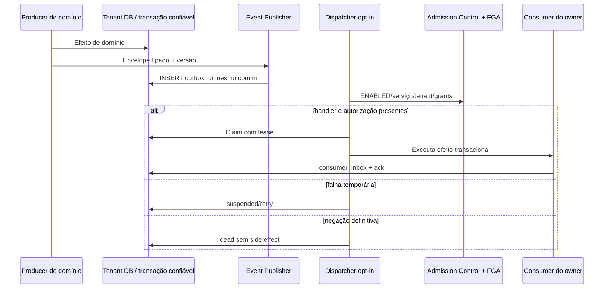
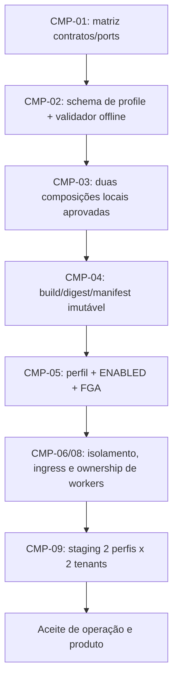

[← Ficha do capítulo](../) · [Volume](../../) · [Fonte original](https://github.com/delmacy/syndes-system/blob/main/docs/subprojects/P14-platform-core/chapters/05-arquitetura-banco-interface-configuracao-e-diagramas.md)

> Conteúdo espelhado da documentação versionada; não expressa automaticamente estado funcional.

## 5. Arquitetura, persistência, interface e diagramas

### Fronteiras de implementação (as-is)

**P14 não é um processo extra.** A04 importa interfaces de A08 e carrega plugins confiáveis listados em `apps/core-host/config/modules.json`: CRM, Inbox, WhatsApp, Organizations e Support. O pacote `@syndes/service` é dependência de build, mas não está nesse manifesto fixo. A configuração não cria perfis selecionáveis por instância.

### Inicialização/autorizações

A composição do Host é verificada em sequência:

1. Ler `config/modules.json` e importar somente plugins confiáveis já instalados.
2. Ordenar definições no `ModuleRegistry`, recusando dependência circular/ausente.
3. Inicializar o `CoreKernel` e confirmar secrets/Control sem fallback permissivo.
4. Receber `Actor` previamente autenticado pelo Host (Keycloak).
5. Para o entrypoint ligado ao Kernel, exigir `TenancyPort.canAccessTenant` e `AuthorizationPort.canAccess` antes do handler.
6. Em falha de membership, FGA, identidade ou infraestrutura, negar a operação protegida; a implementação do erro HTTP depende do Host.

**Limite de eficácia:** o `CoreKernel.executeModule` existe para gate adicional de módulo, porém é opt-in; não presumir que todos os controllers o utilizam. `platform admin` não ganha acesso ao conteúdo de tenants.

### Transactional Outbox e Worker Admission — artefatos opt-in

Os artefatos em `apps/core-host/src/platform-event-*.ts` e os contratos em `packages/core-kernel/src/*events.ts` existem; **não existe scheduler automático liberado nem worker operacional homologado**. As migrations do tenant e do Control têm owners e pré-requisitos distintos, sem permissão de aplicar DDL só por documentar.

### Perfis de Core por instância — to-be aprovado, não implementado

Conforme [ADR de composição](https://github.com/delmacy/syndes-system/blob/main/docs/engineering/ADR-COMPOSICAO-MODULAR-CORE-20261111.md), perfis por instância devem ser artefatos confiáveis imutáveis por build/deploy. Não carregar módulos a partir de requisições de usuários; não inventar comunicação cross-process sem contrato/teste/necessidade.

### Banco, frontend e configuração

- **P14 não tem PostgreSQL, migration ou tabela própria.** Control DB, schema `platform_events` no tenant e migrations dos módulos têm owners separados.
- **Não existe frontend P14.** Workspace tenant, Manager e Support são aplicativos separados; `front-shared` só fornece UI sem tokens/sessões.
- **Configuração implementada:** `apps/core-host/config/modules.json` fixo, runtime secrets/oidc/FGA configurados pelo Host. Valores de credenciais, URLs internas e grants reais **não** devem ser publicados.
- **Segurança:** para ativação de perfis/workers exige Control ENABLED, FGA service grants, schema migrado com backup/restore, canário e rollback autorizados.

---
**Rastreabilidade:** [revisar documento fonte](https://github.com/delmacy/syndes-system/blob/main/docs/subprojects/P14-platform-core/chapters/05-arquitetura-banco-interface-configuracao-e-diagramas.md).
