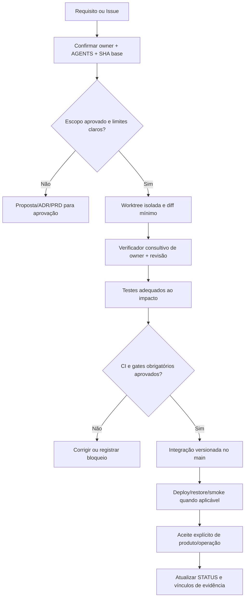

# G03 — Engenharia e Git

[← Sumário do volume](../) · [↑ Biblioteca](../../)

> **Leitura técnica, não homologação.** Estados, limites e comprovações devem ser lidos em STATUS e nos checkpoints versionados.

## Identificação e rastreabilidade

| Campo | Fonte verificável |
|---|---|
| Unidade / owner | **G03** · Engenharia e Git |
| Volume | Infraestrutura e qualidade |
| Caminho de implementação | `AGENTS.md` |
| Documento de origem | [README](https://github.com/delmacy/syndes-system/blob/main/docs/subprojects/G03-engenharia-e-git/README.md) |
| STATUS e critérios | [STATUS original](https://github.com/delmacy/syndes-system/blob/main/docs/subprojects/G03-engenharia-e-git/STATUS.md) |
| Símbolos, APIs, SQL e dependências | [REFERENCIA-TECNICA](https://github.com/delmacy/syndes-system/blob/main/docs/subprojects/G03-engenharia-e-git/REFERENCIA-TECNICA.md) |
| Implantação, runbooks e gates | [OPERACAO](https://github.com/delmacy/syndes-system/blob/main/docs/subprojects/G03-engenharia-e-git/OPERACAO.md) |

## Situação registrada

> AUDITORIA TÉCNICA PARCIAL — 12/11/2026. Fontes AGENTS.md, scripts de escopo/CI/docs, WBS e padrões examinados em origin/main SHA 068954a21e3090c7f94d374e2a8486cec7c2537b (DevServer01, worktree isolada). É auditoria de código estático e governança, não homologação de CI/Projects, isolamento técnico dos agentes ou deploy. Dimensão Situação comprovada Limite --------- Documentação G03 Auditoria parcial Capítulos de processo e fontes reconciliados;…

A descrição acima é uma **citação resumida do STATUS versionado**; não significa que os testes de integração, a implantação ou a homologação estejam aprovados.

## Índice dos subcapítulos

Todos os assuntos deste módulo estão nesta página. Clique em um título para saltar à seção correspondente; o índice lateral acompanha a leitura.

- [Casos de uso](#casos-de-uso)
- [Histórias de usuário](#historias-de-usuario)
- [Requisitos](#requisitos)
- [Contratos públicos e privados](#contratos)
- [APIs e endpoints](#apis)
- [Eventos e mensageria](#eventos)
- [Dados e persistência](#dados)
- [Schemas e migrations](#schema)
- [Dependências e integrações](#dependencias)
- [Configuração e ambiente](#configuracao)
- [Frontend e interfaces](#interface)
- [Testes e evidências](#testes)
- [Operação e implantação](#operacao)
- [WBS e evolução](#wbs)
- [Documentação de origem integral](#documentacao-de-origem)
- [Controle de alterações](#controle-de-alteracoes)

## Casos de uso

**Editar esta seção:** [Abrir arquivo-fonte no GitHub](https://github.com/delmacy/syndes-system/edit/main/docs/subprojects/G03-engenharia-e-git/chapters/02-requisitos-historias-e-casos-de-uso.md) · [Consultar fonte](https://github.com/delmacy/syndes-system/blob/main/docs/subprojects/G03-engenharia-e-git/chapters/02-requisitos-historias-e-casos-de-uso.md)

*Referências extraídas da documentação versionada, sem inferir homologação ou implantação.*

**Fonte:** [REFERENCIA-TECNICA.md](https://github.com/delmacy/syndes-system/blob/main/docs/subprojects/G03-engenharia-e-git/REFERENCIA-TECNICA.md)

> Linha 47: - **Testes da documentação:** `python -m unittest discover -s scripts/docs`, `node --test scripts/docs/test_*.mjs` e `mkdocs build --strict`, executados pelo fluxo local; resultado do próximo commit precisa ser verificado separadamente.

📝 Espaço para ajustes e implementação

Este é um **modelo de registro**, não um editor com salvamento automático. Use o link **Editar esta seção** para atualizar o documento versionado.

- **Alteração proposta:** descreva o requisito, contrato, dado ou comportamento.
- **Referência de código:** informe caminho e símbolo real.
- **Testes e evidências:** informe comando, resultado e limite.
- **Critério de aceite:** indique como validar sem presumir homologação.
- **Status e revisão:** atualize a fonte canônica após revisão.

## Histórias de usuário

**Editar esta seção:** [Abrir arquivo-fonte no GitHub](https://github.com/delmacy/syndes-system/edit/main/docs/subprojects/G03-engenharia-e-git/chapters/02-requisitos-historias-e-casos-de-uso.md) · [Consultar fonte](https://github.com/delmacy/syndes-system/blob/main/docs/subprojects/G03-engenharia-e-git/chapters/02-requisitos-historias-e-casos-de-uso.md)

*Referências extraídas da documentação versionada, sem inferir homologação ou implantação.*

**Fonte:** [STATUS.md](https://github.com/delmacy/syndes-system/blob/main/docs/subprojects/G03-engenharia-e-git/STATUS.md)

> Linha 48: 2. **Q10 — Quality Gates:** próxima auditoria documental; critérios de aceite e evidências para releases.

📝 Espaço para ajustes e implementação

Este é um **modelo de registro**, não um editor com salvamento automático. Use o link **Editar esta seção** para atualizar o documento versionado.

- **Alteração proposta:** descreva o requisito, contrato, dado ou comportamento.
- **Referência de código:** informe caminho e símbolo real.
- **Testes e evidências:** informe comando, resultado e limite.
- **Critério de aceite:** indique como validar sem presumir homologação.
- **Status e revisão:** atualize a fonte canônica após revisão.

## Requisitos

**Editar esta seção:** [Abrir arquivo-fonte no GitHub](https://github.com/delmacy/syndes-system/edit/main/docs/subprojects/G03-engenharia-e-git/chapters/02-requisitos-historias-e-casos-de-uso.md) · [Consultar fonte](https://github.com/delmacy/syndes-system/blob/main/docs/subprojects/G03-engenharia-e-git/chapters/02-requisitos-historias-e-casos-de-uso.md)

*Referências extraídas da documentação versionada, sem inferir homologação ou implantação.*

**Fonte:** [02-requisitos-historias-e-casos-de-uso.md](https://github.com/delmacy/syndes-system/blob/main/docs/subprojects/G03-engenharia-e-git/chapters/02-requisitos-historias-e-casos-de-uso.md)

> Linha 7: \| ID documental \| Regra existente \| Evidência necessária para cumprir \|

**Fonte:** [STATUS.md](https://github.com/delmacy/syndes-system/blob/main/docs/subprojects/G03-engenharia-e-git/STATUS.md)

> Linha 13: \| **Segregação por agentes** \| **Regra documentada; checker consultivo** \| `verify_module_scope.py` declara `advisory enforcement`; não afirmar sandbox ou permissão filesystem \|

> Linha 26: \| `docs/standards/FONTES-DE-VERDADE-E-RASTREABILIDADE.md` \| Vínculos requisito/WBS/Issue/commit/teste/deploy/aceite \| Estado atual de Issue/Project sem consulta ao serviço \|

📝 Espaço para ajustes e implementação

Este é um **modelo de registro**, não um editor com salvamento automático. Use o link **Editar esta seção** para atualizar o documento versionado.

- **Alteração proposta:** descreva o requisito, contrato, dado ou comportamento.
- **Referência de código:** informe caminho e símbolo real.
- **Testes e evidências:** informe comando, resultado e limite.
- **Critério de aceite:** indique como validar sem presumir homologação.
- **Status e revisão:** atualize a fonte canônica após revisão.

## Contratos públicos e privados

**Editar esta seção:** [Abrir arquivo-fonte no GitHub](https://github.com/delmacy/syndes-system/edit/main/docs/subprojects/G03-engenharia-e-git/REFERENCIA-TECNICA.md) · [Consultar fonte](https://github.com/delmacy/syndes-system/blob/main/docs/subprojects/G03-engenharia-e-git/REFERENCIA-TECNICA.md)

*Referências extraídas da documentação versionada, sem inferir homologação ou implantação.*

**Fonte:** [REFERENCIA-TECNICA.md](https://github.com/delmacy/syndes-system/blob/main/docs/subprojects/G03-engenharia-e-git/REFERENCIA-TECNICA.md)

> Linha 31: - Para **imports entre módulos**, conferir `package.json#exports`, versão e owner; `docs/standards/CONTRATOS-PUBLICOS.md` é índice, não source of truth executável.

**Fonte:** [04-contratos-e-dependencias-publicas.md](https://github.com/delmacy/syndes-system/blob/main/docs/subprojects/G03-engenharia-e-git/chapters/04-contratos-e-dependencias-publicas.md)

> Linha 3: **G03 não publica APIs HTTP, classes NestJS, eventos de negócio nem esquema SQL.** Seus contratos são políticas e formatos de governança.

> Linha 5: \| Contrato de processo \| Produtor/source of truth \| Consumidor e restrição \|

> Linha 9: \| **Superfície pública** \| `package.json#exports`, contratos tipados/HTTP/eventos e owner respectivo \| Dependente consome interface pública; não importar `src/` privado \|

> Linha 10: \| **Solicitação de mudança** \| Issue/PRD/ADR aprovado ou proposta de edição contextual \| Issue não é aprovação; deve conter owner, diff/contrato, impacto e aceite \|

> Linha 18: **Entradas mínimas:** `moduleId`, arquivo/tópico, objetivo aprovado, revisão base, limites, critérios de teste. **Saídas:** diff restrito, testes e comandos/resultados, risco residual, contrato afetado, commit/PR proposto e solicitação separada para consumidor externo.

> Linha 25: - **Evento** versionado é publicado por producer autorizado e consumido por owner de destino, com idempotência, contratos e outbox quando aplicável.

**Fonte:** [STATUS.md](https://github.com/delmacy/syndes-system/blob/main/docs/subprojects/G03-engenharia-e-git/STATUS.md)

> Linha 36: 7. **Segurança de documentação pública:** não publicar credenciais, tokens, PII, endereços de administração ou configurações sensíveis.

> Linha 40: - [ESCOPO](ESCOPO.md): missão, exclusões, regras dos agentes, matriz de contratos, critérios de testes e diagrama de mudanças.

**Fonte:** [OPERACAO.md](https://github.com/delmacy/syndes-system/blob/main/docs/subprojects/G03-engenharia-e-git/OPERACAO.md)

> Linha 16: - [Contratos públicos](../../standards/CONTRATOS-PUBLICOS.md).

> Linha 32: 4. Testar com critérios apropriados: unitário, contrato, integração, E2E e CI.

📝 Espaço para ajustes e implementação

Este é um **modelo de registro**, não um editor com salvamento automático. Use o link **Editar esta seção** para atualizar o documento versionado.

- **Alteração proposta:** descreva o requisito, contrato, dado ou comportamento.
- **Referência de código:** informe caminho e símbolo real.
- **Testes e evidências:** informe comando, resultado e limite.
- **Critério de aceite:** indique como validar sem presumir homologação.
- **Status e revisão:** atualize a fonte canônica após revisão.

## APIs e endpoints

**Editar esta seção:** [Abrir arquivo-fonte no GitHub](https://github.com/delmacy/syndes-system/edit/main/docs/subprojects/G03-engenharia-e-git/REFERENCIA-TECNICA.md) · [Consultar fonte](https://github.com/delmacy/syndes-system/blob/main/docs/subprojects/G03-engenharia-e-git/REFERENCIA-TECNICA.md)

*Referências extraídas da documentação versionada, sem inferir homologação ou implantação.*

**Fonte:** [REFERENCIA-TECNICA.md](https://github.com/delmacy/syndes-system/blob/main/docs/subprojects/G03-engenharia-e-git/REFERENCIA-TECNICA.md)

> Linha 3: > **AUDITORIA DOCUMENTAL ESTÁTICA PARCIAL — 12/11/2026.** Fonte examinada no commit `068954a21e3090c7f94d374e2a8486cec7c2537b`. G03 é governança de engenharia, com owner `AGENTS.md`; **não** possui runtime NestJS, endpoint, schema ou API própria.

> Linha 29: **G03 não expõe APIs HTTP, schema GraphQL nem eventos do Event Bus do Syndes.** GitHub REST/Projects são integrações externas do sincronizador, não interfaces públicas do produto.

> Linha 38: **Não existe frontend G03 operacional.** O site Syndes Docs é interface de leitura da documentação. Os botões de propor atualização enviam rascunho para revisão ou edição via GitHub conforme permissões, não são endpoints de modificação. O Workspace e o Manager são interfaces do produto com owners distintos.

**Fonte:** [04-contratos-e-dependencias-publicas.md](https://github.com/delmacy/syndes-system/blob/main/docs/subprojects/G03-engenharia-e-git/chapters/04-contratos-e-dependencias-publicas.md)

> Linha 3: **G03 não publica APIs HTTP, classes NestJS, eventos de negócio nem esquema SQL.** Seus contratos são políticas e formatos de governança.

> Linha 9: \| **Superfície pública** \| `package.json#exports`, contratos tipados/HTTP/eventos e owner respectivo \| Dependente consome interface pública; não importar `src/` privado \|

> Linha 26: - **API** exige identidade, membership/tenant, autorização por recurso e estado ENABLED.

**Fonte:** [STATUS.md](https://github.com/delmacy/syndes-system/blob/main/docs/subprojects/G03-engenharia-e-git/STATUS.md)

> Linha 10: \| **Runtime G03** \| **Não aplicável** \| Owner é `AGENTS.md`; não possui package, endpoint, schema, worker ou front de produto \|

> Linha 41: - [Referência](REFERENCIA-TECNICA.md): scripts, funções e limites verificáveis, sem inventar API ou banco.

📝 Espaço para ajustes e implementação

Este é um **modelo de registro**, não um editor com salvamento automático. Use o link **Editar esta seção** para atualizar o documento versionado.

- **Alteração proposta:** descreva o requisito, contrato, dado ou comportamento.
- **Referência de código:** informe caminho e símbolo real.
- **Testes e evidências:** informe comando, resultado e limite.
- **Critério de aceite:** indique como validar sem presumir homologação.
- **Status e revisão:** atualize a fonte canônica após revisão.

## Eventos e mensageria

**Editar esta seção:** [Abrir arquivo-fonte no GitHub](https://github.com/delmacy/syndes-system/edit/main/docs/subprojects/G03-engenharia-e-git/REFERENCIA-TECNICA.md) · [Consultar fonte](https://github.com/delmacy/syndes-system/blob/main/docs/subprojects/G03-engenharia-e-git/REFERENCIA-TECNICA.md)

*Referências extraídas da documentação versionada, sem inferir homologação ou implantação.*

**Fonte:** [REFERENCIA-TECNICA.md](https://github.com/delmacy/syndes-system/blob/main/docs/subprojects/G03-engenharia-e-git/REFERENCIA-TECNICA.md)

> Linha 29: **G03 não expõe APIs HTTP, schema GraphQL nem eventos do Event Bus do Syndes.** GitHub REST/Projects são integrações externas do sincronizador, não interfaces públicas do produto.

**Fonte:** [04-contratos-e-dependencias-publicas.md](https://github.com/delmacy/syndes-system/blob/main/docs/subprojects/G03-engenharia-e-git/chapters/04-contratos-e-dependencias-publicas.md)

> Linha 3: **G03 não publica APIs HTTP, classes NestJS, eventos de negócio nem esquema SQL.** Seus contratos são políticas e formatos de governança.

> Linha 5: \| Contrato de processo \| Produtor/source of truth \| Consumidor e restrição \|

> Linha 9: \| **Superfície pública** \| `package.json#exports`, contratos tipados/HTTP/eventos e owner respectivo \| Dependente consome interface pública; não importar `src/` privado \|

> Linha 18: **Entradas mínimas:** `moduleId`, arquivo/tópico, objetivo aprovado, revisão base, limites, critérios de teste. **Saídas:** diff restrito, testes e comandos/resultados, risco residual, contrato afetado, commit/PR proposto e solicitação separada para consumidor externo.

> Linha 25: - **Evento** versionado é publicado por producer autorizado e consumido por owner de destino, com idempotência, contratos e outbox quando aplicável.

📝 Espaço para ajustes e implementação

Este é um **modelo de registro**, não um editor com salvamento automático. Use o link **Editar esta seção** para atualizar o documento versionado.

- **Alteração proposta:** descreva o requisito, contrato, dado ou comportamento.
- **Referência de código:** informe caminho e símbolo real.
- **Testes e evidências:** informe comando, resultado e limite.
- **Critério de aceite:** indique como validar sem presumir homologação.
- **Status e revisão:** atualize a fonte canônica após revisão.

## Dados e persistência

**Editar esta seção:** [Abrir arquivo-fonte no GitHub](https://github.com/delmacy/syndes-system/edit/main/docs/subprojects/G03-engenharia-e-git/REFERENCIA-TECNICA.md) · [Consultar fonte](https://github.com/delmacy/syndes-system/blob/main/docs/subprojects/G03-engenharia-e-git/REFERENCIA-TECNICA.md)

*Referências extraídas da documentação versionada, sem inferir homologação ou implantação.*

**Fonte:** [04-contratos-e-dependencias-publicas.md](https://github.com/delmacy/syndes-system/blob/main/docs/subprojects/G03-engenharia-e-git/chapters/04-contratos-e-dependencias-publicas.md)

> Linha 27: - **DDL e dados** pertencem ao módulo dono do schema e ao instalador/operador; G03 não executa migrations.

> Linha 28: - **UI compartilhada** fica em `packages/front-shared` apenas para apresentação; regras de sessão e dados continuam separadas.

> Linha 30: **Dependências da G03:** AGENTS globais/locais, Git, catálogo, WBS/Issues, CI, documentação e políticas de segurança. Não há dependência de runtime PostgreSQL ou de credenciais da operação do produto.

**Fonte:** [05-arquitetura-banco-interface-configuracao-e-diagramas.md](https://github.com/delmacy/syndes-system/blob/main/docs/subprojects/G03-engenharia-e-git/chapters/05-arquitetura-banco-interface-configuracao-e-diagramas.md)

> Linha 35: - **G03 não usa banco de dados próprio.** O registro de alteração é Git e a documentação Markdown; tarefas/estado vivo são serviços GitHub quando conectados e autorizados.

📝 Espaço para ajustes e implementação

Este é um **modelo de registro**, não um editor com salvamento automático. Use o link **Editar esta seção** para atualizar o documento versionado.

- **Alteração proposta:** descreva o requisito, contrato, dado ou comportamento.
- **Referência de código:** informe caminho e símbolo real.
- **Testes e evidências:** informe comando, resultado e limite.
- **Critério de aceite:** indique como validar sem presumir homologação.
- **Status e revisão:** atualize a fonte canônica após revisão.

## Schemas e migrations

**Editar esta seção:** [Abrir arquivo-fonte no GitHub](https://github.com/delmacy/syndes-system/edit/main/docs/subprojects/G03-engenharia-e-git/REFERENCIA-TECNICA.md) · [Consultar fonte](https://github.com/delmacy/syndes-system/blob/main/docs/subprojects/G03-engenharia-e-git/REFERENCIA-TECNICA.md)

*Referências extraídas da documentação versionada, sem inferir homologação ou implantação.*

**Fonte:** [REFERENCIA-TECNICA.md](https://github.com/delmacy/syndes-system/blob/main/docs/subprojects/G03-engenharia-e-git/REFERENCIA-TECNICA.md)

> Linha 3: > **AUDITORIA DOCUMENTAL ESTÁTICA PARCIAL — 12/11/2026.** Fonte examinada no commit `068954a21e3090c7f94d374e2a8486cec7c2537b`. G03 é governança de engenharia, com owner `AGENTS.md`; **não** possui runtime NestJS, endpoint, schema ou API própria.

> Linha 29: **G03 não expõe APIs HTTP, schema GraphQL nem eventos do Event Bus do Syndes.** GitHub REST/Projects são integrações externas do sincronizador, não interfaces públicas do produto.

> Linha 42: **Nenhuma tabela ou migration pertence à G03.** Git é a origem de código/histórico; Issues/Projects armazenam estados externos sob controle do GitHub; WBS e documentação guardam vínculos e decisões. O `Control DB` e os bancos de tenant não são utilizados para planejar workpackages do portal.

**Fonte:** [04-contratos-e-dependencias-publicas.md](https://github.com/delmacy/syndes-system/blob/main/docs/subprojects/G03-engenharia-e-git/chapters/04-contratos-e-dependencias-publicas.md)

> Linha 3: **G03 não publica APIs HTTP, classes NestJS, eventos de negócio nem esquema SQL.** Seus contratos são políticas e formatos de governança.

> Linha 27: - **DDL e dados** pertencem ao módulo dono do schema e ao instalador/operador; G03 não executa migrations.

**Fonte:** [STATUS.md](https://github.com/delmacy/syndes-system/blob/main/docs/subprojects/G03-engenharia-e-git/STATUS.md)

> Linha 10: \| **Runtime G03** \| **Não aplicável** \| Owner é `AGENTS.md`; não possui package, endpoint, schema, worker ou front de produto \|

**Fonte:** [OPERACAO.md](https://github.com/delmacy/syndes-system/blob/main/docs/subprojects/G03-engenharia-e-git/OPERACAO.md)

> Linha 3: > **ÍNDICE DE FONTES, NÃO RUNBOOK HOMOLOGADO.** Não executar migrations, alterar permissões ou ativar workers apenas com esta página.

> Linha 31: 3. Confirmar migrations realmente aplicadas, backup/restore e rollback antes de SQL.

📝 Espaço para ajustes e implementação

Este é um **modelo de registro**, não um editor com salvamento automático. Use o link **Editar esta seção** para atualizar o documento versionado.

- **Alteração proposta:** descreva o requisito, contrato, dado ou comportamento.
- **Referência de código:** informe caminho e símbolo real.
- **Testes e evidências:** informe comando, resultado e limite.
- **Critério de aceite:** indique como validar sem presumir homologação.
- **Status e revisão:** atualize a fonte canônica após revisão.

## Dependências e integrações

**Editar esta seção:** [Abrir arquivo-fonte no GitHub](https://github.com/delmacy/syndes-system/edit/main/docs/subprojects/G03-engenharia-e-git/REFERENCIA-TECNICA.md) · [Consultar fonte](https://github.com/delmacy/syndes-system/blob/main/docs/subprojects/G03-engenharia-e-git/REFERENCIA-TECNICA.md)

*Referências extraídas da documentação versionada, sem inferir homologação ou implantação.*

**Fonte:** [04-contratos-e-dependencias-publicas.md](https://github.com/delmacy/syndes-system/blob/main/docs/subprojects/G03-engenharia-e-git/chapters/04-contratos-e-dependencias-publicas.md)

> Linha 30: **Dependências da G03:** AGENTS globais/locais, Git, catálogo, WBS/Issues, CI, documentação e políticas de segurança. Não há dependência de runtime PostgreSQL ou de credenciais da operação do produto.

**Fonte:** [STATUS.md](https://github.com/delmacy/syndes-system/blob/main/docs/subprojects/G03-engenharia-e-git/STATUS.md)

> Linha 14: \| **GitHub Projects** \| **Integração preparada, sincronização não verificada** \| Variável/token e itens reais no Project não validados nesta auditoria; não inventar cards/status \|

> Linha 50: 4. **Integração Projects:** somente marcar sincronizado após verificar variável/token, itens e estados reais na plataforma.

**Fonte:** [OPERACAO.md](https://github.com/delmacy/syndes-system/blob/main/docs/subprojects/G03-engenharia-e-git/OPERACAO.md)

> Linha 9: - [Evolução](EVOLUCAO.md): workpackages e dependências; nenhum item é concluído por estar planejado.

> Linha 32: 4. Testar com critérios apropriados: unitário, contrato, integração, E2E e CI.

📝 Espaço para ajustes e implementação

Este é um **modelo de registro**, não um editor com salvamento automático. Use o link **Editar esta seção** para atualizar o documento versionado.

- **Alteração proposta:** descreva o requisito, contrato, dado ou comportamento.
- **Referência de código:** informe caminho e símbolo real.
- **Testes e evidências:** informe comando, resultado e limite.
- **Critério de aceite:** indique como validar sem presumir homologação.
- **Status e revisão:** atualize a fonte canônica após revisão.

## Configuração e ambiente

**Editar esta seção:** [Abrir arquivo-fonte no GitHub](https://github.com/delmacy/syndes-system/edit/main/docs/subprojects/G03-engenharia-e-git/OPERACAO.md) · [Consultar fonte](https://github.com/delmacy/syndes-system/blob/main/docs/subprojects/G03-engenharia-e-git/OPERACAO.md)

*Referências extraídas da documentação versionada, sem inferir homologação ou implantação.*

**Fonte:** [REFERENCIA-TECNICA.md](https://github.com/delmacy/syndes-system/blob/main/docs/subprojects/G03-engenharia-e-git/REFERENCIA-TECNICA.md)

> Linha 11: - **Projects:** `scripts/docs/sync_github_project.py` e `.github/workflows/syndes-docs-project-sync.yml`, sujeitos a autorização e configuração.

📝 Espaço para ajustes e implementação

Este é um **modelo de registro**, não um editor com salvamento automático. Use o link **Editar esta seção** para atualizar o documento versionado.

- **Alteração proposta:** descreva o requisito, contrato, dado ou comportamento.
- **Referência de código:** informe caminho e símbolo real.
- **Testes e evidências:** informe comando, resultado e limite.
- **Critério de aceite:** indique como validar sem presumir homologação.
- **Status e revisão:** atualize a fonte canônica após revisão.

## Frontend e interfaces

**Editar esta seção:** [Abrir arquivo-fonte no GitHub](https://github.com/delmacy/syndes-system/edit/main/docs/subprojects/G03-engenharia-e-git/REFERENCIA-TECNICA.md) · [Consultar fonte](https://github.com/delmacy/syndes-system/blob/main/docs/subprojects/G03-engenharia-e-git/REFERENCIA-TECNICA.md)

*Referências extraídas da documentação versionada, sem inferir homologação ou implantação.*

**Fonte:** [REFERENCIA-TECNICA.md](https://github.com/delmacy/syndes-system/blob/main/docs/subprojects/G03-engenharia-e-git/REFERENCIA-TECNICA.md)

> Linha 32: - **Interface de proposta de alteração:** `docs/assets/topic-editor.js` cria solicitações contextualizadas; Pages não efetua gravação no Git.

> Linha 38: **Não existe frontend G03 operacional.** O site Syndes Docs é interface de leitura da documentação. Os botões de propor atualização enviam rascunho para revisão ou edição via GitHub conforme permissões, não são endpoints de modificação. O Workspace e o Manager são interfaces do produto com owners distintos.

**Fonte:** [05-arquitetura-banco-interface-configuracao-e-diagramas.md](https://github.com/delmacy/syndes-system/blob/main/docs/subprojects/G03-engenharia-e-git/chapters/05-arquitetura-banco-interface-configuracao-e-diagramas.md)

> Linha 25: \| Componente \| Comportamento lido no arquivo \| O que falta comprovar \|

📝 Espaço para ajustes e implementação

Este é um **modelo de registro**, não um editor com salvamento automático. Use o link **Editar esta seção** para atualizar o documento versionado.

- **Alteração proposta:** descreva o requisito, contrato, dado ou comportamento.
- **Referência de código:** informe caminho e símbolo real.
- **Testes e evidências:** informe comando, resultado e limite.
- **Critério de aceite:** indique como validar sem presumir homologação.
- **Status e revisão:** atualize a fonte canônica após revisão.

## Testes e evidências

**Editar esta seção:** [Abrir arquivo-fonte no GitHub](https://github.com/delmacy/syndes-system/edit/main/docs/subprojects/G03-engenharia-e-git/STATUS.md) · [Consultar fonte](https://github.com/delmacy/syndes-system/blob/main/docs/subprojects/G03-engenharia-e-git/STATUS.md)

*Referências extraídas da documentação versionada, sem inferir homologação ou implantação.*

**Fonte:** [STATUS.md](https://github.com/delmacy/syndes-system/blob/main/docs/subprojects/G03-engenharia-e-git/STATUS.md)

> Linha 12: \| **Qualidade/CI central** \| **Falha conhecida, gate não satisfeito** \| Run [43332115355](https://github.com/delmacy/syndes-system/actions/runs/43332115355) falhou em `Prove fail-closed test selection and removed-workflow parity`; revalidar após correção por Q07 \|

> Linha 21: \| `AGENTS.md` \| Regras de MVP, autorização, testes, isolamento, gates e instruções locais \| Que agentes cumpram tudo automaticamente \|

> Linha 24: \| `.github/workflows/syndes-ci.yml`, `scripts/ci/plan.mjs` \| Gates e planner de regressão impact/full no mesmo pipeline \| Que todas as suites/branch atual passaram \|

> Linha 26: \| `docs/standards/FONTES-DE-VERDADE-E-RASTREABILIDADE.md` \| Vínculos requisito/WBS/Issue/commit/teste/deploy/aceite \| Estado atual de Issue/Project sem consulta ao serviço \|

> Linha 30: 1. **Mainline CI vermelho:** falha em paridade dos workflows, com regressões posteriores/skipped no run citado. Owner Q07; corrigir/testar em frente separada sem enfraquecer gate.

> Linha 32: 3. **GitHub Projects:** backfill/campos de status não comprovados; falta evidência dos itens e permissão do Project.

> Linha 40: - [ESCOPO](ESCOPO.md): missão, exclusões, regras dos agentes, matriz de contratos, critérios de testes e diagrama de mudanças.

> Linha 48: 2. **Q10 — Quality Gates:** próxima auditoria documental; critérios de aceite e evidências para releases.

> Linha 49: 3. **Q07 — CI central:** corrigir a falha de paridade com testes adequados no escopo responsável e confirmar run verde por SHA.

> Linha 56: **Estado final desta etapa:** documentação parcialmente reconciliada; aceite de governança pendente. Não interpretar publicação no Pages como gate global aprovado.

**Fonte:** [06-wbs-marcos-e-aceite.md](https://github.com/delmacy/syndes-system/blob/main/docs/subprojects/G03-engenharia-e-git/chapters/06-wbs-marcos-e-aceite.md)

> Linha 7: \| Grupo \| Trabalho previsto na WBS de origem \| Fonte de evidência a exigir \|

> Linha 10: \| 00.04–00.05 \| Composição `front-shared` e reconciliação de mudanças \| Testes de frontend, owners, PRs e gates de migração \|

> Linha 12: \| 00.09 \| Regras da `main` e critérios de promoção \| CI completo, gates e política aprovada pelo proprietário \|

> Linha 16: \| Revisão G03 \| Evidência \| Estado \|

> Linha 18: \| Leitura de política global/local \| `AGENTS.md`, `modules/*/AGENTS.md`, Workspace e testes \| Auditado em fonte, aprovação de processo pendente \|

> Linha 22: \| Descrição e STATUS de G03 \| Capítulos e evidências por SHA \| Auditoria parcial, revisão do responsável pendente \|

> Linha 27: - Verificação real de ci/gates por SHA, incluindo falhas/skips explícitos; não enfraquecer testes para obter verde.

> Linha 29: - Documentar se Projects está sincronizado **com evidência da própria plataforma**, sem se apoiar na presença do sincronizador.

> Linha 32: **Próxima unidade na sequência documental:** Q10 — Quality Gates (depois de G01/G02/G03). Q07/CI é a frente executora para a falha de paridade; esta auditoria não abre refatoração de workflows nem sprint automaticamente.

**Fonte:** [REFERENCIA-TECNICA.md](https://github.com/delmacy/syndes-system/blob/main/docs/subprojects/G03-engenharia-e-git/REFERENCIA-TECNICA.md)

> Linha 21: \| `scripts/ci/run-suite.sh` \| Executor de suites por ID \| Executa testes selecionados; sua existência não prova resultado \|

> Linha 46: - **CI mainline:** [workflow](https://github.com/delmacy/syndes-system/blob/main/.github/workflows/syndes-ci.yml); um run com falha de paridade não é gate aprovado. Observar runs e SHA, sem editar pipeline nesta revisão.

> Linha 47: - **Testes da documentação:** `python -m unittest discover -s scripts/docs`, `node --test scripts/docs/test_*.mjs` e `mkdocs build --strict`, executados pelo fluxo local; resultado do próximo commit precisa ser verificado separadamente.

> Linha 48: - **G03 STATUS:** [auditoria, riscos e próximos gates](STATUS.md).

**Fonte:** [OPERACAO.md](https://github.com/delmacy/syndes-system/blob/main/docs/subprojects/G03-engenharia-e-git/OPERACAO.md)

> Linha 7: - [STATUS](STATUS.md): nível de validação, bloqueios, testes, ambiente e SHA.

> Linha 32: 4. Testar com critérios apropriados: unitário, contrato, integração, E2E e CI.

> Linha 33: 5. Registrar resultado e evidência em STATUS, sem confundir merge com deploy ou aceite.

📝 Espaço para ajustes e implementação

Este é um **modelo de registro**, não um editor com salvamento automático. Use o link **Editar esta seção** para atualizar o documento versionado.

- **Alteração proposta:** descreva o requisito, contrato, dado ou comportamento.
- **Referência de código:** informe caminho e símbolo real.
- **Testes e evidências:** informe comando, resultado e limite.
- **Critério de aceite:** indique como validar sem presumir homologação.
- **Status e revisão:** atualize a fonte canônica após revisão.

## Operação e implantação

**Editar esta seção:** [Abrir arquivo-fonte no GitHub](https://github.com/delmacy/syndes-system/edit/main/docs/subprojects/G03-engenharia-e-git/OPERACAO.md) · [Consultar fonte](https://github.com/delmacy/syndes-system/blob/main/docs/subprojects/G03-engenharia-e-git/OPERACAO.md)

*Referências extraídas da documentação versionada, sem inferir homologação ou implantação.*

**Fonte:** [OPERACAO.md](https://github.com/delmacy/syndes-system/blob/main/docs/subprojects/G03-engenharia-e-git/OPERACAO.md)

> Linha 31: 3. Confirmar migrations realmente aplicadas, backup/restore e rollback antes de SQL.

> Linha 33: 5. Registrar resultado e evidência em STATUS, sem confundir merge com deploy ou aceite.

**Fonte:** [06-wbs-marcos-e-aceite.md](https://github.com/delmacy/syndes-system/blob/main/docs/subprojects/G03-engenharia-e-git/chapters/06-wbs-marcos-e-aceite.md)

> Linha 28: - Rastreabilidade real de um pacote de trabalho: requisito → WP → Issue → PR/commit → CI → deploy (se aplicável) → aceite.

**Fonte:** [STATUS.md](https://github.com/delmacy/syndes-system/blob/main/docs/subprojects/G03-engenharia-e-git/STATUS.md)

> Linha 3: > **AUDITORIA TÉCNICA PARCIAL — 12/11/2026.** Fontes `AGENTS.md`, scripts de escopo/CI/docs, WBS e padrões examinados em `origin/main` SHA `068954a21e3090c7f94d374e2a8486cec7c2537b` (DevServer01, worktree isolada). É auditoria **de código estático e governança**, não homologação de CI/Projects, isolamento técnico dos agentes ou deploy.

> Linha 15: \| **Operação e aceite** \| **Não aplicável à G03 como serviço; revisão não aprovada** \| Deploy e aceites pertencem aos owners, CI e responsável do produto \|

> Linha 26: \| `docs/standards/FONTES-DE-VERDADE-E-RASTREABILIDADE.md` \| Vínculos requisito/WBS/Issue/commit/teste/deploy/aceite \| Estado atual de Issue/Project sem consulta ao serviço \|

📝 Espaço para ajustes e implementação

Este é um **modelo de registro**, não um editor com salvamento automático. Use o link **Editar esta seção** para atualizar o documento versionado.

- **Alteração proposta:** descreva o requisito, contrato, dado ou comportamento.
- **Referência de código:** informe caminho e símbolo real.
- **Testes e evidências:** informe comando, resultado e limite.
- **Critério de aceite:** indique como validar sem presumir homologação.
- **Status e revisão:** atualize a fonte canônica após revisão.

## WBS e evolução

**Editar esta seção:** [Abrir arquivo-fonte no GitHub](https://github.com/delmacy/syndes-system/edit/main/docs/subprojects/G03-engenharia-e-git/STATUS.md) · [Consultar fonte](https://github.com/delmacy/syndes-system/blob/main/docs/subprojects/G03-engenharia-e-git/STATUS.md)

*Referências extraídas da documentação versionada, sem inferir homologação ou implantação.*

**Fonte:** [STATUS.md](https://github.com/delmacy/syndes-system/blob/main/docs/subprojects/G03-engenharia-e-git/STATUS.md)

> Linha 3: > **AUDITORIA TÉCNICA PARCIAL — 12/11/2026.** Fontes `AGENTS.md`, scripts de escopo/CI/docs, WBS e padrões examinados em `origin/main` SHA `068954a21e3090c7f94d374e2a8486cec7c2537b` (DevServer01, worktree isolada). É auditoria **de código estático e governança**, não homologação de CI/Projects, isolamento técnico dos agentes ou deploy.

> Linha 9: \| **Documentação G03** \| **Auditoria parcial** \| Capítulos de processo e fontes reconciliados; revisão/aprovação da política pendente \|

> Linha 26: \| `docs/standards/FONTES-DE-VERDADE-E-RASTREABILIDADE.md` \| Vínculos requisito/WBS/Issue/commit/teste/deploy/aceite \| Estado atual de Issue/Project sem consulta ao serviço \|

> Linha 33: 4. **Rastreabilidade:** WBS histórica/Issue/Project e documentação não devem ter progressos manuais independentes.

> Linha 54: \| 2026-11-12 \| `068954a21e3090c7f94d374e2a8486cec7c2537b` · DevServer01/worktree isolada \| Leitura de AGENTS, scripts, workflows, WBS e padrões versionados \| Run verde de CI, isolamento físico, Projects, release, homologação \|

> Linha 56: **Estado final desta etapa:** documentação parcialmente reconciliada; aceite de governança pendente. Não interpretar publicação no Pages como gate global aprovado.

**Fonte:** [06-wbs-marcos-e-aceite.md](https://github.com/delmacy/syndes-system/blob/main/docs/subprojects/G03-engenharia-e-git/chapters/06-wbs-marcos-e-aceite.md)

> Linha 7: \| Grupo \| Trabalho previsto na WBS de origem \| Fonte de evidência a exigir \|

> Linha 18: \| Leitura de política global/local \| `AGENTS.md`, `modules/*/AGENTS.md`, Workspace e testes \| Auditado em fonte, aprovação de processo pendente \|

> Linha 21: \| Issues/Projects/WBS \| WBS-00, padrões de rastreabilidade e workflow de sync \| Integração prevista; estado de Projects não comprovado \|

> Linha 22: \| Descrição e STATUS de G03 \| Capítulos e evidências por SHA \| Auditoria parcial, revisão do responsável pendente \|

> Linha 32: **Próxima unidade na sequência documental:** Q10 — Quality Gates (depois de G01/G02/G03). Q07/CI é a frente executora para a falha de paridade; esta auditoria não abre refatoração de workflows nem sprint automaticamente.

**Fonte:** [07-controle-do-escopo.md](https://github.com/delmacy/syndes-system/blob/main/docs/subprojects/G03-engenharia-e-git/chapters/07-controle-do-escopo.md)

> Linha 11: \| WBS histórica e fontes dinâmicas podem divergir \| G02/G03 + owners \| Preservar estados e SHA de origem, resolver lacunas por evidência, não sobrescrever silenciosamente \|

> Linha 17: - [ ] Fonte e owner aprovados pelo responsável? **Pendente**.

> Linha 26: Novo incremento precisa de owner, objetivo, risco, WBS e evidência. Não iniciar trabalho fora de G03, editar contratos de API, SQL, frontends de produto, branches protegidas ou configurações operacionais sem autorização específica. **A segurança do sistema não é uma opção**: controles tenant e autorização continuam de responsabilidade dos serviços de runtime.

**Fonte:** [REFERENCIA-TECNICA.md](https://github.com/delmacy/syndes-system/blob/main/docs/subprojects/G03-engenharia-e-git/REFERENCIA-TECNICA.md)

> Linha 8: - **Metadados:** `catalog/work-units.json` (owner e source), `catalog/evolution-associations.json` (WBS) e `catalog/traceability-links.json` (vínculos, não status).

> Linha 42: **Nenhuma tabela ou migration pertence à G03.** Git é a origem de código/histórico; Issues/Projects armazenam estados externos sob controle do GitHub; WBS e documentação guardam vínculos e decisões. O `Control DB` e os bancos de tenant não são utilizados para planejar workpackages do portal.

> Linha 50: - **G03 WBS:** [WP-00, vinculações históricas](EVOLUCAO.md).

**Fonte:** [OPERACAO.md](https://github.com/delmacy/syndes-system/blob/main/docs/subprojects/G03-engenharia-e-git/OPERACAO.md)

> Linha 8: - [SPRINT](SPRINT.md): incremento autorizado e checkpoints, quando existentes.

📝 Espaço para ajustes e implementação

Este é um **modelo de registro**, não um editor com salvamento automático. Use o link **Editar esta seção** para atualizar o documento versionado.

- **Alteração proposta:** descreva o requisito, contrato, dado ou comportamento.
- **Referência de código:** informe caminho e símbolo real.
- **Testes e evidências:** informe comando, resultado e limite.
- **Critério de aceite:** indique como validar sem presumir homologação.
- **Status e revisão:** atualize a fonte canônica após revisão.

## Documentação de origem integral

Os oito assuntos canônicos são reproduzidos abaixo para permitir leitura contínua. As fontes versionadas permanecem editáveis e preservadas.

### 00 · Fontes e endereços

[Editar conteúdo original](https://github.com/delmacy/syndes-system/edit/main/docs/subprojects/G03-engenharia-e-git/chapters/00-enderecos-exatos-de-leitura.md) · [Abrir fonte](https://github.com/delmacy/syndes-system/blob/main/docs/subprojects/G03-engenharia-e-git/chapters/00-enderecos-exatos-de-leitura.md)

##### 0. Fontes verificáveis e caminhos

G03 é a unidade de **governança de engenharia e Git**, cujo `source` canônico em `catalog/work-units.json` é `AGENTS.md` na raiz. Não é um app, banco ou contrato HTTP. Leitura estática no commit `068954a21e3090c7f94d374e2a8486cec7c2537b` de 12/11/2026.

| Tema | Fonte versionada | Interpretação |
|---|---|---|
| Política global | [AGENTS.md](https://github.com/delmacy/syndes-system/blob/main/AGENTS.md) | Escopo, gates, segurança, prioridades, regra de ler instrução local |
| Instrução por owner | `modules/*/AGENTS.md`, `apps/workspace-web/AGENTS.md`, `tests/**/AGENTS.md` | Regras locais aplicáveis, sempre subordinadas às globais |
| Catálogo de owners | `catalog/work-units.json`, `docs/subprojects/index.json` | Fonte da identidade e caminhos do módulo, não habilitação operacional |
| Alterações delimitadas | [verify_module_scope.py](https://github.com/delmacy/syndes-system/blob/main/scripts/docs/verify_module_scope.py) | Checker **consultivo** de diff, não sandbox de segurança |
| CI central | [.github/workflows/syndes-ci.yml](https://github.com/delmacy/syndes-system/blob/main/.github/workflows/syndes-ci.yml), `scripts/ci/plan.mjs`, `run-suite.sh` | Seleção de suites e gate; verificar execução por SHA |
| Documentação publicada | `scripts/docs/build_site.py`, `docs/assets/topic-editor.js` | MkDocs + páginas derivadas e editor de propostas; publicação GitHub Pages é somente leitura |
| Fonte e provas | [FONTES-DE-VERDADE-E-RASTREABILIDADE](https://github.com/delmacy/syndes-system/blob/main/docs/standards/FONTES-DE-VERDADE-E-RASTREABILIDADE.md) | ADR/PRD/WBS/Issue/PR/commit/teste/deploy/aceite permanecem distintos |
| Issues e Projects | [GITHUB-PROJECTS](https://github.com/delmacy/syndes-system/blob/main/docs/standards/GITHUB-PROJECTS.md), `scripts/docs/sync_github_project.py` | Sincronizador previsto, **não** comprovação de Project preenchido |
| WBS | [WBS mestre](https://github.com/delmacy/syndes-system/blob/main/docs/engineering/WBS-PROGRAMA-SYNDES-20261110.md), [G03 EVOLUCAO](https://github.com/delmacy/syndes-system/blob/main/docs/subprojects/G03-engenharia-e-git/EVOLUCAO.md) | Tarefas associadas 00.01–00.06 e 00.09, estados originais históricos |
| Critério de validação | [TEST-STRATEGY](https://github.com/delmacy/syndes-system/blob/main/docs/engineering/TEST-STRATEGY.md) e `AGENTS.md` | Gates por commit, PR e RC, sem deduzir aprovação de teste declarado |

**Consulta operacional:** sempre fixar SHA e ambiente. A página pública não deve conter credenciais, tokens, URLs administrativas restritas ou dados de tenant.

### 01 · Missão e fronteiras

[Editar conteúdo original](https://github.com/delmacy/syndes-system/edit/main/docs/subprojects/G03-engenharia-e-git/chapters/01-missao-objetivos-e-fronteiras.md) · [Abrir fonte](https://github.com/delmacy/syndes-system/blob/main/docs/subprojects/G03-engenharia-e-git/chapters/01-missao-objetivos-e-fronteiras.md)

##### 1. Missão, objetivos e limites

###### Missão da G03

Definir e documentar **como mudanças são propostas, delimitadas, desenvolvidas, testadas, integradas e rastreadas** no Syndes. Isso inclui contratos de agentes, fronteiras de owner, isolamento de worktrees, linha principal coerente, WBS, GitHub Issues/Projects, CI e evidências de publicação.

**Natureza:** G03 tem fonte `AGENTS.md`; **não** possui servidor, app, schema, controllers ou package de runtime. A implementação de CI pertence aos próprios workflows e scripts; sua mudança é uma frente específica, fora desta auditoria.

| Responsabilidade da G03 | Não deve realizar nesta revisão |
|---|---|
| Explicitar regras globais e locais dos agentes | Criar novas permissões de agente ou conceder acesso a hosts, dados e secrets |
| Manter matriz de owner e escalonamento entre módulos | Mudar código de CRM, Inbox, WhatsApp, Core ou frontends por conveniência |
| Especificar fluxo Issue → WBS → mudança → CI → deploy → aceite | Transformar Status ou commit em prova de produção |
| Distinguir verificador de escopo consultivo de isolamento efetivo | Afirmar que `verify_module_scope.py` impede escrita fora da worktree |
| Registrar riscos do pipeline e comportamento *fail-closed* | Alterar `main` protection, workflows ou critérios de testes sem escopo próprio |
| Garantir que documentação seja auditável e versionada | Tratar formulário de edição do Pages como gravação automática de Markdown |

###### Princípios já estabelecidos pela fonte

- O produto permanece **monólito modular** quando não há necessidade demonstrada de separar serviços; imports públicos obedecem a `package.json#exports`.
- **`IMPLEMENTED != INTEGRATED != TESTED != PROVEN != DONE`**; todo gate deve indicar SHA, suite, ambiente e evidência. CI verde isolado não equivale a homologação.
- Agente trabalha sob `AGENTS.md` global e instruções locais aplicáveis ao arquivo; regra local não pode reduzir segurança, ampliar escopo ou trocar owner.
- Alterar contrato público, schema, autorização ou outra unidade exige análise de consumidores e **autorização de mudança transversal**; o verificador de caminho sozinho não constitui decisão.
- Worktrees separadas ajudam a não misturar diffs de frentes paralelas; não é permitido sobrescrever alterações não comitadas de outra frente no servidor.
- O `main` deve representar o código integrado e verificável; commits históricos não são todos releases. Não introduzir exigência de proteção do `main` não aprovada pelo proprietário.

**Consumidores:** agentes, engenheiros, tech lead, responsáveis de módulos, produto/qualidade e operadores autorizados. A G03 formaliza um processo, não substitui o julgamento dos donos de contrato e Product Gates.

### 02 · Requisitos e casos de uso

[Editar conteúdo original](https://github.com/delmacy/syndes-system/edit/main/docs/subprojects/G03-engenharia-e-git/chapters/02-requisitos-historias-e-casos-de-uso.md) · [Abrir fonte](https://github.com/delmacy/syndes-system/blob/main/docs/subprojects/G03-engenharia-e-git/chapters/02-requisitos-historias-e-casos-de-uso.md)

##### 2. Requisitos, histórias e casos de uso de engenharia

Os casos abaixo são **interpretações de processo das regras existentes**, não novas funcionalidades do Syndes nem autorizações para executar ações fora do owner.

###### Requisitos rastreáveis

| ID documental | Regra existente | Evidência necessária para cumprir |
|---|---|---|
| G03-R01 | Ler AGENTS raiz e local antes de editar | Paths do owner + instruções consideradas |
| G03-R02 | Alterações devem respeitar o dono canônico do pacote | Diff por módulo e verificação de consumidores; incidente de cross-owner é bloqueado para revisão |
| G03-R03 | Trabalho paralelo sem sobrescrever worktree alheia | `git status` antes/depois, branch e SHA base explícitos |
| G03-R04 | Gate de teste não pode ser enfraquecido para ficar verde | Runs, falhas/skips por SHA, suites relevantes e logs |
| G03-R05 | CI da mainline escolhe suites por impacto e faz full em push | `scripts/ci/plan.mjs`, `syndes-ci.yml` e execução verificada |
| G03-R06 | Produto e arquitetura usam fontes normativas por owner | PRD/ADR/contrato/SQL em seu repositório, links nos consumidores |
| G03-R07 | Issues e Projects não criam aceite por associação | Item explícito, Issue, WP, PR, commit, teste, deploy, aceite separados |
| G03-R08 | Página estática não altera conteúdo autonomamente | Proposta contextual revisada, Issue/PR e commit após autorização |
| G03-R09 | Dados e credenciais não saem para Pages/Issues públicos | Revisão de secrets, URLs internas, PII e metadados sensíveis |

###### Histórias e fluxos de consulta (não novos Product Gates)

**US-G03-01 — Alteração isolada:** como agente, quero localizar o owner e ler suas regras para produzir um diff limitado sem afetar módulos não autorizados. Entrada: módulo/capítulo/Issue + SHA; saída: diff, testes e proposta de impacto.

**US-G03-02 — Quebra de contrato:** como engenheiro, quero localizar export/consumer antes de mudar uma API, evento ou migration. Se houver alteração transowner, escalo para decisão/PR independente, sem realizar escrita em projeto alheio por iniciativa própria.

**US-G03-03 — Revisão do release:** como responsável técnico, quero verificar os jobs *realmente executados* e seu resultado para não liberar um commit que falhou ou teve suite requerida ignorada.

**US-G03-04 — Consulta de projeto:** como gestor, quero distinguir WBS, Issue e Project do histórico de código para saber o que está planejado, bloqueado, testado ou homologado.

###### Caso UC-G03-01 — Modificar um módulo com segurança

1. Identificar ID/owner no catálogo, revisar `AGENTS.md` global + local, STATUS, contrato público e escopo autorizado.
2. Fixar branch/worktree e SHA base sem resetar nem limpar trabalho alheio.
3. Preparar diff limitado; classificar nova demanda como BLOCKER, BUG, MVP ou POST-MVP; última classe não recebe implementação antes do gate.
4. Conferir `verify_module_scope.py` quando aplicável, **sabendo que é consultivo**, e revisar as mudanças manualmente.
5. Rodar testes adequados ao impacto; para mudança transversal exigir avaliação de consumers e gate CI do SHA.
6. Registrar PR/commit, CI, ambiente, rollback, STATUS e Product Gate quando verificado; não promover estados automaticamente.

**NFR:** toda decisão deve ser reproduzível por outra pessoa a partir de SHA, owner, comandos, ambiente, evidência e links.

### 03 · Capacidades

[Editar conteúdo original](https://github.com/delmacy/syndes-system/edit/main/docs/subprojects/G03-engenharia-e-git/chapters/03-capabilities.md) · [Abrir fonte](https://github.com/delmacy/syndes-system/blob/main/docs/subprojects/G03-engenharia-e-git/chapters/03-capabilities.md)

##### 3. Capacidades de engenharia — evidência e limites

| Capacidade governada | Arquivo/artefato encontrado | Limite verificado |
|---|---|---|
| Instruções globais e por módulo | `AGENTS.md`, `modules/*/AGENTS.md`, `apps/workspace-web/AGENTS.md` | Há regras locais em módulos de produto; **não** presumir que todo package/app possui AGENTS próprio |
| Gate de integridade de estrutura | `tests/integrity/repository-structure.sh`, job `foundation` | Checa estrutura e mínimo de AGENTS de módulos, não todos os contratos semânticos |
| Planejador de CI | `scripts/ci/plan.mjs`, `plan.test.mjs`, `parity.test.mjs` | Catálogo de suites por impacto; qualquer falha de teste bloqueia o gate |
| Runner por suite | `scripts/ci/run-suite.sh`, suites JS/Go/infrastrutura | Resultado depende da execução real e ambiente do run |
| GitHub Pages | `.github/workflows/syndes-docs-pages.yml`, `scripts/docs/build_site.py` | Deploy do portal não equivale a CI geral verde |
| Atualização contextual | `docs/assets/topic-editor.js`, `docs/standards/EDICAO-CONTEXTUAL.md` | Gera proposta/Issue ou edição via GitHub; **não** grava Pages em si |
| Limite de owner consultivo | `scripts/docs/verify_module_scope.py` e respectivos testes | Denuncia mudanças fora do root, **não** impede acesso físico nem substitui CI |
| Project sync | `.github/workflows/syndes-docs-project-sync.yml`, `scripts/docs/sync_github_project.py` | Depende de variable/token; **não** é inventário de cards reais/andamento |
| Linha do tempo por commit | `scripts/docs/build_site.py` e catálogo de vínculos | Commit registra alteração; não é prova de deploy, aceite ou linha de tempo de sprint |

###### Estados de maturidade independentes

`proposto → aprovado → implementado → testado → integrado → implantado → aceito` são **transições com evidência distinta**; não um único percentual. Uma referência técnica pode estar revisada e ainda não existir operação. Um job CI marcado *skipped* não prova suíte aprovada.

###### Capacidade planejada versus presente

- **Planejada:** confiabilidade operacional do pipeline do Syndes e espelhamento completo de projetos. Seu código auxiliar já existe, mas condições de execução e permissões precisam ser verificadas.
- **Implementada parcialmente:** gerador de docs por áreas e abas independentes, inventário de símbolos, prompts/edição contextual e checker consultivo por owner.
- **Não comprovada:** imposição de sandbox ao agente, sincronização de status/campos do Projects, gate CI central verde no SHA observado e entrega final/rollback.

**Regra:** não converter em **capacidade entregue** um script isolado ou um mock de UI que não tenha consumidores, testes, CI e operação comprovados.

### 04 · Contratos e dependências

[Editar conteúdo original](https://github.com/delmacy/syndes-system/edit/main/docs/subprojects/G03-engenharia-e-git/chapters/04-contratos-e-dependencias-publicas.md) · [Abrir fonte](https://github.com/delmacy/syndes-system/blob/main/docs/subprojects/G03-engenharia-e-git/chapters/04-contratos-e-dependencias-publicas.md)

##### 4. Contratos de colaboração e dependências

**G03 não publica APIs HTTP, classes NestJS, eventos de negócio nem esquema SQL.** Seus contratos são políticas e formatos de governança.

| Contrato de processo | Produtor/source of truth | Consumidor e restrição |
|---|---|---|
| **Owner de unidade** | `catalog/work-units.json`, com `source`, `entry` e `documentationParent` | Agentes e portal; parent documental não muda dono do código |
| **Instruções de escopo** | `AGENTS.md` e o `AGENTS.md` mais próximo do arquivo | Agente deve aplicar ambas; regra local não pode enfraquecer global |
| **Superfície pública** | `package.json#exports`, contratos tipados/HTTP/eventos e owner respectivo | Dependente consome interface pública; não importar `src/` privado |
| **Solicitação de mudança** | Issue/PRD/ADR aprovado ou proposta de edição contextual | Issue não é aprovação; deve conter owner, diff/contrato, impacto e aceite |
| **Identidade de alteração** | Branch/worktree, SHA base, diff e commit | Revisão deve saber o que mudou; sem mexer em worktree de outra frente |
| **Impacto/teste** | `scripts/ci/plan.mjs` e testes relevantes | Suites selecionadas conforme impacto; gate separado e falha fechada |
| **Cronograma/status** | WBS + Issues + GitHub Projects (quando verificados) | Não duplicar progresso manual com status fictício |
| **Evidência de entrega** | CI/run SHA + deploy digest/ambiente + aceite explícito | Commit, CI, deploy e homologação são etapas diferentes |

###### Contrato de trabalho de agentes

**Entradas mínimas:** `moduleId`, arquivo/tópico, objetivo aprovado, revisão base, limites, critérios de teste. **Saídas:** diff restrito, testes e comandos/resultados, risco residual, contrato afetado, commit/PR proposto e solicitação separada para consumidor externo.

**Fronteiras de escrita:** o agente é instruído a permanecer dentro do owner; `verify_module_scope.py --module <ID> --base origin/main` detecta caminhos inconsistentes, mas é **mecanismo consultivo**, como declara seu docstring. O controle de segurança real depende de permissões efetivas, revisão de alterações, autorização humana e gates apropriados. Uma exceção cross-owner precisa registrar o impacto e consentimento explícito; não burlá-la editando a regra.

###### Comunicação entre módulos

- **Comando** pertence ao módulo de domínio que o executa.
- **Evento** versionado é publicado por producer autorizado e consumido por owner de destino, com idempotência, contratos e outbox quando aplicável.
- **API** exige identidade, membership/tenant, autorização por recurso e estado ENABLED.
- **DDL e dados** pertencem ao módulo dono do schema e ao instalador/operador; G03 não executa migrations.
- **UI compartilhada** fica em `packages/front-shared` apenas para apresentação; regras de sessão e dados continuam separadas.

**Dependências da G03:** AGENTS globais/locais, Git, catálogo, WBS/Issues, CI, documentação e políticas de segurança. Não há dependência de runtime PostgreSQL ou de credenciais da operação do produto.

### 05 · Arquitetura, dados e interfaces

[Editar conteúdo original](https://github.com/delmacy/syndes-system/edit/main/docs/subprojects/G03-engenharia-e-git/chapters/05-arquitetura-banco-interface-configuracao-e-diagramas.md) · [Abrir fonte](https://github.com/delmacy/syndes-system/blob/main/docs/subprojects/G03-engenharia-e-git/chapters/05-arquitetura-banco-interface-configuracao-e-diagramas.md)

##### 5. Arquitetura do fluxo de engenharia

###### Caminho da mudança (modelo processual)

**Este desenho não afirma que todas as etapas foram automatizadas.** Um teste local não substitui CI do SHA; uma publicação do Pages não valida a segurança do SaaS. `main` pode receber commits nesta fase conforme decisão do proprietário, sem implicar que os testes falhos devam ser ignorados.

###### CI e governança no checkout

| Componente | Comportamento lido no arquivo | O que falta comprovar |
|---|---|---|
| `.github/workflows/syndes-ci.yml` | Push/PR/merge_group/manual; jobs `foundation`, `impact`, `regression`, paridades e `gate` | Execução verde no SHA, inclusive `foundation` |
| `scripts/ci/plan.mjs` | Seleção de suites por impacto; push no `main` usa modo `full`; caminhos desconhecidos acionam full | Cobertura real de todos os módulos/novas suites |
| `scripts/ci/parity.test.mjs` | Prova de seleção/governança do pipeline no conjunto de testes | Run atual falhou na paridade; causa/ajuste é da frente CI |
| `syndes-docs-pages.yml` | Build e publicação do portal estático | Aprovar docs não equivale a gate mainline |
| `syndes-docs-project-sync.yml` | Importação condicional de Issues etiquetadas no GitHub Projects | Precisam existir vars/secrets autorizados e evidência real de itens |

###### Modelo de dados e configurações

- **G03 não usa banco de dados próprio.** O registro de alteração é Git e a documentação Markdown; tarefas/estado vivo são serviços GitHub quando conectados e autorizados.
- **Metadados estruturados:** `catalog/work-units.json`, `catalog/evolution-associations.json`, `catalog/traceability-links.json`; não replicar status de Projects como segundo banco.
- **HTML/CSS/JS do Docs:** renderizam abas, busca, edição contextual e navegação; Markdown segue fonte autorada e JSON derivado do código é inventário, não um contrato de runtime.
- **Projects sync:** variável `SYNDES_PROJECT_URL` e secret `SYNDES_PROJECTS_PAT` são **nomes** registrados no workflow. Jamais publicar valores nem afirmar que estão configurados sem evidência.
- **Ambiente:** worktree isolada permite auditoria simultânea sem tocar raiz de trabalho. Não usar `git reset --hard`, limpeza indiscriminada ou manipulação de serviços alheios.

###### Riscos observados

1. A checagem de `verify_module_scope.py` é consultiva e **não** impõe sandbox.
2. O pipeline atual tem falha de regressão de paridade dos workflows; até resolução, não concluir que `main` passou gates globais.
3. Source-of-truth de status pode divergir entre WBS histórica, Issue, Project e STATUS se for copiado manualmente.
4. Um novo módulo não listado no planner pode ficar sem suite adequada; checar matriz do planner e regras do owner na frente CI.
5. Não inventar proteção de branch ou alterar workflows sem aprovação; registrar e encaminhar ao escopo próprio.

### 06 · WBS e critérios de aceite

[Editar conteúdo original](https://github.com/delmacy/syndes-system/edit/main/docs/subprojects/G03-engenharia-e-git/chapters/06-wbs-marcos-e-aceite.md) · [Abrir fonte](https://github.com/delmacy/syndes-system/blob/main/docs/subprojects/G03-engenharia-e-git/chapters/06-wbs-marcos-e-aceite.md)

##### 6. WBS, marcos e critérios de aceite da engenharia

###### Associação existente com WBS-00

A [EVOLUÇÃO da G03](https://github.com/delmacy/syndes-system/blob/main/docs/subprojects/G03-engenharia-e-git/EVOLUCAO.md) liga os IDs **00.01, 00.02, 00.03, 00.04, 00.05, 00.06 e 00.09** ao WP-00 (baseline, governança e branches). Esses são vínculos para consulta, **não** ownership exclusivo nem declarações de progresso.

| Grupo | Trabalho previsto na WBS de origem | Fonte de evidência a exigir |
|---|---|---|
| 00.01–00.03 | Inventário do `main`, PRs e divergências históricas | SHA comparados, PR/commit e diffs efetivos |
| 00.04–00.05 | Composição `front-shared` e reconciliação de mudanças | Testes de frontend, owners, PRs e gates de migração |
| 00.06 | Triagem de branches antigas sem exclusão precipitada | Matriz branch → status do commit → ação aprovada |
| 00.09 | Regras da `main` e critérios de promoção | CI completo, gates e política aprovada pelo proprietário |

###### Checkpoint da presente auditoria

| Revisão G03 | Evidência | Estado |
|---|---|---|
| Leitura de política global/local | `AGENTS.md`, `modules/*/AGENTS.md`, Workspace e testes | Auditado em fonte, aprovação de processo pendente |
| Limite de trabalho dos agentes | `scripts/docs/verify_module_scope.py` e `AGENTS.md` | Limite **consultivo**, não sandbox garantido |
| Pipeline e riscos | `syndes-ci.yml`, planner, parity tests, último CI observado | Fluxo mapeado; CI global com bloqueio |
| Issues/Projects/WBS | WBS-00, padrões de rastreabilidade e workflow de sync | Integração prevista; estado de Projects não comprovado |
| Descrição e STATUS de G03 | Capítulos e evidências por SHA | Auditoria parcial, revisão do responsável pendente |

###### Critérios para elevar G03 de parcial a revisada

- Regras/owners confirmados pelo responsável e conflitos de política resolvidos com decisão registrada.
- Verificação real de ci/gates por SHA, incluindo falhas/skips explícitos; não enfraquecer testes para obter verde.
- Rastreabilidade real de um pacote de trabalho: requisito → WP → Issue → PR/commit → CI → deploy (se aplicável) → aceite.
- Documentar se Projects está sincronizado **com evidência da própria plataforma**, sem se apoiar na presença do sincronizador.
- Testar cenário de violação de escopo sem confundir scanner consultivo com controle impeditivo real.

**Próxima unidade na sequência documental:** Q10 — Quality Gates (depois de G01/G02/G03). Q07/CI é a frente executora para a falha de paridade; esta auditoria não abre refatoração de workflows nem sprint automaticamente.

### 07 · Controle de escopo

[Editar conteúdo original](https://github.com/delmacy/syndes-system/edit/main/docs/subprojects/G03-engenharia-e-git/chapters/07-controle-do-escopo.md) · [Abrir fonte](https://github.com/delmacy/syndes-system/blob/main/docs/subprojects/G03-engenharia-e-git/chapters/07-controle-do-escopo.md)

##### 7. Controle de mudança, riscos e pendências

**Status das regras transversais:** o `AGENTS.md` raiz já estabelece restrições de MVP, segurança, testes e colaboração. Esta reconciliação G03 **não introduz nova política de proteção da main**, não cria PRD e não autoriza alteração em módulos.

| Divergência/riscos confirmados | Owner de solução | Encaminhamento permitido |
|---|---|---|
| CI mainline vermelho na prova de paridade, impedindo regressões | Q07 / frente de CI | Diagnosticar `scripts/ci/parity.test.mjs` e workflow **em escopo separado**; manter falha visível |
| Verificador de escopo documentado como *advisory* | G03 + owner do ambiente/CI | Definir, aprovar e testar controle impeditivo se necessário; **não** alegar que já existe |
| Project sync é condicional a variável/token | G03/proprietário do Project | Verificar permissões, itens e workflow; não declarar status sincronizado sem checagem |
| Alguns apps/packages não possuem `AGENTS.md` local | Owners afetados | Aplicar global e política local quando existir; proposta de cobertura depende de revisão |
| WBS histórica e fontes dinâmicas podem divergir | G02/G03 + owners | Preservar estados e SHA de origem, resolver lacunas por evidência, não sobrescrever silenciosamente |
| Artefatos de CI/teste e implementações de módulos não são iguais a deploy | Q10, Q07, Operação, Produto | Distinguir testes locais, mainline, instalação, smoke, homologação |
| GitHub Pages e Issues são públicos | G03/Segurança | Remover segredos, PII e caminhos administrativos sensíveis antes de publicar |

###### Checklist de revisão

- [ ] Fonte e owner aprovados pelo responsável? **Pendente**.
- [x] Lidas regras globais e locais disponíveis e registrado escopo? **Sim, por leitura estática**.
- [x] Fluxo de CI, Projects e verificador identificados? **Sim, por arquivos**.
- [ ] CI central verde no SHA da mudança? **Ainda não comprovado**.
- [ ] Project sincronizado? **Não verificado nesta auditoria**.
- [ ] Deploy/aceite de produto? **Não aplicável à G03 como serviço**.

###### Regras de continuação

Novo incremento precisa de owner, objetivo, risco, WBS e evidência. Não iniciar trabalho fora de G03, editar contratos de API, SQL, frontends de produto, branches protegidas ou configurações operacionais sem autorização específica. **A segurança do sistema não é uma opção**: controles tenant e autorização continuam de responsabilidade dos serviços de runtime.

A G03 pode permanecer com **auditoria parcial** até revisão técnica, CI saudável e confirmação de integração com GitHub Projects. A continuação documental segue Q10 antes de Q07, sem reduzir exigência de testes.

## Controle de alterações

**Este site é somente leitura.** Para alterar qualquer seção, edite o documento canônico no GitHub; a próxima publicação atualizará este livro automaticamente.

| Registro | Onde editar |
|---|---|
| Especificação e referências | [Referência técnica](https://github.com/delmacy/syndes-system/edit/main/docs/subprojects/G03-engenharia-e-git/REFERENCIA-TECNICA.md) |
| Estado real e bloqueios | [STATUS](https://github.com/delmacy/syndes-system/edit/main/docs/subprojects/G03-engenharia-e-git/STATUS.md) |
| Procedimentos e implantação | [Operação](https://github.com/delmacy/syndes-system/edit/main/docs/subprojects/G03-engenharia-e-git/OPERACAO.md) |
| Capítulos canônicos | [Página do módulo](https://github.com/delmacy/syndes-system/blob/main/docs/subprojects/G03-engenharia-e-git/README.md) |

**Registro recomendado:** data e responsável; alteração; contrato ou interface afetada; testes; impacto em dependências; evidência; revisão/aceite.

---
*Leitura experimental Starlight; a documentação canônica permanece em `docs/subprojects/`. Não inferir entrega funcional a partir de documentação presente.*
