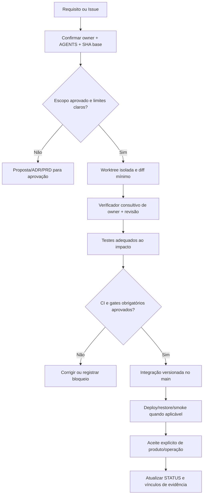

[← Ficha do capítulo](../) · [Volume](../../) · [Fonte original](https://github.com/delmacy/syndes-system/blob/main/docs/subprojects/G03-engenharia-e-git/chapters/05-arquitetura-banco-interface-configuracao-e-diagramas.md)

> Conteúdo espelhado da documentação versionada; não expressa automaticamente estado funcional.

## 5. Arquitetura do fluxo de engenharia

### Caminho da mudança (modelo processual)

**Este desenho não afirma que todas as etapas foram automatizadas.** Um teste local não substitui CI do SHA; uma publicação do Pages não valida a segurança do SaaS. `main` pode receber commits nesta fase conforme decisão do proprietário, sem implicar que os testes falhos devam ser ignorados.

### CI e governança no checkout

| Componente | Comportamento lido no arquivo | O que falta comprovar |
|---|---|---|
| `.github/workflows/syndes-ci.yml` | Push/PR/merge_group/manual; jobs `foundation`, `impact`, `regression`, paridades e `gate` | Execução verde no SHA, inclusive `foundation` |
| `scripts/ci/plan.mjs` | Seleção de suites por impacto; push no `main` usa modo `full`; caminhos desconhecidos acionam full | Cobertura real de todos os módulos/novas suites |
| `scripts/ci/parity.test.mjs` | Prova de seleção/governança do pipeline no conjunto de testes | Run atual falhou na paridade; causa/ajuste é da frente CI |
| `syndes-docs-pages.yml` | Build e publicação do portal estático | Aprovar docs não equivale a gate mainline |
| `syndes-docs-project-sync.yml` | Importação condicional de Issues etiquetadas no GitHub Projects | Precisam existir vars/secrets autorizados e evidência real de itens |

### Modelo de dados e configurações

- **G03 não usa banco de dados próprio.** O registro de alteração é Git e a documentação Markdown; tarefas/estado vivo são serviços GitHub quando conectados e autorizados.
- **Metadados estruturados:** `catalog/work-units.json`, `catalog/evolution-associations.json`, `catalog/traceability-links.json`; não replicar status de Projects como segundo banco.
- **HTML/CSS/JS do Docs:** renderizam abas, busca, edição contextual e navegação; Markdown segue fonte autorada e JSON derivado do código é inventário, não um contrato de runtime.
- **Projects sync:** variável `SYNDES_PROJECT_URL` e secret `SYNDES_PROJECTS_PAT` são **nomes** registrados no workflow. Jamais publicar valores nem afirmar que estão configurados sem evidência.
- **Ambiente:** worktree isolada permite auditoria simultânea sem tocar raiz de trabalho. Não usar `git reset --hard`, limpeza indiscriminada ou manipulação de serviços alheios.

### Riscos observados

1. A checagem de `verify_module_scope.py` é consultiva e **não** impõe sandbox.
2. O pipeline atual tem falha de regressão de paridade dos workflows; até resolução, não concluir que `main` passou gates globais.
3. Source-of-truth de status pode divergir entre WBS histórica, Issue, Project e STATUS se for copiado manualmente.
4. Um novo módulo não listado no planner pode ficar sem suite adequada; checar matriz do planner e regras do owner na frente CI.
5. Não inventar proteção de branch ou alterar workflows sem aprovação; registrar e encaminhar ao escopo próprio.

---
**Rastreabilidade:** [revisar documento fonte](https://github.com/delmacy/syndes-system/blob/main/docs/subprojects/G03-engenharia-e-git/chapters/05-arquitetura-banco-interface-configuracao-e-diagramas.md).
