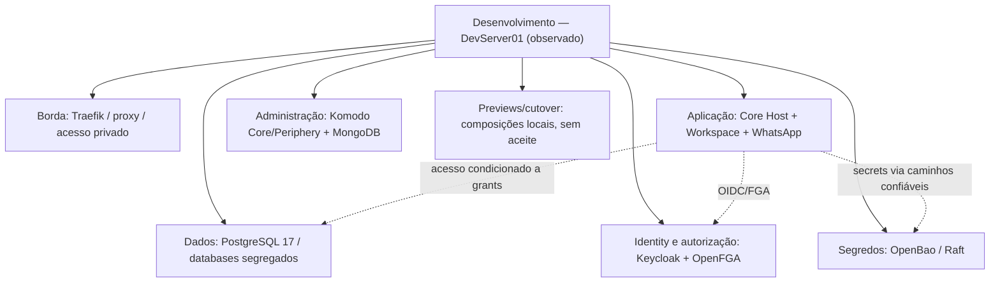
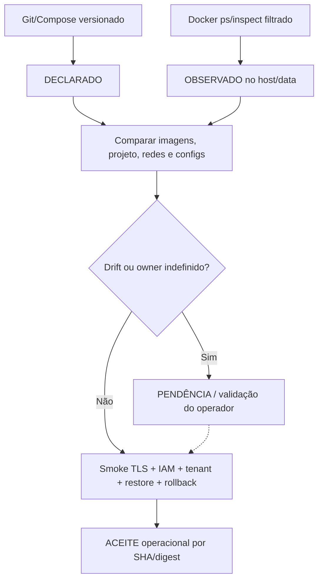

# I02 — Hospedagem e ambientes

[← Sumário do volume](../) · [↑ Biblioteca](../../)

> **Leitura técnica, não homologação.** Estados, limites e comprovações devem ser lidos em STATUS e nos checkpoints versionados.

## Identificação e rastreabilidade

| Campo | Fonte verificável |
|---|---|
| Unidade / owner | **I02** · Hospedagem e ambientes |
| Volume | Infraestrutura e qualidade |
| Caminho de implementação | `infra` |
| Documento de origem | [README](https://github.com/delmacy/syndes-system/blob/main/docs/subprojects/I02-server02/README.md) |
| STATUS e critérios | [STATUS original](https://github.com/delmacy/syndes-system/blob/main/docs/subprojects/I02-server02/STATUS.md) |
| Símbolos, APIs, SQL e dependências | [REFERENCIA-TECNICA](https://github.com/delmacy/syndes-system/blob/main/docs/subprojects/I02-server02/REFERENCIA-TECNICA.md) |
| Implantação, runbooks e gates | [OPERACAO](https://github.com/delmacy/syndes-system/blob/main/docs/subprojects/I02-server02/OPERACAO.md) |

## Situação registrada

> AUDITORIA TÉCNICA PARCIAL — 12/11/2026 (America/SaoPaulo). Fonte Git origin/main SHA 9ac228e8cb21cb37f5c6892063dfdbc3d0238f20; DevServer01 consultado via conector remoto e Docker somente leitura em 13/11/2026 02:27 UTC. win1-server e server02 estavam offline no conector, portanto staging e produção não foram verificados. Nenhuma intervenção operacional foi autorizada ou executada. Dimensão Situação e evidência Não permite concluir --------- Documentação…

A descrição acima é uma **citação resumida do STATUS versionado**; não significa que os testes de integração, a implantação ou a homologação estejam aprovados.

## Índice dos subcapítulos

Todos os assuntos deste módulo estão nesta página. Clique em um título para saltar à seção correspondente; o índice lateral acompanha a leitura.

- [Casos de uso](#casos-de-uso)
- [Histórias de usuário](#historias-de-usuario)
- [Requisitos](#requisitos)
- [Contratos públicos e privados](#contratos)
- [APIs e endpoints](#apis)
- [Eventos e mensageria](#eventos)
- [Dados e persistência](#dados)
- [Schemas e migrations](#schema)
- [Dependências e integrações](#dependencias)
- [Configuração e ambiente](#configuracao)
- [Frontend e interfaces](#interface)
- [Testes e evidências](#testes)
- [Operação e implantação](#operacao)
- [WBS e evolução](#wbs)
- [Documentação de origem integral](#documentacao-de-origem)
- [Controle de alterações](#controle-de-alteracoes)

## Casos de uso

**Editar esta seção:** [Abrir arquivo-fonte no GitHub](https://github.com/delmacy/syndes-system/edit/main/docs/subprojects/I02-server02/chapters/02-requisitos-historias-e-casos-de-uso.md) · [Consultar fonte](https://github.com/delmacy/syndes-system/blob/main/docs/subprojects/I02-server02/chapters/02-requisitos-historias-e-casos-de-uso.md)

*Referências extraídas da documentação versionada, sem inferir homologação ou implantação.*

**Lacuna documental:** ainda não há especificação textual identificada nesta área. Revisar implementação e registrar evidência antes de preencher.

📝 Espaço para ajustes e implementação

Este é um **modelo de registro**, não um editor com salvamento automático. Use o link **Editar esta seção** para atualizar o documento versionado.

- **Alteração proposta:** descreva o requisito, contrato, dado ou comportamento.
- **Referência de código:** informe caminho e símbolo real.
- **Testes e evidências:** informe comando, resultado e limite.
- **Critério de aceite:** indique como validar sem presumir homologação.
- **Status e revisão:** atualize a fonte canônica após revisão.

## Histórias de usuário

**Editar esta seção:** [Abrir arquivo-fonte no GitHub](https://github.com/delmacy/syndes-system/edit/main/docs/subprojects/I02-server02/chapters/02-requisitos-historias-e-casos-de-uso.md) · [Consultar fonte](https://github.com/delmacy/syndes-system/blob/main/docs/subprojects/I02-server02/chapters/02-requisitos-historias-e-casos-de-uso.md)

*Referências extraídas da documentação versionada, sem inferir homologação ou implantação.*

**Lacuna documental:** ainda não há especificação textual identificada nesta área. Revisar implementação e registrar evidência antes de preencher.

📝 Espaço para ajustes e implementação

Este é um **modelo de registro**, não um editor com salvamento automático. Use o link **Editar esta seção** para atualizar o documento versionado.

- **Alteração proposta:** descreva o requisito, contrato, dado ou comportamento.
- **Referência de código:** informe caminho e símbolo real.
- **Testes e evidências:** informe comando, resultado e limite.
- **Critério de aceite:** indique como validar sem presumir homologação.
- **Status e revisão:** atualize a fonte canônica após revisão.

## Requisitos

**Editar esta seção:** [Abrir arquivo-fonte no GitHub](https://github.com/delmacy/syndes-system/edit/main/docs/subprojects/I02-server02/chapters/02-requisitos-historias-e-casos-de-uso.md) · [Consultar fonte](https://github.com/delmacy/syndes-system/blob/main/docs/subprojects/I02-server02/chapters/02-requisitos-historias-e-casos-de-uso.md)

*Referências extraídas da documentação versionada, sem inferir homologação ou implantação.*

**Lacuna documental:** ainda não há especificação textual identificada nesta área. Revisar implementação e registrar evidência antes de preencher.

📝 Espaço para ajustes e implementação

Este é um **modelo de registro**, não um editor com salvamento automático. Use o link **Editar esta seção** para atualizar o documento versionado.

- **Alteração proposta:** descreva o requisito, contrato, dado ou comportamento.
- **Referência de código:** informe caminho e símbolo real.
- **Testes e evidências:** informe comando, resultado e limite.
- **Critério de aceite:** indique como validar sem presumir homologação.
- **Status e revisão:** atualize a fonte canônica após revisão.

## Contratos públicos e privados

**Editar esta seção:** [Abrir arquivo-fonte no GitHub](https://github.com/delmacy/syndes-system/edit/main/docs/subprojects/I02-server02/REFERENCIA-TECNICA.md) · [Consultar fonte](https://github.com/delmacy/syndes-system/blob/main/docs/subprojects/I02-server02/REFERENCIA-TECNICA.md)

*Referências extraídas da documentação versionada, sem inferir homologação ou implantação.*

**Fonte:** [REFERENCIA-TECNICA.md](https://github.com/delmacy/syndes-system/blob/main/docs/subprojects/I02-server02/REFERENCIA-TECNICA.md)

> Linha 3: > **AUDITORIA TÉCNICA PARCIAL — 12/11/2026 (America/Sao_Paulo); coleta live 13/11/2026 02:27 UTC.** Baseline Git `9ac228e8cb21cb37f5c6892063dfdbc3d0238f20`, DevServer01. Foram examinados manifests e metadados do Docker **somente em leitura**. **Não foi realizada inspeção de server02, win1-server, staging nem produção.** Nenhuma senha, IP/hostname privado, URL administrativa, mapeamento de portas nem dados de `docker

> Linha 41: \| Bindings \| Traefik publica portas wildcard; Komodo tem bind em endereço específico; apps observados com loopback ou nenhuma porta publicada; **ACL/firewall não verificados** \|

> Linha 57: **Observações não realizadas:** `docker exec` em bases, consulta a segredo, dump, leitura de mounts/config privada, TLS probing público, firewall, DNS/ACL, acesso a tenant, versionamento de migrações aplicadas, restore e deploy. Não concluir conformidade a partir da ausência dessas verificações.

> Linha 61: **Sem endpoints HTTP próprios da I02 e sem frontend SaaS.** Traefik, Komodo, Keycloak, OpenFGA e Core Host possuem interfaces de seus respectivos produtos/owners. Exposição de proxy não converte APIs privadas em contratos públicos.

**Fonte:** [04-contratos-e-dependencias-publicas.md](https://github.com/delmacy/syndes-system/blob/main/docs/subprojects/I02-server02/chapters/04-contratos-e-dependencias-publicas.md)

> Linha 3: **I02 não implementa API HTTP do produto, pacote Node, classes NestJS ou Event Bus.** O contrato de I02 é a **composição versionada de infraestrutura**, seu procedimento aprovado e a rastreabilidade com os owners de dados, identidade, aplicação e segurança.

> Linha 31: - **Público da plataforma:** apenas interfaces versionadas e endpoints explicitamente aprovados por seus owners; Traefik publica rotas autorizadas, não o conteúdo do Control DB.

> Linha 32: - **Interno:** nomes de redes, imagens, mounts, secrets, store IDs e arquivos de Compose são detalhes operacionais, não contratos de módulos SaaS.

> Linha 33: - **Privado:** conteúdos de secrets, binds completos, roteamento administrativo, endereços de host, DSNs e credenciais nunca devem constar em artefatos públicos.

**Fonte:** [OPERACAO.md](https://github.com/delmacy/syndes-system/blob/main/docs/subprojects/I02-server02/OPERACAO.md)

> Linha 16: - [Contratos públicos](../../standards/CONTRATOS-PUBLICOS.md).

> Linha 32: 4. Testar com critérios apropriados: unitário, contrato, integração, E2E e CI.

📝 Espaço para ajustes e implementação

Este é um **modelo de registro**, não um editor com salvamento automático. Use o link **Editar esta seção** para atualizar o documento versionado.

- **Alteração proposta:** descreva o requisito, contrato, dado ou comportamento.
- **Referência de código:** informe caminho e símbolo real.
- **Testes e evidências:** informe comando, resultado e limite.
- **Critério de aceite:** indique como validar sem presumir homologação.
- **Status e revisão:** atualize a fonte canônica após revisão.

## APIs e endpoints

**Editar esta seção:** [Abrir arquivo-fonte no GitHub](https://github.com/delmacy/syndes-system/edit/main/docs/subprojects/I02-server02/REFERENCIA-TECNICA.md) · [Consultar fonte](https://github.com/delmacy/syndes-system/blob/main/docs/subprojects/I02-server02/REFERENCIA-TECNICA.md)

*Referências extraídas da documentação versionada, sem inferir homologação ou implantação.*

**Fonte:** [REFERENCIA-TECNICA.md](https://github.com/delmacy/syndes-system/blob/main/docs/subprojects/I02-server02/REFERENCIA-TECNICA.md)

> Linha 13: \| [`infra/master-admin/compose.yaml`](https://github.com/delmacy/syndes-system/blob/main/infra/master-admin/compose.yaml) \| Manager API + web em redes segregadas \| A05/A02; configuração declarada **não é Manager implantado** \|

> Linha 53: \| Plataforma Manager \| Frontend visual avulso **healthy** \| API/Web da stack formal de Manager não observadas; evitar confundir visual com painel operacional \|

> Linha 61: **Sem endpoints HTTP próprios da I02 e sem frontend SaaS.** Traefik, Komodo, Keycloak, OpenFGA e Core Host possuem interfaces de seus respectivos produtos/owners. Exposição de proxy não converte APIs privadas em contratos públicos.

**Fonte:** [04-contratos-e-dependencias-publicas.md](https://github.com/delmacy/syndes-system/blob/main/docs/subprojects/I02-server02/chapters/04-contratos-e-dependencias-publicas.md)

> Linha 3: **I02 não implementa API HTTP do produto, pacote Node, classes NestJS ou Event Bus.** O contrato de I02 é a **composição versionada de infraestrutura**, seu procedimento aprovado e a rastreabilidade com os owners de dados, identidade, aplicação e segurança.

> Linha 11: \| Compose Core Host \| `apps/core-host/compose.yaml` — A04 \| Imagem declarada de digest/tag aprovado; 3 redes internas e 4 secrets por arquivo; endpoints e events pertencem ao Host \|

> Linha 12: \| Compose Manager \| `infra/master-admin/compose.yaml` — A05/A02/Infra \| Master API/Web e redes segregadas; **declaração de stack, não instalação confirmada** \|

> Linha 31: - **Público da plataforma:** apenas interfaces versionadas e endpoints explicitamente aprovados por seus owners; Traefik publica rotas autorizadas, não o conteúdo do Control DB.

**Fonte:** [05-arquitetura-banco-interface-configuracao-e-diagramas.md](https://github.com/delmacy/syndes-system/blob/main/docs/subprojects/I02-server02/chapters/05-arquitetura-banco-interface-configuracao-e-diagramas.md)

> Linha 34: \| `infra/security-access/compose.yaml` \| Keycloak, FGA migration/API, OpenBao/Raft \| Keycloak, OpenFGA e OpenBao `Up` \| TLS interno, health funcional, realm/store, rotação \|

> Linha 36: \| `infra/master-admin/compose.yaml` \| API e web em redes segregadas \| Apenas frontend visual avulso `healthy`, não o stack completo \| Identidade Manager, API real, release, isolamento \|

> Linha 74: **I02 não possui frontend ou API de produto.** Workspace/Manager/Support pertencem aos seus aplicativos; as rotas e identidades do Manager e do tenant devem continuar separadas. O que o proxy expõe requer análise com I06 e Segurança, não deve ser deduzido de labels isolados.

**Fonte:** [STATUS.md](https://github.com/delmacy/syndes-system/blob/main/docs/subprojects/I02-server02/STATUS.md)

> Linha 14: \| **Backend/frontend** \| Core Host principal e de cutover, Workspace, preview e gateway WhatsApp em execução \| API de produção, versão aprovada, owner exclusivo de callbacks ou UX validada \|

> Linha 15: \| **Platform Manager** \| Frontend visual avulso `healthy`; Compose de API/Web encontrado no Git \| Manager completo (API+OIDC+grants) em operação \|

> Linha 26: 5. **P1 — Manager visual ≠ Manager operacional.** Sem observação da stack formal Manager API/Web/identidade neste host; evitar afirmar painel global homologado.

📝 Espaço para ajustes e implementação

Este é um **modelo de registro**, não um editor com salvamento automático. Use o link **Editar esta seção** para atualizar o documento versionado.

- **Alteração proposta:** descreva o requisito, contrato, dado ou comportamento.
- **Referência de código:** informe caminho e símbolo real.
- **Testes e evidências:** informe comando, resultado e limite.
- **Critério de aceite:** indique como validar sem presumir homologação.
- **Status e revisão:** atualize a fonte canônica após revisão.

## Eventos e mensageria

**Editar esta seção:** [Abrir arquivo-fonte no GitHub](https://github.com/delmacy/syndes-system/edit/main/docs/subprojects/I02-server02/REFERENCIA-TECNICA.md) · [Consultar fonte](https://github.com/delmacy/syndes-system/blob/main/docs/subprojects/I02-server02/REFERENCIA-TECNICA.md)

*Referências extraídas da documentação versionada, sem inferir homologação ou implantação.*

**Fonte:** [REFERENCIA-TECNICA.md](https://github.com/delmacy/syndes-system/blob/main/docs/subprojects/I02-server02/REFERENCIA-TECNICA.md)

> Linha 41: \| Bindings \| Traefik publica portas wildcard; Komodo tem bind em endereço específico; apps observados com loopback ou nenhuma porta publicada; **ACL/firewall não verificados** \|

**Fonte:** [STATUS.md](https://github.com/delmacy/syndes-system/blob/main/docs/subprojects/I02-server02/STATUS.md)

> Linha 13: \| **Roteamento/proxy** \| Traefik e redes Docker encontrados; entradas publicadas e segmentos `internal=true` identificados \| TLS/ACL/firewall, proteção do Manager ou roteamento de previews corretos \|

> Linha 25: 4. **P1 — borda e segurança de hosts.** Traefik com bindings publicados e Komodo em endereço específico: exposição real depende de firewall/ACL/HTTPS; exigir teste em I06/I12.

📝 Espaço para ajustes e implementação

Este é um **modelo de registro**, não um editor com salvamento automático. Use o link **Editar esta seção** para atualizar o documento versionado.

- **Alteração proposta:** descreva o requisito, contrato, dado ou comportamento.
- **Referência de código:** informe caminho e símbolo real.
- **Testes e evidências:** informe comando, resultado e limite.
- **Critério de aceite:** indique como validar sem presumir homologação.
- **Status e revisão:** atualize a fonte canônica após revisão.

## Dados e persistência

**Editar esta seção:** [Abrir arquivo-fonte no GitHub](https://github.com/delmacy/syndes-system/edit/main/docs/subprojects/I02-server02/REFERENCIA-TECNICA.md) · [Consultar fonte](https://github.com/delmacy/syndes-system/blob/main/docs/subprojects/I02-server02/REFERENCIA-TECNICA.md)

*Referências extraídas da documentação versionada, sem inferir homologação ou implantação.*

**Fonte:** [REFERENCIA-TECNICA.md](https://github.com/delmacy/syndes-system/blob/main/docs/subprojects/I02-server02/REFERENCIA-TECNICA.md)

> Linha 3: > **AUDITORIA TÉCNICA PARCIAL — 12/11/2026 (America/Sao_Paulo); coleta live 13/11/2026 02:27 UTC.** Baseline Git `9ac228e8cb21cb37f5c6892063dfdbc3d0238f20`, DevServer01. Foram examinados manifests e metadados do Docker **somente em leitura**. **Não foi realizada inspeção de server02, win1-server, staging nem produção.** Nenhuma senha, IP/hostname privado, URL administrativa, mapeamento de portas nem dados de `docker

> Linha 11: \| [`infra/postgres/compose.yaml`](https://github.com/delmacy/syndes-system/blob/main/infra/postgres/compose.yaml) \| 1 serviço PostgreSQL 17-bookworm, volume de dados, secrets por arquivo, redes de dados e Manager \| I04/C01/C02: databases/roles, migrations/tenants separados \|

> Linha 15: \| [`modules/whatsapp/deploy/compose.yaml`](https://github.com/delmacy/syndes-system/blob/main/modules/whatsapp/deploy/compose.yaml) \| Gateway Go/Whatsmeow, dados + rede egress \| P03/I09; autorização de canal e sessão precisam de prova própria \|

> Linha 26: \| **Desenvolvimento** \| DevServer01 — conector remoto online e Docker consultado \| 16 containers em execução; Docker, PostgreSQL, IAM, secretos, Komodo/Traefik, Host, Workspace, WhatsApp, previews \| **OBSERVADO em 12/11/2026**, health funcional e Product Gate não homologados \|

> Linha 38: \| Healthchecks \| **2 healthy**, sendo PostgreSQL principal e Manager visual; **14 sem indicador Docker health** — *não significa 14 unhealthy* \|

> Linha 39: \| Redes \| **13** ao todo (3 Docker padrão); redes de dados/Manager com `internal=true` \|

> Linha 42: \| PostgreSQL de teste \| PG17-alpine com nomenclatura de ensaio, em execução há ~43h, sem label de descarte nem owner de projeto; loopback; **não limpar automaticamente** \|

> Linha 49: \| Persistência de aplicação \| PostgreSQL 17-bookworm \| Um servidor DB principal observado; databases/roles/restore ainda não validados \|

> Linha 55: \| Testes ad hoc \| PostgreSQL 17-alpine sem label/projeto \| Necessidade/owner desconhecidos; risco de resíduo de ensaio e uso de recursos \|

> Linha 63: - **Control/Manager x Tenant:** múltiplos databases no PostgreSQL principal conforme `infra/README.md`; papéis de menor privilégio e banco individual por tenant, sujeitos a ensaio real pela I04/C01.

> Linha 75: - [I01 — DevServer01](../I01-devserver01/OPERACAO.md), [I03 — host auxiliar](../I03-win1-server/OPERACAO.md), [I04 — PostgreSQL](../I04-postgresql/REFERENCIA-TECNICA.md), [I05 — Docker](../I05-docker-e-redes/REFERENCIA-TECNICA.md), [I06 — Traefik](../I06-traefik-https/REFERENCIA-TECNICA.md), [I07 — Tailnet](../I07-tailnet/OPERACAO.md), [I08 — Komodo](../I08-komodo/REFERENCIA-TECNICA.md), [I12 — Segurança do host](../

**Fonte:** [04-contratos-e-dependencias-publicas.md](https://github.com/delmacy/syndes-system/blob/main/docs/subprojects/I02-server02/chapters/04-contratos-e-dependencias-publicas.md)

> Linha 3: **I02 não implementa API HTTP do produto, pacote Node, classes NestJS ou Event Bus.** O contrato de I02 é a **composição versionada de infraestrutura**, seu procedimento aprovado e a rastreabilidade com os owners de dados, identidade, aplicação e segurança.

> Linha 7: \| Docker Compose de PostgreSQL \| `infra/postgres/compose.yaml` — I04/I02 \| 1 serviço PostgreSQL 17 com volume nomeado, redes de dados e secrets montados por arquivo; não habilita tenant automaticamente \|

> Linha 8: \| Bootstrap de Control/Tenant \| `infra/postgres/bootstrap/*` — C01/C02/I04 \| SQL e shell de provisionamento autorizados; init só em volume novo, migrations requerem gate próprio \|

> Linha 20: 1. Redes Docker aprovadas (dados, identidade e secretos) e TLS/secret store provisionados por operador.

> Linha 22: 3. PostgreSQL e databases técnicos preparados; migrations e roles executados com ownership e backup.

**Fonte:** [05-arquitetura-banco-interface-configuracao-e-diagramas.md](https://github.com/delmacy/syndes-system/blob/main/docs/subprojects/I02-server02/chapters/05-arquitetura-banco-interface-configuracao-e-diagramas.md)

> Linha 33: \| `infra/postgres/compose.yaml` \| PostgreSQL 17, 2 redes dados/Manager, volume e Docker Secrets \| PostgreSQL principal `healthy`, redes observadas \| DB, papéis, backup, grants e restore \|

> Linha 35: \| `apps/core-host/compose.yaml` \| Host A04 na rede de dados/IAM/secrets \| Core Host base e outra composição de cutover `Up` \| Paridade de imagens/config e roteamento efetivo \|

> Linha 59: - PostgreSQL é **servidor compartilhado**, mas os bancos `Control`, `Keycloak`, `OpenFGA` e tenants são logicamente distintos; `bootstrap` define criação e papéis, não garante aplicação real em volume já existente.

> Linha 60: - OpenBao usa **volume Raft próprio**, fora do PostgreSQL. Komodo usa **MongoDB** como armazenamento da administração de containers, sem se tornar banco do produto.

> Linha 61: - Foram vistos **19 volumes Docker**, sem inspeção dos dados. Contagem não indica backup válido ou consistência de snapshots.

> Linha 62: - O PG17 de ensaio (container avulso sem label de descartável) permanece em execução; não deve ser classificado como persistência de produção ou apagado sem identificar owner.

> Linha 66: - **13 redes** Docker observadas (inclui 3 padrão); as redes de dados e as dedicadas ao Manager têm flag `internal=true`. Isso restringe encaminhamento externo em Docker, mas **não** substitui roles, firewall nem teste de ACL.

> Linha 70: - A versão do Docker Engine observada é **29.9.2**; tags principais: PostgreSQL 17, Keycloak 26, OpenFGA 1, OpenBao 2, Traefik 3 e Komodo 2. Versão de imagem não comprova digest imutável nem política de atualização.

**Fonte:** [STATUS.md](https://github.com/delmacy/syndes-system/blob/main/docs/subprojects/I02-server02/STATUS.md)

> Linha 9: \| **Documentação I02** \| **AUDITORIA PARCIAL:** 8 capítulos, ambiente/serviço/owner, topologia, dependências, inventário live sanitizado e WBS reconciliados \| Que os donos de host, segurança, dados e release tenham aprovado \|

> Linha 11: \| **Saúde de containers** \| PostgreSQL 17 principal e Manager visual relatavam **healthy**; **14 containers sem healthcheck Docker** \| Que os 14 estejam unhealthy ou que os 2 tenham Product Gate \|

> Linha 12: \| **Persistência/segredos** \| PostgreSQL, Keycloak, OpenFGA e OpenBao observados; scripts e volumes versionados/localizados \| Bancos migrados, grants corretos, OpenBao unseal seguro, backup e restore \|

> Linha 16: \| **Container de ensaio** \| PostgreSQL 17-alpine `Up` há ~43h, sem label de descartável ou projeto Compose \| Que pode ser eliminado sem impacto; requer identificar owner \|

> Linha 17: \| **Staging/produção** \| **NÃO VERIFICADOS**: conectores de `server02` e `win1-server` offline \| Que os hosts estejam inativos, sem software ou sem dados \|

> Linha 24: 3. **P1 — container PostgreSQL de teste sem lifecycle claro.** PG17-alpine avulso, `Up` há ~43h, sem label de descarte. Investigar owner e dados antes de limpeza; **não apagar nem migrar automaticamente**.

> Linha 45: - **Não foi executado:** deploy, migração, dump/restore, restart, cleanup, leitura de dados/segredos, alteração de firewall, Komodo, Traefik, serviço ou branch alheia.

**Fonte:** [OPERACAO.md](https://github.com/delmacy/syndes-system/blob/main/docs/subprojects/I02-server02/OPERACAO.md)

> Linha 3: > **RUNBOOK DE CONSULTA SOMENTE LEITURA — NÃO HOMOLOGAÇÃO OPERACIONAL.** A inspeção do DevServer01 em 12/11/2026 não autoriza mudanças em containers, dados, rede ou produção.

> Linha 42: - **Dados e resiliência:** [PostgreSQL](../I04-postgresql/REFERENCIA-TECNICA.md), [Backup/Restore](../I10-backup-e-restore/OPERACAO.md), [Release/Rollback](../I11-release-e-rollback/OPERACAO.md).

> Linha 60: 5. Não parar, remover, reiniciar ou coletar dados de containers avulsos (incluindo o PostgreSQL PG17 de teste) sem confirmação do owner e plano próprio.

📝 Espaço para ajustes e implementação

Este é um **modelo de registro**, não um editor com salvamento automático. Use o link **Editar esta seção** para atualizar o documento versionado.

- **Alteração proposta:** descreva o requisito, contrato, dado ou comportamento.
- **Referência de código:** informe caminho e símbolo real.
- **Testes e evidências:** informe comando, resultado e limite.
- **Critério de aceite:** indique como validar sem presumir homologação.
- **Status e revisão:** atualize a fonte canônica após revisão.

## Schemas e migrations

**Editar esta seção:** [Abrir arquivo-fonte no GitHub](https://github.com/delmacy/syndes-system/edit/main/docs/subprojects/I02-server02/REFERENCIA-TECNICA.md) · [Consultar fonte](https://github.com/delmacy/syndes-system/blob/main/docs/subprojects/I02-server02/REFERENCIA-TECNICA.md)

*Referências extraídas da documentação versionada, sem inferir homologação ou implantação.*

**Fonte:** [REFERENCIA-TECNICA.md](https://github.com/delmacy/syndes-system/blob/main/docs/subprojects/I02-server02/REFERENCIA-TECNICA.md)

> Linha 11: \| [`infra/postgres/compose.yaml`](https://github.com/delmacy/syndes-system/blob/main/infra/postgres/compose.yaml) \| 1 serviço PostgreSQL 17-bookworm, volume de dados, secrets por arquivo, redes de dados e Manager \| I04/C01/C02: databases/roles, migrations/tenants separados \|

**Fonte:** [04-contratos-e-dependencias-publicas.md](https://github.com/delmacy/syndes-system/blob/main/docs/subprojects/I02-server02/chapters/04-contratos-e-dependencias-publicas.md)

> Linha 8: \| Bootstrap de Control/Tenant \| `infra/postgres/bootstrap/*` — C01/C02/I04 \| SQL e shell de provisionamento autorizados; init só em volume novo, migrations requerem gate próprio \|

> Linha 22: 3. PostgreSQL e databases técnicos preparados; migrations e roles executados com ownership e backup.

> Linha 37: Mudanças de rede, porta, volume, backup, migration, service user ou proxy exigem escopo, owner e evidência fora desta auditoria de leitura.

**Fonte:** [05-arquitetura-banco-interface-configuracao-e-diagramas.md](https://github.com/delmacy/syndes-system/blob/main/docs/subprojects/I02-server02/chapters/05-arquitetura-banco-interface-configuracao-e-diagramas.md)

> Linha 34: \| `infra/security-access/compose.yaml` \| Keycloak, FGA migration/API, OpenBao/Raft \| Keycloak, OpenFGA e OpenBao `Up` \| TLS interno, health funcional, realm/store, rotação \|

**Fonte:** [STATUS.md](https://github.com/delmacy/syndes-system/blob/main/docs/subprojects/I02-server02/STATUS.md)

> Linha 28: 7. **P1 — continuidade.** Contagem de 19 volumes, arquivos SQL e scripts de restore não certificam RPO/RTO, backup, migrações ou rollback de produção.

**Fonte:** [OPERACAO.md](https://github.com/delmacy/syndes-system/blob/main/docs/subprojects/I02-server02/OPERACAO.md)

> Linha 31: 3. Confirmar migrations realmente aplicadas, backup/restore e rollback antes de SQL.

📝 Espaço para ajustes e implementação

Este é um **modelo de registro**, não um editor com salvamento automático. Use o link **Editar esta seção** para atualizar o documento versionado.

- **Alteração proposta:** descreva o requisito, contrato, dado ou comportamento.
- **Referência de código:** informe caminho e símbolo real.
- **Testes e evidências:** informe comando, resultado e limite.
- **Critério de aceite:** indique como validar sem presumir homologação.
- **Status e revisão:** atualize a fonte canônica após revisão.

## Dependências e integrações

**Editar esta seção:** [Abrir arquivo-fonte no GitHub](https://github.com/delmacy/syndes-system/edit/main/docs/subprojects/I02-server02/REFERENCIA-TECNICA.md) · [Consultar fonte](https://github.com/delmacy/syndes-system/blob/main/docs/subprojects/I02-server02/REFERENCIA-TECNICA.md)

*Referências extraídas da documentação versionada, sem inferir homologação ou implantação.*

**Fonte:** [REFERENCIA-TECNICA.md](https://github.com/delmacy/syndes-system/blob/main/docs/subprojects/I02-server02/REFERENCIA-TECNICA.md)

> Linha 12: \| [`infra/security-access/compose.yaml`](https://github.com/delmacy/syndes-system/blob/main/infra/security-access/compose.yaml) \| Keycloak 26, OpenFGA 1 com migrate one-shot, OpenBao 2 com Raft \| C03/C04/C05: identidade, autorização e segredos \|

> Linha 16: \| [`infra/README.md`](https://github.com/delmacy/syndes-system/blob/main/infra/README.md) \| Ordem de bootstrap, separação Control/Tenant, secrets via OpenBao, roles e grants \| Procedimento normativo; execução real não confirmada \|

> Linha 17: \| [Runbook do DevServer01](https://github.com/delmacy/syndes-system/blob/main/docs/engineering/WORKSPACE-DEVSERVER01-RUNBOOK.md) \| Workspace/Keycloak/Host em desenvolvimento e Compose locais do host \| Snapshot 01/11/2026; pode estar desatualizado \|

> Linha 50: \| Identidade/segurança \| Keycloak 26, OpenFGA 1, OpenBao 2/Raft \| Container em execução não comprova realm, store, políticas nem unseal/recovery \|

> Linha 61: **Sem endpoints HTTP próprios da I02 e sem frontend SaaS.** Traefik, Komodo, Keycloak, OpenFGA e Core Host possuem interfaces de seus respectivos produtos/owners. Exposição de proxy não converte APIs privadas em contratos públicos.

> Linha 64: - **OpenBao:** volume Raft próprio e arquivos de segredo entregues ao runtime segundo política; **não** mapear credenciais para env/Pages.

**Fonte:** [04-contratos-e-dependencias-publicas.md](https://github.com/delmacy/syndes-system/blob/main/docs/subprojects/I02-server02/chapters/04-contratos-e-dependencias-publicas.md)

> Linha 9: \| Security & Access \| `infra/security-access/compose.yaml` — C03/C04/C05 \| Keycloak, OpenFGA e OpenBao; store de identidades distinto de DB tenant; trust e secrets verificados externamente \|

> Linha 10: \| Gerador de secrets \| `infra/security-access/openbao/run-renderer.sh` \| AppRole/TLS e secrets como arquivos em tmpfs; não inserir tokens em variáveis/logs públicos \|

> Linha 21: 2. OpenBao unsealed por procedimento autorizado; secret renderer capaz de entregar credenciais em arquivos protegidos.

> Linha 23: 4. Keycloak, OpenFGA, stores/clients/tuples válidos; JWT e FGA de tenant não podem ser inferidos de `docker ps`.

**Fonte:** [05-arquitetura-banco-interface-configuracao-e-diagramas.md](https://github.com/delmacy/syndes-system/blob/main/docs/subprojects/I02-server02/chapters/05-arquitetura-banco-interface-configuracao-e-diagramas.md)

> Linha 34: \| `infra/security-access/compose.yaml` \| Keycloak, FGA migration/API, OpenBao/Raft \| Keycloak, OpenFGA e OpenBao `Up` \| TLS interno, health funcional, realm/store, rotação \|

> Linha 59: - PostgreSQL é **servidor compartilhado**, mas os bancos `Control`, `Keycloak`, `OpenFGA` e tenants são logicamente distintos; `bootstrap` define criação e papéis, não garante aplicação real em volume já existente.

> Linha 60: - OpenBao usa **volume Raft próprio**, fora do PostgreSQL. Komodo usa **MongoDB** como armazenamento da administração de containers, sem se tornar banco do produto.

> Linha 70: - A versão do Docker Engine observada é **29.9.2**; tags principais: PostgreSQL 17, Keycloak 26, OpenFGA 1, OpenBao 2, Traefik 3 e Komodo 2. Versão de imagem não comprova digest imutável nem política de atualização.

**Fonte:** [STATUS.md](https://github.com/delmacy/syndes-system/blob/main/docs/subprojects/I02-server02/STATUS.md)

> Linha 9: \| **Documentação I02** \| **AUDITORIA PARCIAL:** 8 capítulos, ambiente/serviço/owner, topologia, dependências, inventário live sanitizado e WBS reconciliados \| Que os donos de host, segurança, dados e release tenham aprovado \|

> Linha 12: \| **Persistência/segredos** \| PostgreSQL, Keycloak, OpenFGA e OpenBao observados; scripts e volumes versionados/localizados \| Bancos migrados, grants corretos, OpenBao unseal seguro, backup e restore \|

**Fonte:** [OPERACAO.md](https://github.com/delmacy/syndes-system/blob/main/docs/subprojects/I02-server02/OPERACAO.md)

> Linha 9: - [Evolução](EVOLUCAO.md): workpackages e dependências; nenhum item é concluído por estar planejado.

> Linha 32: 4. Testar com critérios apropriados: unitário, contrato, integração, E2E e CI.

📝 Espaço para ajustes e implementação

Este é um **modelo de registro**, não um editor com salvamento automático. Use o link **Editar esta seção** para atualizar o documento versionado.

- **Alteração proposta:** descreva o requisito, contrato, dado ou comportamento.
- **Referência de código:** informe caminho e símbolo real.
- **Testes e evidências:** informe comando, resultado e limite.
- **Critério de aceite:** indique como validar sem presumir homologação.
- **Status e revisão:** atualize a fonte canônica após revisão.

## Configuração e ambiente

**Editar esta seção:** [Abrir arquivo-fonte no GitHub](https://github.com/delmacy/syndes-system/edit/main/docs/subprojects/I02-server02/OPERACAO.md) · [Consultar fonte](https://github.com/delmacy/syndes-system/blob/main/docs/subprojects/I02-server02/OPERACAO.md)

*Referências extraídas da documentação versionada, sem inferir homologação ou implantação.*

**Fonte:** [OPERACAO.md](https://github.com/delmacy/syndes-system/blob/main/docs/subprojects/I02-server02/OPERACAO.md)

> Linha 49: 2. Consultar **apenas metadados** da execução, sem `docker inspect` integral nem valores de `Env`, secrets, mounts de origem, routes ou domínio:

> Linha 58: 3. Para publicar, **redigir um resumo por função**, removendo nomes de host, portas, IPs, logs privados, values de env e caminhos físicos de mounts. Conferir Compose declarado versus services observados e ownership de cada overlay/preview.

**Fonte:** [REFERENCIA-TECNICA.md](https://github.com/delmacy/syndes-system/blob/main/docs/subprojects/I02-server02/REFERENCIA-TECNICA.md)

> Linha 11: \| [`infra/postgres/compose.yaml`](https://github.com/delmacy/syndes-system/blob/main/infra/postgres/compose.yaml) \| 1 serviço PostgreSQL 17-bookworm, volume de dados, secrets por arquivo, redes de dados e Manager \| I04/C01/C02: databases/roles, migrations/tenants separados \|

> Linha 12: \| [`infra/security-access/compose.yaml`](https://github.com/delmacy/syndes-system/blob/main/infra/security-access/compose.yaml) \| Keycloak 26, OpenFGA 1 com migrate one-shot, OpenBao 2 com Raft \| C03/C04/C05: identidade, autorização e segredos \|

> Linha 13: \| [`infra/master-admin/compose.yaml`](https://github.com/delmacy/syndes-system/blob/main/infra/master-admin/compose.yaml) \| Manager API + web em redes segregadas \| A05/A02; configuração declarada **não é Manager implantado** \|

> Linha 14: \| [`apps/core-host/compose.yaml`](https://github.com/delmacy/syndes-system/blob/main/apps/core-host/compose.yaml) \| Core Host NestJS, 3 redes de serviço, 4 secrets por arquivo e imagem aprovada \| A04; versão/runtime dependem do deploy e do manifest usado \|

> Linha 15: \| [`modules/whatsapp/deploy/compose.yaml`](https://github.com/delmacy/syndes-system/blob/main/modules/whatsapp/deploy/compose.yaml) \| Gateway Go/Whatsmeow, dados + rede egress \| P03/I09; autorização de canal e sessão precisam de prova própria \|

> Linha 17: \| [Runbook do DevServer01](https://github.com/delmacy/syndes-system/blob/main/docs/engineering/WORKSPACE-DEVSERVER01-RUNBOOK.md) \| Workspace/Keycloak/Host em desenvolvimento e Compose locais do host \| Snapshot 01/11/2026; pode estar desatualizado \|

> Linha 27: \| **Homologação/staging** \| Não foi possível associar host a um release homologado \| Existem scripts/Compose/planos de homologação, não prova de instância aprovada \| **NÃO VERIFICADO** \|

> Linha 32: Comandos de coleta executados **somente leitura**: `docker version --format`, `docker ps --format`, `docker inspect` **filtrado em memória para não expor Env/secretos**, `docker network ls/inspect` e `docker volume ls -q`. **Snapshot temporal: não representa estado atual em datas futuras.**

> Linha 37: \| Containers \| **16 em estado Up**, distribuídos em **8 projetos Compose** identificáveis e **2 avulsos sem label Compose** \|

> Linha 41: \| Bindings \| Traefik publica portas wildcard; Komodo tem bind em endereço específico; apps observados com loopback ou nenhuma porta publicada; **ACL/firewall não verificados** \|

> Linha 64: - **OpenBao:** volume Raft próprio e arquivos de segredo entregues ao runtime segundo política; **não** mapear credenciais para env/Pages.

> Linha 65: - **Docker/Compose:** redes nomeadas e overlays locais; nomes e tags de imagem não garantem digest reprodutível, ausência de drift ou rollback.

**Fonte:** [05-arquitetura-banco-interface-configuracao-e-diagramas.md](https://github.com/delmacy/syndes-system/blob/main/docs/subprojects/I02-server02/chapters/05-arquitetura-banco-interface-configuracao-e-diagramas.md)

> Linha 33: \| `infra/postgres/compose.yaml` \| PostgreSQL 17, 2 redes dados/Manager, volume e Docker Secrets \| PostgreSQL principal `healthy`, redes observadas \| DB, papéis, backup, grants e restore \|

> Linha 34: \| `infra/security-access/compose.yaml` \| Keycloak, FGA migration/API, OpenBao/Raft \| Keycloak, OpenFGA e OpenBao `Up` \| TLS interno, health funcional, realm/store, rotação \|

> Linha 35: \| `apps/core-host/compose.yaml` \| Host A04 na rede de dados/IAM/secrets \| Core Host base e outra composição de cutover `Up` \| Paridade de imagens/config e roteamento efetivo \|

> Linha 36: \| `infra/master-admin/compose.yaml` \| API e web em redes segregadas \| Apenas frontend visual avulso `healthy`, não o stack completo \| Identidade Manager, API real, release, isolamento \|

> Linha 37: \| `modules/whatsapp/deploy/compose.yaml` \| Gateway com rede de egress \| Gateway observado `Up` \| Sessão, callbacks, ownership do canal, idempotência \|

> Linha 68: - Containers de aplicação e identidade publicam portas em loopback ou nenhuma, conforme a coleta. Nenhum IP, hostname interno, URL administrativa, porta ou secret foi transcrito.

> Linha 69: - `infra/.env.example` e `infra/.env.ci` são contratos de configuração/fixação para desenvolvimento e fixtures; **não** são prova de ambiente produtivo provisionado. Não copiar valores.

**Fonte:** [STATUS.md](https://github.com/delmacy/syndes-system/blob/main/docs/subprojects/I02-server02/STATUS.md)

> Linha 10: \| **DevServer01** \| **OBSERVADO:** Docker Engine 29.9.2, **16 containers Up**, **8 projetos Compose**, **2 avulsos**, **13 redes** (3 padrão), **19 volumes** \| Que esteja homologado, com serviços/segurança/backup funcionando \|

> Linha 15: \| **Platform Manager** \| Frontend visual avulso `healthy`; Compose de API/Web encontrado no Git \| Manager completo (API+OIDC+grants) em operação \|

> Linha 16: \| **Container de ensaio** \| PostgreSQL 17-alpine `Up` há ~43h, sem label de descartável ou projeto Compose \| Que pode ser eliminado sem impacto; requer identificar owner \|

> Linha 49: \| 2026-11-12 23:27 America/Sao_Paulo (13/11 02:27 UTC) \| DevServer01, metadados Docker e manifest Git `9ac228e` \| 16 Up, 8 Compose, 2 avulsos, 13 redes, 19 volumes \| Evidência de desenvolvimento, não homologação \|

📝 Espaço para ajustes e implementação

Este é um **modelo de registro**, não um editor com salvamento automático. Use o link **Editar esta seção** para atualizar o documento versionado.

- **Alteração proposta:** descreva o requisito, contrato, dado ou comportamento.
- **Referência de código:** informe caminho e símbolo real.
- **Testes e evidências:** informe comando, resultado e limite.
- **Critério de aceite:** indique como validar sem presumir homologação.
- **Status e revisão:** atualize a fonte canônica após revisão.

## Frontend e interfaces

**Editar esta seção:** [Abrir arquivo-fonte no GitHub](https://github.com/delmacy/syndes-system/edit/main/docs/subprojects/I02-server02/REFERENCIA-TECNICA.md) · [Consultar fonte](https://github.com/delmacy/syndes-system/blob/main/docs/subprojects/I02-server02/REFERENCIA-TECNICA.md)

*Referências extraídas da documentação versionada, sem inferir homologação ou implantação.*

**Fonte:** [REFERENCIA-TECNICA.md](https://github.com/delmacy/syndes-system/blob/main/docs/subprojects/I02-server02/REFERENCIA-TECNICA.md)

> Linha 7: **I02 não é backend, frontend nem biblioteca:** sua fonte `infra/` reúne configurações e procedimentos de hospedagem, enquanto apps e módulos possuem seus próprios manifests. O nome da pasta `I02-server02` é legado documental, não define o ambiente.

> Linha 52: \| Frontend \| Workspace Nginx, preview de UI, Workspace de cutover \| Preview não equivale a versão comercial \|

> Linha 53: \| Plataforma Manager \| Frontend visual avulso **healthy** \| API/Web da stack formal de Manager não observadas; evitar confundir visual com painel operacional \|

> Linha 61: **Sem endpoints HTTP próprios da I02 e sem frontend SaaS.** Traefik, Komodo, Keycloak, OpenFGA e Core Host possuem interfaces de seus respectivos produtos/owners. Exposição de proxy não converte APIs privadas em contratos públicos.

**Fonte:** [03-capabilities.md](https://github.com/delmacy/syndes-system/blob/main/docs/subprojects/I02-server02/chapters/03-capabilities.md)

> Linha 14: \| Manager global \| `infra/master-admin/compose.yaml` \| **Frontend visual de preview** healthy, sem label Compose; Master API/Web da stack versionada **não observados nessa coleta** \|

**Fonte:** [05-arquitetura-banco-interface-configuracao-e-diagramas.md](https://github.com/delmacy/syndes-system/blob/main/docs/subprojects/I02-server02/chapters/05-arquitetura-banco-interface-configuracao-e-diagramas.md)

> Linha 36: \| `infra/master-admin/compose.yaml` \| API e web em redes segregadas \| Apenas frontend visual avulso `healthy`, não o stack completo \| Identidade Manager, API real, release, isolamento \|

> Linha 74: **I02 não possui frontend ou API de produto.** Workspace/Manager/Support pertencem aos seus aplicativos; as rotas e identidades do Manager e do tenant devem continuar separadas. O que o proxy expõe requer análise com I06 e Segurança, não deve ser deduzido de labels isolados.

**Fonte:** [STATUS.md](https://github.com/delmacy/syndes-system/blob/main/docs/subprojects/I02-server02/STATUS.md)

> Linha 14: \| **Backend/frontend** \| Core Host principal e de cutover, Workspace, preview e gateway WhatsApp em execução \| API de produção, versão aprovada, owner exclusivo de callbacks ou UX validada \|

> Linha 15: \| **Platform Manager** \| Frontend visual avulso `healthy`; Compose de API/Web encontrado no Git \| Manager completo (API+OIDC+grants) em operação \|

> Linha 38: **Próximas verificações:** identificar owners de overlays/PG17, coletar inventário somente leitura dos hosts offline quando autorizados e disponíveis, revisar firewall/Traefik, mapear bancos/roles na I04 e assinar aceites operacionais separados. Não tratar os IDs componentes I01/I03/I05/I06/I07/I08/I12 como auditados por esta revisão da I02.

📝 Espaço para ajustes e implementação

Este é um **modelo de registro**, não um editor com salvamento automático. Use o link **Editar esta seção** para atualizar o documento versionado.

- **Alteração proposta:** descreva o requisito, contrato, dado ou comportamento.
- **Referência de código:** informe caminho e símbolo real.
- **Testes e evidências:** informe comando, resultado e limite.
- **Critério de aceite:** indique como validar sem presumir homologação.
- **Status e revisão:** atualize a fonte canônica após revisão.

## Testes e evidências

**Editar esta seção:** [Abrir arquivo-fonte no GitHub](https://github.com/delmacy/syndes-system/edit/main/docs/subprojects/I02-server02/STATUS.md) · [Consultar fonte](https://github.com/delmacy/syndes-system/blob/main/docs/subprojects/I02-server02/STATUS.md)

*Referências extraídas da documentação versionada, sem inferir homologação ou implantação.*

**Fonte:** [STATUS.md](https://github.com/delmacy/syndes-system/blob/main/docs/subprojects/I02-server02/STATUS.md)

> Linha 7: \| Dimensão \| Situação e evidência \| Não permite concluir \|

> Linha 11: \| **Saúde de containers** \| PostgreSQL 17 principal e Manager visual relatavam **healthy**; **14 containers sem healthcheck Docker** \| Que os 14 estejam unhealthy ou que os 2 tenham Product Gate \|

> Linha 22: 1. **P0 documental — mapa de ambientes incompleto.** Somente DevServer01 foi inspecionado; não vincular sem evidência `server02` ou `win1-server` a staging/produção.

> Linha 24: 3. **P1 — container PostgreSQL de teste sem lifecycle claro.** PG17-alpine avulso, `Up` há ~43h, sem label de descarte. Investigar owner e dados antes de limpeza; **não apagar nem migrar automaticamente**.

> Linha 25: 4. **P1 — borda e segurança de hosts.** Traefik com bindings publicados e Komodo em endereço específico: exposição real depende de firewall/ACL/HTTPS; exigir teste em I06/I12.

> Linha 32: \| Referência \| Origem \| Estado preservado \| Ação para fechar o gate \|

> Linha 43: - [Operação](OPERACAO.md): comandos **somente leitura**, restrições para segredos e gates.

> Linha 49: \| 2026-11-12 23:27 America/Sao_Paulo (13/11 02:27 UTC) \| DevServer01, metadados Docker e manifest Git `9ac228e` \| 16 Up, 8 Compose, 2 avulsos, 13 redes, 19 volumes \| Evidência de desenvolvimento, não homologação \|

> Linha 53: **Status final:** auditoria parcial com evidência real do DevServer01; homologação/staging/produção **não verificados**.

**Fonte:** [06-wbs-marcos-e-aceite.md](https://github.com/delmacy/syndes-system/blob/main/docs/subprojects/I02-server02/chapters/06-wbs-marcos-e-aceite.md)

> Linha 13: \| Critério de conclusão documental \| Evidência obtida \| Estado \|

> Linha 20: \| Backend/Frontend real \| Host, Workspace e Gateway executando \| **Containers Up, sem Product Gate** \|

> Linha 21: \| CI do repositório \| [run 43350764378](https://github.com/delmacy/syndes-system/actions/runs/43350764378) — 24/24 success no SHA `9ac228e` \| **Teste de CI, não deploy do DevServer01** \|

> Linha 29: 4. Para **produção**: decisão expressa de implantação, política de backup/restore e RPO/RTO medidos, trilha de auditoria, alertas, rollback, janela e Product Gate.

**Fonte:** [REFERENCIA-TECNICA.md](https://github.com/delmacy/syndes-system/blob/main/docs/subprojects/I02-server02/REFERENCIA-TECNICA.md)

> Linha 26: \| **Desenvolvimento** \| DevServer01 — conector remoto online e Docker consultado \| 16 containers em execução; Docker, PostgreSQL, IAM, secretos, Komodo/Traefik, Host, Workspace, WhatsApp, previews \| **OBSERVADO em 12/11/2026**, health funcional e Product Gate não homologados \|

> Linha 34: \| Indicador \| Evidência do instante \|

> Linha 42: \| PostgreSQL de teste \| PG17-alpine com nomenclatura de ensaio, em execução há ~43h, sem label de descarte nem owner de projeto; loopback; **não limpar automaticamente** \|

> Linha 54: \| Canal WhatsApp \| Gateway Whatsmeow \| Sessão, callbacks e negativas exigem teste de domínio \|

> Linha 55: \| Testes ad hoc \| PostgreSQL 17-alpine sem label/projeto \| Necessidade/owner desconhecidos; risco de resíduo de ensaio e uso de recursos \|

> Linha 67: - **Backup/restore:** existência de volumes e scripts não comprova RPO/RTO; o gate operacional requer teste em staging autorizado.

> Linha 72: - [CI mainline no SHA de origem](https://github.com/delmacy/syndes-system/actions/runs/43350764378): **24/24 jobs success**, inclusive testes descartáveis de Infra; isso não equivale ao inventário real dos serviços do DevServer01 nem a staging/produção homologados.

> Linha 74: - [Operação](OPERACAO.md): procedimento de inspeção não destrutiva e gates; sem comando para remover containers ou rodar DDL.

**Fonte:** [OPERACAO.md](https://github.com/delmacy/syndes-system/blob/main/docs/subprojects/I02-server02/OPERACAO.md)

> Linha 7: - [STATUS](STATUS.md): nível de validação, bloqueios, testes, ambiente e SHA.

> Linha 32: 4. Testar com critérios apropriados: unitário, contrato, integração, E2E e CI.

> Linha 33: 5. Registrar resultado e evidência em STATUS, sem confundir merge com deploy ou aceite.

> Linha 60: 5. Não parar, remover, reiniciar ou coletar dados de containers avulsos (incluindo o PostgreSQL PG17 de teste) sem confirmação do owner e plano próprio.

> Linha 61: 6. Validar por outra frente TLS/firewall/Tailnet, backup/restore, DR e Product Gate. A aprovação do CI não comprova o host.

📝 Espaço para ajustes e implementação

Este é um **modelo de registro**, não um editor com salvamento automático. Use o link **Editar esta seção** para atualizar o documento versionado.

- **Alteração proposta:** descreva o requisito, contrato, dado ou comportamento.
- **Referência de código:** informe caminho e símbolo real.
- **Testes e evidências:** informe comando, resultado e limite.
- **Critério de aceite:** indique como validar sem presumir homologação.
- **Status e revisão:** atualize a fonte canônica após revisão.

## Operação e implantação

**Editar esta seção:** [Abrir arquivo-fonte no GitHub](https://github.com/delmacy/syndes-system/edit/main/docs/subprojects/I02-server02/OPERACAO.md) · [Consultar fonte](https://github.com/delmacy/syndes-system/blob/main/docs/subprojects/I02-server02/OPERACAO.md)

*Referências extraídas da documentação versionada, sem inferir homologação ou implantação.*

**Fonte:** [OPERACAO.md](https://github.com/delmacy/syndes-system/blob/main/docs/subprojects/I02-server02/OPERACAO.md)

> Linha 18: - **Runbook específico:** [DevServer01](https://github.com/delmacy/syndes-system/blob/main/docs/engineering/WORKSPACE-DEVSERVER01-RUNBOOK.md) é histórico; inventário de runtime e lacunas estão na [Referência técnica](REFERENCIA-TECNICA.md). Não reutilizar comandos de deploy de snapshot antigo por inferência.

> Linha 31: 3. Confirmar migrations realmente aplicadas, backup/restore e rollback antes de SQL.

> Linha 33: 5. Registrar resultado e evidência em STATUS, sem confundir merge com deploy ou aceite.

> Linha 39: - **Desenvolvimento:** [I01 — DevServer01](../I01-devserver01/OPERACAO.md) e seu [runbook](https://github.com/delmacy/syndes-system/blob/main/docs/engineering/WORKSPACE-DEVSERVER01-RUNBOOK.md).

> Linha 40: - **Hospedagem por ambiente:** [I02 — inventário e STATUS](STATUS.md) e [I03 host auxiliar](../I03-win1-server/OPERACAO.md). **Não foi comprovado** que I03 ou server02 sejam staging ou produção.

> Linha 41: - **Ferramentas:** [Docker](../I05-docker-e-redes/REFERENCIA-TECNICA.md), [Traefik](../I06-traefik-https/REFERENCIA-TECNICA.md), [Tailnet](../I07-tailnet/OPERACAO.md) e [Komodo](../I08-komodo/REFERENCIA-TECNICA.md).

> Linha 42: - **Dados e resiliência:** [PostgreSQL](../I04-postgresql/REFERENCIA-TECNICA.md), [Backup/Restore](../I10-backup-e-restore/OPERACAO.md), [Release/Rollback](../I11-release-e-rollback/OPERACAO.md).

> Linha 48: 1. Confirmar host, ambiente, autorização de consulta, data/hora e SHA do checkout do repositório; **não** inferir deploy pelo Git.

**Fonte:** [REFERENCIA-TECNICA.md](https://github.com/delmacy/syndes-system/blob/main/docs/subprojects/I02-server02/REFERENCIA-TECNICA.md)

> Linha 13: \| [`infra/master-admin/compose.yaml`](https://github.com/delmacy/syndes-system/blob/main/infra/master-admin/compose.yaml) \| Manager API + web em redes segregadas \| A05/A02; configuração declarada **não é Manager implantado** \|

> Linha 14: \| [`apps/core-host/compose.yaml`](https://github.com/delmacy/syndes-system/blob/main/apps/core-host/compose.yaml) \| Core Host NestJS, 3 redes de serviço, 4 secrets por arquivo e imagem aprovada \| A04; versão/runtime dependem do deploy e do manifest usado \|

> Linha 15: \| [`modules/whatsapp/deploy/compose.yaml`](https://github.com/delmacy/syndes-system/blob/main/modules/whatsapp/deploy/compose.yaml) \| Gateway Go/Whatsmeow, dados + rede egress \| P03/I09; autorização de canal e sessão precisam de prova própria \|

> Linha 18: \| [`scripts/events`](https://github.com/delmacy/syndes-system/tree/main/scripts/events), [Manager deploy](https://github.com/delmacy/syndes-system/blob/main/infra/master-admin/homolog-deploy.sh) \| Ensaios de staging/restore e deploy controlado \| Q08/I10/I11; scripts não comprovam backup ou release realizado \|

> Linha 57: **Observações não realizadas:** `docker exec` em bases, consulta a segredo, dump, leitura de mounts/config privada, TLS probing público, firewall, DNS/ACL, acesso a tenant, versionamento de migrações aplicadas, restore e deploy. Não concluir conformidade a partir da ausência dessas verificações.

> Linha 65: - **Docker/Compose:** redes nomeadas e overlays locais; nomes e tags de imagem não garantem digest reprodutível, ausência de drift ou rollback.

> Linha 74: - [Operação](OPERACAO.md): procedimento de inspeção não destrutiva e gates; sem comando para remover containers ou rodar DDL.

> Linha 75: - [I01 — DevServer01](../I01-devserver01/OPERACAO.md), [I03 — host auxiliar](../I03-win1-server/OPERACAO.md), [I04 — PostgreSQL](../I04-postgresql/REFERENCIA-TECNICA.md), [I05 — Docker](../I05-docker-e-redes/REFERENCIA-TECNICA.md), [I06 — Traefik](../I06-traefik-https/REFERENCIA-TECNICA.md), [I07 — Tailnet](../I07-tailnet/OPERACAO.md), [I08 — Komodo](../I08-komodo/REFERENCIA-TECNICA.md), [I12 — Segurança do host](../

**Fonte:** [05-arquitetura-banco-interface-configuracao-e-diagramas.md](https://github.com/delmacy/syndes-system/blob/main/docs/subprojects/I02-server02/chapters/05-arquitetura-banco-interface-configuracao-e-diagramas.md)

> Linha 37: \| `modules/whatsapp/deploy/compose.yaml` \| Gateway com rede de egress \| Gateway observado `Up` \| Sessão, callbacks, ownership do canal, idempotência \|

**Fonte:** [06-wbs-marcos-e-aceite.md](https://github.com/delmacy/syndes-system/blob/main/docs/subprojects/I02-server02/chapters/06-wbs-marcos-e-aceite.md)

> Linha 21: \| CI do repositório \| [run 43350764378](https://github.com/delmacy/syndes-system/actions/runs/43350764378) — 24/24 success no SHA `9ac228e` \| **Teste de CI, não deploy do DevServer01** \|

> Linha 28: 3. Para **staging**: manifest versionado/digest, isolamento de DB/Keycloak/FGA, restore real de dados sintéticos, certificados, smoke JWT/tenant A-B, rollback.

> Linha 29: 4. Para **produção**: decisão expressa de implantação, política de backup/restore e RPO/RTO medidos, trilha de auditoria, alertas, rollback, janela e Product Gate.

**Fonte:** [STATUS.md](https://github.com/delmacy/syndes-system/blob/main/docs/subprojects/I02-server02/STATUS.md)

> Linha 15: \| **Platform Manager** \| Frontend visual avulso `healthy`; Compose de API/Web encontrado no Git \| Manager completo (API+OIDC+grants) em operação \|

> Linha 18: \| **CI do código auditado** \| [Run 43350764378](https://github.com/delmacy/syndes-system/actions/runs/43350764378) **24/24 jobs success** no SHA `9ac228e` \| Deploy, DR, homologação ou aceite de produção \|

> Linha 28: 7. **P1 — continuidade.** Contagem de 19 volumes, arquivos SQL e scripts de restore não certificam RPO/RTO, backup, migrações ou rollback de produção.

> Linha 36: \| 95.03 \| Staging imutável, deploy por digest e rollback \| **BLOQ** \| Provar staging, backup/restore, releases imutáveis e reversão \|

> Linha 43: - [Operação](OPERACAO.md): comandos **somente leitura**, restrições para segredos e gates.

> Linha 45: - **Não foi executado:** deploy, migração, dump/restore, restart, cleanup, leitura de dados/segredos, alteração de firewall, Komodo, Traefik, serviço ou branch alheia.

📝 Espaço para ajustes e implementação

Este é um **modelo de registro**, não um editor com salvamento automático. Use o link **Editar esta seção** para atualizar o documento versionado.

- **Alteração proposta:** descreva o requisito, contrato, dado ou comportamento.
- **Referência de código:** informe caminho e símbolo real.
- **Testes e evidências:** informe comando, resultado e limite.
- **Critério de aceite:** indique como validar sem presumir homologação.
- **Status e revisão:** atualize a fonte canônica após revisão.

## WBS e evolução

**Editar esta seção:** [Abrir arquivo-fonte no GitHub](https://github.com/delmacy/syndes-system/edit/main/docs/subprojects/I02-server02/STATUS.md) · [Consultar fonte](https://github.com/delmacy/syndes-system/blob/main/docs/subprojects/I02-server02/STATUS.md)

*Referências extraídas da documentação versionada, sem inferir homologação ou implantação.*

**Fonte:** [STATUS.md](https://github.com/delmacy/syndes-system/blob/main/docs/subprojects/I02-server02/STATUS.md)

> Linha 9: \| **Documentação I02** \| **AUDITORIA PARCIAL:** 8 capítulos, ambiente/serviço/owner, topologia, dependências, inventário live sanitizado e WBS reconciliados \| Que os donos de host, segurança, dados e release tenham aprovado \|

> Linha 34: \| 10.01 \| WBS programa — inventário de ambientes Control/Tenant \| **PEND** \| Obter os hosts/serviços restantes e revisar paridade, rede, digest, secret e backup \|

> Linha 44: - [Evolução/WBS](EVOLUCAO.md): tasks históricas, sem promoções automáticas.

**Fonte:** [06-wbs-marcos-e-aceite.md](https://github.com/delmacy/syndes-system/blob/main/docs/subprojects/I02-server02/chapters/06-wbs-marcos-e-aceite.md)

> Linha 3: A [EVOLUÇÃO da I02](../EVOLUCAO.md) associa a unidade à [WBS mestre](../../../engineering/WBS-PROGRAMA-SYNDES-20261110.md). Estados são **históricos**, não transições automáticas provocadas por esta auditoria.

> Linha 5: \| Tarefa existente \| Entregável \| Estado histórico da WBS \| Situação na auditoria I02 \|

> Linha 16: \| Separação de responsabilidades \| I02 e componentes I01/I03/I04/I05–I08/I12 \| **Mapeada, revisão de owner pendente** \|

**Fonte:** [07-controle-do-escopo.md](https://github.com/delmacy/syndes-system/blob/main/docs/subprojects/I02-server02/chapters/07-controle-do-escopo.md)

> Linha 29: - [x] WBS real vinculada sem promover estados.

**Fonte:** [REFERENCIA-TECNICA.md](https://github.com/delmacy/syndes-system/blob/main/docs/subprojects/I02-server02/REFERENCIA-TECNICA.md)

> Linha 71: - [WBS](EVOLUCAO.md): 10.01 (inventário PEND), 40.09 (homologação HTTPS/rate limit BLOQ), 95.03 (staging imutável BLOQ).

**Fonte:** [OPERACAO.md](https://github.com/delmacy/syndes-system/blob/main/docs/subprojects/I02-server02/OPERACAO.md)

> Linha 8: - [SPRINT](SPRINT.md): incremento autorizado e checkpoints, quando existentes.

📝 Espaço para ajustes e implementação

Este é um **modelo de registro**, não um editor com salvamento automático. Use o link **Editar esta seção** para atualizar o documento versionado.

- **Alteração proposta:** descreva o requisito, contrato, dado ou comportamento.
- **Referência de código:** informe caminho e símbolo real.
- **Testes e evidências:** informe comando, resultado e limite.
- **Critério de aceite:** indique como validar sem presumir homologação.
- **Status e revisão:** atualize a fonte canônica após revisão.

## Documentação de origem integral

Os oito assuntos canônicos são reproduzidos abaixo para permitir leitura contínua. As fontes versionadas permanecem editáveis e preservadas.

### 00 · Fontes e endereços

[Editar conteúdo original](https://github.com/delmacy/syndes-system/edit/main/docs/subprojects/I02-server02/chapters/00-enderecos-exatos-de-leitura.md) · [Abrir fonte](https://github.com/delmacy/syndes-system/blob/main/docs/subprojects/I02-server02/chapters/00-enderecos-exatos-de-leitura.md)

##### 0. Fontes verificáveis e limites da observação

> **Auditoria I02 — 12/11/2026 (America/Sao_Paulo); coleta 13/11/2026 02:27 UTC.** Base de código: `origin/main` SHA `9ac228e8cb21cb37f5c6892063dfdbc3d0238f20`. Inspeção do **DevServer01** via Docker em modo somente leitura; não houve mudança de container, volume, rede, banco, segredo ou deploy.

| Dimensão | Fonte concreta | Limite |
|---|---|---|
| Owner | `catalog/work-units.json`, ID `I02`, `path=infra` | I02 é infraestrutura/hospedagem; não um app ou tenant |
| Composição declarada | [`infra/README.md`](https://github.com/delmacy/syndes-system/blob/main/infra/README.md) | Descreve bootstrap e operação-alvo, não comprova serviços ativados |
| Dados | [`infra/postgres/compose.yaml`](https://github.com/delmacy/syndes-system/blob/main/infra/postgres/compose.yaml) e `bootstrap/*` | PostgreSQL 17, Control/Identity e bancos por tenant previstos; scripts de inicialização não comprovam migrations aplicadas |
| IAM/Secrets | [`infra/security-access/compose.yaml`](https://github.com/delmacy/syndes-system/blob/main/infra/security-access/compose.yaml) | Keycloak, OpenFGA e OpenBao/Raft separados |
| Manager | [`infra/master-admin/compose.yaml`](https://github.com/delmacy/syndes-system/blob/main/infra/master-admin/compose.yaml) | Declara Manager API/Web segregados; **não observados como essa stack** no DevServer01 |
| Host | [`apps/core-host/compose.yaml`](https://github.com/delmacy/syndes-system/blob/main/apps/core-host/compose.yaml) | Runtime A04; coexistem composições locais e de cutover |
| WhatsApp | [`modules/whatsapp/deploy/compose.yaml`](https://github.com/delmacy/syndes-system/blob/main/modules/whatsapp/deploy/compose.yaml), `devserver01-cutover.compose.yaml` | Gateway e composições de teste/migração; confirmação por ambiente obrigatória |
| Desenvolvimento | [Runbook do DevServer01](https://github.com/delmacy/syndes-system/blob/main/docs/engineering/WORKSPACE-DEVSERVER01-RUNBOOK.md) | Snapshot operacional anterior de Workspace, não uma descrição atual automaticamente |
| Inventário live | `docker version`, `docker ps`, `docker inspect` **filtrado**, `docker network ls/inspect`, `docker volume ls` | **16 containers**, **13 redes** (incluindo padrão), **19 volumes** observados naquele instante; health não equivale a aceite |
| Outros hosts | Estado do conector remoto na coleta | `win1-server` e `server02` **offline**; sem leitura de serviços, staging ou produção |
| Planejamento | [WBS 10.01, 40.09, 95.03](https://github.com/delmacy/syndes-system/blob/main/docs/engineering/WBS-PROGRAMA-SYNDES-20261110.md) | PEND/BLOQ históricos, sem Product Gate ou release comprovado |

**Rastreio:** os registros publicados omitem endereços, domínios, portas específicas, bind sources, segredos, tokens e valores de `.env`. Logs e `docker inspect` completos **não devem** ser publicados no GitHub Pages.

**Vínculos:** I01 e I03 são componentes históricos de host sob I02; I04 dados, I05 Docker/redes, I06 Traefik, I07 Tailnet, I08 Komodo, I12 segurança têm owners e auditorias próprios.

### 01 · Missão e fronteiras

[Editar conteúdo original](https://github.com/delmacy/syndes-system/edit/main/docs/subprojects/I02-server02/chapters/01-missao-objetivos-e-fronteiras.md) · [Abrir fonte](https://github.com/delmacy/syndes-system/blob/main/docs/subprojects/I02-server02/chapters/01-missao-objetivos-e-fronteiras.md)

##### 1. Missão, objetivos e fronteiras

###### Missão de I02 — Hospedagem por ambiente e função

Construir uma referência verificável de **onde e como o Syndes é executado, protegido, integrado e recuperado**, começando pelo DevServer01 e deixando staging/produção explicitamente **não verificados** até acesso e aceite. I02 coordena a visão do ambiente; não substitui os owners das stacks e serviços.

| Incluído no escopo documental | Fora desta auditoria |
|---|---|
| Mapear desenvolvimento, homologação e produção, com estados independentes | Declarar produção ativa só porque existe Compose ou DNS |
| Levantar inventário **somente leitura** de containers, imagens, redes, mounts e health | Subir/parar containers, abrir portas, reconfigurar proxy, limpar volumes |
| Vincular serviços aos manifests e responsáveis I01/I03/I04/I05–I08/I12 | Transferir controle de Core Host, Manager API, PostgreSQL e WhatsApp para I02 |
| Distinguir Control DB, tenant DB, stores técnicos e segredos | Executar migrations, consultar dados de tenants ou extrair secretos |
| Especificar dependências de rollout, backup, restore, rollback e acesso | Assinar homologação, Product Gate ou DR sem ensaio real |
| Registrar hosts sem torná-los módulos no menu | Publicar IPs, portas administrativas, rotas privadas ou credenciais |

###### Princípios de arquitetura preservados

- **Ambiente** é a unidade de decisão operacional: desenvolvimento, staging e produção; servidor é recurso do ambiente. DevServer01 tem evidência de desenvolvimento. Os demais hosts não foram auditados.
- **Composição da hospedagem** usa Docker/Compose para os componentes observados; não há evidência de Kubernetes, cluster HA ou orquestração de produção aprovada neste inventário.
- **Tenancy:** um servidor PostgreSQL pode atender bancos isolados; Control, Keycloak e OpenFGA são databases distintos; cada tenant recebe DB próprio segundo o contrato de `infra/README.md`. OpenBao mantém volume Raft.
- **Segregação:** Manager API e Web têm Compose versionado e redes dedicadas, porém um frontend de preview observado **não prova Manager operacional** nem sua API instalada.
- **Ingress:** Traefik concentra entradas publicadas. Exposição de porta é fato de rede, **não** validação de TLS, autenticação, origem permitida, rate limit ou firewall.
- **Integridade:** containers “Up”, CI verde e arquivos presentes não comprovam saúde funcional, backup válido, release, reversão, governança ou prontidão comercial.

**Atores:** operadores autorizados, engenharia, segurança, QA e donos dos módulos. I02 não fornece API, pacote npm, módulo NestJS nem frontend SaaS.

### 02 · Requisitos e casos de uso

[Editar conteúdo original](https://github.com/delmacy/syndes-system/edit/main/docs/subprojects/I02-server02/chapters/02-requisitos-historias-e-casos-de-uso.md) · [Abrir fonte](https://github.com/delmacy/syndes-system/blob/main/docs/subprojects/I02-server02/chapters/02-requisitos-historias-e-casos-de-uso.md)

##### 2. Requisitos, histórias e casos de uso operacionais

As referências `I02-R*` são critérios de **documentação/revisão**, derivados de `infra/README.md`, WBS e instruções globais. Não são novos tickets aprovados, nem liberam ações em hosts.

| Critério documental | Evidência mínima de aceitação |
|---|---|
| I02-R01 — Inventário por ambiente | Ambiente, host autorizado, data/hora, origem, service owner e finalidade; ausência explícita de verificação |
| I02-R02 — Paridade declarada/observada | Compose versionado, projeto Compose em execução, imagem e presença/ausência de cada serviço, identificando overlays locais |
| I02-R03 — Redes e exposições | Redes internas x externas, serviços com `HostPort`, política de proxy/TLS e verificação de firewall sem divulgar IP/porta |
| I02-R04 — Segredos e bootstrap | OpenBao/AppRole/arquivos protegidos, ordem de inicialização e recovery; sem valores operacionais publicados |
| I02-R05 — Integridade Control/Tenant | Mapa dos databases/roles e negativa de conectividade indevida; testes com acesso autorizado e datasets de ensaio |
| I02-R06 — Manager segregado | API, front, identidade e redes separadas, com evidência de serviço real e não apenas visual de preview |
| I02-R07 — Recuperação | Existência de backup, retenção, restore ensaiado em ambiente distinto, RPO/RTO medidos, rollback/owner |
| I02-R08 — Observabilidade | Health funcional, logs sanitizados, retenção/rotação e alertas de disco/certificados |
| I02-R09 — Release | SHA/digest, aprovação, smoke, rollback e registro da janela de deploy/staging/produção |
| I02-R10 — Segurança documental | Ausência de credenciais, IPs privados, caminhos sensíveis de mounts e configuração do admin em páginas públicas |

###### Histórias de uso

**US-I02-01 — Operação:** como administrador, preciso saber o que roda em cada ambiente e qual manifesto o define, para operar sem afetar preview e produção por engano.

**US-I02-02 — Engenharia:** como implementador, preciso localizar serviço, banco, rede, owner e gate antes de integrar módulo ou alterar host.

**US-I02-03 — Segurança:** como auditor, preciso separar portas publicadas, rede interna e rota autenticada, para não inferir proteção por presença de proxy.

**US-I02-04 — Continuidade:** como operador de release, preciso de prova de restore e rollback associada ao digest; backup agendado sem restore não comprova recuperação.

###### Casos de uso

**UC-I02-A — Inventário seguro:** selecionar host/ambiente → obter autorização → `docker ps/inspect` filtrado (sem Env/Mount Source) → mapear imagem/projeto/network/health → comparar manifests → registrar divergências → revisão do owner.

**UC-I02-B — Preparar produção:** validar escopo aprovado → staging com imagens imutáveis → grants/identity/tenant → backup/restore → TLS/firewall/rate limit → smoke e logs → rollback testado → aceite. **Nenhuma dessas fases foi executada nesta auditoria.**

**UC-I02-C — Container sem owner:** confirmar Compose/project e quem o criou → classificar preview, fixture ou serviço persistente → validar dependências → solicitar limpeza autorizada em frente própria. **Nunca remover por inferência baseada no nome.**

###### Critérios não funcionais

Deny-by-default, tenancy isolada, secretos fora do Git e logs, controle de acesso à Docker/Komodo, retenção com limiar de disco, recovery ensaiado e rastreabilidade por SHA. **Não inventar SLA, RPO/RTO ou quantidade de réplicas sem medição.**

### 03 · Capacidades

[Editar conteúdo original](https://github.com/delmacy/syndes-system/edit/main/docs/subprojects/I02-server02/chapters/03-capabilities.md) · [Abrir fonte](https://github.com/delmacy/syndes-system/blob/main/docs/subprojects/I02-server02/chapters/03-capabilities.md)

##### 3. Capabilities de hospedagem verificadas e pendentes

###### Observação DevServer01: 12/11/2026 (UTC 13/11 02:27)

| Camada/finalidade | Artefatos no repositório | Evidência live e limites |
|---|---|---|
| Docker/Compose | `infra/*/compose.yaml`, `apps/core-host/compose.yaml` | Docker Engine 29.9.2 e **16 containers Up**; não prova serviço pronto |
| Data plane | `infra/postgres/compose.yaml` | PostgreSQL 17 principal com health **healthy**; **13 redes**, incluindo 3 padrão; DB/roles ainda não auditados |
| Identidade | `infra/security-access/compose.yaml` | Keycloak 26 e OpenFGA presentes; sem healthcheck Docker declarado nesses containers |
| Segredos | `infra/security-access/openbao/` e `compose.yaml` | OpenBao/Raft presente; status de unseal, rotatividade e permissões não verificados |
| Administração/ingress | Manifest de Komodo/Traefik no host (fora do conjunto versionado avaliado) | Komodo Core/Periphery, MongoDB 7 e Traefik 3 ativos; portas de entrada publicadas, autenticação/ACL não homologadas |
| API de aplicação | `apps/core-host/compose.yaml`; overlays WhatsApp | **Duas composições de Core Host** observadas; ownership do tráfego, digest e rotas exigem verificação |
| Front Workspace | `apps/workspace-web` e runbook de desenvolvimento | Workspace, preview e cutover com Nginx; observar serviço ≠ validar sessão/UX |
| Manager global | `infra/master-admin/compose.yaml` | **Frontend visual de preview** healthy, sem label Compose; Master API/Web da stack versionada **não observados nessa coleta** |
| WhatsApp | `modules/whatsapp/deploy/compose.yaml` | Gateway Go/Whatsmeow em execução; estado de sessões e entrega não testados |
| PostgreSQL de ensaio | CI/Q07 e scripts de tests | Um PG17-alpine antigo, em execução há ~43h, sem label de descarte nem projeto Compose; **owner/necessidade não verificados** |
| Redes e volumes | Redes declaradas nas stacks | **13 redes Docker** (3 padrão), **19 volumes** no host, não auditados quanto a conteúdo/restore |
| Segurança da borda | Traefik e redes Docker | Dados e redes dedicadas Manager com `Internal=true`; proxy possui portas publicadas; checar middleware/firewall efetivos |
| Homologação e produção | WBS 95.03; manifests e runbooks | **Nenhum host desses ambientes pôde ser inspecionado**; não afirmar instalação nem saúde |

###### Diferença entre três categorias de evidência

- **Declarado:** serviço em Compose, env example, runbook ou WBS. Não implica `docker ps`.
- **Observado:** container `Up`, imagem, redes, health do Docker na coleta. Não comprova API/negativas/backup.
- **Aceito operacionalmente:** smoke real + segurança, restore, release/digest e autorização do responsável. **Não comprovado pela I02 nesta passagem.**

###### Atenções observadas

- Containers em **8 projetos Compose** identificáveis e **2 sem rótulo de projeto**, incluindo Manager visual e PG17 de teste.
- Dos 16 containers, apenas **2 relatavam `healthy`** pelo Docker: PostgreSQL principal e Manager visual. Os demais não publicaram healthcheck; não classificar como `unhealthy` por isso.
- O PG17 de ensaio tem porta apenas em loopback, mas não possui marcação de container descartável; falta lifecycle/owner. **Não remover automaticamente.**
- `server02` e `win1-server` estavam **offline no conector**: a ausência de acesso não prova serviço parado.

### 04 · Contratos e dependências

[Editar conteúdo original](https://github.com/delmacy/syndes-system/edit/main/docs/subprojects/I02-server02/chapters/04-contratos-e-dependencias-publicas.md) · [Abrir fonte](https://github.com/delmacy/syndes-system/blob/main/docs/subprojects/I02-server02/chapters/04-contratos-e-dependencias-publicas.md)

##### 4. Contratos de infraestrutura e dependências entre owners

**I02 não implementa API HTTP do produto, pacote Node, classes NestJS ou Event Bus.** O contrato de I02 é a **composição versionada de infraestrutura**, seu procedimento aprovado e a rastreabilidade com os owners de dados, identidade, aplicação e segurança.

| Interface de infraestrutura | Fonte e owner | Entrada/saída e boundary |
|---|---|---|
| Docker Compose de PostgreSQL | `infra/postgres/compose.yaml` — I04/I02 | 1 serviço PostgreSQL 17 com volume nomeado, redes de dados e secrets montados por arquivo; não habilita tenant automaticamente |
| Bootstrap de Control/Tenant | `infra/postgres/bootstrap/*` — C01/C02/I04 | SQL e shell de provisionamento autorizados; init só em volume novo, migrations requerem gate próprio |
| Security & Access | `infra/security-access/compose.yaml` — C03/C04/C05 | Keycloak, OpenFGA e OpenBao; store de identidades distinto de DB tenant; trust e secrets verificados externamente |
| Gerador de secrets | `infra/security-access/openbao/run-renderer.sh` | AppRole/TLS e secrets como arquivos em tmpfs; não inserir tokens em variáveis/logs públicos |
| Compose Core Host | `apps/core-host/compose.yaml` — A04 | Imagem declarada de digest/tag aprovado; 3 redes internas e 4 secrets por arquivo; endpoints e events pertencem ao Host |
| Compose Manager | `infra/master-admin/compose.yaml` — A05/A02/Infra | Master API/Web e redes segregadas; **declaração de stack, não instalação confirmada** |
| Gateway WhatsApp | `modules/whatsapp/deploy/compose.yaml` — P03/I09 | Gateway e rede de saída própria; serviço observado ≠ consentimento ou sessão saudável |
| Reverse proxy e administração | Traefik, Tailnet, Komodo — I06/I07/I08 | Entradas HTTPS, ACL, gestão remota, middleware e certificados precisam de verificação no host |
| Backups/restore e release | `scripts/events/*staging*`, `*restore*`, `infra/master-admin/homolog-deploy.sh` — I10/I11/Q08 | Ensaios e gates; não substituir backup/rollback real no ambiente-alvo |
| WBS/Status | [WBS 10.01, 40.09, 95.03](https://github.com/delmacy/syndes-system/blob/main/docs/engineering/WBS-PROGRAMA-SYNDES-20261110.md) | IDs existentes; atualização do planejamento depende de aceite, não de um container `Up` |

###### Requisitos de dependência na inicialização

1. Redes Docker aprovadas (dados, identidade e secretos) e TLS/secret store provisionados por operador.
2. OpenBao unsealed por procedimento autorizado; secret renderer capaz de entregar credenciais em arquivos protegidos.
3. PostgreSQL e databases técnicos preparados; migrations e roles executados com ownership e backup.
4. Keycloak, OpenFGA, stores/clients/tuples válidos; JWT e FGA de tenant não podem ser inferidos de `docker ps`.
5. Core Host com imagem confiável, plugins instalados e acesso mínimo ao Control/Tenant; Workspace/WhatsApp conectados pelo plano de rede adequado.
6. Traefik/Tailnet/Komodo apenas com rotas permitidas e credenciais/ACL separados; monitoramento, backups e ensaios de falha.

**Não há prova de que essa sequência completa tenha sido exercitada no ambiente de produção.** A presença de 16 containers na estação de desenvolvimento não substitui testes funcionais.

###### Contratos públicos e privados

- **Público da plataforma:** apenas interfaces versionadas e endpoints explicitamente aprovados por seus owners; Traefik publica rotas autorizadas, não o conteúdo do Control DB.
- **Interno:** nomes de redes, imagens, mounts, secrets, store IDs e arquivos de Compose são detalhes operacionais, não contratos de módulos SaaS.
- **Privado:** conteúdos de secrets, binds completos, roteamento administrativo, endereços de host, DSNs e credenciais nunca devem constar em artefatos públicos.
- **Separação por tenant:** imagem/Host são recursos compartilháveis; o banco e a autorização são isolados. `Control` não é banco de CRM, WhatsApp ou Inbox.
- **Sem promoção cruzada:** criar ou ativar uma rede, role ou container não equivale a ativar módulo no catálogo nem a conceder entitlement.

Mudanças de rede, porta, volume, backup, migration, service user ou proxy exigem escopo, owner e evidência fora desta auditoria de leitura.

### 05 · Arquitetura, dados e interfaces

[Editar conteúdo original](https://github.com/delmacy/syndes-system/edit/main/docs/subprojects/I02-server02/chapters/05-arquitetura-banco-interface-configuracao-e-diagramas.md) · [Abrir fonte](https://github.com/delmacy/syndes-system/blob/main/docs/subprojects/I02-server02/chapters/05-arquitetura-banco-interface-configuracao-e-diagramas.md)

##### 5. Arquitetura de ambientes, armazenamento, interface e diagramas

###### Composição por função — DevServer01 observado

**Arestas descrevem relações arquiteturais, não autorizações nem rotas reais aprovadas.** Os containers observados incluem duas composições de Core Host, Workspace e previews, Manager visual separado e um PG17 de ensaio sem owner confirmado.

###### Declaração versionada × execução observada

| Fonte versionada | Conteúdo declarado | Evidência do DevServer01 | Pendência |
|---|---|---|---|
| `infra/postgres/compose.yaml` | PostgreSQL 17, 2 redes dados/Manager, volume e Docker Secrets | PostgreSQL principal `healthy`, redes observadas | DB, papéis, backup, grants e restore |
| `infra/security-access/compose.yaml` | Keycloak, FGA migration/API, OpenBao/Raft | Keycloak, OpenFGA e OpenBao `Up` | TLS interno, health funcional, realm/store, rotação |
| `apps/core-host/compose.yaml` | Host A04 na rede de dados/IAM/secrets | Core Host base e outra composição de cutover `Up` | Paridade de imagens/config e roteamento efetivo |
| `infra/master-admin/compose.yaml` | API e web em redes segregadas | Apenas frontend visual avulso `healthy`, não o stack completo | Identidade Manager, API real, release, isolamento |
| `modules/whatsapp/deploy/compose.yaml` | Gateway com rede de egress | Gateway observado `Up` | Sessão, callbacks, ownership do canal, idempotência |
| Hosts adicionais | I03 e histórico server02 | Dispositivos remotos inacessíveis nesta coleta | Staging e produção **não verificados** |

###### Modos de evidência e fluxo de promoção

Neste checkpoint, somente **DevServer01 observado** possui prova live; não foi obtido aceite operacional para staging/produção.

###### Persistência e volumes

- PostgreSQL é **servidor compartilhado**, mas os bancos `Control`, `Keycloak`, `OpenFGA` e tenants são logicamente distintos; `bootstrap` define criação e papéis, não garante aplicação real em volume já existente.
- OpenBao usa **volume Raft próprio**, fora do PostgreSQL. Komodo usa **MongoDB** como armazenamento da administração de containers, sem se tornar banco do produto.
- Foram vistos **19 volumes Docker**, sem inspeção dos dados. Contagem não indica backup válido ou consistência de snapshots.
- O PG17 de ensaio (container avulso sem label de descartável) permanece em execução; não deve ser classificado como persistência de produção ou apagado sem identificar owner.

###### Segurança de rede, TLS e configuração

- **13 redes** Docker observadas (inclui 3 padrão); as redes de dados e as dedicadas ao Manager têm flag `internal=true`. Isso restringe encaminhamento externo em Docker, mas **não** substitui roles, firewall nem teste de ACL.
- Traefik publica entradas com bind wildcard; investigar certificado, middlewares, roteamento e firewall. O acesso de administração do Komodo tem bind em endereço específico, cujo perímetro real não foi validado; não afirmar que é público ou privado.
- Containers de aplicação e identidade publicam portas em loopback ou nenhuma, conforme a coleta. Nenhum IP, hostname interno, URL administrativa, porta ou secret foi transcrito.
- `infra/.env.example` e `infra/.env.ci` são contratos de configuração/fixação para desenvolvimento e fixtures; **não** são prova de ambiente produtivo provisionado. Não copiar valores.
- A versão do Docker Engine observada é **29.9.2**; tags principais: PostgreSQL 17, Keycloak 26, OpenFGA 1, OpenBao 2, Traefik 3 e Komodo 2. Versão de imagem não comprova digest imutável nem política de atualização.

###### Frontend e APIs

**I02 não possui frontend ou API de produto.** Workspace/Manager/Support pertencem aos seus aplicativos; as rotas e identidades do Manager e do tenant devem continuar separadas. O que o proxy expõe requer análise com I06 e Segurança, não deve ser deduzido de labels isolados.

### 06 · WBS e critérios de aceite

[Editar conteúdo original](https://github.com/delmacy/syndes-system/edit/main/docs/subprojects/I02-server02/chapters/06-wbs-marcos-e-aceite.md) · [Abrir fonte](https://github.com/delmacy/syndes-system/blob/main/docs/subprojects/I02-server02/chapters/06-wbs-marcos-e-aceite.md)

##### 6. WBS, marcos e critérios de aceite de hospedagem

A [EVOLUÇÃO da I02](https://github.com/delmacy/syndes-system/blob/main/docs/subprojects/I02-server02/EVOLUCAO.md) associa a unidade à [WBS mestre](https://github.com/delmacy/syndes-system/blob/main/docs/engineering/WBS-PROGRAMA-SYNDES-20261110.md). Estados são **históricos**, não transições automáticas provocadas por esta auditoria.

| Tarefa existente | Entregável | Estado histórico da WBS | Situação na auditoria I02 |
|---|---|---|---|
| **10.01** | Inventário real de ambientes, URLs, rede e hosts Control/Tenant | **PEND** | DevServer01 inventariado **parcialmente**; outros hosts offline, sem URLs/ACL/backup validado |
| **40.09** | Homologar origem HTTPS privada, rate limit, SSE e monitoramento do Support | **BLOQ** | Proxy/containers observados, **sem** smoke real, monitoramento ou aceite |
| **95.03** | Staging imutável e promoção por digest | **BLOQ** | Não verificados staging/produção nem imagens/digests de promoção |

###### Checkpoint documental 12/11/2026

| Critério de conclusão documental | Evidência obtida | Estado |
|---|---|---|
| Inventário por função e ambiente | Compose versionado + `docker ps/inspect` filtrados | **Parcial (DevServer01)** |
| Separação de responsabilidades | I02 e componentes I01/I03/I04/I05–I08/I12 | **Mapeada, revisão de owner pendente** |
| Segurança de rede | Redes internas, binds classificados, ingress identificado | **Parcial; firewall/TLS/ACL não comprovados** |
| Dados e segredos | Arquitetura dos serviços e volumes | **Declarado + serviços observados; roles/unseal/backup não verificados** |
| Roteamento e réplicas | Host base e cutover/previews coexistem | **Requer classificação de tráfego e digest** |
| Backend/Frontend real | Host, Workspace e Gateway executando | **Containers Up, sem Product Gate** |
| CI do repositório | [run 43350764378](https://github.com/delmacy/syndes-system/actions/runs/43350764378) — 24/24 success no SHA `9ac228e` | **Teste de CI, não deploy do DevServer01** |
| Staging/prod | Nenhum host inspecionado | **Não verificados** |

###### Evidência exigida para avançar

1. Para **DevServer01**: registrar responsável por composições locais, manifesto de origem, imagem/digest, versão/branch, serviços extras, health funcional, função preview/cutover e roteamento autorizado.
2. Para **server02/win1**: conectar dispositivo/operador autorizado e coletar **somente leitura**, com foto de versões, volumes/redes, apps, backups e regras de acesso sem segredos.
3. Para **staging**: manifest versionado/digest, isolamento de DB/Keycloak/FGA, restore real de dados sintéticos, certificados, smoke JWT/tenant A-B, rollback.
4. Para **produção**: decisão expressa de implantação, política de backup/restore e RPO/RTO medidos, trilha de auditoria, alertas, rollback, janela e Product Gate.
5. Para a unidade **I02**: revisão do responsável e dos owners I04/I05/I06/I07/I08/I12 sobre fatos e divergências documentadas.

###### Ordem subsequente

Próxima unidade documental no plano: **I04 — PostgreSQL**, seguida de Control Plane (C01), Keycloak (C03), OpenFGA (C04) e OpenBao (C05). O diagnóstico de containers e redes mais profundo permanece em **I05/I06/I08** sem promover essas unidades nesta passagem.

**Não marcar 10.01/40.09/95.03 como DONE** apenas pela conclusão documental.

### 07 · Controle de escopo

[Editar conteúdo original](https://github.com/delmacy/syndes-system/edit/main/docs/subprojects/I02-server02/chapters/07-controle-do-escopo.md) · [Abrir fonte](https://github.com/delmacy/syndes-system/blob/main/docs/subprojects/I02-server02/chapters/07-controle-do-escopo.md)

##### 7. Divergências, riscos e controle de alterações

| Risco/observação | Evidência | Encaminhamento e owner |
|---|---|---|
| O caminho histórico da unidade é `I02-server02`, mas a unidade é **Hospedagem e ambientes** | Catálogo `I02=infra`; README/STATUS antigos usam server02 | Preservar ID/caminhos/links estáveis; corrigir título e conceito, não renomear diretório |
| Composição local além dos Compose versionados auditados | 8 projetos Compose em execução e 2 containers sem projeto; overlays e manifests no host | Identificar owner/manifests/digest por serviço antes de mover/preparar deploy — I02/I05/owners |
| Mais de um Core Host/Workspace em execução | Host padrão e cutover/preview observados | Conferir roteamento e risco de callbacks duplicados antes de novo release — A04/P03/I06 |
| PostgreSQL de ensaio sem owner/label de descarte | PG17-alpine `Up` ~43h, porta em loopback, sem projeto Compose | Verificar processo e dados, obter autorização explícita para limpeza ou persistência — I05/Q09/owner do teste |
| Manager visual não comprova Manager operacional | Container avulso `healthy`; stack versionada API/Web não observada | Validar Manager API, identidade, separação e caminho de deploy — A02/A05 |
| Health insuficiente para a maioria dos containers | 2 `healthy`, restantes sem healthcheck Docker | Criar matriz de health funcional e probes autorizados; não rotular `unhealthy` sem teste — I05/Q09 |
| Borda Traefik publicada | Binds wildcard e redes de proxy em execução | Auditar HTTPS, ACL, rate limit, exposição e firewall sem publicar rotas — I06/I12 |
| Acesso a host remoto não disponível | `server02`, `win1-server` offline no conector | Registrar `NOT_VERIFIED`, não deduzir que produção está parada — I01/I03/I02 |
| Scripts de init/restore não são prova de aplicação real | SQL bootstrap, runbooks e `scripts/events` presentes | Confirmar migrations, backups, restore e rollback no ambiente autorizado — I04/I10/I11 |
| Documentação pública com informações de hosts | Páginas via GitHub Pages | Usar apenas categoria, versão autorizada e resultado; não anexar `docker inspect`, segredos, endereços ou env |

###### Regras de intervenção

- Este checkpoint é **somente leitura** no runtime. Não houve `docker compose up/down`, `docker rm`, `docker network create/rm`, migrations, `git reset` na worktree alheia, abertura de portas ou alteração de logs.
- O fato de um serviço estar `Up` não prova readiness, conectividade do usuário, controle de permissão ou backup.
- Uma porta publicada não é, por si, vulnerabilidade; sem firewall/ACL/TLS testados, seu status é **não verificado**.
- **Sem autorização específica** para remover o PostgreSQL de teste, modificar Traefik ou estabilizar preview/cutover; qualquer mudança deve ter solicitação, owner, rollback e testes.
- `I01` figura **uma única vez** no plano de 57 unidades (posição 48); não existe duplicação de ID a corrigir nesta revisão.

###### Checklist de qualidade do inventário

- [x] Confrontados manifests base do Git com containers, redes e volumes do DevServer01.
- [x] Identificados Compose controlados por versão versus overlays locais e recursos avulsos.
- [x] Registrada ausência de leitura de win1/server02 e de staging/prod.
- [x] WBS real vinculada sem promover estados.
- [x] Mantida a separação entre Container Up, health, CI, deploy, rollback e aceite.
- [ ] Aprovação dos owners e auditoria dos hosts remotos.
- [ ] Smoke real de HTTPS/IAM/tenants, restore operacional e segurança.
- [ ] Paridade de configs/imagens, ownership de previews e lifecycle do PostgreSQL de teste.

**Próxima auditoria:** I04 — PostgreSQL. I02 continuará em **auditoria parcial**, não homologação de hospedagem.

## Controle de alterações

**Este site é somente leitura.** Para alterar qualquer seção, edite o documento canônico no GitHub; a próxima publicação atualizará este livro automaticamente.

| Registro | Onde editar |
|---|---|
| Especificação e referências | [Referência técnica](https://github.com/delmacy/syndes-system/edit/main/docs/subprojects/I02-server02/REFERENCIA-TECNICA.md) |
| Estado real e bloqueios | [STATUS](https://github.com/delmacy/syndes-system/edit/main/docs/subprojects/I02-server02/STATUS.md) |
| Procedimentos e implantação | [Operação](https://github.com/delmacy/syndes-system/edit/main/docs/subprojects/I02-server02/OPERACAO.md) |
| Capítulos canônicos | [Página do módulo](https://github.com/delmacy/syndes-system/blob/main/docs/subprojects/I02-server02/README.md) |

**Registro recomendado:** data e responsável; alteração; contrato ou interface afetada; testes; impacto em dependências; evidência; revisão/aceite.

---
*Leitura experimental Starlight; a documentação canônica permanece em `docs/subprojects/`. Não inferir entrega funcional a partir de documentação presente.*
