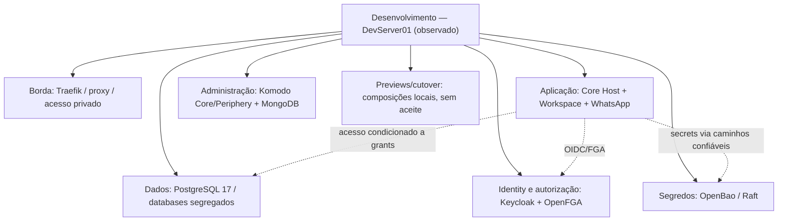
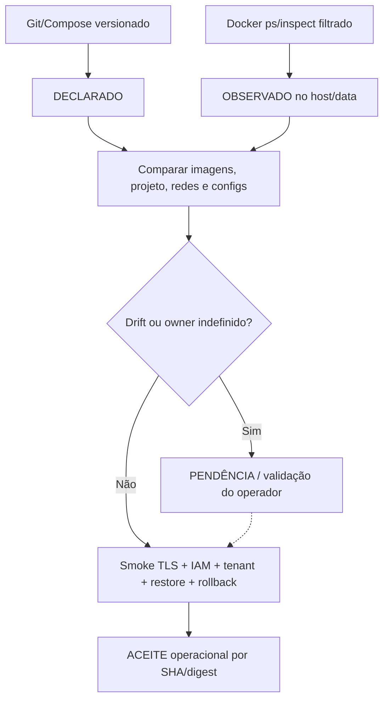

[← Ficha do capítulo](../) · [Volume](../../) · [Fonte original](https://github.com/delmacy/syndes-system/blob/main/docs/subprojects/I02-server02/chapters/05-arquitetura-banco-interface-configuracao-e-diagramas.md)

> Conteúdo espelhado da documentação versionada; não expressa automaticamente estado funcional.

## 5. Arquitetura de ambientes, armazenamento, interface e diagramas

### Composição por função — DevServer01 observado

**Arestas descrevem relações arquiteturais, não autorizações nem rotas reais aprovadas.** Os containers observados incluem duas composições de Core Host, Workspace e previews, Manager visual separado e um PG17 de ensaio sem owner confirmado.

### Declaração versionada × execução observada

| Fonte versionada | Conteúdo declarado | Evidência do DevServer01 | Pendência |
|---|---|---|---|
| `infra/postgres/compose.yaml` | PostgreSQL 17, 2 redes dados/Manager, volume e Docker Secrets | PostgreSQL principal `healthy`, redes observadas | DB, papéis, backup, grants e restore |
| `infra/security-access/compose.yaml` | Keycloak, FGA migration/API, OpenBao/Raft | Keycloak, OpenFGA e OpenBao `Up` | TLS interno, health funcional, realm/store, rotação |
| `apps/core-host/compose.yaml` | Host A04 na rede de dados/IAM/secrets | Core Host base e outra composição de cutover `Up` | Paridade de imagens/config e roteamento efetivo |
| `infra/master-admin/compose.yaml` | API e web em redes segregadas | Apenas frontend visual avulso `healthy`, não o stack completo | Identidade Manager, API real, release, isolamento |
| `modules/whatsapp/deploy/compose.yaml` | Gateway com rede de egress | Gateway observado `Up` | Sessão, callbacks, ownership do canal, idempotência |
| Hosts adicionais | I03 e histórico server02 | Dispositivos remotos inacessíveis nesta coleta | Staging e produção **não verificados** |

### Modos de evidência e fluxo de promoção

Neste checkpoint, somente **DevServer01 observado** possui prova live; não foi obtido aceite operacional para staging/produção.

### Persistência e volumes

- PostgreSQL é **servidor compartilhado**, mas os bancos `Control`, `Keycloak`, `OpenFGA` e tenants são logicamente distintos; `bootstrap` define criação e papéis, não garante aplicação real em volume já existente.
- OpenBao usa **volume Raft próprio**, fora do PostgreSQL. Komodo usa **MongoDB** como armazenamento da administração de containers, sem se tornar banco do produto.
- Foram vistos **19 volumes Docker**, sem inspeção dos dados. Contagem não indica backup válido ou consistência de snapshots.
- O PG17 de ensaio (container avulso sem label de descartável) permanece em execução; não deve ser classificado como persistência de produção ou apagado sem identificar owner.

### Segurança de rede, TLS e configuração

- **13 redes** Docker observadas (inclui 3 padrão); as redes de dados e as dedicadas ao Manager têm flag `internal=true`. Isso restringe encaminhamento externo em Docker, mas **não** substitui roles, firewall nem teste de ACL.
- Traefik publica entradas com bind wildcard; investigar certificado, middlewares, roteamento e firewall. O acesso de administração do Komodo tem bind em endereço específico, cujo perímetro real não foi validado; não afirmar que é público ou privado.
- Containers de aplicação e identidade publicam portas em loopback ou nenhuma, conforme a coleta. Nenhum IP, hostname interno, URL administrativa, porta ou secret foi transcrito.
- `infra/.env.example` e `infra/.env.ci` são contratos de configuração/fixação para desenvolvimento e fixtures; **não** são prova de ambiente produtivo provisionado. Não copiar valores.
- A versão do Docker Engine observada é **29.9.2**; tags principais: PostgreSQL 17, Keycloak 26, OpenFGA 1, OpenBao 2, Traefik 3 e Komodo 2. Versão de imagem não comprova digest imutável nem política de atualização.

### Frontend e APIs

**I02 não possui frontend ou API de produto.** Workspace/Manager/Support pertencem aos seus aplicativos; as rotas e identidades do Manager e do tenant devem continuar separadas. O que o proxy expõe requer análise com I06 e Segurança, não deve ser deduzido de labels isolados.

---
**Rastreabilidade:** [revisar documento fonte](https://github.com/delmacy/syndes-system/blob/main/docs/subprojects/I02-server02/chapters/05-arquitetura-banco-interface-configuracao-e-diagramas.md).
