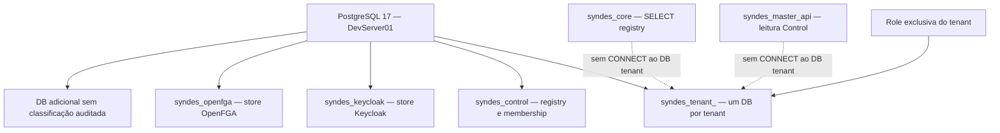
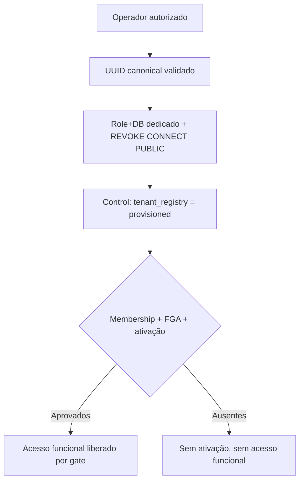
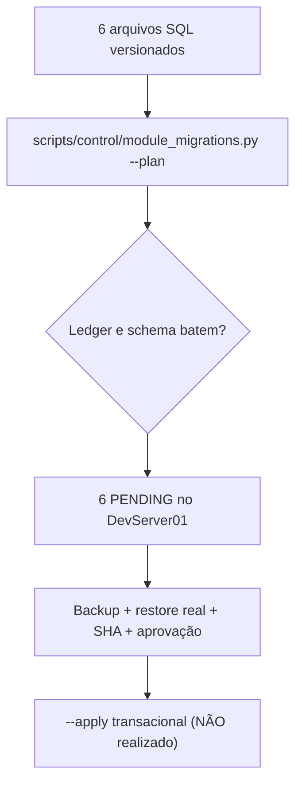

# I04 — PostgreSQL

[← Sumário do volume](../) · [↑ Biblioteca](../../)

> **Leitura técnica, não homologação.** Estados, limites e comprovações devem ser lidos em STATUS e nos checkpoints versionados.

## Identificação e rastreabilidade

| Campo | Fonte verificável |
|---|---|
| Unidade / owner | **I04** · PostgreSQL |
| Volume | Infraestrutura e qualidade |
| Caminho de implementação | `infra/postgres` |
| Documento de origem | [README](https://github.com/delmacy/syndes-system/blob/main/docs/subprojects/I04-postgresql/README.md) |
| STATUS e critérios | [STATUS original](https://github.com/delmacy/syndes-system/blob/main/docs/subprojects/I04-postgresql/STATUS.md) |
| Símbolos, APIs, SQL e dependências | [REFERENCIA-TECNICA](https://github.com/delmacy/syndes-system/blob/main/docs/subprojects/I04-postgresql/REFERENCIA-TECNICA.md) |
| Implantação, runbooks e gates | [OPERACAO](https://github.com/delmacy/syndes-system/blob/main/docs/subprojects/I04-postgresql/OPERACAO.md) |

## Situação registrada

> AUDITORIA TÉCNICA PARCIAL — 13/11/2026. Baseline Git 13955974bc0702f4c7fcb5717ee2d7cb243f5f08 (origin/main); DevServer01 acessado por conector autorizado. Foram realizadas somente consultas aos catálogos PostgreSQL, conferência de grants e --plan do migrador Control, sem DDL, DML, mudança operacional, dump, restore nem leitura de dados pessoais. Outros hosts, staging e produção não verificados. Dimensão Resultado comprovado Limites --------- Documentação…

A descrição acima é uma **citação resumida do STATUS versionado**; não significa que os testes de integração, a implantação ou a homologação estejam aprovados.

## Índice dos subcapítulos

Todos os assuntos deste módulo estão nesta página. Clique em um título para saltar à seção correspondente; o índice lateral acompanha a leitura.

- [Casos de uso](#casos-de-uso)
- [Histórias de usuário](#historias-de-usuario)
- [Requisitos](#requisitos)
- [Contratos públicos e privados](#contratos)
- [APIs e endpoints](#apis)
- [Eventos e mensageria](#eventos)
- [Dados e persistência](#dados)
- [Schemas e migrations](#schema)
- [Dependências e integrações](#dependencias)
- [Configuração e ambiente](#configuracao)
- [Frontend e interfaces](#interface)
- [Testes e evidências](#testes)
- [Operação e implantação](#operacao)
- [WBS e evolução](#wbs)
- [Documentação de origem integral](#documentacao-de-origem)
- [Controle de alterações](#controle-de-alteracoes)

## Casos de uso

**Editar esta seção:** [Abrir arquivo-fonte no GitHub](https://github.com/delmacy/syndes-system/edit/main/docs/subprojects/I04-postgresql/chapters/02-requisitos-historias-e-casos-de-uso.md) · [Consultar fonte](https://github.com/delmacy/syndes-system/blob/main/docs/subprojects/I04-postgresql/chapters/02-requisitos-historias-e-casos-de-uso.md)

*Referências extraídas da documentação versionada, sem inferir homologação ou implantação.*

**Lacuna documental:** ainda não há especificação textual identificada nesta área. Revisar implementação e registrar evidência antes de preencher.

📝 Espaço para ajustes e implementação

Este é um **modelo de registro**, não um editor com salvamento automático. Use o link **Editar esta seção** para atualizar o documento versionado.

- **Alteração proposta:** descreva o requisito, contrato, dado ou comportamento.
- **Referência de código:** informe caminho e símbolo real.
- **Testes e evidências:** informe comando, resultado e limite.
- **Critério de aceite:** indique como validar sem presumir homologação.
- **Status e revisão:** atualize a fonte canônica após revisão.

## Histórias de usuário

**Editar esta seção:** [Abrir arquivo-fonte no GitHub](https://github.com/delmacy/syndes-system/edit/main/docs/subprojects/I04-postgresql/chapters/02-requisitos-historias-e-casos-de-uso.md) · [Consultar fonte](https://github.com/delmacy/syndes-system/blob/main/docs/subprojects/I04-postgresql/chapters/02-requisitos-historias-e-casos-de-uso.md)

*Referências extraídas da documentação versionada, sem inferir homologação ou implantação.*

**Lacuna documental:** ainda não há especificação textual identificada nesta área. Revisar implementação e registrar evidência antes de preencher.

📝 Espaço para ajustes e implementação

Este é um **modelo de registro**, não um editor com salvamento automático. Use o link **Editar esta seção** para atualizar o documento versionado.

- **Alteração proposta:** descreva o requisito, contrato, dado ou comportamento.
- **Referência de código:** informe caminho e símbolo real.
- **Testes e evidências:** informe comando, resultado e limite.
- **Critério de aceite:** indique como validar sem presumir homologação.
- **Status e revisão:** atualize a fonte canônica após revisão.

## Requisitos

**Editar esta seção:** [Abrir arquivo-fonte no GitHub](https://github.com/delmacy/syndes-system/edit/main/docs/subprojects/I04-postgresql/chapters/02-requisitos-historias-e-casos-de-uso.md) · [Consultar fonte](https://github.com/delmacy/syndes-system/blob/main/docs/subprojects/I04-postgresql/chapters/02-requisitos-historias-e-casos-de-uso.md)

*Referências extraídas da documentação versionada, sem inferir homologação ou implantação.*

**Lacuna documental:** ainda não há especificação textual identificada nesta área. Revisar implementação e registrar evidência antes de preencher.

📝 Espaço para ajustes e implementação

Este é um **modelo de registro**, não um editor com salvamento automático. Use o link **Editar esta seção** para atualizar o documento versionado.

- **Alteração proposta:** descreva o requisito, contrato, dado ou comportamento.
- **Referência de código:** informe caminho e símbolo real.
- **Testes e evidências:** informe comando, resultado e limite.
- **Critério de aceite:** indique como validar sem presumir homologação.
- **Status e revisão:** atualize a fonte canônica após revisão.

## Contratos públicos e privados

**Editar esta seção:** [Abrir arquivo-fonte no GitHub](https://github.com/delmacy/syndes-system/edit/main/docs/subprojects/I04-postgresql/REFERENCIA-TECNICA.md) · [Consultar fonte](https://github.com/delmacy/syndes-system/blob/main/docs/subprojects/I04-postgresql/REFERENCIA-TECNICA.md)

*Referências extraídas da documentação versionada, sem inferir homologação ou implantação.*

**Fonte:** [REFERENCIA-TECNICA.md](https://github.com/delmacy/syndes-system/blob/main/docs/subprojects/I04-postgresql/REFERENCIA-TECNICA.md)

> Linha 9: \| Recurso \| Fonte de contrato \| Conclusão \|

> Linha 16: \| Migrations Tenant \| `infra/postgres/bootstrap/migrate-modules-tenant.sh`, `tenant-module-ledger.schema` \| Imagem por `@sha256`, mapping verificado e ledger de execução privado; **não executado** \|

> Linha 17: \| Persistência de módulos \| `modules/{core-crm,inbox,whatsapp,organizations,support,service-management}/sql` \| Contratos SQL de cada owner, não instalações comprovadas no tenant examinado \|

> Linha 44: \| Assinatura / interface \| Owner \| Efeito ou contrato \|

> Linha 57: Não confundir funções do **migrador de operador** com endpoints públicos. Scripts de provisioning e manutenção são interfaces privadas. O site público não publica valores de secrets, DSNs, nomes reais de tenants, dados de usuários nem comandos de aplicação de migration.

> Linha 73: - O ledger de migration `_syndes.module_migrations` é **protegido contra runtime role**, conforme contrato versionado, mas não estava criado no DB consultado.

**Fonte:** [04-contratos-e-dependencias-publicas.md](https://github.com/delmacy/syndes-system/blob/main/docs/subprojects/I04-postgresql/chapters/04-contratos-e-dependencias-publicas.md)

> Linha 3: I04 expõe **contratos de PostgreSQL/SQL e scripts operacionais**, não endpoints REST, eventos SaaS ou `package exports`.

> Linha 10: \| `bootstrap/provision-tenant.sh` \| `TENANT_ID` UUID validado; role `syndes_t_<uuid sem hífens>`, DB `syndes_tenant_<uuid>`, `REVOKE CONNECT`, estado `provisioned` \| Requer operador e senha única protegida; **não é API pública** \|

> Linha 22: - **Contratos públicos de módulos:** APIs/ports/versionamento de CRM, Inbox, WhatsApp, Organizations, Support e Service pertencem aos owners; SQL infra de I04 não é biblioteca reutilizável pelo frontend.

> Linha 23: - **Contrato privado de infraestrutura:** formatos de DB/role, grants, transação e ledger. O nome canônico é derivado do UUID aprovado **server-side**, sem escolher banco por parâmetro de cliente.

> Linha 30: Control base (registry/membership) e Manager base estão **instalados**; catálogo/entitlements/events de módulos estão **ausentes** na instância examinada. O migrador Control de fato informa as seis etapas como **PENDING**. No DB tenant observado, os schemas de módulo e o ledger `_syndes` não apareceram. Isso é **diferença de estado**, não falha comprovada dos contratos versionados.

**Fonte:** [STATUS.md](https://github.com/delmacy/syndes-system/blob/main/docs/subprojects/I04-postgresql/STATUS.md)

> Linha 9: \| **Documentação I04** \| **AUDITORIA PARCIAL:** SQL/Compose, contratos, 8 capítulos, bancos/roles/grants, diagrama e WBS reconciliados \| Ratificação pelos owners/DBA pendente \|

> Linha 52: **Entregável:** registro da diferença **artefatos SQL versionados × objetos SQL realmente existentes**, isolamento básico observado e dependências de aplicação. O próximo owner a auditar é **C01 — Control Plane** para reconciliar especificamente os contratos e tabelas de Control sem DDL involuntário.

**Fonte:** [OPERACAO.md](https://github.com/delmacy/syndes-system/blob/main/docs/subprojects/I04-postgresql/OPERACAO.md)

> Linha 16: - [Contratos públicos](../../standards/CONTRATOS-PUBLICOS.md).

> Linha 32: 4. Testar com critérios apropriados: unitário, contrato, integração, E2E e CI.

> Linha 63: **Bloqueios e próximos owners:** [STATUS I04](STATUS.md), [contratos](chapters/04-contratos-e-dependencias-publicas.md) e [WBS](EVOLUCAO.md).

📝 Espaço para ajustes e implementação

Este é um **modelo de registro**, não um editor com salvamento automático. Use o link **Editar esta seção** para atualizar o documento versionado.

- **Alteração proposta:** descreva o requisito, contrato, dado ou comportamento.
- **Referência de código:** informe caminho e símbolo real.
- **Testes e evidências:** informe comando, resultado e limite.
- **Critério de aceite:** indique como validar sem presumir homologação.
- **Status e revisão:** atualize a fonte canônica após revisão.

## APIs e endpoints

**Editar esta seção:** [Abrir arquivo-fonte no GitHub](https://github.com/delmacy/syndes-system/edit/main/docs/subprojects/I04-postgresql/REFERENCIA-TECNICA.md) · [Consultar fonte](https://github.com/delmacy/syndes-system/blob/main/docs/subprojects/I04-postgresql/REFERENCIA-TECNICA.md)

*Referências extraídas da documentação versionada, sem inferir homologação ou implantação.*

**Fonte:** [REFERENCIA-TECNICA.md](https://github.com/delmacy/syndes-system/blob/main/docs/subprojects/I04-postgresql/REFERENCIA-TECNICA.md)

> Linha 7: **PostgreSQL 17**, Docker Compose, bancos separados por função e por tenant, roles isoladas, secrets por arquivo e SQL versionado. I04 é infraestrutura, **não possui package.json, frontend, APIs HTTP, classes NestJS ou eventos de negócio próprios**. Os dados de domínio e providers SQL pertencem a seus módulos.

> Linha 57: Não confundir funções do **migrador de operador** com endpoints públicos. Scripts de provisioning e manutenção são interfaces privadas. O site público não publica valores de secrets, DSNs, nomes reais de tenants, dados de usuários nem comandos de aplicação de migration.

> Linha 84: - **Pendências:** reconciliar Control schema/migrator, classificar DB adicional, identificar finalidade do tenant canônico, comprovar backup/restore real, A/B de API e staging/produção.

**Fonte:** [04-contratos-e-dependencias-publicas.md](https://github.com/delmacy/syndes-system/blob/main/docs/subprojects/I04-postgresql/chapters/04-contratos-e-dependencias-publicas.md)

> Linha 3: I04 expõe **contratos de PostgreSQL/SQL e scripts operacionais**, não endpoints REST, eventos SaaS ou `package exports`.

> Linha 10: \| `bootstrap/provision-tenant.sh` \| `TENANT_ID` UUID validado; role `syndes_t_<uuid sem hífens>`, DB `syndes_tenant_<uuid>`, `REVOKE CONNECT`, estado `provisioned` \| Requer operador e senha única protegida; **não é API pública** \|

> Linha 16: \| `bootstrap/support-migration-gate.sh` \| Support migration somente se `TENANT_ID` corresponder ao tenant operacional permitido \| Evita provisionar Support em tenant comercial; não é autorização de API \|

**Fonte:** [05-arquitetura-banco-interface-configuracao-e-diagramas.md](https://github.com/delmacy/syndes-system/blob/main/docs/subprojects/I04-postgresql/chapters/05-arquitetura-banco-interface-configuracao-e-diagramas.md)

> Linha 84: **I04 não tem frontend nem endpoint HTTP público.** Apps comunicam-se via providers/ports e grants apropriados; o navegador não recebe DSN nem role de banco. Keycloak e OpenFGA são consumidores de stores técnicos separados. Manager não herda acesso às conversas e mensagens dos tenants.

**Fonte:** [STATUS.md](https://github.com/delmacy/syndes-system/blob/main/docs/subprojects/I04-postgresql/STATUS.md)

> Linha 12: \| **Isolamento de CONNECT** \| `PUBLIC` sem CONNECT nos DBs técnicos e tenant; `syndes_core` e `syndes_master_api` sem CONNECT no tenant; role tenant sem superuser, CREATEDB ou CREATEROLE \| Não comprova negação de API, FGA ou todo tenant futuro \|

> Linha 27: 4. **P1 — Teste de isolamento incompleto.** `CONNECT` e grants básicos estão restritivos no banco examinado, mas falta matriz SQL completa e teste API/authorization A/B contra providers reais.

> Linha 39: \| **55.03** \| Installer, canonicidade e schema/gates \| API opt-in/PG17 sintético; Control/restore/FGA reais BLOQ \|

📝 Espaço para ajustes e implementação

Este é um **modelo de registro**, não um editor com salvamento automático. Use o link **Editar esta seção** para atualizar o documento versionado.

- **Alteração proposta:** descreva o requisito, contrato, dado ou comportamento.
- **Referência de código:** informe caminho e símbolo real.
- **Testes e evidências:** informe comando, resultado e limite.
- **Critério de aceite:** indique como validar sem presumir homologação.
- **Status e revisão:** atualize a fonte canônica após revisão.

## Eventos e mensageria

**Editar esta seção:** [Abrir arquivo-fonte no GitHub](https://github.com/delmacy/syndes-system/edit/main/docs/subprojects/I04-postgresql/REFERENCIA-TECNICA.md) · [Consultar fonte](https://github.com/delmacy/syndes-system/blob/main/docs/subprojects/I04-postgresql/REFERENCIA-TECNICA.md)

*Referências extraídas da documentação versionada, sem inferir homologação ou implantação.*

**Fonte:** [REFERENCIA-TECNICA.md](https://github.com/delmacy/syndes-system/blob/main/docs/subprojects/I04-postgresql/REFERENCIA-TECNICA.md)

> Linha 7: **PostgreSQL 17**, Docker Compose, bancos separados por função e por tenant, roles isoladas, secrets por arquivo e SQL versionado. I04 é infraestrutura, **não possui package.json, frontend, APIs HTTP, classes NestJS ou eventos de negócio próprios**. Os dados de domínio e providers SQL pertencem a seus módulos.

> Linha 11: \| Instância PostgreSQL \| [`infra/postgres/compose.yaml`](https://github.com/delmacy/syndes-system/blob/main/infra/postgres/compose.yaml) \| `postgres:17-bookworm`, volume `postgres_data`, healthcheck `pg_isready`, sem porta DB publicada no Compose \|

> Linha 36: \| Outbox Control \| `control_events.outbox_events`, `event_deliveries`, `consumer_inbox`: **ausentes** \|

> Linha 74: - A outbox de tenant usa `platform_events` e depende do instalador/worker sob gates próprios.

**Fonte:** [04-contratos-e-dependencias-publicas.md](https://github.com/delmacy/syndes-system/blob/main/docs/subprojects/I04-postgresql/chapters/04-contratos-e-dependencias-publicas.md)

> Linha 3: I04 expõe **contratos de PostgreSQL/SQL e scripts operacionais**, não endpoints REST, eventos SaaS ou `package exports`.

> Linha 7: \| `infra/postgres/compose.yaml` \| Serviço `postgres:17-bookworm`; Docker Secrets `POSTGRES_PASSWORD_FILE`; volume `postgres_data`; redes `syndes-data` e `syndes-master-data`; `pg_isready` \| Sem porta DB publicada pelo Compose; saúde Docker `healthy` observada \|

> Linha 24: - **Eventos:** outbox Control em `control_events` e outbox de tenant em `platform_events` são domínios distintos, com tabelas, regras e owners distintos.

**Fonte:** [05-arquitetura-banco-interface-configuracao-e-diagramas.md](https://github.com/delmacy/syndes-system/blob/main/docs/subprojects/I04-postgresql/chapters/05-arquitetura-banco-interface-configuracao-e-diagramas.md)

> Linha 35: \| Control \| `control_events.outbox_events/deliveries/consumer_inbox` \| Eventos Control — C01/C06 \| **Ausentes** \|

> Linha 38: \| Tenant \| `platform_events` \| Event Bus/Transactional Outbox de tenant \| **Schema não encontrado** \|

> Linha 76: - `infra/postgres/compose.yaml`: banco sem portas publicadas, redes `syndes-data` e `syndes-master-data` (controle Manager), secrets de arquivos Docker, `no-new-privileges` e `POSTGRES_INITDB_ARGS=--auth-host=scram-sha-256`.

**Fonte:** [STATUS.md](https://github.com/delmacy/syndes-system/blob/main/docs/subprojects/I04-postgresql/STATUS.md)

> Linha 15: \| **Eventos Control** \| `control_events` outbox/deliveries/inbox **ausentes** \| Nenhum worker pode ser considerado habilitado por documentação \|

> Linha 24: 1. **P0 — Plano de migrations Control: seis etapas pendentes.** `scripts/control/module_migrations.py --plan` informou `001_catalog`, `002_lifecycle`, `003_attestation`, `004_activation`, `005_manager_readonly`, `006_control_events` como PENDING. Há objetos Manager base presentes, mas nenhuma dessas seis migrações aparece aplicada. **Não presumir que o Host esteja apto a operar o catálogo/eventos.**

📝 Espaço para ajustes e implementação

Este é um **modelo de registro**, não um editor com salvamento automático. Use o link **Editar esta seção** para atualizar o documento versionado.

- **Alteração proposta:** descreva o requisito, contrato, dado ou comportamento.
- **Referência de código:** informe caminho e símbolo real.
- **Testes e evidências:** informe comando, resultado e limite.
- **Critério de aceite:** indique como validar sem presumir homologação.
- **Status e revisão:** atualize a fonte canônica após revisão.

## Dados e persistência

**Editar esta seção:** [Abrir arquivo-fonte no GitHub](https://github.com/delmacy/syndes-system/edit/main/docs/subprojects/I04-postgresql/REFERENCIA-TECNICA.md) · [Consultar fonte](https://github.com/delmacy/syndes-system/blob/main/docs/subprojects/I04-postgresql/REFERENCIA-TECNICA.md)

*Referências extraídas da documentação versionada, sem inferir homologação ou implantação.*

**Fonte:** [REFERENCIA-TECNICA.md](https://github.com/delmacy/syndes-system/blob/main/docs/subprojects/I04-postgresql/REFERENCIA-TECNICA.md)

> Linha 3: > **AUDITORIA TÉCNICA PARCIAL — 13/11/2026.** Baseline `origin/main` SHA `13955974bc0702f4c7fcb5717ee2d7cb243f5f08`, inspeção somente leitura do PostgreSQL **DevServer01**. Não foi consultado conteúdo pessoal de clientes nem executado DDL/DML, migration, backup, restore ou modificação de container. **Staging e produção não verificados.**

> Linha 7: **PostgreSQL 17**, Docker Compose, bancos separados por função e por tenant, roles isoladas, secrets por arquivo e SQL versionado. I04 é infraestrutura, **não possui package.json, frontend, APIs HTTP, classes NestJS ou eventos de negócio próprios**. Os dados de domínio e providers SQL pertencem a seus módulos.

> Linha 11: \| Instância PostgreSQL \| [`infra/postgres/compose.yaml`](https://github.com/delmacy/syndes-system/blob/main/infra/postgres/compose.yaml) \| `postgres:17-bookworm`, volume `postgres_data`, healthcheck `pg_isready`, sem porta DB publicada no Compose \|

> Linha 13: \| Bootstrap de DBs \| `infra/postgres/bootstrap/00-init.sh`, `control.schema` \| Três databases técnicos separados, registry/membership; init em volume novo \|

> Linha 14: \| Provisionamento \| `infra/postgres/bootstrap/provision-tenant.sh` \| UUID canônico → role/DB individual, `REVOKE CONNECT PUBLIC`, `tenant_registry.state=provisioned` \|

> Linha 16: \| Migrations Tenant \| `infra/postgres/bootstrap/migrate-modules-tenant.sh`, `tenant-module-ledger.schema` \| Imagem por `@sha256`, mapping verificado e ledger de execução privado; **não executado** \|

> Linha 17: \| Persistência de módulos \| `modules/{core-crm,inbox,whatsapp,organizations,support,service-management}/sql` \| Contratos SQL de cada owner, não instalações comprovadas no tenant examinado \|

> Linha 22: Consultas em transações `BEGIN READ ONLY` às **views de catálogo do próprio PostgreSQL** e grants; nomes/UUID de tenants e dados de negócio não foram emitidos.

> Linha 26: \| Servidor \| PostgreSQL **17**, container principal `healthy` no momento da observação \|

> Linha 55: \| `tests/platform/postgres-smoke.sh` \| Q01/I04 \| CI descartável: roles/isolamento, tenant idempotente e `pg_dump`/restore **sintético** \|

> Linha 57: Não confundir funções do **migrador de operador** com endpoints públicos. Scripts de provisioning e manutenção são interfaces privadas. O site público não publica valores de secrets, DSNs, nomes reais de tenants, dados de usuários nem comandos de aplicação de migration.

> Linha 67: - Control Plane não deve armazenar mensagens, conversas, anexos ou dados de CRM do tenant.

> Linha 78: `syndes_keycloak` e `syndes_openfga` são databases separados. OpenBao **não usa PostgreSQL**: mantém Raft próprio. Komodo usa MongoDB na stack de administração; nenhum deles vira tenant DB por associação.

> Linha 83: - **Validação não destrutiva local:** leitura de SQL/Compose, `bash -n` de scripts, `py_compile` e plano Control `--plan`. Não executar `--apply`, `migrate-modules-tenant.sh`, `provision-tenant.sh` ou `postgres-smoke.sh` em host persistente.

**Fonte:** [04-contratos-e-dependencias-publicas.md](https://github.com/delmacy/syndes-system/blob/main/docs/subprojects/I04-postgresql/chapters/04-contratos-e-dependencias-publicas.md)

> Linha 3: I04 expõe **contratos de PostgreSQL/SQL e scripts operacionais**, não endpoints REST, eventos SaaS ou `package exports`.

> Linha 7: \| `infra/postgres/compose.yaml` \| Serviço `postgres:17-bookworm`; Docker Secrets `POSTGRES_PASSWORD_FILE`; volume `postgres_data`; redes `syndes-data` e `syndes-master-data`; `pg_isready` \| Sem porta DB publicada pelo Compose; saúde Docker `healthy` observada \|

> Linha 17: \| `tests/platform/postgres-smoke.sh` \| Teste de três bancos, negativa de Keycloak→Control, provisionamento duplicado e restore de fixture \| Ambiente **descartável de CI**, não evidência de restore real \|

**Fonte:** [05-arquitetura-banco-interface-configuracao-e-diagramas.md](https://github.com/delmacy/syndes-system/blob/main/docs/subprojects/I04-postgresql/chapters/05-arquitetura-banco-interface-configuracao-e-diagramas.md)

> Linha 76: - `infra/postgres/compose.yaml`: banco sem portas publicadas, redes `syndes-data` e `syndes-master-data` (controle Manager), secrets de arquivos Docker, `no-new-privileges` e `POSTGRES_INITDB_ARGS=--auth-host=scram-sha-256`.

> Linha 77: - `postgres_data` é volume persistente. **A existência de volume e healthcheck não comprova backup**, retenção, recuperação ou recuperação entre múltiplos tenants no mesmo servidor.

> Linha 79: - Um servidor PostgreSQL é ponto compartilhado de falha: separar DB por tenant dá isolamento lógico/permissões, **não alta disponibilidade, resiliência física ou backups independentes automáticos**.

**Fonte:** [STATUS.md](https://github.com/delmacy/syndes-system/blob/main/docs/subprojects/I04-postgresql/STATUS.md)

> Linha 3: > **AUDITORIA TÉCNICA PARCIAL — 13/11/2026.** Baseline Git `13955974bc0702f4c7fcb5717ee2d7cb243f5f08` (`origin/main`); DevServer01 acessado por conector autorizado. **Foram realizadas somente consultas aos catálogos PostgreSQL, conferência de grants e `--plan` do migrador Control, sem DDL, DML, mudança operacional, dump, restore nem leitura de dados pessoais.** Outros hosts, staging e produção **não verificados**.

> Linha 10: \| **Instância DevServer01** \| PostgreSQL **17**, container principal `healthy`; três DBs técnicos previstos presentes \| `healthy` não valida restauração, produto, TPS nem todos os providers \|

> Linha 17: \| **Tenant DB observado** \| Sem schemas de CRM, Inbox, WhatsApp, Organizations, Support, Service, `platform_events` ou ledger `_syndes` \| Pode ser tenant apenas `provisioned`; ausência não é falha funcional demonstrada \|

> Linha 35: \| **10.02** \| Revisar roles PostgreSQL e grants \| PEND \|

> Linha 49: \| 13/11/2026 \| DevServer01; Git `1395597` \| Consultas `BEGIN READ ONLY`, roles/bancos/schema/grants, migrador `--plan`: seis pendências \| Dados pessoais, migrations, backup operacional \|

**Fonte:** [OPERACAO.md](https://github.com/delmacy/syndes-system/blob/main/docs/subprojects/I04-postgresql/OPERACAO.md)

> Linha 15: - [Código/artefato do módulo](https://github.com/delmacy/syndes-system/tree/main/infra/postgres) — `infra/postgres`.

> Linha 53: Esses metadados não provam schemas migrados. A versão PostgreSQL, os bancos e os grants foram conferidos na instância de desenvolvimento, **não em staging/produção**. Consultas adicionais devem passar por DBA/segurança e **jamais** publicar `docker inspect` completo, `pg_dump` ou linhas com PII.

📝 Espaço para ajustes e implementação

Este é um **modelo de registro**, não um editor com salvamento automático. Use o link **Editar esta seção** para atualizar o documento versionado.

- **Alteração proposta:** descreva o requisito, contrato, dado ou comportamento.
- **Referência de código:** informe caminho e símbolo real.
- **Testes e evidências:** informe comando, resultado e limite.
- **Critério de aceite:** indique como validar sem presumir homologação.
- **Status e revisão:** atualize a fonte canônica após revisão.

## Schemas e migrations

**Editar esta seção:** [Abrir arquivo-fonte no GitHub](https://github.com/delmacy/syndes-system/edit/main/docs/subprojects/I04-postgresql/REFERENCIA-TECNICA.md) · [Consultar fonte](https://github.com/delmacy/syndes-system/blob/main/docs/subprojects/I04-postgresql/REFERENCIA-TECNICA.md)

*Referências extraídas da documentação versionada, sem inferir homologação ou implantação.*

**Fonte:** [REFERENCIA-TECNICA.md](https://github.com/delmacy/syndes-system/blob/main/docs/subprojects/I04-postgresql/REFERENCIA-TECNICA.md)

> Linha 3: > **AUDITORIA TÉCNICA PARCIAL — 13/11/2026.** Baseline `origin/main` SHA `13955974bc0702f4c7fcb5717ee2d7cb243f5f08`, inspeção somente leitura do PostgreSQL **DevServer01**. Não foi consultado conteúdo pessoal de clientes nem executado DDL/DML, migration, backup, restore ou modificação de container. **Staging e produção não verificados.**

> Linha 7: **PostgreSQL 17**, Docker Compose, bancos separados por função e por tenant, roles isoladas, secrets por arquivo e SQL versionado. I04 é infraestrutura, **não possui package.json, frontend, APIs HTTP, classes NestJS ou eventos de negócio próprios**. Os dados de domínio e providers SQL pertencem a seus módulos.

> Linha 13: \| Bootstrap de DBs \| `infra/postgres/bootstrap/00-init.sh`, `control.schema` \| Três databases técnicos separados, registry/membership; init em volume novo \|

> Linha 15: \| Migrations Control \| [`scripts/control/module_migrations.py`](https://github.com/delmacy/syndes-system/blob/main/scripts/control/module_migrations.py) \| Plano/aplicação com SHA/checksum, PG17, ledger e autorização; **`--plan` executado, seis PENDING** \|

> Linha 16: \| Migrations Tenant \| `infra/postgres/bootstrap/migrate-modules-tenant.sh`, `tenant-module-ledger.schema` \| Imagem por `@sha256`, mapping verificado e ledger de execução privado; **não executado** \|

> Linha 17: \| Persistência de módulos \| `modules/{core-crm,inbox,whatsapp,organizations,support,service-management}/sql` \| Contratos SQL de cada owner, não instalações comprovadas no tenant examinado \|

> Linha 18: \| Event Bus \| `apps/core-host/sql/001_platform_events.sql`, `002_event_type_version_consistency.sql`, Control `control-module-events.schema` \| Schemas/objetos planejados por banco distintos; workers opt-in sob gates \|

> Linha 35: \| Ledger das migrations Control \| `public.control_module_schema_migrations`: **ausente** \|

> Linha 37: \| Ledger/módulos do tenant \| Schema `_syndes` e schemas `crm`, `inbox`, `whatsapp`, `organizations`, `support`, `service`, `platform_events`: **não encontrados** no DB tenant canônico \|

> Linha 40: **Limite:** esse resultado descreve apenas os bancos e objetos catalogados nessa instância e naquele instante. Um container `healthy` não prova saúde funcional do CRM/Inbox, e a ausência de schema em um DB canônico não demonstra que nenhum outro ambiente ou host contenha o módulo.

> Linha 48: \| `scripts/control/module_migrations.py:release_files()` \| C01/C02 \| Lista fixa 001–006 com SHA-256 dos SQL versionados \|

> Linha 49: \| `inventory(container)` / `reconcile(container,migrations)` \| C01/C02 \| Consulta catálogo/ledger, recusa checksum drift, objetos sem histórico, ordem inválida \|

> Linha 50: \| `main() --plan` \| C01/C02 \| **Somente leitura** da situação de migrations; na coleta: todas pendentes \|

> Linha 52: \| `migrate-modules-tenant.sh` \| C02/A04 \| Imagem pinned `@sha256`, consulta mapping Control e executa SQL por role de tenant \|

> Linha 53: \| `support-migration-gate.sh` \| P06/C02 \| Garante tenant operacional aprovado para migrations Support \|

> Linha 54: \| `tenant-module-ledger.schema` \| C02 \| `_syndes.module_migrations` com PK de módulo/migration, checksum e digest \|

> Linha 57: Não confundir funções do **migrador de operador** com endpoints públicos. Scripts de provisioning e manutenção são interfaces privadas. O site público não publica valores de secrets, DSNs, nomes reais de tenants, dados de usuários nem comandos de aplicação de migration.

> Linha 72: - SQL de `crm`, `inbox`, `whatsapp`, `organizations`, `support`, `service` pertence aos módulos, sem presumir execução.

**Fonte:** [04-contratos-e-dependencias-publicas.md](https://github.com/delmacy/syndes-system/blob/main/docs/subprojects/I04-postgresql/chapters/04-contratos-e-dependencias-publicas.md)

> Linha 3: I04 expõe **contratos de PostgreSQL/SQL e scripts operacionais**, não endpoints REST, eventos SaaS ou `package exports`.

> Linha 9: \| `bootstrap/control.schema` \| `public.tenant_registry`, `public.tenant_memberships`; restrição `PUBLIC`, `syndes_core` com `SELECT` \| Objetos e grants básicos encontrados no DevServer01 \|

> Linha 11: \| `bootstrap/control-admin.schema` \| `syndes_master_api`, `platform_operator_access`, `platform_tenant_profiles`, SELECT global limitado \| Role e tabelas presentes; demais fluxos Manager têm gates próprios \|

> Linha 12: \| `scripts/control/module_migrations.py --plan` \| Verifica versão PG17/target/ledger, checksums fixos dos seis SQL e estado sem DDL \| Executado; **seis PENDING**, sem apply \|

> Linha 13: \| `scripts/control/module_migrations.py --apply` \| SQL Control transacional, lock/advisory, pin SHA, backups e restore-ID \| **Não executado.** Exige autorização operacional explícita; não usar para corrigir a documentação \|

> Linha 14: \| `bootstrap/tenant-module-ledger.schema` \| `_syndes.module_migrations` com `module_id`, `migration_id`, `version`, `checksum`, `image_digest` \| Não encontrado no DB tenant auditado; runtime role não deve poder alterar ledger \|

> Linha 15: \| `bootstrap/migrate-modules-tenant.sh` \| Confere mapping em Control; imagem `@sha256` e migrations do Host; `SET ROLE` no DB do tenant \| **Não executado**; depende de release, backup/restore e gates \|

> Linha 16: \| `bootstrap/support-migration-gate.sh` \| Support migration somente se `TENANT_ID` corresponder ao tenant operacional permitido \| Evita provisionar Support em tenant comercial; não é autorização de API \|

> Linha 18: \| `apps/core-host/test/*pg17*.test.mjs` \| Instalador, Control/events, FGA, tenant A/B, migration ledger e módulos \| Evidências por suite/CI, não autorização para aplicar schemas no DevServer \|

> Linha 22: - **Contratos públicos de módulos:** APIs/ports/versionamento de CRM, Inbox, WhatsApp, Organizations, Support e Service pertencem aos owners; SQL infra de I04 não é biblioteca reutilizável pelo frontend.

> Linha 24: - **Eventos:** outbox Control em `control_events` e outbox de tenant em `platform_events` são domínios distintos, com tabelas, regras e owners distintos.

> Linha 26: - **Mudanças de SQL:** requerem ownership C01/C02/C06 ou módulo, revisão de impacto, SHA/digest, backup/restore e rollback; mera presença de arquivo `.schema` não autoriza aplicação.

> Linha 30: Control base (registry/membership) e Manager base estão **instalados**; catálogo/entitlements/events de módulos estão **ausentes** na instância examinada. O migrador Control de fato informa as seis etapas como **PENDING**. No DB tenant observado, os schemas de módulo e o ledger `_syndes` não apareceram. Isso é **diferença de estado**, não falha comprovada dos contratos versionados.

**Fonte:** [05-arquitetura-banco-interface-configuracao-e-diagramas.md](https://github.com/delmacy/syndes-system/blob/main/docs/subprojects/I04-postgresql/chapters/05-arquitetura-banco-interface-configuracao-e-diagramas.md)

> Linha 30: \| Database \| Schema/tabela \| Natureza \| Estado no DevServer01 \|

> Linha 37: \| Tenant \| `crm`, `inbox`, `whatsapp`, `organizations`, `support`, `service` \| Domínios dos módulos \| **Schemas não encontrados** \|

> Linha 38: \| Tenant \| `platform_events` \| Event Bus/Transactional Outbox de tenant \| **Schema não encontrado** \|

> Linha 39: \| Keycloak/FGA \| Bancos técnicos separados \| Identidade e autorização \| DBs presentes; tabelas internas não auditadas \|

> Linha 78: - Scripts `00-init.sh` são disparados pelo `docker-entrypoint-initdb.d` apenas na criação de volume; aplicar `control.schema` em ambiente já persistente exige migrador/gate.

> Linha 80: - Para Support, somente tenant operacional autorizado recebe migration; a ativação multi-org permanece **manual e com Product Gate**.

**Fonte:** [STATUS.md](https://github.com/delmacy/syndes-system/blob/main/docs/subprojects/I04-postgresql/STATUS.md)

> Linha 9: \| **Documentação I04** \| **AUDITORIA PARCIAL:** SQL/Compose, contratos, 8 capítulos, bancos/roles/grants, diagrama e WBS reconciliados \| Ratificação pelos owners/DBA pendente \|

> Linha 13: \| **Control mínimo** \| `tenant_registry`, `tenant_memberships` presentes, SELECT do core; Manager com perfil/operador e SELECT, sem DML de perfis \| Tabelas adicionais do Control não necessariamente instaladas \|

> Linha 16: \| **Control migration ledger** \| `public.control_module_schema_migrations` **ausente**; migrador oficial **6 PENDING** via `--plan` \| Não executar `--apply` sem backup/restore, SHA e owner \|

> Linha 17: \| **Tenant DB observado** \| Sem schemas de CRM, Inbox, WhatsApp, Organizations, Support, Service, `platform_events` ou ledger `_syndes` \| Pode ser tenant apenas `provisioned`; ausência não é falha funcional demonstrada \|

> Linha 24: 1. **P0 — Plano de migrations Control: seis etapas pendentes.** `scripts/control/module_migrations.py --plan` informou `001_catalog`, `002_lifecycle`, `003_attestation`, `004_activation`, `005_manager_readonly`, `006_control_events` como PENDING. Há objetos Manager base presentes, mas nenhuma dessas seis migrações aparece aplicada. **Não presumir que o Host esteja apto a operar o catálogo/eventos.**

> Linha 25: 2. **P1 — Tenant existente sem schema de negócio/ledger.** Um DB de tenant canônico está provisionado, porém faltam `crm/inbox/whatsapp/organizations/support/service/platform_events/_syndes`. Verificar finalidade e estado antes de instalar; o gateway ou Host em execução não comprova a presença desse schema.

> Linha 27: 4. **P1 — Teste de isolamento incompleto.** `CONNECT` e grants básicos estão restritivos no banco examinado, mas falta matriz SQL completa e teste API/authorization A/B contra providers reais.

> Linha 38: \| **40.08** \| Migrations tenant Syndes + backup/restore \| BLOQ \|

> Linha 39: \| **55.03** \| Installer, canonicidade e schema/gates \| API opt-in/PG17 sintético; Control/restore/FGA reais BLOQ \|

> Linha 40: \| **60.02** \| Auditar migrations Organizations/CRM/Inbox/WhatsApp \| BLOQ \|

> Linha 43: **Não executar `--apply`, DDL, migrations, grants, rotinas de provisioning ou restaurar backups** para melhorar o STATUS documental.

> Linha 49: \| 13/11/2026 \| DevServer01; Git `1395597` \| Consultas `BEGIN READ ONLY`, roles/bancos/schema/grants, migrador `--plan`: seis pendências \| Dados pessoais, migrations, backup operacional \|

> Linha 52: **Entregável:** registro da diferença **artefatos SQL versionados × objetos SQL realmente existentes**, isolamento básico observado e dependências de aplicação. O próximo owner a auditar é **C01 — Control Plane** para reconciliar especificamente os contratos e tabelas de Control sem DDL involuntário.

> Linha 54: **Status final: auditoria documental/SQL parcial; banco de desenvolvimento observado; produto e operação não homologados.**

**Fonte:** [OPERACAO.md](https://github.com/delmacy/syndes-system/blob/main/docs/subprojects/I04-postgresql/OPERACAO.md)

> Linha 3: > **RUNBOOK DE CONSULTA E AUDITORIA, NÃO PROCEDIMENTO DE IMPLANTAÇÃO.** A inspeção de 13/11/2026 foi somente leitura de catálogos de desenvolvimento. Não executar migrations, provisioning, alterações de privilégios, backup ou restore a partir desta página.

> Linha 31: 3. Confirmar migrations realmente aplicadas, backup/restore e rollback antes de SQL.

> Linha 39: O script versionado de consulta de migrations Control aceita o modo **não mutante**:

> Linha 45: No checkpoint, esse comando mostrou **seis migrations PENDING** e `PLAN ONLY: no Control DB changes`. **Não usar `--apply`** sem aprovação do owner e evidência explícita de backup/restore; o modo de aplicação tem gates próprios de SHA, ledger, lock e revisão.

> Linha 53: Esses metadados não provam schemas migrados. A versão PostgreSQL, os bancos e os grants foram conferidos na instância de desenvolvimento, **não em staging/produção**. Consultas adicionais devem passar por DBA/segurança e **jamais** publicar `docker inspect` completo, `pg_dump` ou linhas com PII.

> Linha 61: 5. Registrar resultado por SHA/ambiente, com negativas de acesso, migrações aplicadas e schema compatível. CI de DB descartável **não** representa execução no DevServer.

📝 Espaço para ajustes e implementação

Este é um **modelo de registro**, não um editor com salvamento automático. Use o link **Editar esta seção** para atualizar o documento versionado.

- **Alteração proposta:** descreva o requisito, contrato, dado ou comportamento.
- **Referência de código:** informe caminho e símbolo real.
- **Testes e evidências:** informe comando, resultado e limite.
- **Critério de aceite:** indique como validar sem presumir homologação.
- **Status e revisão:** atualize a fonte canônica após revisão.

## Dependências e integrações

**Editar esta seção:** [Abrir arquivo-fonte no GitHub](https://github.com/delmacy/syndes-system/edit/main/docs/subprojects/I04-postgresql/REFERENCIA-TECNICA.md) · [Consultar fonte](https://github.com/delmacy/syndes-system/blob/main/docs/subprojects/I04-postgresql/REFERENCIA-TECNICA.md)

*Referências extraídas da documentação versionada, sem inferir homologação ou implantação.*

**Fonte:** [REFERENCIA-TECNICA.md](https://github.com/delmacy/syndes-system/blob/main/docs/subprojects/I04-postgresql/REFERENCIA-TECNICA.md)

> Linha 78: `syndes_keycloak` e `syndes_openfga` são databases separados. OpenBao **não usa PostgreSQL**: mantém Raft próprio. Komodo usa MongoDB na stack de administração; nenhum deles vira tenant DB por associação.

> Linha 82: - **CI baseline:** [GitHub Actions 43355545663](https://github.com/delmacy/syndes-system/actions/runs/43355545663), 24/24 `success` no SHA `1395597`. Testes de integração/restore descartáveis **não** provam aplicação das migrations no DevServer01.

**Fonte:** [04-contratos-e-dependencias-publicas.md](https://github.com/delmacy/syndes-system/blob/main/docs/subprojects/I04-postgresql/chapters/04-contratos-e-dependencias-publicas.md)

> Linha 17: \| `tests/platform/postgres-smoke.sh` \| Teste de três bancos, negativa de Keycloak→Control, provisionamento duplicado e restore de fixture \| Ambiente **descartável de CI**, não evidência de restore real \|

**Fonte:** [05-arquitetura-banco-interface-configuracao-e-diagramas.md](https://github.com/delmacy/syndes-system/blob/main/docs/subprojects/I04-postgresql/chapters/05-arquitetura-banco-interface-configuracao-e-diagramas.md)

> Linha 39: \| Keycloak/FGA \| Bancos técnicos separados \| Identidade e autorização \| DBs presentes; tabelas internas não auditadas \|

> Linha 84: **I04 não tem frontend nem endpoint HTTP público.** Apps comunicam-se via providers/ports e grants apropriados; o navegador não recebe DSN nem role de banco. Keycloak e OpenFGA são consumidores de stores técnicos separados. Manager não herda acesso às conversas e mensagens dos tenants.

**Fonte:** [STATUS.md](https://github.com/delmacy/syndes-system/blob/main/docs/subprojects/I04-postgresql/STATUS.md)

> Linha 52: **Entregável:** registro da diferença **artefatos SQL versionados × objetos SQL realmente existentes**, isolamento básico observado e dependências de aplicação. O próximo owner a auditar é **C01 — Control Plane** para reconciliar especificamente os contratos e tabelas de Control sem DDL involuntário.

**Fonte:** [OPERACAO.md](https://github.com/delmacy/syndes-system/blob/main/docs/subprojects/I04-postgresql/OPERACAO.md)

> Linha 9: - [Evolução](EVOLUCAO.md): workpackages e dependências; nenhum item é concluído por estar planejado.

> Linha 32: 4. Testar com critérios apropriados: unitário, contrato, integração, E2E e CI.

> Linha 63: **Bloqueios e próximos owners:** [STATUS I04](STATUS.md), [contratos](chapters/04-contratos-e-dependencias-publicas.md) e [WBS](EVOLUCAO.md).

📝 Espaço para ajustes e implementação

Este é um **modelo de registro**, não um editor com salvamento automático. Use o link **Editar esta seção** para atualizar o documento versionado.

- **Alteração proposta:** descreva o requisito, contrato, dado ou comportamento.
- **Referência de código:** informe caminho e símbolo real.
- **Testes e evidências:** informe comando, resultado e limite.
- **Critério de aceite:** indique como validar sem presumir homologação.
- **Status e revisão:** atualize a fonte canônica após revisão.

## Configuração e ambiente

**Editar esta seção:** [Abrir arquivo-fonte no GitHub](https://github.com/delmacy/syndes-system/edit/main/docs/subprojects/I04-postgresql/OPERACAO.md) · [Consultar fonte](https://github.com/delmacy/syndes-system/blob/main/docs/subprojects/I04-postgresql/OPERACAO.md)

*Referências extraídas da documentação versionada, sem inferir homologação ou implantação.*

**Fonte:** [REFERENCIA-TECNICA.md](https://github.com/delmacy/syndes-system/blob/main/docs/subprojects/I04-postgresql/REFERENCIA-TECNICA.md)

> Linha 7: **PostgreSQL 17**, Docker Compose, bancos separados por função e por tenant, roles isoladas, secrets por arquivo e SQL versionado. I04 é infraestrutura, **não possui package.json, frontend, APIs HTTP, classes NestJS ou eventos de negócio próprios**. Os dados de domínio e providers SQL pertencem a seus módulos.

> Linha 11: \| Instância PostgreSQL \| [`infra/postgres/compose.yaml`](https://github.com/delmacy/syndes-system/blob/main/infra/postgres/compose.yaml) \| `postgres:17-bookworm`, volume `postgres_data`, healthcheck `pg_isready`, sem porta DB publicada no Compose \|

> Linha 12: \| Segurança e redes \| Compose e [`infra/README.md`](https://github.com/delmacy/syndes-system/blob/main/infra/README.md) \| `syndes-data`, `syndes-master-data`, SCRAM para host, secret files; saúde e firewall dependem da operação \|

> Linha 83: - **Validação não destrutiva local:** leitura de SQL/Compose, `bash -n` de scripts, `py_compile` e plano Control `--plan`. Não executar `--apply`, `migrate-modules-tenant.sh`, `provision-tenant.sh` ou `postgres-smoke.sh` em host persistente.

**Fonte:** [05-arquitetura-banco-interface-configuracao-e-diagramas.md](https://github.com/delmacy/syndes-system/blob/main/docs/subprojects/I04-postgresql/chapters/05-arquitetura-banco-interface-configuracao-e-diagramas.md)

> Linha 76: - `infra/postgres/compose.yaml`: banco sem portas publicadas, redes `syndes-data` e `syndes-master-data` (controle Manager), secrets de arquivos Docker, `no-new-privileges` e `POSTGRES_INITDB_ARGS=--auth-host=scram-sha-256`.

**Fonte:** [STATUS.md](https://github.com/delmacy/syndes-system/blob/main/docs/subprojects/I04-postgresql/STATUS.md)

> Linha 9: \| **Documentação I04** \| **AUDITORIA PARCIAL:** SQL/Compose, contratos, 8 capítulos, bancos/roles/grants, diagrama e WBS reconciliados \| Ratificação pelos owners/DBA pendente \|

📝 Espaço para ajustes e implementação

Este é um **modelo de registro**, não um editor com salvamento automático. Use o link **Editar esta seção** para atualizar o documento versionado.

- **Alteração proposta:** descreva o requisito, contrato, dado ou comportamento.
- **Referência de código:** informe caminho e símbolo real.
- **Testes e evidências:** informe comando, resultado e limite.
- **Critério de aceite:** indique como validar sem presumir homologação.
- **Status e revisão:** atualize a fonte canônica após revisão.

## Frontend e interfaces

**Editar esta seção:** [Abrir arquivo-fonte no GitHub](https://github.com/delmacy/syndes-system/edit/main/docs/subprojects/I04-postgresql/REFERENCIA-TECNICA.md) · [Consultar fonte](https://github.com/delmacy/syndes-system/blob/main/docs/subprojects/I04-postgresql/REFERENCIA-TECNICA.md)

*Referências extraídas da documentação versionada, sem inferir homologação ou implantação.*

**Fonte:** [REFERENCIA-TECNICA.md](https://github.com/delmacy/syndes-system/blob/main/docs/subprojects/I04-postgresql/REFERENCIA-TECNICA.md)

> Linha 7: **PostgreSQL 17**, Docker Compose, bancos separados por função e por tenant, roles isoladas, secrets por arquivo e SQL versionado. I04 é infraestrutura, **não possui package.json, frontend, APIs HTTP, classes NestJS ou eventos de negócio próprios**. Os dados de domínio e providers SQL pertencem a seus módulos.

> Linha 44: \| Assinatura / interface \| Owner \| Efeito ou contrato \|

**Fonte:** [03-capabilities.md](https://github.com/delmacy/syndes-system/blob/main/docs/subprojects/I04-postgresql/chapters/03-capabilities.md)

> Linha 14: \| Manager Control \| `platform_operator_access`, `platform_tenant_profiles` presentes \| Algum SQL do Manager aplicado; frontend completo não auditado \|

**Fonte:** [05-arquitetura-banco-interface-configuracao-e-diagramas.md](https://github.com/delmacy/syndes-system/blob/main/docs/subprojects/I04-postgresql/chapters/05-arquitetura-banco-interface-configuracao-e-diagramas.md)

> Linha 84: **I04 não tem frontend nem endpoint HTTP público.** Apps comunicam-se via providers/ports e grants apropriados; o navegador não recebe DSN nem role de banco. Keycloak e OpenFGA são consumidores de stores técnicos separados. Manager não herda acesso às conversas e mensagens dos tenants.

📝 Espaço para ajustes e implementação

Este é um **modelo de registro**, não um editor com salvamento automático. Use o link **Editar esta seção** para atualizar o documento versionado.

- **Alteração proposta:** descreva o requisito, contrato, dado ou comportamento.
- **Referência de código:** informe caminho e símbolo real.
- **Testes e evidências:** informe comando, resultado e limite.
- **Critério de aceite:** indique como validar sem presumir homologação.
- **Status e revisão:** atualize a fonte canônica após revisão.

## Testes e evidências

**Editar esta seção:** [Abrir arquivo-fonte no GitHub](https://github.com/delmacy/syndes-system/edit/main/docs/subprojects/I04-postgresql/STATUS.md) · [Consultar fonte](https://github.com/delmacy/syndes-system/blob/main/docs/subprojects/I04-postgresql/STATUS.md)

*Referências extraídas da documentação versionada, sem inferir homologação ou implantação.*

**Fonte:** [STATUS.md](https://github.com/delmacy/syndes-system/blob/main/docs/subprojects/I04-postgresql/STATUS.md)

> Linha 27: 4. **P1 — Teste de isolamento incompleto.** `CONNECT` e grants básicos estão restritivos no banco examinado, mas falta matriz SQL completa e teste API/authorization A/B contra providers reais.

> Linha 39: \| **55.03** \| Installer, canonicidade e schema/gates \| API opt-in/PG17 sintético; Control/restore/FGA reais BLOQ \|

> Linha 47: \| Momento \| Ambiente/SHA \| Evidência \| Não auditado \|

> Linha 50: \| 13/11/2026 \| CI GitHub da baseline `1395597` \| [24/24 success](https://github.com/delmacy/syndes-system/actions/runs/43355545663) \| Deploy real, staging, produção e Product Gate \|

**Fonte:** [06-wbs-marcos-e-aceite.md](https://github.com/delmacy/syndes-system/blob/main/docs/subprojects/I04-postgresql/chapters/06-wbs-marcos-e-aceite.md)

> Linha 3: A [EVOLUÇÃO](../EVOLUCAO.md) é a ligação canônica dos **7 IDs** ao [programa](../../../engineering/WBS-PROGRAMA-SYNDES-20261110.md). O estado foi preservado do snapshot original; a auditoria de documentos **não executa** tasks ou Product Gates.

> Linha 5: \| ID de origem \| Objetivo/gate \| Estado da WBS \| Fato conhecido após auditoria \|

> Linha 7: \| **10.02** \| Revisar roles, CONNECT e grants A/B por banco \| **PEND** \| No único tenant: PUBLIC/core/master não conectam e owner exclusivo não tem superuser; falta teste funcional/roles completas \|

> Linha 8: \| **10.07** \| Backup/restore de Control e tenants, RPO/RTO \| **BLOQ (operação)** \| Teste sintético de CI existe; restore de ambiente persistente **não verificado** \|

> Linha 11: \| **55.03** \| Installer, gates de canonicidade e schema \| **BLOQ em Control/restore/FGA reais** \| Código e CI em PG17 existem; Control live carece de catálogo e ledger/tenant sem schema \|

> Linha 17: \| Gate \| Prova necessária \| Situação \|

> Linha 23: \| Testes descartáveis \| CI por SHA e suíte PG17 \| [Run 43355545663](https://github.com/delmacy/syndes-system/actions/runs/43355545663) **24/24** na baseline \|

> Linha 33: 5. **I04/C03/C04/A05:** ampliar matriz de grants com testes negativos reais, sem consultar dados privados.

> Linha 34: 6. **G02/owners:** Product Gate separado para Support, módulos, multi-org e Client/Manager.

**Fonte:** [REFERENCIA-TECNICA.md](https://github.com/delmacy/syndes-system/blob/main/docs/subprojects/I04-postgresql/REFERENCIA-TECNICA.md)

> Linha 18: \| Event Bus \| `apps/core-host/sql/001_platform_events.sql`, `002_event_type_version_consistency.sql`, Control `control-module-events.schema` \| Schemas/objetos planejados por banco distintos; workers opt-in sob gates \|

> Linha 51: \| `main() --apply` \| C01/C02 \| **Mutação não autorizada nesta passagem:** transação, advisory lock, SHA e evidência de backup/restore obrigatórios \|

> Linha 53: \| `support-migration-gate.sh` \| P06/C02 \| Garante tenant operacional aprovado para migrations Support \|

> Linha 74: - A outbox de tenant usa `platform_events` e depende do instalador/worker sob gates próprios.

> Linha 82: - **CI baseline:** [GitHub Actions 43355545663](https://github.com/delmacy/syndes-system/actions/runs/43355545663), 24/24 `success` no SHA `1395597`. Testes de integração/restore descartáveis **não** provam aplicação das migrations no DevServer01.

> Linha 85: - **WBS histórica:** 10.02 (PEND), 10.07/40.02/40.08/60.02/60.03 BLOQ, 55.03 sob gate parcial — sem promoção nesta auditoria.

**Fonte:** [OPERACAO.md](https://github.com/delmacy/syndes-system/blob/main/docs/subprojects/I04-postgresql/OPERACAO.md)

> Linha 7: - [STATUS](STATUS.md): nível de validação, bloqueios, testes, ambiente e SHA.

> Linha 18: - **Fontes de operação:** [`infra/README.md`](https://github.com/delmacy/syndes-system/blob/main/infra/README.md), [`scripts/control/module_migrations.py`](https://github.com/delmacy/syndes-system/blob/main/scripts/control/module_migrations.py) e [referência técnica](REFERENCIA-TECNICA.md). Os comandos de mutação são restritos a operadores/gates próprios, não reproduzidos aqui.

> Linha 32: 4. Testar com critérios apropriados: unitário, contrato, integração, E2E e CI.

> Linha 33: 5. Registrar resultado e evidência em STATUS, sem confundir merge com deploy ou aceite.

> Linha 45: No checkpoint, esse comando mostrou **seis migrations PENDING** e `PLAN ONLY: no Control DB changes`. **Não usar `--apply`** sem aprovação do owner e evidência explícita de backup/restore; o modo de aplicação tem gates próprios de SHA, ledger, lock e revisão.

> Linha 60: 4. Executar migrações de módulo somente no tenant aprovado, com role própria e digest autorizado; Support é restrito ao tenant operacional Syndes e multi-org continua sob gate manual.

📝 Espaço para ajustes e implementação

Este é um **modelo de registro**, não um editor com salvamento automático. Use o link **Editar esta seção** para atualizar o documento versionado.

- **Alteração proposta:** descreva o requisito, contrato, dado ou comportamento.
- **Referência de código:** informe caminho e símbolo real.
- **Testes e evidências:** informe comando, resultado e limite.
- **Critério de aceite:** indique como validar sem presumir homologação.
- **Status e revisão:** atualize a fonte canônica após revisão.

## Operação e implantação

**Editar esta seção:** [Abrir arquivo-fonte no GitHub](https://github.com/delmacy/syndes-system/edit/main/docs/subprojects/I04-postgresql/OPERACAO.md) · [Consultar fonte](https://github.com/delmacy/syndes-system/blob/main/docs/subprojects/I04-postgresql/OPERACAO.md)

*Referências extraídas da documentação versionada, sem inferir homologação ou implantação.*

**Fonte:** [OPERACAO.md](https://github.com/delmacy/syndes-system/blob/main/docs/subprojects/I04-postgresql/OPERACAO.md)

> Linha 3: > **RUNBOOK DE CONSULTA E AUDITORIA, NÃO PROCEDIMENTO DE IMPLANTAÇÃO.** A inspeção de 13/11/2026 foi somente leitura de catálogos de desenvolvimento. Não executar migrations, provisioning, alterações de privilégios, backup ou restore a partir desta página.

> Linha 18: - **Fontes de operação:** [`infra/README.md`](https://github.com/delmacy/syndes-system/blob/main/infra/README.md), [`scripts/control/module_migrations.py`](https://github.com/delmacy/syndes-system/blob/main/scripts/control/module_migrations.py) e [referência técnica](REFERENCIA-TECNICA.md). Os comandos de mutação são restritos a operadores/gates próprios, não reproduzidos aqui.

> Linha 31: 3. Confirmar migrations realmente aplicadas, backup/restore e rollback antes de SQL.

> Linha 33: 5. Registrar resultado e evidência em STATUS, sem confundir merge com deploy ou aceite.

> Linha 59: 3. Validar backup consistente, restore real em banco segregado, rollback e autorizações antes de escrever em DB persistente.

**Fonte:** [REFERENCIA-TECNICA.md](https://github.com/delmacy/syndes-system/blob/main/docs/subprojects/I04-postgresql/REFERENCIA-TECNICA.md)

> Linha 12: \| Segurança e redes \| Compose e [`infra/README.md`](https://github.com/delmacy/syndes-system/blob/main/infra/README.md) \| `syndes-data`, `syndes-master-data`, SCRAM para host, secret files; saúde e firewall dependem da operação \|

**Fonte:** [06-wbs-marcos-e-aceite.md](https://github.com/delmacy/syndes-system/blob/main/docs/subprojects/I04-postgresql/chapters/06-wbs-marcos-e-aceite.md)

> Linha 8: \| **10.07** \| Backup/restore de Control e tenants, RPO/RTO \| **BLOQ (operação)** \| Teste sintético de CI existe; restore de ambiente persistente **não verificado** \|

> Linha 13: \| **60.03** \| Ativação manual multi-org transacional com rollback \| **BLOQ** \| Não aprovada/aplicada nesta auditoria; manter guardas do SQL 002 \|

> Linha 25: \| Staging/produção \| Operação e aceite no host-alvo \| **Não verificados** \|

> Linha 29: 1. **I04/C01:** reconciliar `syndes_control` e histórico de migrations com o migrador `--plan`, identificar owner e estado de operação antes de qualquer `--apply`.

> Linha 32: 4. **I10/Q08:** comprovar backup/restore e rollback em staging autorizado, com RPO/RTO quando houver medição.

**Fonte:** [STATUS.md](https://github.com/delmacy/syndes-system/blob/main/docs/subprojects/I04-postgresql/STATUS.md)

> Linha 28: 5. **P1 — Backup e reversibilidade desconhecidos.** `pg_dump` de fixture em CI não substitui restore de Control+tenants com RPO/RTO, rollback e papéis.

> Linha 36: \| **10.07** \| Plano backup/restore de Control e tenants \| BLOQ (operação) \|

> Linha 50: \| 13/11/2026 \| CI GitHub da baseline `1395597` \| [24/24 success](https://github.com/delmacy/syndes-system/actions/runs/43355545663) \| Deploy real, staging, produção e Product Gate \|

> Linha 54: **Status final: auditoria documental/SQL parcial; banco de desenvolvimento observado; produto e operação não homologados.**

📝 Espaço para ajustes e implementação

Este é um **modelo de registro**, não um editor com salvamento automático. Use o link **Editar esta seção** para atualizar o documento versionado.

- **Alteração proposta:** descreva o requisito, contrato, dado ou comportamento.
- **Referência de código:** informe caminho e símbolo real.
- **Testes e evidências:** informe comando, resultado e limite.
- **Critério de aceite:** indique como validar sem presumir homologação.
- **Status e revisão:** atualize a fonte canônica após revisão.

## WBS e evolução

**Editar esta seção:** [Abrir arquivo-fonte no GitHub](https://github.com/delmacy/syndes-system/edit/main/docs/subprojects/I04-postgresql/STATUS.md) · [Consultar fonte](https://github.com/delmacy/syndes-system/blob/main/docs/subprojects/I04-postgresql/STATUS.md)

*Referências extraídas da documentação versionada, sem inferir homologação ou implantação.*

**Fonte:** [STATUS.md](https://github.com/delmacy/syndes-system/blob/main/docs/subprojects/I04-postgresql/STATUS.md)

> Linha 9: \| **Documentação I04** \| **AUDITORIA PARCIAL:** SQL/Compose, contratos, 8 capítulos, bancos/roles/grants, diagrama e WBS reconciliados \| Ratificação pelos owners/DBA pendente \|

**Fonte:** [06-wbs-marcos-e-aceite.md](https://github.com/delmacy/syndes-system/blob/main/docs/subprojects/I04-postgresql/chapters/06-wbs-marcos-e-aceite.md)

> Linha 3: A [EVOLUÇÃO](../EVOLUCAO.md) é a ligação canônica dos **7 IDs** ao [programa](../../../engineering/WBS-PROGRAMA-SYNDES-20261110.md). O estado foi preservado do snapshot original; a auditoria de documentos **não executa** tasks ou Product Gates.

> Linha 5: \| ID de origem \| Objetivo/gate \| Estado da WBS \| Fato conhecido após auditoria \|

**Fonte:** [07-controle-do-escopo.md](https://github.com/delmacy/syndes-system/blob/main/docs/subprojects/I04-postgresql/chapters/07-controle-do-escopo.md)

> Linha 23: - [x] Revisados testes descartáveis e WBS, com gates preservados.

**Fonte:** [REFERENCIA-TECNICA.md](https://github.com/delmacy/syndes-system/blob/main/docs/subprojects/I04-postgresql/REFERENCIA-TECNICA.md)

> Linha 85: - **WBS histórica:** 10.02 (PEND), 10.07/40.02/40.08/60.02/60.03 BLOQ, 55.03 sob gate parcial — sem promoção nesta auditoria.

**Fonte:** [OPERACAO.md](https://github.com/delmacy/syndes-system/blob/main/docs/subprojects/I04-postgresql/OPERACAO.md)

> Linha 8: - [SPRINT](SPRINT.md): incremento autorizado e checkpoints, quando existentes.

> Linha 63: **Bloqueios e próximos owners:** [STATUS I04](STATUS.md), [contratos](chapters/04-contratos-e-dependencias-publicas.md) e [WBS](EVOLUCAO.md).

📝 Espaço para ajustes e implementação

Este é um **modelo de registro**, não um editor com salvamento automático. Use o link **Editar esta seção** para atualizar o documento versionado.

- **Alteração proposta:** descreva o requisito, contrato, dado ou comportamento.
- **Referência de código:** informe caminho e símbolo real.
- **Testes e evidências:** informe comando, resultado e limite.
- **Critério de aceite:** indique como validar sem presumir homologação.
- **Status e revisão:** atualize a fonte canônica após revisão.

## Documentação de origem integral

Os oito assuntos canônicos são reproduzidos abaixo para permitir leitura contínua. As fontes versionadas permanecem editáveis e preservadas.

### 00 · Fontes e endereços

[Editar conteúdo original](https://github.com/delmacy/syndes-system/edit/main/docs/subprojects/I04-postgresql/chapters/00-enderecos-exatos-de-leitura.md) · [Abrir fonte](https://github.com/delmacy/syndes-system/blob/main/docs/subprojects/I04-postgresql/chapters/00-enderecos-exatos-de-leitura.md)

##### 0. Fontes de verdade, evidências e período observado

> **Auditoria técnica documental + catálogo PostgreSQL em modo somente leitura — 13/11/2026.** Checkout base `origin/main` SHA `13955974bc0702f4c7fcb5717ee2d7cb243f5f08`; DevServer01 online. Os hosts adicionais e produção não foram auditados. Nenhum registro de cliente foi consultado ou exportado.

| Fonte | Escopo e interpretação |
|---|---|
| `catalog/work-units.json` (`I04`) | `infra/postgres`, `maturity=verified`; **maturidade de inventário não é produção homologada** |
| [`infra/postgres/compose.yaml`](https://github.com/delmacy/syndes-system/blob/main/infra/postgres/compose.yaml) | PostgreSQL 17, secrets de arquivo, dados em volume e duas redes; configuração declarada |
| [`infra/postgres/bootstrap/00-init.sh`](https://github.com/delmacy/syndes-system/blob/main/infra/postgres/bootstrap/00-init.sh) | Criação inicial de roles e databases; só roda pelo entrypoint em **volume novo** |
| [`infra/postgres/bootstrap/control.schema`](https://github.com/delmacy/syndes-system/blob/main/infra/postgres/bootstrap/control.schema) | Registry e memberships Control |
| [`infra/postgres/bootstrap/provision-tenant.sh`](https://github.com/delmacy/syndes-system/blob/main/infra/postgres/bootstrap/provision-tenant.sh) | Criação de DB/role por UUID, sem ativar tenant |
| [`scripts/control/module_migrations.py`](https://github.com/delmacy/syndes-system/blob/main/scripts/control/module_migrations.py) | Plano/aplicação de **seis migrations Control** em ordem, checksums, SHA e gates; foi executado **apenas `--plan`** |
| `infra/postgres/bootstrap/control-module-*.schema`, `control-admin.schema`, `control-account-*.schema` | Candidatas de schemas e funções Control; **presença do SQL não comprova aplicação** |
| `infra/postgres/bootstrap/tenant-module-ledger.schema` | Ledger protegido `_syndes.module_migrations`, destinado ao **tenant DB** |
| `modules/*/sql`, `apps/core-host/sql` | Migrations dos owners de CRM, Inbox, WhatsApp, Organizations, Support, Service e Event Platform |
| `infra/postgres/bootstrap/migrate-modules-tenant.sh`, `support-migration-gate.sh` | Execução de migrations com imagem por digest e tenant aprovado; **não executados** |
| `tests/platform/postgres-smoke.sh`, `apps/core-host/test/*pg17*`, suites dos módulos | Testes de bancos **descartáveis** separados de DevServer/produção |
| [CI baseline](https://github.com/delmacy/syndes-system/actions/runs/43355545663) | 24/24 jobs `success` no SHA `1395597`; não comprova migrations operacionais |
| [WBS da unidade](https://github.com/delmacy/syndes-system/blob/main/docs/subprojects/I04-postgresql/EVOLUCAO.md) | 10.02, 10.07, 40.02, 40.08, 55.03, 60.02, 60.03 — estados históricos preservados |

###### Método efetivamente utilizado

1. Leitura dos Compose, scripts SQL/shell, migrador Control, testes e WBS.
2. `docker ps` e saúde do container PostgreSQL principal.
3. Consultas **`BEGIN READ ONLY`** somente a `pg_database`, `pg_roles`, `pg_namespace`, `pg_class`/`to_regclass` e grants, com saída agregada e sem nomes de tenants.
4. `python3 scripts/control/module_migrations.py --plan` (consulta catálogo e ledger; **sem `--apply`**).
5. `bash -n` e `py_compile` de scripts, sem executá-los.

**Redação pública:** somente contagens, flags e nomes de objetos presentes no código. Não expor UUIDs reais, registros, credenciais, DSN, host/porta, nomes de bancos extras nem `docker inspect` integral.

### 01 · Missão e fronteiras

[Editar conteúdo original](https://github.com/delmacy/syndes-system/edit/main/docs/subprojects/I04-postgresql/chapters/01-missao-objetivos-e-fronteiras.md) · [Abrir fonte](https://github.com/delmacy/syndes-system/blob/main/docs/subprojects/I04-postgresql/chapters/01-missao-objetivos-e-fronteiras.md)

##### 1. Missão, responsabilidades e fronteiras de persistência

###### I04 — infraestrutura PostgreSQL

Manter a **fronteira física e lógica da persistência PostgreSQL** do Syndes, com roles de menor privilégio, dados separados por database, provisionamento confiável e gates de backup/restore. I04 não é um módulo NestJS, plugin, frontend, Event Bus ou schema de CRM.

| Responsabilidade | Owner efetivo | Fronteira |
|---|---|---|
| Servidor, Compose, volume, secrets PG e DB de sistema | **I04 + I02/Infra** | Inicialização do PostgreSQL e disponibilidade de conexão |
| Registry e memberships globais | **C01 — Control Plane** | `syndes_control` não armazena contatos, mensagens ou dados de tenant |
| Provisionamento de database/role por tenant | **C02 — Tenant Installer** com acesso operacional controlado | UUID canônico; cliente não escolhe DSN, DB ou role |
| Identity stores | **C03 Keycloak / C04 OpenFGA** | Databases `syndes_keycloak` e `syndes_openfga` isolados |
| Acesso administrativo global | **A05/Platform Manager** | Role `syndes_master_api` e objetos Control, sem CONNECT no banco tenant auditado |
| Dados de produto | **Owners CRM, Inbox, WhatsApp, Organizations, Support, Service** | SQL e histórico dentro do tenant DB/namespace do módulo |
| Event outbox e inbox por natureza | **C06/A04** (tenant events), **C01/C06** (Control events) | Schemas e contratos separados; disponibilidade do SQL não ativa worker |
| Backup, restore, staging e rollback | **I10/I11/Q08/Operação** | RPO/RTO e recuperação exigem ensaio real; teste CI não basta |

###### Invariantes confirmados em fonte

- Um servidor PostgreSQL pode hospedar vários **databases separados**, não schema único compartilhado entre tenants.
- `00-init.sh` cria `syndes_control`, `syndes_keycloak`, `syndes_openfga` e respectivas roles; revoga `CONNECT` de `PUBLIC` nos três.
- `provision-tenant.sh` valida UUID, cria role/db individuais, registra estado **`provisioned`**; não ativa membership nem concede FGA.
- `syndes_core` recebe `SELECT` no registry/memberships; aplicações resolvem tenant por informação confiável server-side, nunca por nome de banco recebido do cliente.
- Migrations dos módulos têm gates de digest, checksum, canonicidade e owner. **Nenhum DDL em operação foi autorizado nesta auditoria.**

###### Invariantes comprovados parcialmente no DevServer01

O banco do tenant encontrado tem `PUBLIC CONNECT=false`, `syndes_core CONNECT=false`, `syndes_master_api CONNECT=false`, é propriedade de sua role individual, que **não** é superuser/`CREATEDB`/`CREATEROLE`. Isso confirma **apenas o isolamento no catálogo de privilégios SQL para o DB observado**. Não comprova autorização de API, FGA, backup, instalação de módulos ou todos os tenants futuros.

**Fora de escopo:** dados pessoais, consultas de negócio, criação de tenants, `GRANT`, `ALTER ROLE`, migração de schemas, `pg_dump` ou limpeza do host.

### 02 · Requisitos e casos de uso

[Editar conteúdo original](https://github.com/delmacy/syndes-system/edit/main/docs/subprojects/I04-postgresql/chapters/02-requisitos-historias-e-casos-de-uso.md) · [Abrir fonte](https://github.com/delmacy/syndes-system/blob/main/docs/subprojects/I04-postgresql/chapters/02-requisitos-historias-e-casos-de-uso.md)

##### 2. Requisitos de persistência e casos de uso

Os códigos `I04-R*`/US/UC aqui são identificadores **documentais para rastreio** de contratos já existentes. Não aprovam novas features ou ações de DBA.

| Critério | Origem | Prova antes de aceite |
|---|---|---|
| **I04-R01 — Identidade do DB** | Compose/`00-init.sh` | Versão e banco-alvo corretos; não confundir DB Control e tenant |
| **I04-R02 — DB separado por tenant** | `provision-tenant.sh` | UUID canônico, nome estável, role exclusiva e `PUBLIC CONNECT` revogado |
| **I04-R03 — Menor privilégio** | `control.schema`, `control-admin.schema` | `syndes_core` somente Control SELECT; Manager sem conteúdo tenant; negações de SQL reais |
| **I04-R04 — Provisionamento seguro** | `provision-tenant.sh` e Control | Repetição idempotente, state `provisioned`, nenhum entitlement automático |
| **I04-R05 — Migração Control por versão** | `scripts/control/module_migrations.py` | Plano, ledger, SHA/digest, checksum e rollback do ambiente; `--apply` somente com autorização |
| **I04-R06 — Migration tenant protegida** | `tenant-module-ledger.schema`, `migrate-modules-tenant.sh` | Identidade/role, banco canônico, imagem por digest, checksums e regressão cruzada |
| **I04-R07 — Support tenant-only** | `support-migration-gate.sh` | Support SQL somente no tenant operacional aprovado |
| **I04-R08 — Multi-org controlado** | Organizations SQL 002 e manual activation | Índices e guardas intactos até Product Gate explícito |
| **I04-R09 — Event schemas separados** | Control events e tenant `platform_events` | Outbox/inbox e migrações corretas por banco e worker próprio |
| **I04-R10 — Backup/Restore real** | WBS 10.07, I10, Q08 | Snapshot consistente de DBs/roles, teste de restore isolado, RPO/RTO medidos |

###### Histórias documentais

**US-I04-01:** como DBA, preciso distinguir o SQL presente no Git dos objetos realmente instalados no DevServer01, para não executar migrations em banco incorreto.

**US-I04-02:** como responsável de segurança, preciso verificar `CONNECT`, `SUPERUSER` e grants por role, sem inspecionar clientes, para identificar falhas estruturais de isolamento.

**US-I04-03:** como desenvolvedor, preciso saber quais schemas pertencem ao Control e quais ao tenant, a fim de impedir migrations de CRM/Inbox/WhatsApp em banco global.

**US-I04-04:** como operador, preciso de plano de `migration`/restore aprovado com checksum e evidência por SHA, antes de aplicar DDL em ambiente persistente.

###### Casos de uso e negativas

**UC-I04-A — Tenant aprovado:** validar UUID server-side → provisionar role/db → `REVOKE CONNECT PUBLIC` → registrar `provisioned` no Control → habilitação e FGA **separadas**.

**UC-I04-B — Controle de migrações:** identificar target DB e SHA → `--plan` → comparar ledger/objetos → verificar backup e restore → aprovação do owner → aplicar de forma transacional → validar grants/contratos/rollback. **Somente `--plan` foi exercitado nesta auditoria.**

**UC-I04-C — Negativas A/B:** testar `syndes_core`/Manager/tenant A contra DB do tenant B; bloquear usuários sem membership e impedir SQL sem role adequada. As verificações desta passagem cobriram **catálogo de privilégios do único tenant observado**, não todos os cenários de API.

**UC-I04-D — Banco em desvio:** schema esperado ausente, objeto sem ledger ou migration alterada → registrar divergência → bloquear apply automático → owner decide gate. Não interpretar ausência de schema como autorização para criá-lo.

### 03 · Capacidades

[Editar conteúdo original](https://github.com/delmacy/syndes-system/edit/main/docs/subprojects/I04-postgresql/chapters/03-capabilities.md) · [Abrir fonte](https://github.com/delmacy/syndes-system/blob/main/docs/subprojects/I04-postgresql/chapters/03-capabilities.md)

##### 3. Capabilities implementadas, observadas e planejadas

###### Estado observado — DevServer01, 13/11/2026

| Categoria | Evidência de catálogo/arquivo | Interpretação |
|---|---|---|
| Versão e instância | PostgreSQL **17** em container principal `healthy` (Docker) | Serviço em execução; não é prova de backup nem latência |
| Databases técnicos | `syndes_control`, `syndes_keycloak`, `syndes_openfga` **presentes** | DBs distintos; objetos internos de Keycloak/FGA não auditados |
| Databases tenant | **1 DB com nome canônico** e **1 outro DB fora das categorias verificadas** | Objetivo/proprietário do DB adicional não verificados; não publicar nome |
| Roles | `syndes_core`, `syndes_master_api`, **1 role tenant** | Role core não é superuser; role tenant sem superuser/CREATEDB/CREATEROLE |
| Acesso aos DBs de sistema | `PUBLIC CONNECT=false` nos três | Negativa de CONNECT, não de todos os privilégios |
| Isolamento do tenant observado | `PUBLIC`, `syndes_core`, `syndes_master_api` sem CONNECT | Owner coincide com role dedicada; **não comprova FGA/membership API** |
| Control base | `tenant_registry`, `tenant_memberships` presentes, core com SELECT | Contrato base de tenancy observado |
| Manager Control | `platform_operator_access`, `platform_tenant_profiles` presentes | Algum SQL do Manager aplicado; frontend completo não auditado |
| Módulos no Control | `module_catalog`, `module_catalog_versions`, `tenant_module_entitlements`, `tenant_module_installs`, `tenant_module_audit` **ausentes** | SQL versionado, não instalado no Control auditado |
| Eventos Control | `control_events.outbox_events`, `event_deliveries`, `consumer_inbox` **ausentes** | Schema Control events não observado |
| Tenant DB observado | Sem schemas `crm`, `inbox`, `whatsapp`, `organizations`, `support`, `service`, `platform_events`, `_syndes` | DB com nome canônico pode estar somente provisionado; não inferir que produto esteja instalado |
| Migrador Control | `python3 scripts/control/module_migrations.py --plan` | **6 migrations PENDING**, saída `PLAN ONLY`, nenhum DDL executado |

###### Migrações de módulos efetivamente presentes no Git

| Owner | Fontes versionadas | Uso |
|---|---|---|
| Control (C01/C02/C06) | `infra/postgres/bootstrap/control-module-*.schema` e `scripts/control/module_migrations.py` | Catálogo, lifecycle, attestation, activation, manager read-only e Control events |
| Admin global (A05) | `control-admin.schema`, `control-account-roles.schema`, `control-account-delegation.schema` | Operador, perfil, papéis e delegação |
| Tenant ledger (C02/A04) | `tenant-module-ledger.schema` | Histórico com checksum/digest protegido por schema `_syndes` |
| CRM | `modules/core-crm/sql/001–003` | Dados CRM e relações |
| Inbox | `modules/inbox/sql/001` | Conversas e atribuições |
| WhatsApp | `modules/whatsapp/sql/001–008` | Canal, mensagens, histórico, projeções e recibos |
| Organizations | `modules/organizations/sql/001–007` + script `manual/` | Contexto organizacional, integridade e gate manual multi-org |
| Support | `modules/support/sql/001` | Casos de suporte no tenant operacional |
| Service Management | `modules/service-management/sql/001–003` | Funis, transferências e visualização de conversa |
| Event Platform tenant | `apps/core-host/sql/001–002` | Eventos/consumers em schema `platform_events` |

**Atenção:** os números representam artefatos versionados, **não migrations aplicadas ao DevServer01**. Testes em Postgres descartável podem comprovar schema e isolamento de um fixture sem alterar o servidor da plataforma.

###### Lacunas não resolvidas

- Inventário de um DB adicional fora das categorias conhecidas, sem inspeção de nomes/dados.
- Discrepância entre migrations Control versionadas e 6 pendências em `--plan`.
- Tenant canônico provisionado sem schemas dos módulos analisados; é possível que não seja o tenant de uma release operacional.
- Sem evidência de testes de backup/restore **no ambiente persistente**, retenção, RPO/RTO, failover ou auditoria de grants de todas as roles.
- Conector de `server02`/`win1-server` offline, sem diagnóstico de outras instâncias PostgreSQL.

### 04 · Contratos e dependências

[Editar conteúdo original](https://github.com/delmacy/syndes-system/edit/main/docs/subprojects/I04-postgresql/chapters/04-contratos-e-dependencias-publicas.md) · [Abrir fonte](https://github.com/delmacy/syndes-system/blob/main/docs/subprojects/I04-postgresql/chapters/04-contratos-e-dependencias-publicas.md)

##### 4. Contratos de dados, scripts e limites de execução

I04 expõe **contratos de PostgreSQL/SQL e scripts operacionais**, não endpoints REST, eventos SaaS ou `package exports`.

| Artefato | Interface / efeitos declarados | Observação ou gate |
|---|---|---|
| `infra/postgres/compose.yaml` | Serviço `postgres:17-bookworm`; Docker Secrets `POSTGRES_PASSWORD_FILE`; volume `postgres_data`; redes `syndes-data` e `syndes-master-data`; `pg_isready` | Sem porta DB publicada pelo Compose; saúde Docker `healthy` observada |
| `bootstrap/00-init.sh` | Inicializa roles `syndes_keycloak`, `syndes_openfga`, `syndes_core` e os três databases técnicos | **Somente no volume novo**, não atua como migrador de bases persistentes |
| `bootstrap/control.schema` | `public.tenant_registry`, `public.tenant_memberships`; restrição `PUBLIC`, `syndes_core` com `SELECT` | Objetos e grants básicos encontrados no DevServer01 |
| `bootstrap/provision-tenant.sh` | `TENANT_ID` UUID validado; role `syndes_t_<uuid sem hífens>`, DB `syndes_tenant_<uuid>`, `REVOKE CONNECT`, estado `provisioned` | Requer operador e senha única protegida; **não é API pública** |
| `bootstrap/control-admin.schema` | `syndes_master_api`, `platform_operator_access`, `platform_tenant_profiles`, SELECT global limitado | Role e tabelas presentes; demais fluxos Manager têm gates próprios |
| `scripts/control/module_migrations.py --plan` | Verifica versão PG17/target/ledger, checksums fixos dos seis SQL e estado sem DDL | Executado; **seis PENDING**, sem apply |
| `scripts/control/module_migrations.py --apply` | SQL Control transacional, lock/advisory, pin SHA, backups e restore-ID | **Não executado.** Exige autorização operacional explícita; não usar para corrigir a documentação |
| `bootstrap/tenant-module-ledger.schema` | `_syndes.module_migrations` com `module_id`, `migration_id`, `version`, `checksum`, `image_digest` | Não encontrado no DB tenant auditado; runtime role não deve poder alterar ledger |
| `bootstrap/migrate-modules-tenant.sh` | Confere mapping em Control; imagem `@sha256` e migrations do Host; `SET ROLE` no DB do tenant | **Não executado**; depende de release, backup/restore e gates |
| `bootstrap/support-migration-gate.sh` | Support migration somente se `TENANT_ID` corresponder ao tenant operacional permitido | Evita provisionar Support em tenant comercial; não é autorização de API |
| `tests/platform/postgres-smoke.sh` | Teste de três bancos, negativa de Keycloak→Control, provisionamento duplicado e restore de fixture | Ambiente **descartável de CI**, não evidência de restore real |
| `apps/core-host/test/*pg17*.test.mjs` | Instalador, Control/events, FGA, tenant A/B, migration ledger e módulos | Evidências por suite/CI, não autorização para aplicar schemas no DevServer |

###### Domínio público x privado

- **Contratos públicos de módulos:** APIs/ports/versionamento de CRM, Inbox, WhatsApp, Organizations, Support e Service pertencem aos owners; SQL infra de I04 não é biblioteca reutilizável pelo frontend.
- **Contrato privado de infraestrutura:** formatos de DB/role, grants, transação e ledger. O nome canônico é derivado do UUID aprovado **server-side**, sem escolher banco por parâmetro de cliente.
- **Eventos:** outbox Control em `control_events` e outbox de tenant em `platform_events` são domínios distintos, com tabelas, regras e owners distintos.
- **Segredos:** paths de Docker Secrets/roles são documentação de **estrutura**. Credenciais/DSNs, chaves, mounts completos, contas reais e query results pessoais não entram nas páginas públicas.
- **Mudanças de SQL:** requerem ownership C01/C02/C06 ou módulo, revisão de impacto, SHA/digest, backup/restore e rollback; mera presença de arquivo `.schema` não autoriza aplicação.

###### Comparação de contrato versus runtime

Control base (registry/membership) e Manager base estão **instalados**; catálogo/entitlements/events de módulos estão **ausentes** na instância examinada. O migrador Control de fato informa as seis etapas como **PENDING**. No DB tenant observado, os schemas de módulo e o ledger `_syndes` não apareceram. Isso é **diferença de estado**, não falha comprovada dos contratos versionados.

### 05 · Arquitetura, dados e interfaces

[Editar conteúdo original](https://github.com/delmacy/syndes-system/edit/main/docs/subprojects/I04-postgresql/chapters/05-arquitetura-banco-interface-configuracao-e-diagramas.md) · [Abrir fonte](https://github.com/delmacy/syndes-system/blob/main/docs/subprojects/I04-postgresql/chapters/05-arquitetura-banco-interface-configuracao-e-diagramas.md)

##### 5. Arquitetura, bancos, redes, autorização e fluxos

###### Mapa lógico do PostgreSQL — configuração declarada e parte observada

**Observação:** o grafo não representa que os módulos CRM/Inbox/WhatsApp estejam instalados no DB tenant, apenas que **um database canônico existe**. O banco adicional não foi identificado na publicação pública.

###### Camadas SQL por owner

| Database | Schema/tabela | Natureza | Estado no DevServer01 |
|---|---|---|---|
| Control | `public.tenant_registry`, `tenant_memberships` | C01: mapping e memberships | **Presentes** |
| Control | `public.platform_operator_access`, `platform_tenant_profiles` | Manager | **Presentes** |
| Control | `public.module_catalog*`, `tenant_module_entitlements/installs/audit` | Catálogo/lifecycle — C01/C02 | **Ausentes** |
| Control | `control_events.outbox_events/deliveries/consumer_inbox` | Eventos Control — C01/C06 | **Ausentes** |
| Tenant | `_syndes.module_migrations` | Ledger de instalador C02/A04 | **Ausente no único DB canônico encontrado** |
| Tenant | `crm`, `inbox`, `whatsapp`, `organizations`, `support`, `service` | Domínios dos módulos | **Schemas não encontrados** |
| Tenant | `platform_events` | Event Bus/Transactional Outbox de tenant | **Schema não encontrado** |
| Keycloak/FGA | Bancos técnicos separados | Identidade e autorização | DBs presentes; tabelas internas não auditadas |

###### Provisionamento e gates

A criação inicial de databases não instala aplicações nem concede permissões de produto automaticamente. Um tenant criado permanece em `provisioned` até operações separadas de Control/identidade/autorização.

###### Migração de Control — estado observado

**Nenhum `--apply` foi executado.** O plano usa checksums SHA-256, exige PG17 e impede mudanças quando encontra drift de checksum/ledger incompleto. Mesmo um plano consistente não substitui backup e aprovação operacionais.

###### Configuração, volumes e backup

- `infra/postgres/compose.yaml`: banco sem portas publicadas, redes `syndes-data` e `syndes-master-data` (controle Manager), secrets de arquivos Docker, `no-new-privileges` e `POSTGRES_INITDB_ARGS=--auth-host=scram-sha-256`.
- `postgres_data` é volume persistente. **A existência de volume e healthcheck não comprova backup**, retenção, recuperação ou recuperação entre múltiplos tenants no mesmo servidor.
- Scripts `00-init.sh` são disparados pelo `docker-entrypoint-initdb.d` apenas na criação de volume; aplicar `control.schema` em ambiente já persistente exige migrador/gate.
- Um servidor PostgreSQL é ponto compartilhado de falha: separar DB por tenant dá isolamento lógico/permissões, **não alta disponibilidade, resiliência física ou backups independentes automáticos**.
- Para Support, somente tenant operacional autorizado recebe migration; a ativação multi-org permanece **manual e com Product Gate**.

###### Fronteira de APIs/frontend

**I04 não tem frontend nem endpoint HTTP público.** Apps comunicam-se via providers/ports e grants apropriados; o navegador não recebe DSN nem role de banco. Keycloak e OpenFGA são consumidores de stores técnicos separados. Manager não herda acesso às conversas e mensagens dos tenants.

### 06 · WBS e critérios de aceite

[Editar conteúdo original](https://github.com/delmacy/syndes-system/edit/main/docs/subprojects/I04-postgresql/chapters/06-wbs-marcos-e-aceite.md) · [Abrir fonte](https://github.com/delmacy/syndes-system/blob/main/docs/subprojects/I04-postgresql/chapters/06-wbs-marcos-e-aceite.md)

##### 6. WBS, marcos e critérios de aceite

A [EVOLUÇÃO](https://github.com/delmacy/syndes-system/blob/main/docs/subprojects/I04-postgresql/EVOLUCAO.md) é a ligação canônica dos **7 IDs** ao [programa](https://github.com/delmacy/syndes-system/blob/main/docs/engineering/WBS-PROGRAMA-SYNDES-20261110.md). O estado foi preservado do snapshot original; a auditoria de documentos **não executa** tasks ou Product Gates.

| ID de origem | Objetivo/gate | Estado da WBS | Fato conhecido após auditoria |
|---|---|---|---|
| **10.02** | Revisar roles, CONNECT e grants A/B por banco | **PEND** | No único tenant: PUBLIC/core/master não conectam e owner exclusivo não tem superuser; falta teste funcional/roles completas |
| **10.07** | Backup/restore de Control e tenants, RPO/RTO | **BLOQ (operação)** | Teste sintético de CI existe; restore de ambiente persistente **não verificado** |
| **40.02** | Provisionar Syndes como tenant convencional | **BLOQ** | 1 DB com nome canônico existe; não é possível atribuí-lo ao tenant Syndes sem conferir mapping autorizado |
| **40.08** | Migrations de Support somente no tenant Syndes, com restore | **BLOQ** | Nenhum schema Support observado; sem aplicação ou prova de backup/restore |
| **55.03** | Installer, gates de canonicidade e schema | **BLOQ em Control/restore/FGA reais** | Código e CI em PG17 existem; Control live carece de catálogo e ledger/tenant sem schema |
| **60.02** | Auditar Organization SQL 001–006 + CRM/Inbox/WhatsApp | **BLOQ** | Arquivos versionados, schemas ausentes no tenant canônico observado |
| **60.03** | Ativação manual multi-org transacional com rollback | **BLOQ** | Não aprovada/aplicada nesta auditoria; manter guardas do SQL 002 |

###### Evidências por gate

| Gate | Prova necessária | Situação |
|---|---|---|
| Estrutura/bancos | PostgreSQL e databases de sistema presentes | **Observado no DevServer01** |
| Roles no SQL | CONNECT e superuser/ownership negativos | **Observado no único tenant**, não em todos ambientes |
| Objetos Control | Catálogo e events instalados com ledger versionado | **Não observados; seis Control migrations PENDING** |
| Migrations tenant | Ledger + schemas por módulo e estado ENABLED | **Ausentes no tenant canônico consultado** |
| Testes descartáveis | CI por SHA e suíte PG17 | [Run 43355545663](https://github.com/delmacy/syndes-system/actions/runs/43355545663) **24/24** na baseline |
| Backup/restore operacional | DR demonstrado, snapshots, tempo e reversão | **Não verificado** |
| Staging/produção | Operação e aceite no host-alvo | **Não verificados** |

###### Prioridade e próximos passos por responsabilidade

1. **I04/C01:** reconciliar `syndes_control` e histórico de migrations com o migrador `--plan`, identificar owner e estado de operação antes de qualquer `--apply`.
2. **C02/A04:** identificar finalidade do DB de tenant existente e conferir condições de instalação; **não** aplicar SQL para preencher lacuna documental.
3. **I04/I02:** classificar o DB extra sem expor seu identificador, confrontar imagem/volume e plano de retenção.
4. **I10/Q08:** comprovar backup/restore e rollback em staging autorizado, com RPO/RTO quando houver medição.
5. **I04/C03/C04/A05:** ampliar matriz de grants com testes negativos reais, sem consultar dados privados.
6. **G02/owners:** Product Gate separado para Support, módulos, multi-org e Client/Manager.

**Próxima unidade da ordem de auditoria:** **C01 — Control Plane**. O fato de o migrador Control listar pendências é um insumo técnico para C01, não autorização para executá-las.

### 07 · Controle de escopo

[Editar conteúdo original](https://github.com/delmacy/syndes-system/edit/main/docs/subprojects/I04-postgresql/chapters/07-controle-do-escopo.md) · [Abrir fonte](https://github.com/delmacy/syndes-system/blob/main/docs/subprojects/I04-postgresql/chapters/07-controle-do-escopo.md)

##### 7. Divergências, riscos e regras de intervenção

| Risco e gravidade de investigação | Evidência | Owner/encaminhamento |
|---|---|---|
| **P0 documental — seis migrations Control pendentes** | `--plan` listou 001–006 como PENDING, tabelas de catálogo/entitlements e events Control ausentes | C01/C02/C06 + I04: validar necessidade, estado do Host, histórico, backup e Product Gate **antes do apply** |
| **P1 — tenant DB sem schemas/ledger** | Um DB com nome canônico, `_syndes` e módulos não encontrados | C02/A04/owners: verificar finalidade; pode estar apenas provisionado |
| **P1 — DB extra fora das categorias catalogadas** | Catálogo PostgreSQL retornou um DB adicional, sem identificação pública | I04/I02: classificar com operador autorizado; não divulgar name/DSN |
| **P1 — risco de pressupor multi-tenant só por nome** | Há um DB e role por tenant observado; grants negativos básicos | C01/C04/Q05: testar isolamento A/B e autorizações efetivas das APIs |
| **P1 — Control e tenant schemas de eventos ausentes** | Catálogos Control/tenant auditados em modo read only | C06/A04: não iniciar worker ou tratar Outbox como operacional |
| **P1 — backup e recovery não comprovados** | `postgres-smoke.sh` usa restore CI descartável, não do volume do DevServer | I10/I11/Q08: ensaio restaurável, RPO/RTO, logs e rollback |
| **P1 — script init não reexecuta em volume existente** | `00-init.sh` em `docker-entrypoint-initdb.d` | I04/Operação: migration planeada com checksum, não edição manual ad hoc |
| **P1 — outros hosts offline** | `server02` e `win1-server` sem leitura | I02/I04: não inferir produção parada ou corretamente migrada |
| **P2 — código de APIs distinto dos grants SQL** | Host/modules têm adaptadores e testes próprios | A04/owners: verificar cada endpoint e entrypoint com JWT, membership e FGA |

###### Checklist da auditoria (não de go-live)

- [x] Comparados Compose, `00-init.sh`, provisioner e SQLs da infraestrutura.
- [x] Consultado catálogo PostgreSQL no DevServer01 com `BEGIN READ ONLY` e sem ler linhas de clientes.
- [x] Confirmados databases técnicos e um tenant canônico; DB adicional sem classificação publicada.
- [x] Verificados `PUBLIC CONNECT`, `syndes_core` e `syndes_master_api` no tenant encontrado.
- [x] Confirmada ausência de catálogo/events Control e schemas de módulo/ledger tenant no runtime examinado.
- [x] Migrador oficial executado exclusivamente com `--plan`: 6 PENDING, sem alterações.
- [x] Revisados testes descartáveis e WBS, com gates preservados.
- [ ] Dono do banco e da versão instalada ratifica a comparação.
- [ ] Prova de backup/restore e migrations em ambiente autorizado.
- [ ] Staging/produção e negação real de API A/B homologados.

**Nenhum SQL de escrita foi executado nesta auditoria.** Não se aplicaram grants, schemas, migrations, provisionamento, dump, alteração de container, segredos nem troca de configuração. O registro dos gaps não representa autorização para corrigi-los.

**Próxima auditoria:** C01 — Control Plane, a partir dos objetos reais e das seis migrations Control pendentes; I04 permanece **auditoria técnica parcial**.

## Controle de alterações

**Este site é somente leitura.** Para alterar qualquer seção, edite o documento canônico no GitHub; a próxima publicação atualizará este livro automaticamente.

| Registro | Onde editar |
|---|---|
| Especificação e referências | [Referência técnica](https://github.com/delmacy/syndes-system/edit/main/docs/subprojects/I04-postgresql/REFERENCIA-TECNICA.md) |
| Estado real e bloqueios | [STATUS](https://github.com/delmacy/syndes-system/edit/main/docs/subprojects/I04-postgresql/STATUS.md) |
| Procedimentos e implantação | [Operação](https://github.com/delmacy/syndes-system/edit/main/docs/subprojects/I04-postgresql/OPERACAO.md) |
| Capítulos canônicos | [Página do módulo](https://github.com/delmacy/syndes-system/blob/main/docs/subprojects/I04-postgresql/README.md) |

**Registro recomendado:** data e responsável; alteração; contrato ou interface afetada; testes; impacto em dependências; evidência; revisão/aceite.

---
*Leitura experimental Starlight; a documentação canônica permanece em `docs/subprojects/`. Não inferir entrega funcional a partir de documentação presente.*
