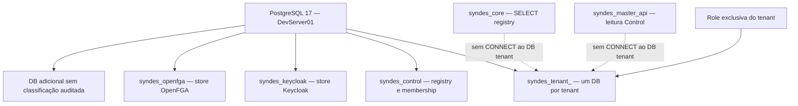
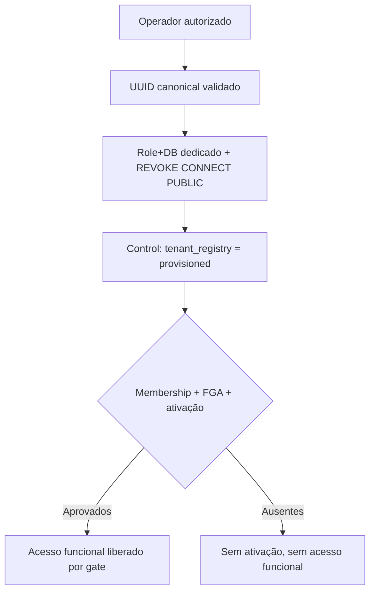
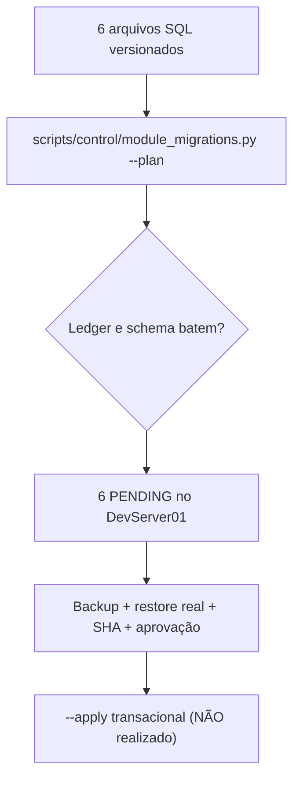

[← Ficha do capítulo](../) · [Volume](../../) · [Fonte original](https://github.com/delmacy/syndes-system/blob/main/docs/subprojects/I04-postgresql/chapters/05-arquitetura-banco-interface-configuracao-e-diagramas.md)

> Conteúdo espelhado da documentação versionada; não expressa automaticamente estado funcional.

## 5. Arquitetura, bancos, redes, autorização e fluxos

### Mapa lógico do PostgreSQL — configuração declarada e parte observada

**Observação:** o grafo não representa que os módulos CRM/Inbox/WhatsApp estejam instalados no DB tenant, apenas que **um database canônico existe**. O banco adicional não foi identificado na publicação pública.

### Camadas SQL por owner

| Database | Schema/tabela | Natureza | Estado no DevServer01 |
|---|---|---|---|
| Control | `public.tenant_registry`, `tenant_memberships` | C01: mapping e memberships | **Presentes** |
| Control | `public.platform_operator_access`, `platform_tenant_profiles` | Manager | **Presentes** |
| Control | `public.module_catalog*`, `tenant_module_entitlements/installs/audit` | Catálogo/lifecycle — C01/C02 | **Ausentes** |
| Control | `control_events.outbox_events/deliveries/consumer_inbox` | Eventos Control — C01/C06 | **Ausentes** |
| Tenant | `_syndes.module_migrations` | Ledger de instalador C02/A04 | **Ausente no único DB canônico encontrado** |
| Tenant | `crm`, `inbox`, `whatsapp`, `organizations`, `support`, `service` | Domínios dos módulos | **Schemas não encontrados** |
| Tenant | `platform_events` | Event Bus/Transactional Outbox de tenant | **Schema não encontrado** |
| Keycloak/FGA | Bancos técnicos separados | Identidade e autorização | DBs presentes; tabelas internas não auditadas |

### Provisionamento e gates

A criação inicial de databases não instala aplicações nem concede permissões de produto automaticamente. Um tenant criado permanece em `provisioned` até operações separadas de Control/identidade/autorização.

### Migração de Control — estado observado

**Nenhum `--apply` foi executado.** O plano usa checksums SHA-256, exige PG17 e impede mudanças quando encontra drift de checksum/ledger incompleto. Mesmo um plano consistente não substitui backup e aprovação operacionais.

### Configuração, volumes e backup

- `infra/postgres/compose.yaml`: banco sem portas publicadas, redes `syndes-data` e `syndes-master-data` (controle Manager), secrets de arquivos Docker, `no-new-privileges` e `POSTGRES_INITDB_ARGS=--auth-host=scram-sha-256`.
- `postgres_data` é volume persistente. **A existência de volume e healthcheck não comprova backup**, retenção, recuperação ou recuperação entre múltiplos tenants no mesmo servidor.
- Scripts `00-init.sh` são disparados pelo `docker-entrypoint-initdb.d` apenas na criação de volume; aplicar `control.schema` em ambiente já persistente exige migrador/gate.
- Um servidor PostgreSQL é ponto compartilhado de falha: separar DB por tenant dá isolamento lógico/permissões, **não alta disponibilidade, resiliência física ou backups independentes automáticos**.
- Para Support, somente tenant operacional autorizado recebe migration; a ativação multi-org permanece **manual e com Product Gate**.

### Fronteira de APIs/frontend

**I04 não tem frontend nem endpoint HTTP público.** Apps comunicam-se via providers/ports e grants apropriados; o navegador não recebe DSN nem role de banco. Keycloak e OpenFGA são consumidores de stores técnicos separados. Manager não herda acesso às conversas e mensagens dos tenants.

---
**Rastreabilidade:** [revisar documento fonte](https://github.com/delmacy/syndes-system/blob/main/docs/subprojects/I04-postgresql/chapters/05-arquitetura-banco-interface-configuracao-e-diagramas.md).
