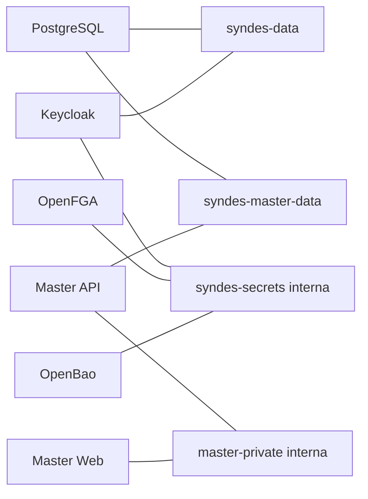

# I05 — Docker e redes

[← Sumário do volume](../) · [↑ Biblioteca](../../)

> **Leitura técnica, não homologação.** Estados, limites e comprovações devem ser lidos em STATUS e nos checkpoints versionados.

## Identificação e rastreabilidade

| Campo | Fonte verificável |
|---|---|
| Unidade / owner | **I05** · Docker e redes |
| Volume | Infraestrutura e qualidade |
| Caminho de implementação | `infra` |
| Documento de origem | [README](https://github.com/delmacy/syndes-system/blob/main/docs/subprojects/I05-docker-e-redes/README.md) |
| STATUS e critérios | [STATUS original](https://github.com/delmacy/syndes-system/blob/main/docs/subprojects/I05-docker-e-redes/STATUS.md) |
| Símbolos, APIs, SQL e dependências | [REFERENCIA-TECNICA](https://github.com/delmacy/syndes-system/blob/main/docs/subprojects/I05-docker-e-redes/REFERENCIA-TECNICA.md) |
| Implantação, runbooks e gates | [OPERACAO](https://github.com/delmacy/syndes-system/blob/main/docs/subprojects/I05-docker-e-redes/OPERACAO.md) |
| Owner hierárquico | `I02` — relação registrada no catálogo |

## Situação registrada

> AUDITORIA TÉCNICA PARCIAL — 13/11/2026. Checkpoint de código ff37302 incorporado nesta branch como ab08a0b; base documental ec037df. Evidência: manifests versionados e observação Docker somente leitura. NÃO HOMOLOGADO: redes, portas, isolamento e regras efetivas não inspecionadas. Dimensão Evidência Limite --------- PostgreSQL infra/postgres/compose.yaml: imagem postgres:17-bookworm, volume postgresdata, redes externas syndes-data/syndes-master-data,…

A descrição acima é uma **citação resumida do STATUS versionado**; não significa que os testes de integração, a implantação ou a homologação estejam aprovados.

## Índice dos subcapítulos

Todos os assuntos deste módulo estão nesta página. Clique em um título para saltar à seção correspondente; o índice lateral acompanha a leitura.

- [Casos de uso](#casos-de-uso)
- [Histórias de usuário](#historias-de-usuario)
- [Requisitos](#requisitos)
- [Contratos públicos e privados](#contratos)
- [APIs e endpoints](#apis)
- [Eventos e mensageria](#eventos)
- [Dados e persistência](#dados)
- [Schemas e migrations](#schema)
- [Dependências e integrações](#dependencias)
- [Configuração e ambiente](#configuracao)
- [Frontend e interfaces](#interface)
- [Testes e evidências](#testes)
- [Operação e implantação](#operacao)
- [WBS e evolução](#wbs)
- [Documentação de origem integral](#documentacao-de-origem)
- [Controle de alterações](#controle-de-alteracoes)

## Casos de uso

**Editar esta seção:** [Abrir arquivo-fonte no GitHub](https://github.com/delmacy/syndes-system/edit/main/docs/subprojects/I05-docker-e-redes/chapters/02-requisitos-historias-e-casos-de-uso.md) · [Consultar fonte](https://github.com/delmacy/syndes-system/blob/main/docs/subprojects/I05-docker-e-redes/chapters/02-requisitos-historias-e-casos-de-uso.md)

*Referências extraídas da documentação versionada, sem inferir homologação ou implantação.*

**Lacuna documental:** ainda não há especificação textual identificada nesta área. Revisar implementação e registrar evidência antes de preencher.

📝 Espaço para ajustes e implementação

Este é um **modelo de registro**, não um editor com salvamento automático. Use o link **Editar esta seção** para atualizar o documento versionado.

- **Alteração proposta:** descreva o requisito, contrato, dado ou comportamento.
- **Referência de código:** informe caminho e símbolo real.
- **Testes e evidências:** informe comando, resultado e limite.
- **Critério de aceite:** indique como validar sem presumir homologação.
- **Status e revisão:** atualize a fonte canônica após revisão.

## Histórias de usuário

**Editar esta seção:** [Abrir arquivo-fonte no GitHub](https://github.com/delmacy/syndes-system/edit/main/docs/subprojects/I05-docker-e-redes/chapters/02-requisitos-historias-e-casos-de-uso.md) · [Consultar fonte](https://github.com/delmacy/syndes-system/blob/main/docs/subprojects/I05-docker-e-redes/chapters/02-requisitos-historias-e-casos-de-uso.md)

*Referências extraídas da documentação versionada, sem inferir homologação ou implantação.*

**Lacuna documental:** ainda não há especificação textual identificada nesta área. Revisar implementação e registrar evidência antes de preencher.

📝 Espaço para ajustes e implementação

Este é um **modelo de registro**, não um editor com salvamento automático. Use o link **Editar esta seção** para atualizar o documento versionado.

- **Alteração proposta:** descreva o requisito, contrato, dado ou comportamento.
- **Referência de código:** informe caminho e símbolo real.
- **Testes e evidências:** informe comando, resultado e limite.
- **Critério de aceite:** indique como validar sem presumir homologação.
- **Status e revisão:** atualize a fonte canônica após revisão.

## Requisitos

**Editar esta seção:** [Abrir arquivo-fonte no GitHub](https://github.com/delmacy/syndes-system/edit/main/docs/subprojects/I05-docker-e-redes/chapters/02-requisitos-historias-e-casos-de-uso.md) · [Consultar fonte](https://github.com/delmacy/syndes-system/blob/main/docs/subprojects/I05-docker-e-redes/chapters/02-requisitos-historias-e-casos-de-uso.md)

*Referências extraídas da documentação versionada, sem inferir homologação ou implantação.*

**Fonte:** [02-requisitos-historias-e-casos-de-uso.md](https://github.com/delmacy/syndes-system/blob/main/docs/subprojects/I05-docker-e-redes/chapters/02-requisitos-historias-e-casos-de-uso.md)

> Linha 3: \| ID \| Requisito \| Evidência/aceite \|

📝 Espaço para ajustes e implementação

Este é um **modelo de registro**, não um editor com salvamento automático. Use o link **Editar esta seção** para atualizar o documento versionado.

- **Alteração proposta:** descreva o requisito, contrato, dado ou comportamento.
- **Referência de código:** informe caminho e símbolo real.
- **Testes e evidências:** informe comando, resultado e limite.
- **Critério de aceite:** indique como validar sem presumir homologação.
- **Status e revisão:** atualize a fonte canônica após revisão.

## Contratos públicos e privados

**Editar esta seção:** [Abrir arquivo-fonte no GitHub](https://github.com/delmacy/syndes-system/edit/main/docs/subprojects/I05-docker-e-redes/REFERENCIA-TECNICA.md) · [Consultar fonte](https://github.com/delmacy/syndes-system/blob/main/docs/subprojects/I05-docker-e-redes/REFERENCIA-TECNICA.md)

*Referências extraídas da documentação versionada, sem inferir homologação ou implantação.*

**Fonte:** [REFERENCIA-TECNICA.md](https://github.com/delmacy/syndes-system/blob/main/docs/subprojects/I05-docker-e-redes/REFERENCIA-TECNICA.md)

> Linha 13: **Interfaces/contratos:** não há API HTTP, classe TypeScript ou frontend próprio do I05. Interfaces são manifests Compose, nomes de rede, mounts, configuração runtime e restrições de conectividade. APIs de identidade, segredo, autorização, tenant e Manager pertencem aos módulos respectivos. Não atribuir schemas/migrations SQL a I05; o volume PostgreSQL pertence ao serviço de I04 e `openbao_raft` ao serviço C05.

**Fonte:** [04-contratos-e-dependencias-publicas.md](https://github.com/delmacy/syndes-system/blob/main/docs/subprojects/I05-docker-e-redes/chapters/04-contratos-e-dependencias-publicas.md)

> Linha 3: O contrato do I05 é **declarativo**, não export TypeScript: Compose services, nomes de redes externas, volumes, mounts, `depends_on`, secrets e restrições de execução. Consumidores são workloads de I04, C03, C04, C05 e Manager. `openfga-migrate` é job de migração declarado; não executar como teste de documentação. Não há endpoint HTTP, evento de negócio, contrato de frontend ou migration SQL atribuível ao I05. Evidên

**Fonte:** [STATUS.md](https://github.com/delmacy/syndes-system/blob/main/docs/subprojects/I05-docker-e-redes/STATUS.md)

> Linha 17: **Limites de ownership:** I05 trata Docker/redes/volumes; I06 Traefik, I07 Tailnet, I08 Komodo, I12 hardening, I04 PostgreSQL e C03/C04/C05 conservam seus contratos. Nenhum container, secret, volume, porta, migration ou configuração foi alterado.

📝 Espaço para ajustes e implementação

Este é um **modelo de registro**, não um editor com salvamento automático. Use o link **Editar esta seção** para atualizar o documento versionado.

- **Alteração proposta:** descreva o requisito, contrato, dado ou comportamento.
- **Referência de código:** informe caminho e símbolo real.
- **Testes e evidências:** informe comando, resultado e limite.
- **Critério de aceite:** indique como validar sem presumir homologação.
- **Status e revisão:** atualize a fonte canônica após revisão.

## APIs e endpoints

**Editar esta seção:** [Abrir arquivo-fonte no GitHub](https://github.com/delmacy/syndes-system/edit/main/docs/subprojects/I05-docker-e-redes/REFERENCIA-TECNICA.md) · [Consultar fonte](https://github.com/delmacy/syndes-system/blob/main/docs/subprojects/I05-docker-e-redes/REFERENCIA-TECNICA.md)

*Referências extraídas da documentação versionada, sem inferir homologação ou implantação.*

**Fonte:** [REFERENCIA-TECNICA.md](https://github.com/delmacy/syndes-system/blob/main/docs/subprojects/I05-docker-e-redes/REFERENCIA-TECNICA.md)

> Linha 11: \| `infra/master-admin/compose.yaml` \| `master-api`, `master-web` \| `master-private` interna, `syndes-master-data`/`syndes-master-identity` externas; web bind em loopback; `read_only`, `no-new-privileges`, `cap_drop: ALL` declarados \|

> Linha 13: **Interfaces/contratos:** não há API HTTP, classe TypeScript ou frontend próprio do I05. Interfaces são manifests Compose, nomes de rede, mounts, configuração runtime e restrições de conectividade. APIs de identidade, segredo, autorização, tenant e Manager pertencem aos módulos respectivos. Não atribuir schemas/migrations SQL a I05; o volume PostgreSQL pertence ao serviço de I04 e `openbao_raft` ao serviço C05.

**Fonte:** [04-contratos-e-dependencias-publicas.md](https://github.com/delmacy/syndes-system/blob/main/docs/subprojects/I05-docker-e-redes/chapters/04-contratos-e-dependencias-publicas.md)

> Linha 3: O contrato do I05 é **declarativo**, não export TypeScript: Compose services, nomes de redes externas, volumes, mounts, `depends_on`, secrets e restrições de execução. Consumidores são workloads de I04, C03, C04, C05 e Manager. `openfga-migrate` é job de migração declarado; não executar como teste de documentação. Não há endpoint HTTP, evento de negócio, contrato de frontend ou migration SQL atribuível ao I05. Evidên

**Fonte:** [STATUS.md](https://github.com/delmacy/syndes-system/blob/main/docs/subprojects/I05-docker-e-redes/STATUS.md)

> Linha 11: \| Manager \| `infra/master-admin/compose.yaml`: `master-api`, `master-web`, `master-private` interna, `read_only`, `cap_drop: ALL` declarados \| Não foi feita inspeção runtime nem ingress \|

📝 Espaço para ajustes e implementação

Este é um **modelo de registro**, não um editor com salvamento automático. Use o link **Editar esta seção** para atualizar o documento versionado.

- **Alteração proposta:** descreva o requisito, contrato, dado ou comportamento.
- **Referência de código:** informe caminho e símbolo real.
- **Testes e evidências:** informe comando, resultado e limite.
- **Critério de aceite:** indique como validar sem presumir homologação.
- **Status e revisão:** atualize a fonte canônica após revisão.

## Eventos e mensageria

**Editar esta seção:** [Abrir arquivo-fonte no GitHub](https://github.com/delmacy/syndes-system/edit/main/docs/subprojects/I05-docker-e-redes/REFERENCIA-TECNICA.md) · [Consultar fonte](https://github.com/delmacy/syndes-system/blob/main/docs/subprojects/I05-docker-e-redes/REFERENCIA-TECNICA.md)

*Referências extraídas da documentação versionada, sem inferir homologação ou implantação.*

**Fonte:** [REFERENCIA-TECNICA.md](https://github.com/delmacy/syndes-system/blob/main/docs/subprojects/I05-docker-e-redes/REFERENCIA-TECNICA.md)

> Linha 9: \| `infra/postgres/compose.yaml` \| `postgres:17-bookworm` \| `postgres_data`, `syndes-data` e `syndes-master-data` externas; secrets montados de runtime, sem porta de banco publicada no manifesto \|

**Fonte:** [04-contratos-e-dependencias-publicas.md](https://github.com/delmacy/syndes-system/blob/main/docs/subprojects/I05-docker-e-redes/chapters/04-contratos-e-dependencias-publicas.md)

> Linha 3: O contrato do I05 é **declarativo**, não export TypeScript: Compose services, nomes de redes externas, volumes, mounts, `depends_on`, secrets e restrições de execução. Consumidores são workloads de I04, C03, C04, C05 e Manager. `openfga-migrate` é job de migração declarado; não executar como teste de documentação. Não há endpoint HTTP, evento de negócio, contrato de frontend ou migration SQL atribuível ao I05. Evidên

**Fonte:** [OPERACAO.md](https://github.com/delmacy/syndes-system/blob/main/docs/subprojects/I05-docker-e-redes/OPERACAO.md)

> Linha 9: 3. Com autorização operacional, coletar **somente campos sanitizados** de rede, `internal`, portas publicadas, privilégios, health e labels; nunca registrar env, tokens, mounts privados, IPs privados ou caminhos sensíveis.

📝 Espaço para ajustes e implementação

Este é um **modelo de registro**, não um editor com salvamento automático. Use o link **Editar esta seção** para atualizar o documento versionado.

- **Alteração proposta:** descreva o requisito, contrato, dado ou comportamento.
- **Referência de código:** informe caminho e símbolo real.
- **Testes e evidências:** informe comando, resultado e limite.
- **Critério de aceite:** indique como validar sem presumir homologação.
- **Status e revisão:** atualize a fonte canônica após revisão.

## Dados e persistência

**Editar esta seção:** [Abrir arquivo-fonte no GitHub](https://github.com/delmacy/syndes-system/edit/main/docs/subprojects/I05-docker-e-redes/REFERENCIA-TECNICA.md) · [Consultar fonte](https://github.com/delmacy/syndes-system/blob/main/docs/subprojects/I05-docker-e-redes/REFERENCIA-TECNICA.md)

*Referências extraídas da documentação versionada, sem inferir homologação ou implantação.*

**Fonte:** [REFERENCIA-TECNICA.md](https://github.com/delmacy/syndes-system/blob/main/docs/subprojects/I05-docker-e-redes/REFERENCIA-TECNICA.md)

> Linha 9: \| `infra/postgres/compose.yaml` \| `postgres:17-bookworm` \| `postgres_data`, `syndes-data` e `syndes-master-data` externas; secrets montados de runtime, sem porta de banco publicada no manifesto \|

> Linha 13: **Interfaces/contratos:** não há API HTTP, classe TypeScript ou frontend próprio do I05. Interfaces são manifests Compose, nomes de rede, mounts, configuração runtime e restrições de conectividade. APIs de identidade, segredo, autorização, tenant e Manager pertencem aos módulos respectivos. Não atribuir schemas/migrations SQL a I05; o volume PostgreSQL pertence ao serviço de I04 e `openbao_raft` ao serviço C05.

**Fonte:** [05-arquitetura-banco-interface-configuracao-e-diagramas.md](https://github.com/delmacy/syndes-system/blob/main/docs/subprojects/I05-docker-e-redes/chapters/05-arquitetura-banco-interface-configuracao-e-diagramas.md)

> Linha 16: Topologia **declarada** e parcial, sem representar IPs, portas efetivas ou tráfego. `postgres_data` pertence à persistência PostgreSQL; `openbao_raft` ao cofre. Não há Tenant DB, Control DB, classes ou frontend próprio do I05. Configurações secretas e env_file não foram lidas.

**Fonte:** [STATUS.md](https://github.com/delmacy/syndes-system/blob/main/docs/subprojects/I05-docker-e-redes/STATUS.md)

> Linha 9: \| PostgreSQL \| `infra/postgres/compose.yaml`: imagem `postgres:17-bookworm`, volume `postgres_data`, redes externas `syndes-data`/`syndes-master-data`, healthcheck \| Não há prova de backup, restore, grants ou firewall \|

> Linha 17: **Limites de ownership:** I05 trata Docker/redes/volumes; I06 Traefik, I07 Tailnet, I08 Komodo, I12 hardening, I04 PostgreSQL e C03/C04/C05 conservam seus contratos. Nenhum container, secret, volume, porta, migration ou configuração foi alterado.

📝 Espaço para ajustes e implementação

Este é um **modelo de registro**, não um editor com salvamento automático. Use o link **Editar esta seção** para atualizar o documento versionado.

- **Alteração proposta:** descreva o requisito, contrato, dado ou comportamento.
- **Referência de código:** informe caminho e símbolo real.
- **Testes e evidências:** informe comando, resultado e limite.
- **Critério de aceite:** indique como validar sem presumir homologação.
- **Status e revisão:** atualize a fonte canônica após revisão.

## Schemas e migrations

**Editar esta seção:** [Abrir arquivo-fonte no GitHub](https://github.com/delmacy/syndes-system/edit/main/docs/subprojects/I05-docker-e-redes/REFERENCIA-TECNICA.md) · [Consultar fonte](https://github.com/delmacy/syndes-system/blob/main/docs/subprojects/I05-docker-e-redes/REFERENCIA-TECNICA.md)

*Referências extraídas da documentação versionada, sem inferir homologação ou implantação.*

**Fonte:** [REFERENCIA-TECNICA.md](https://github.com/delmacy/syndes-system/blob/main/docs/subprojects/I05-docker-e-redes/REFERENCIA-TECNICA.md)

> Linha 13: **Interfaces/contratos:** não há API HTTP, classe TypeScript ou frontend próprio do I05. Interfaces são manifests Compose, nomes de rede, mounts, configuração runtime e restrições de conectividade. APIs de identidade, segredo, autorização, tenant e Manager pertencem aos módulos respectivos. Não atribuir schemas/migrations SQL a I05; o volume PostgreSQL pertence ao serviço de I04 e `openbao_raft` ao serviço C05.

**Fonte:** [04-contratos-e-dependencias-publicas.md](https://github.com/delmacy/syndes-system/blob/main/docs/subprojects/I05-docker-e-redes/chapters/04-contratos-e-dependencias-publicas.md)

> Linha 3: O contrato do I05 é **declarativo**, não export TypeScript: Compose services, nomes de redes externas, volumes, mounts, `depends_on`, secrets e restrições de execução. Consumidores são workloads de I04, C03, C04, C05 e Manager. `openfga-migrate` é job de migração declarado; não executar como teste de documentação. Não há endpoint HTTP, evento de negócio, contrato de frontend ou migration SQL atribuível ao I05. Evidên

**Fonte:** [STATUS.md](https://github.com/delmacy/syndes-system/blob/main/docs/subprojects/I05-docker-e-redes/STATUS.md)

> Linha 17: **Limites de ownership:** I05 trata Docker/redes/volumes; I06 Traefik, I07 Tailnet, I08 Komodo, I12 hardening, I04 PostgreSQL e C03/C04/C05 conservam seus contratos. Nenhum container, secret, volume, porta, migration ou configuração foi alterado.

📝 Espaço para ajustes e implementação

Este é um **modelo de registro**, não um editor com salvamento automático. Use o link **Editar esta seção** para atualizar o documento versionado.

- **Alteração proposta:** descreva o requisito, contrato, dado ou comportamento.
- **Referência de código:** informe caminho e símbolo real.
- **Testes e evidências:** informe comando, resultado e limite.
- **Critério de aceite:** indique como validar sem presumir homologação.
- **Status e revisão:** atualize a fonte canônica após revisão.

## Dependências e integrações

**Editar esta seção:** [Abrir arquivo-fonte no GitHub](https://github.com/delmacy/syndes-system/edit/main/docs/subprojects/I05-docker-e-redes/REFERENCIA-TECNICA.md) · [Consultar fonte](https://github.com/delmacy/syndes-system/blob/main/docs/subprojects/I05-docker-e-redes/REFERENCIA-TECNICA.md)

*Referências extraídas da documentação versionada, sem inferir homologação ou implantação.*

**Fonte:** [REFERENCIA-TECNICA.md](https://github.com/delmacy/syndes-system/blob/main/docs/subprojects/I05-docker-e-redes/REFERENCIA-TECNICA.md)

> Linha 10: \| `infra/security-access/compose.yaml` \| `keycloak:26.8.1`, `openfga:v1.22.1`, `openbao:2.7.0`, `openfga-migrate` \| `syndes-secrets` bridge interna, `syndes-security-access`, `syndes-data`, `syndes-master-identity`; Raft `openbao_raft` \|

> Linha 15: **Atenção:** `openfga-migrate` é job mutável declarado, não executado na auditoria. `env_file`, secrets e caminhos de runtime são referenciados, **não lidos**. Nenhum `docker inspect` de containers, env, mounts ou IPs foi realizado.

**Fonte:** [04-contratos-e-dependencias-publicas.md](https://github.com/delmacy/syndes-system/blob/main/docs/subprojects/I05-docker-e-redes/chapters/04-contratos-e-dependencias-publicas.md)

> Linha 3: O contrato do I05 é **declarativo**, não export TypeScript: Compose services, nomes de redes externas, volumes, mounts, `depends_on`, secrets e restrições de execução. Consumidores são workloads de I04, C03, C04, C05 e Manager. `openfga-migrate` é job de migração declarado; não executar como teste de documentação. Não há endpoint HTTP, evento de negócio, contrato de frontend ou migration SQL atribuível ao I05. Evidên

**Fonte:** [STATUS.md](https://github.com/delmacy/syndes-system/blob/main/docs/subprojects/I05-docker-e-redes/STATUS.md)

> Linha 10: \| Identidade e segredos \| `infra/security-access/compose.yaml`: Keycloak 26.8.1, OpenFGA 1.22.1, OpenBao 2.7.0; rede `syndes-secrets` com `internal: true` \| `internal` declarativo não demonstra conectividade ou seal/ACL reais \|

**Fonte:** [OPERACAO.md](https://github.com/delmacy/syndes-system/blob/main/docs/subprojects/I05-docker-e-redes/OPERACAO.md)

> Linha 15: Não existe evidência de isolamento efetivo, rede de produção ou inventário completo de todos os stacks. O job `openfga-migrate` não foi executado. Nenhuma configuração, secret, container, volume, porta ou firewall foi modificado.

📝 Espaço para ajustes e implementação

Este é um **modelo de registro**, não um editor com salvamento automático. Use o link **Editar esta seção** para atualizar o documento versionado.

- **Alteração proposta:** descreva o requisito, contrato, dado ou comportamento.
- **Referência de código:** informe caminho e símbolo real.
- **Testes e evidências:** informe comando, resultado e limite.
- **Critério de aceite:** indique como validar sem presumir homologação.
- **Status e revisão:** atualize a fonte canônica após revisão.

## Configuração e ambiente

**Editar esta seção:** [Abrir arquivo-fonte no GitHub](https://github.com/delmacy/syndes-system/edit/main/docs/subprojects/I05-docker-e-redes/OPERACAO.md) · [Consultar fonte](https://github.com/delmacy/syndes-system/blob/main/docs/subprojects/I05-docker-e-redes/OPERACAO.md)

*Referências extraídas da documentação versionada, sem inferir homologação ou implantação.*

**Fonte:** [OPERACAO.md](https://github.com/delmacy/syndes-system/blob/main/docs/subprojects/I05-docker-e-redes/OPERACAO.md)

> Linha 3: > **RUNBOOK DE VERIFICAÇÃO, NÃO AUTORIZAÇÃO DE MUDANÇA.** Em 13/11/2026 foram observados 16 containers Up e bridges Syndes/Komodo, sem `docker inspect`, sem leitura de secrets e sem executar Compose. O serviço Up não prova readiness.

> Linha 8: 2. Planejar validação de `docker compose config --quiet` **em cópia isolada** e sem importar arquivos secretos; o manifesto Manager exige variáveis e arquivos operacionais, portanto não executar cegamente no host.

> Linha 9: 3. Com autorização operacional, coletar **somente campos sanitizados** de rede, `internal`, portas publicadas, privilégios, health e labels; nunca registrar env, tokens, mounts privados, IPs privados ou caminhos sensíveis.

> Linha 10: 4. Conferir se topologia efetiva corresponde ao Compose da revisão analisada; testar negativas de comunicação entre domínios em ambiente segregado, com plano de rollback.

> Linha 15: Não existe evidência de isolamento efetivo, rede de produção ou inventário completo de todos os stacks. O job `openfga-migrate` não foi executado. Nenhuma configuração, secret, container, volume, porta ou firewall foi modificado.

**Fonte:** [REFERENCIA-TECNICA.md](https://github.com/delmacy/syndes-system/blob/main/docs/subprojects/I05-docker-e-redes/REFERENCIA-TECNICA.md)

> Linha 3: > **AUDITORIA PARCIAL DE CONFIGURAÇÃO, NÃO HOMOLOGAÇÃO OPERACIONAL.** Base `ec037df`; checkpoint `ff37302`. A configuração Compose é fonte declarativa, não prova de que containers ativos usam a mesma revisão.

> Linha 9: \| `infra/postgres/compose.yaml` \| `postgres:17-bookworm` \| `postgres_data`, `syndes-data` e `syndes-master-data` externas; secrets montados de runtime, sem porta de banco publicada no manifesto \|

> Linha 10: \| `infra/security-access/compose.yaml` \| `keycloak:26.8.1`, `openfga:v1.22.1`, `openbao:2.7.0`, `openfga-migrate` \| `syndes-secrets` bridge interna, `syndes-security-access`, `syndes-data`, `syndes-master-identity`; Raft `openbao_raft` \|

> Linha 11: \| `infra/master-admin/compose.yaml` \| `master-api`, `master-web` \| `master-private` interna, `syndes-master-data`/`syndes-master-identity` externas; web bind em loopback; `read_only`, `no-new-privileges`, `cap_drop: ALL` declarados \|

> Linha 13: **Interfaces/contratos:** não há API HTTP, classe TypeScript ou frontend próprio do I05. Interfaces são manifests Compose, nomes de rede, mounts, configuração runtime e restrições de conectividade. APIs de identidade, segredo, autorização, tenant e Manager pertencem aos módulos respectivos. Não atribuir schemas/migrations SQL a I05; o volume PostgreSQL pertence ao serviço de I04 e `openbao_raft` ao serviço C05.

> Linha 15: **Atenção:** `openfga-migrate` é job mutável declarado, não executado na auditoria. `env_file`, secrets e caminhos de runtime são referenciados, **não lidos**. Nenhum `docker inspect` de containers, env, mounts ou IPs foi realizado.

> Linha 32: Diagrama de **vínculos declarados** (subconjunto dos Compose inventariados), não tráfego observado. Os stacks Core Host, Workspace, WhatsApp, Komodo, Traefik e Tailnet requerem inventário próprio.

> Linha 38: - Pendentes: inventário completo dos stacks, `docker compose config --quiet` com ambiente sanitizado, comparação de manifests com runtime, ingress/egress, publicação de portas, least privilege e isolamento por rede.

**Fonte:** [STATUS.md](https://github.com/delmacy/syndes-system/blob/main/docs/subprojects/I05-docker-e-redes/STATUS.md)

> Linha 9: \| PostgreSQL \| `infra/postgres/compose.yaml`: imagem `postgres:17-bookworm`, volume `postgres_data`, redes externas `syndes-data`/`syndes-master-data`, healthcheck \| Não há prova de backup, restore, grants ou firewall \|

> Linha 10: \| Identidade e segredos \| `infra/security-access/compose.yaml`: Keycloak 26.8.1, OpenFGA 1.22.1, OpenBao 2.7.0; rede `syndes-secrets` com `internal: true` \| `internal` declarativo não demonstra conectividade ou seal/ACL reais \|

> Linha 11: \| Manager \| `infra/master-admin/compose.yaml`: `master-api`, `master-web`, `master-private` interna, `read_only`, `cap_drop: ALL` declarados \| Não foi feita inspeção runtime nem ingress \|

> Linha 13: \| Cobertura \| Três Compose principais inventariados \| Core Host, Workspace, WhatsApp, Komodo e demais stacks ainda precisam de mapeamento integral \|

> Linha 15: **WBS:** I05.DOC.01 — **AUDITORIA PARCIAL** (fontes e ownership); I05.NET.01 — **PENDENTE** (topologia e portas efetivas sanitizadas); I05.SEC.01 — **PENDENTE** (negações/ingress/egress); I05.OPS.01 — **PENDENTE** (compose config, recovery e inventário completo); I05.GATE — **BLOQUEADO** (aceite e prova de ambiente-alvo).

> Linha 17: **Limites de ownership:** I05 trata Docker/redes/volumes; I06 Traefik, I07 Tailnet, I08 Komodo, I12 hardening, I04 PostgreSQL e C03/C04/C05 conservam seus contratos. Nenhum container, secret, volume, porta, migration ou configuração foi alterado.

📝 Espaço para ajustes e implementação

Este é um **modelo de registro**, não um editor com salvamento automático. Use o link **Editar esta seção** para atualizar o documento versionado.

- **Alteração proposta:** descreva o requisito, contrato, dado ou comportamento.
- **Referência de código:** informe caminho e símbolo real.
- **Testes e evidências:** informe comando, resultado e limite.
- **Critério de aceite:** indique como validar sem presumir homologação.
- **Status e revisão:** atualize a fonte canônica após revisão.

## Frontend e interfaces

**Editar esta seção:** [Abrir arquivo-fonte no GitHub](https://github.com/delmacy/syndes-system/edit/main/docs/subprojects/I05-docker-e-redes/REFERENCIA-TECNICA.md) · [Consultar fonte](https://github.com/delmacy/syndes-system/blob/main/docs/subprojects/I05-docker-e-redes/REFERENCIA-TECNICA.md)

*Referências extraídas da documentação versionada, sem inferir homologação ou implantação.*

**Fonte:** [REFERENCIA-TECNICA.md](https://github.com/delmacy/syndes-system/blob/main/docs/subprojects/I05-docker-e-redes/REFERENCIA-TECNICA.md)

> Linha 13: **Interfaces/contratos:** não há API HTTP, classe TypeScript ou frontend próprio do I05. Interfaces são manifests Compose, nomes de rede, mounts, configuração runtime e restrições de conectividade. APIs de identidade, segredo, autorização, tenant e Manager pertencem aos módulos respectivos. Não atribuir schemas/migrations SQL a I05; o volume PostgreSQL pertence ao serviço de I04 e `openbao_raft` ao serviço C05.

**Fonte:** [05-arquitetura-banco-interface-configuracao-e-diagramas.md](https://github.com/delmacy/syndes-system/blob/main/docs/subprojects/I05-docker-e-redes/chapters/05-arquitetura-banco-interface-configuracao-e-diagramas.md)

> Linha 16: Topologia **declarada** e parcial, sem representar IPs, portas efetivas ou tráfego. `postgres_data` pertence à persistência PostgreSQL; `openbao_raft` ao cofre. Não há Tenant DB, Control DB, classes ou frontend próprio do I05. Configurações secretas e env_file não foram lidas.

📝 Espaço para ajustes e implementação

Este é um **modelo de registro**, não um editor com salvamento automático. Use o link **Editar esta seção** para atualizar o documento versionado.

- **Alteração proposta:** descreva o requisito, contrato, dado ou comportamento.
- **Referência de código:** informe caminho e símbolo real.
- **Testes e evidências:** informe comando, resultado e limite.
- **Critério de aceite:** indique como validar sem presumir homologação.
- **Status e revisão:** atualize a fonte canônica após revisão.

## Testes e evidências

**Editar esta seção:** [Abrir arquivo-fonte no GitHub](https://github.com/delmacy/syndes-system/edit/main/docs/subprojects/I05-docker-e-redes/STATUS.md) · [Consultar fonte](https://github.com/delmacy/syndes-system/blob/main/docs/subprojects/I05-docker-e-redes/STATUS.md)

*Referências extraídas da documentação versionada, sem inferir homologação ou implantação.*

**Fonte:** [STATUS.md](https://github.com/delmacy/syndes-system/blob/main/docs/subprojects/I05-docker-e-redes/STATUS.md)

> Linha 3: > **AUDITORIA TÉCNICA PARCIAL — 13/11/2026.** Checkpoint de código `ff37302` incorporado nesta branch como `ab08a0b`; base documental `ec037df`. Evidência: manifests versionados e observação Docker **somente leitura**. **NÃO HOMOLOGADO**: redes, portas, isolamento e regras efetivas não inspecionadas.

> Linha 7: \| Dimensão \| Evidência \| Limite \|

> Linha 15: **WBS:** I05.DOC.01 — **AUDITORIA PARCIAL** (fontes e ownership); I05.NET.01 — **PENDENTE** (topologia e portas efetivas sanitizadas); I05.SEC.01 — **PENDENTE** (negações/ingress/egress); I05.OPS.01 — **PENDENTE** (compose config, recovery e inventário completo); I05.GATE — **BLOQUEADO** (aceite e prova de ambiente-alvo).

**Fonte:** [06-wbs-marcos-e-aceite.md](https://github.com/delmacy/syndes-system/blob/main/docs/subprojects/I05-docker-e-redes/chapters/06-wbs-marcos-e-aceite.md)

> Linha 7: \| I05.SEC.01 \| Pendente \| Evidenciar portas, ingress/egress, isolamento negativo \|

> Linha 9: \| I05.GATE \| Bloqueado \| Evidências e aprovação do ambiente-alvo \|

**Fonte:** [OPERACAO.md](https://github.com/delmacy/syndes-system/blob/main/docs/subprojects/I05-docker-e-redes/OPERACAO.md)

> Linha 11: 5. Requerer evidências de backup/restore e custódia de volumes dos respectivos owners. Só após aceites registrar I05 como homologado.

> Linha 15: Não existe evidência de isolamento efetivo, rede de produção ou inventário completo de todos os stacks. O job `openfga-migrate` não foi executado. Nenhuma configuração, secret, container, volume, porta ou firewall foi modificado.

📝 Espaço para ajustes e implementação

Este é um **modelo de registro**, não um editor com salvamento automático. Use o link **Editar esta seção** para atualizar o documento versionado.

- **Alteração proposta:** descreva o requisito, contrato, dado ou comportamento.
- **Referência de código:** informe caminho e símbolo real.
- **Testes e evidências:** informe comando, resultado e limite.
- **Critério de aceite:** indique como validar sem presumir homologação.
- **Status e revisão:** atualize a fonte canônica após revisão.

## Operação e implantação

**Editar esta seção:** [Abrir arquivo-fonte no GitHub](https://github.com/delmacy/syndes-system/edit/main/docs/subprojects/I05-docker-e-redes/OPERACAO.md) · [Consultar fonte](https://github.com/delmacy/syndes-system/blob/main/docs/subprojects/I05-docker-e-redes/OPERACAO.md)

*Referências extraídas da documentação versionada, sem inferir homologação ou implantação.*

**Fonte:** [OPERACAO.md](https://github.com/delmacy/syndes-system/blob/main/docs/subprojects/I05-docker-e-redes/OPERACAO.md)

> Linha 10: 4. Conferir se topologia efetiva corresponde ao Compose da revisão analisada; testar negativas de comunicação entre domínios em ambiente segregado, com plano de rollback.

**Fonte:** [STATUS.md](https://github.com/delmacy/syndes-system/blob/main/docs/subprojects/I05-docker-e-redes/STATUS.md)

> Linha 19: **Próxima unidade:** I06 — Traefik HTTPS. [Referência](REFERENCIA-TECNICA.md) · [Operação](OPERACAO.md) · [Checkpoint](../../evidence/checkpoints/I05-docker-networks-initial-20261113-1000.md).

📝 Espaço para ajustes e implementação

Este é um **modelo de registro**, não um editor com salvamento automático. Use o link **Editar esta seção** para atualizar o documento versionado.

- **Alteração proposta:** descreva o requisito, contrato, dado ou comportamento.
- **Referência de código:** informe caminho e símbolo real.
- **Testes e evidências:** informe comando, resultado e limite.
- **Critério de aceite:** indique como validar sem presumir homologação.
- **Status e revisão:** atualize a fonte canônica após revisão.

## WBS e evolução

**Editar esta seção:** [Abrir arquivo-fonte no GitHub](https://github.com/delmacy/syndes-system/edit/main/docs/subprojects/I05-docker-e-redes/STATUS.md) · [Consultar fonte](https://github.com/delmacy/syndes-system/blob/main/docs/subprojects/I05-docker-e-redes/STATUS.md)

*Referências extraídas da documentação versionada, sem inferir homologação ou implantação.*

**Fonte:** [STATUS.md](https://github.com/delmacy/syndes-system/blob/main/docs/subprojects/I05-docker-e-redes/STATUS.md)

> Linha 15: **WBS:** I05.DOC.01 — **AUDITORIA PARCIAL** (fontes e ownership); I05.NET.01 — **PENDENTE** (topologia e portas efetivas sanitizadas); I05.SEC.01 — **PENDENTE** (negações/ingress/egress); I05.OPS.01 — **PENDENTE** (compose config, recovery e inventário completo); I05.GATE — **BLOQUEADO** (aceite e prova de ambiente-alvo).

**Fonte:** [06-wbs-marcos-e-aceite.md](https://github.com/delmacy/syndes-system/blob/main/docs/subprojects/I05-docker-e-redes/chapters/06-wbs-marcos-e-aceite.md)

> Linha 3: \| Marco \| Estado \| Critério \|

> Linha 6: \| I05.NET.01 \| Pendente \| Cobrir todos os stacks e comparar redes runtime/manifests \|

> Linha 7: \| I05.SEC.01 \| Pendente \| Evidenciar portas, ingress/egress, isolamento negativo \|

> Linha 8: \| I05.OPS.01 \| Pendente \| Config sanitizada, health, backup/restore com owners \|

📝 Espaço para ajustes e implementação

Este é um **modelo de registro**, não um editor com salvamento automático. Use o link **Editar esta seção** para atualizar o documento versionado.

- **Alteração proposta:** descreva o requisito, contrato, dado ou comportamento.
- **Referência de código:** informe caminho e símbolo real.
- **Testes e evidências:** informe comando, resultado e limite.
- **Critério de aceite:** indique como validar sem presumir homologação.
- **Status e revisão:** atualize a fonte canônica após revisão.

## Documentação de origem integral

Os oito assuntos canônicos são reproduzidos abaixo para permitir leitura contínua. As fontes versionadas permanecem editáveis e preservadas.

### 00 · Fontes e endereços

[Editar conteúdo original](https://github.com/delmacy/syndes-system/edit/main/docs/subprojects/I05-docker-e-redes/chapters/00-enderecos-exatos-de-leitura.md) · [Abrir fonte](https://github.com/delmacy/syndes-system/blob/main/docs/subprojects/I05-docker-e-redes/chapters/00-enderecos-exatos-de-leitura.md)

##### 0. Endereços exatos de leitura

- `infra/postgres/compose.yaml`, `infra/security-access/compose.yaml`, `infra/master-admin/compose.yaml`.
- `docs/evidence/checkpoints/I05-docker-networks-initial-20261113-1000.md`.
- `docs/subprojects/I05-docker-e-redes/{STATUS,REFERENCIA-TECNICA,OPERACAO}.md`.
- `docs/blueprint/PLANO-ATUALIZACAO-MODULOS.md` e `catalog/work-units.json`.
- Donos adjacentes: I04, I06, I07, I08, I12, C03, C04 e C05.

### 01 · Missão e fronteiras

[Editar conteúdo original](https://github.com/delmacy/syndes-system/edit/main/docs/subprojects/I05-docker-e-redes/chapters/01-missao-objetivos-e-fronteiras.md) · [Abrir fonte](https://github.com/delmacy/syndes-system/blob/main/docs/subprojects/I05-docker-e-redes/chapters/01-missao-objetivos-e-fronteiras.md)

##### 1. Missão, objetivos e fronteiras

I05 documenta manifests Docker, redes, volumes, interfaces de infraestrutura e seu isolamento pretendido. Não possui API HTTP nem interface de usuário própria. Não assume propriedade de Traefik, Tailnet, Komodo, hardening, banco PostgreSQL ou policies de OpenBao/OpenFGA. A existência de containers Up não comprova homologação, política de rede efetiva ou prontidão.

### 02 · Requisitos e casos de uso

[Editar conteúdo original](https://github.com/delmacy/syndes-system/edit/main/docs/subprojects/I05-docker-e-redes/chapters/02-requisitos-historias-e-casos-de-uso.md) · [Abrir fonte](https://github.com/delmacy/syndes-system/blob/main/docs/subprojects/I05-docker-e-redes/chapters/02-requisitos-historias-e-casos-de-uso.md)

##### 2. Requisitos, histórias e casos de uso

| ID | Requisito | Evidência/aceite |
|---|---|---|
| I05-RF01 | Separar redes de dados, identidade, segredos e Manager | Compose versionados; validação efetiva pendente |
| I05-RF02 | Restringir portas publicadas | PostgreSQL sem porta host declarada; Master Web bind loopback; inventário global pendente |
| I05-RF03 | Proteger workloads e volumes | `no-new-privileges`, `read_only`, `cap_drop` em serviços específicos; runtime não validado |
| I05-RF04 | Evitar vazamento de secrets em docs/logs | Referências a arquivos runtime; material não consultado |
| I05-RF05 | Validar isolamento negativo entre redes | Teste segregado e autorização pendentes |

### 03 · Capacidades

[Editar conteúdo original](https://github.com/delmacy/syndes-system/edit/main/docs/subprojects/I05-docker-e-redes/chapters/03-capabilities.md) · [Abrir fonte](https://github.com/delmacy/syndes-system/blob/main/docs/subprojects/I05-docker-e-redes/chapters/03-capabilities.md)

##### 3. Capabilities

| Capability | Declarado | Comprovação |
|---|---|---|
| PostgreSQL em Compose | Imagem 17-bookworm, volume `postgres_data`, redes externas | Arquivo versionado |
| Segurança em Compose | Keycloak 26.8.1, OpenFGA 1.22.1, OpenBao 2.7.0 | Arquivo versionado |
| Segredos em rede interna | `syndes-secrets: internal: true` | Somente configuração |
| Manager segregado | `master-private: internal: true`, web loopback | Somente configuração |
| Runtime observado | 16 containers Up, redes bridge Syndes/Komodo | Inventário parcial read-only |
| Topologia completa, isolamento e recovery | Não demonstrados | Pendente |

### 04 · Contratos e dependências

[Editar conteúdo original](https://github.com/delmacy/syndes-system/edit/main/docs/subprojects/I05-docker-e-redes/chapters/04-contratos-e-dependencias-publicas.md) · [Abrir fonte](https://github.com/delmacy/syndes-system/blob/main/docs/subprojects/I05-docker-e-redes/chapters/04-contratos-e-dependencias-publicas.md)

##### 4. Contratos e dependências públicas

O contrato do I05 é **declarativo**, não export TypeScript: Compose services, nomes de redes externas, volumes, mounts, `depends_on`, secrets e restrições de execução. Consumidores são workloads de I04, C03, C04, C05 e Manager. `openfga-migrate` é job de migração declarado; não executar como teste de documentação. Não há endpoint HTTP, evento de negócio, contrato de frontend ou migration SQL atribuível ao I05. Evidência de YAML não deve ser registrada como símbolo JavaScript fictício no witness registry.

### 05 · Arquitetura, dados e interfaces

[Editar conteúdo original](https://github.com/delmacy/syndes-system/edit/main/docs/subprojects/I05-docker-e-redes/chapters/05-arquitetura-banco-interface-configuracao-e-diagramas.md) · [Abrir fonte](https://github.com/delmacy/syndes-system/blob/main/docs/subprojects/I05-docker-e-redes/chapters/05-arquitetura-banco-interface-configuracao-e-diagramas.md)

##### 5. Arquitetura, banco, interface, configuração e diagramas

Topologia **declarada** e parcial, sem representar IPs, portas efetivas ou tráfego. `postgres_data` pertence à persistência PostgreSQL; `openbao_raft` ao cofre. Não há Tenant DB, Control DB, classes ou frontend próprio do I05. Configurações secretas e env_file não foram lidas.

### 06 · WBS e critérios de aceite

[Editar conteúdo original](https://github.com/delmacy/syndes-system/edit/main/docs/subprojects/I05-docker-e-redes/chapters/06-wbs-marcos-e-aceite.md) · [Abrir fonte](https://github.com/delmacy/syndes-system/blob/main/docs/subprojects/I05-docker-e-redes/chapters/06-wbs-marcos-e-aceite.md)

##### 6. WBS, marcos e aceite

| Marco | Estado | Critério |
|---|---|---|
| I05.DOC.01 | Auditoria parcial | Inventário dos três Compose e observação read-only |
| I05.NET.01 | Pendente | Cobrir todos os stacks e comparar redes runtime/manifests |
| I05.SEC.01 | Pendente | Evidenciar portas, ingress/egress, isolamento negativo |
| I05.OPS.01 | Pendente | Config sanitizada, health, backup/restore com owners |
| I05.GATE | Bloqueado | Evidências e aprovação do ambiente-alvo |

Próxima unidade documental: I06 — Traefik HTTPS. Publicação depende de CI e confirmação da revisão no GitHub Pages.

### 07 · Controle de escopo

[Editar conteúdo original](https://github.com/delmacy/syndes-system/edit/main/docs/subprojects/I05-docker-e-redes/chapters/07-controle-do-escopo.md) · [Abrir fonte](https://github.com/delmacy/syndes-system/blob/main/docs/subprojects/I05-docker-e-redes/chapters/07-controle-do-escopo.md)

##### 7. Controle do escopo

Checkpoint `ff37302` (13/11/2026); auditoria de código e runtime **somente leitura**. Não executar Compose, migrations, alterar redes, firewall, ingress, volumes, containers ou secrets. Não inferir políticas efetivas de arquivos YAML. I05 não absorve I06, I07, I08, I12, I04, C03, C04 ou C05. Testes documentais não são testes de rede nem homologação.

## Controle de alterações

**Este site é somente leitura.** Para alterar qualquer seção, edite o documento canônico no GitHub; a próxima publicação atualizará este livro automaticamente.

| Registro | Onde editar |
|---|---|
| Especificação e referências | [Referência técnica](https://github.com/delmacy/syndes-system/edit/main/docs/subprojects/I05-docker-e-redes/REFERENCIA-TECNICA.md) |
| Estado real e bloqueios | [STATUS](https://github.com/delmacy/syndes-system/edit/main/docs/subprojects/I05-docker-e-redes/STATUS.md) |
| Procedimentos e implantação | [Operação](https://github.com/delmacy/syndes-system/edit/main/docs/subprojects/I05-docker-e-redes/OPERACAO.md) |
| Capítulos canônicos | [Página do módulo](https://github.com/delmacy/syndes-system/blob/main/docs/subprojects/I05-docker-e-redes/README.md) |

**Registro recomendado:** data e responsável; alteração; contrato ou interface afetada; testes; impacto em dependências; evidência; revisão/aceite.

---
*Leitura experimental Starlight; a documentação canônica permanece em `docs/subprojects/`. Não inferir entrega funcional a partir de documentação presente.*
