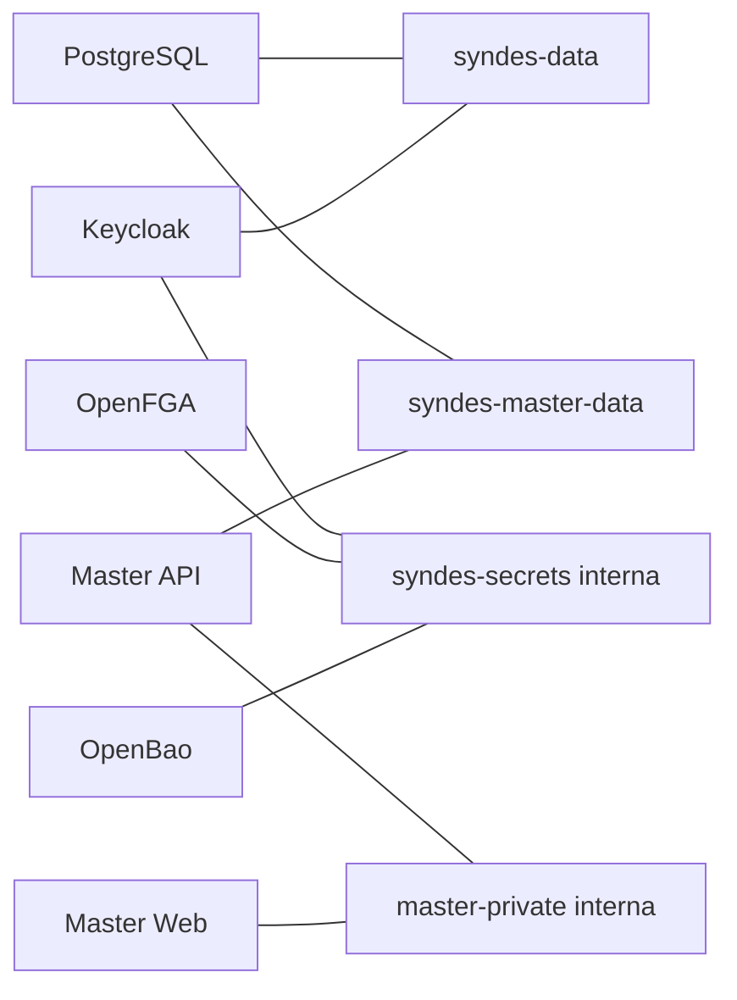

[← Ficha do capítulo](../) · [Volume](../../) · [Fonte original](https://github.com/delmacy/syndes-system/blob/main/docs/subprojects/I05-docker-e-redes/chapters/05-arquitetura-banco-interface-configuracao-e-diagramas.md)

> Conteúdo espelhado da documentação versionada; não expressa automaticamente estado funcional.

## 5. Arquitetura, banco, interface, configuração e diagramas

Topologia **declarada** e parcial, sem representar IPs, portas efetivas ou tráfego. `postgres_data` pertence à persistência PostgreSQL; `openbao_raft` ao cofre. Não há Tenant DB, Control DB, classes ou frontend próprio do I05. Configurações secretas e env_file não foram lidas.

---
**Rastreabilidade:** [revisar documento fonte](https://github.com/delmacy/syndes-system/blob/main/docs/subprojects/I05-docker-e-redes/chapters/05-arquitetura-banco-interface-configuracao-e-diagramas.md).
