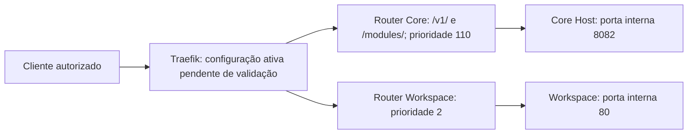

# I06 — Traefik HTTPS

[← Sumário do volume](../) · [↑ Biblioteca](../../)

> **Leitura técnica, não homologação.** Estados, limites e comprovações devem ser lidos em STATUS e nos checkpoints versionados.

## Identificação e rastreabilidade

| Campo | Fonte verificável |
|---|---|
| Unidade / owner | **I06** · Traefik HTTPS |
| Volume | Infraestrutura e qualidade |
| Caminho de implementação | `docs/engineering/WORKSPACE-DEVSERVER01-RUNBOOK.md` |
| Documento de origem | [README](https://github.com/delmacy/syndes-system/blob/main/docs/subprojects/I06-traefik-https/README.md) |
| STATUS e critérios | [STATUS original](https://github.com/delmacy/syndes-system/blob/main/docs/subprojects/I06-traefik-https/STATUS.md) |
| Símbolos, APIs, SQL e dependências | [REFERENCIA-TECNICA](https://github.com/delmacy/syndes-system/blob/main/docs/subprojects/I06-traefik-https/REFERENCIA-TECNICA.md) |
| Implantação, runbooks e gates | [OPERACAO](https://github.com/delmacy/syndes-system/blob/main/docs/subprojects/I06-traefik-https/OPERACAO.md) |
| Owner hierárquico | `I02` — relação registrada no catálogo |

## Situação registrada

> AUDITORIA TÉCNICA PARCIAL — não homologação operacional. Fonte principal: modules/whatsapp/deploy/devserver01-cutover.compose.yaml; evidência datada. - Compose versionado de cutover WhatsApp contém dois routers, prioridades 110/2, entrypoint web, middleware referenciado syndes-tailnet-only@docker e destinos 8082/80. - Checkpoint anterior a393007 relata Traefik v3.6.25 e rede infra-proxy no DevServer01; evidência de observação, não teste de TLS/isolamento.…

A descrição acima é uma **citação resumida do STATUS versionado**; não significa que os testes de integração, a implantação ou a homologação estejam aprovados.

## Índice dos subcapítulos

Todos os assuntos deste módulo estão nesta página. Clique em um título para saltar à seção correspondente; o índice lateral acompanha a leitura.

- [Casos de uso](#casos-de-uso)
- [Histórias de usuário](#historias-de-usuario)
- [Requisitos](#requisitos)
- [Contratos públicos e privados](#contratos)
- [APIs e endpoints](#apis)
- [Eventos e mensageria](#eventos)
- [Dados e persistência](#dados)
- [Schemas e migrations](#schema)
- [Dependências e integrações](#dependencias)
- [Configuração e ambiente](#configuracao)
- [Frontend e interfaces](#interface)
- [Testes e evidências](#testes)
- [Operação e implantação](#operacao)
- [WBS e evolução](#wbs)
- [Documentação de origem integral](#documentacao-de-origem)
- [Controle de alterações](#controle-de-alteracoes)

## Casos de uso

**Editar esta seção:** [Abrir arquivo-fonte no GitHub](https://github.com/delmacy/syndes-system/edit/main/docs/subprojects/I06-traefik-https/chapters/02-requisitos-historias-e-casos-de-uso.md) · [Consultar fonte](https://github.com/delmacy/syndes-system/blob/main/docs/subprojects/I06-traefik-https/chapters/02-requisitos-historias-e-casos-de-uso.md)

*Referências extraídas da documentação versionada, sem inferir homologação ou implantação.*

**Fonte:** [02-requisitos-historias-e-casos-de-uso.md](https://github.com/delmacy/syndes-system/blob/main/docs/subprojects/I06-traefik-https/chapters/02-requisitos-historias-e-casos-de-uso.md)

> Linha 3: - **Caso documentado existente:** distinguir caminhos de API `/v1/` e `/modules/` do fallback Workspace por regras e prioridades dos routers no Compose.

📝 Espaço para ajustes e implementação

Este é um **modelo de registro**, não um editor com salvamento automático. Use o link **Editar esta seção** para atualizar o documento versionado.

- **Alteração proposta:** descreva o requisito, contrato, dado ou comportamento.
- **Referência de código:** informe caminho e símbolo real.
- **Testes e evidências:** informe comando, resultado e limite.
- **Critério de aceite:** indique como validar sem presumir homologação.
- **Status e revisão:** atualize a fonte canônica após revisão.

## Histórias de usuário

**Editar esta seção:** [Abrir arquivo-fonte no GitHub](https://github.com/delmacy/syndes-system/edit/main/docs/subprojects/I06-traefik-https/chapters/02-requisitos-historias-e-casos-de-uso.md) · [Consultar fonte](https://github.com/delmacy/syndes-system/blob/main/docs/subprojects/I06-traefik-https/chapters/02-requisitos-historias-e-casos-de-uso.md)

*Referências extraídas da documentação versionada, sem inferir homologação ou implantação.*

**Lacuna documental:** ainda não há especificação textual identificada nesta área. Revisar implementação e registrar evidência antes de preencher.

📝 Espaço para ajustes e implementação

Este é um **modelo de registro**, não um editor com salvamento automático. Use o link **Editar esta seção** para atualizar o documento versionado.

- **Alteração proposta:** descreva o requisito, contrato, dado ou comportamento.
- **Referência de código:** informe caminho e símbolo real.
- **Testes e evidências:** informe comando, resultado e limite.
- **Critério de aceite:** indique como validar sem presumir homologação.
- **Status e revisão:** atualize a fonte canônica após revisão.

## Requisitos

**Editar esta seção:** [Abrir arquivo-fonte no GitHub](https://github.com/delmacy/syndes-system/edit/main/docs/subprojects/I06-traefik-https/chapters/02-requisitos-historias-e-casos-de-uso.md) · [Consultar fonte](https://github.com/delmacy/syndes-system/blob/main/docs/subprojects/I06-traefik-https/chapters/02-requisitos-historias-e-casos-de-uso.md)

*Referências extraídas da documentação versionada, sem inferir homologação ou implantação.*

**Fonte:** [02-requisitos-historias-e-casos-de-uso.md](https://github.com/delmacy/syndes-system/blob/main/docs/subprojects/I06-traefik-https/chapters/02-requisitos-historias-e-casos-de-uso.md)

> Linha 5: - Requisitos RF/US/AC de produto para I06: **não evidenciados nem inventados**; owner deve formalizar antes de atribuir aceite.

📝 Espaço para ajustes e implementação

Este é um **modelo de registro**, não um editor com salvamento automático. Use o link **Editar esta seção** para atualizar o documento versionado.

- **Alteração proposta:** descreva o requisito, contrato, dado ou comportamento.
- **Referência de código:** informe caminho e símbolo real.
- **Testes e evidências:** informe comando, resultado e limite.
- **Critério de aceite:** indique como validar sem presumir homologação.
- **Status e revisão:** atualize a fonte canônica após revisão.

## Contratos públicos e privados

**Editar esta seção:** [Abrir arquivo-fonte no GitHub](https://github.com/delmacy/syndes-system/edit/main/docs/subprojects/I06-traefik-https/REFERENCIA-TECNICA.md) · [Consultar fonte](https://github.com/delmacy/syndes-system/blob/main/docs/subprojects/I06-traefik-https/REFERENCIA-TECNICA.md)

*Referências extraídas da documentação versionada, sem inferir homologação ou implantação.*

**Fonte:** [REFERENCIA-TECNICA.md](https://github.com/delmacy/syndes-system/blob/main/docs/subprojects/I06-traefik-https/REFERENCIA-TECNICA.md)

> Linha 29: - [Operação e gates](OPERACAO.md); [capítulos de contratos](chapters/04-contratos-e-dependencias-publicas.md) e [arquitetura](chapters/05-arquitetura-banco-interface-configuracao-e-diagramas.md).

**Fonte:** [04-contratos-e-dependencias-publicas.md](https://github.com/delmacy/syndes-system/blob/main/docs/subprojects/I06-traefik-https/chapters/04-contratos-e-dependencias-publicas.md)

> Linha 6: - **Não declarar contrato HTTPS ativo apenas pelo nome I06**; nenhum evento versionado, SDK ou API de negócio I06 identificado.

**Fonte:** [STATUS.md](https://github.com/delmacy/syndes-system/blob/main/docs/subprojects/I06-traefik-https/STATUS.md)

> Linha 13: \| Documentação \| Auditoria parcial I06 \| Contratos Compose inspecionados; proprietário e runtime completo pendentes \|

**Fonte:** [OPERACAO.md](https://github.com/delmacy/syndes-system/blob/main/docs/subprojects/I06-traefik-https/OPERACAO.md)

> Linha 22: - Não usar valores de `env_file`, tokens, certificados privados ou dumps no relatório público.

📝 Espaço para ajustes e implementação

Este é um **modelo de registro**, não um editor com salvamento automático. Use o link **Editar esta seção** para atualizar o documento versionado.

- **Alteração proposta:** descreva o requisito, contrato, dado ou comportamento.
- **Referência de código:** informe caminho e símbolo real.
- **Testes e evidências:** informe comando, resultado e limite.
- **Critério de aceite:** indique como validar sem presumir homologação.
- **Status e revisão:** atualize a fonte canônica após revisão.

## APIs e endpoints

**Editar esta seção:** [Abrir arquivo-fonte no GitHub](https://github.com/delmacy/syndes-system/edit/main/docs/subprojects/I06-traefik-https/REFERENCIA-TECNICA.md) · [Consultar fonte](https://github.com/delmacy/syndes-system/blob/main/docs/subprojects/I06-traefik-https/REFERENCIA-TECNICA.md)

*Referências extraídas da documentação versionada, sem inferir homologação ou implantação.*

**Fonte:** [REFERENCIA-TECNICA.md](https://github.com/delmacy/syndes-system/blob/main/docs/subprojects/I06-traefik-https/REFERENCIA-TECNICA.md)

> Linha 16: Ambos declaram `traefik.enable=true` e `traefik.docker.network=infra-proxy`; `infra-proxy` e outras redes são externas ao Compose. A prioridade separa caminhos de API e fallback Workspace **somente se** esses routers forem carregados com as regras esperadas. `web` não constitui prova de TLS; TLS, `websecure`, redirects, certificados e política real de ingresso precisam de verificação independente.

> Linha 19: - I06 é componente de infraestrutura **declarativo**: nenhum pacote TypeScript, API de negócio, classe/método exportado, consumidor de eventos ou migration SQL próprio foi comprovado nas fontes auditadas.

> Linha 20: - Destinos HTTP internos pertencem ao Core Host e Workspace, não criam endpoints novos de I06. Não atribuir tabelas do Tenant DB ou Control DB a este componente.

> Linha 25: - Não confundir host acessível, certificado aceito ou HTTP 200 com autorização correta do backend.

**Fonte:** [04-contratos-e-dependencias-publicas.md](https://github.com/delmacy/syndes-system/blob/main/docs/subprojects/I06-traefik-https/chapters/04-contratos-e-dependencias-publicas.md)

> Linha 6: - **Não declarar contrato HTTPS ativo apenas pelo nome I06**; nenhum evento versionado, SDK ou API de negócio I06 identificado.

**Fonte:** [OPERACAO.md](https://github.com/delmacy/syndes-system/blob/main/docs/subprojects/I06-traefik-https/OPERACAO.md)

> Linha 14: 4. Conferir roteamento API `/v1/`, `/modules/` e Workspace, prioridades, códigos esperados e downstream authorization. HTTP 200 da página estática não prova autorização de dados.

📝 Espaço para ajustes e implementação

Este é um **modelo de registro**, não um editor com salvamento automático. Use o link **Editar esta seção** para atualizar o documento versionado.

- **Alteração proposta:** descreva o requisito, contrato, dado ou comportamento.
- **Referência de código:** informe caminho e símbolo real.
- **Testes e evidências:** informe comando, resultado e limite.
- **Critério de aceite:** indique como validar sem presumir homologação.
- **Status e revisão:** atualize a fonte canônica após revisão.

## Eventos e mensageria

**Editar esta seção:** [Abrir arquivo-fonte no GitHub](https://github.com/delmacy/syndes-system/edit/main/docs/subprojects/I06-traefik-https/REFERENCIA-TECNICA.md) · [Consultar fonte](https://github.com/delmacy/syndes-system/blob/main/docs/subprojects/I06-traefik-https/REFERENCIA-TECNICA.md)

*Referências extraídas da documentação versionada, sem inferir homologação ou implantação.*

**Fonte:** [REFERENCIA-TECNICA.md](https://github.com/delmacy/syndes-system/blob/main/docs/subprojects/I06-traefik-https/REFERENCIA-TECNICA.md)

> Linha 19: - I06 é componente de infraestrutura **declarativo**: nenhum pacote TypeScript, API de negócio, classe/método exportado, consumidor de eventos ou migration SQL próprio foi comprovado nas fontes auditadas.

**Fonte:** [04-contratos-e-dependencias-publicas.md](https://github.com/delmacy/syndes-system/blob/main/docs/subprojects/I06-traefik-https/chapters/04-contratos-e-dependencias-publicas.md)

> Linha 6: - **Não declarar contrato HTTPS ativo apenas pelo nome I06**; nenhum evento versionado, SDK ou API de negócio I06 identificado.

**Fonte:** [OPERACAO.md](https://github.com/delmacy/syndes-system/blob/main/docs/subprojects/I06-traefik-https/OPERACAO.md)

> Linha 6: - Checkpoint local `a393007` (2026-11-13) reportou container Traefik v3.6.25 em execução na `infra-proxy`, portas 80/443 publicadas e quatro containers com labels. Isso **não** comprova exposição Internet nem isolamento Tailnet.

📝 Espaço para ajustes e implementação

Este é um **modelo de registro**, não um editor com salvamento automático. Use o link **Editar esta seção** para atualizar o documento versionado.

- **Alteração proposta:** descreva o requisito, contrato, dado ou comportamento.
- **Referência de código:** informe caminho e símbolo real.
- **Testes e evidências:** informe comando, resultado e limite.
- **Critério de aceite:** indique como validar sem presumir homologação.
- **Status e revisão:** atualize a fonte canônica após revisão.

## Dados e persistência

**Editar esta seção:** [Abrir arquivo-fonte no GitHub](https://github.com/delmacy/syndes-system/edit/main/docs/subprojects/I06-traefik-https/REFERENCIA-TECNICA.md) · [Consultar fonte](https://github.com/delmacy/syndes-system/blob/main/docs/subprojects/I06-traefik-https/REFERENCIA-TECNICA.md)

*Referências extraídas da documentação versionada, sem inferir homologação ou implantação.*

**Fonte:** [REFERENCIA-TECNICA.md](https://github.com/delmacy/syndes-system/blob/main/docs/subprojects/I06-traefik-https/REFERENCIA-TECNICA.md)

> Linha 20: - Destinos HTTP internos pertencem ao Core Host e Workspace, não criam endpoints novos de I06. Não atribuir tabelas do Tenant DB ou Control DB a este componente.

**Fonte:** [05-arquitetura-banco-interface-configuracao-e-diagramas.md](https://github.com/delmacy/syndes-system/blob/main/docs/subprojects/I06-traefik-https/chapters/05-arquitetura-banco-interface-configuracao-e-diagramas.md)

> Linha 14: - Banco de dados, schemas, migrations e lógica de UI: não pertencem ao I06 segundo o inventário atual; frontend atendido é owner Workspace.

**Fonte:** [OPERACAO.md](https://github.com/delmacy/syndes-system/blob/main/docs/subprojects/I06-traefik-https/OPERACAO.md)

> Linha 14: 4. Conferir roteamento API `/v1/`, `/modules/` e Workspace, prioridades, códigos esperados e downstream authorization. HTTP 200 da página estática não prova autorização de dados.

📝 Espaço para ajustes e implementação

Este é um **modelo de registro**, não um editor com salvamento automático. Use o link **Editar esta seção** para atualizar o documento versionado.

- **Alteração proposta:** descreva o requisito, contrato, dado ou comportamento.
- **Referência de código:** informe caminho e símbolo real.
- **Testes e evidências:** informe comando, resultado e limite.
- **Critério de aceite:** indique como validar sem presumir homologação.
- **Status e revisão:** atualize a fonte canônica após revisão.

## Schemas e migrations

**Editar esta seção:** [Abrir arquivo-fonte no GitHub](https://github.com/delmacy/syndes-system/edit/main/docs/subprojects/I06-traefik-https/REFERENCIA-TECNICA.md) · [Consultar fonte](https://github.com/delmacy/syndes-system/blob/main/docs/subprojects/I06-traefik-https/REFERENCIA-TECNICA.md)

*Referências extraídas da documentação versionada, sem inferir homologação ou implantação.*

**Fonte:** [REFERENCIA-TECNICA.md](https://github.com/delmacy/syndes-system/blob/main/docs/subprojects/I06-traefik-https/REFERENCIA-TECNICA.md)

> Linha 19: - I06 é componente de infraestrutura **declarativo**: nenhum pacote TypeScript, API de negócio, classe/método exportado, consumidor de eventos ou migration SQL próprio foi comprovado nas fontes auditadas.

> Linha 20: - Destinos HTTP internos pertencem ao Core Host e Workspace, não criam endpoints novos de I06. Não atribuir tabelas do Tenant DB ou Control DB a este componente.

**Fonte:** [05-arquitetura-banco-interface-configuracao-e-diagramas.md](https://github.com/delmacy/syndes-system/blob/main/docs/subprojects/I06-traefik-https/chapters/05-arquitetura-banco-interface-configuracao-e-diagramas.md)

> Linha 14: - Banco de dados, schemas, migrations e lógica de UI: não pertencem ao I06 segundo o inventário atual; frontend atendido é owner Workspace.

📝 Espaço para ajustes e implementação

Este é um **modelo de registro**, não um editor com salvamento automático. Use o link **Editar esta seção** para atualizar o documento versionado.

- **Alteração proposta:** descreva o requisito, contrato, dado ou comportamento.
- **Referência de código:** informe caminho e símbolo real.
- **Testes e evidências:** informe comando, resultado e limite.
- **Critério de aceite:** indique como validar sem presumir homologação.
- **Status e revisão:** atualize a fonte canônica após revisão.

## Dependências e integrações

**Editar esta seção:** [Abrir arquivo-fonte no GitHub](https://github.com/delmacy/syndes-system/edit/main/docs/subprojects/I06-traefik-https/REFERENCIA-TECNICA.md) · [Consultar fonte](https://github.com/delmacy/syndes-system/blob/main/docs/subprojects/I06-traefik-https/REFERENCIA-TECNICA.md)

*Referências extraídas da documentação versionada, sem inferir homologação ou implantação.*

**Fonte:** [REFERENCIA-TECNICA.md](https://github.com/delmacy/syndes-system/blob/main/docs/subprojects/I06-traefik-https/REFERENCIA-TECNICA.md)

> Linha 29: - [Operação e gates](OPERACAO.md); [capítulos de contratos](chapters/04-contratos-e-dependencias-publicas.md) e [arquitetura](chapters/05-arquitetura-banco-interface-configuracao-e-diagramas.md).

**Fonte:** [STATUS.md](https://github.com/delmacy/syndes-system/blob/main/docs/subprojects/I06-traefik-https/STATUS.md)

> Linha 15: \| Integração \| Não verificada \| Sem testes de roteamento, certificados ou middleware \|

**Fonte:** [OPERACAO.md](https://github.com/delmacy/syndes-system/blob/main/docs/subprojects/I06-traefik-https/OPERACAO.md)

> Linha 15: 5. Revisar plano de rollback documentado para cutover, dependências e impacto nos callbacks; não executar rollback sem janela/autorização específica.

📝 Espaço para ajustes e implementação

Este é um **modelo de registro**, não um editor com salvamento automático. Use o link **Editar esta seção** para atualizar o documento versionado.

- **Alteração proposta:** descreva o requisito, contrato, dado ou comportamento.
- **Referência de código:** informe caminho e símbolo real.
- **Testes e evidências:** informe comando, resultado e limite.
- **Critério de aceite:** indique como validar sem presumir homologação.
- **Status e revisão:** atualize a fonte canônica após revisão.

## Configuração e ambiente

**Editar esta seção:** [Abrir arquivo-fonte no GitHub](https://github.com/delmacy/syndes-system/edit/main/docs/subprojects/I06-traefik-https/OPERACAO.md) · [Consultar fonte](https://github.com/delmacy/syndes-system/blob/main/docs/subprojects/I06-traefik-https/OPERACAO.md)

*Referências extraídas da documentação versionada, sem inferir homologação ou implantação.*

**Fonte:** [OPERACAO.md](https://github.com/delmacy/syndes-system/blob/main/docs/subprojects/I06-traefik-https/OPERACAO.md)

> Linha 7: - Compose GitHub de cutover WhatsApp declara dois routers no entrypoint `web` e referencia `syndes-tailnet-only@docker`. Não foi comprovada a definição/eficácia do middleware ou TLS end-to-end.

> Linha 11: 1. Inspecionar a configuração ativa do proxy e a procedência de entrypoints, routers e middlewares, filtrando credenciais e caminhos sensíveis.

**Fonte:** [REFERENCIA-TECNICA.md](https://github.com/delmacy/syndes-system/blob/main/docs/subprojects/I06-traefik-https/REFERENCIA-TECNICA.md)

> Linha 7: - Fonte real de configuração versionada: `modules/whatsapp/deploy/devserver01-cutover.compose.yaml`; `modules/whatsapp/deploy/README.md`; documentação operacional histórica: `docs/engineering/WORKSPACE-DEVSERVER01-RUNBOOK.md`.

> Linha 8: - A configuração global efetivamente carregada pelo Traefik não foi localizada/validada neste gate.

> Linha 11: \| Router declarado \| Match \| Prioridade \| Entrypoint \| Middleware referenciado \| Porta do destino \|

> Linha 16: Ambos declaram `traefik.enable=true` e `traefik.docker.network=infra-proxy`; `infra-proxy` e outras redes são externas ao Compose. A prioridade separa caminhos de API e fallback Workspace **somente se** esses routers forem carregados com as regras esperadas. `web` não constitui prova de TLS; TLS, `websecure`, redirects, certificados e política real de ingresso precisam de verificação independente.

> Linha 29: - [Operação e gates](OPERACAO.md); [capítulos de contratos](chapters/04-contratos-e-dependencias-publicas.md) e [arquitetura](chapters/05-arquitetura-banco-interface-configuracao-e-diagramas.md).

**Fonte:** [05-arquitetura-banco-interface-configuracao-e-diagramas.md](https://github.com/delmacy/syndes-system/blob/main/docs/subprojects/I06-traefik-https/chapters/05-arquitetura-banco-interface-configuracao-e-diagramas.md)

> Linha 13: - `infra-proxy` é rede Docker externa no Compose; `web` é entrypoint declarado, **não evidência de TLS**.

> Linha 15: - Configuração dinâmica ativa, certificados e políticas não foram inspecionados nesta reconciliação.

**Fonte:** [STATUS.md](https://github.com/delmacy/syndes-system/blob/main/docs/subprojects/I06-traefik-https/STATUS.md)

> Linha 3: > **AUDITORIA TÉCNICA PARCIAL — não homologação operacional.** Fonte principal: `modules/whatsapp/deploy/devserver01-cutover.compose.yaml`; [evidência datada](../../evidence/checkpoints/I06-traefik-https-github-reconciliation-20261113.md).

> Linha 6: - Compose versionado de cutover WhatsApp contém dois routers, prioridades 110/2, entrypoint `web`, middleware referenciado `syndes-tailnet-only@docker` e destinos 8082/80.

> Linha 8: - Runbook aponta para manifesto local `/srv/syndes-lab/workspace.traefik.yaml` não localizado na auditoria anterior. Não presumir que a configuração histórica corresponda ao runtime atual.

> Linha 13: \| Documentação \| Auditoria parcial I06 \| Contratos Compose inspecionados; proprietário e runtime completo pendentes \|

> Linha 14: \| Implementação \| Configuração declarativa encontrada \| Labels e manifests não comprovam aplicação \|

> Linha 21: \| I06.DOC.01 \| PARCIAL \| Compose versionado, referência e oito capítulos \| Revisão de escopo/owner \|

> Linha 23: \| I06.TLS.01 \| PENDENTE \| `entrypoints: web` no Compose \| Confirmar TLS, redirects e certificados efetivos \|

📝 Espaço para ajustes e implementação

Este é um **modelo de registro**, não um editor com salvamento automático. Use o link **Editar esta seção** para atualizar o documento versionado.

- **Alteração proposta:** descreva o requisito, contrato, dado ou comportamento.
- **Referência de código:** informe caminho e símbolo real.
- **Testes e evidências:** informe comando, resultado e limite.
- **Critério de aceite:** indique como validar sem presumir homologação.
- **Status e revisão:** atualize a fonte canônica após revisão.

## Frontend e interfaces

**Editar esta seção:** [Abrir arquivo-fonte no GitHub](https://github.com/delmacy/syndes-system/edit/main/docs/subprojects/I06-traefik-https/REFERENCIA-TECNICA.md) · [Consultar fonte](https://github.com/delmacy/syndes-system/blob/main/docs/subprojects/I06-traefik-https/REFERENCIA-TECNICA.md)

*Referências extraídas da documentação versionada, sem inferir homologação ou implantação.*

**Fonte:** [REFERENCIA-TECNICA.md](https://github.com/delmacy/syndes-system/blob/main/docs/subprojects/I06-traefik-https/REFERENCIA-TECNICA.md)

> Linha 19: - I06 é componente de infraestrutura **declarativo**: nenhum pacote TypeScript, API de negócio, classe/método exportado, consumidor de eventos ou migration SQL próprio foi comprovado nas fontes auditadas.

> Linha 20: - Destinos HTTP internos pertencem ao Core Host e Workspace, não criam endpoints novos de I06. Não atribuir tabelas do Tenant DB ou Control DB a este componente.

> Linha 29: - [Operação e gates](OPERACAO.md); [capítulos de contratos](chapters/04-contratos-e-dependencias-publicas.md) e [arquitetura](chapters/05-arquitetura-banco-interface-configuracao-e-diagramas.md).

**Fonte:** [05-arquitetura-banco-interface-configuracao-e-diagramas.md](https://github.com/delmacy/syndes-system/blob/main/docs/subprojects/I06-traefik-https/chapters/05-arquitetura-banco-interface-configuracao-e-diagramas.md)

> Linha 14: - Banco de dados, schemas, migrations e lógica de UI: não pertencem ao I06 segundo o inventário atual; frontend atendido é owner Workspace.

📝 Espaço para ajustes e implementação

Este é um **modelo de registro**, não um editor com salvamento automático. Use o link **Editar esta seção** para atualizar o documento versionado.

- **Alteração proposta:** descreva o requisito, contrato, dado ou comportamento.
- **Referência de código:** informe caminho e símbolo real.
- **Testes e evidências:** informe comando, resultado e limite.
- **Critério de aceite:** indique como validar sem presumir homologação.
- **Status e revisão:** atualize a fonte canônica após revisão.

## Testes e evidências

**Editar esta seção:** [Abrir arquivo-fonte no GitHub](https://github.com/delmacy/syndes-system/edit/main/docs/subprojects/I06-traefik-https/STATUS.md) · [Consultar fonte](https://github.com/delmacy/syndes-system/blob/main/docs/subprojects/I06-traefik-https/STATUS.md)

*Referências extraídas da documentação versionada, sem inferir homologação ou implantação.*

**Fonte:** [STATUS.md](https://github.com/delmacy/syndes-system/blob/main/docs/subprojects/I06-traefik-https/STATUS.md)

> Linha 3: > **AUDITORIA TÉCNICA PARCIAL — não homologação operacional.** Fonte principal: `modules/whatsapp/deploy/devserver01-cutover.compose.yaml`; [evidência datada](../../evidence/checkpoints/I06-traefik-https-github-reconciliation-20261113.md).

> Linha 7: - Checkpoint anterior `a393007` relata Traefik v3.6.25 e rede `infra-proxy` no DevServer01; evidência de observação, não teste de TLS/isolamento.

> Linha 15: \| Integração \| Não verificada \| Sem testes de roteamento, certificados ou middleware \|

> Linha 19: \| ID \| Estado \| Evidência \| Próximo gate \|

> Linha 22: \| I06.SEC.01 \| PENDENTE \| Middleware somente referenciado por label \| Teste de allowlist e negativas \|

**Fonte:** [06-wbs-marcos-e-aceite.md](https://github.com/delmacy/syndes-system/blob/main/docs/subprojects/I06-traefik-https/chapters/06-wbs-marcos-e-aceite.md)

> Linha 3: \| WBS \| Estado \| Evidência necessária \|

> Linha 6: \| I06.SEC.01 \| Pendente \| Definição ativa e teste de negativa de `syndes-tailnet-only@docker` \|

> Linha 10: Sem gate operacional nem aceite de produto nesta alteração. [STATUS](../STATUS.md) e [Operação](../OPERACAO.md).

**Fonte:** [REFERENCIA-TECNICA.md](https://github.com/delmacy/syndes-system/blob/main/docs/subprojects/I06-traefik-https/REFERENCIA-TECNICA.md)

> Linha 8: - A configuração global efetivamente carregada pelo Traefik não foi localizada/validada neste gate.

> Linha 29: - [Operação e gates](OPERACAO.md); [capítulos de contratos](chapters/04-contratos-e-dependencias-publicas.md) e [arquitetura](chapters/05-arquitetura-banco-interface-configuracao-e-diagramas.md).

**Fonte:** [OPERACAO.md](https://github.com/delmacy/syndes-system/blob/main/docs/subprojects/I06-traefik-https/OPERACAO.md)

> Linha 12: 2. Confirmar destino das portas 80/443 e certificado/hostname/redirect por teste com validação TLS; registrar data, ambiente e resultado.

> Linha 16: 6. Registrar evidências no STATUS e checkpoint por revisão e ambiente. Sem evidência, permanecer pendente.

📝 Espaço para ajustes e implementação

Este é um **modelo de registro**, não um editor com salvamento automático. Use o link **Editar esta seção** para atualizar o documento versionado.

- **Alteração proposta:** descreva o requisito, contrato, dado ou comportamento.
- **Referência de código:** informe caminho e símbolo real.
- **Testes e evidências:** informe comando, resultado e limite.
- **Critério de aceite:** indique como validar sem presumir homologação.
- **Status e revisão:** atualize a fonte canônica após revisão.

## Operação e implantação

**Editar esta seção:** [Abrir arquivo-fonte no GitHub](https://github.com/delmacy/syndes-system/edit/main/docs/subprojects/I06-traefik-https/OPERACAO.md) · [Consultar fonte](https://github.com/delmacy/syndes-system/blob/main/docs/subprojects/I06-traefik-https/OPERACAO.md)

*Referências extraídas da documentação versionada, sem inferir homologação ou implantação.*

**Fonte:** [OPERACAO.md](https://github.com/delmacy/syndes-system/blob/main/docs/subprojects/I06-traefik-https/OPERACAO.md)

> Linha 8: - Runbook `WORKSPACE-DEVSERVER01-RUNBOOK.md` lista arquivos locais em `/srv/syndes-lab` não identificados no checkpoint; revisar a validade histórica antes de qualquer operação.

> Linha 15: 5. Revisar plano de rollback documentado para cutover, dependências e impacto nos callbacks; não executar rollback sem janela/autorização específica.

**Fonte:** [REFERENCIA-TECNICA.md](https://github.com/delmacy/syndes-system/blob/main/docs/subprojects/I06-traefik-https/REFERENCIA-TECNICA.md)

> Linha 7: - Fonte real de configuração versionada: `modules/whatsapp/deploy/devserver01-cutover.compose.yaml`; `modules/whatsapp/deploy/README.md`; documentação operacional histórica: `docs/engineering/WORKSPACE-DEVSERVER01-RUNBOOK.md`.

> Linha 29: - [Operação e gates](OPERACAO.md); [capítulos de contratos](chapters/04-contratos-e-dependencias-publicas.md) e [arquitetura](chapters/05-arquitetura-banco-interface-configuracao-e-diagramas.md).

**Fonte:** [06-wbs-marcos-e-aceite.md](https://github.com/delmacy/syndes-system/blob/main/docs/subprojects/I06-traefik-https/chapters/06-wbs-marcos-e-aceite.md)

> Linha 10: Sem gate operacional nem aceite de produto nesta alteração. [STATUS](../STATUS.md) e [Operação](../OPERACAO.md).

**Fonte:** [STATUS.md](https://github.com/delmacy/syndes-system/blob/main/docs/subprojects/I06-traefik-https/STATUS.md)

> Linha 3: > **AUDITORIA TÉCNICA PARCIAL — não homologação operacional.** Fonte principal: `modules/whatsapp/deploy/devserver01-cutover.compose.yaml`; [evidência datada](../../evidence/checkpoints/I06-traefik-https-github-reconciliation-20261113.md).

> Linha 16: \| Operação \| Containers identificados em checkpoint anterior \| Sem TLS, firewall, isolamento ou rollback homologados \|

📝 Espaço para ajustes e implementação

Este é um **modelo de registro**, não um editor com salvamento automático. Use o link **Editar esta seção** para atualizar o documento versionado.

- **Alteração proposta:** descreva o requisito, contrato, dado ou comportamento.
- **Referência de código:** informe caminho e símbolo real.
- **Testes e evidências:** informe comando, resultado e limite.
- **Critério de aceite:** indique como validar sem presumir homologação.
- **Status e revisão:** atualize a fonte canônica após revisão.

## WBS e evolução

**Editar esta seção:** [Abrir arquivo-fonte no GitHub](https://github.com/delmacy/syndes-system/edit/main/docs/subprojects/I06-traefik-https/STATUS.md) · [Consultar fonte](https://github.com/delmacy/syndes-system/blob/main/docs/subprojects/I06-traefik-https/STATUS.md)

*Referências extraídas da documentação versionada, sem inferir homologação ou implantação.*

**Fonte:** [STATUS.md](https://github.com/delmacy/syndes-system/blob/main/docs/subprojects/I06-traefik-https/STATUS.md)

> Linha 22: \| I06.SEC.01 \| PENDENTE \| Middleware somente referenciado por label \| Teste de allowlist e negativas \|

> Linha 23: \| I06.TLS.01 \| PENDENTE \| `entrypoints: web` no Compose \| Confirmar TLS, redirects e certificados efetivos \|

> Linha 24: \| I06.OPS.01 \| PENDENTE \| Runbook histórico e checkpoint de runtime \| Confrontar origem de manifests e ingress efetivo \|

**Fonte:** [06-wbs-marcos-e-aceite.md](https://github.com/delmacy/syndes-system/blob/main/docs/subprojects/I06-traefik-https/chapters/06-wbs-marcos-e-aceite.md)

> Linha 3: \| WBS \| Estado \| Evidência necessária \|

> Linha 6: \| I06.SEC.01 \| Pendente \| Definição ativa e teste de negativa de `syndes-tailnet-only@docker` \|

> Linha 7: \| I06.TLS.01 \| Pendente \| Certificado, entrypoint efetivo, redirecionamento e cliente TLS \|

> Linha 8: \| I06.OPS.01 \| Pendente \| Manifests do runtime, correspondência de labels e smoke reversível \|

**Fonte:** [07-controle-do-escopo.md](https://github.com/delmacy/syndes-system/blob/main/docs/subprojects/I06-traefik-https/chapters/07-controle-do-escopo.md)

> Linha 3: - Baseline: I06 possui contratos de configuração versionados **parcialmente auditados**; escopo/aceite formal de owner pendente.

**Fonte:** [OPERACAO.md](https://github.com/delmacy/syndes-system/blob/main/docs/subprojects/I06-traefik-https/OPERACAO.md)

> Linha 16: 6. Registrar evidências no STATUS e checkpoint por revisão e ambiente. Sem evidência, permanecer pendente.

> Linha 19: - [SPRINT — acompanhamento do incremento](SPRINT.md): planejamento, não aceite operacional.

📝 Espaço para ajustes e implementação

Este é um **modelo de registro**, não um editor com salvamento automático. Use o link **Editar esta seção** para atualizar o documento versionado.

- **Alteração proposta:** descreva o requisito, contrato, dado ou comportamento.
- **Referência de código:** informe caminho e símbolo real.
- **Testes e evidências:** informe comando, resultado e limite.
- **Critério de aceite:** indique como validar sem presumir homologação.
- **Status e revisão:** atualize a fonte canônica após revisão.

## Documentação de origem integral

Os oito assuntos canônicos são reproduzidos abaixo para permitir leitura contínua. As fontes versionadas permanecem editáveis e preservadas.

### 00 · Fontes e endereços

[Editar conteúdo original](https://github.com/delmacy/syndes-system/edit/main/docs/subprojects/I06-traefik-https/chapters/00-enderecos-exatos-de-leitura.md) · [Abrir fonte](https://github.com/delmacy/syndes-system/blob/main/docs/subprojects/I06-traefik-https/chapters/00-enderecos-exatos-de-leitura.md)

##### 0. Endereços exatos de leitura

- Catálogo: `catalog/work-units.json` e `docs/subprojects/index.json` (I06 ligado a I02).
- Declarações de roteamento versionadas: `modules/whatsapp/deploy/devserver01-cutover.compose.yaml`.
- Contexto de cutover e rollback: `modules/whatsapp/deploy/README.md`.
- Runbook histórico: `docs/engineering/WORKSPACE-DEVSERVER01-RUNBOOK.md`.
- Evidência auditável: [checkpoint I06](https://github.com/delmacy/syndes-system/blob/main/docs/evidence/checkpoints/I06-traefik-https-github-reconciliation-20261113.md).
- Políticas de contribuição: `AGENTS.md`; status e gates em [STATUS](https://github.com/delmacy/syndes-system/blob/main/docs/subprojects/I06-traefik-https/STATUS.md) e [Operação](https://github.com/delmacy/syndes-system/blob/main/docs/subprojects/I06-traefik-https/OPERACAO.md).

### 01 · Missão e fronteiras

[Editar conteúdo original](https://github.com/delmacy/syndes-system/edit/main/docs/subprojects/I06-traefik-https/chapters/01-missao-objetivos-e-fronteiras.md) · [Abrir fonte](https://github.com/delmacy/syndes-system/blob/main/docs/subprojects/I06-traefik-https/chapters/01-missao-objetivos-e-fronteiras.md)

##### 1. Missão, objetivos e fronteiras

- Missão técnica observada: encaminhar ingress HTTP aos serviços internos declarados por labels Docker/Traefik; o objetivo de HTTPS/Tailnet ainda requer prova de comportamento efetivo.
- Fronteira: I06 documenta ingress/proxy; **não** possui lógica de autenticação JWT, persistência ou eventos de CRM/Inbox/WhatsApp.
- Dependências relacionadas: I02 hospedagem, I05 Docker/redes e I07 Tailnet. Não presumir delegação de owner nem aceite operacional.
- Exclusões: alterações em certificados, firewall, rede, OpenFGA e deploy não integram esta atualização.

### 02 · Requisitos e casos de uso

[Editar conteúdo original](https://github.com/delmacy/syndes-system/edit/main/docs/subprojects/I06-traefik-https/chapters/02-requisitos-historias-e-casos-de-uso.md) · [Abrir fonte](https://github.com/delmacy/syndes-system/blob/main/docs/subprojects/I06-traefik-https/chapters/02-requisitos-historias-e-casos-de-uso.md)

##### 2. Requisitos, histórias e casos de uso

- **Caso documentado existente:** distinguir caminhos de API `/v1/` e `/modules/` do fallback Workspace por regras e prioridades dos routers no Compose.
- **Critérios a validar, não aprovados:** certificado válido para hostname correto, restrição Tailnet com negativa externa, resposta esperada por rota e nenhum enfraquecimento dos controles downstream.
- Requisitos RF/US/AC de produto para I06: **não evidenciados nem inventados**; owner deve formalizar antes de atribuir aceite.

### 03 · Capacidades

[Editar conteúdo original](https://github.com/delmacy/syndes-system/edit/main/docs/subprojects/I06-traefik-https/chapters/03-capabilities.md) · [Abrir fonte](https://github.com/delmacy/syndes-system/blob/main/docs/subprojects/I06-traefik-https/chapters/03-capabilities.md)

##### 3. Capabilities

| Capacidade | Fonte | Classificação |
|---|---|---|
| Roteamento declarativo Core Host/Workspace | `modules/whatsapp/deploy/devserver01-cutover.compose.yaml` | Presente em manifesto; runtime não aceito |
| Seleção por host, prefixo e prioridade | Mesmo Compose | Presente em manifesto |
| Middleware `syndes-tailnet-only@docker` | Referência em labels | Existência e efeito não verificados |
| HTTPS/TLS/redirect e certificados | Requer configuração Traefik ativa | Pendente de evidência |
| Reversão do cutover | `modules/whatsapp/deploy/README.md` | Procedimento descrito; não executado neste gate |

### 04 · Contratos e dependências

[Editar conteúdo original](https://github.com/delmacy/syndes-system/edit/main/docs/subprojects/I06-traefik-https/chapters/04-contratos-e-dependencias-publicas.md) · [Abrir fonte](https://github.com/delmacy/syndes-system/blob/main/docs/subprojects/I06-traefik-https/chapters/04-contratos-e-dependencias-publicas.md)

##### 4. Contratos e dependências públicas

- Router `syndes-core-whatsapp-v2`: Host e prefixos `/v1/`/`/modules/`, prioridade 110, `web`, upstream interno 8082.
- Router `syndes-workspace-whatsapp-v2`: Host sem prefixo, prioridade 2, `web`, upstream 80.
- Ambos referenciam `syndes-tailnet-only@docker` e `infra-proxy`, exigindo middleware/provider/rede já existentes.
- **Não declarar contrato HTTPS ativo apenas pelo nome I06**; nenhum evento versionado, SDK ou API de negócio I06 identificado.
- Origem: `modules/whatsapp/deploy/devserver01-cutover.compose.yaml`; detalhamento em [Referência técnica](https://github.com/delmacy/syndes-system/blob/main/docs/subprojects/I06-traefik-https/REFERENCIA-TECNICA.md).

### 05 · Arquitetura, dados e interfaces

[Editar conteúdo original](https://github.com/delmacy/syndes-system/edit/main/docs/subprojects/I06-traefik-https/chapters/05-arquitetura-banco-interface-configuracao-e-diagramas.md) · [Abrir fonte](https://github.com/delmacy/syndes-system/blob/main/docs/subprojects/I06-traefik-https/chapters/05-arquitetura-banco-interface-configuracao-e-diagramas.md)

##### 5. Arquitetura, banco, interface, configuração e diagramas

- Este diagrama representa a intenção das labels, não uma topologia verificada.
- `infra-proxy` é rede Docker externa no Compose; `web` é entrypoint declarado, **não evidência de TLS**.
- Banco de dados, schemas, migrations e lógica de UI: não pertencem ao I06 segundo o inventário atual; frontend atendido é owner Workspace.
- Configuração dinâmica ativa, certificados e políticas não foram inspecionados nesta reconciliação.

### 06 · WBS e critérios de aceite

[Editar conteúdo original](https://github.com/delmacy/syndes-system/edit/main/docs/subprojects/I06-traefik-https/chapters/06-wbs-marcos-e-aceite.md) · [Abrir fonte](https://github.com/delmacy/syndes-system/blob/main/docs/subprojects/I06-traefik-https/chapters/06-wbs-marcos-e-aceite.md)

##### 6. WBS, marcos e aceite

| WBS | Estado | Evidência necessária |
|---|---|---|
| I06.DOC.01 | Parcial | Compose, README, checkpoint I06 e revisão de owner |
| I06.SEC.01 | Pendente | Definição ativa e teste de negativa de `syndes-tailnet-only@docker` |
| I06.TLS.01 | Pendente | Certificado, entrypoint efetivo, redirecionamento e cliente TLS |
| I06.OPS.01 | Pendente | Manifests do runtime, correspondência de labels e smoke reversível |

Sem gate operacional nem aceite de produto nesta alteração. [STATUS](https://github.com/delmacy/syndes-system/blob/main/docs/subprojects/I06-traefik-https/STATUS.md) e [Operação](https://github.com/delmacy/syndes-system/blob/main/docs/subprojects/I06-traefik-https/OPERACAO.md).

### 07 · Controle de escopo

[Editar conteúdo original](https://github.com/delmacy/syndes-system/edit/main/docs/subprojects/I06-traefik-https/chapters/07-controle-do-escopo.md) · [Abrir fonte](https://github.com/delmacy/syndes-system/blob/main/docs/subprojects/I06-traefik-https/chapters/07-controle-do-escopo.md)

##### 7. Controle do escopo

- Baseline: I06 possui contratos de configuração versionados **parcialmente auditados**; escopo/aceite formal de owner pendente.
- Não estender I06 para gerir infraestrutura do I05, identidade do C03, Tailnet do I07 ou regras de negócio dos módulos.
- Alterações futuras em entrypoints, middlewares, DNS/certificados, firewall e redes exigem procedimento operacional e revisão próprios; **não foram executadas**.
- Evidência por SHA de código e ambiente; aprovação da documentação não é homologação de serviço.

## Controle de alterações

**Este site é somente leitura.** Para alterar qualquer seção, edite o documento canônico no GitHub; a próxima publicação atualizará este livro automaticamente.

| Registro | Onde editar |
|---|---|
| Especificação e referências | [Referência técnica](https://github.com/delmacy/syndes-system/edit/main/docs/subprojects/I06-traefik-https/REFERENCIA-TECNICA.md) |
| Estado real e bloqueios | [STATUS](https://github.com/delmacy/syndes-system/edit/main/docs/subprojects/I06-traefik-https/STATUS.md) |
| Procedimentos e implantação | [Operação](https://github.com/delmacy/syndes-system/edit/main/docs/subprojects/I06-traefik-https/OPERACAO.md) |
| Capítulos canônicos | [Página do módulo](https://github.com/delmacy/syndes-system/blob/main/docs/subprojects/I06-traefik-https/README.md) |

**Registro recomendado:** data e responsável; alteração; contrato ou interface afetada; testes; impacto em dependências; evidência; revisão/aceite.

---
*Leitura experimental Starlight; a documentação canônica permanece em `docs/subprojects/`. Não inferir entrega funcional a partir de documentação presente.*
