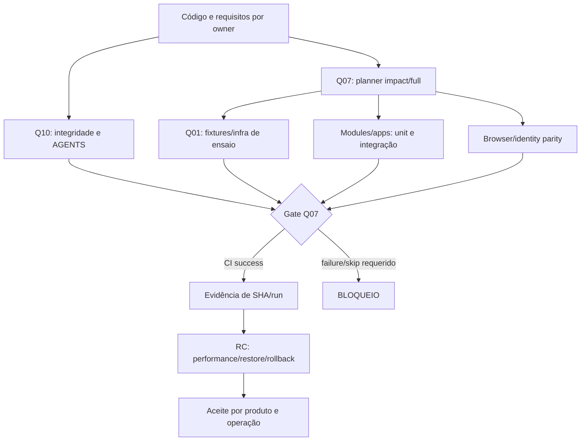

# Q01 — Plataforma de testes

[← Sumário do volume](../) · [↑ Biblioteca](../../)

> **Leitura técnica, não homologação.** Estados, limites e comprovações devem ser lidos em STATUS e nos checkpoints versionados.

## Identificação e rastreabilidade

| Campo | Fonte verificável |
|---|---|
| Unidade / owner | **Q01** · Plataforma de testes |
| Volume | Infraestrutura e qualidade |
| Caminho de implementação | `tests` |
| Documento de origem | [README](https://github.com/delmacy/syndes-system/blob/main/docs/subprojects/Q01-plataforma-de-testes/README.md) |
| STATUS e critérios | [STATUS original](https://github.com/delmacy/syndes-system/blob/main/docs/subprojects/Q01-plataforma-de-testes/STATUS.md) |
| Símbolos, APIs, SQL e dependências | [REFERENCIA-TECNICA](https://github.com/delmacy/syndes-system/blob/main/docs/subprojects/Q01-plataforma-de-testes/REFERENCIA-TECNICA.md) |
| Implantação, runbooks e gates | [OPERACAO](https://github.com/delmacy/syndes-system/blob/main/docs/subprojects/Q01-plataforma-de-testes/OPERACAO.md) |

## Situação registrada

> AUDITORIA TÉCNICA PARCIAL — FONTES ESTÁTICAS — 12/11/2026. Fontes em tests/, AGENTS.md, Test Strategy, Q07 e Q10, com checkout origin/main SHA bd0aa69349879485156ce05ffcb211904d34c206 em worktree isolada. Não foram executadas suites destrutivas de infraestrutura diretamente no DevServer. O CI central da mesma revisão passou 24/24 jobs no GitHub Actions. Dimensão Evidência comprovada Limites e gates --------- Documentação Q01 Auditoria parcial: capítulos…

A descrição acima é uma **citação resumida do STATUS versionado**; não significa que os testes de integração, a implantação ou a homologação estejam aprovados.

## Índice dos subcapítulos

Todos os assuntos deste módulo estão nesta página. Clique em um título para saltar à seção correspondente; o índice lateral acompanha a leitura.

- [Casos de uso](#casos-de-uso)
- [Histórias de usuário](#historias-de-usuario)
- [Requisitos](#requisitos)
- [Contratos públicos e privados](#contratos)
- [APIs e endpoints](#apis)
- [Eventos e mensageria](#eventos)
- [Dados e persistência](#dados)
- [Schemas e migrations](#schema)
- [Dependências e integrações](#dependencias)
- [Configuração e ambiente](#configuracao)
- [Frontend e interfaces](#interface)
- [Testes e evidências](#testes)
- [Operação e implantação](#operacao)
- [WBS e evolução](#wbs)
- [Documentação de origem integral](#documentacao-de-origem)
- [Controle de alterações](#controle-de-alteracoes)

## Casos de uso

**Editar esta seção:** [Abrir arquivo-fonte no GitHub](https://github.com/delmacy/syndes-system/edit/main/docs/subprojects/Q01-plataforma-de-testes/chapters/02-requisitos-historias-e-casos-de-uso.md) · [Consultar fonte](https://github.com/delmacy/syndes-system/blob/main/docs/subprojects/Q01-plataforma-de-testes/chapters/02-requisitos-historias-e-casos-de-uso.md)

*Referências extraídas da documentação versionada, sem inferir homologação ou implantação.*

**Lacuna documental:** ainda não há especificação textual identificada nesta área. Revisar implementação e registrar evidência antes de preencher.

📝 Espaço para ajustes e implementação

Este é um **modelo de registro**, não um editor com salvamento automático. Use o link **Editar esta seção** para atualizar o documento versionado.

- **Alteração proposta:** descreva o requisito, contrato, dado ou comportamento.
- **Referência de código:** informe caminho e símbolo real.
- **Testes e evidências:** informe comando, resultado e limite.
- **Critério de aceite:** indique como validar sem presumir homologação.
- **Status e revisão:** atualize a fonte canônica após revisão.

## Histórias de usuário

**Editar esta seção:** [Abrir arquivo-fonte no GitHub](https://github.com/delmacy/syndes-system/edit/main/docs/subprojects/Q01-plataforma-de-testes/chapters/02-requisitos-historias-e-casos-de-uso.md) · [Consultar fonte](https://github.com/delmacy/syndes-system/blob/main/docs/subprojects/Q01-plataforma-de-testes/chapters/02-requisitos-historias-e-casos-de-uso.md)

*Referências extraídas da documentação versionada, sem inferir homologação ou implantação.*

**Lacuna documental:** ainda não há especificação textual identificada nesta área. Revisar implementação e registrar evidência antes de preencher.

📝 Espaço para ajustes e implementação

Este é um **modelo de registro**, não um editor com salvamento automático. Use o link **Editar esta seção** para atualizar o documento versionado.

- **Alteração proposta:** descreva o requisito, contrato, dado ou comportamento.
- **Referência de código:** informe caminho e símbolo real.
- **Testes e evidências:** informe comando, resultado e limite.
- **Critério de aceite:** indique como validar sem presumir homologação.
- **Status e revisão:** atualize a fonte canônica após revisão.

## Requisitos

**Editar esta seção:** [Abrir arquivo-fonte no GitHub](https://github.com/delmacy/syndes-system/edit/main/docs/subprojects/Q01-plataforma-de-testes/chapters/02-requisitos-historias-e-casos-de-uso.md) · [Consultar fonte](https://github.com/delmacy/syndes-system/blob/main/docs/subprojects/Q01-plataforma-de-testes/chapters/02-requisitos-historias-e-casos-de-uso.md)

*Referências extraídas da documentação versionada, sem inferir homologação ou implantação.*

**Fonte:** [02-requisitos-historias-e-casos-de-uso.md](https://github.com/delmacy/syndes-system/blob/main/docs/subprojects/Q01-plataforma-de-testes/chapters/02-requisitos-historias-e-casos-de-uso.md)

> Linha 3: Os IDs seguintes identificam **rastreio documental de requisitos já descritos nos AGENTS e na Test Strategy**. Não criam features, gates novos nem metas numéricas adicionais.

**Fonte:** [REFERENCIA-TECNICA.md](https://github.com/delmacy/syndes-system/blob/main/docs/subprojects/Q01-plataforma-de-testes/REFERENCIA-TECNICA.md)

> Linha 41: - `tests/security`, `tests/integration` e `tests/performance` possuem neste checkout seus `AGENTS.md`, mas nenhum executor próprio nessas subpastas; cenários podem estar em outros locais e exigem matriz por requisito.

**Fonte:** [STATUS.md](https://github.com/delmacy/syndes-system/blob/main/docs/subprojects/Q01-plataforma-de-testes/STATUS.md)

> Linha 40: **Entrega desta atualização:** referência do conjunto de testes, responsabilidades, matriz de requisitos/negativas, diagrama de execução, riscos e STATUS, sem alterar código de testes de produto, CI, scripts operacionais ou ambientes.

📝 Espaço para ajustes e implementação

Este é um **modelo de registro**, não um editor com salvamento automático. Use o link **Editar esta seção** para atualizar o documento versionado.

- **Alteração proposta:** descreva o requisito, contrato, dado ou comportamento.
- **Referência de código:** informe caminho e símbolo real.
- **Testes e evidências:** informe comando, resultado e limite.
- **Critério de aceite:** indique como validar sem presumir homologação.
- **Status e revisão:** atualize a fonte canônica após revisão.

## Contratos públicos e privados

**Editar esta seção:** [Abrir arquivo-fonte no GitHub](https://github.com/delmacy/syndes-system/edit/main/docs/subprojects/Q01-plataforma-de-testes/REFERENCIA-TECNICA.md) · [Consultar fonte](https://github.com/delmacy/syndes-system/blob/main/docs/subprojects/Q01-plataforma-de-testes/REFERENCIA-TECNICA.md)

*Referências extraídas da documentação versionada, sem inferir homologação ou implantação.*

**Fonte:** [REFERENCIA-TECNICA.md](https://github.com/delmacy/syndes-system/blob/main/docs/subprojects/Q01-plataforma-de-testes/REFERENCIA-TECNICA.md)

> Linha 11: - **Owners de produto:** `modules/*/test`, `apps/*/test` e suites próprias; Q01 não absorve seus contratos.

> Linha 27: As assinaturas descritas vêm da leitura das fontes, não de um pacote Q01 exportável. Evitar copiar código de infra/módulos e apresentá-lo como biblioteca pública.

> Linha 31: **Q01 não publica endpoints HTTP, contratos OpenAPI, eventos do Event Bus, classes de domínio, exports de package ou schemas/migrations próprios**. O contrato com o CI é **executar testes e emitir exit code/resultado**, correlacionados ao SHA, job, ambiente e negativa verificada. APIs e objetos SQL testados pertencem a suas unidades de runtime.

**Fonte:** [04-contratos-e-dependencias-publicas.md](https://github.com/delmacy/syndes-system/blob/main/docs/subprojects/Q01-plataforma-de-testes/chapters/04-contratos-e-dependencias-publicas.md)

> Linha 3: **Q01 não expõe endpoints HTTP, package exports, eventos de negócio, controllers, migrations nem classes de domínio.** Seus contratos observáveis são arquivos de teste, comandos, exit codes, fixtures e resultados dos jobs executados por Q07.

> Linha 5: \| Contrato / interface \| Entrada \| Efeito observável \| Restrição \|

> Linha 25: \| Provas de produto \| **Módulos** (`modules/*/test`, `apps/*/test`) \| Links para suite, não alterar seus contratos \|

**Fonte:** [OPERACAO.md](https://github.com/delmacy/syndes-system/blob/main/docs/subprojects/Q01-plataforma-de-testes/OPERACAO.md)

> Linha 16: - [Contratos públicos](../../standards/CONTRATOS-PUBLICOS.md).

> Linha 32: 4. Testar com critérios apropriados: unitário, contrato, integração, E2E e CI.

📝 Espaço para ajustes e implementação

Este é um **modelo de registro**, não um editor com salvamento automático. Use o link **Editar esta seção** para atualizar o documento versionado.

- **Alteração proposta:** descreva o requisito, contrato, dado ou comportamento.
- **Referência de código:** informe caminho e símbolo real.
- **Testes e evidências:** informe comando, resultado e limite.
- **Critério de aceite:** indique como validar sem presumir homologação.
- **Status e revisão:** atualize a fonte canônica após revisão.

## APIs e endpoints

**Editar esta seção:** [Abrir arquivo-fonte no GitHub](https://github.com/delmacy/syndes-system/edit/main/docs/subprojects/Q01-plataforma-de-testes/REFERENCIA-TECNICA.md) · [Consultar fonte](https://github.com/delmacy/syndes-system/blob/main/docs/subprojects/Q01-plataforma-de-testes/REFERENCIA-TECNICA.md)

*Referências extraídas da documentação versionada, sem inferir homologação ou implantação.*

**Fonte:** [REFERENCIA-TECNICA.md](https://github.com/delmacy/syndes-system/blob/main/docs/subprojects/Q01-plataforma-de-testes/REFERENCIA-TECNICA.md)

> Linha 31: **Q01 não publica endpoints HTTP, contratos OpenAPI, eventos do Event Bus, classes de domínio, exports de package ou schemas/migrations próprios**. O contrato com o CI é **executar testes e emitir exit code/resultado**, correlacionados ao SHA, job, ambiente e negativa verificada. APIs e objetos SQL testados pertencem a suas unidades de runtime.

> Linha 36: - **Frontend:** Q01 não tem frontend, tela, rota ou API. Browser E2E é executado nas suites dos aplicativos Workspace, Support e Manager, sob seus respectivos owners.

**Fonte:** [04-contratos-e-dependencias-publicas.md](https://github.com/delmacy/syndes-system/blob/main/docs/subprojects/Q01-plataforma-de-testes/chapters/04-contratos-e-dependencias-publicas.md)

> Linha 3: **Q01 não expõe endpoints HTTP, package exports, eventos de negócio, controllers, migrations nem classes de domínio.** Seus contratos observáveis são arquivos de teste, comandos, exit codes, fixtures e resultados dos jobs executados por Q07.

> Linha 12: \| `tests/platform/openbao-smoke.sh` \| OpenBao CI + certificado de fixture \| Health/TLS, init/unseal e API de secretos \| **Unseal 1-of-1 é exclusivo de CI**, não exemplo de configuração produtiva \|

**Fonte:** [05-arquitetura-banco-interface-configuracao-e-diagramas.md](https://github.com/delmacy/syndes-system/blob/main/docs/subprojects/Q01-plataforma-de-testes/chapters/05-arquitetura-banco-interface-configuracao-e-diagramas.md)

> Linha 46: - Não há API ou frontend da Q01; as telas do portal servem para consultar evidência, não controlar infraestrutura ou alterar permissões.

**Fonte:** [STATUS.md](https://github.com/delmacy/syndes-system/blob/main/docs/subprojects/Q01-plataforma-de-testes/STATUS.md)

> Linha 10: \| **Implementação** \| Scripts reais em `tests/platform` e `tests/integrity`, AGENTS em integration/security/performance; testes também em modules/apps \| Sem backend/API/schema/frontend exclusivo de Q01; nem todo AGENTS tem runner \|

📝 Espaço para ajustes e implementação

Este é um **modelo de registro**, não um editor com salvamento automático. Use o link **Editar esta seção** para atualizar o documento versionado.

- **Alteração proposta:** descreva o requisito, contrato, dado ou comportamento.
- **Referência de código:** informe caminho e símbolo real.
- **Testes e evidências:** informe comando, resultado e limite.
- **Critério de aceite:** indique como validar sem presumir homologação.
- **Status e revisão:** atualize a fonte canônica após revisão.

## Eventos e mensageria

**Editar esta seção:** [Abrir arquivo-fonte no GitHub](https://github.com/delmacy/syndes-system/edit/main/docs/subprojects/Q01-plataforma-de-testes/REFERENCIA-TECNICA.md) · [Consultar fonte](https://github.com/delmacy/syndes-system/blob/main/docs/subprojects/Q01-plataforma-de-testes/REFERENCIA-TECNICA.md)

*Referências extraídas da documentação versionada, sem inferir homologação ou implantação.*

**Fonte:** [REFERENCIA-TECNICA.md](https://github.com/delmacy/syndes-system/blob/main/docs/subprojects/Q01-plataforma-de-testes/REFERENCIA-TECNICA.md)

> Linha 31: **Q01 não publica endpoints HTTP, contratos OpenAPI, eventos do Event Bus, classes de domínio, exports de package ou schemas/migrations próprios**. O contrato com o CI é **executar testes e emitir exit code/resultado**, correlacionados ao SHA, job, ambiente e negativa verificada. APIs e objetos SQL testados pertencem a suas unidades de runtime.

**Fonte:** [04-contratos-e-dependencias-publicas.md](https://github.com/delmacy/syndes-system/blob/main/docs/subprojects/Q01-plataforma-de-testes/chapters/04-contratos-e-dependencias-publicas.md)

> Linha 3: **Q01 não expõe endpoints HTTP, package exports, eventos de negócio, controllers, migrations nem classes de domínio.** Seus contratos observáveis são arquivos de teste, comandos, exit codes, fixtures e resultados dos jobs executados por Q07.

📝 Espaço para ajustes e implementação

Este é um **modelo de registro**, não um editor com salvamento automático. Use o link **Editar esta seção** para atualizar o documento versionado.

- **Alteração proposta:** descreva o requisito, contrato, dado ou comportamento.
- **Referência de código:** informe caminho e símbolo real.
- **Testes e evidências:** informe comando, resultado e limite.
- **Critério de aceite:** indique como validar sem presumir homologação.
- **Status e revisão:** atualize a fonte canônica após revisão.

## Dados e persistência

**Editar esta seção:** [Abrir arquivo-fonte no GitHub](https://github.com/delmacy/syndes-system/edit/main/docs/subprojects/Q01-plataforma-de-testes/REFERENCIA-TECNICA.md) · [Consultar fonte](https://github.com/delmacy/syndes-system/blob/main/docs/subprojects/Q01-plataforma-de-testes/REFERENCIA-TECNICA.md)

*Referências extraídas da documentação versionada, sem inferir homologação ou implantação.*

**Fonte:** [REFERENCIA-TECNICA.md](https://github.com/delmacy/syndes-system/blob/main/docs/subprojects/Q01-plataforma-de-testes/REFERENCIA-TECNICA.md)

> Linha 7: - **Test runner:** Bash, Python e Node.js ESM, com Docker Compose/containers de PostgreSQL 16/17 conforme cenário, Keycloak, OpenFGA e OpenBao descartáveis. Ferramentas e versões variam pelo job do Q07; não existe um `package.json` central em `tests/`.

> Linha 19: \| `bash tests/platform/postgres-smoke.sh` \| `tests/platform/postgres-smoke.sh` \| `pg_isready`, DB Control/Identity, roles/tenant e restore sintético \|

> Linha 33: - **Banco PostgreSQL:** `tests/platform/postgres-smoke.sh` valida múltiplos DBs/roles em fixture. `modules/service-management/test/service-funnels-pg17.test.mjs` possui seu próprio banco de ensaio sob o owner P05.

**Fonte:** [04-contratos-e-dependencias-publicas.md](https://github.com/delmacy/syndes-system/blob/main/docs/subprojects/Q01-plataforma-de-testes/chapters/04-contratos-e-dependencias-publicas.md)

> Linha 10: \| `tests/platform/postgres-smoke.sh` \| Compose PostgreSQL descartável \| DB/roles, tenant registry, dump/restore de fixture \| Testes só em ambiente CI; nenhuma mudança operacional \|

**Fonte:** [05-arquitetura-banco-interface-configuracao-e-diagramas.md](https://github.com/delmacy/syndes-system/blob/main/docs/subprojects/Q01-plataforma-de-testes/chapters/05-arquitetura-banco-interface-configuracao-e-diagramas.md)

> Linha 26: \| Ambiente \| Propósito \| Dados e isolamento \| O que não se pode concluir \|

> Linha 29: \| Teste PG17 descartável \| Persistência/roles/tenant, Serviço e migrations \| Container efêmero, portas restritas/labels, cleanup \| Migration de produção aplicada \|

> Linha 37: `Control Plane` mantém registry, roles e escopo global; cada `tenant database` é isolado. Os testes de PostgreSQL exercitam proibição de conexões indevidas e provisionamento de fixture, mas não criam dados permanentes da Q01. Os testes de OpenFGA validam grants simulados de A/B; os de Keycloak usam identidades descartáveis. **Q01 não cria database, tabela nem migration próprias.**

**Fonte:** [STATUS.md](https://github.com/delmacy/syndes-system/blob/main/docs/subprojects/Q01-plataforma-de-testes/STATUS.md)

> Linha 11: \| **Estrutura/validação local** \| Leitura/checagem de fontes, sintaxe e integridade não destrutiva realizadas nesta revisão (ver checkpoint) \| Não cria fixture de identidade ou dados de cliente \|

> Linha 22: \| DB/roles \| `postgres-smoke.sh`, `account-roles-pg-smoke.sh`, `platform-manager-postgres-smoke.sh` \| Exigir fixture, flags, negativas de acesso, cleanup e run \|

> Linha 31: 2. **Provas descartáveis versus operação real:** PostgreSQL, OpenFGA, Keycloak, OpenBao e restore testados em CI não constituem restore/rollout operacional.

> Linha 42: **Próxima unidade do plano documental:** **P14 — Platform Core**, com validação do inventário lógico de core antes de atribuir APIs, classes ou persistência.

📝 Espaço para ajustes e implementação

Este é um **modelo de registro**, não um editor com salvamento automático. Use o link **Editar esta seção** para atualizar o documento versionado.

- **Alteração proposta:** descreva o requisito, contrato, dado ou comportamento.
- **Referência de código:** informe caminho e símbolo real.
- **Testes e evidências:** informe comando, resultado e limite.
- **Critério de aceite:** indique como validar sem presumir homologação.
- **Status e revisão:** atualize a fonte canônica após revisão.

## Schemas e migrations

**Editar esta seção:** [Abrir arquivo-fonte no GitHub](https://github.com/delmacy/syndes-system/edit/main/docs/subprojects/Q01-plataforma-de-testes/REFERENCIA-TECNICA.md) · [Consultar fonte](https://github.com/delmacy/syndes-system/blob/main/docs/subprojects/Q01-plataforma-de-testes/REFERENCIA-TECNICA.md)

*Referências extraídas da documentação versionada, sem inferir homologação ou implantação.*

**Fonte:** [REFERENCIA-TECNICA.md](https://github.com/delmacy/syndes-system/blob/main/docs/subprojects/Q01-plataforma-de-testes/REFERENCIA-TECNICA.md)

> Linha 31: **Q01 não publica endpoints HTTP, contratos OpenAPI, eventos do Event Bus, classes de domínio, exports de package ou schemas/migrations próprios**. O contrato com o CI é **executar testes e emitir exit code/resultado**, correlacionados ao SHA, job, ambiente e negativa verificada. APIs e objetos SQL testados pertencem a suas unidades de runtime.

**Fonte:** [04-contratos-e-dependencias-publicas.md](https://github.com/delmacy/syndes-system/blob/main/docs/subprojects/Q01-plataforma-de-testes/chapters/04-contratos-e-dependencias-publicas.md)

> Linha 3: **Q01 não expõe endpoints HTTP, package exports, eventos de negócio, controllers, migrations nem classes de domínio.** Seus contratos observáveis são arquivos de teste, comandos, exit codes, fixtures e resultados dos jobs executados por Q07.

**Fonte:** [05-arquitetura-banco-interface-configuracao-e-diagramas.md](https://github.com/delmacy/syndes-system/blob/main/docs/subprojects/Q01-plataforma-de-testes/chapters/05-arquitetura-banco-interface-configuracao-e-diagramas.md)

> Linha 29: \| Teste PG17 descartável \| Persistência/roles/tenant, Serviço e migrations \| Container efêmero, portas restritas/labels, cleanup \| Migration de produção aplicada \|

> Linha 37: `Control Plane` mantém registry, roles e escopo global; cada `tenant database` é isolado. Os testes de PostgreSQL exercitam proibição de conexões indevidas e provisionamento de fixture, mas não criam dados permanentes da Q01. Os testes de OpenFGA validam grants simulados de A/B; os de Keycloak usam identidades descartáveis. **Q01 não cria database, tabela nem migration próprias.**

**Fonte:** [STATUS.md](https://github.com/delmacy/syndes-system/blob/main/docs/subprojects/Q01-plataforma-de-testes/STATUS.md)

> Linha 10: \| **Implementação** \| Scripts reais em `tests/platform` e `tests/integrity`, AGENTS em integration/security/performance; testes também em modules/apps \| Sem backend/API/schema/frontend exclusivo de Q01; nem todo AGENTS tem runner \|

**Fonte:** [OPERACAO.md](https://github.com/delmacy/syndes-system/blob/main/docs/subprojects/Q01-plataforma-de-testes/OPERACAO.md)

> Linha 3: > **ÍNDICE DE FONTES, NÃO RUNBOOK HOMOLOGADO.** Não executar migrations, alterar permissões ou ativar workers apenas com esta página.

> Linha 31: 3. Confirmar migrations realmente aplicadas, backup/restore e rollback antes de SQL.

📝 Espaço para ajustes e implementação

Este é um **modelo de registro**, não um editor com salvamento automático. Use o link **Editar esta seção** para atualizar o documento versionado.

- **Alteração proposta:** descreva o requisito, contrato, dado ou comportamento.
- **Referência de código:** informe caminho e símbolo real.
- **Testes e evidências:** informe comando, resultado e limite.
- **Critério de aceite:** indique como validar sem presumir homologação.
- **Status e revisão:** atualize a fonte canônica após revisão.

## Dependências e integrações

**Editar esta seção:** [Abrir arquivo-fonte no GitHub](https://github.com/delmacy/syndes-system/edit/main/docs/subprojects/Q01-plataforma-de-testes/REFERENCIA-TECNICA.md) · [Consultar fonte](https://github.com/delmacy/syndes-system/blob/main/docs/subprojects/Q01-plataforma-de-testes/REFERENCIA-TECNICA.md)

*Referências extraídas da documentação versionada, sem inferir homologação ou implantação.*

**Fonte:** [REFERENCIA-TECNICA.md](https://github.com/delmacy/syndes-system/blob/main/docs/subprojects/Q01-plataforma-de-testes/REFERENCIA-TECNICA.md)

> Linha 7: - **Test runner:** Bash, Python e Node.js ESM, com Docker Compose/containers de PostgreSQL 16/17 conforme cenário, Keycloak, OpenFGA e OpenBao descartáveis. Ferramentas e versões variam pelo job do Q07; não existe um `package.json` central em `tests/`.

> Linha 20: \| `fga()`, `check()` \| `tests/platform/openfga-smoke.sh` \| Chamadas a OpenFGA de CI e verificação allow/deny \|

> Linha 21: \| `bao_http()`, `unseal()` \| `tests/platform/openbao-smoke.sh` \| Health/TLS e lifecycle de secretos descartáveis \|

> Linha 23: \| `platform-manager-keycloak-ci.mjs` \| `tests/platform` \| Testes de realm e tokens assinados de Keycloak efêmero \|

> Linha 34: - **Autorização/identidade:** OpenFGA/Keycloak de CI testam políticas e JWT, sem se conectar ao tenant/realm operacional.

> Linha 35: - **Segredos:** OpenBao e `ci-secret-fixtures.py` usam fixture; valores não devem constar no Docs nem serem reutilizados em ambientes reais.

**Fonte:** [04-contratos-e-dependencias-publicas.md](https://github.com/delmacy/syndes-system/blob/main/docs/subprojects/Q01-plataforma-de-testes/chapters/04-contratos-e-dependencias-publicas.md)

> Linha 11: \| `tests/platform/openfga-smoke.sh` \| OpenFGA e modelo de teste \| Check allow/deny, isolamento A/B \| Store/test token descartáveis; FGA real da plataforma pertence a C04 \|

> Linha 12: \| `tests/platform/openbao-smoke.sh` \| OpenBao CI + certificado de fixture \| Health/TLS, init/unseal e API de secretos \| **Unseal 1-of-1 é exclusivo de CI**, não exemplo de configuração produtiva \|

> Linha 13: \| `tests/platform/platform-manager-keycloak-ci.mjs` \| Keycloak/realm de ensaio \| JWT assinado, audience e requests negativos \| Direct Access Grants apenas para clients descartáveis \|

> Linha 32: `testId + owner + commit SHA + comando/run + ambiente + fixture + resultado PASS/FAIL/SKIP/BLOCKED + negativos + limitações`. Se o teste depende de Keycloak/OpenFGA/PG reais, registrar se os containers eram descartáveis, assim como imagem e versão. **Não publicar a URI completa com credencial, bearer ou secret nos registros públicos.**

**Fonte:** [05-arquitetura-banco-interface-configuracao-e-diagramas.md](https://github.com/delmacy/syndes-system/blob/main/docs/subprojects/Q01-plataforma-de-testes/chapters/05-arquitetura-banco-interface-configuracao-e-diagramas.md)

> Linha 30: \| Integração de identidade \| Keycloak, OpenFGA, OpenBao, JWT/Host \| Containers CI, realms/stores e secrets de fixture \| Grants, tokens e DNS da operação \|

> Linha 37: `Control Plane` mantém registry, roles e escopo global; cada `tenant database` é isolado. Os testes de PostgreSQL exercitam proibição de conexões indevidas e provisionamento de fixture, mas não criam dados permanentes da Q01. Os testes de OpenFGA validam grants simulados de A/B; os de Keycloak usam identidades descartáveis. **Q01 não cria database, tabela nem migration próprias.**

**Fonte:** [STATUS.md](https://github.com/delmacy/syndes-system/blob/main/docs/subprojects/Q01-plataforma-de-testes/STATUS.md)

> Linha 12: \| **Integração CI central** \| [Run 43340637846](https://github.com/delmacy/syndes-system/actions/runs/43340637846) no SHA `bd0aa69349879485156ce05ffcb211904d34c206`: **24/24 jobs success**, incluindo infra, Manager, Support e Serviço \| Ambiente GitHub Actions descartável, não release de produção \|

> Linha 23: \| Keycloak/OpenFGA/OpenBao \| `platform-manager-keycloak-ci.mjs`, `openfga-smoke.sh`, `openbao-smoke.sh` \| Ambientes descartáveis e permissão/denegação testadas \|

> Linha 25: \| Diretrizes de integração/segurança \| `tests/integration/AGENTS.md`, `tests/security/AGENTS.md` \| Testes localizados nos módulos/plataforma; não declarados prontos só pelo AGENTS \|

> Linha 31: 2. **Provas descartáveis versus operação real:** PostgreSQL, OpenFGA, Keycloak, OpenBao e restore testados em CI não constituem restore/rollout operacional.

**Fonte:** [OPERACAO.md](https://github.com/delmacy/syndes-system/blob/main/docs/subprojects/Q01-plataforma-de-testes/OPERACAO.md)

> Linha 9: - [Evolução](EVOLUCAO.md): workpackages e dependências; nenhum item é concluído por estar planejado.

> Linha 32: 4. Testar com critérios apropriados: unitário, contrato, integração, E2E e CI.

📝 Espaço para ajustes e implementação

Este é um **modelo de registro**, não um editor com salvamento automático. Use o link **Editar esta seção** para atualizar o documento versionado.

- **Alteração proposta:** descreva o requisito, contrato, dado ou comportamento.
- **Referência de código:** informe caminho e símbolo real.
- **Testes e evidências:** informe comando, resultado e limite.
- **Critério de aceite:** indique como validar sem presumir homologação.
- **Status e revisão:** atualize a fonte canônica após revisão.

## Configuração e ambiente

**Editar esta seção:** [Abrir arquivo-fonte no GitHub](https://github.com/delmacy/syndes-system/edit/main/docs/subprojects/Q01-plataforma-de-testes/OPERACAO.md) · [Consultar fonte](https://github.com/delmacy/syndes-system/blob/main/docs/subprojects/Q01-plataforma-de-testes/OPERACAO.md)

*Referências extraídas da documentação versionada, sem inferir homologação ou implantação.*

**Fonte:** [REFERENCIA-TECNICA.md](https://github.com/delmacy/syndes-system/blob/main/docs/subprojects/Q01-plataforma-de-testes/REFERENCIA-TECNICA.md)

> Linha 7: - **Test runner:** Bash, Python e Node.js ESM, com Docker Compose/containers de PostgreSQL 16/17 conforme cenário, Keycloak, OpenFGA e OpenBao descartáveis. Ferramentas e versões variam pelo job do Q07; não existe um `package.json` central em `tests/`.

> Linha 22: \| `run(*args, env=None, check=True, timeout=80)` \| `tests/platform/platform-manager-network-smoke.py` \| Wrapper de execução de comandos de ensaio \|

**Fonte:** [05-arquitetura-banco-interface-configuracao-e-diagramas.md](https://github.com/delmacy/syndes-system/blob/main/docs/subprojects/Q01-plataforma-de-testes/chapters/05-arquitetura-banco-interface-configuracao-e-diagramas.md)

> Linha 41: - `infra/.env.ci` é fonte de variáveis **de teste**; não usar esse arquivo como modelo de credenciais de produção.

📝 Espaço para ajustes e implementação

Este é um **modelo de registro**, não um editor com salvamento automático. Use o link **Editar esta seção** para atualizar o documento versionado.

- **Alteração proposta:** descreva o requisito, contrato, dado ou comportamento.
- **Referência de código:** informe caminho e símbolo real.
- **Testes e evidências:** informe comando, resultado e limite.
- **Critério de aceite:** indique como validar sem presumir homologação.
- **Status e revisão:** atualize a fonte canônica após revisão.

## Frontend e interfaces

**Editar esta seção:** [Abrir arquivo-fonte no GitHub](https://github.com/delmacy/syndes-system/edit/main/docs/subprojects/Q01-plataforma-de-testes/REFERENCIA-TECNICA.md) · [Consultar fonte](https://github.com/delmacy/syndes-system/blob/main/docs/subprojects/Q01-plataforma-de-testes/REFERENCIA-TECNICA.md)

*Referências extraídas da documentação versionada, sem inferir homologação ou implantação.*

**Fonte:** [REFERENCIA-TECNICA.md](https://github.com/delmacy/syndes-system/blob/main/docs/subprojects/Q01-plataforma-de-testes/REFERENCIA-TECNICA.md)

> Linha 36: - **Frontend:** Q01 não tem frontend, tela, rota ou API. Browser E2E é executado nas suites dos aplicativos Workspace, Support e Manager, sob seus respectivos owners.

**Fonte:** [05-arquitetura-banco-interface-configuracao-e-diagramas.md](https://github.com/delmacy/syndes-system/blob/main/docs/subprojects/Q01-plataforma-de-testes/chapters/05-arquitetura-banco-interface-configuracao-e-diagramas.md)

> Linha 46: - Não há API ou frontend da Q01; as telas do portal servem para consultar evidência, não controlar infraestrutura ou alterar permissões.

**Fonte:** [STATUS.md](https://github.com/delmacy/syndes-system/blob/main/docs/subprojects/Q01-plataforma-de-testes/STATUS.md)

> Linha 10: \| **Implementação** \| Scripts reais em `tests/platform` e `tests/integrity`, AGENTS em integration/security/performance; testes também em modules/apps \| Sem backend/API/schema/frontend exclusivo de Q01; nem todo AGENTS tem runner \|

📝 Espaço para ajustes e implementação

Este é um **modelo de registro**, não um editor com salvamento automático. Use o link **Editar esta seção** para atualizar o documento versionado.

- **Alteração proposta:** descreva o requisito, contrato, dado ou comportamento.
- **Referência de código:** informe caminho e símbolo real.
- **Testes e evidências:** informe comando, resultado e limite.
- **Critério de aceite:** indique como validar sem presumir homologação.
- **Status e revisão:** atualize a fonte canônica após revisão.

## Testes e evidências

**Editar esta seção:** [Abrir arquivo-fonte no GitHub](https://github.com/delmacy/syndes-system/edit/main/docs/subprojects/Q01-plataforma-de-testes/STATUS.md) · [Consultar fonte](https://github.com/delmacy/syndes-system/blob/main/docs/subprojects/Q01-plataforma-de-testes/STATUS.md)

*Referências extraídas da documentação versionada, sem inferir homologação ou implantação.*

**Fonte:** [STATUS.md](https://github.com/delmacy/syndes-system/blob/main/docs/subprojects/Q01-plataforma-de-testes/STATUS.md)

> Linha 7: \| Dimensão \| Evidência comprovada \| Limites e gates \|

> Linha 10: \| **Implementação** \| Scripts reais em `tests/platform` e `tests/integrity`, AGENTS em integration/security/performance; testes também em modules/apps \| Sem backend/API/schema/frontend exclusivo de Q01; nem todo AGENTS tem runner \|

> Linha 13: \| **Testes de performance** \| Diretrizes `tests/performance/AGENTS.md` e Test Strategy \| Stress/spike/soak e resultados p50/p95/p99 **não verificados** \|

> Linha 15: \| **Produto/Go-live** \| Não há Product Gate atribuído à Q01 \| MVP não homologado por esta auditoria; aceite pertence aos owners \|

> Linha 19: \| Grupo \| Script/fonte identificado \| Evidência exigida além de presença \|

> Linha 25: \| Diretrizes de integração/segurança \| `tests/integration/AGENTS.md`, `tests/security/AGENTS.md` \| Testes localizados nos módulos/plataforma; não declarados prontos só pelo AGENTS \|

> Linha 34: 5. **Q10 histórico:** seu registro de falha de CI reflete SHA anterior; o [run atualizado](https://github.com/delmacy/syndes-system/actions/runs/43340637846) comprova recuperação do pipeline, mas não aprovação dos Product Gates.

> Linha 40: **Entrega desta atualização:** referência do conjunto de testes, responsabilidades, matriz de requisitos/negativas, diagrama de execução, riscos e STATUS, sem alterar código de testes de produto, CI, scripts operacionais ou ambientes.

> Linha 46: \| 2026-11-12 \| `bd0aa69349879485156ce05ffcb211904d34c206`, DevServer01/worktree isolada \| Leitura de fontes/AGENTS/estratégia e consulta do [CI verde](https://github.com/delmacy/syndes-system/actions/runs/43340637846) \| Homologação QA, performance, restore real, Product Gate \|

**Fonte:** [06-wbs-marcos-e-aceite.md](https://github.com/delmacy/syndes-system/blob/main/docs/subprojects/Q01-plataforma-de-testes/chapters/06-wbs-marcos-e-aceite.md)

> Linha 5: \| ID \| Entregável no planejamento \| Estado registrado pela WBS \| Evidência de hoje \|

> Linha 8: \| **95.01** \| Definition of Done transversal e evidência por pacote \| **PEND** \| AGENTS e matriz de critérios existem; aprovação formal por owners ainda requerida \|

> Linha 16: \| Testes de estrutura \| Execução exit 0 + SHA \| Verificação local da Q01 a registrar no STATUS após validação \|

> Linha 17: \| CI central \| Run e Gate success no SHA \| **Comprovado na baseline** `bd0aa69`, 24/24 \|

> Linha 27: - **Q01.DOC.03 (candidato):** consolidar matriz de coverage e critérios de RC com produto e operações — **pendente de evidência**.

**Fonte:** [REFERENCIA-TECNICA.md](https://github.com/delmacy/syndes-system/blob/main/docs/subprojects/Q01-plataforma-de-testes/REFERENCIA-TECNICA.md)

> Linha 3: > **AUDITORIA ESTÁTICA PARCIAL — 12/11/2026.** Checkout `origin/main` SHA `bd0aa69349879485156ce05ffcb211904d34c206`, DevServer01/worktree isolada. Q01 não é app/backend: sua fonte canônica é `tests/` e os testes executáveis do Syndes estão distribuídos pelos módulos. O [CI no SHA auditado](https://github.com/delmacy/syndes-system/actions/runs/43340637846) passou **24/24 jobs**, em ambientes de ensaio.

> Linha 8: - **Q01:** `tests/AGENTS.md`, `tests/platform/*`, `tests/integration/AGENTS.md`, `tests/security/AGENTS.md` e `tests/performance/AGENTS.md`; as subáreas de testes têm owners específicos.

> Linha 23: \| `platform-manager-keycloak-ci.mjs` \| `tests/platform` \| Testes de realm e tokens assinados de Keycloak efêmero \|

> Linha 31: **Q01 não publica endpoints HTTP, contratos OpenAPI, eventos do Event Bus, classes de domínio, exports de package ou schemas/migrations próprios**. O contrato com o CI é **executar testes e emitir exit code/resultado**, correlacionados ao SHA, job, ambiente e negativa verificada. APIs e objetos SQL testados pertencem a suas unidades de runtime.

> Linha 40: - [Estratégia de testes](../../engineering/TEST-STRATEGY.md) define unit/integration/security/RC e stress/spike/soak. Planejar 2500 tenants **não** prova suportar 2500 tenants.

**Fonte:** [OPERACAO.md](https://github.com/delmacy/syndes-system/blob/main/docs/subprojects/Q01-plataforma-de-testes/OPERACAO.md)

> Linha 7: - [STATUS](STATUS.md): nível de validação, bloqueios, testes, ambiente e SHA.

> Linha 32: 4. Testar com critérios apropriados: unitário, contrato, integração, E2E e CI.

> Linha 33: 5. Registrar resultado e evidência em STATUS, sem confundir merge com deploy ou aceite.

📝 Espaço para ajustes e implementação

Este é um **modelo de registro**, não um editor com salvamento automático. Use o link **Editar esta seção** para atualizar o documento versionado.

- **Alteração proposta:** descreva o requisito, contrato, dado ou comportamento.
- **Referência de código:** informe caminho e símbolo real.
- **Testes e evidências:** informe comando, resultado e limite.
- **Critério de aceite:** indique como validar sem presumir homologação.
- **Status e revisão:** atualize a fonte canônica após revisão.

## Operação e implantação

**Editar esta seção:** [Abrir arquivo-fonte no GitHub](https://github.com/delmacy/syndes-system/edit/main/docs/subprojects/Q01-plataforma-de-testes/OPERACAO.md) · [Consultar fonte](https://github.com/delmacy/syndes-system/blob/main/docs/subprojects/Q01-plataforma-de-testes/OPERACAO.md)

*Referências extraídas da documentação versionada, sem inferir homologação ou implantação.*

**Fonte:** [OPERACAO.md](https://github.com/delmacy/syndes-system/blob/main/docs/subprojects/Q01-plataforma-de-testes/OPERACAO.md)

> Linha 31: 3. Confirmar migrations realmente aplicadas, backup/restore e rollback antes de SQL.

> Linha 33: 5. Registrar resultado e evidência em STATUS, sem confundir merge com deploy ou aceite.

**Fonte:** [05-arquitetura-banco-interface-configuracao-e-diagramas.md](https://github.com/delmacy/syndes-system/blob/main/docs/subprojects/Q01-plataforma-de-testes/chapters/05-arquitetura-banco-interface-configuracao-e-diagramas.md)

> Linha 30: \| Integração de identidade \| Keycloak, OpenFGA, OpenBao, JWT/Host \| Containers CI, realms/stores e secrets de fixture \| Grants, tokens e DNS da operação \|

**Fonte:** [06-wbs-marcos-e-aceite.md](https://github.com/delmacy/syndes-system/blob/main/docs/subprojects/Q01-plataforma-de-testes/chapters/06-wbs-marcos-e-aceite.md)

> Linha 20: \| Backup/restore de operação \| Restore/rollback medido no ambiente-alvo, aceite \| **Não comprovado** \|

**Fonte:** [STATUS.md](https://github.com/delmacy/syndes-system/blob/main/docs/subprojects/Q01-plataforma-de-testes/STATUS.md)

> Linha 14: \| **Backup/restore e RC** \| Restore de fixture e scripts de preflight presentes no CI \| Restore de ambiente operacional, rollback e RPO/RTO **não verificados** \|

> Linha 31: 2. **Provas descartáveis versus operação real:** PostgreSQL, OpenFGA, Keycloak, OpenBao e restore testados em CI não constituem restore/rollout operacional.

> Linha 33: 4. **Performance/RC:** resultados medidos, RPO/RTO, restore, rollback e aceites de produto permanecem não comprovados.

📝 Espaço para ajustes e implementação

Este é um **modelo de registro**, não um editor com salvamento automático. Use o link **Editar esta seção** para atualizar o documento versionado.

- **Alteração proposta:** descreva o requisito, contrato, dado ou comportamento.
- **Referência de código:** informe caminho e símbolo real.
- **Testes e evidências:** informe comando, resultado e limite.
- **Critério de aceite:** indique como validar sem presumir homologação.
- **Status e revisão:** atualize a fonte canônica após revisão.

## WBS e evolução

**Editar esta seção:** [Abrir arquivo-fonte no GitHub](https://github.com/delmacy/syndes-system/edit/main/docs/subprojects/Q01-plataforma-de-testes/STATUS.md) · [Consultar fonte](https://github.com/delmacy/syndes-system/blob/main/docs/subprojects/Q01-plataforma-de-testes/STATUS.md)

*Referências extraídas da documentação versionada, sem inferir homologação ou implantação.*

**Fonte:** [STATUS.md](https://github.com/delmacy/syndes-system/blob/main/docs/subprojects/Q01-plataforma-de-testes/STATUS.md)

> Linha 9: \| **Documentação Q01** \| **Auditoria parcial**: capítulos 00–07, referencia técnica e matriz de suites/owners preenchidos \| Aprovação técnica da taxonomia e lacunas pendente \|

> Linha 38: A [EVOLUÇÃO Q01](EVOLUCAO.md) associa **00.08 (BLOQ), 95.01 (PEND) e 95.02 (PEND em outra frente)** na WBS histórica. O sucesso do Q07 não altera automaticamente essas tarefas.

> Linha 44: \| Data \| SHA/ambiente \| Método \| Pendente \|

**Fonte:** [06-wbs-marcos-e-aceite.md](https://github.com/delmacy/syndes-system/blob/main/docs/subprojects/Q01-plataforma-de-testes/chapters/06-wbs-marcos-e-aceite.md)

> Linha 3: A [EVOLUÇÃO](../EVOLUCAO.md) vincula Q01 aos workitems **00.08, 95.01 e 95.02** da [WBS mestre](../../../engineering/WBS-PROGRAMA-SYNDES-20261110.md). O vínculo é documental; não concede ownership dos pipelines nem prova a conclusão do RC.

> Linha 5: \| ID \| Entregável no planejamento \| Estado registrado pela WBS \| Evidência de hoje \|

> Linha 26: - **Q01.DOC.02 (candidato):** confirmar suites ausentes, priorizar implementação com Q02–Q09 e módulos — **pendente de revisão**.

> Linha 27: - **Q01.DOC.03 (candidato):** consolidar matriz de coverage e critérios de RC com produto e operações — **pendente de evidência**.

**Fonte:** [OPERACAO.md](https://github.com/delmacy/syndes-system/blob/main/docs/subprojects/Q01-plataforma-de-testes/OPERACAO.md)

> Linha 8: - [SPRINT](SPRINT.md): incremento autorizado e checkpoints, quando existentes.

📝 Espaço para ajustes e implementação

Este é um **modelo de registro**, não um editor com salvamento automático. Use o link **Editar esta seção** para atualizar o documento versionado.

- **Alteração proposta:** descreva o requisito, contrato, dado ou comportamento.
- **Referência de código:** informe caminho e símbolo real.
- **Testes e evidências:** informe comando, resultado e limite.
- **Critério de aceite:** indique como validar sem presumir homologação.
- **Status e revisão:** atualize a fonte canônica após revisão.

## Documentação de origem integral

Os oito assuntos canônicos são reproduzidos abaixo para permitir leitura contínua. As fontes versionadas permanecem editáveis e preservadas.

### 00 · Fontes e endereços

[Editar conteúdo original](https://github.com/delmacy/syndes-system/edit/main/docs/subprojects/Q01-plataforma-de-testes/chapters/00-enderecos-exatos-de-leitura.md) · [Abrir fonte](https://github.com/delmacy/syndes-system/blob/main/docs/subprojects/Q01-plataforma-de-testes/chapters/00-enderecos-exatos-de-leitura.md)

##### 0. Endereços exatos de leitura e evidência

**Revisão:** `origin/main` commit `bd0aa69349879485156ce05ffcb211904d34c206`, 12/11/2026, worktree isolada em DevServer01. Q01 tem o diretório `tests/` como origem canônica no [catálogo das unidades](https://github.com/delmacy/syndes-system/blob/main/catalog/work-units.json). Sua maturidade `distributed` significa **testes distribuídos, não serviço implantado**.

| Categoria | Fonte rastreável | Limite |
|---|---|---|
| Política raiz/local | `AGENTS.md`, `tests/AGENTS.md` | Define invariantes e pirâmide; regra não prova execução |
| Integração | `tests/integration/AGENTS.md` | Diretrizes e prioridade dos módulos; não confundir com suite implementada neste diretório |
| Segurança | `tests/security/AGENTS.md` | Regras de negação/tenant; os scripts executáveis estão distribuídos |
| Performance | `tests/performance/AGENTS.md` | Perfis 50→2500, spike/soak planejados; não são medições |
| Integridade | `tests/integrity/AGENTS.md`, `repository-structure.sh` | Q10 executa testes estruturais simples |
| Plataforma/ambiente | `tests/platform/*.sh`, `*.py`, `*.mjs` | Scripts de PostgreSQL, identidade, redes, Manager e Support |
| Testes por domínio | `modules/*/test`, `apps/*/test`, scripts de cada owner | Existem fora de `tests/`; owners preservados |
| Orquestrador | `.github/workflows/syndes-ci.yml`, `scripts/ci/plan.mjs`, `run-suite.sh` | Q07 planeja/executa; não é ownership exclusivo Q01 |
| Estratégia | [Test Strategy](https://github.com/delmacy/syndes-system/blob/main/docs/engineering/TEST-STRATEGY.md) | Commit/PR/RC e critérios de falha |
| Evidência do CI integrado | [Run 43340637846](https://github.com/delmacy/syndes-system/actions/runs/43340637846) | **24/24 jobs success no SHA auditado**, não valida deploy |
| WBS | [Evolução Q01](https://github.com/delmacy/syndes-system/blob/main/docs/subprojects/Q01-plataforma-de-testes/EVOLUCAO.md) e [WBS mestre](https://github.com/delmacy/syndes-system/blob/main/docs/engineering/WBS-PROGRAMA-SYNDES-20261110.md) | 00.08, 95.01 e 95.02 sem promover tarefas |

**É proibido transcrever segredos, dumps reais, dados pessoais, hostnames internos ou tokens dos testes para o site público.** Documentar comandos e nomes de fixtures, não seus valores operacionais.

### 01 · Missão e fronteiras

[Editar conteúdo original](https://github.com/delmacy/syndes-system/edit/main/docs/subprojects/Q01-plataforma-de-testes/chapters/01-missao-objetivos-e-fronteiras.md) · [Abrir fonte](https://github.com/delmacy/syndes-system/blob/main/docs/subprojects/Q01-plataforma-de-testes/chapters/01-missao-objetivos-e-fronteiras.md)

##### 1. Missão, objetivos e fronteiras da plataforma de testes

###### Missão

Fornecer diretrizes, cenários e ferramentas para comprovar **integridade, autorização, isolamento entre tenants, contratos, persistência e recuperação**, antes que produto e operação sejam declarados aceitos. Q01 é um **agrupamento de testes distribuídos**; não é servidor, módulo NestJS, banco, app React ou suíte monolítica.

| Pertence à Q01 | Não pertence à Q01 |
|---|---|
| Política geral de testes em `tests/AGENTS.md` e AGENTS específicos | Alterar regras de domínio/tenancy em CRM, Inbox ou Serviço |
| Organização dos cenários de plataforma/segurança e fixtures sintéticas | Destruir ou migrar banco operacional para produzir evidência |
| Mapear como executar e interpretar provas de PostgreSQL, OpenFGA, OpenBao, Keycloak, Manager, Support e Host | Declarar que scripts representam produção validada ou que UI oculta é autorização |
| Conferir separação de teste estrutural, integração, browser, segurança e carga | Reduzir asserts, desabilitar negações, mascarar flaky tests ou inventar percentuais |
| Exigir rastreabilidade entre SHA, ambiente, comando, resultado e gate | Assinar Product Gate, RC e aceite comercial em nome do owner |
| Tornar visíveis lacunas de implantação e cobertura | Criar um framework central de testes fictício para todas as equipes |

###### Invariantes e política existente

- `tests/AGENTS.md`: usar a prova mais barata adequada, sem remover assertions, retries ilimitados, fixtures com secrets reais, ou omitir falha de provider.
- `tests/security/AGENTS.md`: verificação **no backend** de tenant isolation, autorização, ID tampering, autenticidade/idempotência de webhook, session boundary, uploads e ferramentas de IA; uma violação cross-tenant bloqueia release.
- `tests/integration/AGENTS.md`: integração externa usa mock/fake determinístico, exercita erro/timeout, e persistência é validada em DB descartável quando existe.
- `tests/performance/AGENTS.md`: performance em ambiente separado de desenvolvimento/produção; stress por estágios, spike e soak de 2h inicialmente; nunca aceitar degradação de segurança sob carga.
- [Test Strategy](https://github.com/delmacy/syndes-system/blob/main/docs/engineering/TEST-STRATEGY.md): gate leve por commit, integração/segurança em PR, stress/restore operacional por RC. **Especificação de teste não equivale a teste realizado.**

**Fronteira técnica:** Q10 é owner de `tests/integrity`, Q07 orquestra GitHub Actions; Q01 organiza o conjunto `tests/`, sem transferir autoria de scripts, migrations ou Product Gates das unidades responsáveis.

### 02 · Requisitos e casos de uso

[Editar conteúdo original](https://github.com/delmacy/syndes-system/edit/main/docs/subprojects/Q01-plataforma-de-testes/chapters/02-requisitos-historias-e-casos-de-uso.md) · [Abrir fonte](https://github.com/delmacy/syndes-system/blob/main/docs/subprojects/Q01-plataforma-de-testes/chapters/02-requisitos-historias-e-casos-de-uso.md)

##### 2. Requisitos, histórias, casos de uso e negativas

Os IDs seguintes identificam **rastreio documental de requisitos já descritos nos AGENTS e na Test Strategy**. Não criam features, gates novos nem metas numéricas adicionais.

| Critério | Fonte | Evidência de aceite |
|---|---|---|
| Q01-R01 — Teste reproduzível | `tests/AGENTS.md` | SHA, suite, comando, ambiente, fixtures, resultado/skip/failure |
| Q01-R02 — Tenant A/B isolados | `tests/security/AGENTS.md`, `postgres-smoke.sh`, suites de módulo | Tentativas de leitura/escrita cruzadas recusadas no backend e DB |
| Q01-R03 — Autorizações negativas | `tests/security/AGENTS.md`, `openfga-smoke.sh`, suites Manager | Tokens inválidos, wrong audience, membros revogados e service down negados |
| Q01-R04 — Persistência e rollback | `tests/integration/AGENTS.md`, PostgreSQL de ensaio | Migrations idempotentes, falha com rollback, restauração sem corrupção |
| Q01-R05 — Erros de providers | `tests/integration/AGENTS.md` | Timeout, erro, repetição/duplicação além de happy path |
| Q01-R06 — Segurança de secrets | `tests/platform/ci-secret-fixtures.py`, OpenBao e rede | Env e arquivos sintéticos, ausência de exposição e TLS conforme cenário |
| Q01-R07 — Integração real de UI | Test Strategy; suites Support/Manager/Workspace | Autenticação real e isolamento por público em browser de CI |
| Q01-R08 — Performance e recovery | `tests/performance/AGENTS.md` | Medição em hardware controlado; não aprovar por plano de capacidade |
| Q01-R09 — Gates separados | `AGENTS.md`, Test Strategy, Q07/Q10 | Diferenciar local, CI, RC, rollout, operação e Product Gate |

###### Histórias de consulta

**US-Q01-01 — QA:** como responsável por qualidade, preciso saber qual suite executa a negativa de acesso de um tenant a outro e em qual ambiente foi comprovada para impedir aceite baseado somente em mock.

**US-Q01-02 — Dev:** como owner de módulo, preciso escolher teste unitário, integração e browser adequados, sem rodar containers operacionais nem remover cenários adversos quando o teste falha.

**US-Q01-03 — Operações:** como responsável por release, preciso separar ensaio descartável de backup/restore do restore efetivo do ambiente alvo, com cadeia de SHA/artefato e aprovação.

**US-Q01-04 — Gestor:** como gestor de projeto, preciso distinguir cobertura implementada de critérios planejados, vinculando WBS, CI, Product Gate e histórico sem progresso fictício.

###### Casos de uso principais

**UC-Q01-A — Alteração com fronteira tenant:** modificar no owner → teste unitário → SQL de banco descartável A/B → negação FGA/backend → CI por impacto → considerar gate de produto separadamente.

**UC-Q01-B — CI de infraestrutura:** criar fixtures sintéticas → PostgreSQL, Keycloak/OpenFGA/OpenBao e redes isoladas → testar acessos permitidos/negados, segredo e restore de fixture → limpar containers/volumes → associar run e SHA.

**UC-Q01-C — Release candidate:** recuperar histórico de testes → executar stress/spike/soak em ambiente separado → ensaio real de restore/rollback apropriado → revisar métricas e riscos → obter aprovação explícita. **A documentação não executa nem aprova essa sequência.**

###### Matriz de testes negativos

| Fronteira | Falha que deve ser demonstrada |
|---|---|
| Tenant A → B | Leitura, alteração e listagem cross-tenant rejeitadas |
| Usuário sem grant → API | Falha fechada antes de side effects |
| Identidade de Manager → Workspace | Não herdar escopo nem acessar dados privados |
| Secrets / rede | Credenciais não expostas em env/log; serviço isolado |
| Webhook/consumer | Replay/duplicação/idempotência; sem perda silenciosa |
| Migração | Falha e rollback sem estado parcial |

### 03 · Capacidades

[Editar conteúdo original](https://github.com/delmacy/syndes-system/edit/main/docs/subprojects/Q01-plataforma-de-testes/chapters/03-capabilities.md) · [Abrir fonte](https://github.com/delmacy/syndes-system/blob/main/docs/subprojects/Q01-plataforma-de-testes/chapters/03-capabilities.md)

##### 3. Capacidades existentes e lacunas

###### Inventário de fontes encontradas no checkout

| Área de teste | Caminhos presentes | Natureza observada |
|---|---|---|
| Integridade estrutural | `tests/integrity/repository-structure.sh` | Executável Bash; executa checker do catálogo; owner Q10 |
| Postgres/tenancy | `tests/platform/postgres-smoke.sh`, `account-roles-pg-smoke.sh`, `platform-manager-postgres-smoke.sh` | Smoke de DB/roles/migrações em fixtures, com salvaguardas |
| Segurança OpenFGA/OpenBao | `tests/platform/openfga-smoke.sh`, `openbao-smoke.sh` | Exercitam autorizações e secret lifecycle em ambiente de CI |
| Identity Manager | `tests/platform/platform-manager-keycloak-ci.mjs`, `platform-manager-host-gate.sh` | Keycloak de ensaio, JWT assinado e boundary do Manager |
| Redes e configuração | `tests/platform/platform-manager-network-smoke.py`, `test-manager-tailnet-route.py`, `test-manager-keycloak-redirect.py` | Redes/rotas/negativas; partes são simulações configuracionais |
| Operações Manager | `test-owner-bootstrap.py`, `test-master-secret-render.py`, `test-manager-operator-provision.py`, `test-manager-release-checkout.py` | Validações locais de provisionamento, arquivo secreto e checkout |
| Core Host / integração | `tests/platform/core-host-runtime-smoke.sh`, `support-migration-*.test.sh` | Host/identidade e migrations em disposable CI |
| Suites distribuídas dos domínios | `modules/*/test`, `apps/*/test`, scripts próprios | Coberturas efetivas pertencem ao módulo e ao CI Q07 |
| Diretórios de diretrizes | `tests/integration/AGENTS.md`, `tests/security/AGENTS.md`, `tests/performance/AGENTS.md` | **Não têm executáveis próprios nesse checkout**; cobertura mora em outros diretórios |

###### Amostra confirmada por CI de referência

No [run 43340637846](https://github.com/delmacy/syndes-system/actions/runs/43340637846), associado ao SHA `bd0aa69349879485156ce05ffcb211904d34c206`, houve **24/24 jobs success**, incluindo a regressão de infraestrutura e as paridades reais de Manager e Support. Essa evidência é do **ambiente descartável GitHub Actions**, não comprovação de instalação no DevServer/produção.

###### Planejado, não comprovado

- `tests/performance/AGENTS.md`: escada 50, 200, 500, 1000, 2500 tenants, spike, soak de 2 horas, métricas p50/p95/p99 e recuperação. **Não há resultados de benchmark nesta auditoria.**
- `tests/integration` e `tests/security` documentam princípios, mas não oferecem executáveis próprios dentro dessas pastas. Cobertura parcial deve ser investigada por contrato e owner.
- Não foram medidos RPO/RTO reais, latência alvo, throughput, custo de CI ou volume de clientes homologados.

**Não confundir:** disponibilidade de script, execução local, CI verde, instalação, restore operacional e aceite são dimensões distintas.

### 04 · Contratos e dependências

[Editar conteúdo original](https://github.com/delmacy/syndes-system/edit/main/docs/subprojects/Q01-plataforma-de-testes/chapters/04-contratos-e-dependencias-publicas.md) · [Abrir fonte](https://github.com/delmacy/syndes-system/blob/main/docs/subprojects/Q01-plataforma-de-testes/chapters/04-contratos-e-dependencias-publicas.md)

##### 4. Contratos de execução, entradas e dependências

**Q01 não expõe endpoints HTTP, package exports, eventos de negócio, controllers, migrations nem classes de domínio.** Seus contratos observáveis são arquivos de teste, comandos, exit codes, fixtures e resultados dos jobs executados por Q07.

| Contrato / interface | Entrada | Efeito observável | Restrição |
|---|---|---|---|
| `bash tests/integrity/repository-structure.sh` | Checkout versionado com AGENTS e catálogo | Check estrutural com exit code | Q10 é responsável pelo próprio script |
| `bash scripts/ci/run-suite.sh <suite>` | Identificador presente no catálogo Q07 | `npm ci` e suites, Go ou infraestrutura | Inexistente/erro deve falhar, não virar PASS |
| `scripts/ci/plan.mjs` | Paths ou modo full; markers/lockfiles | Matriz JSON de `{suite,node}` | Q07 decide seleção e gating por SHA |
| `tests/platform/postgres-smoke.sh` | Compose PostgreSQL descartável | DB/roles, tenant registry, dump/restore de fixture | Testes só em ambiente CI; nenhuma mudança operacional |
| `tests/platform/openfga-smoke.sh` | OpenFGA e modelo de teste | Check allow/deny, isolamento A/B | Store/test token descartáveis; FGA real da plataforma pertence a C04 |
| `tests/platform/openbao-smoke.sh` | OpenBao CI + certificado de fixture | Health/TLS, init/unseal e API de secretos | **Unseal 1-of-1 é exclusivo de CI**, não exemplo de configuração produtiva |
| `tests/platform/platform-manager-keycloak-ci.mjs` | Keycloak/realm de ensaio | JWT assinado, audience e requests negativos | Direct Access Grants apenas para clients descartáveis |
| `tests/platform/core-host-runtime-smoke.sh` | Containers e `GITHUB_ACTIONS/CI_RUNTIME_SMOKE` | Ready/segurança do Host de CI | Recusa execução fora de contexto de CI |
| `tests/platform/ci-secret-fixtures.py` | Arquivo `infra/.env.ci` sintético | Arquivos de segredos descartáveis | Executar apenas no runner isolado; escreve em `/run/syndes/runtime` |
| `tests/performance/AGENTS.md` | Política de carga | Metodologia proposta | **Não constitui comando de benchmark implementado** |

###### Dependências por owner

| Camada | Implementador/owner | O que a Q01 registra |
|---|---|---|
| Estrutura de repositório | **Q10** (`tests/integrity`) | Resultado de conformidade e limites |
| Matriz e execução GitHub Actions | **Q07** (`scripts/ci`, workflows) | SHA, jobs obrigatórios e artefatos |
| Scripts de plataforma | **Q01** (`tests/platform`, AGENTS do diretório raiz) | Cenários de DB, segurança, identidade e rede |
| Provas de produto | **Módulos** (`modules/*/test`, `apps/*/test`) | Links para suite, não alterar seus contratos |
| Autorização/identidade/segredos | **C03/C04/C05/Infra** | Ambiente real separado do descartável |
| RC/rollback e backup operacional | **Q08/Q09/I10/I11/Operação** | Requer evidência de restore, digest e sign-off |
| Aceite comercial/UX | **G02 e Product Gate de cada módulo** | CI é requisito, não decisão de produto |

###### Contrato de evidência mínima

`testId + owner + commit SHA + comando/run + ambiente + fixture + resultado PASS/FAIL/SKIP/BLOCKED + negativos + limitações`. Se o teste depende de Keycloak/OpenFGA/PG reais, registrar se os containers eram descartáveis, assim como imagem e versão. **Não publicar a URI completa com credencial, bearer ou secret nos registros públicos.**

Mudanças entre owners — inclusive para ampliar a cobertura — exigem revisão própria. Um resultado de teste não concede permissão de escrita em outro módulo.

### 05 · Arquitetura, dados e interfaces

[Editar conteúdo original](https://github.com/delmacy/syndes-system/edit/main/docs/subprojects/Q01-plataforma-de-testes/chapters/05-arquitetura-banco-interface-configuracao-e-diagramas.md) · [Abrir fonte](https://github.com/delmacy/syndes-system/blob/main/docs/subprojects/Q01-plataforma-de-testes/chapters/05-arquitetura-banco-interface-configuracao-e-diagramas.md)

##### 5. Arquitetura de testes, interfaces, dados e fluxos

###### Topologia lógica de prova (não topologia de produção)

**Interpretação:** Q01 dá organização às provas; não inventa um test runner central de runtime. GitHub Actions executa Q07; Q10 e módulos possuem seus próprios checks. RC e aceites são processos distintos, não jobs automaticamente disparados por esse desenho.

###### Mapa de ambientes

| Ambiente | Propósito | Dados e isolamento | O que não se pode concluir |
|---|---|---|---|
| Unit local | Testar regra e validação | Mocks, fixtures sintéticas e módulos isolados | Segurança de banco real |
| Teste PG17 descartável | Persistência/roles/tenant, Serviço e migrations | Container efêmero, portas restritas/labels, cleanup | Migration de produção aplicada |
| Integração de identidade | Keycloak, OpenFGA, OpenBao, JWT/Host | Containers CI, realms/stores e secrets de fixture | Grants, tokens e DNS da operação |
| Browser de CI | Workspace/Manager/Support conforme jobs | App/browser de ensaio e personas de teste | Homologação por usuário real |
| Performance | Stress/spike/soak **previstos** | RAM/CPU controladas, provedores mock/real separados | Capacidade provada em 2500 tenants |
| Staging/produção | Rollout, restore, smoke e suporte real | Acesso, backups e identidades operacionais | **Não auditados nesta unidade** |

###### Fronteiras de dados e fluxo

`Control Plane` mantém registry, roles e escopo global; cada `tenant database` é isolado. Os testes de PostgreSQL exercitam proibição de conexões indevidas e provisionamento de fixture, mas não criam dados permanentes da Q01. Os testes de OpenFGA validam grants simulados de A/B; os de Keycloak usam identidades descartáveis. **Q01 não cria database, tabela nem migration próprias.**

###### Configurações e riscos

- `infra/.env.ci` é fonte de variáveis **de teste**; não usar esse arquivo como modelo de credenciais de produção.
- `tests/platform/core-host-runtime-smoke.sh` verifica `GITHUB_ACTIONS=true` e `CI_RUNTIME_SMOKE=1` para recusar execução fora de CI.
- `tests/platform/ci-secret-fixtures.py` escreve arquivos sob `/run/syndes/runtime`; não executar sem contexto isolado, volume descartável e autorização.
- `run-infra.sh` instala/derruba containers e redes CI e faz cleanup; rodar diretamente no DevServer compartilhado pode interferir com redes existentes. **Esta auditoria não o executou localmente.**
- A suite de serviço `service-management` usa PG17 descartável e o CI Q07 a executou com sucesso no SHA da baseline. Isso não ativa o plugin no Host operacional.
- Não há API ou frontend da Q01; as telas do portal servem para consultar evidência, não controlar infraestrutura ou alterar permissões.

### 06 · WBS e critérios de aceite

[Editar conteúdo original](https://github.com/delmacy/syndes-system/edit/main/docs/subprojects/Q01-plataforma-de-testes/chapters/06-wbs-marcos-e-aceite.md) · [Abrir fonte](https://github.com/delmacy/syndes-system/blob/main/docs/subprojects/Q01-plataforma-de-testes/chapters/06-wbs-marcos-e-aceite.md)

##### 6. WBS, marcos de qualidade e critérios de aceite

A [EVOLUÇÃO](https://github.com/delmacy/syndes-system/blob/main/docs/subprojects/Q01-plataforma-de-testes/EVOLUCAO.md) vincula Q01 aos workitems **00.08, 95.01 e 95.02** da [WBS mestre](https://github.com/delmacy/syndes-system/blob/main/docs/engineering/WBS-PROGRAMA-SYNDES-20261110.md). O vínculo é documental; não concede ownership dos pipelines nem prova a conclusão do RC.

| ID | Entregável no planejamento | Estado registrado pela WBS | Evidência de hoje |
|---|---|---|---|
| **00.08** | Revalidar release candidate integrado | **BLOQ** no snapshot histórico | CI mainline verde no SHA `bd0aa69`, porém RC/restore operacional não foram auditados |
| **95.01** | Definition of Done transversal e evidência por pacote | **PEND** | AGENTS e matriz de critérios existem; aprovação formal por owners ainda requerida |
| **95.02** | CI integrado por impacto com negativos | **PEND (outra frente)** | Q07 confirmou [24/24 jobs success](https://github.com/delmacy/syndes-system/actions/runs/43340637846) no SHA auditado; não é aceitação de go-live |

###### Matriz do aceite de testes versus produto

| Dimensão | Quando considerar comprovada | Situação desta auditoria |
|---|---|---|
| Inventário e autoria de suites | Caminhos/owners/AGENTS encontrados e compatíveis | **Inventário estático revisado** |
| Testes de estrutura | Execução exit 0 + SHA | Verificação local da Q01 a registrar no STATUS após validação |
| CI central | Run e Gate success no SHA | **Comprovado na baseline** `bd0aa69`, 24/24 |
| Integração real de fronteiras | Runs de PG/Keycloak/OpenFGA e negativos | **Comprovados em ambiente GitHub Actions descartável**, nos cenários do run |
| Benchmarks/performance | Métricas comparáveis, hardware, stress/spike/soak | **Não comprovados** |
| Backup/restore de operação | Restore/rollback medido no ambiente-alvo, aceite | **Não comprovado** |
| Homologação do MVP | Jornada real, produto, segurança e operador aprovam | **Não comprovada** |

###### WBS documental (não é sprint nova)

- **Q01.DOC.01:** inventariar tipos de prova, executores, environments e owners — **auditoria parcial**.
- **Q01.DOC.02 (candidato):** confirmar suites ausentes, priorizar implementação com Q02–Q09 e módulos — **pendente de revisão**.
- **Q01.DOC.03 (candidato):** consolidar matriz de coverage e critérios de RC com produto e operações — **pendente de evidência**.

**Próxima unidade da sequência:** P14 — Platform Core. Os gaps de performance e aceite permanecem em Q01/Q06/Q08/Q09 e respectivos owners; não abrir benchmark ou migração nesta auditoria documental.

### 07 · Controle de escopo

[Editar conteúdo original](https://github.com/delmacy/syndes-system/edit/main/docs/subprojects/Q01-plataforma-de-testes/chapters/07-controle-do-escopo.md) · [Abrir fonte](https://github.com/delmacy/syndes-system/blob/main/docs/subprojects/Q01-plataforma-de-testes/chapters/07-controle-do-escopo.md)

##### 7. Controle de escopo, lacunas e decisões pendentes

**Esta revisão é documental.** Não adiciona testes que afetem o Host, altera migrations, habilita plugin, modifica autorização/roles nem executa fixtures que criem arquivos de segredo em serviços do DevServer compartilhado.

| Divergência / limite | Owner do encaminhamento | Situação |
|---|---|---|
| Q01 possui `tests/` mas as suites vivem também nos módulos e apps | Q01 + owners/Q07 | Registrar matriz por owner e não declarar uma biblioteca central única |
| `tests/integration`, `tests/security`, `tests/performance` têm AGENTS sem scripts próprios | Q02/Q03/Q04/Q05/Q06 + módulos | Reconciliar cobertura real; nenhuma meta numérica aprovada só pelo AGENTS |
| O CI integrado voltou a ficar verde na Q07 | Q07/Q10 | [Run 43340637846](https://github.com/delmacy/syndes-system/actions/runs/43340637846), **24/24** no SHA `bd0aa69`; estados de Q10 anteriores podem estar históricos |
| Teste PostgreSQL usa restore sintético | I10/Q08/Q09/Operação | Exigir backup, ensaio de restore e rollback realmente operacional no gate apropriado |
| `ci-secret-fixtures.py` grava em `/run/syndes/runtime` | Owner Q01/Infra | **Não executar** na estação compartilhada sem isolamento; somente CI disposable |
| `run-infra.sh` cria/remove redes e containers | Q07/Infra | Não executar no DevServer sem ambiente dedicado/autorizações |
| A suíte Serviço Basic passou em CI | P05/Q07 | Pacote ainda não está montado automaticamente no Host, sem Product Gate |
| Performance sob carga ainda é plano | Q06/Operação | Exigir medição de benchmark antes de dimensionar produção |
| Confusão entre documentação aprovada e operação | G02/Q10/owners | Registrar `NOT_RUN`, `BLOCKED`, `SKIPPED` sem reinterpretar como `PASS` |

###### Critérios para revisar ou promover a Q01

1. Responsável de QA valida o inventário, a taxonomia e a matriz de donos.
2. Gaps por domínio são ligados a suites e issues reais, com execução e evidência por SHA.
3. Ambientes descartáveis, scripts e cleanup são revalidados após mudança relevante; não tocar credenciais operacionais.
4. Processos de performance/RC/restore real recebem evidências dos seus owners, separadas do gate Q07.
5. Product Gate/Go-live continuam sujeitos a aceite explícito — não basta o run verde do GitHub.

**Sem atualização de código de produto, workflows, scripts de plataforma, bancos, permissões ou ambiente operacional nesta frente.** A auditoria da Q01 permanece **parcial** até revisão formal.

## Controle de alterações

**Este site é somente leitura.** Para alterar qualquer seção, edite o documento canônico no GitHub; a próxima publicação atualizará este livro automaticamente.

| Registro | Onde editar |
|---|---|
| Especificação e referências | [Referência técnica](https://github.com/delmacy/syndes-system/edit/main/docs/subprojects/Q01-plataforma-de-testes/REFERENCIA-TECNICA.md) |
| Estado real e bloqueios | [STATUS](https://github.com/delmacy/syndes-system/edit/main/docs/subprojects/Q01-plataforma-de-testes/STATUS.md) |
| Procedimentos e implantação | [Operação](https://github.com/delmacy/syndes-system/edit/main/docs/subprojects/Q01-plataforma-de-testes/OPERACAO.md) |
| Capítulos canônicos | [Página do módulo](https://github.com/delmacy/syndes-system/blob/main/docs/subprojects/Q01-plataforma-de-testes/README.md) |

**Registro recomendado:** data e responsável; alteração; contrato ou interface afetada; testes; impacto em dependências; evidência; revisão/aceite.

---
*Leitura experimental Starlight; a documentação canônica permanece em `docs/subprojects/`. Não inferir entrega funcional a partir de documentação presente.*
